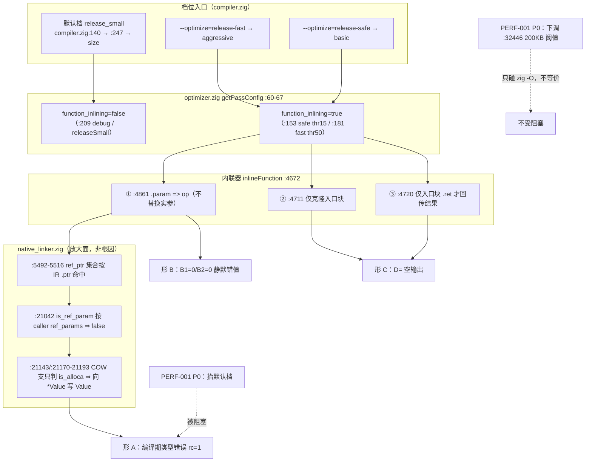
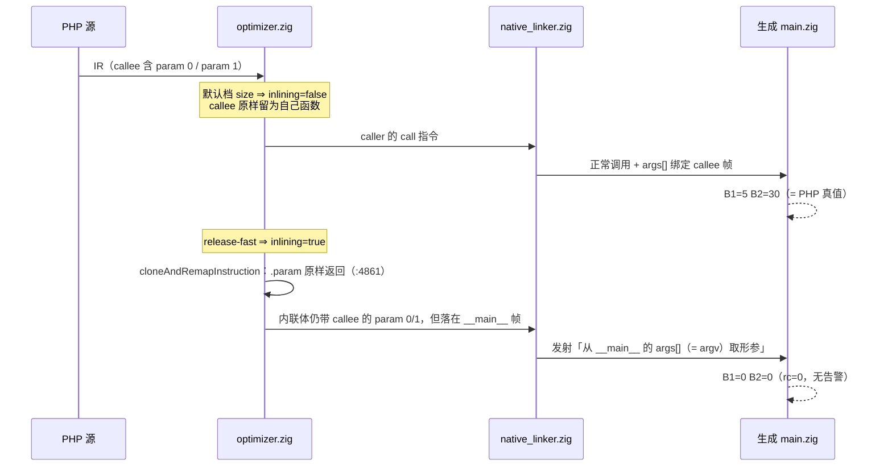
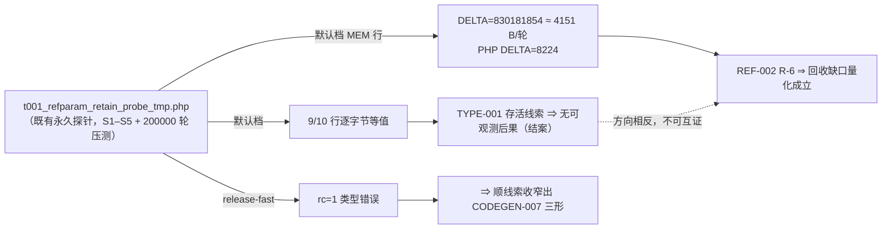
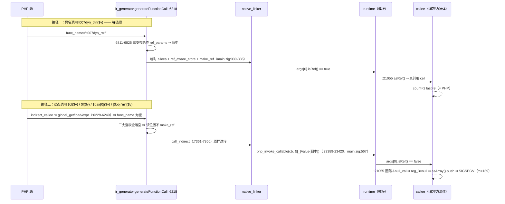

# 函数内联形参绑定丢失（新立 AOT-CODEGEN-007）与 TYPE-001 P2 结案 · 变更摘要

**日期**: 2026-10-06　**任务**: #87 → #88 → #89 → **#94**（抬档语料面四臂实测，同文档追加）　**代次**: `native_linker.zig` md5 `fbe6382a2e0904b6740d771b88c409c7`／32797 行（`git diff --numstat` = `5 4`，属 #74 纯注释批，仍未提交）；`optimizer.zig` md5 `252234ef48cb47a42e6f39d1bc3e845b`／6877 行（无 diff）；`ir_generator.zig` md5 `cb53c2da7d4fe2e1f62b728511f7c3ea`；冻结二进制 `zig-out/bin/php-interpreter` md5 `1f15e4ce9b5c9cdaaef7cabf5efb9c76`（#94 全部读数基于该二进制，实测于 `_hdr.txt` 与 `md5 -q` 双侧）

---

## 1. 高层摘要（TL;DR）

本轮**零源码改动**，做了四件事：

1. **#87 结案**：TYPE-001 遗留的「7 处裸 `reg_a = reg_b;` 是否绕过 retain」逐处实读 ⇒ **7 枚全部不需改走 `writePtrAwareAssign`**（3 枚自带 retain，4 枚属 helper 自身认可的非拥有指针拷贝／重定向口径）。判据不是「有没有 retain」，而是**目标寄存器是否拥有该值**。
2. **#88 结案**：TYPE-001 最后一条存活线索（引用参数实参初始化 `:21069` 支不 retain，与 helper `:1349` 支 retain 相左）用既有永久探针在**默认档**一次编译运行定性 ⇒ 9/10 行与 PHP 逐字节等值 ⇒ **无可观测后果，维持不改发射侧**。同批顺带拿到 REF-002 **R-6** 的量化上界（AOT ≈ **4151 B/轮** vs PHP 压测总 `8224` B）。
3. **#88 副产物 = 新立工单 [AOT-CODEGEN-007](../../known-issues/AOT-CODEGEN-007-function-inlining-param-args-lost.md)**：上条探针在 `--optimize=release-fast` 档**编译失败**，顺着报错收窄出**函数内联器（`optimizer.zig`）三形缺陷** —— `.param` 不做实参替换、只搬入口块、返回值仅在入口块终止符为 `.ret` 时回传；并**实测否证** PERF-001「抬默认档不改生成码／零漂移」的论证文本。
4. **#89 同轮追加 = 新立工单 [AOT-REF-004](../../known-issues/AOT-REF-004-dynamic-call-byref-arg-not-made.md)**：为 CODEGEN-007 §7.2 设计的默认档六形探针意外命中一枚**默认档即 SIGSEGV** 的更严重缺陷 —— 动态调用（`call_indirect`）从不装填引用形参实参 ⇒ callee 回落 `&null_val` ⇒ 按数组写入 ⇒ 段错误；四形崩、两对照形等值。同轮再以 7 形普查把该缺陷面扩到**内建回调族**（`array_walk_recursive` 丢写回 ×2、`array_map`/`array_filter`/`array_reduce` 静默错值 ×3、`usort` 崩溃 ×1），并据 PHP「按值族 vs walk 族」口径分裂导出 H/I 两条新路线。顺带把 §7.2 **结案**（非内联几何不可达）。

5. **#94 同轮追加 = 抬档语料面四臂实测（只读、零源码改动）**：给 PERF-001 的两条档位路线定价。A 臂（`--optimize=release-fast` × 68 语料）⇒ **编译失败 0，但生成码漂移 67/67、输出红 19/67**（17 枚静默错值 + `f152` SIGSEGV + `f160` exit=255）；B 臂（默认档复跑同 19 枚）⇒ **19/19 全绿** ⇒ 红面确由档造成；C 臂（默认档 + `--aot-enable-pass=inline --aot-inline-threshold=50` ⇒ 内联单变量）⇒ **仅 1/67 漂移**（`f152`），且三形标定在该旗标下**全部复现** ⇒ 66 绿是真零面而非开关失灵；D 臂（threshold 保持 releaseSmall 的 5）⇒ `f152` 生成码**与冻结基线逐字节相同** ⇒ threshold=5 时全语料零内联。收益面 = 生成码总行数 2,292,895 → 2,263,854（**−1.27%**）。⇒ **CODEGEN-007 只解释 19 枚红中的 1 枚**，抬档的真实阻塞项是另 12 枚 pass 变量。

一句话：**TYPE-001 的 P2 队列已全清；换来两枚新工单 —— CODEGEN-007（非默认档缺陷，语料内联面经实测为 1/67）与 REF-004（默认档即崩，语料面 0 但属真功能缺口）。#94 进一步把「抬默认档」路线定价为「−1.27% 行数换 67/67 重冻结 + 19/67 红」，并实测证明「下调 200KB 阈值」路线对本语料是空操作。**

---

## 2. 影响范围

| 维度 | 本轮读数 | 说明 |
|---|---|---|
| 源码 | **0 处改动** | 两枚超文件均为只读取证；numstat 仍是 #74 的 `5 4` |
| 冻结基线 68 语料 | **默认档面 = 0（两单均 0）；抬档面经 #94 实测 = 1/67（内联单变量）** | CODEGEN-007：默认档 `release_small` ⇒ `function_inlining=false` ⇒ 三形不触发；#94 C 臂（默认档 + `inline`@50）实测**只有 `f152` 一枚**生成码漂移并 SIGSEGV（新「形 D」，另记 §7.5），其余 66 枚逐字节等值。REF-004：虽默认档即崩，但实测 grep「闭包/箭头函数带 `&$` 形参」在非 `tmp/` 目录仅命中 `fail_runtime/f008_array_functional_pipeline.php`，其形态是 `array_walk` ⇒ 属等值绿的 runtime 装填路径。**两单均无需重跑默认档漂移门** |
| 十二腿门链 | **不失效** | 零插桩、零编译 ⇒ R15 收尾轮登记的 12/12 读数继续有效；#94 四臂为**独立 harness**，读的是冻结基线的比对结果，未重登记基线 |
| 待裁决队列 | **+2 条新前置；#94 为其中 1 条提供实测定价** | PERF-001 的「抬默认 `optimize_level`」路线：原记「被 CODEGEN-007 阻塞」⇒ **实测更正为「本单只解释 19 枚红形中的 1 枚」**，其真实代价是 67/67 重冻结 + 19/67 红换 −1.27% 行数（⇒ 已在 PERF-001 §4/§5/§7 建议降级为 P2）；「下调 200KB 阈值」路线**不受阻塞**，但 #94 实测该规则对语料**已 100% 命中**（最小生成码 `f040` = 278,560 bytes）⇒ 语料侧剩余收益 = 0。REF-004 是默认档真功能缺口（宪法 §七.8 前半条：PHP 能跑 ⇒ 必须修），其 P0 方案 E 跨 IR + 模板 + 运行时三处 ⇒ 排期独立 |
| 探针资产 | **+7 枚永久探针 + 3 枚永久 harness** | 探针：`t007_inline_refparam_tmp.php`／`t007_inline_byval_tmp.php`／`t007_inline_multiblock_tmp.php`（#88）＋ `t007_refparam_noninline_geom_tmp.php`／`t007_closure_byref_min_tmp.php`／`t007_dynref_shapes_tmp.php`／`t004_builtin_cb_ref_tmp.php`（#89）；连同既有 `t001_refparam_retain_probe_tmp.php`，一律勿删。harness（#94，含同名 `.tsv` 读数与 `_hdr.txt` 代次印章）：`c007_releasefast_face_tmp.sh`（A 臂）／`c007_rf_control_tmp.sh`（B 臂）／`c007_inline_only_face_tmp.sh`（C 臂），同样勿删 |
| 文档 | **2 新工单 + 4 处工单更正/结案** | CODEGEN-007、REF-004 立项；TYPE-001 汇总表 2 行 + 新章节 2 节 + 更新日志 2 条；CODEGEN-007 §5-D 降级为纯防御 + §7.2 结案 + **§3.5/§3.6/§4.1 三节实测 + §6.1 复测路径 + §7.5 形 D + 头部三处口径更正**（#94）+ 更新日志 2 条；**PERF-001 §4/§5/§7/TL;DR/§8.2 共 5 处按实测更正**（#94） |

---

## 3. 核心变更

| # | 变更 | 落点 | 性质 |
|---|---|---|---|
| C1 | P2 七枚裸拷贝逐处实读表（含 retain/release 就地证据） | `docs/known-issues/AOT-TYPE-001-fix-plan.md` §P2 逐项核对结果 | 只读核对，更正原「绕过 retain」表述 |
| C2 | helper 分支口径判据（`:1333`–`:1378` 仅 `:1352`/`:1364` 两支刻意不 retain） | 同上 | 建立可复用的判断口径 |
| C3 | `=&` 压测探针两档运行时定性 + R-6 每轮 4151 B 上界 | 同上 §P2 存活线索运行时定性 | 一次编译取两结论（retain 分歧 + R-6 量化） |
| C4 | 新立 CODEGEN-007（症状 6 读数 / 根因 5 小节 / 档位链 / PERF-001 耦合 / 4 项修复口径 / 复测路径 / 4 条遗留） | `docs/known-issues/AOT-CODEGEN-007-function-inlining-param-args-lost.md` | 工单文本，未动代码 |
| C5 | 三形永久探针 | `fuzzy_scripts_720/tmp/t007_inline_*.php` | 取证资产 |
| C6 | 记忆：新单 `project-aot-codegen007-inlining.md` + 索引行；状态单追加段落与 frontmatter 条款 | `~/.qoder/projects/.../memory/` | 跨会话口径 |
| **C7** | **CODEGEN-007 §7.2 结案**：默认档六形探针实测 ①–⑤（实例/静态方法、含默认值、混排、双引用互换）全等值 + 静态同基论证（`ref_params` 用 `func.params.items.len`、`.param` 用 `i + param_offset`，`this` 先 `addParam` ⇒ 恒等）⇒ COW 支缺 `isPointerReg` 在非内联几何下**不可达**，修复项 D 降级为纯防御 | `AOT-CODEGEN-007` §5-D／§7.2／更新日志 | 只读实测 + 工单更正 |
| **C8** | **新立 AOT-REF-004**：动态调用（`.call_indirect`）不做引用形参装填 ⇒ callee 回落 `&null_val` ⇒ 段错误；六形表（4 崩 / 2 对照等值）+ 根因到行 + 四套修复口径（E/F/G + 不建议项）+ 验收门 | `docs/known-issues/AOT-REF-004-dynamic-call-byref-arg-not-made.md` | 工单文本，未动代码 |
| **C9** | 三枚永久探针 + **`$argv` 选路法**（一形一崩的族用「单文件多形态 + `$argv[1]` 选路」⇒ 一次编译换六次运行，省 5 次编译） | `t007_refparam_noninline_geom_tmp.php`／`t007_closure_byref_min_tmp.php`／`t007_dynref_shapes_tmp.php` | 取证资产 + 方法学 |
| **C10** | **#94 三臂永久 harness**（A 抬档面／B 默认档对照／C 内联单变量 + 三形标定）：判据逐字复用官方 harness 的 `normalize_output`（`scripts/regression_test_720.sh:85-97`）与 `should_exclude`（`:76-82`），逐脚本抓 `main.zig` md5＋行数＋`build-exe` 的 `-O` 旗标，与 `baseline_main_zig_md5.tsv` 三分类（`GEN_SAME/GEN_DRIFT/NOROW`） | `fuzzy_scripts_720/tmp/c007_releasefast_face_tmp.sh`／`c007_rf_control_tmp.sh`／`c007_inline_only_face_tmp.sh`（读数 `.tsv` + `_hdr.txt` 代次印章） | 取证资产（只读，零源码改动） |
| **C11** | **#94 归因链**：A 臂 67/67 漂移 + 19/67 红 ⇒ B 臂同 19 枚默认档 19/19 绿（红由档造成）⇒ C 臂仅 1/67 漂移（`f152`）且 `rf_same=0`（无一枚脚本的抬档漂移可由内联单独复现）⇒ **18 枚红属另 12 枚 pass 变量，本单阻塞度 = 1/19**；`-O` 混杂经实测排除（语料最小生成码 278,560 bytes ⇒ 尺寸规则 100% 命中，两臂 `-OReleaseFast` 恒等） | `AOT-CODEGEN-007` §3.5／§3.6／§4.1 | 只读实测 + 工单新增三节 |
| **C12** | **#94 对 PERF-001 的实测更正落地**：§4 的合一 P0 行拆为两行（阈值下调 ⇒ 收益面语料 0；改默认值 ⇒ 标注「实测否决，建议降级 P2」并划掉「不改生成码 ⇒ 理论上零漂移」）、§5 的「预期 `diff=0`」收窄为只对阈值路线成立、§7 裁决项 1 收窄为「建议只改阈值」（锚点 `:32195`→`:32446`）、TL;DR 与 §8.2 锚点代次刷新 | `docs/known-issues/AOT-PERF-001-默认优化档位与函数级状态机回退.md` | 纯文档，按实测读数 |

---

## 4. 可视化概览

### 4.1 分层：缺陷落点与阻塞关系



### 4.2 执行流程：形 B（同脚本两档分岔）



### 4.3 业务映射：一次探针编译取两结论



### 4.4 AOT-REF-004：同一 callee，两条调用路径的命运分岔（默认档）



---

## 5. 详细变更分析

### 5.1 涉及文件

| 文件 | 动作 | 关键内容 |
|---|---|---|
| `docs/known-issues/AOT-CODEGEN-007-function-inlining-param-args-lost.md` | 新建 | §1 症状（三形 × 两档 6 组编译 + 6 组真值）｜§2 根因（2.1 `.param` 不替换 + `:4695-4701` 映射键类型错；2.2 只搬入口块；2.3 返回回传仅限入口 `.ret`；2.4 形 A 完整成因链；2.5 四条排除项）｜§3 档位链 + §3.4 语料面｜§4 PERF-001 耦合（两档 md5/行数实测）｜§5 修复口径 A/B/C/D｜§6 复测路径｜§7 遗留 4 条。**同轮追加**：§5 D 行降级为「纯防御」，§7.2 **结案**（非内联几何不可达 + 静态同基论证 + 反证排除条），更新日志 2 条 |
| `docs/known-issues/AOT-REF-004-dynamic-call-byref-arg-not-made.md` | 新建（任务 #89 同轮追加） | §1 六形实测表（2 对照等值 / 4 形 `rc=139`）｜§2 根因（G1 装填通道缺失 + G2 静默回落；`ir_generator.zig:6811-6825` 三支按名查表、`:7361-7366` `.call_indirect` 透传、`native_linker.zig:21055` `else &null_val`、生成码 `main.zig:567`/`:886-912` 逐字引用）｜§3 PHP 口径（四形均为合法按引用传参 ⇒ 禁止简化）｜§4 修复口径 E/F/G｜§5 复测路径｜§6 遗留 5 条（含 `registerFunctionMeta` 对闭包名**重复登记**的观察） |
| `docs/known-issues/AOT-TYPE-001-fix-plan.md` | 4 处编辑 | ①汇总表演变：「唯一存活线索」P2 行划除并结 case、新增「P1（新立单）→ CODEGEN-007」行；②§P2 逐项核对结果（7 枚判定表）；③§P2 存活线索运行时定性（两档表 + R-6 表 + MEM 绝对值不可比口径）；④更新日志两条（#87、#87→#88 同轮） |
| `fuzzy_scripts_720/tmp/t007_inline_refparam_tmp.php` | 新建（永久） | 形 A：`array &$a` 形参 + `$a[] = 9` |
| `fuzzy_scripts_720/tmp/t007_inline_byval_tmp.php` | 新建（永久） | 形 B：`t007_plus(int,int)` 常量实参与变量实参各一次 |
| `fuzzy_scripts_720/tmp/t007_inline_multiblock_tmp.php` | 新建（永久） | 形 C：`if` 提前 `return` + 末块 `return` |
| `src/aot/optimizer.zig` | **只读** | 内联器全链 `:4615/:4628/:4661/:4672/:4763/:4794`，缺陷点 `:4861`、`:4695-4701`、`:4711-4717`、`:4720-4743`，门不一致 `:4590-4592` vs `:4681-4682`，pass 配置 `:60-67`/`:126/:147/:175/:203`，测试锁定 `:6222/:6225/:6231` |
| `src/aot/native_linker.zig` | **只读** | `:5492-5516` ref_ptr 收集两支、`:781-797` `isPointerReg`、`:1333-1378` `writePtrAwareAssign`（`:1352`/`:1364` 刻意不 retain）、`:21042-21077` 引用参数支三分判别、`:21134-21193` 普通参数 COW 支（仅 `:21143 is_alloca` 一枚判别）、`:32446` 200KB 升档 |
| `src/aot/compiler.zig` | **只读** | `:140` 默认档、`:238/:247` 档位映射、`:610-614` IROptimizer.init、`:666` pass 覆盖、`:1016` 失败回退强制关内联 |

### 5.2 实测读数（全部为本轮实际命令产出，非推算）

| 形 | 档 | 编译 rc | AOT 输出 | PHP 真值 | 判定 |
|---|---|---|---|---|---|
| A 引用形参 | release-fast | 1 | — | `A count=3 last=9` | `main.zig:210:45: error: expected type '*runtime_lib.Value', found 'runtime_lib.Value'` |
| A | 默认 | 0 | `A count=3 last=9` | 同 | 等值 |
| B 按值形参 | release-fast | 0 | `B1=0` `B2=0` | `B1=5` `B2=30` | **静默错值** |
| B | 默认 | 0 | `B1=5` `B2=30` | 同 | 等值 |
| C 多块 callee | release-fast | 0 | `D=`（空） | `D=1 0` | **静默截断** |
| C | 默认 | 0 | `D=1 0` | 同 | 等值 |
| `=&` 五形探针 | 默认 | 0 | 9/10 行等值（`MEM_AFTER=830298919 DELTA=830181854` 按设计不参与） | `DELTA=8224` | retain 分歧无可观测后果 |
| 同上 | release-fast | 1 | `main.zig:3627:46` 同形错 2 处 | — | 归 CODEGEN-007 |
| 生成码 `main.zig`（形 B 同脚本） | 默认 | — | md5 `f7e7f303a9d01b821b540eec39686b88`／1370 行 | — | **否证 PERF-001「零漂移」** |
| 同上 | release-fast | — | md5 `722c97eb6abba8e7e4f484136300d97c`／1332 行 | — | 同上 |

### 5.3 生成码侧证据（CODEGEN-007）

保留临时目录 `.zigphp_aot_build_21087/main.zig`（已由本轮清理删除）实测：`pub fn @"__main__"`（起始 `:84`）内出现两条克隆的 `.param` 取参指令，位于 `:143`/`:148`，读的是 `args[0]`/`args[1]` 并携带 callee 源行标签（`t007_plus` 的 `:12`）；而 `@"t007_plus"(` 全文件仅出现 2 次（注册 + 反射分发），说明**两处直接调用点都已被内联替换**。

### 5.4 同轮追加实测（任务 #89，**默认档**，AOT-REF-004）

探针 `fuzzy_scripts_720/tmp/t007_dynref_shapes_tmp.php`（永久）：单文件以 `$argv[1]` 选形 ⇒ **一次编译、六次运行**，把崩溃族的取证成本压到 1 次编译（崩溃形会杀进程，逐形编译不可行）。

| 形 | 调用写法 | AOT（默认档） | PHP 真值 | 判定 |
|---|---|---|---|---|
| CTRL 具名 | `t007dyn_ctrl($v)`（`array &$a`） | rc=0 `SHAPE=ctrl_named count=2 last=9` | 同 | **等值** |
| CTRL 内建 | `array_walk($a, static function (mixed &$val, string $key))` | rc=0 `SHAPE=ctrl_walk val=10` | 同 | **等值** |
| ① 变量函数 | `$f='t007dyn_ctrl'; $f($v);` | **rc=139**（无输出） | `count=2 last=9` | **段错误** |
| ② call_user_func | `call_user_func($t007dyn_cl, $v)`（闭包值） | **rc=139**（无输出） | `Warning: Argument #1 ($a) must be passed by reference, value given` + `count=1 last=` | **崩溃 vs 告警** |
| ③ 数组可调用 | `$pair=[$t007dyn_cl]; $pair[0]($v);` | **rc=139**（无输出） | `count=2 last=42` | **段错误** |
| ④ 实例方法名 | `$f=[$this,'cbRef']; $f($a);` | **rc=139**（无输出） | `count=2 last=7` | **段错误** |
| ⑤ 闭包直调（最小化探针） | `$cl = function (array &$a) { $a[] = 42; }; $cl($v);` | 先打印 CTRL 行后 **rc=139** | 正常写回 | **段错误**（`t007_closure_byref_min_tmp.php`，永久） |

对照：同一 callee 经**具名**调用逐字节等值、经 `array_walk`（运行时已做 `make_ref`，`runtime_lib_template.zig:25569`）亦等值 ⇒ 缺陷面精确落在**动态调用装填通道**（见 §4.4 时序图）。

生成码侧（`ZIGPHP_AOT_KEEP_TEMP=1`，`.zigphp_aot_build_22277/main.zig`）：`main.zig:567` 为 `reg_27 = getGlobalVar("$cb"); ... php_invoke_callable(reg_26, &[_]runtime.Value{reg_27}, ...)` —— 实参是**值副本**、无 `make_ref`；`main.zig:886-912` 为 callee 侧 `reg_1 = if (args.len > 0 and !args[0].isMissing() and args[0].isRef()) args[0].asRef() else &null_val;` ⇒ `isRef()` 落空取 `&null_val`，随后 `reg_3.asArray().push(...)` 在空值上解引用崩溃。

编译期档位观察（同一默认 `--compile --no-debug-info` 档，非 `--optimize` 决定）：六形探针与几何探针脚本体积过 `native_linker.zig:32446` 的 200KB 阈值 ⇒ `zig build-exe -OReleaseFast`；最小闭包探针为 `-OReleaseSmall`。**两档都崩 ⇒ 与 ReleaseFast 无关，也不是内联（默认档 `function_inlining=false`）** ⇒ 与 CODEGEN-007 无因果关系，禁止互相佐证。

**§7.2（CODEGEN-007「非内联几何能否触达 COW 支缺分支」）结案读数**：几何探针 `t007_refparam_noninline_geom_tmp.php`（永久）①–⑤ 五形（方法引用形参 / 引用形参带默认值 / 静态方法引用字符串形参 / 混合形参 / 双引用交换）在默认档编译运行**全部与 PHP 逐字节等值**，唯形 ⑥（闭包 + 引用形参）崩 ⇒ 已独立立案 AOT-REF-004，**不构成对 §7.2 的反证**。

### 5.5 REF-004 同轮延伸实测：内建回调族引用装填普查（任务 #89，默认档，7 形）

新永久探针 `fuzzy_scripts_720/tmp/t004_builtin_cb_ref_tmp.php`（7 形 × `$argv[1]` ⇒ **1 次编译 + 7 次运行 + 7 次真值 + 1 次 `KEEP_TEMP` 取证**）；每个回调都声明引用形参并尝试写回。

| 形 | 内建 | PHP 真值 | AOT | 判定 |
|---|---|---|---|---|
| CTRL | `array_walk` | `a={"x":10,"y":20}` | 同 | **等值** |
| ⑧ | `array_walk_recursive`（标量叶） | `a={"x":10,"y":20}` | `a={"x":1,"y":2}` | **静默丢写回** |
| ⑨ | `array_walk_recursive`（嵌套叶） | `a={"p":[101,102],"q":[103]}` | `a={"p":[1,2],"q":[3]}` | **静默丢写回** |
| ⑩ | `array_map` | Warning + `r=[6,7]` | `r=[5,5]` | **静默错值**（`$v` 读到 null） |
| ⑪ | `array_filter` | Warning + `r={"1":2,"2":3}` | `r=[]` | **静默错值**（谓词恒 false） |
| ⑫ | `usort`（`array &$x` + `$x[]=9`） | Warning + `a=[[1],[2]]` | **`rc=139`** | **段错误**（与形 ①–⑤ 同链） |
| ⑬ | `array_reduce` | Warning + `s=3` | `s=0` | **静默错值** |

普查口径（实测）：全模板 `make_ref` 共 10 处调用，落在回调派发器内的**只有** `php_array_walk:25569`；`php_usort:22506-22534`／`php_uasort:22535-22555`／`php_uksort:22556-22576`／`php_array_map:25246-25334`／`php_array_filter:25335-25397`／`php_array_reduce:25398-25415`／`php_array_walk_recursive_inner:25583-25610`／`php_call_user_func:30409-30417`／`php_call_user_func_array:30418-30422` **均不装填**。⇒ 顺带**更正本轮早前的误读锚点**：`array_walk` 的装填点是 `:25569` 而非 `:25596`（`:25596-25598` 属 `php_array_walk_recursive_inner`，那里恰是不装填的那一处）。

**口径分裂（决定修复覆盖面）**：PHP 对 `array_map`/`array_filter`/`usort`/`array_reduce` 的回调**本就按值**（引用形参 ⇒ Warning，但形参仍拿到值）；只有 `array_walk`/`array_walk_recursive` 规范上 by-ref。⇒ 形 ⑩⑪⑬ 的错**不在装填**，而在 callee 的 `&null_val` 回落把「按值传递」变成「传递 null」；形 ⑧⑨ 才是真缺装填（`php_array_walk_recursive_inner:25598`）；形 ⑫ 与动态调用族共享同一条崩溃链（`main.zig:6075` 回落 ⇒ `:6087` `reg_5 = reg_2.*` ⇒ `:6101` `asArray().push` ⇒ SIGSEGV）。

**语料面（实测）**：逐语句窗口扫描全语料（排除 `tmp/`；7 个内建名 + `array_reduce`/`uksort`）「内建高阶函数 ∧ 回调声明引用形参」= **0 命中** ⇒ 冻结基线不覆盖本族（**未被保护的真功能缺口，非回归**）。

**新增修复路线（均属发射/模板 ⇒ 待点头）**：**H（P0）** = `native_linker.zig:21055` 回落改为「值装私有 cell」（实参存在但非 Ref ⇒ 拷值；缺失才回 `&null_val`）⇒ 一次性消掉崩溃面 + 按值族静默错值，语义即 PHP 的 value-given；**I（P1）** = `php_array_walk_recursive_inner:25598` 补 `make_ref(@constCast(entry.value_ptr))`，口径逐字对齐 `:25569`。**H 不可顶替 E**：只落 H 时形 ①③④⑤ 由崩溃变为 `count=1` 的静默丢写回，仍不等于 PHP。

### 5.6 #94 抬档语料面四臂实测（只读，给 PERF-001 定价）

本轮最后一轮为**非门控只读实测**，回答两个问题：①CODEGEN-007 三形在 release-fast 档到底命中语料几枚；②抬档本身的代价与收益各是多少。三臂 harness + 一枚门限敏感性探针，全部判据复用官方 harness 的 `normalize_output`／`should_exclude`，真值 `/opt/homebrew/bin/php`，产物名 `aot_compile_*`，逐命令 `timeout`。

**DONE 读数（`grep` 实测，非转述）**：

```bash
# fuzzy_scripts_720/tmp/c007_rf_face_tmp.tsv
RFACE_DONE total=68 gen_same=0 gen_drift=67 gen_norow=0 notemp=0 pass=48 diff=17 runtime_fail=2 compile_fail=0 skip=1
# fuzzy_scripts_720/tmp/c007_rf_control_tmp.tsv
CTRL_DONE total=19 pass=19 diff=0 runtime_fail=0 compile_fail=0
# fuzzy_scripts_720/tmp/c007_inline_only_face_tmp.tsv
INLINE_ONLY_DONE total=68 base_same=66 base_drift=1 rf_same=0 rf_diff=67 pass=66 diff=0 runtime_fail=1 compile_fail=0 skip=1
```

| 臂 | 旗标 | 回答的问题 | 实测结论 |
|---|---|---|---|
| **A** | `--optimize=release-fast` × 68 | 抬档的总体暴露 | **`compile_fail=0`**（本单形 A 的编译期硬失败在语料上**零命中**）；**生成码 67/67 漂移**（`gen_same=0` ⇒ 冻结基线须整体重登记）；**输出红 19/67** = 17 枚静默错值 DIFF + 2 枚运行失败（`f152` exit=139、`f160` exit=255）；`skip=1`（`f004`，PHP 真值侧非 0 退出，属既有排除） |
| **B** | 默认档，仅 A 臂的 19 枚红形名单 | 红是档造成还是语料本底已红 | **19/19 全绿** ⇒ 红面 100% 由档造成 |
| **C** | 默认档 + `--aot-enable-pass=inline --aot-inline-threshold=50` | 内联能否单独解释抬档暴露 | **仅 1/67 漂移**（`f152`，且症状是 SIGSEGV ⇒ 不属 §1 三形任一，另立**形 D**）；其余 66 枚逐字节等值 |
| **D** | 同上但 threshold 保持 releaseSmall 的 5 | 门限敏感性 | `f152` 的 `main.zig` = **46,376 行／`f4c41d87a3bfbb78c7ff42fff27c3d66` == 冻结基线** ⇒ threshold=5 时**全语料零内联**（`shouldInline` `optimizer.zig:4661-4671` 的单调性已论证：`max_calls` 只随 threshold 由 3 抬到 10，内联集对 threshold 单调不减） |

**C 臂灵敏度标定（关键前置，否则「66 绿」无意义）**：同一旗标下 §1 三形**全部复现** —— 形 A `rc=1`（`main.zig:215:45: error: expected type '*runtime_lib.Value', found 'runtime_lib.Value'`，与本单原记 `:210:45` 同错型、行号随档/旗标位移）、形 B `B1=0 B2=0` vs 真值 `B1=5 B2=30`、形 C `D=`（空）vs 真值 `D=1 0`。⇒ C 臂的绿是「语料里没有这个几何」的**真零面**，不是开关失灵。

**归因读数（不过度归因）**：C 臂 `rf_same=0` —— 67 枚脚本**无一枚**的 release-fast 生成码与内联单变量臂的生成码逐字节相同 ⇒ 抬档漂移**没有一处可由内联单独复现**；19 枚红形里只有 `f152` 一枚能由「只开内联」点亮，**其余 18 枚属另 12 枚 pass 变量的交互**（`releaseFast()` `optimizer.zig:175-199` 对 `releaseSmall()` `:203-222` 的唯一非等值字段共 13 枚：`function_inlining`、`inline_threshold`、`type_specialization`、`copy_propagation`、`licm`、`max_iterations`、`max_instructions_per_function`、`scalar_replacement`、`gvn`、`advanced_sccp`、`slp_vectorization`、`polyhedral_optimization`、`loop_vectorization`）。**本单对抬档的阻塞度 = 1/19**。

**`-O` 混杂排除（实测）**：`native_linker.zig:32445-32446` 的尺寸规则（`zig_code.len > 200_000 and optimize_level == .release_small` ⇒ 抬 ReleaseFast）**对全部语料命中** —— 语料最小生成码 `f040_flyweight_forest_pool` 默认档实测 **278,560 bytes／5,606 行／md5 `3c9aad342472611a6903a512a61931f3`**（本轮逐字节复验，与冻结基线等值），A/B/C 三臂抓到的 `-O` 一律 `-OReleaseFast` ⇒ 漂移与红面 **100% 归 IR pass 集**。两档唯一非 pass 差异是 `compiler.zig:645 strip_symbols = (optimize_level == .release_small)`，只影响链接期符号表。

**收益读数**：67 枚脚本生成码总行数 **2,292,895 → 2,263,854**（`awk` 实测和）⇒ **−29,041 行／−1.27%**，逐脚本 65 收缩／1 增长（`f152` +409，正是崩的那枚）／1 等行（`f026`）。**运行侧无基准数据** ⇒ 抬档的性价比按现口径无法判定为正向。

**被否证的捷径（记下以免重走）**：曾设想「行数收缩幅度」可作红/绿静态预测器 ⇒ **本轮否证**（逐脚本 `baseline − release-fast` 行数差实测）：48 枚绿形中 **38 枚**的收缩幅度超过最小红形的 17 行（`f025`），绿形最大收缩达 **1,470 行**（`f097`）；而 19 枚红形的差值横跨 **−409（`f152` 增长）到 +2,854（`f117` 收缩）** ⇒ 幅度与红/绿**无对应关系**，抬档验收只能逐脚本跑输出比对，无静态捷径。逐脚本差值合计收缩 65 枚／等行 1 枚／增长 1 枚。

**新缺陷登记（形 D，`f152_closure_arrow_higher_order`）**：`partial(callable $fn, ...$fixed)`（`f152_closure_arrow_higher_order.php:36-40`，含 spread 调用）在 threshold=50 与 release-fast 两臂均 SIGSEGV，在 threshold=5 与默认档两臂等值绿 ⇒ **崩溃由内联几何触发，但机制未取证到行** ⇒ 已写入 CODEGEN-007 §7.5，并明确**禁止与 AOT-REF-004 互为证据**（后者是「动态调用不装填引用形参」，本形是「内联后 callee 体损坏」，档位与成因都不同）。


---

## 6. 影响与风险评估

| 项 | 判断 |
|---|---|
| 是否破坏式变更 | **否**。本轮无源码改动、无基线重登记、无门链失效 |
| 影响面 | 文档 + 探针/harness 资产 + **待裁决队列的 2 条新前置**（CODEGEN-007 A/B/C/D、REF-004 E/F/G/H/I）；#94 追加 3 枚永久 harness 与 1 枚待立案「形 D」 |
| 需要特别注意的点 | ①**CODEGEN-007 是 B/C 静默错值型**（rc=0 无告警），比 A 的硬失败更危险；②**TYPE-001 今后的复测必须固定默认档**，否则会被本缺陷的编译失败掩盖（已写入该工单更新日志）；③R-6 的 4151 B/轮与 retain 判定**方向相反**，两条结论禁止互相佐证；④`MEM=` 绝对值不可比（分配器/池化不同，见 AOT-MEM-001），只有 `DELTA` 可用；⑤**抬档 19 枚红形中有 18 枚与本单无关**（#94 C 臂归因）⇒ 「落地 CODEGEN-007 方案 A 就能解锁抬档」是**误读**；⑥抬档收益**目前只有生成码行数 −1.27%，运行侧无基准数据** ⇒ 不构成正向证据 |
| REF-004 的风险定性 | **默认档即崩**（`rc=139`，硬失败、非静默），冻结语料面 = 0（唯一命中点在 `fail_runtime/f008_array_functional_pipeline.php`，走的是已 `make_ref` 的 `array_walk` 绿路径）；但它是**真功能缺口**（四种合法 PHP 按引用传参写法全部不可用），不是优化档位回归 ⇒ **不受「默认档安全」结论保护**，也不受 CODEGEN-007 门控方案影响 |
| 两单关系 | 共享同一口径缺口（**按函数名查 `ref_params` 的三支持表在动态调用下拿不到名字**），但成因、档位、症状、修复面各不相同 ⇒ **裁决与排期禁止互相替代**（CODEGEN-007 走优化器门，REF-004 走调用点装填 + 运行时元数据） |
| 与 PERF-001 的耦合 | 「抬默认档」路线**受阻塞、但只是次要阻塞项**（实测 1/19）；「下调 `:32446` 200KB 阈值」路线**不受阻塞**（只碰 `zig build-exe -O`／strip，不影响 IR pass 集）⇒ 二者不等价性 + 「抬默认档必改生成码（67/67 漂移）」的更正**本轮已实际写入 PERF-001 §4/§5/§7**（原「零漂移」论证已划掉，该路线建议降级 P2）；阈值路线另得**语料侧空操作**读数（最小生成码 278,560 bytes 已越过 200KB ⇒ 规则对 68 语料 100% 命中，剩余收益只在语料外小脚本） |
| 复测路径（体验流程） | CODEGEN-007 见其 §6（三形 × 两档）与 **§6.1（#94 四臂 harness 的逐条命令 + 期望 `RFACE_DONE`／`CTRL_DONE`／`INLINE_ONLY_DONE` 行）**；REF-004 见其 §5 与本文 §5.4 —— **崩溃族用 `$argv[1]` 选形：一次编译、N 次运行**，逐形编译在此族不可行（进程被杀）；真值 `/opt/homebrew/bin/php`，仓库根目录执行，全部 `timeout` 包裹；**四臂 harness 之间禁止并发**（每个都是全量编译，且单脚本探针也不得与批次的第 1–2 腿争编译目录） |

---

## 7. 遗留 / 潜在问题

1. ~~形 B / 形 C 在 **release-fast 档的语料面**未实测（68 语料今日仅在默认档冻结，结构上对该缺陷族**全盲**）。~~ ⇒ **结案（任务 #94 四臂实测）**：A 臂（`--optimize=release-fast` × 68）**编译失败 0**、生成码漂移 **67/67**、输出红 **19/67**（17 DIFF + 2 运行失败）；B 臂（默认档复跑同 19 枚）**19/19 绿** ⇒ 红由档造成；C 臂（默认档 + `inline`@50，内联单变量）仅 **1/67** 漂移（`f152`，SIGSEGV ⇒ 另立形 D）且三形标定全部复现 ⇒ **形 B/形 C 的抬档语料面 = 0**，形 A 的编译期硬失败语料面同样 = 0。详见本文 §5.6 与 CODEGEN-007 §3.5/§3.6。
2. ~~§2.4 第 4 步（普通参数 COW 支缺 `isPointerReg` 第三判别）在**非内联几何**下能否触达未实测。~~ **已结案（任务 #89）**：几何探针 ①–⑤ 五形默认档全部与 PHP 逐字节等值 ⇒ 非内联几何**不可达**该缺分支（静态同基论证见 CODEGEN-007 §7.2）；修复项 D 因此降级为**纯防御**。形 ⑥（闭包 + 引用形参）崩已独立立案 **AOT-REF-004**，不互为证据。
3. ~~`--pass-override` 显式打开 `function_inlining` 的路径（`main.zig:138` → `compiler.zig:666`）与本轮同源，未单独复测。~~ ⇒ **结案（任务 #94 C/D 臂）**：该通道为**纯 CLI、零源码改动**，实际旗标名是 `--aot-enable-pass=<p>`／`--aot-disable-pass=<p>`（`src/main.zig:305/:311` → `applyPassToggle` `:124-172`，pass 名 `inline`/`function-inlining`）＋ `--aot-inline-threshold=<n>`，由 `compiler.zig:662-679 applyPassOverrides` 覆盖进 `PassConfig`（14 枚可覆盖字段）。C 臂（`inline`@50）实测语料 **1/67** 漂移、D 臂（threshold 仍为 5）`f152` 生成码**与冻结基线逐字节相同** ⇒ 抬档通道与 `--optimize` 通道同源且可单变量隔离，后续归因轮可直接复用。
4. ~~PERF-001 工单文本的「抬默认档不改生成码」论证尚未在该工单内更正。~~ ⇒ **结案（任务 #94）**：已按实测在 PERF-001 侧落地 5 处更正 —— §4 的合一 P0 行拆为「阈值下调（收益面语料 0）」与「改默认值（实测否决，建议降级 P2）」两行、原「不改生成码 ⇒ 理论上零漂移」划掉并替换为「68 语料实测 67/67 漂移 + 19/67 红」、§5「预期 `diff=0`」收窄为只对阈值路线成立（默认值路线期望 `DRIFT_DONE diff=67`）、§7 裁决项 1 收窄为「建议只改阈值」（锚点 `:32195`→`:32446`）、TL;DR 与 §8.2 锚点代次刷新并附更新日志。
4b. **形 D 未取证到行**：`f152_closure_arrow_higher_order` 的 `partial(callable $fn, ...$fixed)`（`:36-40`，spread 调用）在 C 臂与 A 臂均 SIGSEGV（exit=139），在默认档与 D 臂等值绿 ⇒ 触发条件已量化为「callee 被内联 ⇒ 崩」，但**崩溃点与内联体哪一段损坏尚未取证** ⇒ 需一轮「C 臂旗标 + `KEEP_TEMP` 的 f152 生成码只读检查」。**禁止与 AOT-REF-004 互为证据**（档位、成因、修复面均不同）。
4c. **其余 18 枚抬档红形的逐 pass 归因未做**：C 臂 `rf_same=0` 已证明无一枚漂移可由内联单独复现 ⇒ 抬档的真实阻塞项分布在这 18 枚（含 `f160` exit=255 与 17 枚静默错值）与另 12 枚 pass 变量的交互中；若要再讨论「改默认档」路线，必须先做**逐 pass 二分**把每枚红形钉到具体 pass，否则定价不成立。**二分覆盖面已实读限定**（`src/main.zig:124-172 applyPassToggle` + `compiler.zig:662-679 applyPassOverrides`）：两档 13 枚差异字段中**仅 5 枚有 CLI 开关**（`inline`、`typespec`、`licm`、`max_iterations`、`inline_threshold`），**另 8 枚无开关**（`copy_propagation`、`max_instructions_per_function`、`scalar_replacement`、`gvn`、`advanced_sccp`、`slp_vectorization`、`polyhedral_optimization`、`loop_vectorization`）⇒ 5 枚全关仍红的红形，其下一步必然落到**改 `optimizer.zig`（门控项，需点头）**。
5. TYPE-001 剩余 P2：把 `t001_phi_type_mix_tmp.php` 纳入常跑探针门；其口径分歧 2（`.box` 四支分流不查 `current_ref_ptr_regs`）语料面未实测。
6. **REF-004 相关**：①② **已结案（同轮 §5.5 普查）** —— 内建回调族只有 `php_array_walk:25569` 装填，`array_map`/`array_filter`/`array_reduce`/`usort`/`uasort`/`uksort`/`array_walk_recursive`/`call_user_func*` 均不装填；标量引用形参只读**不崩但读到 null**（⇒ 静默错值），崩溃仍需「数组引用形参 + 写入」。③ **仍待裁决**：形 ②／形 ⑩⑪⑬⑫ 落地后是对齐 PHP 的 `Warning: ... must be passed by reference, value given` 还是静默按值（本工单按「对齐 PHP」写）。④ **非缺陷观察**：`registerFunctionMeta` 对闭包名**重复登记**（发射源 `native_linker.zig:2370-2377` 与 `:2381-2391` 两段循环重叠），幂等无害、可清理。⑤ **新遗留**：H 方案在引用形参入口多一次 cell 分配 + 拷贝 ⇒ **动态调用/回调热点基准未测**，落地前必须先测，禁止负向优化。
7. 用户侧待裁决队列：**#81（N1/N2 裁决后「落地」，验收九形 `same=8 differs=1`）**、**#84（R17 `ttag` 面）**、#40 REF-003、PERF-001 三项决策（**#94 已给实测建议：阈值路线语料侧为空操作 ⇒ 收益证据需语料外；抬默认值路线 67/67 漂移 + 19/67 红 ⇒ 建议放弃或降级 P2**）、REF-001 D1、REF-002 R-2/R-4/R-5/R-6（R-6 现已有实测上界）、CODEGEN-004 臂内 10 站，**新增 CODEGEN-007（A/B/C/D 取舍 **+ 形 D 是否并入本单**）与 REF-004（E/F/G/H/I 取舍，其中 H 为覆盖面最大的一条）**；#74 纯注释批（`fbe6382a`/32797）与全部新工单/探针/harness 仍**未入库**，需「提交」指令。

---

## 8. 后续开发 / 优化建议

| 优先级 | 建议 | 影响面 | 落地成本 |
|---|---|---|---|
| **P0** | CODEGEN-007 方案 **A（收窄内联门）**：`block_count == 1` ∧ 入口块终止符为 `.ret`（或 void）∧ 无引用形参 —— 把「静默错值」在门控层消灭，与默认档逐字节等价。**实测更正（#94）**：A 的价值是「非默认档正确性 + C 臂零面」，**不是解锁 PERF-001 抬档**（19 枚抬档红形只解释 1 枚） | 三形全退出内联；放弃这部分内联收益（不动 zig `-O`，PERF-001 的编译期收益不受影响）。**默认档预期零漂移**（D 臂实测 threshold=5 时语料无 callee 过内联门），抬档侧才需重登记 | 低（10 行内），但属生成码改动 ⇒ 需 68 语料漂移门 + 基线重登记评估；**需「落地」点头** |
| P1 | 方案 **B**：`.param` 的 result id 直接映射到 `args[i].id` 并丢弃该指令（`:4695-4701` 改按 result id 建表、`:4861` 改子 op 移除），逐 op 核默认值/强转/COW 语义 | 修 B 形；修不了 A/C ⇒ 须与 A 或 C 同批 | 中-高 |
| P1 | 方案 **C**：多块 callee 克隆全量块 + CFG 缝合（或干脆由 A 的门排除） | C 形 | 高（块重命名 + 寄存器跨界） |
| ~~P1~~ **已结案（#94）** | ~~release-fast 档**语料面 sweep**（68 脚本 × 非默认档），量化 CODEGEN-007 在抬档时的真实暴露~~ ⇒ 四臂 harness 已跑完并永久留存：A `gen_drift=67/67`、`diff=17`、`runtime_fail=2`、`compile_fail=0`；B `19/19` 绿；C `base_drift=1/67` 且 `rf_same=0`；D 与冻结基线逐字节等值 ⇒ **抬档定价 = 67/67 重冻结 + 19/67 红 换 −1.27% 行数**，本单阻塞度 1/19（读数见 §5.6） | 已交付 PERF-001 定价依据，并据此把「改默认值」建议降级 | 已完成（3 枚永久 harness：`c007_releasefast_face_tmp.sh`／`c007_rf_control_tmp.sh`／`c007_inline_only_face_tmp.sh`） |
| **P1** | **形 D 取证轮**（只读）：C 臂旗标 + `ZIGPHP_AOT_KEEP_TEMP=1` 编 `f152_closure_arrow_higher_order`，把 `exit=139` 钉到生成码具体站点（内联体哪一段损坏 / 哪个寄存器为空），再决定并入 CODEGEN-007 还是另立 | 决定形 D 的归属与修复面；**禁止与 REF-004 互为证据** | 低-中（1 次编译 + `main.zig` 阅读，禁与主批并发） |
| **P1** | **抬档红形的逐 pass 二分归因轮**（只读）：C 臂证明 18/19 枚红与本单无关 ⇒ 若仍要评估「改默认 `optimize_level`」，从 release-fast 档出发逐个 `--aot-disable-pass=<p>` 关掉差异字段，把每枚红形钉到单枚 pass。**覆盖面已实读限定**：`applyPassToggle`（`src/main.zig:124-172`）+ `applyPassOverrides`（`compiler.zig:662-679`）只暴露 11 枚 pass 字段 + `inline_threshold`/`unroll_factor`/`max_iterations` ⇒ 两档 13 枚差异字段中**仅 5 枚可 CLI 关闭**（`inline`、`typespec`、`licm`、`max_iterations`、`inline_threshold`）；**另 8 枚无 CLI 开关**（`copy_propagation`、`max_instructions_per_function`、`scalar_replacement`、`gvn`、`advanced_sccp`、`slp_vectorization`、`polyhedral_optimization`、`loop_vectorization`）⇒ 若某枚红形在 5 枚全关后仍红，其成因必在另 8 枚之内，**下一步就是改 `optimizer.zig`（门控，需点头）** | 决定抬档路线能否被「修某几枚 pass」解锁，或彻底放弃；同时量化 CLI 通道能否承担归因职责 | 低-中（先做 1–2 枚红形定点二分：每枚 ≤6 次编译，禁与主批并发；全量 68 × 6 轮成本过高，不建议） |
| P2 | 方案 **D**：COW 支补 `isPointerReg` 第三判别，把「非法几何」变成「合法发射或显式报错」 | **默认档命中面已实测不可达**（§7 第 2 条）⇒ 纯防御性，非缺陷修复 | 低-中（发射侧 ⇒ 需漂移门） |
| **P0** | REF-004 方案 **E**：**调用点装填** —— 动态调用（`.call_indirect` / `php_invoke_callable` / `php_call_user_func`）对**plain variable** 实参按 callee 引用位图执行 `make_ref`；位图落点复用既有铺好的通道（`PHPClosure` 增字段 + `php_create_closure:3247-3253` 已在读的 `function_meta_registry`，`registerFunctionMeta` 扩一枚掩码参数） | 使四形崩溃退出；写回真实生效 ⇒ 闭包/变量函数/数组可调用/`[$obj,'m']` 的引用语义与 PHP 一致。**必须在调用点侧**：`getGlobalVar` 已复制值，运行时再包装无法找回 caller 存储 | 中（跨 IR + 运行时模板 ⇒ 需漂移门 + 动态调用热路径**性能复测**，禁止负向优化）；**需「落地」点头** |
| P1 | REF-004 方案 **F**：`$cl = function (...) {...}` 这类**静态可解析**的闭包变量直调回退到具名/已知 callee 路径（复用 `:6811-6825` 的三支查表） | 只覆盖形 ⑤（及部分形 ③），形 ① 变量函数名不可覆盖 ⇒ **E 仍是必要条件**；门必须保守（值来源唯一且可证） | 低（IR 侧收窄判定），但属生成码改动 |
| P2 | REF-004 方案 **G**：兜底 —— 动态调用遇引用形参时分配临时私有 cell（写回丢失但不崩）或显式发 `Warning: ... must be passed by reference, value given` | 把 `rc=139` 降级为可诊断行为；**只能作为 E/F 排期前的兜底，不可当修复结案** | 低-中（含口径裁决：是否对齐 PHP Warning） |
| **P0** | REF-004 方案 **H**：callee 引用形参的 `&null_val` 回落改为「实参存在但非 Ref ⇒ 值装私有 cell，缺失才回 null」（`native_linker.zig:21055`，三分判别对照 `:21068-21074`） | **一次消掉崩溃面（形 ⑫ + 形 ①–⑤ 的 `rc=139`）与按值族静默错值（形 ⑩⑪⑬）**；语义即 PHP 的 value-given。**不可顶替 E**（只落 H 时形 ①③④⑤ 变为静默丢写回） | 中：引用形参入口多一次 cell 分配 + 拷贝 ⇒ **必须先做动态调用/回调热点基准**，禁止负向优化；发射侧 ⇒ 需漂移门；**需「落地」点头** |
| P1 | REF-004 方案 **I**：`php_array_walk_recursive_inner:25598` 补 `args_buf[0] = try make_ref(@constCast(entry.value_ptr), allocator)`，口径逐字对齐 `:25569`（含 R-1b「装槽而非锚容器槽」理由） | 形 ⑧⑨（PHP 规范要求的写回语义） | 低（单点 + 同族先例）；需核子容器装槽后的生命周期（`:25589` 递归传 `value.asArray()`）；模板改动 ⇒ **需点头且不在批内编辑模板** |
| P2 | 非门控后续实测：**H 落地前的热点基准** —— 以 `array_map`/`usort`/`array_walk` 组与动态调用组为基准，量出「引用形参入口 + 一次 cell 分配拷贝」的开销上界，再决定 H 是否需要按「callee 是否只读该形参」收窄 | 决定 H 的落地形态（全量 or 收窄） | 低-中（基准脚本 + 2 次编译，禁与主批并发） |
| P2 | 在 `optimizer.zig` 加一枚**内联后不变式断言**（内联体不得残留 `.param`、callee 块数与克隆块数必须相等），作为金丝雀在 debug 档编译期即失败 | 把 B/C 的静默错值提前到编译期 | 低 |
| ~~P2~~ **已结案（#94）** | ~~在 PERF-001 §8 表把「抬默认档」的前置改为「CODEGEN-007 方案 A 已落地」，并记下两档 md5 实测对~~ ⇒ 实际落地比该文本更强：**已按实测在该工单内更正 5 处**（§4 两行拆分、§5 期望 `diff=0` 收窄、§7 裁决项 1 收窄为「建议只改阈值」并把阈值锚点刷新为 `:32446`、TL;DR 补实测边界、§8.2.1 单锚点复验记录位移 +134）；抬档两档 md5 对与 67/67 漂移读数均已入该工单更新日志。**该路线现建议降级为 P2（实测否决）**，不再以「CODEGEN-007 方案 A 落地」为解锁条件 | 口径一致性 | 低（纯文档，已完成） |

---

**本轮产出**：**2 枚新工单**（CODEGEN-007 仅非默认档；REF-004 默认档即崩，症状面按实测计数 = **段错误 6 形**（变量函数／`call_user_func`／数组下标 callable／`[$obj,'m']`／闭包直调／`usort`）+ **静默错值或丢写回 5 形**（`array_walk_recursive` ×2、`array_map`、`array_filter`、`array_reduce`）+ **等值对照 3 形**（具名直调、`array_walk` ×2 枚探针各一次），分属「动态调用」与「内建回调」两条探针族，修复路线 E/F/G **+ H/I**）、TYPE-001 4 处更正（P2 队列全清 + R-6 上界）、CODEGEN-007 §7.2 **结案**（发射项 D 降级为纯防御）、**7 枚永久探针**、1 份变更文档 + 1 份记忆新单 + 2 处记忆更新、任务 #87/#88/#89 全部闭环；**同轮追加任务 #94 = 抬档语料面四臂实测**：**3 枚永久 harness**（A/B/C）+ D 臂定点探针 + 三形标定、CODEGEN-007 新增 **§3.5／§3.6／§4.1／§6.1／§7.5（形 D 立案）** 与头部 3 处口径更正、PERF-001 **5 处按实测更正**（抬默认档 ⇒ 建议降级 P2、阈值路线 ⇒ 语料侧空操作）、§7 遗留 1/3/4 条**结案**、否证「行数差作红绿预测器」这一捷径、抬档定价 **67/67 重冻结 + 19/67 红 换 −1.27% 行数（−29,041/2,292,895）**；**零源码改动**（`native_linker.zig` 仍为 `fbe6382a`/32797，`git diff --numstat` = `5 4` 系 #74 纯注释批；`optimizer.zig`/`ir_generator.zig`/`runtime_lib_template.zig` 未改；冻结二进制 md5 `1f15e4ce9b5c9cdaaef7cabf5efb9c76` 全程未重建），本轮全部临时编译目录与 `/tmp` 产物已清理（**`.php` 源、永久探针与 harness 一律保留**）。
