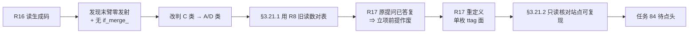
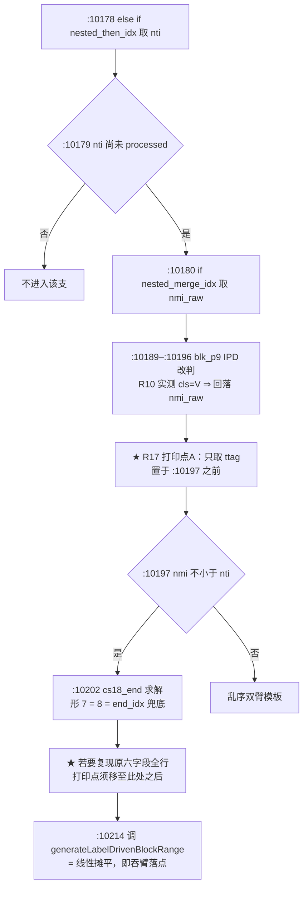
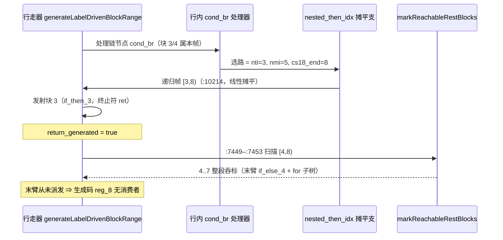

# 形 7 生成码复证与 R17 立项前提复算（AOT-CODEGEN-006 R16 + §3.21.1 + §3.21.2）

**日期**: 2026-10-06
**代次**: `fbe6382a2e0904b6740d771b88c409c7` / 32797 行（= #74 纯注释锚点批工作区代次，本文档所述三轮**未产生新代次**）
**任务**: #83（R16）· #84（R17，待点头）· #85（R17 开轮前置只读核对）
**性质**: 零插桩、零编译、零源码改动的只读取证 + 复算 + 前置核对；全部结论落工单，本文件为变更摘要。

---

## 1. 高层摘要（TL;DR）

十轮同层试错之后，本轮**不再造判据，而是回头读已有读数**，得到三条结果：

1. **R16（#83）**：直接读形 7 的生成码与 IR，本工单 §3.10 对形 7 的诊断**被推翻** —— 形 7 不是「臂守卫坍缩后跑错臂」，而是**二级 `cond_br` 的终止符从未派发 + 末臂整棵子树未发射**；且 IR 普查证明该链**根本没有 `if_merge_` 块**（13 支探针里唯一）⇒ `merge_bi`/IPD/`defer`/`lfi` 机制族对形 7 **原理上无对象**，故本单为形 9 准备的 §4.7 成对候选**永不覆盖形 7**（与 R15 该形 `[R15-X]` = 0 相互独立复证）。形 7 由 C 类**改判 A/D 类（缺失派发）**。
2. **§3.21.1**：写 R17 提案前先把 R8/R8.1 的逐字读数与 R16 的生成码证据对表 ⇒ R17 的原提问（「五枚内联发射站点中哪一处吞掉了它」）**在 R8 就已被答复**：形 7 的帧走的是 `nested_then_idx` 兜底**线性摊平**，块 3 的 `ret` 冒泡触发行走器头部的 `markReachableRestBlocks` 整段吞标。若照原口径开轮 = 第十一次同层浪费。**该立项前提作废。**
3. **§3.21.2（#85）**：R17 重定义为「单枚 `ttag` 面」窄探针轮后，其唯一开轮前置（站点在当代次能否复现原读数）以**读源码**方式当场完成，并用 `git blame` 实证站点未迁移 ⇒ 老铁点头后可直接插桩。

**净效果**：形 7 从「无解的静态判据问题」变成「站点已知、机制已解释、只差一枚字段面实测的取证问题」；形 9 的路线不受影响（仍等「落地」）。

---

## 2. 影响范围

| 维度 | 本轮影响 | 量化证据 |
|---|---|---|
| 编译器发射侧代码 | **零影响** | `md5` 仍 `fbe6382a…`、`wc -l` = 32797、`git diff --numstat` = `5 4`（#74 纯注释批原样）、残留 grep = 0 |
| 生成码 / 语料 | **零影响**（未重新编译任何脚本） | 无新产物；上轮十二腿门链读数仍有效 |
| 工单口径 | **一处诊断被推翻 + 一节新增 + 两节更正** | §3.21（R16 三条实测）、§3.21.1（R17 前提复算）、§3.21.2（前置核对）、§3.10 ⚠ 更正、§7 a)/a′) 重写、状态行末尾刷新 |
| 任务台账 | 形 7 的下一步唯一合法动作收窄为一轮探针 | #83 完成、#85 完成、#84 范围重写（前置已清） |
| 分类学 | 形 7 的类别归属变更，影响后续修法选型 | C 类（臂互斥丧失）→ **A/D 类（缺失派发）** |
| 覆盖面 | 仅形 7 一形 | 形 9 = §4.7 候选在途；形 4 已绿（R9-B） |

---

## 3. 核心变更

| # | 变更 | 类型 | 依据（实测/推导，逐字标注） |
|---|---|---|---|
| C1 | 形 7 症状改记：二级 `cond_br` 终止符从未派发（`reg_8` 只有计算与 `release`，无消费者）+ 末臂 `[if_else_4, for_cond_7, for_body_8, for_exit_10]` 整体未发射 | 诊断更正 | **实测**（KEEP_TEMP `main.zig` + `--dump-ir`，链干净二进制 `fbe6382a`） |
| C2 | 形 7 无 `if_merge_` 块 ⇒ `merge_bi`/IPD/`defer`/`lfi` 无对象 | 结构事实 | **实测**（13 支探针块标签普查：唯此形 = 0，余 12 支 = 1） |
| C3 | R17 原口径作废：吞掉者是 `nested_then_idx` 兜底线性摊平 + `ret` 冒泡 `markReachableRestBlocks`（`:7449–:7453`），非五枚内联发射器 | 前提复算 | **实测**（R8 `S09I`/R8.1 `S09N` 形 7 行 `ttag=ret ttgt=99999 nti=3 nei=4 cs18_end=8 end=8`）与 C1 三条生成码事实互洽 |
| C4 | R17 重定义 = 单枚 `ttag` 面探针轮，候选 `R8-a 四条件 ∧ ttag=ret` | 立项重写 | `ttag` **从未**进入 R8.1/R10/R11 任何合取（字段集比对）；语料面 **未知**（R8.1 原始日志已按产物规约删除 ⇒ 禁止外推） |
| C5 | R17 开轮前置完成：站点当代次行号与字段可绑定性登记 | 前置核对 | **实测**（实文逐行 + `git blame`）；形 7 的 `nmi` 改判后仍 = 5 属**推导**（R10 该链节点 `cls=V` ⇒ `blk_p9` 回落 `nmi_raw`），须开轮实读复证 |
| C6 | 记忆同步：R16 段 + §3.21.1/§3.21.2 段 + 索引两行 + 「How to apply」改写为「无在途轮、两项 gated」 | 台账 | 与工单逐字对齐 |

---

## 4. 可视化概览（Code & Logic Map）

### 4.1 分层架构

```mermaid
graph TB
  subgraph L1[PHP 源层]
    A[c006_tl_fncontext_loop_tmp.php<br/>elseif 链 + 臂内含循环 + 函数上下文]
  end
  subgraph L2[IR 层]
    B[cond_br 链节点 + 臂块<br/>实测：该链无 if_merge_ 块]
  end
  subgraph L3[发射层 native_linker.zig]
    C[generateLabelDrivenBlockRange<br/>行内 cond_br 处理器]
    D[nested_then_idx 兜底摊平支<br/>:10178 / :10197 / :10202 / :10214]
    E[行走器头部不可达扫描<br/>markReachableRestBlocks :7449–:7453]
  end
  subgraph L4[生成码层]
    F[main.zig：二级条件寄存器算出即释放<br/>末臂子树缺失]
  end
  A --> B --> C --> D --> F
  D -.帧内先发射块 3 = ret.-> E
  E -.整段吞标 4..7.-> F
```

### 4.2 本轮取证业务流程



### 4.3 站点执行流程（R17 打印点）



### 4.4 时序图（发射侧，形 7 实测路径）



---

## 5. 详细变更分析

### 5.1 涉及文件

| 文件 | 层 | 变更 |
|---|---|---|
| `src/aot/native_linker.zig` | 编译器发射层 | **无**（实测：md5 未变、numstat 仍 `5 4`、探针残留 grep = 0） |
| `docs/known-issues/AOT-CODEGEN-006-elseif-chain-arm-loop-lost.md` | 工单 | 新增 §3.21.1、§3.21.2；重写 §7 a)/a′) 单元格；状态行末尾刷新 R16/§3.21.1/§3.21.2 |
| `docs/changes/2026-10-06/形7生成码复证与R17立项复算_CODEGEN-006R16_2026-10-06_fbe6382a.md` | 变更文档 | 本文件（新建） |
| `memory/project-aot-codegen006-recorder-lead.md` | 记忆 | R16 段、§3.21.1/§3.21.2 段、frontmatter description、How to apply |
| `memory/project-aot-status-2026-09.md` | 记忆 | R16 段末尾 R17 口径更正 |
| `memory/MEMORY.md` | 记忆索引 | 两行索引更新 |

### 5.2 关键读数与代码映射（逐字）

```text
R8  S09I 形 7 : src=entry nti=3(if_then_3) nelse=if_else_4 nmi=5(for_cond_7) cs18_end=8 end=8 tproc=0 eproc=0 nloop=1
R8.1 S09N 形 7 : src=entry nti=3 nei=4 nmi=5 cs18_end=8 end=8 ttag=ret ttgt=99999 etag=br etgt=5 narm=2
R8-a 语料面    : f067 ttag=br ttgt=9 / f067 ttag=br ttgt=5        ⇒ 与形 7 在 ttag 上不同值
R16 生成码     : main.zig :159 reg_8 = php_identical(...)（无消费者，仅 :175 release）
                 :163 二级 then 臂无条件内联；末臂四块零发射；函数体 for/while 计数 0
R16 IR 普查    : 13 支探针中仅 c006_tl_fncontext_loop 的 if_merge_ 块数 = 0
```

```zig
// :10214（当代次实测原文，R17 站点即在此支）
try self.generateLabelDrivenBlockRange(writer, func, nti, cs18_end, cleanup_regs, processed, loop_label_counter, body_indent);
```

```text
git blame（HEAD 497edc6，逐行）：
:10178 = 77872d7c(2026-08-29)   :10179 = 64d3bba1(2026-07-30)   :10197 = 62fd6489(2026-07-31)
:10202 = 24634df2(2026-09-28)   :10214 = 24634df2(2026-09-28)
:10180 + :10189–:10196 = 497edc6（R9-B 的 blk_p9 IPD 改判块）
⇒ 五处早于 R8.1 且一字未改；R17 读到的 nmi 为改判后值
```

### 5.3 变更点性质

- 全部为**记录与选型**变更：诊断更正、立项范围收窄、前置实测登记。
- **无**任何发射语义、判据、模板、门脚本、`.php` 资产改动；`git status --porcelain | grep -c '^ D'` = 0，`.php` 零删除零修改。

---

## 6. 影响与风险评估

| 项 | 结论 |
|---|---|
| 是否破坏式变更 | **否**（零源码改动，代次未迁移） |
| 影响范围 | 仅工单与记忆的口径；编译器行为零变化 |
| 主要风险 | **口径风险而非代码风险**：`nmi` 等值属推导（C5），若 R17 实测不符则站点语义已变；已写死停轮规则（形 7 若 `nmi ≠ 5` 即停轮回填，不得继续插桩推断） |
| 次风险 | 「站点未迁移」误判为假阴性：已通过**打印点分档**规避（只取 `ttag` ⇒ `:10197` 前；复现全行 ⇒ 须 `:10202` 后） |
| 语料面未知 | `ttag=ret` 的语料事件数**未测**，本轮不据记忆外推（R8.1 原始日志已按产物规约删除），这正是 R17 存在的唯一理由 |
| 复测路径（体验流程） | ① `md5 -q src/aot/native_linker.zig` = `fbe6382a…`；② `wc -l` = 32797；③ `git diff --numstat` = `5 4`；④ `grep -cE 'R15|R16|R17|S09|S1[0-3]' src/aot/native_linker.zig` = 0；⑤ 形 7 复现：`ZIGPHP_AOT_KEEP_TEMP=1 timeout 600 ./zig-out/bin/php-interpreter --compile --no-debug-info fuzzy_scripts_720/tmp/c006_tl_fncontext_loop_tmp.php` 后读 `main.zig`（预期仍缺末臂 ⇒ 与 §3.21 一致） |

---

## 7. 遗留问题 / 潜在问题

1. **形 7 的动作仍未定**：即使 R17 测得 `ttag=ret` 语料面 = 0，改走双臂模板后由谁收口仍未定（形 7 无回向 merge）⇒ 须与 §7 路线 ③ 完整形态（`generateLabelDrivenBlockRange` 行走前回传帧停止块，实测波及调用站点 94 处）**同批裁决**。
2. **形 9 仍红**：§4.7 成对候选已复验到可落地，但在等「落地」二字。
3. **本轮不产生九形门新读数**：零源码改动 ⇒ 沿用上轮 12/12 腿登记；若 R17 开轮，中性双证（九形 `same=7` 同判 + 全量 `diff=0`）必须在插桩代次重跑。
4. **未提交的 #74 纯注释批**仍是唯一工作区改动（`5 4`），需「提交」才入库。
5. **160 支未入库 `.php` 探针**：新克隆无法复跑任何门（PROC-001 残留，同上）。

---

## 8. 后续开发 / 优化建议

| 优先级 | 事项 | 影响面 | 落地成本 |
|---|---|---|---|
| **P0（待点头）** | **#84 R17**：`ttag` 单字段面窄探针（站点已固化于 §3.21.2，`:10179` 内侧、`:10197` 前，stderr-only）；开轮先复证形 7 `nmi = 5` | 决定形 7 是否具备「机制不变量」候选；语料 68 + 探针 13 | ≈40 min（插桩 + 全量影子 + 还原复验） |
| **P0（待「落地」）** | **#81 §4.7 成对候选**：for 侧一跳纯记录支 + foreach/for 共用 `armFallthroughStop` | 形 9 转绿，验收 `same=8 differs=1`，形 7 不在覆盖面 | 估算 `+22/−6` + 十二腿门链（≈1 h） |
| P1 | R17 面为 0 时，把形 7 与**路线 ③ 完整形态**合并为一次结构性裁决（禁止单点补丁） | 全链臂家族；94 调用站点波及 | 半天～1 天 |
| P1 | `ttag` 之外补测 `ttgt`（同一打印行零额外成本）：R8.1 形 7 `ttgt=99999`（无 `.br`）与 f067 `ttgt=9/5` 天然不同值，可作 R17 的第二枚候选 | 仅读侧，无行为面 | 与 R17 同轮，≈0 额外成本 |
| P2 | 把「先读旧读数再立项」写进宪法流程条目（本轮是该规约第一次**在立项前**拦住同层试错） | 流程质量 | 文档改动，需用户同意修改宪法 |

---

**复测口径提醒**：本轮所有结论均为只读，未触碰发射侧；「未见读数前不改码」继续生效，「落地」与「提交」仍各需老铁明确授权。
