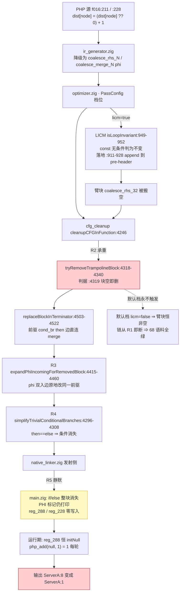
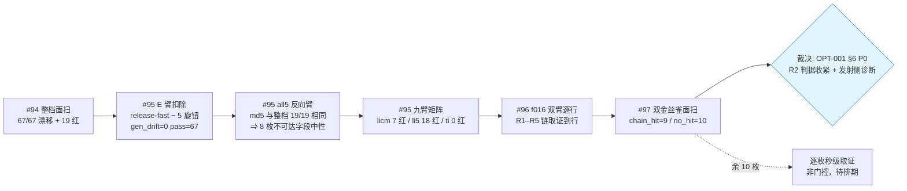
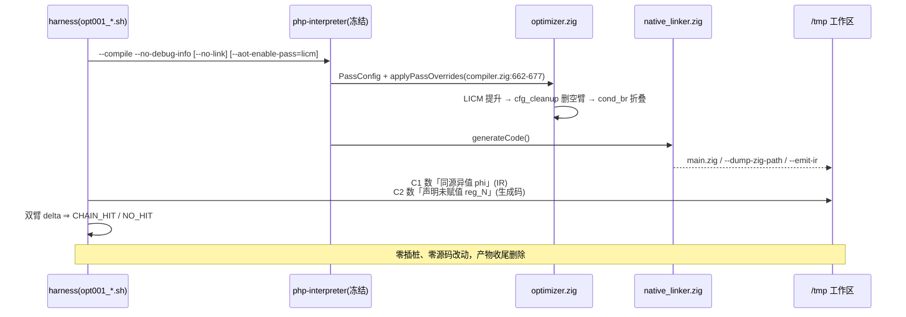
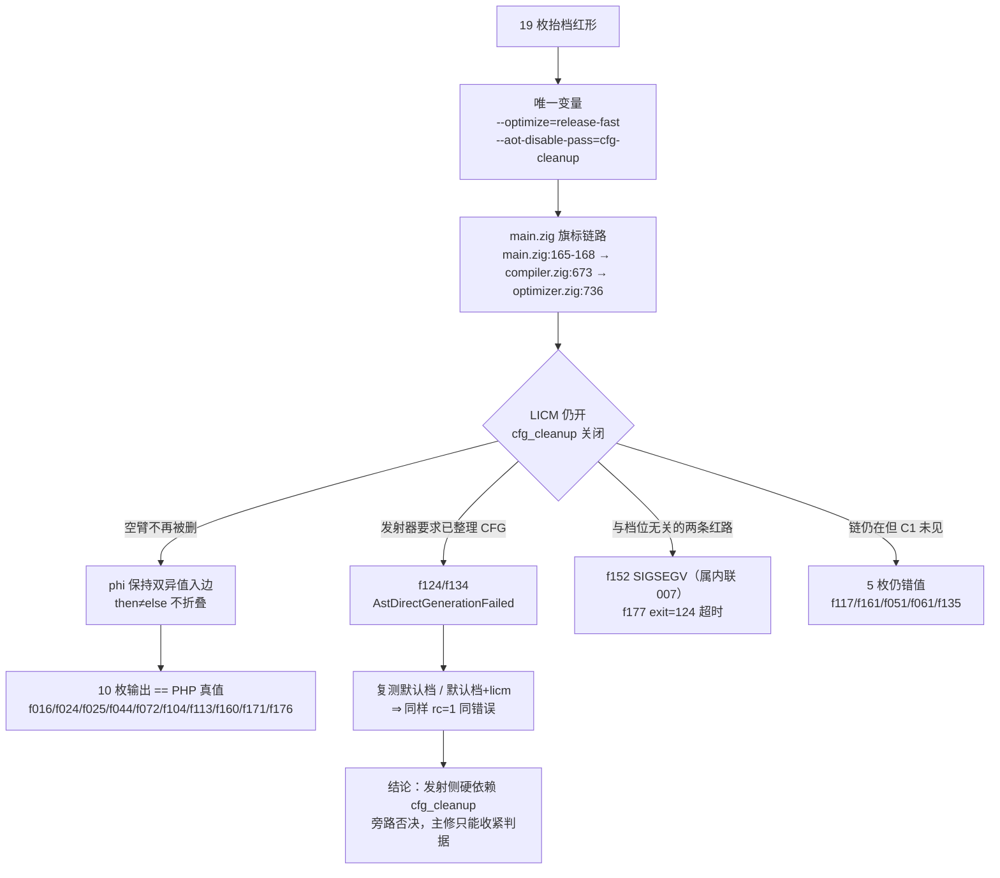

# 变更摘要 · 抬档红面归因与 LICM 错值机制取证（AOT-OPT-001 #94–#98）

**日期**: 2026-10-06　**任务**: #94 面扫 / #95 扣除臂与归因矩阵 / #96 机制取证到行 / #97 共因面扫 / **#98 旗标因果判别（增补见 §9）**
**性质**: **五轮累计只读实测，零源码改动、零插桩**（新增永久 harness 探针资产若干）
**代次戳（收尾实测）**: `src/aot/optimizer.zig` md5 `252234ef48cb47a42e6f39d1bc3e845b`／6877 行（`git diff --stat` 无输出）；`src/aot/native_linker.zig` `fbe6382a2e0904b6740d771b88c409c7`／32797 行（numstat `5 4` = #74 纯注释批，仍未提交，本轮未触碰）；`src/aot/ir_generator.zig` `cb53c2da7d4fe2e1f62b728511f7c3ea`；冻结二进制 `zig-out/bin/php-interpreter` `1f15e4ce9b5c9cdaaef7cabf5efb9c76`（**未重建**）。

---

## 1. 高层摘要（TL;DR）

把「把 AOT 默认优化档抬到 `release-fast`」这件事的代价，从**相关性数字**推进到**逐行根因**，并诚实标定该根因的解释力上限：

1. **#94/#95**：68 语料实测 release-fast ⇒ **67/67 生成码漂移 + 19 枚红**；E 臂（release-fast − 5 枚 CLI 可达旋钮）与 all5 臂（默认档 + 5 枚全开）双向夹逼 ⇒ 13 枚档位差集里 **8 枚不可达字段在语料上发射中性**，抬档代价 100% 落在 5 枚可达旋钮；九臂矩阵 ⇒ **18/19 枚红由 `licm` 引发**（`licm` 单枚 7 红、`licm+iter5` 18 红、typespec 零贡献、`ti` 臂 0 红 ⇒ LICM 是必要条件），**内联只占 1 枚**（`f152`，属 CODEGEN-007）。
2. **#96**：`f016` 双臂逐行取证 ⇒ **根因不是 LICM 提错，而是 `optimizer.zig` 的 cfg_cleanup 把被搬空的条件臂当 trampoline 删掉**（R1→R5 五环链，锚点全部实读到行），后果是 PHP `??`／三元的**选择语义整体消失**、交汇寄存器**零写入**并保持 `initNull()` ⇒ 静默错值 `{"ServerA":8}` → `{"ServerA":1}`。默认档因 `:4319`「块非空即拒删」而**从未触发** ⇒ 这是一枚**潜伏缺陷 + LICM 引爆**。
3. **#97**：两枚只读金丝雀面扫 19 枚红形 × 双臂 ⇒ `chain_hit=9 / no_hit=10`（「LICM 单枚红」组 **7/7** 全覆盖）⇒ **本链解释力上限 9/19，余下 10 枚必另有机制**；并把单形取证成本从分钟级降到**秒级**（`--no-link --emit-ir/--dump-zig-path`，生成码与完整链接**逐字节等价已实测**）。
4. **修复口径已登记但全部门控**（OPT-001 §6）：P0 主修 = 收紧 `tryRemoveTrampolineBlock` 的删块准入判据；P0 同批 = 发射侧对「phi 入边同块异值」出编译期诊断。**未获老铁点头前不动一行。**

---

## 2. 影响范围

| 维度 | 本轮影响 | 说明 |
|---|---|---|
| 源码 | **无** | `git status --short src/` 只余 `native_linker.zig`（#74 纯注释批，本轮未触碰）；`optimizer.zig`/`compiler.zig`/`ir_generator.zig` 无 diff |
| 冻结基线 | **无漂移** | 二进制未重建、`main.zig` 基线未动；基线复算待 P0 批落地时才需要 |
| 工单/知识 | 2 张刷新 | OPT-001（§1/§5.2/§5.3/§5.4/§6/§7/§8/更新日志）、PERF-001（§4 P0 行、§7 裁决项 1、新增更新日志块） |
| 测试资产 | **+2 harness（永久）** | `opt001_f016_dualarm_tmp.sh`（含本轮口径自我修正）、`opt001_canary_sweep_tmp.sh` + `.tsv` 读数表 |
| 语料 | **零改动** | `.php` 计数 374（前后一致），无任何源被删除或简化 |
| 决策面 | 抬默认档裁决**收窄** | PERF-001 §7 裁决项 1 维持「建议只改阈值」；OPT-001 §6 P2（抬档保 `licm=false`）实测 0 红但收益仅 −1.27% 行数 ⇒ 不构成动手理由 |

---

## 3. 核心变更（本轮产出的结论性资产）

| # | 变更 | 之前 → 之后 | 证据 |
|---|---|---|---|
| 1 | OPT-001 §5 状态 | 「未取证 + 5 条假设 H1–H5」→「**已取证到行**（R1–R5 五环链）」，H1–H5 全部**作废**（H3 明确否证） | `f016` 双臂 159 hunk／删 312／增 298／净 −14 行；`--emit-ir` 1127 ⇄ 1123 行 |
| 2 | 归因落点 | 「LICM 提错东西」→「**cfg_cleanup 删空臂**（R2 承重），发射侧仅未报告」 | `optimizer.zig:4318-4340`＋`:4503-4522`＋`:4415-4472`＋`:4296-4308` 逐环实读（R3 区间末行原记 `:4460`，#98 复测更正） |
| 3 | 解释力标定 | 「18/19 = LICM 家族」→「**本链只解释 9/19**（单枚红组 7/7），余 10 枚另有机制」 | `CANARY_SWEEP_DONE total=19 chain_hit=9 no_hit=10 compile_fail=0` |
| 4 | 取证通道 | 「必须 KEEP_TEMP + 完整链接（分钟级）」→「`--no-link --dump-zig-path`（秒级，逐字节等价）」 | f016 licm 臂两侧 md5 均 `285c35aa9585d101c944437b5771433a` |
| 5 | 判据口径 | 「单臂计数可用」→「**C2 有底噪，必须取双臂 delta**」 | base 臂非零 4 枚：`f044`=1／`f051`=1／`f061`=4／`f135`=3 |
| 6 | PERF-001 | 抬档代价从「13 字段差集、8 字段是归因死角」→「死角关闭 + 根因收敛到一条链、上限 9/19」 | §4 P0 行、§7 裁决项 1、文末新增更新日志块 |
| 7 | harness 自检 | `removed_lines` 计数口径缺陷**自我更正** | 首轮 `'^-'/'^+'` 只数到 `c` 型 hunk 的 `---`（14 = c 型 hunk 数；`a`=61、`d`=84）⇒ 改为 `'< '/'> '` 并补 `net_lines` |

---

## 4. 可视化概览（Mermaid）

### 4.1 分层架构 · 缺陷归属

### 4.2 业务流程 · 归因与取证闭环

### 4.3 执行流程 · 单形取证时序（只读）

### 4.4 变更点业务相关代码映射（自上而下）

| 层 | 锚点（实测代次 `252234ef`/6877） | 本轮角色 |
|---|---|---|
| CLI | `src/main.zig:305/:311/:317/:329` | 唯一可达的档位旋钮通道 |
| 编译驱动 | `compiler.zig:614` `applyPassOverrides`（体 `:662-677`）、`:755` emit-IR 钩子（在优化之后、`generateCode()` `:768` 之前） | 证明 `--emit-ir` 读的是**优化后** IR ⇒ C1 判据成立的前提 |
| 优化器 | `releaseFast():175-200`／`releaseSmall():203-222`（13 字段差集）、LICM `:949-952`/`:911-928`、`cleanupCFGInFunction :4246/:4263/:4272`、`tryRemoveTrampolineBlock :4318-4340`（判据 `:4319`）、`replaceBlockInTerminator :4503-4522`、`expandPhiIncomingForRemovedBlock :4415-4460`、`simplifyTrivialConditionalBranches :4296-4308` | **P0 主修落点（R2）**，本轮全部只读 |
| 发射侧 | `native_linker.zig` 的 `// PHI: reg_N (handled in terminator)` 路径 | **P0 同批诊断落点（R5）**，本轮只读观测 |
| 链接 | `native_linker.zig:32446`（200KB 逃逸门） | 已排除为变量（全语料 100% 命中 ReleaseFast） |

---

## 5. 详细变更分析

### 5.1 涉及文件清单

| 文件 | 类型 | 本轮动作 |
|---|---|---|
| `docs/known-issues/AOT-OPT-001-licm-multi-iteration-silent-wrong-values.md` | 工单 | 头部任务号扩展、§1 定调改写、§5.2 表格（R1/R4/R5 逐行证据）、§6 门控修复表、§7 资产表（含 harness 口径更正记录）、§8 关系表（+归因落点/CODEGEN-002）、更新日志 +#96/#97 两条 |
| `docs/known-issues/AOT-PERF-001-默认优化档位与函数级状态机回退.md` | 工单 | §4「改默认值」行落地成本改写、§7 裁决项 1 追加 #96/#97 更新、文末新增「归因与取证」更新日志块 |
| `fuzzy_scripts_720/tmp/opt001_f016_dualarm_tmp.sh` | 永久 harness | 新建（#96）→ 本轮修正 `removed/added/net` 计数口径 |
| `fuzzy_scripts_720/tmp/opt001_canary_sweep_tmp.sh` | 永久 harness | 新建（#97），19 枚 × 双臂 × `--no-link` |
| `fuzzy_scripts_720/tmp/opt001_canary_sweep_tmp.tsv` | 读数表 | 19 枚逐形读数 + 代次戳头 |
| `fuzzy_scripts_720/tmp/opt001_licm_stale_hoist_tmp.php` | 永久探针 | #95 五形否证探针（本轮引用其结论） |
| `src/aot/optimizer.zig`、`src/aot/compiler.zig`、`src/aot/native_linker.zig`、`src/main.zig` | 源码 | **只读**，无改动 |
| `fuzzy_scripts_720/pass/f016_hash_bloom_consistent.php` | 语料 | **只读**，未改动、未删除 |

### 5.2 `f016` 逐行读数（本轮取证核心）

| 项 | 默认档（基线臂） | `+licm` 臂 | 判读 |
|---|---|---|---|
| `main.zig` 行数／md5 | 46,782／`c8dc9660f4fe42f63af5d7ed2e8cd43f`（= 冻结基线逐字节） | 46,768／`285c35aa9585d101c944437b5771433a` | 唯一变量 = `--aot-enable-pass=licm` |
| diff | — | 159 hunk（14 `c` + 61 `a` + 84 `d`）／删 312 行／增 298 行／净 −14 行 | 绝大多数 hunk 为常量/寄存器搬运（合法提升的表征），承重改动仅 2 处 |
| 常量落点（R1） | `reg_287=initInt(0)` 在 `:43409`、`reg_289=initInt(1)` 在 `:43421`（循环体内） | 二者移至 `:42184`／`:42178`，循环头 `__foreach_5` 在 `:42185` | 恰为 pre-header ⇒ LICM 提升合法落地 |
| 选择块（R4） | `:43406-43415`（`if (reg_286.toBool()) {…} else {…}`，10 行）；同形 `:35730-35739` | **整块消失**，仅存 `reg_286 = try runtime.php_identical(...)`（`:43404`）无消费者 | `??` 条件被折叠掉 |
| phi 拷贝（R5） | `reg_288 = reg_287;`／`reg_288 = reg_284;`（含 retain） | **零写入**（`grep "reg_288 = \|reg_288\."` = 0 命中），而 `// PHI: reg_288 (handled in terminator)` 标记仍在 `:43407` | 声明 `:7141` 保持 `initNull()` ⇒ 每轮 `php_add(null,1)=1` |
| IR（C1） | 优化后 IR 无「同源异值 phi」 | `:1031`、`:1112` 两条 ⇒ **恰为两处错值行** | `foreach_body_28` 尾 `br .286, coalesce_rhs_32, coalesce_merge_33` → `br coalesce_merge_33` |

### 5.3 面扫读数（#97，19 枚红形 × 双臂）

| 组 | 枚数 | C1 delta>0 | 逐形（C1 base/licm） |
|---|---|---|---|
| LICM 单枚红 | 7 | **7/7** | `f016` 0→2、`f044` 0→1、`f113` 0→3、`f117` 0→4、`f124` 0→1、`f161` 0→2、`f177` 0→1 |
| LICM×迭代放大 | 11 | 2 | 命中 `f104` 0→1、`f134` 0→1；未命中 `f024`/`f025`/`f051`/`f061`/`f072`/`f135`/`f160`/`f171`/`f176` |
| 内联专属 | 1 | 0 | `f152`（属 CODEGEN-007，符合预期） |
| 合计 | 19 | **chain_hit=9 / no_hit=10 / compile_fail=0** | TSV `opt001_canary_sweep_tmp.tsv` |

- **C2 底噪（禁止单用）**：base 臂即非零 4 枚（`f044`=1／`f051`=1／`f061`=4／`f135`=3）⇒ 判据必须取双臂 delta。
- **同链不同结局**：C1 命中而 C2 delta=0 的 8 枚为「取错入边」型（交汇寄存器仍有赋值），与 §4 的次序错乱／内容并置症状吻合；此结论**只到相关性**，未逐枚复核到 PHP 表达式。

### 5.4 九臂归因矩阵（#95，复算核对通过）

| 臂 | gen_drift/19 | 红数 | 结论 |
|---|---|---|---|
| `typespec` | 13 | 0 | 改码不改值 |
| `iter5` | 15 | 0 | 单开迭代无害 |
| `ti` | 18 | 0 | ⇒ LICM 是红面必要条件 |
| `licm` | 19 | **7** | 单枚即红 7 |
| `li5` | 19 | **18** | 迭代 1→5 放大 +11 |
| `trip` | 19 | 18 | 红集与 `li5` 逐枚相同 ⇒ typespec 零贡献 |
| `all5` | 19 | **19** | = 整档红面（生成码 md5 19/19 与 release-fast 相同） |
| E 臂（rf − 5） | 0/67 | 0 | 双向夹逼的另一侧 |

---

## 6. 影响与风险评估

| 项 | 判定 |
|---|---|
| 是否破坏式变更 | **否**。零源码改动、零基线漂移、零语料改动；只新增只读 harness 与文档登记 |
| 影响范围 | 文档面 2 张工单 + 资产面 3 个文件（1 harness 修正、2 新建）；决策面收窄 PERF-001 §7 裁决项 1 |
| 特别留意点 1 | **解释力上限已钉死**：本链 = 9/19。任何后续文档**禁止**把「解 OPT-001 一条链」写成抬档的唯一前置；余 10 枚未归因（含 `f160` 是 exit=255 未捕获异常、`f152` 属 CODEGEN-007） |
| 特别留意点 2 | **「迭代 1→5 放大需 ≥2 轮」仍是读数推断**，未做逐轮插桩验证 ⇒ 不得作为根因引用（OPT-001 §5.2 已就地标注） |
| 特别留意点 3 | **C2 金丝雀有底噪**，单臂计数会误报 ⇒ 面扫/验收一律双臂 delta |
| 特别留意点 4 | harness 计数口径缺陷虽已修正，但**该 harness 未重跑**（修正属静态口径更正，结论数字由本轮对既存 `main_base.zig`/`main_licm.zig` 重新实测得到） |
| 特别留意点 5 | `--no-link` 通道的等价性**只在 f016 一枚实测**过；跨形推广依据是同一 `generateCode()` 前置流水线（`compiler.zig:755`/`:768`），非逐形实测 |
| 复测路径 | ①`bash fuzzy_scripts_720/tmp/opt001_f016_dualarm_tmp.sh`（应见 `DUALARM_DONE` + `diff_hunks=159 removed_lines=312 added_lines=298 net_lines=-14`，base 臂 md5 = 冻结基线）；②`bash fuzzy_scripts_720/tmp/opt001_canary_sweep_tmp.sh`（应见 `CANARY_SWEEP_DONE total=19 chain_hit=9 no_hit=10 compile_fail=0`）；③九臂矩阵 `bash fuzzy_scripts_720/tmp/c007_rf_knockout_single_tmp.sh <arm>`；④E 臂 `bash fuzzy_scripts_720/tmp/c007_rf_knockout_tmp.sh` |
| P0 落地时的验收硬门（预登记） | ①`licm`/`li5` 臂复跑 ⇒ 预期 7→0、18→≤9；②默认档 68 回归 + `DRIFT_DONE diff=0`（逐字节回冻结基线）；③`timeout 240 zig build test`；④四道探针门（17 形等值、RC-4 诊断、RC-5 八形+三单形、`c005_dowhile_probe_run_tmp.sh`） |

---

## 7. 遗留问题 / 潜在问题

1. **10 枚红形未归因**（`f024`、`f025`、`f051`、`f061`、`f072`、`f135`、`f160`、`f171`、`f176` + `f152`）：C1 delta=0 ⇒ 必然另有机制，`f152` 已归 CODEGEN-007，其余 9 枚是抬档红面的**真正剩余阻塞面**。
2. **迭代放大机制未验证**：只到方向一致性（`licm`=7 vs `li5`=18），未做逐轮插桩 ⇒ 若 P0 主修后仍有红形残留，本条必须补验。
3. **R5 发射侧「静默」的判据边界未定义**：诊断批要报「phi 入边同块异值」，但 8 枚 C2 delta=0 形说明「同块异值」在发射期还有第二种结局（取错入边），诊断口径需覆盖两者 ⇒ 落地前须先定口径。
4. **P1（R1 侧限制提升）未做影子实测**：其对抬档收益的折损只有定性判断（少一条常量提升），无实测。
5. **抬档收益本身仍无运行时基准**：PERF-001 §2.1 的 2.65×～3.44× 属 `-O` 轴；`--optimize` 轴的实测收益只有生成码行数 −1.27%，语料级运行时无基准 ⇒ 即便红面清零，抬档收益命题仍未证。
6. **#74 纯注释批（`native_linker.zig` numstat `5 4`）与本轮文档改动均未提交**，待老铁「提交」指令。
7. 待裁决存量不变：REF-003 P0（#40）、CODEGEN-006 #81（N1/N2 前置）与 #84（R17）、PERF-001 §7 三项、OPT-001 §6 P0 两条。

---

## 8. 后续开发 / 优化建议

| 优先级 | 建议 | 影响面 | 落地成本 |
|---|---|---|---|
| **P0（门控，待点头）** | 按 OPT-001 §6 落地 **R2 判据收紧**（`tryRemoveTrampolineBlock` 删块前检查「target 的 phi 是否以本块为入边且取值与其它入边不同」）+ **发射侧「phi 同源异值」编译期诊断**同批 | 预期转绿 9/19（单枚红组 7/7）；**#98 后此数按两把尺理解**：9/19 = C1 签名面、10/19 = 关掉整条 pass 的因果上界 ⇒ 禁止单独当验收目标，见 §9.6；默认档理论上发射中性 | 小（一处判据 + 一处诊断）；验收见 §6 复测路径 |
| **P1（非门控，建议先做）** | ~~用 #97 的秒级通道对**余下 9 枚**（`f024`/`f025`/`f051`/`f061`/`f072`/`f135`/`f160`/`f171`/`f176`）逐枚做双臂 diff~~ ⇒ **本行已由 #98 更新**：该 9 枚中有 6 枚（`f024`/`f025`/`f072`/`f160`/`f171`/`f176`）在因果判别臂上直接转绿（属本链、C1 只是看不见），残留队列改为 **5 枚仍错值**（`f117`/`f161`/`f051`/`f061`/`f135`）＋ **2 枚 `AstDirectGenerationFailed`**（`f124`/`f134`）＋ **1 枚超时**（`f177`），见 §9.8 | 只读；决定抬档是否还有第二个前置 | 低～中（每枚秒级，判据需再设计） |
| **P1** | 为 R5 诊断**先定口径**（停初值型 vs 取错入边型两类结局都要覆盖），并与既有「空 else + unreachable 发射期金丝雀」（#18）合并为一条发射期不变量族 | 中（发射侧守卫 + 诊断文案） | 小 |
| **P2** | 补**抬档运行时基准**（同一语料子集两档 wall-clock），否则「抬默认档」的收益命题永远只有行数 proxy | 不改码，纯量测 | 中 |
| **P2** | 若要解锁迭代假设：在 `optimize` `:414`/`:442` 加**非行为插桩**（逐轮打印被删块/phi 变化）做一次单轮 vs 多轮对照，之后**必须还原**并复跑全门（先例：#65/#76 收尾流程） | 临时插桩 | 中 |
| **建议** | 把「双臂 delta + `--no-link` 秒级通道」写进抬档类改动的**默认验收手段**，替代「整档重冻结后跑 68」这一重量级路径 | 流程改进 | 小 |

---

## 9. 增补 · #98 旗标因果判别（同一代次续做，仍零源码改动）

### 9.1 TL;DR

`cfg_cleanup` 除被推断为承重环之外，**自带一枚 CLI 开关**，于是在不碰一行代码的前提下把 §5.2 的「双臂相关性推断」升级为**旗标因果实证**：抬档臂上只关掉 `cfg_cleanup`（LICM 保持开启）⇒ 19 枚红形里 **10 枚输出与 PHP 真值逐字节相等**。同轮**实测否决**了「抬档时顺手关掉这个整理型 pass」的旁路 —— 发射侧对 `cfg_cleanup` 是**档位无关的硬依赖**。

### 9.2 影响范围（#98 增量）

| 维度 | 影响 | 实测依据 |
|---|---|---|
| 源码 | **无**（第五轮仍零改动） | `git status --short src/` 仅 ` M src/aot/native_linker.zig`（#74 纯注释批）；`optimizer.zig` `252234ef`/6877、`compiler.zig`、`main.zig` 无 diff |
| 结论口径 | 「解释力 9/19」→「**签名面 9/19 ＋ 因果面 10/19**，未解释面由 10 收窄为 **9**」 | `DISCRIM_DONE total=19 pass=10 diff=5 runtime_fail=2 compile_fail=2` |
| PERF-001 | §4 P0 行、§7 裁决项 1 补入因果口径与一条**否证**；文末新增 #98 更新日志块 | OPT-001 §5.5 逐枚读数 ＋ PERF-001 文末「更新日志（因果判别，任务 #98）」 |
| 工单 | OPT-001 新增 §5.5（读数）＋ §5.3 的 C3 通道行 ＋ §7 资产行 ＋ §1 定调改写 | 同上 |
| 测试资产 | **+1 永久 harness** | `fuzzy_scripts_720/tmp/opt001_cfgclean_discriminant_tmp.sh` + `.tsv` + `_hdr.txt` |
| 语料 | **零改动** | `.php` 仍 375／68，`git status --porcelain` 对 `.php` 全为 `??`，无删除无修改 |

### 9.3 核心变更

| # | 变更 | 之前 → 之后 |
|---|---|---|
| 1 | R2 的承重性证据等级 | 「两档差异 + 只读 diff 推断」→「**旗标因果**」（单独关掉该 pass、其余变量不动即转绿） |
| 2 | C1 金丝雀的地位 | 「解释力度量」→「**下界探针，不是判据**」（因果面比签名面大 1，且差集里 6 枚 C1 读数为 0） |
| 3 | 抬档的可用 workaround 假设 | 「抬档顺手关 `cfg_cleanup` 可规避本类缺陷」→「**实测否决**」（既留 9 枚红，又让 `f124`/`f134` 砸编译） |
| 4 | 发射侧不变量认知 | 新增一条架构事实：「**标签驱动发射器要求 CFG 已被 cleanup 整理过**，与优化档位无关」 |
| 5 | 锚点卫生 | §5.2/§2 全部锚点**逐符号复测、零漂移**；唯一更正 R3 区间末行 `:4460`→`:4472`（本工单 §3 表行 2 同步） |

### 9.4 执行流程（只读判别臂）

### 9.5 判别臂读数（按 C1 分组，逐枚）

| 组 | PASS（== PHP 真值） | DIFF（仍静默错值） | RUNTIME_FAIL | COMPILE_FAIL |
|---|---|---|---|---|
| **CHAIN**（C1 命中，9 枚） | `f016` `f044` `f104` `f113` | `f117` `f161` | `f177`（`exit=124`，`TIMEOUT_10S`） | `f124` `f134` |
| **NOHIT**（C1 不可见，10 枚） | `f024` `f025` `f072` `f160` `f171` `f176` | `f051` `f061` `f135` | `f152`（`exit=139`，属 CODEGEN-007） | — |
| **合计** | **10** | **5** | **2** | **2** |

旗标生效性独立实证（不依赖汇总列）：`f016` 的 `main.zig` 本臂 **46,558 行／`bbbd47aa04c7439efc122c1ad823ffc6`**，既 ≠ A 臂 45,941 行／`5fdea94d…`，也 ≠ 默认基线 46,782 行／`c8dc9660…`。

### 9.6 影响与风险评估

- **是否破坏式变更**：否。纯只读实测，冻结二进制未重建，基线未动。
- **诚实边界（禁引口径）**：①**10/19 是「关掉整条 pass」的收益上界**，不得当作 §6 P0 的验收目标（P0 只收紧 R2 删块准入，覆盖面 ≤10/19）；②**9/19 只是 C1 的签名面**，不得再写成「本链的唯一解释面」，也不得反向写成「余下全归内联」；③本工单 §3 表行 3 的「本链只解释 9/19」现应按 §9.1 的**两把尺**理解。
- **harness 两处口径缺陷（已修正并登记）**：控制组 TSV 实为**竖线**分隔，首轮 `awk -F'\t'` 使 `ctrl=` 两列恒空 ⇒ 首轮汇总列 `gen_same_as_rf=0/19` **整体作废**，严禁解读为「19 枚生成码全部漂移」；`exit=124` 原被并入 `RUNTIME_FAIL`，现拆为 `TIMEOUT_10S`（挂起与过慢未区分）。
- **需要特别注意的点**：`f124`/`f134` 的 `AstDirectGenerationFailed` **不是抬档产物**（默认档与默认档+licm 同样失败）⇒ 它是一条独立于本单的发射侧不变量，未来任何「关整理型 pass」的提案都会先撞上它。

### 9.7 遗留 / 潜在问题

- 5 枚仍错值形（`f117`/`f161`/`f051`/`f061`/`f135`）机制未定 —— 因果口径下「余 9 枚」的构成仍待逐枚取证。
- `f177` 的 `exit=124` 未区分挂起/过慢。
- OPT-001 §6 的 **P0 主修（R2 判据收紧）＋发射侧「phi 同源异值」编译期诊断**仍为**门控项**，未动一行源码。

### 9.8 后续建议（#98 增量，仍按「优先级 × 影响面 × 落地成本」）

| 优先级 | 建议 | 影响面 | 落地成本 |
|---|---|---|---|
| **P0（门控，待老铁点头）** | 落地 R2 删块准入收紧 **+** 同批发射侧诊断；验收须同时跑「判别臂 10 枚」与「C1 命中 9 枚」两个面，并明确 5 枚仍错值形不在验收内 | 面 ≤10/19，默认档理论上发射中性 | 小（一处判据 + 一处诊断） |
| **P1（非门控）** | 对 5 枚仍错值形用 OPT-001 §5.3 的 `--no-link` 秒级通道逐枚定机制；若再出现第二条链，则抬档真实前置从 1 个变 2 个 | 只读 | 低（每枚秒级） |
| **P1（新登记的约束）** | 把「发射侧对 `cfg_cleanup` 档位无关硬依赖」写进任何 pass 开关类改动的**前置检查表**（含未来的 `--aot-disable-pass` 组合） | 流程约束，不改码 | 小 |
| **P2** | `f177` 单独复跑放宽超时以区分挂起/过慢；若为挂起则新立工单 | 只读量测 | 小 |

### 9.9 清理与静态自证（实测）

`/tmp/opt001_*`、仓库内 `aot_compile_*`、`.zigphp_aot_build_*` 均为 **0**；`.php` 计数 375／68 不变，`git status --porcelain` 对 `.php` 全为 `??`；`git status --short src/` 仍只 ` M src/aot/native_linker.zig`。

---

## 附：本轮清理确认（全部为实测读数）

- 已删除：`/tmp/opt001_f016_work`（`main_base.zig`／`main_licm.zig`／两份 diff／`ir_base.txt`／`ir_licm.txt`／`ir_diff.txt`／两份 `.cerr`／两枚 `aot_compile_ir_*.zig`）、`/tmp/opt001_canary_work`（19 枚 × 双臂的 `p_*`/`l_*` dump 与 `chk.py`），以及 #95 遗留的 `/tmp/opt001_a.txt`、`/tmp/opt001_all5.txt`、`/tmp/opt001_work` ⇒ `ls -d /tmp/opt001_*` 现为 **0**。
- 仓库内 `aot_compile_*` 产物与 `.zigphp_aot_build_*` 临时目录：**0**（`find` 实测）。
- **`.php` 计数分口径实测**：`fuzzy_scripts_720` = **375**、仓库全局（排除 `.git`）= **573**、`fuzzy_scripts_720/pass` 语料 = **68**。**无任何 `.php` 被删除或改动**。
  - **口径更正**：#95 收尾登记「本轮 `.php` 计数 374（前后一致）」与**同轮新增永久探针 `opt001_licm_stale_hoist_tmp.php`** 自相矛盾（新增一枚必然 +1）⇒ 374 是**探针落地前**的读数，现值 375；已在 OPT-001 §7 就地更正。
- `git status --short src/`：仅 ` M src/aot/native_linker.zig`（#74 纯注释批，早于本轮，仍未提交）⇒ **本轮零源码改动**得静态自证。
- **#98 收尾复测补记**：末次 `ls -d /tmp/opt001_*` 曾发现 1 枚遗留草稿日志 `/tmp/opt001_cfgclean_run.log`（248 B，内容仅判别臂的三行汇总 + `DISCRIM_DONE`，与 `.tsv`／OPT-001 §5.5 已登记读数完全重复，无独立证据）⇒ 已删除，**最终实测为 0**（本文档 §9.9 与 OPT-001 #98 日志项均按该末次读数登记）。
