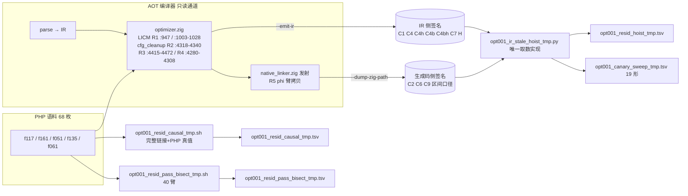
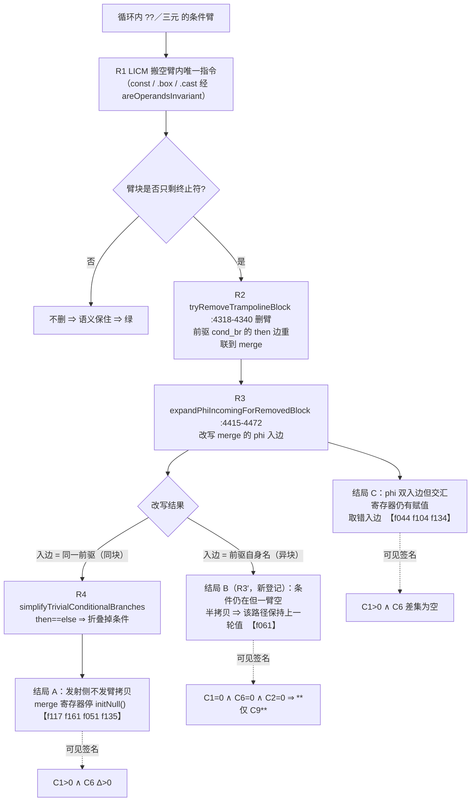
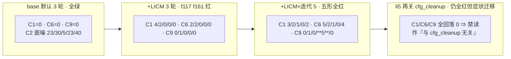

# AOT-OPT-001 §5.6 残红五形逐枚定机制（任务 #99）· 变更摘要

## 1. 高层摘要（TL;DR）

老铁，本轮是 **只读取证轮**（零源码改动、零插桩、非门控），把 OPT-001 在 §5.5 之后**剩下的 5 枚「仍错值」红形**（`f117`/`f161`/`f051`/`f061`/`f135`）逐枚定到机制：

1. **四枚（`f117`/`f161`/`f051`/`f135`）与 `f016` 是同一条链** `R1 LICM 搬空臂 → R2 `tryRemoveTrampolineBlock` 删臂 → R3 `expandPhiIncomingForRemovedBlock` 改成同一前驱双入边 → R4 `simplifyTrivialConditionalBranches` 折掉条件 → R5 发射侧不发臂拷贝`，症状都是「merge 寄存器停 `initNull()`」。⇒ §5.5 写的「**余下必另有机制**」对这 4 枚**作废**，改判为「**同链、同一发射结局**」。
2. **`f061` 是一枚新结局**（记作 **R3′「异块改写支」/ 结局 B**）：phi 入边被改写成**前驱自身的块名**（与另一臂入边**不同名**）⇒ R4 的 `then==else` 折叠**从不触发** ⇒ IR 侧「同源异值 phi」签名（C1）**结构性看不见**，只有生成码侧「PHI 标记 + 空臂」签名（新立的 **C9**）能抓到（实测红臂 C9=5）。⇒ **本单原来的「二分结局」现拆成三分**（A 停初值／B 半拷贝／C 取错入边）。
3. **三条否证（全部实测）**：①陈旧提升（C4/C4h 五形全 0）；②`hasStoreInLoop` 盲区（C4bh 全 0）；③控制流不敏感提升（C7 **非区分量**，绿臂读数反而更大）⇒ **五形都没有「LICM 提升本身有害」的证据**，承重点仍唯一落在 `cfg_cleanup`。
4. **两条口径级自我更正**：①`max_iterations` 默认是 **3 轮**（`optimizer.zig:103`），本单原隐含「默认 1 轮」为**错**；②生成码侧金丝雀（C2/C6）第 1 代用「全文是否出现 `reg_N = `」判定 ⇒ 因 **`reg_N` 编号在每个 PHP 功能内独立复用**而被其它功能的同名赋值**洗白** ⇒ 改为**按顶层 `fn` 切区间**后，19 形面扫刷新为 `chain_hit=9`（C1 面不变）＋ **`emit_hit=6`**，故 §5.4 的「**8 枚取错入边**」实为 **3 枚**（`f044`/`f104`/`f134`）。
5. **一条负结果**：5 形 × 7 枚 CLI 可达 pass 的旗标二分 = **40/40 全红、`PASS=0`** ⇒ 在 CLI 可达面内除 LICM 外**无一枚 pass 关掉能救这五形**；余候选（`sccp`/`copy-propagation`/`gvn`/`advanced_sccp`/`scalar-replacement`/`rc-elision`）**无旗标** ⇒ 再归因**必须插桩**（越出本轮边界，需老铁点头）。

**成本口径（实测）**：`--no-link --emit-ir --dump-zig-path` 只读通道单臂 **0.01–0.02 s**（`/usr/bin/time -p`，`f061`/`f124` 各测），19 形 × 双臂面扫 **6 s** ⇒ 逐枚机制取证的门槛已从「分钟级 KEEP_TEMP 双臂」降到「秒级」。

**门控项不变**：OPT-001 §6 的 P0 主修 + 发射侧诊断、PERF-001 §7 三项档位裁决、REF-003 P0（#40）、CODEGEN-006 #81/#84 全部待裁决；本轮**未动一行源码**。

---

## 2. 影响范围

| 维度 | 影响 | 说明 |
|---|---|---|
| 源码 | **无** | `optimizer.zig` `252234ef…`/6877 无 diff；`native_linker.zig` `fbe6382a…`/32797 仍为 #74 纯注释批 numstat `5 4`；`ir_generator.zig` `cb53c2da…`；冻结二进制 `1f15e4ce…` **未重建** |
| 工单结论 | **改口 3 条、作废 2 条** | 改口：「余下 9 枚必另有机制」→「5 枚属同链不同结局」；「8 枚取错入边」→「3 枚」；「默认 1 轮迭代」→「3 轮」。作废：第 1 代全文口径 C2/C6 全部数值、`BISECT_SUMMARY` 的七枚 pass 行 |
| 修复判据 | **两条实测收窄（不落地，仅登记）** | P0 删臂准入须在 `expandPhiIncomingForRemovedBlock` **改写之前**取数（此口径五形全覆盖，含 `f061`）；发射侧诊断若只按「同块异值」触发**必漏 R3′ 类** |
| 测试面 | **无变化** | 68 语料、19 枚抬档红形、`pass` 集均未动；`.php` 计数 375／573／68 不变 |
| 资产 | **新增永久 5 枚** | 分析器 `.py` ×1 + 面扫/判别/二分 `.sh` ×3 + 第 1 代归档 `.tsv.r1-global-c2` |

---

## 3. 核心变更

| # | 变更 | 位置 | 性质 |
|---|---|---|---|
| C1 | 生成码侧金丝雀改**区间口径**（新增 `_zig_regions()`，按顶层 `fn`/`pub fn` 切段后逐段求 `declared − assigned`、`phi_marked − assigned`） | `fuzzy_scripts_720/tmp/opt001_ir_stale_hoist_tmp.py` | 取数实现更正（旧口径会洗白停初值寄存器） |
| C2 | 面扫**去重复实现**，改调同一分析器；金丝雀 2 枚→4 枚，新增 `EMIT_HIT`/`EMIT_BLIND` 判定与 `emit_hit` 汇总列 | `fuzzy_scripts_720/tmp/opt001_canary_sweep_tmp.sh` | DRY + 签名扩容 |
| C3 | 残红五形 × **四臂**（`base`/`licm`/`li5`/`li5nc`）签名面扫，落 12 列 CSV；头部登记**两条自我更正**（base 臂不带 `--base` ⇒ `C4b/C4bh` 同值不可作假阳性判据；C9 绝对值有底噪 ⇒ 只取双臂 Δ） | `fuzzy_scripts_720/tmp/opt001_resid_hoist_tmp.sh` | 新永久 harness |
| C4 | 四臂**完整链接 + 运行输出比对 PHP 真值**的因果判别，并落盘 `li5nc` 的 diff hunk（症状迁移证据） | `fuzzy_scripts_720/tmp/opt001_resid_causal_tmp.sh` | 新永久 harness |
| C5 | 40 臂 pass 旗标二分；`BISECT_SUMMARY` 由 `grep "|$p|"`（漏 `no_` 前缀 ⇒ 恒 0）改为 **awk 按列等值**重算 + `pass_rows_total` 自证 | `fuzzy_scripts_720/tmp/opt001_resid_pass_bisect_tmp.sh` | 新永久 harness + 取数缺陷修复 |
| C6 | 新增 **§5.6**（5.6.1 四臂签名表／5.6.2 逐枚机制／5.6.3 三条否证／5.6.4 三结局表／5.6.5 第 2 代口径刷新／5.6.6 二分负结果＋症状迁移警示／5.6.7 禁引四条＋§6 收窄表） | `docs/known-issues/AOT-OPT-001-…md` | 文档 |
| C7 | §1/§5.2/§5.3/§5.4 四处口径同步（迭代 3 轮、C1 只标「链在场」、C2 第 1 代作废、8 枚→3 枚、底噪换第 2 代读数）；§7 资产表补 5 行；更新日志补 #99 | 同上 | 文档 |
| C8 | 文末新增 #99 更新日志块（抬档视角）＋ #97/#98 两条的改口指针 | `docs/known-issues/AOT-PERF-001-…md` | 文档 |

---

## 4. 可视化概览（Code & Logic Map）

### 4.1 分层与影响面



### 4.2 一条链 → 三种发射结局



### 4.3 逐枚执行流程（以 `f061` 为例，实测 IR／生成码逐行）

```mermaid
sequenceDiagram
  participant PH as f061.php :80 三元
  participant L1 as 第 1 轮 LICM
  participant L2 as 第 2 轮 LICM
  participant CC as cfg_cleanup
  participant NL as native_linker
  PH->>L1: ternary_then_10 的 const(27) 被提升进 pre-header
  L1->>L2: 同块 box(28) 的操作数已在循环外 ⇒ 第 2 轮也提升（:526 落 entry）
  L2->>CC: ternary_then_10 清空 ⇒ 删臂，cond_br then 边直连 ternary_merge_12
  CC->>CC: phi30 = [.28 foreach_body_6], [.29 ternary_else_11] ⇒ 入边名不同 ⇒ 不折叠
  CC->>NL: 条件仍在，但 then 臂无内容
  NL-->>NL: 发射 `if (reg_26.toBool()) { } else { reg_30 = reg_29; }` ⇒ **空 then 臂**
  Note over NL: reg_30 在 then 路径保持上一轮值 ⇒ C1/C6/C2 三盲，仅 C9=5 可见
```

### 4.4 四臂签名读数（面扫实测，禁取绝对值）



---

## 5. 变更分析

### 5.1 涉及文件清单

| 文件 | 类型 | 本轮动作 |
|---|---|---|
| `docs/known-issues/AOT-OPT-001-licm-multi-iteration-silent-wrong-values.md` | 工单 | 新增 §5.6（7 小节）+ §1/§5.2/§5.3/§5.4/§7/更新日志 六处同步 |
| `docs/known-issues/AOT-PERF-001-默认优化档位与函数级状态机回退.md` | 工单 | 文末新增 #99 块 + #97/#98 改口指针 |
| `fuzzy_scripts_720/tmp/opt001_ir_stale_hoist_tmp.py` | 分析器（永久） | C2/C6 改区间口径（第 2 代）＋文档串头登记 |
| `fuzzy_scripts_720/tmp/opt001_canary_sweep_tmp.sh` / `.tsv` | 面扫（永久） | 改调分析器、4 枚签名、`emit_hit` 列、重跑 |
| `fuzzy_scripts_720/tmp/opt001_canary_sweep_tmp.tsv.r1-global-c2` | 归档（禁删） | 第 1 代口径原始落盘 |
| `fuzzy_scripts_720/tmp/opt001_resid_hoist_tmp.sh` / `.tsv` / `_evidence_tmp.txt` | 五形四臂面扫（永久） | 新建 + 头部两条自我更正 + 重跑 |
| `fuzzy_scripts_720/tmp/opt001_resid_causal_tmp.sh` / `.tsv` | 四臂因果判别（永久） | 新建 |
| `fuzzy_scripts_720/tmp/opt001_resid_pass_bisect_tmp.sh` / `.tsv` | 40 臂旗标二分（永久） | 新建 + 汇总缺陷修复 + `.tsv` 追加 `# CORRECTION` |
| `src/aot/optimizer.zig`、`src/aot/native_linker.zig`、`src/aot/ir_generator.zig`、`src/main.zig`、`src/aot/compiler.zig` | 源码 | **只读实读，零改动** |
| `fuzzy_scripts_720/pass/*.php` | 语料 | **只读，零删除** |

### 5.2 变更点与实测读数

| 变更点 | 实测读数 | 判读 |
|---|---|---|
| 五形四臂签名面 | `f117`：C1 0→4（3 轮）／C6 0→2；`f161`：C1 0→2／C6 0→2；`f051`：C1 0→1、C6 0→1（均在 5 轮）；`f061`：**C1/C6/C2 全 0，C9 0→5**；`f135`：C1 0→2／C6 3→4 | 四枚结局 A + 一枚结局 B |
| `li5nc`（关 `cfg_cleanup`） | 五形 C1/C6/C9 **全回 0 但仍全红**，diff 位置迁移（`f117 40,42d39`／`f161 42a43,46`／`f051 6,28d5`／`f061 8,25c8,15`／`f135 23,24c23,24`），`f061` 的 C2 由 23 涨到 47 | 立「症状迁移警示」：不得读作「与 cfg_cleanup 无关」 |
| 三条否证 | C4/C4h 五形 **全 0**；C4bh **全 0**；C7 非区分量（绿臂读数更高，`f061 licm` 39/44 却全绿） | 提升本身无害 ⇒ 主修不在 P1 |
| 40 臂旗标二分 | 八枚标签各 `DIFF=5`、`PASS=0`、`pass_rows_total=0`；`NO_EFFECT`：`no_constprop`/`no_box-unbox`/`no_typespec` 5/5、`no_strength` 4/5（例外 `f135`）、`no_dce`/`no_cse`/`no_mem2reg` 0/5 | CLI 可达面已穷尽 |
| 19 形面扫（第 2 代） | `chain_hit=9`（不变）／`no_hit=10`／`compile_fail=0`／**`emit_hit=6`**（`f016`/`f113`/`f117`/`f124`/`f161`/`f177`） | 取错入边面由 8 枚改 3 枚 |
| 迭代锚点 | `:103`=3（默认）、`:142`=1、`:163`=3、`:191`=5（release-fast）、`:219`=1（release-small）；迭代环 `:442` 与 `:663` | 「默认 1 轮」错判已更正 |
| 通道成本 | 单臂 0.01–0.02 s；19 形 × 双臂 6 s | 逐枚取证门槛降到秒级 |

---

## 6. 影响与风险评估

- **是否破坏式变更**：**否**。零源码改动、零语料改动、零产物残留；变更集中在文档与 `fuzzy_scripts_720/tmp/` 下的只读 harness。
- **范围**：仅 AOT 编译链取证口径（宪法 §五）；未触碰解释器／字节码／JIT 路径。
- **需要注意的点**：
  1. **禁引四条**（OPT-001 §5.6.7）已生效 —— 尤其「C1 只标链在场，不标症状归属」，任何后续文档若把 C1 当归属判据即为违规。
  2. **第 1 代 C2/C6 数值全部作废**，但归档 `.tsv.r1-global-c2` **禁删**（口径追溯）；新旧数值**不可跨代比较**。
  3. **`li5nc` 的「转绿签名」是假象**（关 `cfg_cleanup` 会砸掉发射侧对已整理 CFG 的隐式依赖），复测时不得把它当「不同因」的证据。
  4. 区间口径令 C2/C6 底噪显著变大（`f135` base 就有 40 枚）⇒ **任何单臂绝对值都不可判**，判据只允许双臂 Δ。
  5. `opt001_resid_*` 系列用 `reg_N` 联表跨臂匹配，脚本已自带 `hm`/`hl` 自证分母；若某臂 `hm/hl ≠ H` 则该臂 `C7` 读数作废。
- **复测路径（体验流程）**：
  ```bash
  # 1) 秒级五形四臂签名面扫（产物即时删除，禁删 .php）
  timeout 300 bash fuzzy_scripts_720/tmp/opt001_resid_hoist_tmp.sh
  # 2) 19 形第 2 代面扫（含 emit_hit 列）
  timeout 300 bash fuzzy_scripts_720/tmp/opt001_canary_sweep_tmp.sh
  # 3) 完整链接因果判别（每臂 ≤10 s 运行）
  timeout 600 bash fuzzy_scripts_720/tmp/opt001_resid_causal_tmp.sh
  # 4) 40 臂旗标二分（最慢，走 zig build-exe）
  timeout 1800 bash fuzzy_scripts_720/tmp/opt001_resid_pass_bisect_tmp.sh
  ```
  预期汇总：`RESID_SWEEP_DONE shapes=5`／`CANARY_SWEEP_DONE total=19 chain_hit=9 no_hit=10 compile_fail=0 emit_hit=6`／`li5: PASS=0 DIFF=5`／`pass_rows_total=0`。

---

## 7. 遗留问题 / 潜在问题

| 项 | 状态 | 说明 |
|---|---|---|
| 逐轮（3→4→5）插桩验证「迭代放大」 | **未做** | 本轮只有「3 轮部分红 / 5 轮全红 / base 全绿」的行为级证据 |
| 其余 14 枚红形是否也有结局 B（C9-only） | **未跑** | 成本已实测为秒级，可直接扩面 |
| `f061` 另 4 处 C9 站点（`reg_60/94/146/219`） | **未逐枚复核 PHP 表达式** | 只按标记行登记 |
| `f124`/`f134` `AstDirectGenerationFailed` | **未闭环** | §5.5 已证发射侧对 `cfg_cleanup` 有档位无关硬依赖，属独立条目 |
| `f177` `exit=124` | **未区分** | 挂起 vs 过慢未判 |
| 6 枚无 CLI 旗标的 pass | **需插桩** | 越出零插桩边界 ⇒ 待老铁点头 |
| harness 重复实现 | **部分收敛** | 两支面扫已共用分析器，但 IR 解析段仍与 `opt001_resid_*` 有重叠（DRY 待收） |

---

## 8. 后续开发 / 优化建议

| 优先级 | 建议 | 影响面 | 落地成本 |
|---|---|---|---|
| **P0（门控，需裁决）** | 按 §5.6.7 收窄后的口径实施 OPT-001 §6 P0：在 `expandPhiIncomingForRemovedBlock` **改写之前**判「被删块是否为 `target` 任一 phi 提供与他边**不同值**的入边」⇒ 拒删；同批把发射侧静默改为**编译期诊断**，诊断条件须扩到「入边块名 == 前驱自身名」的 R3′ 结构 | 覆盖 §5.4/§5.5 口径下 9–10 枚，含 `f061` | 中（`optimizer.zig` 一处准入 + `native_linker.zig` 一处守卫；须走 §5 全门 + 基线漂移核对） |
| **P1（门控）** | P1（收紧 R1 提升）按实测**降级为辅助**：五形无「提升有害」证据，且否决条件不能写成「块内只剩一条指令」、只限 `.const_*` 不足（`.box`/`.cast` 第 2 轮同样被提升） | 低（可能零收益） | 小 |
| **P1（非门控，可下轮直做）** | 把 C9 签名扩到其余 14 枚抬档红形（秒级/枚），量化结局 B 的真实面 | 决定 P0 诊断条件的覆盖面 | 极小 |
| **P2** | 逐轮（3→4→5）插桩坐实「迭代放大」；插桩属门控（改源码）⇒ 需裁决 | 关闭 §5.2 最后一环推断 | 小（一次插桩 + 还原） |
| **P2** | 把 `f124`/`f134` 的「发射侧对 `cfg_cleanup` 的硬依赖」另立工单（它是抬档旁路被否决的根因，且与 P0 判据无关） | 抬档路线 | 中 |
| **P2** | 两支 sweep 的 IR 解析段合并为单一库（DRY），并给 `opt001_*` 系列加统一 `_hdr.txt` 代次戳 | 资产可维护性 | 小 |

---

**代次戳（本轮收尾实测）**：`optimizer.zig` `252234ef48cb47a42e6f39d1bc3e845b`／6877（无 diff）；`native_linker.zig` `fbe6382a2e0904b6740d771b88c409c7`／32797（numstat `5 4`，#74 纯注释批仍未提交）；`ir_generator.zig` `cb53c2da7d4fe2e1f62b728511f7c3ea`；冻结二进制 `1f15e4ce9b5c9cdaaef7cabf5efb9c76`（未重建）；`git status --short src/` 仅 ` M src/aot/native_linker.zig`。
**产物收尾**：`.php` = 375（`fuzzy_scripts_720`）／573（全局）／68（`pass` 语料），零删除；`aot_compile_*` = 0；`.zigphp_aot_build_*` = 0；`/tmp/opt001_*` 全部删除。
