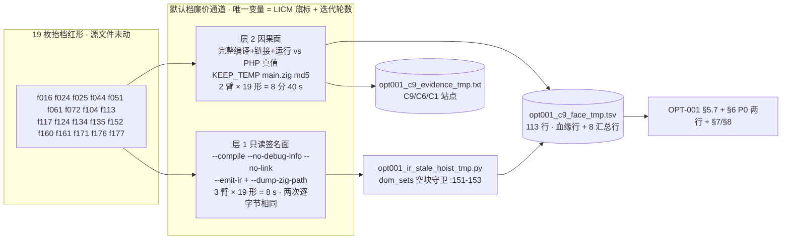
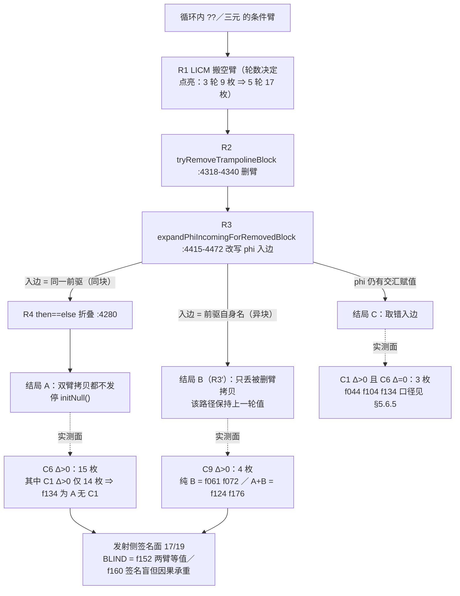
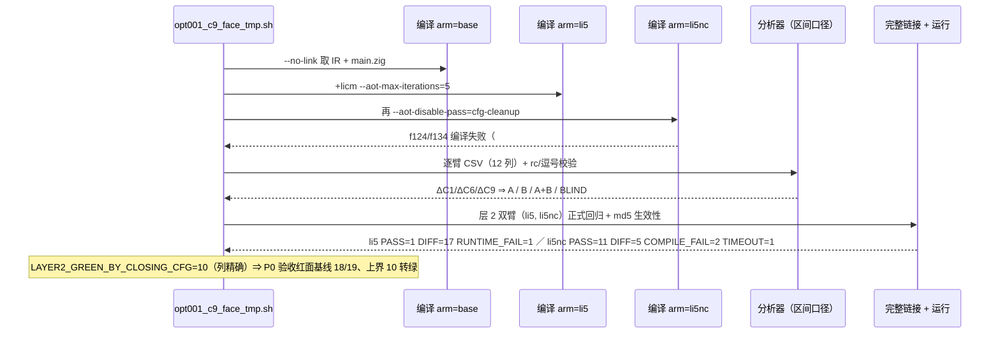
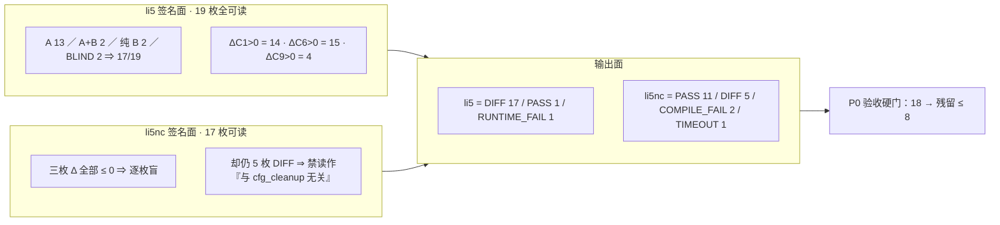
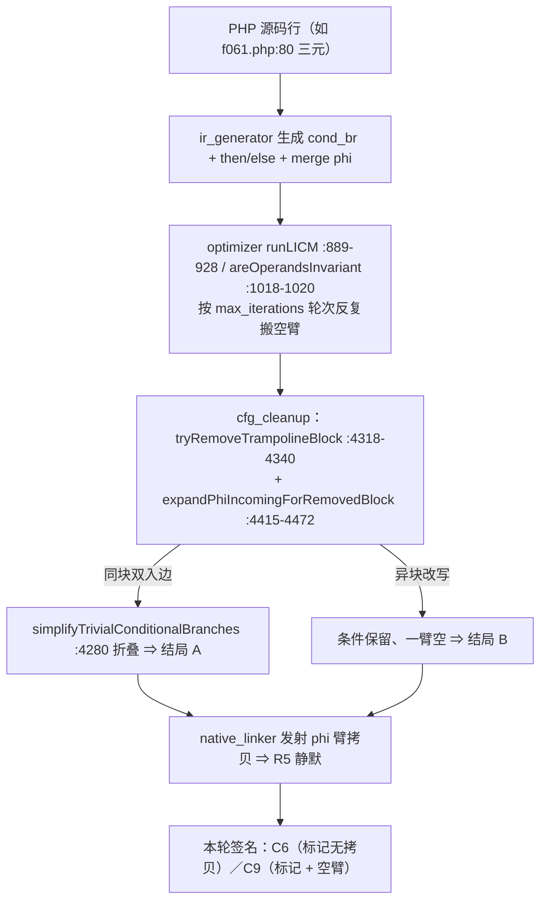

# AOT-OPT-001 §5.7 结局 B 定面 + 默认档廉价复现通道（任务 #100）· 变更摘要

## 1. 高层摘要（TL;DR）

老铁，本轮仍是 **只读取证轮**（零源码改动、零插桩、非门控），把 #99 收尾登记的两条问题（§5.6.4/§5.6.7）在 **19 枚抬档红形整面**上一次性答完：

1. **Q1 结局 B（R3′「异块改写支」，只被 C9 看见）不是孤例**。`li5` 臂（默认档 + `--aot-enable-pass=licm --aot-max-iterations=5`）上 **ΔC9>0 共 4 枚**：**纯 B 2 枚**（`f061` +5、`f072` +2 —— 后者 #97 在 3 轮档判过 `NO_HIT`，属**本轮新点亮**）＋ **A+B 混合 2 枚**（`f124` +1、`f176` +1）。发射侧签名面合计 **17/19**。
2. **Q2 廉价复现通道成立** ⇒ P0 验收从此**不必**再吃 `--optimize=release-fast`：`li5` 在 19 枚里点亮 **18/19 红**（唯一绿 = `f152`，且两臂 `main.zig` 逐字节等值 ⇒ 生效性自证判 `NO_EFFECT`，与 CODEGEN-007「只有内联旗标能引爆」定性一致）。层 1 全量 **8 秒墙钟且两次运行逐字节相同**，层 2 完整链接+运行 **8 分 40 秒**。
3. **迭代轮数是第二个面变量** ⇒ **撤回一条历史假设**：3 轮档 `chain_hit=9`（#97）对 5 轮档签名面 `17/19`。§5.4/§5.6 隐含的「余下 9 枚必另有机制」**作废**——它们只是**没被抬到那一轮**，不是另一种机制。
4. **`f134` 给出一条新的签名分裂：结局 A 可以完全没有 C1**（实测 ΔC1=0／ΔC6=+6／ΔC9=0）。这比 §5.6.7 禁引条 ① 更强 ⇒ **任何以 C1 为前置的发射侧诊断会同时漏掉 `f134`（A 无签名）与 `f061`/`f072`（B 全盲）**，§6 P0 第二条的判据已按此改写为「按生成码自身结构（C6/C9）取数」。
5. **两处口径复现/否证升级**：①`li5nc`（关 `cfg_cleanup`）在默认档廉价通道上 **17 枚可读行三枚签名 Δ 全部 ≤ 0、却仍 5 枚 DIFF**（`LAYER1_LI5NC_HIT_ROWS=0`）⇒ #99 的「签名熄灭但仍红」不是 `release-fast` 特有；②`C4h`／`C4bh` 在**全部 36 行**均为 0 ⇒ 两条否证由「五形面」升级为「整红面否证」；`C7` 在**绿臂同样点亮** ⇒ 再次确认非区分量，§6 P1（限制提升）在本语料给不出红面收益。
6. **关 `cfg_cleanup` 的新转绿上界 = 10 枚**（列精确口径），与 #98 在 `release-fast` 上的读数**逐枚同量** ⇒ 该上界为**档位无关**。

**门控项不变**：OPT-001 §6 P0 主修 + 发射侧诊断（判据本轮再收窄第三条）、PERF-001 §7 三项档位裁决、REF-003 P0（#40）、CODEGEN-006 #81/#84 全部待裁决；本轮**未动一行源码、未提交**。

---

## 2. 影响范围

| 维度 | 影响 | 说明 |
|---|---|---|
| 源码 | **无** | `optimizer.zig` `252234ef…`/6877 无 diff；`native_linker.zig` `fbe6382a…`/32797 仍为 #74 纯注释批 numstat `5 4`；`ir_generator.zig` `cb53c2da…`；冻结二进制 `1f15e4ce…` **未重建**；`git status --short src/` 全轮仅 ` M src/aot/native_linker.zig` |
| 工单结论 | **撤回 1 条、改口 2 条、新增 2 条** | 撤回：「C1 命中的 9 枚之外余下 9 枚必属其它机制」。改口：「结局 B 仅 `f061` 一枚」→「纯 B 2 枚 + A+B 2 枚」；「发射侧诊断可按 C1 触发」→「必须按 C6/C9 的生成码结构」。新增：结局 A 可无 C1（`f134`）；迭代轮数为面变量 |
| 复现通道 | **P0 验收通道换档** | 从 `--optimize=release-fast`（67/67 生成码漂移 + 整档重冻结）换到**默认档 `li5`**（红面 18/19、漂移 0、层 1 八秒） |
| 修复判据 | **第三条实测收窄（不落地，仅登记）** | P0 第二条触发条件不得以 IR 侧 C1 为前置；覆盖面实测 A 类 15 枚 + B 类 4 枚 ⇒ 17/19 |
| 测试面 | **无变化** | 68 语料、19 枚抬档红形、`pass` 集均未动；`.php` 计数 375／573／68 不变 |
| 资产 | **新增永久 4 枚 + 归档 4 枚** | `opt001_c9_face_tmp.sh`、`opt001_c9_face_tmp.tsv`、`opt001_c9_evidence_tmp.txt`、分析器 `dom_sets` 空块守卫；`.tsv` 归档 `.r1-run1`／`.r2-layer1only`／`.r3-f134`／`.rec` |

---

## 3. 核心变更

| # | 变更 | 位置 | 性质 |
|---|---|---|---|
| C1 | **两层合一 harness**：层 1 = 19 形 × `base`/`li5`/`li5nc` 只读签名面扫（`--no-link --emit-ir --dump-zig-path`）；层 2 = 同 19 形 × `li5`/`li5nc` 完整链接 + 运行对 `/opt/homebrew/bin/php` 真值 + KEEP_TEMP 取 `main.zig` md5 做生效性自证 | `fuzzy_scripts_720/tmp/opt001_c9_face_tmp.sh`（新建，永久） | 新永久 harness |
| C2 | **分析器空块守卫**：`dom_sets()` 加 `if not blocks: return {}` —— `f134` 基线 IR（`--base` 侧）曾在此抛 `IndexError` | `fuzzy_scripts_720/tmp/opt001_ir_stale_hoist_tmp.py:151-153` | 取数实现缺陷修复（崩溃曾被伪装成 `BLIND` 行） |
| C3 | **逐臂记账 + 分析器输出校验**：层 1 丢掉 all-or-none 的 `ok` 旗标（一臂编译失败不再连坐同形其余臂）；两支调用均校验退出码与 11 枚逗号（12 列），失败落 `SIG_ANALYZE_FAIL` | 同上 `.sh` | 取数缺陷修复（复算 `f124`=A+B、`f134`=A） |
| C4 | **汇总列限定**：`LAYER2_GREEN_BY_CLOSING_CFG` 加 `$4 ~ /^gen=/` 只计层 2 判定行 ⇒ run 1 的 **11 修正为 10**（`f152` 两臂皆绿、判 `NO_EFFECT`，原被误计） | 同上 `.sh` | 指标口径更正 |
| C5 | **`.rec` 覆盖陷阱登记**：`ONLY=<egrep>` 定点复算固定重写单一 `.rec` ⇒ 规约「需要留证的运行必须跑完立刻 `cp` 归档」写入脚本头注释；主表按血缘行重建（层 1 = run 2 全量、层 2 = run 1） | 同上 `.sh` 头部 + §5.7.5 | 复算通道规约 |
| C6 | **证据落盘**：`f072`/`f124`/`f176`/`f134` 的 C9/C6/C1 站点（寄存器 + `main.zig` 标记行 + `base` 控制组对照）逐枚存档 | `fuzzy_scripts_720/tmp/opt001_c9_evidence_tmp.txt` | 新永久证据文件 |
| C7 | 工单新增 **§5.7**（5.7.1 两层合一读数／5.7.2 结局 B 非孤例／5.7.3 `f134` 分裂／5.7.4 廉价通道与整面否证／5.7.5 四处工具自我更正／5.7.6 遗留）；**§6** 标题行、P0 两行、`#100 更正` 段落；**§7** 资产 4 行；**§8** PERF-001 补 2 条读数；**更新日志**前置 #100 条目 | `docs/known-issues/AOT-OPT-001-licm-multi-iteration-silent-wrong-values.md` | 文档 |

---

## 4. 可视化概览（Code & Logic Map）

### 4.1 分层与影响面



### 4.2 一条链 → 三种发射结局（本轮把面量化）



### 4.3 执行流程（层 1 与层 2 的判据分工）



### 4.4 三层读数的面计数（实测，禁取绝对值）



---

## 5. 变更分析

### 5.1 端／模块层

| 层 | 对象 | 本轮动作 |
|---|---|---|
| 语料端 | `fuzzy_scripts_720/pass` 68 枚 + 19 枚抬档红形 `.php` | **只读**，零改动、零删除 |
| 编译端 | `src/aot/optimizer.zig`（R1/R2/R3/R4）、`src/aot/native_linker.zig`（R5 发射） | **零改动**（代次戳见 §2） |
| 工具端 | `fuzzy_scripts_720/tmp/opt001_c9_face_tmp.sh` + `opt001_ir_stale_hoist_tmp.py` | 新建 1 枚 + 守卫修复 1 处 + 取数缺陷修复 3 处 |
| 文档端 | `docs/known-issues/AOT-OPT-001-…md` | §5.7 全节、§6 P0 两行、§7 资产、§8 关系、更新日志 |

### 5.2 数据侧（`.tsv` 汇总行逐字，全部实测）

```text
LAYER1_DONE total=19 arm_compile_fail=2 arm_rows=36
LAYER1_FACE B_HIT_only=2 A_or_AB=15
causal_eff: EFFECTIVE=16 NO_EFFECT=1 NO_TEMP=2
LAYER2_GREEN_BY_CLOSING_CFG=10
LAYER1_LI5_BLIND_SHAPE=f152_closure_arrow_higher_order f160_virtual_fs_path_traversal
LAYER1_LI5_B_ONLY_SHAPE=f061_graph_dijkstra_bellmanford_floyd f072_type_inference_hindley_milner
LAYER1_LI5NC_HIT_ROWS=0
```

`NO_TEMP` 2 枚 = `f124`/`f134` 的 `li5nc` 臂编译失败（#98 登记的发射侧对 `cfg_cleanup` 的档位无关硬依赖），非取数缺失。

### 5.3 结局 B 站点（`opt001_c9_evidence_tmp.txt`，寄存器 + `main.zig` 标记行）

| 形 | ΔC9 | 站点 | 控制组 |
|---|---|---|---|
| `f061` | +5 | `reg_30`:14712、`reg_60`:26717、`reg_94`:29722、`reg_146`:34278、`reg_219`:40000 | `base` C9=0 |
| `f072` | +2 | `reg_30`（空臂=then）:9846、`reg_208`（空臂=then）:22278 | `base` C9=0 |
| `f124` | +1（与 A 共存） | `reg_90`:13633、`reg_79`:13636、`reg_74`:13639、`reg_68`:13642（四枚连续 ⇒ 同一 if/merge 区域）；C6 另 `reg_301`/`reg_60` | ΔC1=+2／ΔC6=+2 |
| `f176` | +1（与 A 共存） | `reg_268`:29628；C6 侧 7 枚 `reg_114/126/138/150/183/194/314` 与 C1 的 7 枚同源双值 phi 一一对应 | 3 轮档曾 `NO_HIT` |

### 5.4 变更点业务相关代码逻辑（时序，自上而下）



---

## 6. 影响与风险评估

| 项 | 结论 |
|---|---|
| 是否破坏式变更 | **否**。零源码改动、零语料改动、零提交；冻结二进制未重建，基线漂移面 = 0 |
| 影响范围 | 仅工单口径 + 复现通道。真正受影响的是**后续 P0 落地批的验收方式**（换成默认档 `li5`）与**发射侧诊断的判据写法** |
| 需要特别注意的点 | ①**禁引**：`li5` 的 18/19 是「默认档 + 5 轮」的红面，**不得**当作 P0 的验收目标（目标是「残留 ≤ 8」）；②`li5nc` 的「全盲但仍红」**不得**读成「与 `cfg_cleanup` 无关」（#99 症状迁移警示，本轮在默认档复现）；③`C1` 既非症状归属判据、也**非结局 A 的必要条件**（`f134`）；④`C7` 非区分量，绿臂读数更大；⑤`.rec` 单路径每次整体重写 ⇒ 留证运行必须立刻 `cp` |
| 风险 | 主要风险是**口径误用**：面计数依赖双臂 Δ，绝对值有底噪；Δ 可为负（`f044` −2、`f135` −1、`f161` −1），「红臂 < base」不构成否证 |
| 复测路径（体验流程） | ①`bash fuzzy_scripts_720/tmp/opt001_c9_face_tmp.sh`（层 1 全量 ≈ 8 s，`ONLY='.' SKIP_LAYER2=1` 更省）；②`bash fuzzy_scripts_720/tmp/opt001_c9_face_tmp.sh` 全量含层 2（≈ 8 分 40 s，需 `timeout 300` 逐形）；③单形双臂手工复现：`ZIGPHP_AOT_KEEP_TEMP=0 timeout 300 zig-out/bin/php-interpreter --compile --no-debug-info --no-link --aot-enable-pass=licm --aot-max-iterations=5 --emit-ir=/tmp/ir.txt --dump-zig-path=/tmp/z.txt fuzzy_scripts_720/pass/f061_*.php`，再 `python3 fuzzy_scripts_720/tmp/opt001_ir_stale_hoist_tmp.py /tmp/ir.txt --base <base IR> --zig /tmp/z.txt --csv`；④P0 落地后验收：默认档 68 回归 + `DRIFT_DONE diff=0` + `zig build test` + `li5` 臂红面 18 → ≤ 8 |

---

## 7. 遗留问题 / 潜在问题

| # | 问题 | 状态 |
|---|---|---|
| 1 | C9 站点未复核到 PHP 表达式（`f061` 余 4 处、`f072` 2 处、`f124` 4 处、`f176` 1 处），只到寄存器 + `main.zig` 标记行 | 登记，不阻塞（§5.7.6-1） |
| 2 | **逐轮曲线缺失**：3→4→5 的逐轮点亮顺序无插桩读数，只有两面读数（3 轮 9 枚／5 轮 17 枚）⇒「轮数是面变量」已实证，但「哪一轮点亮哪一枚」未知 | 登记（§5.7.6-2） |
| 3 | `f124`/`f134` 的 `li5nc` 编译失败（#98 发射侧对 `cfg_cleanup` 硬依赖）、`f177` 的 `TIMEOUT_10S`（挂起／过慢未区分）三处输出面留洞 | 非签名面问题（§5.7.6-3） |
| 4 | `f160` **三枚签名两臂全 0 却承重**（`li5` RUNTIME_FAIL → `li5nc` PASS）⇒ 现无对应 IR 侧探针；若补，需新写「phi 入边被改写为前驱自身名」的结构列 | 登记（§5.7.6-4） |
| 5 | 六个非 CLI 可达 pass（`sccp`/`copy-propagation`/`gvn`/`advanced_sccp`/`scalar-replacement`/`rc-elision`）**无旗标**，再归因**必须插桩**，越出本轮零插桩边界 | 待老铁点头 |
| 6 | #74 纯注释批（`fbe6382a…`/32797）与最近六轮全部文档/harness 变更**仍未提交**，需「提交」指令 | 待指令 |

---

## 8. 后续开发 / 优化建议

| 优先级 | 建议 | 影响面 | 落地成本 |
|---|---|---|---|
| **P0（建议主修，待裁决）** | **R2 删块准入收紧**：`tryRemoveTrampolineBlock :4318-4340` 在 `expandPhiIncomingForRemovedBlock` **改写之前**判「`target` 的任一 phi 是否以该块为入边且供值与其它入边不同」，命中即拒绝删块 | 修抬档面；默认档本环不触发（`:4319` 已挡）⇒ 发射中性 | 小（一处判据 + 一条注释）。**验收已换廉价通道**：默认档 `li5` 红面 **18 → 残留 ≤ 8** + 68 回归 + `DRIFT_DONE diff=0` + `zig build test` |
| **P0（同批，判据已两次收窄）** | **发射侧静默改可见**：诊断按生成码结构触发 —— `// PHI: reg_N` 存在且该寄存器在本顶层功能区间内无正常流赋值（C6），或该臂为空臂（C9）；**不得**以 C1 为前置 | 实测覆盖 17/19（A 类 15 + B 类 4）；按 C1 触发必漏 `f134`/`f061`/`f072` | 小（`native_linker` phi 臂拷贝路径一处守卫、两条结构共用）。验收：`f016`/`f134`/`f061`/`f072` 的 `li5` 臂从「错值」变编译期报错 |
| **P1（更窄替代，不推荐主修）** | R1 侧限制提升 | 否决条件**不能**写成「块内只剩一条指令」（`f061` 靠两轮先后搬空），只限 `.const_*` **不足**（`.box`/`.cast` 经 `:1018/:1020` 同样提升）；且本轮 `C7` 整面非区分量 ⇒ 收益面在本语料给不出红面证据 | 中（需块内计数） |
| **P2（本轮新增，只读）** | **逐轮插桩**（3→4→5）把「轮数 = 面变量」落到逐枚曲线 | 直接决定 P0 修完之后抬 `max_iterations` 的安全上限 | 需插桩（越出零插桩边界，待点头） |
| **P2（只读，成本已实测为秒级）** | 为 `f160` 补一枚 IR 侧「入边改写为前驱自身名」结构探针 | 把签名盲的因果承重枚纳入面扫 | 小（分析器加一列 + 面扫复跑 ≈ 8 s） |
| **P2（清账）** | 把 `--aot-max-iterations` 的档位含义写入 PERF-001 抬档裁决材料（`:103`=3／`:142`=1／`:163`=3／`:191`=5／`:219`=1） | 避免「默认档 = 1 轮」这一 #99 已作废的隐含假设再次被引用 | 文档级 |

---

**复现与取证资产（永久，禁删）**：`fuzzy_scripts_720/tmp/opt001_c9_face_tmp.sh`、`opt001_c9_face_tmp.tsv`（+ 归档 `.r1-run1`／`.r2-layer1only`／`.r3-f134`／`.rec`）、`opt001_c9_evidence_tmp.txt`、`opt001_ir_stale_hoist_tmp.py`（`dom_sets` 守卫 `:151-153`）。语料与全部探针源未改动、未删除。
