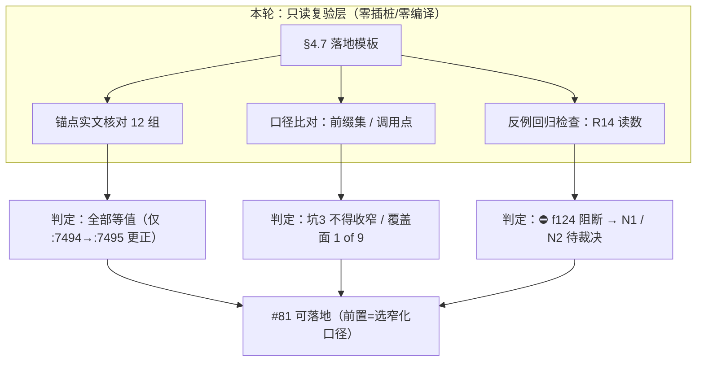
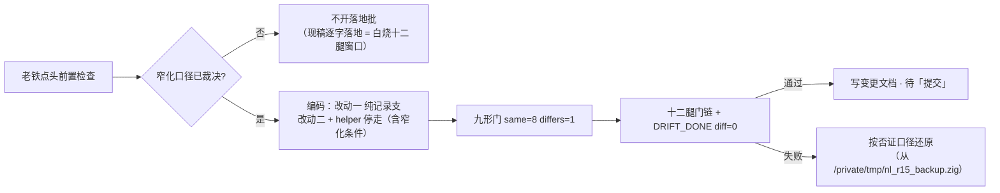
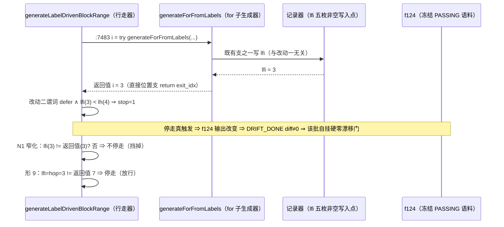
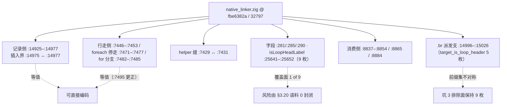

# #81 落地批锚点与口径只读复验（AOT-CODEGEN-006 §3.22）—— 锚点全等值 + 一条 f124 阻断项

**日期**: 2026-10-06
**代次**: `fbe6382a2e0904b6740d771b88c409c7` / 32797 行（= #74 纯注释锚点批工作区代次，本轮**未产生新代次**）
**任务**: #86（本轮）· #81（§4.7 成对候选落地批，前置已变更）· #84（R17 `ttag` 面探针轮，待点头）
**性质**: 零插桩、零编译、零源码改动的只读复验；全部结论落工单 §3.22，本文件为变更摘要。

---

## 1. 高层摘要（TL;DR）

上一轮（§3.21.2 / #85）为 #84 清掉了开轮前置；本轮把同一套方法用在 **#81（§4.7 成对候选）的落地锚点与逐字模板**上，目的是让老铁的「落地」点头能直接换成代码，不必在落地批里再花一整个十二腿编译窗口去寻锚点。三条结果：

1. **锚点全部等值**：§4.7 引用的 12 组锚点（记录侧插入界、`.br` 派发支、行走侧 foreach 停走模板、`for_cond_` 分支、helper 插入缝、字段与签名、消费侧）在 `fbe6382a`/32797 上**逐字成立**，`armFallthroughStop` 名字未被占用（全文件 grep 0 命中）。唯一更正：§4.7 末行把 `while_body_` 测试引为 `:7494`，实为 `:7495`（`:7494` 是注释行），已就地更正。
2. **两条口径收窄（不推翻候选）**：(i) 改动一排除所用的 `isLoopHeadLabel` 有 **9 枚前缀**，而 `.br` 派发支自用的 `target_is_loop_header` 只有 **5 枚** ⇒ 新支守卫**严格宽于**既有派发，坑 3 的排除面**不得收窄为五枚**（收窄即引入 `lfi` 双写风险）；(ii) `self.generateForFromLabels(` 共 **9 个调用点**，只有 `:7483` 把返回值写回行走指针 ⇒ 改动二覆盖面是 1/9，其余八处弃返回值、各自消费 `lfi`，该风险面由 §3.20 的语料 0 命中封闭。
3. **⛔ 阻断项**：改动二的停走谓词与 R14 实测的**唯一反事实读数逐字同形** —— 冻结 PASSING 脚本 `f124_container_orchestrator_pod_service_autoscale` 读 `lfi=3 lh=4 stop=1`，而 f124 的 `lfi` 与改动一无关（非空写入点实测恰五枚）⇒ **成对只消解 R14 的第一半（停走侧无输入），不消解「停走会误伤 f124」这一半**。按现稿逐字落地，该批必挂在自家 `DRIFT_DONE diff=0` 硬零漂移门上。两种收窄口径登记为待裁决：**N1** 停走前加 `lfi != 派发返回值`（推荐）、**N2** 专用新鲜度标记。

**净效果**：#81 的技术不确定性从「锚点是否还在」降为「**窄化口径选哪一条**」；「落地」点头的前置正式改为先裁决 N1/N2。改动一本体不受阻断影响。

---

## 2. 影响范围

| 维度 | 本轮影响 | 量化证据 |
|---|---|---|
| 编译器发射侧代码 | **零影响** | `md5` 仍 `fbe6382a2e0904b6740d771b88c409c7`、`wc -l` = 32797、`git diff --numstat` = `5 4`（#74 纯注释批原样）、`grep -cE 'R1[4-8]\|S09\|armFallthroughStop'` = **0** |
| 生成码 / 语料 | **零影响**（未编译任何脚本） | 无新产物；R15 收尾轮登记的十二腿门链读数（12/12 等值）仍有效，本轮不产生新门读数 |
| 工单口径 | **一节新增 + 三处更正/加固** | §3.22（含 3.22.1–3.22.5）、§4.7 标题下 ⛔ 前置横幅、§4.7 末 `:7494`→`:7495`、状态行末尾刷新、§7 成对候选行「点头前置正式变更」 |
| 任务台账 | #86 结案；#81 由「锚点已备好」改为「**先裁决 N1/N2**」 | 两项仍为唯一在途（且均为 gated） |
| 落地批成本预期 | 若未先裁决即落地 ⇒ 白烧一整个十二腿编译窗口 | 阻断项的代价即此 |
| 覆盖面 | 仅形 9 路线的**落地形态**；形 7 另案（#84） | 形 4 已绿（R9-B），形 7 已由 R16 改判 A/D 类 |

---

## 3. 核心变更

| # | 变更 | 类型 | 依据（实测/推导，逐字标注） |
|---|---|---|---|
| C1 | §4.7 落地模板 12 组锚点在当代次全部等值，插入界 `:14975`↔`:14977` 与 helper 缝 `:7429`/`:7431` 可直接使用 | 复验 | **实测**（实文逐行读，代次 `fbe6382a`/32797） |
| C2 | 前缀集不对称：派发支 `target_is_loop_header` 5 枚 vs `isLoopHeadLabel` 9 枚 ⇒ 坑 3 排除面不得收窄 | 口径收窄 | **实测**（`:14999–:15003` 与 `:25641–:25652` 逐枚比对，宽出 `foreach_body_`/`foreach_increment_`/`for_body_`/`for_loop_`） |
| C3 | 覆盖面 = 9 个 `generateForFromLabels` 调用点中的 `:7483` 一处；风险由 §3.20 语料 0 命中封闭 | 口径登记 | **实测**（调用点 grep）+ **既有读数**（`HOPQ` 语料命中 0） |
| C4 | ⛔ 阻断项：改动二谓词与 R14 的 f124 `stop=1` 读数同形 ⇒ 现稿逐字落地必挂 `diff=0` 门 | 阻断登记 | **实测**（§3.19 `[R14-FOR]` 原文 `lfi=3 stop=1`）+ **实测**（非空写入点恰五枚 `:12814`/`:12972`/`:14925`/`:14963`/`:16551`） |
| C5 | N1 的构造论证写成**单向**（放行集 ⊆ N1 通过集），并证明其**不依赖 f124 的 provenance** | 论证自纠 | 「改动一不 return」为 §4.7 明定口径 ⇒ 其事件恒见 `exit_idx+1 ≠ hop`；直接位置两支 `return exit_idx` 恰等于其写入 `lfi`（3/3 同一条实读） |
| C6 | 共用 helper 必须把「是否要求新鲜」参数化，foreach 侧 `:7471–:7477` 逐字不改 | 落地约束 | **既有读数**（`[R14-FE]` 6 个语料脚本 10 条 `stop=1` 为活路径） |
| C7 | `@NNNN` 形锚点在 #74 卫生批 grep 面之外：`@7026`（×2）有效，`@7702` 失效 139 行（真实置位点 `:7841`） | 顺带发现 | **实测**（逐处读现文，非算术推算）；**未改源码**（注释亦属改动，须点头） |
| C8 | `ttag` 语料面**不可**零插桩回收 ⇒ #84 仍是唯一路径 | 前置替代路径排除 | **实测**（仓内 `*.log` 命中 0；`ttag` 全仓 29 次仅落在本工单与配套变更文档） |
| C9 | 记忆同步：recorder-lead 前置描述 + §3.22 段 + PAIR 段 ⚠ 更正 + 「How to apply」重写；状态记忆 §3.22 段 + Why 行修复；索引两行 | 台账 | 与工单逐字对齐 |

---

## 4. 可视化概览（Code & Logic Map）

### 4.1 分层架构

### 4.2 业务流程（落地批的决策门）

### 4.3 执行流程（阻断项的几何）

### 4.4 锚点地图（本轮复验的站点）

---

## 5. 详细变更分析

### 5.1 端 / 层

| 层 | 本轮动作 |
|---|---|
| 编译器发射侧（`src/aot/native_linker.zig`） | **未触碰**（读取复验，md5 不变） |
| 工单文档（`docs/known-issues/`） | CODEGEN-006 §3.22 新增（5 小节）、§4.7 前置横幅 + `:7495` 更正、状态行末尾、§7 成对候选行 |
| 变更文档（`docs/changes/`） | 本文件（同代次配套，与 R16 文档并列） |
| 记忆（`.qoder/projects/.../memory`） | recorder-lead、status、项目索引 |
| 任务台账 | #86 结案；#81 前置变更 |

### 5.2 涉及文件列表

| 文件 | 类型 | 说明 |
|---|---|---|
| `src/aot/native_linker.zig` | 只读 | 12 组锚点 + 5 枚 `lfi` 写入点 + 9 枚调用点 + `@NNNN` 三处的实文核对 |
| `docs/known-issues/AOT-CODEGEN-006-elseif-chain-arm-loop-lost.md` | 文档 | §3.22（3.22.1 表 / 3.22.2 两口径 / 3.22.3 阻断 + N1/N2 表 + 构造论证 / 3.22.4 `@NNNN` / 3.22.5 `ttag` 不可回收 / 零改动自证） |
| `docs/changes/2026-10-06/落地批锚点复验与f124阻断项_CODEGEN-006_322轮_2026-10-06_fbe6382a.md` | 文档 | 本摘要 |
| `memory/project-aot-codegen006-recorder-lead.md` | 记忆 | §3.22 段 + PAIR 段 ⚠ 更正 + 「How to apply」 |
| `memory/project-aot-status-2026-09.md` | 记忆 | §3.22 段 + frontmatter + 被吞掉的 **Why:** 行修复 |
| `memory/MEMORY.md` | 记忆索引 | 状态行与 recorder-lead 行 |

### 5.3 变更点描述（关键锚点，代次 `fbe6382a`/32797）

| 站点 | 现文（逐字） | 判定 |
|---|---|---|
| `:14925` / `:14935` | `self.last_loop_fallthrough_idx = exit_idx;` / `return exit_idx;` | 等值 |
| `:14940–:14941` / `:14943` | `if (exit_block.terminator) \|term\| {` + `if (term == .cond_br) {` / `return exit_idx;` | 等值 |
| `:14951` / `:14961` / `:14963` / `:14971` / `:14974` / `:14975` | `for_loop_` 测试 / `if (self.in_cond_br_branch) {` / `lfi = exit_idx` / `return exit_idx;` / `return exit_idx + 1;` / 支尾 `}` | 等值，插入界成立 |
| `:14977–:14981` | `try processed.put(exit_idx, {});` + 逐条发射 `exit_block` | 等值（坑 1 成立） |
| `:14996`–`:15026` | `.br => \|br_target\|` / 5 枚 `target_is_loop_header` / 指针反查（`:15009` `error.TargetBlockNotFound`）/ 派发 `:15018` / `return exit_idx + 1;` | 等值 |
| `:7446`–`:7453` | `while (i < end_idx) {` / `return_generated or break_generated` / `markReachableRestBlocks` / `return;` | 等值（坑 4 (i) 成立） |
| `:7465`–`:7478` | foreach 测试 / `const loop_head_idx = i;` / 派发 / 停走七行 / `continue;` | 抄写模板逐字可用 |
| `:7482`–`:7485` | for 测试 / 派发（**无 `loop_head_idx`**）/ `continue;` / `}` | 改动二确为 +2 行 |
| `:7488` / `:7495` | `while_cond_` / `while_body_` 测试 | §4.7 原引 `:7494` 更正 |
| `:7429` / `:7431` | `warnEmptyElseBeforeUnreachable` 收尾 `}` / `fn generateLabelDrivenBlockRange(` | helper 缝等值，`armFallthroughStop` 0 命中 |
| `:8837–:8854` / `:8855–:8856` / `:8858` / `:8859` / `:8865` / `:8884` | `then_end` 求解（不动）/ 清 `lfi` / `defer = true` / 递归行走 / 两枚消费 `if` | 等值 |

---

## 6. 影响与风险评估

| 项 | 评估 |
|---|---|
| 是否破坏式变更 | **否**（零源码改动、零编译、零删除；`git status --porcelain \| grep -c '^ D'` = 0，`.php` 源文件未触碰） |
| 变更影响范围 | 仅文档与台账；发射行为逐字节不变（md5 复证） |
| 需要特别注意的点 | ① 阻断项**改变的是「落地形态」而非「落地可行性」** —— 形 9 的几何在 N1 下由 `3 != 7` 构造性放行；② 共用 helper 必须参数化「新鲜度」要求，否则动到 foreach 的活路径（坑 5 之外再开新风险面）；③ `defer` 置位面与 `then_end` 层依旧冻结（该层已死五次）；④ 收窄后的语料面 0 是「一实测读数 + 两条构造」的**派生**，不是新读数 ⇒ 仍须以落地批的 `DRIFT_DONE diff=0` 复验 |
| 复测路径（体验流程） | 无新门读数；下一轮若落地：`c006_tl_probe_run_tmp.sh`（目标 `same=8 differs=1`）→ `c005_*` 四门 → `D` 旁门 → 漂移 `diff=0` → 官方 68 → 巡检/抽查 → `zig build test` → 从 `/private/tmp/nl_r15_backup.zig` 还原并复验 md5 |

---

## 7. 遗留问题 / 潜在问题

| 优先级 | 问题 | 状态 |
|---|---|---|
| P0 | **#81 窄化口径未裁决**（N1 `lfi != 派发返回值`，推荐 / N2 专用新鲜度标记） | 待老铁裁决；未裁决即落地 = 白烧一个十二腿窗口 |
| P0 | 形 7 仍需独立机制（R16 改判 A/D 类，无 `if_merge_` 对象） | #84（R17 `ttag` 面探针，前置已由 §3.21.2 清完）待点头 |
| P1 | `@7702` 注释锚点失效 139 行 | 已登记未改（注释亦属源码改动）；候选追加行进 #74 未提交批 |
| P1 | 改动一在八处「弃返回值」调用点的新可见性 | 由 §3.20 语料 0 封闭，落地批硬零漂移门复测 |
| P2 | 逐字模板尚未在任何代次上编译过（锚点等值 ≠ 语义正确） | 落地批本身即复验 |
| — | PROC-001 残留：160 枚未入库 `.php` 探针 + #74 纯注释批未提交 | 均待「提交」 |

---

## 8. 后续开发 / 优化建议

| 优先级 | 建议 | 影响面 | 落地成本 |
|---|---|---|---|
| P0 | 裁决 N1（推荐）或 N2，随后开 #81 落地批 | 形 9 一族；决定该批是否挂自家漂移门 | N1 = 停走前 1 枚比较 + helper 增 1 入参；N2 = 新增 1 枚 `self` 字段 + 置位/清除 2 处 |
| P0 | 落地批把 foreach 停走改为「新鲜度是否必需」参数化的共用 helper，旧调用逐字传旧口径 | 6 个语料脚本的活路径（`[R14-FE]` 10 条 `stop=1`） | ≈ 3 行（缝 `:7429`/`:7431`），改动二 +2 行 |
| P1 | #84（R17）单枚 `ttag` 面窄探针轮：stderr-only、语料面先行、形 7 `nmi` 复测即停 | 形 7 是否可与 §7 路线 ③ 完整形态合并裁决 | 一个插桩轮 + 十二腿还原链 |
| P1 | 把「锚点复验先于落地批」固化为流程规约（§3.21.2/#85 与 §3.22/#86 为两次成功案例） | 每个落地批省一个编译窗口 | 文档级（写入 `constitution/PART3_DEVELOPMENT.md` 须老铁亲自决定） |
| P2 | 随「提交」一并入库 `@NNNN` 锚点的 grep 面（`@` 形制），防第三类失效锚点复发 | 注释 hygiene | 1 条 grep 口径 |

---

**本轮零源码改动自证（2026-10-06 实测）**：`md5` = `fbe6382a2e0904b6740d771b88c409c7`、`wc -l` = 32797、`git diff --numstat` = `5 4`（#74 原样）、`grep -cE 'R1[4-8]|S09|armFallthroughStop' src/aot/native_linker.zig` = **0**、`git status --porcelain | grep -c '^ D'` = **0** ⇒ 代次未迁移，不产生新的九形门或漂移门读数；R15 收尾轮的十二腿（12/12）登记值继续有效。
