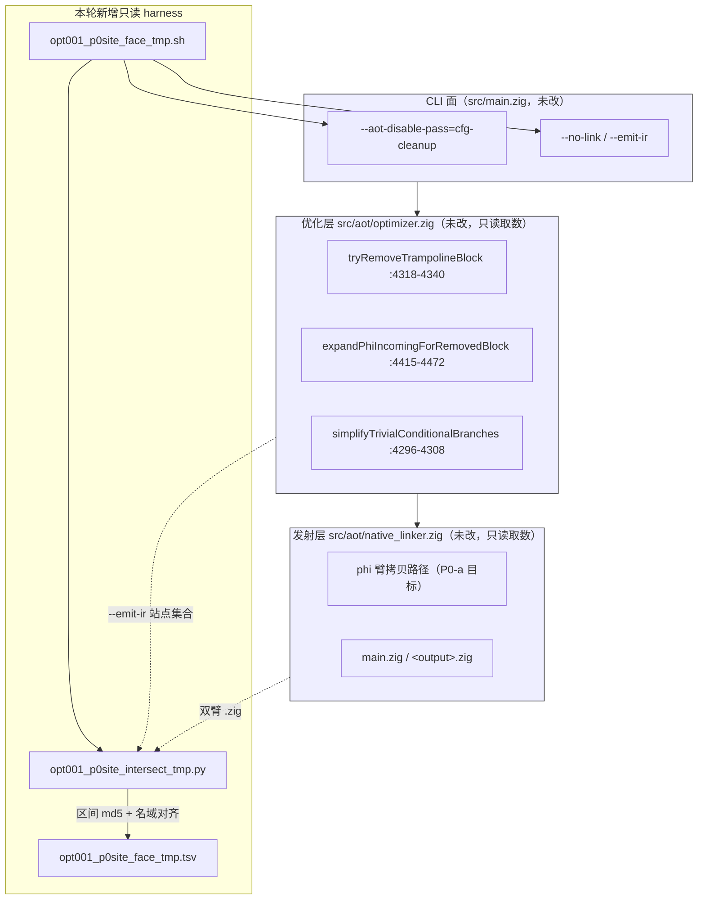
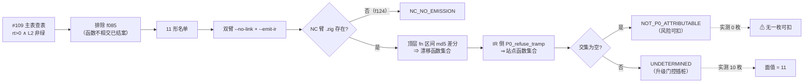
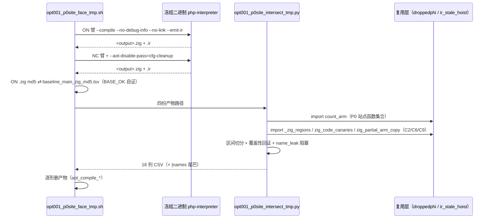
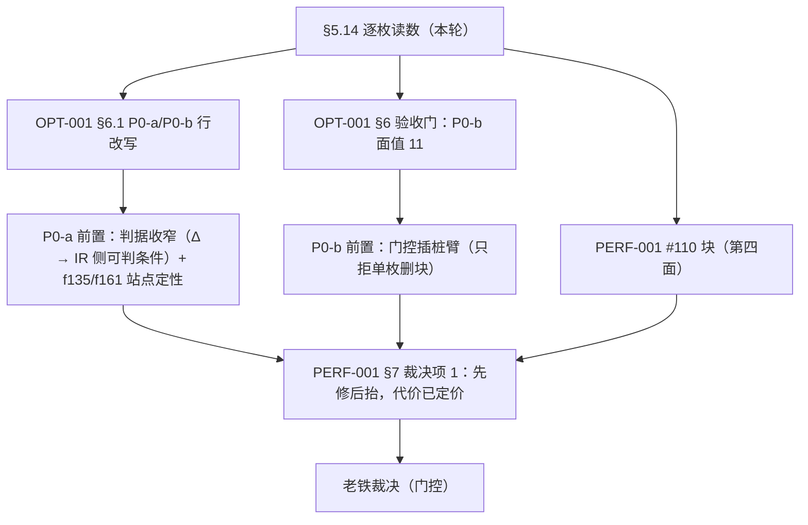

# AOT-OPT-001 逐枚归因面收口（任务 #110）· 变更摘要

> 关联工单：[AOT-OPT-001 §5.14](../../known-issues/AOT-OPT-001-licm-multi-iteration-silent-wrong-values.md)　交叉引用：[AOT-PERF-001（#110 更新日志块）](../../known-issues/AOT-PERF-001-默认优化档位与函数级状态机回退.md)
> 代次：`optimizer.zig` `252234ef48cb47a42e6f39d1bc3e845b`／6877　`native_linker.zig` `fbe6382a2e0904b6740d771b88c409c7`／32797（numstat `5 4` = #74 纯注释批，未提交）　`ir_generator.zig` `cb53c2da7d4fe2e1f62b728511f7c3ea`　冻结二进制 `1f15e4ce9b5c9cdaaef7cabf5efb9c76`（**未重建**）

---

## 1. 高层摘要（TL;DR）

#109 把 P0-b（`cfg_cleanup` 删块判据收紧）的语义风险量到**上界** 12/68（排除 `f085` ⇒ ≤11），但那 11 枚里到底有几枚「P0 拦下的删块根本不在生成码漂移的函数区间内」始终没有读数。本轮（#110）用**同一条零插桩 CLI 通道**做逐枚函数区间对账，得到三条硬结论：

1. **一枚都扣不掉** ⇒ P0-b 的语义风险**面值 = 11**（`NOT_P0_ATTRIBUTABLE=0`／`UNDETERMINED=10`／`NC_NO_EMISSION=1`），且 `P0SITE_FULLY_DRIFTING = 10/10`（`inter == p0_funcs` 恒成立）⇒ **「逐函数白名单」这条退路被实测关闭**。
2. **P0-a 的「结构性零新红风险」被按字面否证** ⇒ 真默认档上 C6／C9 的**绝对在场**恰好落在两枚**当前绿形**（`f135` `c6=3`／`c9=1`、`f161` `c9=1`）上 ⇒ 发射侧诊断若按绝对计数触发，会当场砸编译这两枚绿形 ⇒ **判据必须收窄（Δ 口径 → 转写为 IR 侧可判条件）**。这是本轮最有价值的收获：它把「先做 P0-a 无风险」这句简化成了「先做 P0-a，但先要给它一条不会误伤的判据」。
3. **成本再降两个数量级** ⇒ 逐枚归因走 `--no-link`（同一份 `.zig`）⇒ 全轮 11 形 `ELAPSED=3s`，否证旧估算「2 × 12 秒／形」（那是 KEEP_TEMP 全编译通道）。

**零源码改动、零 `.php` 删除、只读实测 ⇒ 十三轮累计零源码改动。** 门控状态不变：P0-a／P0-b 仍等老铁点头；OPT-001 的**非门控通道至此穷尽**。

---

## 2. 影响范围

| 层 | 对象 | 影响 | 描述 |
|---|---|---|---|
| 源码 | `src/aot/*.zig` | **无** | 四枚戳逐枚等值、二进制未重建；`git status --short src/` 仍仅 ` M src/aot/native_linker.zig`（#74 纯注释批，与本单无关） |
| 工单 | `AOT-OPT-001` | 新增 §5.14（含 §5.14.1 逐形表／§5.14.2 结论）＋改写 §5.13.3 推论、§5.13.4 遗留行、§6 标题行、§6 两行、§6.1 三处、§7 三行、更新日志 | 把「≤11 待定面」换成实测面值 11；把 P0-a 的「零新红」降级为「零删块风险 + 判据须收窄」 |
| 工单 | `AOT-PERF-001` | 新增「#110 逐枚归因面收口」块（5 条）＋更正 #109 块内一处 | 「先修 P0 再抬档」的**代价定价工作结束**，只剩裁决 |
| 资产 | `fuzzy_scripts_720/tmp/` | **新增 3 枚永久资产** | harness + 分析器 + 落盘主表 |
| 语料 | `fuzzy_scripts_720/pass/*.php` | **无** | 68/68 原样；`.php` 总数 375／573／68 三处口径不变 |
| 判定 | §6.1 的动手次序 | **不变** | P0-a → P0-b → 再谈抬档；但 P0-a 前多一步判据收窄 |
| 判定 | 门控清单 | 收窄一项 | 「非门控候选」清空 ⇒ 后续定面必然需要 `optimizer.zig`/`native_linker.zig` 插桩 |

**读数的适用范围**：本轮全部结论为**真默认档（`release_small` 1 轮 = 冻结基线档）**、唯一变量 = `--aot-disable-pass=cfg-cleanup`。⇒ 一切结论是「NC（关整条 pass）近似下」的对账 ⇒ 只能定**上界与可否证性**，不能定 P0 的面值本身（承 §5.13 的上界口径）。

---

## 3. 核心变更

| # | 变更 | 位置 | 性质 |
|---|---|---|---|
| 1 | 新增 §5.14：协议（NC ⇄ ON 生成码按顶层 `fn` 区间取 md5 ⇒ 漂移函数集合 ∩ P0 拒删站点函数集合）+ 三处口径换算（`--no-link` 通道／IR `define @Name(` ⇄ `pub fn @"Name"(` 名域对齐／`rt=` 事件枚数 vs `p0_funcs=` 函数枚数）+ 三条自证 | `AOT-OPT-001` §5.14 | 文档 |
| 2 | 逐形读数表 11 枚（含 `inter` 交集函数清单） | §5.14.1 | 文档（原始来源 = `opt001_p0site_face_tmp.tsv`） |
| 3 | 四条结论：①面值 11 未收窄 ②`FULLY_DRIFTING 10/10` ⇒ 白名单退路关闭 ③`f124` 为唯一「NC 无产物」形（三次复现）④`Σdrift_only_functions=30` 的上界幅值 | §5.14.2 | 文档 |
| 4 | 两条新落地约束：**P0-a 禁按 C6／C9 绝对在场**（`f135`/`f161` 绿形带签名、NC 臂归零）；**NC 非绿 10 枚的机制不是 R1→R5 签名**（C6/C9 全 0、只 C2 上升 ⇒ 「保块不保守」拆成两类破坏） | §5.14.2 | 文档 ⇒ 直接影响 P0-a 的可落地形态 |
| 5 | 成本更正 + `pub fn` 正则坑（首版假判 `NOT_P0_ATTRIBUTABLE`，已由 `name_leak` 阻塞自证挡住） | §5.14（成本／坑两段） | 文档 |
| 6 | §6 标题行补 **#110 = 第四面**；§6 第一行插入面值 11；§6 第二行追加「第四约束（禁绝对在场）」 | §6 | 文档 |
| 7 | §6.1 P0-a 行「结构性零新红风险」→「不新增删块／拦删风险」+ 两条落地前置 + 验收补测；P0-b 行「≤11 待 #110 定面」→ 实测 11；「一句话口径」同步 | §6.1 | 文档 |
| 8 | 新增 harness：名单**查表派生**（`awk` 从 #109 主表取 `L1.refuse_tramp>0 ∩ L2 非绿` 再排除 `f085`）；双臂 `--no-link` + `--emit-ir`；逐形 `BASE_OK` 自证；产物逐形即删 | `opt001_p0site_face_tmp.sh` | 只读工具 |
| 9 | 新增分析器：区间 md5 差分 + 名域对齐 + 覆盖性回证 + `NAME_EXTRACT_FAIL` 阻塞；金丝雀 C2/C6/C9 走 `import` 复用既有实现（**被复用文件零改动**） | `opt001_p0site_intersect_tmp.py` | 只读工具 |

---

## 4. 可视化概览【Code & Logic Map】

### 4.1 分层架构（本轮触及的层，标注「只读」）



### 4.2 归因流程（判定树）



### 4.3 执行流程（单形，实测 3 s／全轮）



### 4.4 上层 → 底层时序（结论如何落到裁决）



---

## 5. 详细变更分析

### 5.1 逐形读数（11 枚，全部实测）

| 形 | 层 2 结局（NC 臂） | `rt` 事件 | 漂移函数 | P0 站点函数 | 交集 | 仅漂移 | 判定 | 交集函数 |
|---|---|---|---|---|---|---|---|---|
| `f027_number_theory_primes_modular` | DIFF | 3 | 4 | 2 | 2 | 2 | UNDETERMINED | `NumberTheory::primeFactors`, `sieveOfEratosthenes` |
| `f061_graph_dijkstra_bellmanford_floyd` | DIFF | 4 | 4 | 1 | 1 | 3 | UNDETERMINED | `WeightedGraph::dijkstra` |
| `f067_json_parser_schema_path_diff` | RUNTIME_FAIL | 3 | 8 | 2 | 2 | 6 | UNDETERMINED | `JsonParser::parseNumber`, `parseObject` |
| `f067_min_repro` | RUNTIME_FAIL | 1 | 1 | 1 | 1 | 0 | UNDETERMINED | `MinJsonParser::parseObject` |
| `f095_compiler_opt_constfold_dce_cse` | DIFF | 2 | 4 | 1 | 1 | 3 | UNDETERMINED | `DeadCodeElimination::optimize` |
| `f117_search_engine_inverted_tfidf_bm25` | DIFF | 4 | 4 | 3 | 3 | 1 | UNDETERMINED | `InvertedIndex::search`, `searchBM25`, `searchTFIDF` |
| `f124_container_orchestrator_pod_service_autoscale` | COMPILE_FAIL | 6 | — | — | — | — | **NC_NO_EMISSION** | NC 臂无生成码 |
| `f135_math_number_theory_crt_miller_rabin` | DIFF | 6 | 4 | 3 | 3 | 1 | UNDETERMINED | `NumberTheory::millerRabin`, `primeFactorize`, `sieveOfEratosthenes` |
| `f161_json_xml_csv_parsing` | DIFF | 1 | 5 | 1 | 1 | 4 | UNDETERMINED | `CsvHelper::parse` |
| `f177_graph_traversal_dfs_bfs` | TIMEOUT_10S | 11 | 5 | 3 | 3 | 2 | UNDETERMINED | `Graph::bfs`, `dijkstra`, `topologicalSort` |
| `f178_numeric_precision_matrix` | RUNTIME_FAIL | 1 | 9 | 1 | 1 | 8 | UNDETERMINED | `Matrix::minor` |

金丝雀列（同轮顺带取，**未改共用分析器**）：

| 形 | C2 ON→NC | C6 ON→NC | C9 ON→NC |
|---|---|---|---|
| `f135` | 40→37 | **3→0** | **1→0** |
| `f161` | 30→30 | 0→0 | **1→0** |
| `f061` | **23→47** | 0→0 | 0→0 |
| `f067_json…` | **15→17** | 0→0 | 0→0 |
| `f177` | **14→16** | 0→0 | 0→0 |
| 其余 6 枚 | 等值或无产物 | 0→0 | 0→0 |

`CANARY_SUM shapes=11 Σc2_on=221 Σc2_nc=246 Σc6_on=3 Σc6_nc=0 Σc9_on=2 Σc9_nc=0`

### 5.2 端／模块层／业务层／数据层

| 层 | 本轮内容 |
|---|---|
| CLI／工具层 | `opt001_p0site_face_tmp.sh`（12,065 B，md5 `c1ebbdf9…`）——查表派生名单、双臂 `--no-link`、逐形基线自证、逐形删产物 |
| 分析层 | `opt001_p0site_intersect_tmp.py`（8,997 B，md5 `0e9f4aca…`）——区间 md5 差分 + 名域对齐 + 覆盖回证 + 提取泄漏阻塞 + 三枚按区间归一的金丝雀 |
| 复用层（**零改动**） | `opt001_droppedphi_tmp.py`（`1a2e02e7…`）的 `count_arm`；`opt001_ir_stale_hoist_tmp.py`（`42b9658c…`）的 `_zig_regions`/`zig_code_canaries`/`zig_partial_arm_copy` |
| 数据层 | `opt001_p0site_face_tmp.tsv`（5,532 B，`b0064b1b…`）：表头 5 枚戳 + 名单来源行 + 11 条 24 列数据行 + 汇总块 15 行 |
| 文档层 | OPT-001 §5.14 及 §5.13/§6/§6.1/§7/更新日志改写；PERF-001 #110 块；本变更文档 |

### 5.3 复测路径

```bash
# 全轮 11 形，约 3 秒（真默认档，双臂 --no-link + --emit-ir）
cd /Users/wangjianjun/products/parser
timeout 300 bash fuzzy_scripts_720/tmp/opt001_p0site_face_tmp.sh
# 单形复算（跳过 shell，直接调分析器；ON/NC 两份 .zig + 两份 .ir）
python3 fuzzy_scripts_720/tmp/opt001_p0site_intersect_tmp.py <ON.zig> <NC.zig> <ON.ir> <NC.ir> --csv --names
```

---

## 6. 影响与风险评估

**是否破坏式变更：否。** 零源码改动、零语料改动、零基线变化；对工单里既有的**判据文本**与**门控状态**均未改动，只改写了「风险定价」与一处「前提的字面强度」。

| # | 风险 | 评级 | 处置 |
|---|---|---|---|
| 1 | **把本轮读数误读成「P0 会改这 30 枚函数」** | 高 | `Σdrift_only_functions=30` 属 **NC（关整条 pass）** 独改面，比 P0 宽得多 ⇒ §5.14.2 结论 4 已写「禁止反向引用」；文档三处（§5.14.2／§6.1／PERF-001）均标「上界」口径 |
| 2 | **把 `p0_funcs=` 读成拒删枚数** | 中 | `rt=` 是事件枚数、`p0_funcs=` 是去重函数枚数 ⇒ §5.14 口径 3 + §7 资产行的 ⚠ 禁令双登记（典型例：`f178` `rt=1`／`p0_all=14`） |
| 3 | **函数名提取退化 ⇒ 假判「可扣除」** | 已闭合 | 本轮真实发生并修复：`^(?:pub )?fn` + `name_leak` 阻塞 ⇒ 提取失败显形为 `NAME_EXTRACT_FAIL` 而非空集；坑已写进 harness 头注与 §5.14 |
| 4 | **`f124` 行的 `coverage=NO`／`err=missing:` 被当成分析器缺陷** | 低 | 事实是 NC 臂**不产生成码**（#103/#109/本轮三次复现的发射侧硬依赖）⇒ 文档明确该形只能插桩，不计入对齐失败 |
| 5 | **共用分析器被改动 ⇒ 历史 TSV 表头登记的分析器 md5 失真** | 已闭合 | 曾评估在本文件里加「按函数区间」的金丝雀输出口径，**否决**：改为 `import` 复用，被复用两文件 md5 复验未变（`1a2e02e7…`／`42b9658c…`） |
| 6 | **产物泄漏 / 误删源** | 低 | 产物一律 `aot_compile_*` 且逐形即删；`.php` 三处计数复验 375／573／68（见 §8 收尾复验） |

**需要注意的点（承 §6.1）**：P0-a 的落地形态已被本轮改写 —— 它不再是「零风险可立即落地」，而是「**零 CFG 风险，但判据须先收窄**」。若老铁只批 P0-a 而不做判据收窄，实测会把 `f135`/`f161` 两枚当前绿形变成编译期报错 ⇒ 该情形属**验收门可捕获**（默认档 68 形输出回归 + `f135`/`f161` 不得转红），但仍是可预防的自伤。

---

## 7. 遗留问题 / 潜在问题

1. **10 枚 `UNDETERMINED` 的逐枚定性只剩门控插桩**：把 NC（关整条 pass）换成「只拒这一枚删块」的真 P0 臂 ⇒ 需改 `optimizer.zig`。**非门控通道已穷尽。**
2. **`f124` 在 NC 臂无生成码**：与 #103/#109 同事实第三次复现，属发射侧对 `cfg_cleanup` 的结构性硬依赖（`[AST-DIRECT-FAIL] … unprocessed blocks: N:if_merge_*`）⇒ 该形的 P0 风险**无法**由任何零插桩通道定面。
3. **P0-a 判据的两处待办**：①`f135` 的 3 枚 C6 站点与 1 枚 C9 站点、`f161` 的 1 枚 C9 站点需逐枚读成「良性」或据此收窄判据；②「臂间 Δ」在发射器单次编译内不可见 ⇒ 必须转写为 IR 侧可判的等价条件（如「本次运行 `cfg_cleanup` 确实删掉了该 merge 的供值臂」）。
4. **NC 非绿 10 枚的破坏机制未定性**：本轮只证明它们**不带** R1→R5 签名（C6/C9 全 0、C2 上升）⇒ 「保块」引出的第二类破坏（C2 = 声明未赋值）尚未归因，可能与 CODEGEN-005/006 家族的臂块摊平逻辑相关，但**禁止互为证据**，需单独取证。
5. **提交积压**（非本单）：#74 纯注释批（`native_linker.zig` numstat `5 4`）仍未提交，等「提交」指令；PROC-001 登记的 160 枚未跟踪 `.php` 探针与冻结基线表同样待裁决。

---

## 8. 后续开发 / 优化建议

| 优先级 | 建议 | 影响面 | 落地成本 |
|---|---|---|---|
| **P0-a（先做，但先收窄判据）** | 发射侧「静默改可见」诊断：`native_linker.zig` phi 臂拷贝路径加守卫；**新增前置** = §7 遗留 3 的 4 处站点定性 + Δ 口径转写为 IR 侧可判条件 | 零 CFG 改动；覆盖面 17/19；不收窄则误伤 `f135`/`f161` 两枚绿形 | 小（一处守卫 + 一条诊断），前置取证约 1 轮只读（`--detail` 通道秒级） |
| **P0-b（后做）** | `tryRemoveTrampolineBlock` `:4318-4340` 删块判据收紧（含 #107 两条改写） | 发射面 ≤23／语义风险面值 **11**（本轮实测，白名单退路已关闭） | 判据本体小，验收面大（三条改写门 + 门 ③ 诊断 + ≤23 枚定向重冻结） |
| **P1（门控插桩，唯一能继续收窄风险的路线）** | 把「只拒单枚删块」做成可开关的实验臂 ⇒ 逐枚定面 10 枚 `UNDETERMINED` | 只影响诊断通道，不改默认行为 | 中（需 `optimizer.zig` 加一处开关 + 一轮 11 形实测；成本已降到秒级／全批） |
| **P2（顺带）** | 把 OPT-001 的「按区间 md5 对账」协议登记为跨工单通用归因通道（CODEGEN-005/006/007 的函数级归因都能复用） | 工具面 | 小（分析器已 `import` 化，可直接复用） |

---

**一句话给老铁**：#110 把 P0-b 的风险从「≤11 待定」钉成「**11，且没法白名单摊平**」，同时第一次证明 P0-a 也不是免费的 —— 它的判据写法会砸两枚绿形；两面都已写进 §6.1，动手次序不变，**门控状态不变，仍等你点头**。
