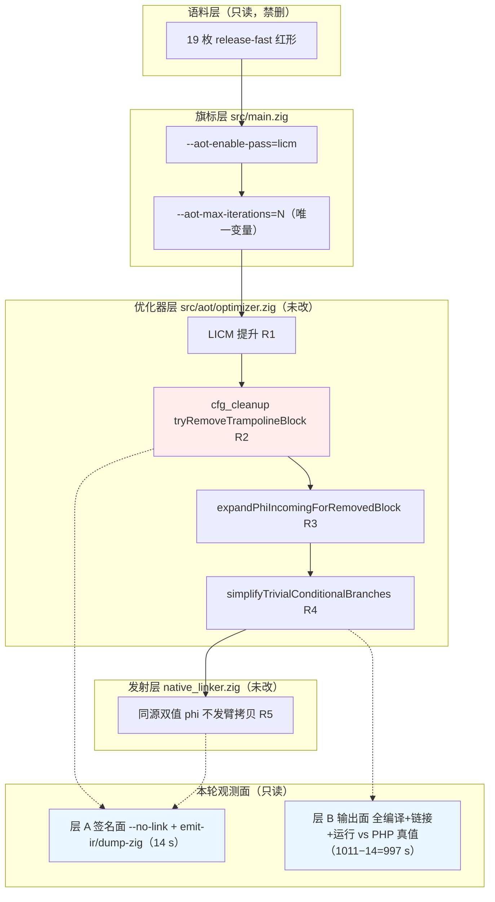
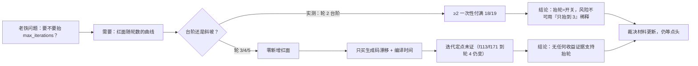
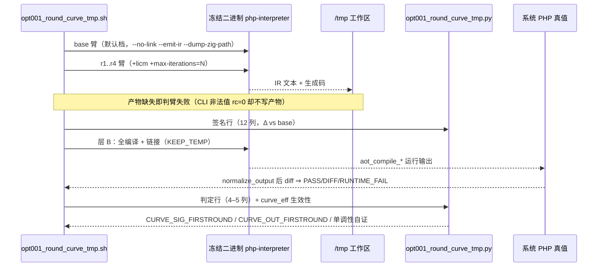
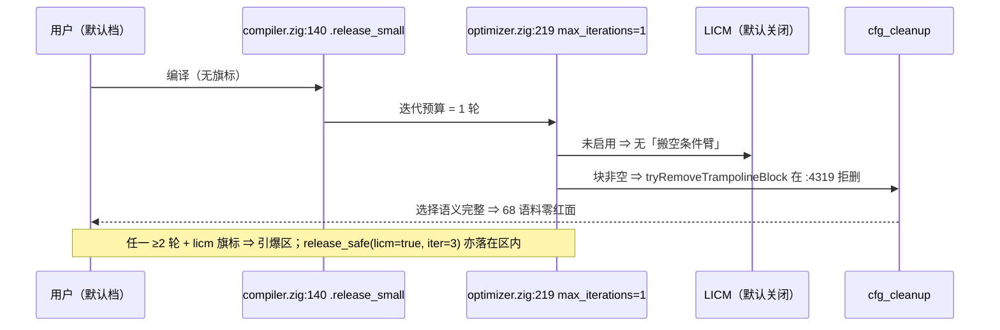

# 变更摘要 · 逐轮（1→5）点亮曲线与 `max_iterations` 迭代维定价（AOT-OPT-001 #101）

**代次戳（本轮全部实测复取，收尾再取一次）**：`src/aot/optimizer.zig` md5 `252234ef48cb47a42e6f39d1bc3e845b`／6877 行；`src/aot/native_linker.zig` `fbe6382a2e0904b6740d771b88c409c7`／32797 行（`git diff --numstat` = `5 4`，#74 纯注释批，仍未提交）；`src/aot/ir_generator.zig` `cb53c2da7d4fe2e1f62b728511f7c3ea`；冻结二进制 `zig-out/bin/php-interpreter` `1f15e4ce9b5c9cdaaef7cabf5efb9c76`（**未重建**）；`git status --short src/` = 仅 ` M src/aot/native_linker.zig` 一行。
**本轮性质**：**只读取证 + 文档落盘，零源码改动、零插桩、无提交**（未收到「提交」指令）。

---

## 1. 高层摘要（TL;DR）

1. **本轮唯一目标**：把 #97 的 `chain_hit=9`（1 轮臂）与 #100 的 `17/19`（`li5` 臂）两个**端点**换成真正的**逐轮曲线**，因为这条曲线是 PERF-001 §7 裁决项 1（是否抬 `max_iterations`）唯一缺的定价输入。
2. **结论：迭代轴是「开关」，不是「刻度」**。判定面（哪一枚红）在**轮 2 一次性到顶** —— 签名面 9 → 17、输出面 7 → 18；轮 3/4/5 **零额外红面**。⇒ 「保守地只抬到 3」与「抬到 5」的红面代价**相同**，风险只由「是否 ≥2」这一个布尔决定。
3. **幅值面（红多少）另有一个封顶点 = 轮 3**：`r2` 与 `r3` 在 **4 枚**形上签名幅值不同（`f117`/`f124`/`f171`/`f176`，命中判定不变），`r3 ≡ r4 ≡ r5` 在四枚签名上 **19/19 逐枚等值**。⇒ 两把尺必须分开陈述，**本轮据此更正了自己上一轮写下的「四臂逐枚等值」这一过强表述**。
4. **计划外最大收益：默认档迭代数口径回滚**。默认 `optimize_level = .release_small`（`compiler.zig:140`）→ `.size`（`optimizer.zig:65`）→ `releaseSmall()` 的 `max_iterations = 1`（`:219`）⇒ **语料默认跑 1 轮**；`optimizer.zig:103` 的 `= 3` 只是结构体字段默认，被四份具名预设全覆盖、**从不生效** ⇒ #99 那条「默认 3 非 1」的"更正"本身是错的，OPT-001/PERF-001 共 8 处已回滚或加注。**当前零红面基线正是靠这个 1 轮维持。**
5. **给 P0 验收省了钱**：最廉价饱和复现通道 = 默认档 + `--aot-enable-pass=licm --aot-max-iterations=2`（判定面与 `li5` 相同，无需 `--optimize=release-fast`）⇒ §6 P0 验收格已回填；仅幅值敏感子项需轮 3。
6. **成本实测（不是估算）**：整轮 harness 自记 `ELAPSED=1011s`，层 A（签名，`--no-link`）19 形 × 5 臂 = 95 臂 = **14 秒** ⇒ 层 B（全编译 + 链接 + 运行 + 对 PHP 真值，76 臂）≈ **52.5 秒／形、13.1 秒／臂**，与 #100 的 13.7 秒／臂同量级 ⇒ **无成本异常**；我运行中按进度点估的「4.3 分钟／形、慢 2.4×」被实测**否证**（偏高 4.8×），估算句已删、只在工单留过程记录。

---

## 2. 影响范围

| 对象 | 影响 | 说明 |
|---|---|---|
| `src/**`（编译器与运行时） | **无** | 零源码改动，冻结二进制未重建 |
| `docs/known-issues/AOT-OPT-001-*.md` | 新增 §5.8（含 5.8.1–5.8.6）、§6 P0 验收格追加、§7 三行资产 + 收尾实测段、更新日志 #101 条 | 本轮主产出 |
| `docs/known-issues/AOT-PERF-001-*.md` | §7 裁决项 1 追加「开关非刻度」定价；#99 日志块的迭代口径作废注 + 两义化改写；新增「更新日志（逐轮定价）#101」块 | 定价结论落地到裁决材料 |
| `fuzzy_scripts_720/tmp/opt001_round_curve_tmp.{sh,py,tsv,r1-layerA}` | 新增永久资产 4 枚 | 复算通道，禁删 |
| 回归基线 / 68 语料 | **无** | 未跑全量回归门；本轮读数全在 19 枚红形子集上 |
| 门控项 | **一条未解** | §6 P0 主修 + 发射侧诊断仍等老铁裁决，本轮只降其验收成本 |

---

## 3. 核心变更（本轮产出的结论性资产）

| # | 结论性资产 | 实测依据 | 用途 |
|---|---|---|---|
| C-1 | 迭代 = 布尔开关：`≥2` 即付满红面 | 签名面逐轮并集 9→17→17→17（+ `r5`≡17）；输出面 `r1: PASS=12 DIFF=7` → `r2..r4: PASS=1 DIFF=17 RUNTIME_FAIL=1` | PERF-001 §7 裁决项 1 定价 |
| C-2 | 判定面封顶轮 2、幅值面封顶轮 3 | 4 枚形 `f117`/`f124`/`f171`/`f176` 的 ΔC1/ΔC6/ΔC9 在 `r2`↔`r3` 间变动；`r3`↔`r4` 逐枚差异 = **0 枚**（脚本重算） | 验收判据必须按「枚」而非「条数」 |
| C-3 | 默认档迭代 = **1 轮**（`.release_small`） | 锚点链 `compiler.zig:140` → `optimizer.zig:65` → `:219`；旁证 = `r1`（显式 1 轮）与 #97 `licm` 臂（默认档）**19/19 四枚 Δ 全等** | 回滚 8 处「默认 3」措辞；说明零红面基线的承重点 |
| C-4 | `r4 ≡ li5`（19/19 判定 + 行数/md5） | TSV 逐枚比对 `# FIXED CURVE` 与 #100 `li5` 列 | 证明 #100 与 #101 是同一观测，可跨 harness 对账 |
| C-5 | 生成码收敛分布（字节口径）= 轮 2 收敛 **9**／轮 3 收敛 **8**／到轮 4 仍变 **2** | `curve_eff` 行 md5 重算 ⇒ `f113` `103365→102572→102042`、`f171` `32105→30876→30716` | 与 §5.8.3 行数口径 9/8/2 **同构互证**；迭代定点未证的实证 |
| C-6 | 签名面 ⇏ 输出面（首轮不同轮） | 同轮 1 = 7 枚；`f104`/`f134` 签名轮 1 亮、输出轮 2 现形；`f160` 签名**全轮盲**却输出轮 2 `RUNTIME_FAIL`；`f152` 两面全绿 | 「禁止互为验收」首张实证表 |
| C-7 | P0 验收可降本到轮 2 档 | C-1 + C-4 ⇒ 判定面在轮 2 已饱和 | §6 P0 验收格已回填 |

---

## 4. 可视化概览（Mermaid）

### 4.1 分层架构 · 本轮读数落在哪一层

### 4.2 业务流程 · 「抬轮」决策是怎么被定价的

### 4.3 执行流程 · 单形逐轮取数时序

### 4.4 时序 · 默认档为何「看起来安全」

---

## 5. 详细变更分析

### 5.1 涉及文件清单

| 文件 | 类型 | 变更 |
|---|---|---|
| `docs/known-issues/AOT-OPT-001-licm-multi-iteration-silent-wrong-values.md` | 工单 | 新增 §5.8（引言 + 5.8.1–5.8.6）、§6 P0 验收格追加、§7 三行资产 + #101 收尾实测段、更新日志 #101 条；回滚 §1/§5.2/§5.6/§5.7 的迭代口径 |
| `docs/known-issues/AOT-PERF-001-默认优化档位与函数级状态机回退.md` | 工单 | §7 裁决项 1 追加迭代维定价；#99 日志块加作废注并把「逐枚等值」改写为两义；文末新增 #101 更新日志块 |
| `fuzzy_scripts_720/tmp/opt001_round_curve_tmp.sh` | 永久 harness | 上一轮已建，本轮未改（`fl_for()` 供旗标、产物存在性守卫、`EFFECTIVE/NO_EFFECT/NO_TEMP`） |
| `fuzzy_scripts_720/tmp/opt001_round_curve_tmp.py` | 永久汇总器 | **本轮修复 `load()`**：`len(p) < 7` 统一守卫 ⇒ 按行类分门槛（签名 ≥7／判定 ≥4） |
| `fuzzy_scripts_720/tmp/opt001_round_curve_tmp.tsv` | 落盘 | 追加 `# CORRECTION` + `# FIXED` 全量重算块（原缺陷块保留不删） |
| `fuzzy_scripts_720/tmp/opt001_round_curve_tmp.r1-layerA` | 快照 | 层 A 全量输出 14,165 B，§5.8.1 读数的原始来源 |
| `src/**` | — | **未改** |

### 5.2 签名面读数（层 A，第 2 代口径：只取对 `base` 的 Δ）

| 臂 | 命中并集（of 19） | ΔC1 | ΔC6 | ΔC9 | 首轮点亮 |
|---|---|---|---|---|---|
| `r1`（= 默认迭代） | 9 | 9 | 6 | 0 | 9 枚 |
| `r2` | 17 | 14 | 15 | 4 | 8 枚 |
| `r3` | 17 | 14 | 15 | 4 | — |
| `r4` | 17 | 14 | 15 | 4 | — |
| `r5`（= #100 `li5`） | 17 | 14 | 15 | 4 | — |

- `CURVE_SIG_FIRSTROUND 1=9 2=8 BLIND=2`（盲 = `f152`、`f160`）；`CURVE_SIG_NONMONOTONIC NONE` ⇒ 无一枚点亮后回灭。
- 幅值抖动 4 枚：`f117` ΔC1 5↔3、`f124` ΔC6 1↔2、`f171` ΔC6 2↔3、`f176` ΔC6 3↔7。

### 5.3 输出面读数（层 B，全编译 + 链接 + 运行 vs `/opt/homebrew/bin/php`）

| 臂 | 判定分布 | 红面 |
|---|---|---|
| `r1` | `PASS=12 DIFF=7` | 7（与 §4 矩阵 `licm` 臂**逐枚同名**：`f016`/`f044`/`f113`/`f117`/`f124`/`f161`/`f177`） |
| `r2`/`r3`/`r4` | `PASS=1 DIFF=17 RUNTIME_FAIL=1` | 18 |
| `r5`（`li5`） | 同 `r4`（**判定 + 行数/md5 19/19 全等**） | 18 |

- `CURVE_OUT_FIRSTROUND 1=7 2=11 GREEN=1`；`curve_eff EFFECTIVE=19/19` ⇒ 无旗标空转。
- 汇总器缺陷与修复：首报 `GREEN=19`（层 B 判定行被 `len(p)<7` 整批丢弃）⇒ 修复后重算得上述读数；**规约**：任何「0 红」读数须先验判定行条数（本轮 76 行）。

### 5.4 收敛面（与红面分离）

| 收敛轮 | 生成码行数口径 | 生成码 md5 口径（本轮重算） |
|---|---|---|
| 轮 1 即恒定 | IR 1 枚（`f152`）／行数 0 枚 | 0 枚 |
| 轮 2 | 9 枚 | **9 枚** |
| 轮 3 | 8 枚 | **8 枚** |
| 到轮 4 仍在变 | 2 枚（`f113`、`f171`） | **2 枚（同两枚）** |

⇒ 两口径同构互证；轮 3/4/5 仍在改 IR 与生成码却**不新增任何红面**。

---

## 6. 影响与风险评估

| 维度 | 评估 |
|---|---|
| 是否破坏式变更 | **否** —— 零源码改动、零产物残留、二进制未重建、基线未动 |
| 影响范围 | 两张工单文档 + 4 枚 `tmp/` 永久资产；68 语料回归门未触发 |
| 结论级风险 | ①「台阶」结论只在**本 19 枚红形 × 本代次**成立，禁止外推为「迭代轴全域安全」；②`release_safe`（`licm=true` ∧ `max_iterations=3`）据锚点判为**落在引爆区**，但**逐形红面未扫** ⇒ 该条是**实测推论**，不得当实测读数引用 |
| 迭代定点 | **未证**：`f113`/`f171` 到轮 4 生成码仍在变；轮 ≥6 未测 ⇒ 任何「轮多必收敛」主张无证据 |
| 口径风险 | 签名面与输出面首轮不同轮（`f104`/`f134` 滞后一轮、`f160` 签名全盲）⇒ 两把尺**禁止互为验收**，P0 的门只按输出面（枚）走 |
| 工具风险（已缓解） | CLI 对非法 `--aot-max-iterations` 值 **`rc=0` 且不写产物**（`src/main.zig:329-331`）⇒ 臂失败判据必须含产物存在性；`/bin/bash` 3.2 禁 `declare -A`、BWK awk 禁三参 `match` 已在脚本内登记 |
| 成本 | 实测整轮 1011 s（层 A 14 s）；后续复算走轮 2 档可再省（无需 `release-fast`） |
| 复测路径（体验流程） | ①`bash fuzzy_scripts_720/tmp/opt001_round_curve_tmp.sh`（全量，harness 自记 **`ELAPSED=1011s`** ≈ 17 分钟）；②`SKIP_LAYER_B=1 ONLY='f016|f061' bash …`（秒级签名面）；③汇总：`python3 fuzzy_scripts_720/tmp/opt001_round_curve_tmp.py`；④最廉价饱和档：`--aot-enable-pass=licm --aot-max-iterations=2` |

---

## 7. 遗留问题 / 潜在问题（工单 §5.8.6 的六条 + 本轮追加一条工具侧）

1. `f160` 签名面**全轮盲**却输出轮 2 `RUNTIME_FAIL` ⇒ 需新 IR 探针才能定位（**待点头**）。
2. 6 枚不可 CLI 的 pass（`sccp`/`copy_propagation`/`gvn`/`advanced_sccp`/`scalar_replacement`/`rc_elision`）的逐轮面未测 ⇒ 必须插桩（**门控**）。
3. 迭代定点未证（`f113`/`f171`）。
4. 轮 ≥6 未测。
5. `release_safe` 档面扫未做（**非门控**，成本已定价：判定面秒级／输出面分钟级）。
6. 逐轮 × `cfg_cleanup` 的两维交互未做（**非门控**）。
7. （工具侧）`opt001_*` 永久分析器仍无跨 harness 的公共取数库，逐轮曲线与 §5.7 面扫各持一份列口径 ⇒ 复用前需人工核对列序。

---

## 8. 后续开发 / 优化建议

| 优先级 | 建议 | 影响面 | 落地成本 |
|---|---|---|---|
| P0 | **先裁 §6 P0 主修**（`tryRemoveTrampolineBlock` 准入收紧，取数须在 `expandPhiIncomingForRemovedBlock` **之前**）+ 同批发射侧诊断（判据按 C6/C9，不按 C1） | 18/19 红面；抬档唯一真实前置 | 判据级改动 1 处 + 诊断 1 处；验收已可走轮 2 档，判定面门约 52 s／形 |
| P0 | 裁决 PERF-001 §7 三项时，把迭代维按「开关」表述：**保持 1 轮 = 本链红面 0；取任何 ≥2 = 一次性付满 18/19** | 档位路线 | 零成本（材料已就绪） |
| P1 | 非门控两扫先做：`release_safe` 档面扫 + 逐轮 × `cfg_cleanup` 两维交互（各约 15 分钟量级） | 中间档风险、判据完整性 | 只读 harness 复用，零插桩 |
| P1 | 为 `f160` 设计新 IR 金丝雀（签名全盲类的通用取数） | 下界探针盲区 | 需 1 枚探针 + 1 轮面扫 |
| P2 | 迭代定点专项：`f171` 的 `C7` 振荡（实测 `r1..r4` = 15→19→16→15）作首选样本，配 `copy_propagation` 振荡注释（`optimizer.zig:220`） | 长期稳定性 | 需插桩，**门控** |
| P2 | 把四份 `PassConfig` 预设的 `max_iterations`/`licm` 组合做成一张「档 × 旗标 ⇒ 引爆区」对照表，随工单维护 | 防止再次误读字段默认值 | 半页文档 |

**门控声明**：本轮未写一行源码、未提交。§6 P0 主修 + 发射侧诊断（判据口径同 #100）、P1 限制提升、PERF-001 §7 三档裁决、REF-003 P0（#40）、CODEGEN-006 #81（须先裁 N1/N2）/#84（R17）仍全部**等老铁点头**。

---

## 附：本轮清理确认（全部为末次实测读数）

- `/tmp` 工作区：`opt001_roundcurve_sig`／`opt001_roundcurve_run`／`opt001_roundcurve_b.log`／`curve_fixed.txt` 已删除 ⇒ `ls /tmp | grep -E 'opt001|curve_fixed'` = **0**。
  （过程登记：首条 `rm -rf /tmp/opt001_*` 被安全闸门拦停 ⇒ 改逐条显式路径删除，删后复验残留 0。）
- 仓库：`aot_compile_*` = **0**、`.zigphp_aot_build_*` = **0**；一次性核对脚本 `opt001_round_curve_conv_check_tmp.py` 已删除。
- `.php` 计数 **375（`fuzzy_scripts_720`）／573（全局）／68（`pass` 语料）不变、零删除**。
- 代次戳（收尾重取）：`optimizer.zig` `252234ef…`／6877、`native_linker.zig` `fbe6382a…`／32797（numstat `5 4`）、`ir_generator.zig` `cb53c2da…`、二进制 `1f15e4ce…` 未重建；`git status --short src/` 仅 ` M src/aot/native_linker.zig`。
- 本轮新增永久资产 **4 枚**（`.sh`／`.py`／`.tsv`／`.r1-layerA`），另在 TSV 内追加 `# CORRECTION` + `# FIXED` 两个块（原缺陷块保留供口径追溯）。
