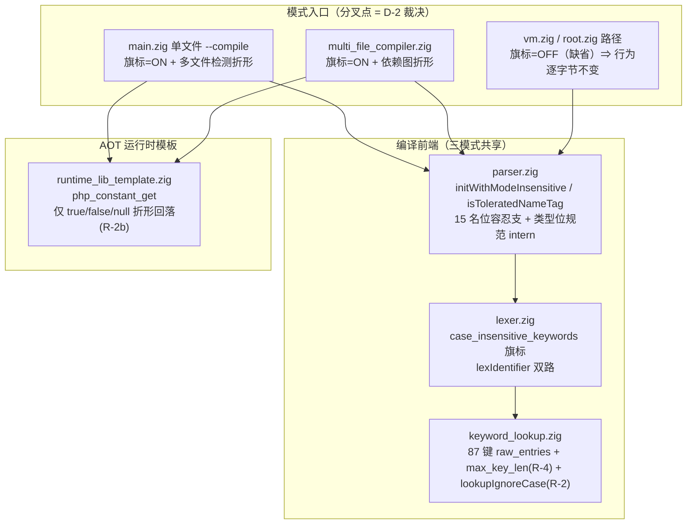

# AOT-CODEGEN-010 R-2 批落地与名位长尾补洞_R122_2026-10-07_fbe6382a

## 1. 高层摘要（TL;DR)

1. **AOT-CODEGEN-010 的修复批（R-2/R-2b/R-4 + 名位补洞）落地并全量验收**：PHP 关键字大小写不敏感支持缺失（非全小写拼写在 lexer 查表坍成标识符 ⇒ 五种结局）自此在 **AOT 编译模式**修复，解释器/字节码模式按 D-2 裁决**逐字节保持现状**（旗标门控分叉）。
2. **验收面**：门 H 79 形穷举 **face 59→1**（残面 k_unset = 调用名解析独立缺陷，非回归）+ **探针编译失败 25→0** + **过度识别反例组 inverse_face 15→1**（残红 invf_go = 外族词运行碰撞）；门 E/F/G 全数收敛且守卫臂零越界；门 H2 成因面不变；门 I `aot_same=19` 且 **tree/bc 读数与冻结注册值逐项一致**。
3. **冻结基线零漂移实测**：影子门 68 语料 `main.zig` md5 **68/68 逐字节一致**；主回归 **Pass 67 / Skip 1** 保持（f004）。
4. **落地过程被门实测打回一轮**：首批只补工单编目的两处硬名位 ⇒ 守卫探针 `function Get()`/`class With` 由今日绿转编译失败（失败点后移到调用位/`new` 位/`instanceof` 位）⇒ 第二批扩至 **15 处名位容忍支 + 第四面孔**（main.zig 多文件检测 + dependency_resolver 关键字匹配折形）后全绿 —— 印证「门 H 反例组 + 守卫探针」判据的必要性。
5. **裁决执行记录**：D-1=甲（同批补洞）｜D-2=分叉（仅 AOT）｜D-3=五枚独立缺陷并入本单（§8，另接纳 2 枚验收残面）｜D-4=死桩维持现状｜D-5/D-2b/D-6/D-7 未获答复按保守口径（D-5 不修、D-7 零提交）。

## 2. 影响范围

| 维度 | 范围 |
|---|---|
| 执行模式 | **仅 AOT 编译路径**（单文件 `--compile` + 多文件编译器）；解释器（tree）/字节码（bytecode/fast）模式经旗标缺省关 + 门 I 实测读数逐项不变 |
| 编译阶段 | lexer 查表 → parser 名位/类型位 → main.zig 多文件路由 → dependency_resolver 依赖图 → AOT 运行时常量查名（R-2b） |
| 源码 | 8 文件 **+268/−78 行**（git diff HEAD 实测，含上一会话 #74 的 native_linker.zig 纯注释批 5+/4-） |
| 非源码资产 | 新增影子门脚本+TSV、验收链脚本；六门 TSV 全量重跑刷新为落地后读数（修复前值已备份 `/tmp/c010_prefix_backup/tsv/`）；工单回填至 475 行 |
| 二进制 | `zig-out/bin/php-interpreter`：`1f15e4ce…`（冻结）→ `a71d97d7bef21bbcc853424cd320498f`（落地下） |

## 3. 核心变更

| # | 变更 | 文件 | 内容 |
|---|---|---|---|
| 1 | **R-2 查表大小写不敏感** | `keyword_lookup.zig` | 87 枚键抽出为 `raw_entries` 单一事实源；新增 `lookupIgnoreCase`（原文折小写查 80 枚 k_ 键 + 折大写查 7 枚 m_ 键，两族大小写互斥无交叉误命中；栈上折形零分配）；4 枚单测（含 87 键 × 3 拼写变体穷举） |
| 2 | **R-4 长度上限按表计算** | `keyword_lookup.zig` + `lexer.zig` | `max_key_len`（comptime 求表内最长键 = 13）替换硬编码 `len <= 15`（行为等价：表内无 14-15 字符键） |
| 3 | **旗标分叉** | `lexer.zig` + `parser.zig` + `main.zig` + `multi_file_compiler.zig` | `Lexer.case_insensitive_keywords`（缺省 false）；`Parser.initWithModeInsensitive` 在预取 curr/peek **前**置位；仅 AOT 两入口使用 |
| 4 | **名位容忍支 ×15** | `parser.zig` | `isToleratedNameTag`/`eatNameIdentifier`（t_string 恒可；旗标开时 74 基础 + 6 扩展 tag 可作名位标识符，token 文本仍取原文切片）：顶层函数名、类名×2（parseContainer/WithModifiers）、namespace、use 名/别名、分组 use 成员/别名、属性名、enum case、const、goto 标签、`${name}`；`isAotExtendedKeywordIdentifierTag` = 5 枚 `end*` + `.k_struct`（修 invm_struct） |
| 5 | **表达式主位/instanceof/类型位扩展** | `parser.zig` | parsePrimary else 臂（守卫 p1 `echo Get();` 调用位）；instanceof RHS（守卫 p2）；parsePrimaryType 旗标 catch-all（守卫 `function f(Get $x)`）+ **内置类型名规范小写 intern**（修 `Callable` TypeError 残面；小写输入下与原文等值 ⇒ 旗标关路径不变） |
| 6 | **R-2b 常量表** | `runtime_lib_template.zig` | `php_constant_get` 精确未命中后，仅 `true/false/null` 三枚关键字常量名按 `eqlIgnoreCase` 回落规范键（`name.len <= 5` 早退）；php_int_max/用户常量保持敏感（门 G 守卫臂 `guard_red=0` 实证未越界） |
| 7 | **第四面孔：源文本关键字检测折形** | `main.zig` + `dependency_resolver.zig` | needs_multi_file 检测 haystack 折小写（启发式字符类不受折形影响）；`matchKeyword` 改 `eqlIgnoreCase` —— `Include "x.php";` 漏检曾致误走单文件 ⇒ include_stmt 无人消费而整句静默 |

## 4. 可视化概览（Code & Logic Map）



```mermaid
sequenceDiagram
    participant S as PHP 源码(混合大小写)
    participant M as main.zig --compile
    participant L as Lexer
    participant P as Parser
    participant G as 生成码 main.zig
    S->>M: Include "x.php"; / Echo "e";
    M->>M: 折形检测 include 关键字(第四面孔) ⇒ 多文件路由
    M->>L: initWithModeInsensitive(旗标 ON)
    L->>L: lookupIgnoreCase：折小写查 k_ 键 / 折大写查 m_ 键
    L-->>P: k_include/k_echo token（文本仍原文切片）
    P->>P: isToleratedNameTag ⇒ 名位/主位容忍支（原文 intern）
    P-->>G: IR/发射（影子实测 68 语料 md5 与冻结基线逐字节一致）
    G->>G: 运行期 php_constant_get：仅 true/false/null 折形回落(R-2b)
```

## 5. 详细变更分析

| 层 | 文件 | 变更点 | 关键设计约束 |
|---|---|---|---|
| 数据层 | `keyword_lookup.zig` | 键表单一事实源化；`max_key_len` comptime；`lookupIgnoreCase` 双向折形 | 折形落栈上 ≤13 字节缓冲，零堆分配；旗标关路径查表指令序列不变（§二-4 性能） |
| 词法层 | `lexer.zig` | 旗标字段 + lexIdentifier 分叉 | 旗标读为一次可预测分支；token 文本恒为原始切片 |
| 文法层 | `parser.zig` | 构造函数族抽 `initFromLexer`（DRY）+ 新增 `initWithModeInsensitive`（旗标须在 curr/peek 预取前写入，Lexer 按值内嵌事后补设会漏首两枚 token）；15 处名位 + 主位/instanceof/类型位 | 旗标关时每个容忍支与原 `eat(.t_string)` 逐字节等价（含错误路径）；`m_*` tag 不入容忍清单；`isKeywordIdentifierTag`(74)/死桩(:3756-3759 D-4 维持现状)未动 |
| 入口层 | `main.zig` | AOT 入口置旗标；needs_multi_file 折形 haystack | 折形副本仅用于检测（字母折叠不改启发式字符类）；解释器入口 ：508 不动 |
| AOT 编译层 | `multi_file_compiler.zig`、`dependency_resolver.zig` | 多文件入口置旗标；matchKeyword 折形 | 依赖图建边与路由口径一致，防「路由进多文件但建边漏检」 |
| AOT 运行时 | `runtime_lib_template.zig` | php_constant_get 三枚关键字常量名折形回落 | 守卫边界：非关键字内置常量/用户常量恒敏感（门 G guard_red=0 实证） |

## 6. 影响与风险评估

- **是否破坏式变更**：否。旗标门控分叉使解释器/字节码行为逐字节不变（门 I 四项读数与冻结注册值逐项一致）；AOT 侧 68 语料影子 md5 零漂移、主回归 Pass 67/Skip 1 保持。对 AOT 模式是**纯能力增加**（原先因查表落空侥幸通过的形态继续通过并走上正确语义路径）。
- **变更影响范围**：编译前端全 token 流仅在 AOT 模式受旗标影响；影子实测证明对现网合法语料**发射中性**。
- **需要特别注意的点**：
  1. `initWithModeInsensitive` 必须保持「预取前置旗标」——后续重构构造函数族时不可改为构造后补设；
  2. 门 H 的 H TSV 已刷新为落地后读数，修复前读数以本工单锚点表 + `/tmp/c010_prefix_backup/tsv/` 为准；
  3. 影子 TSV 末行汇总为超时后手工补记（136 行数据行完整、awk 汇总被 2400s 超时截断）；
  4. 残面 `k_unset`/`invf_go` **不是回归**（修复前同面同红/同 Fatal），归属见工单 §8。
- **复测路径（全部实测）**：
  ```bash
  cd /Users/wangjianjun/products/parser
  timeout 120 zig build && timeout 590 zig build test          # 21/21 步骤、326/326 测试 ✅
  timeout 2400 bash fuzzy_scripts_720/tmp/c010_shadow_main_md5_tmp.sh   # 影子 68/68 ✅
  timeout 480 bash fuzzy_scripts_720/tmp/c010_keyword_case_gate_tmp.sh  # E ✅
  timeout 300 bash fuzzy_scripts_720/tmp/c010_mechanism_gate_tmp.sh     # F ✅
  timeout 300 bash fuzzy_scripts_720/tmp/c010_constant_case_gate_tmp.sh # G ✅
  timeout 900 bash fuzzy_scripts_720/tmp/c010_kw_full_table_gate_tmp.sh # H ✅
  timeout 300 bash fuzzy_scripts_720/tmp/c010_noface_tolerance_gate_tmp.sh # H2 ✅
  timeout 480 bash fuzzy_scripts_720/tmp/c010_crossmode_gate_tmp.sh     # I ✅
  timeout 1800 bash fuzzy_scripts_720/run_regression.sh                 # Pass 67/Skip 1 ✅
  ```

## 7. 遗留问题 / 潜在问题

1. **§8 七枚独立缺陷未修**（D-3 并入）：`and` 求值错、`var` 声明编译失败、`goto` 尾部消失、`iterable` 拒数组+`$$a` 消息、`__NAMESPACE__` 空串、函数名大小写不敏感解析缺失（k_unset 残面）、外族词运行碰撞（invf_go 残红）——逐枚需单独门控。
2. **已知边界（登记未修）**：标签定义位 `Get:` 语句路由、`parseCallArg` 命名参数名位未并扩展 6 枚、表达式位 `echo Include "f";` 的过度接受、`defined()` 的大小写语义未测。
3. **D-5/D-6/D-7 悬置**：字节码 VM popFast panic 未修（§五 默认）；`--compile` 解析失败 rc=0 流程项维持登记；六门未入官方门链、**全部资产零提交**（未获「提交」二字）——#63 同族丢失风险仍在。
4. **影子门超时预算偏紧**：2400s 实测仍被掐（68×2 编译 ≈2600s），后续复跑建议 3600s。

## 8. 后续开发 / 优化建议

| 优先级 | 建议 | 影响面 | 落地成本 |
|---|---|---|---|
| **P0** | 老铁明示「提交」后按交接 §6 切分入库：① #74 注释批；② 本批 8 文件 + 工单 + 六门/影子资产 + 变更文档 | 资产防丢（#63 同族） | 零成本（资产已就绪） |
| **P1** | §8 #6 函数名大小写不敏感解析（运行期注册表折形查名）——收掉 k_unset 残面，现网 `Get()` 式调用即命中 | 运行期函数查名全域 | 未实测；需评估与 `resolveName`/内建表关系 |
| **P1** | §8 #2/#3（`var` 声明、`goto` 发射）合法语法面 | 解析/发射面 | 单枚量级，另批 |
| **P2** | §8 #7 外族词出表（`go/get/set/lock/with/from/struct`）+ Go 模式联动设计 | 词表 + Go 模式 | 需先设计后评审 |
| **P2** | 标签定义位路由、`parseCallArg` 扩展、表达式位 include 语义 | parser 边缘位 | 单点小改 |
| **P2** | R-3 金丝雀（零指令断言）按 §5 原口径另批 | 发射期防回归 | 未实测 |
