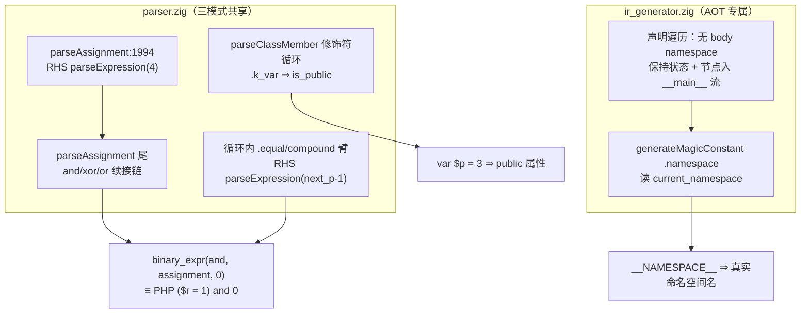

# AOT-CODEGEN-010 §8 三批修复（赋值优先级 / var 声明 / __NAMESPACE__）_R123_2026-10-07_fbe6382a

## 1. 高层摘要（TL;DR）

1. **工单 §8 七枚独立缺陷中的三枚（#1/#2/#5）修复落地并全量验收**：①赋值 RHS 优先级（`$r = 1 and 0` ≡ `($r = 1) and 0` PHP 语义）；②`var` 属性声明（PHP4 风格隐式 public）；③`__NAMESPACE__` 魔术常量取真实命名空间名。
2. **首版 #1 被门 D8 实测打回一轮**：RHS 截断后尾随 `and 0` 悬空 ⇒ d1a/d1b 转 COMPILE_FAIL ⇒ 补「赋值节点之上的 and/xor/or 续接链」后全绿 —— 门 D8 的「未修复形保持红 + 控制臂不动」双向判据首次完整发挥。
3. **验收全绿**：门 D8 `defect_red 7→4 / guard_same 6→10 / compile_fail 1→0`；门 H `confounded 5→2`（k_and/k_var/m_namespace 转绿，余 k_goto/k_iterable 属未修批）、`ctrl_compile_fail 1→0`、`face=1` 与反例组 `inverse_face=1` 不变；门 H2/I 与 E/F/G 读数全部符合预期（门 I tree/bc **逐项不变**）；影子 68 语料 `main.zig` md5 **68/68 一致**；主回归 **Pass 67 / Skip 1** 保持。
4. **本轮源码改动 2 文件 +37/−6**（parser.zig、ir_generator.zig）；#1/#2 属共享解析层 ⇒ 解释器/字节码模式同面同批改善（与 R-2 的旗标分叉不同：这三枚是共享层真缺陷，修一处三模式同受益）；#5 属 AOT 专属 ir_generator，天然仅 AOT。
5. 修复代二进制 `f47263c25428ee14269ba4a985427c15`；R-2 批已由老铁本人以 `b92f206`（提交说明「11」）入库，本轮修复在其上**未提交**。

## 2. 影响范围

| 维度 | 范围 |
|---|---|
| 执行模式 | #1/#2：三模式共享 parser ⇒ 同批改善（含解释器/字节码）；#5：AOT 专属 |
| 语法面 | ①赋值语句 RHS 含 `and`/`or`/`xor` 的绑定（语料 0 处）；②类体内 `var` 属性声明（语料 0 处）；③`__NAMESPACE__` 取值（语料 0 处） |
| 源码 | `parser.zig` +30/−4（4 处）、`ir_generator.zig` +13/−2（2 处） |
| 门资产 | 门 D8 刷新为修复代读数；影子门脚本汇总 awk 修复（`END` 关键字误用 bug）；六门全量重跑 |

## 3. 核心变更

| # | 变更 | 文件:位置 | 内容 |
|---|---|---|---|
| 1a | parseAssignment RHS 优先级 | parser.zig:1994 区 | `parseExpression(0)` → `parseExpression(4)`（赋值 prec 5 右结合 ⇒ RHS=4），使 `and/or/xor` 截止在赋值之外 |
| 1b | 循环内赋值/复合赋值臂 | parser.zig `.equal`/compound 臂 | `parseExpression(precedence)` → `parseExpression(next_p - 1)`（同 star_star 右结合惯例） |
| 1c | 低优先级逻辑符续接链 | parser.zig parseAssignment 尾 | 赋值节点之上以 while 链续接 `and(4)>xor(3)>or(2)`（族内左结合），消除截断后的悬空 token |
| 2 | `var` 修饰符臂 | parser.zig parseClassMember 修饰符循环 | `.k_var => modifiers.is_public = true`（PHP4 风格隐式 public） |
| 3 | `__NAMESPACE__` 读状态 | ir_generator.zig `.namespace` 臂 | `internString("")` → `internString(self.current_namespace orelse "")` |
| 4 | 无括号 namespace 语义 | ir_generator.zig 声明遍历 | 无 body 分支不再立即恢复 `current_namespace`，且节点按源顺序追加进 `__main__` 语句流（多段无括号 namespace 按序正确；大括号块 prev_ns 恢复不变） |

## 4. 可视化概览（Code & Logic Map）



```mermaid
sequenceDiagram
    participant S as PHP 源
    participant P as Parser
    participant IR as ir_generator
    participant D8 as 门 D8
    S->>P: $r = 1 and 0; / var $p = 3; / namespace Foo; __NAMESPACE__
    P->>P: RHS(4) 截断 → 赋值节点 → and 续接链
    P->>IR: AST（var ⇒ public 属性节点）
    IR->>IR: namespace 节点入 __main__ 流 → current_namespace 维护
    IR-->>D8: d1a/d1b/d2a/d5a 转绿；d3a/d6a/d6b/d7a 保持红；GUARD_SAME 六臂不动
```

## 5. 详细变更分析

| 层 | 变更点 | 设计约束 |
|---|---|---|
| 解析层 | #1 双位点 + 续接链 | 右结合惯例与 star_star 臂一致；`and(4)>xor(3)>or(2)` 族内左结合；chained `$a=$b=1` 仍成立 |
| 解析层 | #2 k_var 臂 | 仅 parseClassMember 一处（类级修饰符循环不收 `var`）；语义 = 隐式 public |
| IR 层 | #5 状态读取 + 无括号 namespace 入流 | 大括号块 prev_ns 保存/恢复语义不变；多段无括号 namespace 按源顺序在 `__main__` 生成期逐节点生效 |
| 门资产 | 门 D8 两代读数；影子门 awk 修复 | 先修门后引用；首跑（漏 `<?php`）读数作废 |

## 6. 影响与风险评估

- **是否破坏式变更**：否。语料三触发面全 0 ⇒ 影子 68/68 md5 一致、主回归 Pass 67/Skip 1 保持；门 I tree/bc 逐项不变。
- **需要特别注意**：①#1 改变所有赋值 RHS 的绑定——任何依赖「`and/or/xor` 被吸进 RHS」旧错误行为的现网脚本会从静默错值转为正确值（行为变化即修复本身）；②#5 使 `__NAMESPACE__` 从恒空串变为真实名——依赖空串的脚本行为改变（同为修复）；③R-2 批已由老铁以 `b92f206` 入库，本轮 2 文件未提交。
- **复测路径**：`zig build && zig build test`（326/326 ✅）→ 门 D8（`defect_red=4 guard_same=10` ✅）→ 链 III 六门+影子+回归（✅）。命令与超时同工单 §6。

## 7. 遗留问题 / 潜在问题

1. §8 余四枚未修：#3（goto 发射侧子轮定行）、#4（iterable+`$$a`）、#6（函数名大小写解析）、#7（`go` 内建遮蔽）——#6/#7 需解析序设计评审（用户函数优先 + 两端折小写、常量/变量不折、go 符号加前缀），动码前按 §六 门控。
2. 大括号命名空间内**语句**（非声明）的 `__NAMESPACE__` 仍取外层恢复后的值（声明遍历展开 inner 语句的既有设计）——罕见形态，登记未修。
3. 全部资产（本轮 2 文件 + 工单/门/文档）未提交。

## 8. 后续开发 / 优化建议

| 优先级 | 建议 | 影响面 | 落地成本 |
|---|---|---|---|
| **P0** | 明示「提交」后入库本轮 2 文件 + 工单/门/文档 | 资产防丢 | 零成本 |
| **P1** | #6+#7 解析序批（设计评审后落地）：用户函数优先 + 函数族两端折小写 + go 符号前缀 | 运行期调用解析全域 | 设计 ~1 轮 + 验收链 1 次 |
| **P2** | #3 goto 发射侧子轮（KEEP_TEMP 逐块核对定行后修复） | 代码生成块线性化 | 未实测 |
| **P2** | #4 iterable 类型校验 + `$$a` 消息渲染 | 类型检查 + 消息面 | 未实测 |
