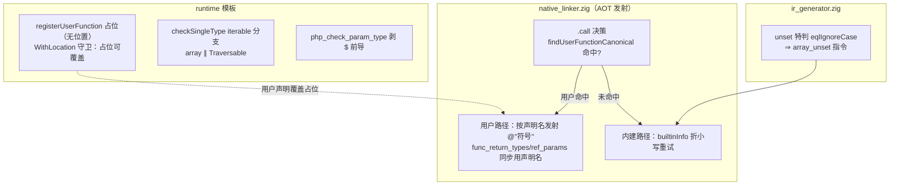

# AOT-CODEGEN-010 §8 调用解析序与 iterable 批（#4/#6/#7）_R124_2026-10-07_fbe6382a

## 1. 高层摘要（TL;DR）

1. **工单 §8 剩余四枚独立缺陷中的三枚（#4/#6/#7）修复落地并全量验收**，至此七枚仅余 #3（goto 发射侧，P2 子轮）：门 H 主群 **face=0**（79 形全绿，R-2 前为 59 红）、反例组 **inverse_face=0**（21 形全绿，原 15 红）、confounded 仅余 k_goto。
2. **#6+#7 调用解析序**：`.call` 发射决策改**用户函数优先**（大小写不敏感解析到规范声明名并按其发射符号）+ 内建表查名折小写重试（`Unset`→`unset`）+ unset 语言结构特判改 `eqlIgnoreCase` + 运行期注册**占位覆盖**（`go` 协程族预注册不再阻断用户同名声明）。
3. **#4 iterable + 消息渲染**：`checkSingleType` 补 `iterable` 伪类型分支（array 或 `implementsInterface("Traversable")`）；`php_check_param_type` 剥参数名前导 `$`（消除 `$$a` 双 `$` 渲染）。
4. **验收全绿**：门 D8 `defect_red 4→1 / guard_same 10→13`；影子 68 语料 `main.zig` md5 **68/68 一致**；门 I tree/bc **逐项不变**（本轮改动全在 AOT 专属层：native_linker + runtime 模板）；主回归 **Pass 67 / Skip 1** 保持。
5. 修复代二进制 `b416d3fbceed199b186676619043bcc5`；本轮源码 2 文件（native_linker.zig、runtime_lib_template.zig），累计未提交 4 文件 +114/−28。

## 2. 影响范围

| 维度 | 范围 |
|---|---|
| 执行模式 | **仅 AOT**（native_linker 发射层 + 运行时模板均为 AOT 专属；解释器/字节码零接触，门 I tree/bc 逐项不变实证） |
| 行为面 | ①跨大小写函数调用（`Get()`↔`get()`）从 Fatal 变正确解析；②被调拼写为 Title/大写的内建函数（`Unset`）正常解析且保留 array-element 写回语义；③用户声明的 `function go()` 不再被内建伪函数遮蔽/阻断注册；④`iterable` 参数接受数组与 Traversable 实现；⑤类型错误消息参数名单 `$` |
| 门资产 | 门 D8 刷新为 `defect_red=1`；门 H 终态 `face=0 inverse_face=0 confounded=1`；影子门汇总行首次由脚本自写成功（上轮 awk 修复生效） |

## 3. 核心变更

| # | 变更 | 文件:位置 | 内容 |
|---|---|---|---|
| 1 | 内建查名折形 | native_linker.zig `builtinInfo` | 精确 miss 后折小写重试（表键全小写；≤64 字节栈缓冲零分配） |
| 2 | 用户函数优先 + 规范名解析 | native_linker.zig `.call` 发射决策 + 新增 `findUserFunctionCanonical` | `findUserFunctionCanonical`（eqlIgnoreCase 扫描 module.functions，返回声明名）命中 ⇒ 不走内建表；用户路径以**声明名**发射 `@"符号"`、查 `func_return_types`/ref_params（修复跨大小写下返回值/引用参数元数据错配） |
| 3 | unset 语言结构特判折形 | ir_generator.zig:6542 区 | `eql(func_name,"unset")` → `eqlIgnoreCase`（`Unset($a[0])` 走 array_unset 指令，元素删除写回生效） |
| 4 | 注册占位覆盖 | runtime_lib_template.zig `registerUserFunction` + `registerUserFunctionWithLocation` | `registerUserFunction`（go 协程族预注册）只 put registry、**不写 decl_locations**；WithLocation 守卫区分「占位（无位置记录）⇒ 放行用户覆盖」与「用户 vs 用户 ⇒ Cannot redeclare 保持」 |
| 5 | iterable 伪类型 | runtime_lib_template.zig `checkSingleType` | 补 `iterable` 分支：`arg.isArray()` 或对象 `implementsInterface("Traversable")` |
| 6 | `$$a` 消息渲染 | runtime_lib_template.zig `php_check_param_type` | 顶部剥 `param_name` 前导 `$`（格式串 `${s}` 保留），两个 TypeError 消息点统一 |

## 4. 可视化概览（Code & Logic Map）



```mermaid
sequenceDiagram
    participant S as PHP 源
    participant L as native_linker 发射
    participant R as 运行时
    S->>L: echo go(); / Unset($a[0]); / f(iterable $x)
    L->>L: findUserFunctionCanonical（CI）命中用户 go ⇒ 不走内建表
    L->>R: 直调 @"go" 符号；registerUserFunction 占位早于用户注册且无位置记录
    R->>R: 用户注册按「占位覆盖」放行（原 Cannot redeclare Fatal 消除）
    L->>R: Unset ⇒ 折形解析 unset + array_unset 指令（元素删除生效）
    R->>R: iterable 参数：array/Traversable 通过；消息渲染 ($a) 单 $
```

## 5. 详细变更分析

| 层 | 变更点 | 设计约束 |
|---|---|---|
| 发射层 | 用户优先决策 + CI 规范名解析 | 符号/返回值元数据/引用参数/func_return_types 全部以**声明名**为键（跨大小写调用不再错配）；Fatal 消息保留被调拼写（PHP 行为） |
| 发射层 | builtinInfo 折形 | 栈上 ≤64 字节折形缓冲，零堆分配；`php_` 前缀快路径不变 |
| 运行时 | 占位覆盖语义 | 用户 vs 用户重复声明仍 Cannot redeclare（PHP 语义保持）；占位 = registry 有名而 decl_locations 无记录 |
| 运行时 | iterable 分支 + $ 剥离 | 与 callable 分支同位放置；`meta.implementsInterface` 复用既有接口检查 |
| IR 层 | unset 特判折形 | 仅放宽函数名匹配，array_unset 指令语义不变 |

## 6. 影响与风险评估

- **是否破坏式变更**：否。四触发面语料内全 0（跨大小写调用/Title 内建/用户 `go`/iterable 参数）⇒ 影子 68/68 一致、主回归 Pass 67/Skip 1、门 I tree/bc 逐项不变。行为变化均为「Fatal/静默错值 → 正确语义」的修复本身。
- **需要特别注意**：①用户函数优先后，用户声明的与**内建表伪函数**同名的函数（仅 `go` 族，PHP 无此内建）解析到用户函数 —— PHP 本就允许（go 非保留字）；②真实 PHP 内建名（strlen 等）用户重定义在 PHP 侧本为 Fatal，AOT 不新增该校验（既有行为，未越界）；③占位覆盖依赖「预注册不写 decl_locations」的约定——后续给注册函数加位置时不得破坏该不变量。
- **复测路径**：门 D8（`defect_red=1` ✅）→ 链 IV 六门+影子+回归（✅）；命令与超时同工单 §6。

## 7. 遗留问题 / 潜在问题

1. **#3 goto 发射丢失（唯一残红）**：机制已定位（generateGotoStmt 的 goto_after 块在 if 体内成为不可达块，后续语句全落入）——修复需与 if 生成的块接线契约配合，P2 子轮。
2. 命名参数 + 跨大小写调用：`symbol_table.lookupFunction`/named-args 元数据仍精确匹配（罕见组合，登记未修）。
3. 动态调用 `is_callable("Unset")` 等运行期查名函数族（`php_is_callable` 的 registry 精确查）未折形——罕见面，登记。
4. 全部资产（本轮 2 文件 + 工单/门/文档）未提交。

## 8. 后续开发 / 优化建议

| 优先级 | 建议 | 影响面 | 落地成本 |
|---|---|---|---|
| **P0** | 明示「提交」入库本轮 2 文件 + 工单/门/文档（R123+R124 两批） | 资产防丢 | 零成本 |
| **P2** | #3 goto：发射侧子轮——`generateGotoStmt` 的 after 块按需创建/与 if 接线契约对齐，验收 = 门 D8 d3a 转绿（`defect_red=0`） | IR 块图 → Zig 线性化 | 需 1 轮取证 + 实测 |
| **P2** | 运行期查名族折形（`php_is_callable`/`php_defined` 等 registry 精确查）与命名参数 CI 解析 | 运行期边缘面 | 单点小改 |
