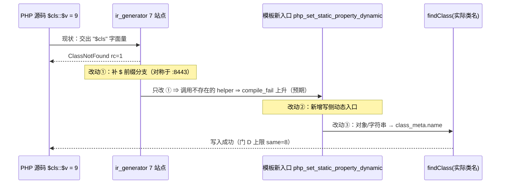
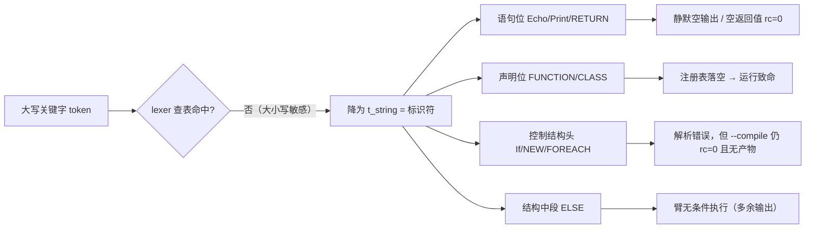

# G4-f 双环归因 + 关键字大小写新族立项（R117/R118）— 2026-10-07

> 代次锚点（本轮实测，非估计）：`php-interpreter 1f15e4ce9b5c9cdaaef7cabf5efb9c76` ·
> `runtime_lib_template.zig 008b7b639f1069cb73e443064e115ed1` / 30810 行 ·
> `native_linker.zig fbe6382a2e0904b6740d771b88c409c7` / 32797 行（仅 §74 纯注释批在暂存区，发射中性）·
> `ir_generator.zig cb53c2da7d4fe2e1f62b728511f7c3ea` / 9732 行 ·
> `lexer.zig 21f02e926ee28c7354aa92507136074d` / 530 行 · `keyword_lookup.zig b8832bef829d3e0c11c4e249700bfddd` / 118 行
> ⇒ **本轮零 `src/` 文件落地**（`git status --porcelain -- src/` 只有既有的纯注释暂存批）。

---

## 1. 高层摘要（TL;DR）

老铁，这一轮做了两件事，都不改代码，只把「未知」变成「到行」：

1. **任务 #117**：把 AOT-RUNTIME-002 的 **G4-f（动态类名限定静态属性 → 运行致命 `ClassNotFound`）** 从上一轮的错误措辞「动态名写入口缺失」**否证并重写为两条独立环** —— ① `ir_generator.zig` 的 **7 处写/引用源站点**缺 `$` 前缀分支（读侧早有，所以读形是绿的），② 模板 `php_get_static_property_dynamic:20200` 的 `else ""` 不接受对象。修复面由此定为**三处同动，缺一无效**。永久侧门 D（9 形）实测 `same=4 diff=5 cnotfound_fatal=5 compile_fail=0`，`ELAPSED=35s` ⇒ **3.9 s/形**，且首跑/复跑逐字节自证。
2. **任务 #118**：在收窄一枚**非 AOT**（字节码/解释器模式）panic 的过程中，意外量到一整个**新缺陷族**：本项目词法器对 PHP 关键字的**大小写不敏感**语义完全缺失 ⇒ 新立工单 **AOT-CODEGEN-010（P0）**，配一枚永久 19 形侧门 E，实测 `same=8 diff=8 silent_empty=3 aot_fatal=3 compile_fail=3 @ 60s`（**3.2 s/形**）。该族最危险的形态是**静默**：`Echo`/`Print`/`RETURN` 大写时 AOT **输出空、rc=0**，回归报表看不见。

一句话结论：**RUNTIME-002 R-10 的归因前置已闭环**（可以进落地批，但必须三处同动）；**CODEGEN-010 是新开的 P0 口子，且它落在编译前端共享层 ⇒ 跨模式，是否一并修需老铁明示**（宪法 §五）。

---

## 2. 影响范围

| 维度 | 面 | 实测证据 | 影响描述 |
|---|---|---|---|
| RUNTIME-002 G4-f | 静态属性读写 × 类名操作数形态 | 侧门 D 9 形：`same=4 diff=5`，5 形 AOT `error: ClassNotFound` rc=1（PHP 侧 rc=0 且读写均正确） | 只影响**非字面类名**限定形；字面类名读写两形（控制臂）逐字节 SAME ⇒ 通道本身没坏 |
| RUNTIME-002 修复面 | `ir_generator.zig` 7 站点 + 模板 1 新入口 + 模板 1 对象支 | 站点枚举到行（`ir_generator.zig:4379/4749/4922/5361/5915/6051` 写 + `:4547/:4554/:4564` 引用源；模板 `:20198-20200` 读、`:20334`/`:20380` 落空点） | 属 **IR 生成侧 + 模板侧**双修；只补 IR 侧会指向不存在的 helper ⇒ 门里 `compile_fail` 由 0 上升（这是**预期**，不是新伤） |
| CODEGEN-010 | 大写/首字母大写的 PHP 关键字 | 侧门 E 19 形：静默空输出 3、静默空返回（含于 diff）、致命 3、解析失败 3、`ELSE` 无条件执行 1 | **四类结局**，其中两类静默（rc=0）⇒ 基线与人工巡检都看不见 |
| CODEGEN-010 语料面 | `fuzzy_scripts_720/pass/*.php` | 大写关键字形似命中 10 枚，**全部落在字符串字面量内** ⇒ 关键字位命中 **0** | 基线绿是**覆盖意外**，不是实现正确 |
| CODEGEN-010 跨模式 | 解释器/字节码模式（同一 lexer） | 4 臂探针 3 臂复现（`Echo` 空输出、`If` ⇒ `Call to undefined function If()`、`RETURN` ⇒ `r=`） | **不是 AOT 专属** ⇒ 按 §五 只能登记，修不修等老铁裁决 |
| 非 AOT 侧门发现（登记不修） | 字节码 VM 静态属性参与 `.` 串联 | 四臂收窄：静态属性 `.` 串联 ⇒ `thread panic: Stack underflow in popFast`，顶帧 `src/bytecode/vm.zig:2322`（`handleConcat`）；纯变量串联/实例属性串联/逗号 `echo` 三臂正常 | `vm.zig` md5 `4343151291f461d067b61187ff9bb9be` / 8863 行；**未立单**，等裁决 |
| 破坏式变更？ | — | 本轮无源码改动 | **否**，纯取证与登记轮 |

---

## 3. 核心变更

| # | 变更 | 类型 | 位置 | 状态 |
|---|---|---|---|---|
| C1 | RUNTIME-002 标题/性质/§3/§4/§5/§7 六处旧措辞更正（「无动态写入口」→ 两条独立环） | 文档 | `docs/known-issues/AOT-RUNTIME-002-property-entry-semantics.md`（13 处编辑） | 已落盘 |
| C2 | G4-f 到行归因表（7 IR 站点 + 模板对象支 + 读侧先例）与「三处同动」推导 | 取证 | 同上 §3 G4-f 小节 | 已落盘 |
| C3 | R-10 改写：归因轮闭环、剩余为落地批；**未实测项**明标（语料 `main.zig` 影子覆盖面） | 工单 | 同上 §5 | 已落盘 |
| C4 | 门链口径由「四门」改「**五门**」，新增门 D 命令 + 逐批预测（含 `compile_fail` 上升的判读） | 工单 | 同上 §6 | 已落盘 |
| C5 | 永久侧门 D（9 形 + 生成码实参字面量 `emit` 通道） | 资产 | `fuzzy_scripts_720/tmp/rt002_dynname_gate_tmp.sh`（md5 `62ec8bac…`/142 行）+ `rt002_dynname_tmp.tsv` | 实测两轮逐字节一致 |
| C6 | **新工单立项 AOT-CODEGEN-010**（P0，编译前端，跨模式共享） | 工单 | `docs/known-issues/AOT-CODEGEN-010-keyword-case-insensitive-lexer.md`（137 行） | 已落盘，OPEN |
| C7 | 永久侧门 E（19 形，计数器按**失败模式**分档而非只 SAME/DIFF） | 资产 | `fuzzy_scripts_720/tmp/c010_keyword_case_gate_tmp.sh`（md5 `1367584f…`/109 行）+ `c010_keyword_case_tmp.tsv` | 实测 `C010KW_DONE shapes=19 same=8 diff=8 silent_empty=3 aot_fatal=3 compile_fail=3` |
| C8 | 跨模式对照臂 + 非 AOT panic 四臂收窄，均**只登记** | 取证 | RUNTIME-002 §7-13、CODEGEN-010 §2.2 | 已落盘 |
| C9 | 记忆落盘：RUNTIME-002/CODEGEN-009 条目更新至 #117；新增 CODEGEN-010 条目；回归规则新增**规则 21** | 记忆 | `memory/project-aot-runtime002-codegen009.md`、`memory/project-aot-codegen010-keyword-case.md`、`memory/feedback-aot-regression-rules.md`、`MEMORY.md` | 已落盘 |

---

## 4. 可视化概览（Code & Logic Map）

### 4.1 分层与归属

```mermaid
graph TB
    subgraph FE["编译前端（跨模式共享）"]
        LEX["lexer.zig:384 lexIdentifier"]
        KWD["keyword_lookup.zig:6 大小写敏感 StaticStringMap（87 枚全小写）"]
        PARSE["parser.zig:2531-2558 .double_colon 类名操作数"]
    end
    subgraph IR["IR 生成侧"]
        READ["ir_generator.zig:8443 generateStaticPropertyAccess<br/>有 $ 分支 → dynamic helper"]
        WSET["6× .static_property_set 站点<br/>:4379/:4749/:4922/:5361/:5915/:6051<br/>无 $ 分支"]
        RFSRC["引用源站点 :4547/:4554 → emit :4564<br/>无 $ 分支"]
    end
    subgraph RT["运行时模板（AOT 专属）"]
        GDD["php_get_static_property_dynamic :20198-20200<br/>isString() … else \"\" ← 拒对象"]
        LSD["findClass(class_name) 落空点<br/>写 :20380 / 读 :20334"]
        C9D["php_get_class_constant_dynamic :20210<br/>同一枚 else \"\" ← 与 CODEGEN-009 同病"]
    end
    KWD -.失配即降为标识符.-> SILENT["静默空输出 / 空返回 rc=0"]
    LEX --> KWD
    LEX --> PARSE
    PARSE --> READ
    PARSE --> WSET
    PARSE --> RFSRC
    READ --> GDD
    WSET --> LSD
    RFSRC --> LSD
    GDD --> C9D
```

### 4.2 G4-f 执行流程（同一份源码，读绿写红的分叉）

```mermaid
flowchart LR
    A["$cls::$v 或 $o::$v"] --> B{IR 站点方向?}
    B -- 读 --> C{"class_name[0]=='$' ?<br/>ir_generator:8449"}
    C -- 是 --> D["取变量值 → php_get_static_property_dynamic"]
    D --> E{args[0] 类型}
    E -- 字符串 --> F["✅ dyn_read_str / dyn_read_paren SAME"]
    E -- 对象 --> G["❌ 空类名 → ClassNotFound（dyn_read_obj）"]
    B -- 写/引用源 --> H["❌ 无 $ 分支：原样交出 \"$cls\""]
    H --> I["findClass(\"$cls\") 落空 :20380"]
    I --> J["❌ 运行致命 rc=1（4 形）"]
```

### 4.3 修复的三处同动（缺一无效）



### 4.4 CODEGEN-010 四类结局



---

## 5. 详细变更分析

### 5.1 涉及文件清单

| 层 | 文件 | 动作 |
|---|---|---|
| 工单 | `docs/known-issues/AOT-RUNTIME-002-property-entry-semantics.md` | 13 处编辑（标题/性质/状态/代次锚点/§3/§4/§5 R-10/§6 门链/§7-8·11·12·13） |
| 工单 | `docs/known-issues/AOT-CODEGEN-010-keyword-case-insensitive-lexer.md` | **新建**（137 行） |
| 门 | `fuzzy_scripts_720/tmp/rt002_dynname_gate_tmp.sh` + `rt002_dynname_tmp.tsv` | 永久侧门 D + 读数 |
| 门 | `fuzzy_scripts_720/tmp/c010_keyword_case_gate_tmp.sh` + `c010_keyword_case_tmp.tsv` | 永久侧门 E + 读数 |
| 探针 | `fuzzy_scripts_720/tmp/st_dyn_write_probe_tmp.php` | 三面（PHP/AOT/解释器）跨模式对照替身 |
| 只读核对 | `src/aot/ir_generator.zig:4372-4401 / 4540-4571 / 8443-8482`、`src/aot/runtime_lib_template.zig:20196-20213`、`src/compiler/lexer.zig:378-403`、`src/compiler/keyword_lookup.zig:95-118`、`src/bytecode/vm.zig:2320-2324` | **零改动** |
| 记忆 | `project-aot-runtime002-codegen009.md` / 新增 `project-aot-codegen010-keyword-case.md` / `feedback-aot-regression-rules.md`（规则 21）/ `MEMORY.md` | 落盘 |

### 5.2 门 D 九形读数（逐字节，控制臂锁定通道可用）

| 形 | 类名操作数 | 方向 | verdict | 生成码 `emit` | 归因 |
|---|---|---|---|---|---|
| `dyn_read_lit` | `DynA::` | 读 | **SAME** | `php_get_static_property("DynA", "v")` | 控制臂 ① |
| `dyn_read_str` | `$cls = "DynB"` | 读 | **SAME** | `php_get_static_property_dynamic(&[_]runtime.Value{reg_2, reg_3}, …)` | 读侧 `$` 分支生效 |
| `dyn_read_paren` | `($cls)` | 读 | **SAME** | 同上 | 括号对 parser 透明 |
| `dyn_read_obj` | `$o = new DynH()` | 读 | DIFF | dynamic helper **已**发射 | **成因②**：`:20200` `else ""` 拒对象 |
| `dyn_write_lit` | `DynI::` | 写 | **SAME** | `php_set_static_property("DynI", "v", …)` | 控制臂 ② |
| `dyn_write_str` | `$cls = "DynC"` | 写 | DIFF | `php_set_static_property("$cls", "v", reg_1)` | **成因①**：字面量含 `$` |
| `dyn_write_obj` | `$o` | 写 | DIFF | `php_set_static_property("$o", "v", reg_1)` | 成因① |
| `dyn_write_paren` | `($cls)` | 写 | DIFF | 与裸变量写形**逐字节同形** | 非 parser 分派差异 |
| `dyn_ref_source` | `$r = &$cls::$v` | 引用源 | DIFF | `php_get_static_property("$cls", "v")` | 第七枚站点（`:4564`） |

**否证记录**：`parser.zig:2531-2558` 的 `.variable` 分支**不是**病根 —— 若它是根，`dyn_read_str` 不可能 SAME（读侧拿到的也是同一枚 token 文本，却正确走了 dynamic helper）。⇒ 病在 **IR 站点是否判 `$`**，不在 parser。

### 5.3 门 E 十九形按失败模式分档

| 失败模式 | 形 | 实测读数 |
|---|---|---|
| **静默空输出 rc=0** | `kw_echo_title` `Echo` / `kw_echo_upper` `ECHO` | PHP 有输出，AOT **空**，rc=0 |
| **静默空返回值 rc=0** | `kw_return_upper` `RETURN` | PHP `r=9\|DONE\|`，AOT `r=\|DONE\|`（调用侧拿到空值） |
| 运行致命 | `kw_function_upper` | `Call to undefined function fc4()` |
| 运行致命 | `kw_class_upper` | `Class "CC6" not found` |
| 运行致命 | `kw_while_upper` | `Call to undefined function WHILE()`（`while` 被解析成调用） |
| **解析失败但 rc=0 且无产物** | `kw_if_title`（`Unexpected token in expression on line 3`）、`kw_foreach_upper`（同，line 2）、`kw_new_upper`（`syntax error, unexpected identifier, expecting ";" on line 3`） | `compile_fail=3` |
| **臂无条件执行** | `kw_else_upper` | PHP `i=gt\|` ⇔ AOT `i=gt\|i=le\|` |
| 免疫 | `kw_bool_upper`（`TRUE/FALSE/NULL`） | SAME（成因**未归因**，§7-6） |
| 控制臂 | 各形小写对照（8 枚） | 全部 SAME |

**门本身的两个坑（已固化在门头注释，属规则 21）**：
- `compile_fail` 首跑判错：`--compile` 在 PHP 解析失败时**仍 rc=0 且不留产物** ⇒ 必须测 `[ ! -x 产物 ]`。
- `kw_else_upper` 首跑用**假条件** ⇒ 臂永不抵达 ⇒ 假 SAME，把全局 `same` 抬到 9。改真条件后**重跑**再报数，故本单只登记 `same=8 diff=8`（未引用过作废读数）。

### 5.4 机制锚点（实文核对，非推测）

```zig
// src/compiler/lexer.zig:384-402（现状）
fn lexIdentifier(self: *Lexer, start: usize) Token {
    while (...) self.pos += 1;
    const text = self.buffer[start..self.pos];        // :386 原文切片，未折叠
    if (text.len <= 5) {
        if (keyword_lookup.lookupFast(text)) |tag| return .{ .tag = tag, ... };  // :390
    } else if (text.len <= 15) {
        if (keyword_lookup.lookup(text)) |tag| return .{ .tag = tag, ... };      // :394
    }
    const tag: Token.Tag = if (self.syntax_mode == .go) .t_go_identifier else .t_string;  // :400-402 静默降级
    return .{ .tag = tag, .loc = ... };
}
```

- `src/compiler/keyword_lookup.zig:6` = `std.StaticStringMap(Token.Tag).initComptime(...)`，**大小写敏感**，87 枚条目全小写；`grep -rn eqlIgnoreCase src/compiler/*.zig` = **0 命中** ⇒ 现有代码里没有大小写折叠的先例可抄（不得凭推测写）。
- `text.len <= 15` 是**独立第二枚缺陷**（超过 15 字符的关键字永不可命中）＋ 宪法 §四-3 硬编码存量违反。
- 模板侧：`php_get_static_property_dynamic:20200` 与 `php_get_class_constant_dynamic:20210` 是**同一枚 `else ""`** ⇒ RUNTIME-002 与 CODEGEN-009 在此并批（§7-11 建议）。

### 5.5 实测成本（只报实测，不报估计）

| 动作 | 实测 | 单位成本 |
|---|---|---|
| 侧门 D（9 形，逐形编译 + 双跑 + 生成码 `emit` 提取） | `ELAPSED=35s` | **3.9 s/形** |
| 侧门 E（19 形，同法） | `ELAPSED=60s` | **3.2 s/形** |
| 跨模式对照（解释器模式 4 臂，无编译） | 秒级 | PHP/解释器臂不占 zig-cache |
| 行级归因本身 | **0 次编译** | 纯读源 |
| `st_dyn_write_probe_tmp.php` 三面臂 | ≈6s | 1 编译 + 2 跑 |

---

## 6. 影响与风险评估

**是否破坏式变更**：本轮**否**（零源码改动，工单/门/探针为增量资产）。

| 风险 | 说明 | 处置 |
|---|---|---|
| G4-f 落地需**三处同动** | 只补 IR 侧 ① ⇒ 生成的调用指向**不存在的** `php_set_static_property_dynamic` ⇒ 门 D `compile_fail` 由 0 上升 | **预期现象**，非新伤；门内已写判读口径，验收以「两枚控制臂仍 SAME」为硬门 |
| 覆盖面未影子实测 | 改动 ① 落在 `ir_generator.zig`（超大文件，宪法 §一），语料 `main.zig` 是否漂移**未实测** | 已在 §5 R-10 明标「未实测项」；**禁止**以「语料 0 命中」推定发射中性 |
| CODEGEN-010 落在共享前端 | `src/compiler/` 被解释器/字节码/AOT 共用 ⇒ 修它**必然改非 AOT 行为**（§五 双门控） | 只登记，路由表全部门控；是否一并修需老铁明示 |
| CODEGEN-010 修法是「放宽接受」 | 大写关键字从解析失败变可解析 ⇒ 语料面 0 命中（已实测：10 枚形似命中全在字符串字面量内），但生成码仍可能变（token 归一 vs 保留原文） | R-2 口径已钉「**token 文本不改**」，避免下游字符串比对漂移 |
| 静默性是最大杀伤面 | `Echo`/`RETURN` 大写 ⇒ **空输出/空返回值且 rc=0**；官方回归按输出比对，若语料出现此类写法会直接 FAIL_DIFF，但当前 0 命中 | 侧门 E 的 `silent_empty` 计数器专门为这一档存在 |
| 门 E 的 `compile_fail` 与 R-3 混淆 | R-3（发射期金丝雀）会把 `compile_fail` 由 3 抬到 6，**这不是修好了** | 已在 §6 复测路径明写「R-3-only 不得计作验收」 |
| 非 AOT panic 未立单 | 字节码 VM `.` 串联静态属性 panic（`vm.zig:2322`） | 只登记于 RUNTIME-002 §7-13，**等裁决** |

**复测路径（体验流程）**：
```bash
# 门 D（RUNTIME-002 G4-f，9 形 ≈35s）
timeout 300 bash fuzzy_scripts_720/tmp/rt002_dynname_gate_tmp.sh
# 门 E（CODEGEN-010 关键字大小写，19 形 ≈60s）
timeout 300 bash fuzzy_scripts_720/tmp/c010_keyword_case_gate_tmp.sh
# 跨模式对照（无需编译，秒级）
/opt/homebrew/bin/php fuzzy_scripts_720/tmp/st_dyn_write_probe_tmp.php
timeout 10 ./zig-out/bin/php-interpreter fuzzy_scripts_720/tmp/st_dyn_write_probe_tmp.php
```
门 D 基线：`DYNNAME_DONE shapes=9 same=4 diff=5 cnotfound_fatal=5 compile_fail=0`；门 E 基线：`C010KW_DONE shapes=19 same=8 diff=8 silent_empty=3 aot_fatal=3 compile_fail=3`。**两门的控制臂（`dyn_read_lit`/`dyn_write_lit`；8 枚小写形）必须始终 SAME**，一旦移动即判「门坏掉」而非「修好了」。

---

## 7. 遗留 / 潜在问题

| # | 归属 | 问题 | 级别 |
|---|---|---|---|
| L1 | CODEGEN-010 §7-1 | 四类下游失败点（`t_string` 之后 parser/IR/发射各在哪一环崩）**未逐形归因** ⇒ R-2 落地前需 R-1 归因轮 | P0 前置 |
| L2 | CODEGEN-010 §7-2 | 87 枚关键字的**逐枚穷尽门**从未跑过，成本未知 | P1 |
| L3 | CODEGEN-010 §3 | `text.len <= 15` 硬编码（宪法 §四-3 存量违反），R-4 待裁决 | P1 |
| L4 | CODEGEN-010 §2.2 | 跨模式是否一并修 —— **需老铁裁决**（§五） | 决策 |
| L5 | CODEGEN-010 §7-5 | `--compile` 解析失败仍 rc=0、不留产物 ⇒ 官方回归看不见这一类（**流程项**，非编译器改动） | P1 流程 |
| L6 | CODEGEN-010 §7-6 | `TRUE/FALSE/NULL` 大写为何免疫 —— 成因未归因 | P2 |
| L7 | RUNTIME-002 §7-8 | 动态类名**写**形的逐站点归因已闭环，但改动 ① 对语料 `main.zig` 的影子覆盖面**未实测** | P0 落地前置 |
| L8 | RUNTIME-002 §7-9 | 反射写静态属性的引用计数不对称（`:16894-16895` vs `:17806-17812`）—— 泄漏**未量化** | P1 |
| L9 | RUNTIME-002 §7-10 | 静态侧未覆盖入口三形（`protected static` 越权、引用绑定静态属性、`unset` 后回读） | P2 |
| L10 | RUNTIME-002 §7-13 | 非 AOT：字节码 VM 静态属性 `.` 串联 panic（`vm.zig:2322`）**是否另立工单待裁决** | 决策 |
| L11 | 通用 | 本轮新增资产（门 D/E + TSV + 探针 + 两张工单 + 变更文档）仍**未入库**，需老铁明示「提交」（§六） | P0 流程 |

---

## 8. 后续开发 / 优化建议

| 优先级 | 建议 | 影响面 | 落地成本 |
|---|---|---|---|
| **P0（最廉价的正确性收益）** | CODEGEN-010 **R-1 归因轮**（只读 + 生成码通道，不动源码）：把 8 枚红形的下游断点逐形定到行，为 R-2 定覆盖面 | 决定 R-2 是「查表折叠」还是「token 语义改动」 | 未实测（同法门成本 ≈3.2 s/形） |
| **P0** | RUNTIME-002 **R-2**（2 枚模板守卫：coerce 失败不得入槽）—— 唯一能消 G3 的批 | typed 属性写入全链 | 2 处模板 + 门 A/B 复跑（`25s + 10s`） |
| **P0** | RUNTIME-002 **R-10 落地批**（三处同动：7 IR 站点 + 新写侧动态入口 + `:20200` 对象支） | 动态类名静态属性读写；**需语料影子实测** | 实测复跑 = 门 D `35s` + `timeout 120 zig build`；影子面未实测 |
| **P1** | CODEGEN-009 与 RUNTIME-002 并批：`:20210` / `:20200` 同一枚 `else ""` 一次改（抽公共「值 → 类名」helper） | 消两族对象形；DRY | 单枚 helper + 两处调用 |
| **P1** | 流程：给「PHP 侧就致命」的语料加「仍编译 AOT、只比对致命文本」子档；同时让 `--compile` 解析失败返回非 0 | 官方回归可见性（L5 + RUNTIME-002 §7-4） | 改 `run_regression.sh`，不碰编译器 |
| **P2** | 门 E 扩至 87 枚关键字穷尽档（独立门文件，不扩现有门，守规则 11） | 把「四类结局」变逐枚台账 | 未实测 |
| **P2** | R-4 去掉 `text.len <= 15` 硬编码 | 消除长关键字静默漏命中 + §四-3 违反 | 与 R-2 同批近零增量 |

> **门控声明（逐字，两张工单一致）**：CODEGEN-010 —— 「以上任一路线落地前需老铁点头（宪法 §六：编译前端语义改动 + 可能损失/改变发射形态；§五：跨模式（解释器/字节码）同面**是否一并修**亦需明示）。」；RUNTIME-002 —— 「以上任一路线落地前需老铁点头（宪法 §六：语义改动 + 消息文本变更 + 可能新增运行时支路）。」`继续推进` 类指令本轮只覆盖**取证与登记**，不覆盖落地。
