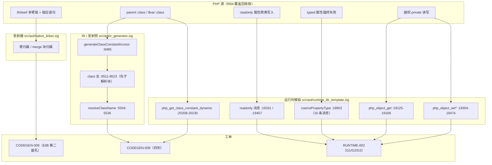
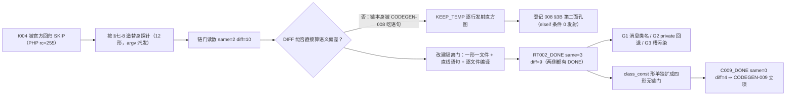
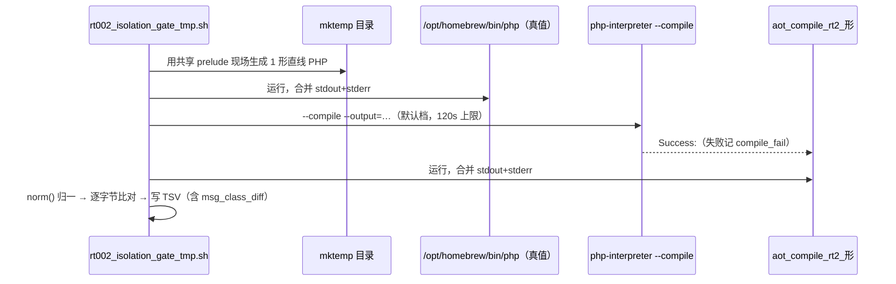
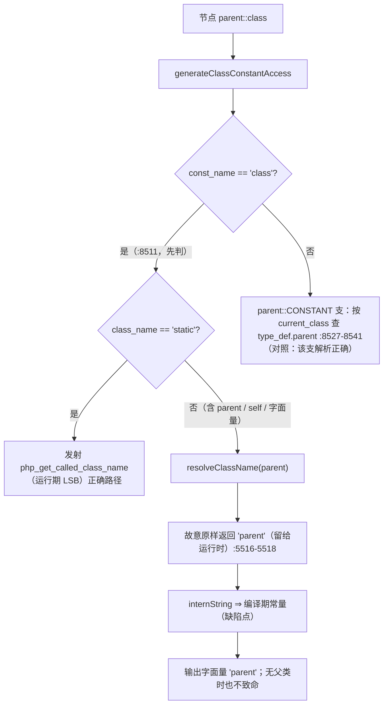

# f004 SKIP 覆盖回收 → 两张新工单立项（AOT-RUNTIME-002 / AOT-CODEGEN-009）+ CODEGEN-008 第二面孔

**轮次**: 任务 #114
**日期**: 2026-10-07
**代次锚点（本轮实测复验，非记忆）**

| 资产 | md5 | 行数 |
|---|---|---|
| `zig-out/bin/php-interpreter` | `1f15e4ce9b5c9cdaaef7cabf5efb9c76` | — |
| `src/aot/native_linker.zig` | `fbe6382a2e0904b6740d771b88c409c7` | 32797 |
| `src/aot/runtime_lib_template.zig` | `008b7b639f1069cb73e443064e115ed1` | 30810 |
| `src/aot/ir_generator.zig` | `cb53c2da7d4fe2e1f62b728511f7c3ea` | 9732 |
| `fuzzy_scripts_720/tmp/f004_ro_unser_tmp.php` | `672c82ed3addba063c8032863b64a4e6` | 237 |
| `git HEAD` | `497edc6` | — |

**本轮 `src/` 改动数：0**（四枚 md5 与轮次开始一致；`git status --porcelain -- src/` 仅 `M  src/aot/native_linker.zig` = #74 纯注释锚点批，早于本轮）。

---

## 1. 高层摘要（TL;DR）

任务起点是「语料唯一 SKIP 脚本 `f004_oop_deep_inheritance_magic.php` 在 AOT 侧零覆盖，按宪法 §七-8 第二条回收覆盖」。回收探针跑出来 10 枚 DIFF，但**其中一部分不是属性语义偏差**，而是探针自身的 `if/elseif` 派发链被 **AOT-CODEGEN-008** 吃掉语句 —— 于是本轮做了三件事：

1. **给 CODEGEN-008 补第二面孔**（§3B）：七臂无 `else` 链里，第 5/6/7 臂的**条件**与链后语句在生成码里**发射指令数 = 0**（不是归属错，是整段不发射），臂不可派发且 rc=0 ⇒ 该工单原「臂尾为 echo」四要素判据不完整；
2. **另建 C008-free 隔离门**（一形一个直线 PHP 文件、逐文件编译），把真正的运行时偏差从 10 枚 DIFF 里剥出来，归成三组 → **新工单 AOT-RUNTIME-002**（属性写入入口语义：消息类名归属、越权 `private` 回退、强转失败槽污染）；
3. 隔离门里 `class_const` 形单独扩成**四形无链门** → **新工单 AOT-CODEGEN-009**（`parent::class` 折叠成字面量、无父类时该致命不致命、`$对象::class` 空串、`$字符串::class` 该致命不致命）。

三条成本的实测口径：f004 替身探针 12 形 `ELAPSED=14s`；RUNTIME-002 隔离门 12 形 `ELAPSED=58s`；CODEGEN-009 门 4 形 `ELAPSED=16s`；单次 `KEEP_TEMP` 生成码直读 ≈10s。**全部修复待裁决，未动一字节源码。**

---

## 2. 影响范围

| 影响对象 | 状态 | 影响描述 |
|---|---|---|
| 冻结基线 `baseline_main_zig_md5.tsv`（68 行） | **未触碰** | 零发射改动 ⇒ 无漂移；本轮不需要重冻 |
| 官方回归门（68 语料） | **未重跑**（本轮无源码改动，重跑无新信息） | 报表仍为 `Pass=67 / Fail_*=0 / Skip=1`（`regression_report.md` 尾部、`regression_failures.tsv:1`） |
| AOT-CODEGEN-008 工单 | **修订** | 新增 §3B「第二面孔：零发射」+ 语料面/假绿口径更正（`run_regression.sh:43-49`） |
| AOT-RUNTIME-002 工单 | **新立** | 三组属性入口语义偏差，逐形实测 + 锚点到行；G3 为 P0 不变量破坏 |
| AOT-CODEGEN-009 工单 | **新立** | 四个 `::class` 解析面 + 生成码级归因；B/D 两面属「该致命 → 静默放行」 |
| 永久探针资产 | **+8 文件**（`git status --porcelain` 实测均为 `??`） | `c009_{a,b,c,d}_tmp.php`（4 形探针）、`c009_class_const_gate_tmp.sh` + `.tsv`、`rt002_isolation_gate_tmp.sh`、`runtime002_isolation_tmp.tsv` |
| `f004_ro_unser_tmp.{php,sh,tsv}` | **扩展** | 10 形 → 12 形（补 `val_self`/`val_dyn`），门尾新增 `same=/diff=` 计数 |
| 待裁决队列 | **+7 条路线** | RUNTIME-002 R-1/R-2/R-3 + CODEGEN-009 R-1/R-2/R-3/R-4（+ CODEGEN-008 R-A…R-D 不变） |

---

## 3. 核心变更

| # | 变更 | 类型 | 关键读数 / 证据 |
|---|---|---|---|
| C-1 | 发现并登记 CODEGEN-008 第二面孔 | 取证 | 逐行发射直方图：源 `:220/:222/:224`（三条 `elseif` 条件）与 `:232/:234`（链后语句）计数 **0**；臂体 `:221/:223/:225` 却有 7/7/11 条 ⇒ 臂不可达 |
| C-2 | 建立「链派发探针不可作语义验收」的方法论 | 流程 | 隔离门 12 形两侧都产出 `DONE` ⇒ CODEGEN-008 无法介入，剩余 DIFF 才能归因运行时 |
| C-3 | RUNTIME-002 G1 归因（消息类名归属） | 取证 | 只需改 4 处入参（`:19331`/`:19457` readonly、`:19335`/`:19461` → `coercePropertyType`）即覆盖 `coercePropertyType` 内**全部 16 条**消息构造行（`:18914…:19114`，段内 `grep -c "to property"` = 16） |
| C-4 | **否证**「七处可见性站点都要改」假设 | 判据收紧 | `prot_read`、`ro_write_same_scope`、`type_self` 三条控制臂逐字节 SAME ⇒ access 消息用**实例类**才是对的，六处站点一律禁改 |
| C-5 | RUNTIME-002 G2：两条消息在 AOT 运行库中根本不存在 | 缺口 | `grep -n 'Undefined property'` 与 `'Creation of dynamic property'` 于 `src/aot/*.zig` = **0 命中** ⇒ 属整条语义支路缺失，非措辞差异 |
| C-6 | RUNTIME-002 G3：强转失败把 `TypeError` 对象留在 `int` 槽 | 新缺陷 | PHP `slot=0 type=integer` vs AOT `slot='\TypeError::__set_state(...)' type=object`；**机制未取证**（三条可证伪候选已登记） |
| C-7 | CODEGEN-009 四形门与归因 | 新立 | A `parent=parent`；B `php_rc=255 / aot_rc=0`；C `obj=`（空串）；D `str=DAlpha`（PHP 侧 `TypeError: Cannot use "::class" on string`） |
| C-8 | CODEGEN-009 机制钉到行 | 取证 | `ir_generator.zig:8511` `class` 支**先于** `:8525+` 的 parent/self/static 解析块；`resolveClassName:5516-5518` 故意原样返回 `"parent"` 留给运行时 ⇒ 却被 `:8520-8522` 折成编译期常量；`static` 是唯一发射运行期调用的一支 ⇒ LSB 才对 |
| C-9 | 语料面口径更正（两处） | 文档纠错 | 官方门只扫 `pass/f*.php`（`run_regression.sh:9/:98/:109`）⇒ 原先「`static::class` 命中 f130」为误归属（f130 在根目录、f046 在 `fail_runtime/`）；`readonly` **声明**在绿语料内（f031:43-48、f040:7-9）但**偏差面**为 0 |

---

## 4. 可视化概览

### 4.1 分层与缺陷归属（业务视角）

### 4.2 本轮取证流程（含分岔判据）

### 4.3 执行流程（一次隔离门形）

### 4.4 CODEGEN-009 A/B 面：契约与现实的错位

---

## 5. 详细变更分析

### 5.1 端 / 层 / 文件清单

| 层 | 文件 | 变更 |
|---|---|---|
| 工单文档 | `docs/known-issues/AOT-CODEGEN-008-echo-arm-tail-merged-into-implicit-else.md` | +§3B（零发射面孔 + 直方图表 + `"DONE\n"` 三站点证据）；§4 假绿行锚点更正为 `run_regression.sh:43-49` |
| 工单文档 | `docs/known-issues/AOT-RUNTIME-002-property-entry-semantics.md` | 新建（代次锚点、§1 为何另建门、§2 12 形矩阵、§3 G1/G2/G3 到行、§4 语料面三条可证伪论据、§5 路线 R-1/R-2/R-3/R-4、§6 复测、§7 遗留 5 项） |
| 工单文档 | `docs/known-issues/AOT-CODEGEN-009-class-const-parent-and-dynamic.md` | 新建（§1 四形 + 控制面、§2.1/2.2 生成码直读、§3 语料面与受保护对照、§4 路线、§5 复测、§6 边界、§7 未判定） |
| 探针（永久） | `fuzzy_scripts_720/tmp/f004_ro_unser_tmp.php` | 10 形 → 12 形（`val_self`/`val_dyn`：异常后槽回读） |
| 门（永久） | `fuzzy_scripts_720/tmp/f004_ro_unser_tmp.sh` | 形表补齐 + `COUNT/SAME_N/DIFF_N` 门尾计数 |
| 门（永久） | `fuzzy_scripts_720/tmp/rt002_isolation_gate_tmp.sh` | 新建：C008-free 隔离门（12 形 × 逐文件编译） |
| 读数 | `fuzzy_scripts_720/tmp/runtime002_isolation_tmp.tsv` | 新建：12 行 + `ELAPSED=58s` + `RT002_DONE shapes=12 same=3 diff=9 compile_fail=0` |
| 探针（永久） | `fuzzy_scripts_720/tmp/c009_{a_parent_class,b_no_parent,c_var_class,d_str_class}_tmp.php` | 新建：无链四形（d 形由 c 形拆出，避免 PHP 致命截断后续断言） |
| 门（永久） | `fuzzy_scripts_720/tmp/c009_class_const_gate_tmp.sh` | 新建：4 探针独立编译 + `norm()` 归一（含 `in FILE:LINE` 前导空格修正） |
| 读数 | `fuzzy_scripts_720/tmp/c009_class_const_gate_tmp.tsv` | 新建：`ELAPSED=16s` + `C009_DONE probes=4 same=0 diff=4 compile_fail=0` |
| 运行时（只读核对） | `src/aot/runtime_lib_template.zig` | **未改**，本轮新增实文引用：`:5811 emitWarning`、`:5832`/`:6255` Deprecated 双行先例、`:18902-19114`、`:19125-19168`、`:19171-19200`、`:19304-19348`、`:19433-19474`、`:20208-20230` |
| 发射侧（只读核对） | `src/aot/ir_generator.zig` | **未改**，`:8485-8560`、`:5504-5536` |

### 5.2 隔离门 12 形读数（本轮权威语义面）

| 形 | 判读 | 分组 |
|---|---|---|
| `priv_read` | DIFF（PHP Warning + null vs AOT `Error`） | G2 |
| `priv_write` | DIFF（PHP Deprecated + 动态写成功 vs AOT `Error`） | G2 |
| `prot_read` | **SAME**（控制臂） | 反证 |
| `type_inherit` | DIFF，`msg_class_diff`: php=`MBase::$total` / aot=`MChild::$total` | G1 |
| `type_self` | **SAME**（控制臂） | 反证 |
| `dyn_ro` / `val_dyn` | DIFF（归属：php=`MBase::$uuid` / aot=`MChild::$uuid`；槽值两侧一致） | G1 |
| `class_const` | DIFF（`var=` 空串、`parent=parent`） | → CODEGEN-009 |
| `val_self` | DIFF，AOT 槽内为 `\TypeError` 对象（`type=object`）vs PHP `slot=0 type=integer` | **G3（P0）** |
| `val_tinherit` | DIFF（归属 + 槽污染） | G1 + G3 |
| `fatal_ro` | DIFF，php=`BBase::$uuid` / aot=`BUser::$uuid` | G1 |
| `ro_write_same_scope` | **SAME**（控制臂） | 反证 |

门合计：`same=3 diff=9 compile_fail=0`（`ELAPSED=58s`）。

---

## 6. 影响与风险评估

| 维度 | 结论 |
|---|---|
| 是否破坏式变更 | **本轮否**（零源码改动、零基线漂移）。**后续是**：CODEGEN-009 R-1 改 `ir_generator.zig` 属发射侧 ⇒ 生成码整体移动 ⇒ 需重冻 `baseline_main_zig_md5.tsv` 并跑全门链；RUNTIME-002 R-1/R-3 与 CODEGEN-009 R-2/R-3 属模板/语义 ⇒ 不漂 `main.zig` md5，但改变**消息文本**与**是否致命**，会移动历史探针期望值 |
| 受基线保护的对照（砸不得） | 字面量 `ClassName::class`（f010 12 处、f104 35 处，逐字节等值）；三条 SAME 控制臂（`prot_read`/`ro_write_same_scope`/`type_self`）；`static::class` LSB 路径（`php_get_called_class_name`） |
| 需要特别注意的点 | ① G3 机制**未取证**，任何「先改一版试试」都违反宪法 §二-1；② 语料面对三张工单都是 0，且是被 skip-before-compile 结构性排除 ⇒ 新三门是**唯一哨兵**，删除即失明；③ 替身探针 `f004_ro_unser_tmp.php` 永远不可作为 CODEGEN-008 验收门（链派发即污染）；④ `fuzzy_scripts_720/tmp/f004_ro_unser_tmp.tsv.prefix` 是 10 形旧读数，已被 12 形取代，仅存历史对照 |
| 复测路径（体验流程） | `timeout 600 bash fuzzy_scripts_720/tmp/rt002_isolation_gate_tmp.sh`（预期 `same=3 diff=9`）→ `timeout 300 bash fuzzy_scripts_720/tmp/c009_class_const_gate_tmp.sh`（预期 `same=0 diff=4`）→ `timeout 200 bash fuzzy_scripts_720/tmp/f004_ro_unser_tmp.sh`（预期 `same=2 diff=10`，仅对照）。修复后预期：RUNTIME-002 门 `same=11 diff=1`（唯一残红 = `class_const`，归 CODEGEN-009）、CODEGEN-009 门 `same=4 diff=0` |
| 产物清理 | 已按 §三-7 删除：`.zigphp_aot_build_54231`、`/tmp/{cc_min,act_v1..v6,act_min,act_min2,act_cf,f004_v2,v3,v4,f004_keep,f004_keep2,f004_mt,f004_mt_dir.txt,f004probe.4rpfSt,c008_gate_50656,c009_b.log,c009_c.log,aot_compile_c009_{b,c}_tmp}`；**未删除任何 `.php` 源**（实测：`git status --porcelain` 删除计数 = 0；全仓 `.php` = 594，其中官方语料 `pass/` = 68、`tmp/` 探针 = 215） |

---

## 7. 遗留 / 潜在问题

| # | 问题 | 状态 |
|---|---|---|
| L-1 | G3 异常对象进槽的机制未到行 | **未取证**（三条候选已登记，先做归因轮再谈修复） |
| L-2 | `:20342`/`:20388` 两处已用 `decl.class.name` 的 access 消息属另一入口 | **未判定**，需静态/引用属性读写入口探针 |
| L-3 | CODEGEN-009 只覆盖 `::class`，`parent::CONSTANT`/`$var::CONSTANT`/`self::CONSTANT` 未测 | R-4（落地前置） |
| L-4 | `parent::class` 在 trait / 接口默认实现 / 顶层函数三处作用域未测 | 未测 |
| L-5 | B 形致命在 PHP 是编译期还是运行期触发（AOT 要复刻「早于任何输出」还是「调用点抛 Error」） | **未判定**，R-1 落地时定档 |
| L-6 | CODEGEN-008 §3B 失效上界**未判定**：实测为同一条 7 臂链内**前 4 臂条件发射（各 3 条）、第 5/6/7 臂条件 0 发射** ⇒ 无法区分「臂序位 ≥ 5 才失效」与「链臂数 > 4 才失效」 | 未判定（两条轴各需单独二分，见 §8 P2 行） |
| L-7 | 本轮新增未入库资产 **11 个**（`git status` 均为 `??`）= 2 张新工单文档（RUNTIME-002、CODEGEN-009）+ 8 个 `tmp/` 门与探针（见 §2 行「永久探针资产」）+ 本变更文档；`CODEGEN-008` 为既有文档修订（同为 `??`，其上一轮已立）；叠加 #63/#74 未提交积压 | 待「提交」指令（宪法 §六-3 与既有记忆：`继续推进` 类指令不含提交授权） |

---

## 8. 后续开发 / 优化建议（优先级 + 影响面 + 落地成本）

| 优先级 | 建议 | 影响面 | 落地成本 |
|---|---|---|---|
| **P0** | RUNTIME-002 R-2 第一步 = **G3 归因轮**（KEEP_TEMP 副本 `-ODebug` 重建 + 打印 trace，锁定异常 Value 进槽那行），只取证不改模板 | typed 属性不变量；异常模型 | 归因通道单臂成本实测 ≈4.5 s（REF-004 §7 同型 `-ODebug` 通道实测）；本轮**臂数未实测**（G3 未开轮） |
| **P0** | 流程项：官方回归对「PHP 侧致命」的语料增加「仍编译 AOT、只比对致命文本」子档 | 决定这类缺陷是否还能被 skip-before-compile 永久隐藏 | 改 `run_regression.sh`（不改编译器）；实测成本待补 |
| **P1** | RUNTIME-002 R-1（4 处入参 `meta.name` → `decl.class.name`）与 CODEGEN-009 R-2/R-3（动态 `::class` 对象取名 + 字符串侧致命）**同批**：都只动模板，可共用一次 `zig build` + 两张门 | readonly/强转消息文本；`$var::class` 两形 | `timeout 120 zig build` + 隔离门 `58s` + c009 门 `16s`（均实测），基线不漂 |
| **P1** | RUNTIME-002 R-3（G2：新增 `Undefined property` Warning 支路与 `Creation of dynamic property` Deprecated 支路 + fallthrough 到动态属性） | 新增两条消息与一条语义支路；`protected` 必须仍抛（控制臂锁定） | 需新增 `emitDeprecated`（复用 `:5832` 双行先例）；复跑隔离门 `58s` + 全门链 |
| **P1** | CODEGEN-009 R-1（`::class` 支复用同函数 `:8527-8541` 已有的 parent 解析 + 无父类发射运行期 Error） | 全部 `parent::class` 用法；发射侧 | `ir_generator.zig` 改动 ⇒ 基线重冻 + 全门链（成本按全门链计，非本门 `16s`） |
| **P2** | CODEGEN-008 §3B 两条轴分开二分：轴 1「臂序位」（固定 7 臂链，看第 k 臂条件是否发射，读数已在 §3B：1–4 发射 / 5–7 零）与轴 2「链臂数」（4/5/6 臂各一枚无链长形，看末臂条件是否发射）⇒ 判定失效究竟是序位还是链长 | 决定第二面孔的覆盖面与验收形集 | 每枚一次 `KEEP_TEMP` 直读，实测口径 ≈10s/枚（三枚 ≈30s） |
| **P2** | CODEGEN-009 R-4 三形探针（`parent::CONSTANT`、`$var::CONSTANT`、`self::CONSTANT` 继承链） | 判定 R-1 是否顺带影响常量查找支 | 新建 3 形，成本待实测后登记（禁写估算） |

---

**门控清单（本轮未动源码的原因）**：宪法 §五（只针对 AOT）+ §六（语义改动、消息文本变更、新增运行时支路、发射侧基线重冻、性能/风险后果）要求逐条裁决 ⇒ 上表任何一行落地前需老铁点头；`继续处理已知问题修复` 本轮按「取证 + 登记 + 建门」执行。
