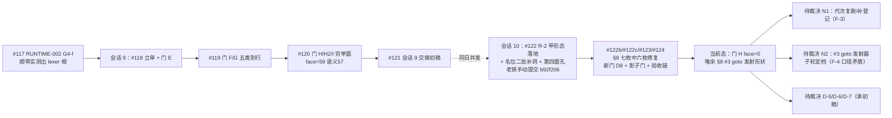

# 交接文档（会话 9 → 审计更正版）· AOT-CODEGEN-010 全链：穷举面闭环（#118–#121）+ 落地代次接续（#122–#124）

> - **初稿日期**：2026-10-07（会话 9，任务 #118→#119→#120→#121）
> - **审计更正版**：2026-10-08 07:53（老铁令「审查交接文件完成进度」时实测发现仓库已被**并发会话**推进 ⇒ 初稿的「当前态」描述全部失效，本文件已改为**双代次并行**口径）
> - **本文件不自记 md5/行数**（记录即改动）
> - **代次锚点（审计时实测，非记忆）**：
>   - **代次 A ＝ 会话 9 归因代（修复前）**：二进制 `1f15e4ce9b5c9cdaaef7cabf5efb9c76`，工单 396 行 `79be8bc9…`，`src/` 零改动
>   - **代次 B ＝ 落地代（并发会话 10 + #123/#124，现已是仓库当前态）**：HEAD `b92f206`（老铁手动提交，消息 `11`，8 文件 `+268/−78`）；**当前工作树二进制 `5beb1591018e6092ffc0ab0446344eee`（2026-10-07 22:28:25 重建）—— 文档零登记**（工单最后登记 `b416d3fbceed199b186676619043bcc5`）；工单现 480 行 `eaac878c…`、新增 §8
> - **回归状态（代次 B，实测 mtime `2026-10-07 21:16:02`）**：`Total=68 / Pass=67 / Fail(Compile)=0 / Fail(Runtime)=0 / Fail(Diff)=0 / Skip=1`（SKIP 仍为 `f004`）；影子 68 语料 `main.zig` md5 `total=68 same=68 diff=0 miss=0`
> - **用户指令**：**「继续处理已知问题修复」** —— 只授权已接受计划内的只读取证/归因/建门/写文档；**不构成**提交授权（须「提交」二字）；**不构成**对发射侧/文法侧修复的点头
> - **上级交接链**：§2.1

---

## 0. 状态标记图例（全文统一）

| 标记 | 含义 |
|---|---|
| ✅ **DONE** | 已闭环，读数已注册 |
| ✅ **已落地** | 源码改动已入库（HEAD）或已在暂存区（附注） |
| ✅ **已收口** | **取证类**事项（非源码改动）闭环，等价证据已登记于工单对应节；引用时给出该节号而非复跑 |
| 🟡 **待裁决** | 取证完整，落地前需老铁点头（§五/§六） |
| 🔒 **门控中** | 路线未启动，禁止开工 |
| 📦 **未提交** | 资产已落盘未入库，需「提交」二字 |
| ❌ **已否证** | 实测推翻的旧说法（禁止再引用） |
| ⚠️ **推断未取证** | 禁止当证据引用 |
| 🕒 **代次错配** | 读数与当前二进制代次不一致，复跑或补登记前不得引用为「当前态」 |

---

## 1. TL;DR（含审计结论）

1. **会话 9（#118–#121）把「覆盖面穷举」做尽**：新立 P0 工单 `AOT-CODEGEN-010`，把 `lexer.zig:384 lexIdentifier` 把原文切片交给大小写敏感 `keyword_lookup.zig:6`（**87 枚 = 80 小写关键字 + 7 大写魔术常量键**）这一根因，按**全表逐枚**测成 79 形双臂 + 21 形名位矩阵，红面注册为 **59 枚**（语义 57）；六张永久侧门 E/F/G/H/H2/I 全部实跑并注册。
2. **并发会话（#122/#122b/#122c/#123/#124）在同日把该单推进到落地代次**：R-2 走的是**甲**形态（lexer 折形查表 + `case_insensitive_keywords` 旗标 + 名位长尾补洞），老铁以 `b92f206`（消息 `11`）**亲手入库**；**D-3 已裁决＝并入本单**（工单新增 §8，七枚独立缺陷逐枚到行），其中 **#1/#2/#4/#5/#6/#7 六枚已修复**，**唯余 #3（反向 `goto` 发射形状）**；新立永久侧门 **D8**、**影子 md5 门**、**验收链脚本**。（2026-10-08 09:12:33 续：§8 六枚修复即原暂存区 4 文件 `+114/−28` 已由老铁提交 `0652130` 入库，`git status --porcelain -- src/` 归零。）
3. **修复代终态实测（本审计逐门复量 TSV）**：门 H `face=0 / noface=78 / confounded=1 / inverse_face=0 / inverse_noface=21`（`ELAPSED=721s`）；门 E `same=19`／F `same=8 zero_instr=0`／G `same=7 red_confirmed=0 guard_red=0`；门 H2 `over_accept=14` 不变；门 I `aot_same=19 aot_diff=0 both_red=0 vm_only_red=12 aot_only_red=0`（tree/bc 读数与冻结注册逐项一致 ⇒ **D-2「分叉仅 AOT」达成**）；门 D8 `defect_red=1 guard_same=13`（`48s`）。
4. **审计发现 6 项（F-1…F-6，详见 §11）**，其中 **F-3 代次错配已按老铁裁决「方案② 补登记等价证据」收口**（2026-10-08，工单 §9）：门 TSV 头行本就自登记 `# compiler_md5=` 与四枚源码 md5 ⇒「无登记」一说被本审计自己否证，缺口仅为「当代次二进制未进注册头」；补证分源码级（blob mtime 取证 + 与 #122b 注册 blob 的 hunk 比对 + **21:16→22:31 窗口对象库零写入**）与行为级（六门复跑数据行逐字节相同、H 子集 13/13、影子子集 16/16 生成码 md5 相同），**实测 600 s ≈ 10 分钟**（非整链 42 分钟）。**仍须老铁处置的是 F-4**：工单 §8 文末优先级自相矛盾（同一句把 #3 既记 P1 又记 P2）——属并发会话的工单，我未擅改，只登记。
5. **本初稿的自我否证**：初稿断言「2026-09-20 → 2026-10-06 无任何交接文件」**为错** —— 实测存在 `docs/changes/2026-09-21/f161前缀自增结合性解析修复_缺陷B交接_2026-09-21_908a3a0.md`（❌ F-2，本文件 §2.1 已更正）。
6. **收口后的剩余风险面（4 项，禁当已验，工单 §9.4）**：门 H 全量 79 形/200 臂、影子全量 68 形、主回归本代次未复跑、构建非确定性无对照实验。09:12:33 的提交 `0652130` 使六枚相关源码获得**版本库锚点**（工作树 md5 ↔ `git show` md5 逐枚全等），代次判定从此一条命令可复现。

---

## 2. 交接链（可回溯）

### 2.1 会话级文档链

| 顺序 | 文档 | 状态 | 说明 |
|---|---|---|---|
| 会话 7 / 8 | `docs/changes/2026-09-19/handoff_session7.md`、`handoff_session8.md` | 📦 | 编号式 `handoff_sessionN` 的**最后一个**是 session8 |
| **专项交接（初稿漏记，已更正）** | `docs/changes/2026-09-21/f161前缀自增结合性解析修复_缺陷B交接_2026-09-21_908a3a0.md` | 📦 | 非编号式，专项缺陷 B 交接 |
| 空档 | 2026-09-22 → 2026-10-06 | — | **确无交接文件**；该段只能靠**任务号 + 带任务号的变更文档**回溯（本份 §2.3 即为此而写） |
| 会话 9 初稿 | `docs/changes/2026-10-07/交接文档_2026-10-07_session9_R118-R120关键字穷举面闭环.md` | 📦 本文件（已就地更正版） | 修复前代次快照 + 落地代次接续 |

2026-10-07 当日 CODEGEN-010 族文档（按 mtime，含并发会话产物）：

| 文档 | 归属 | 状态 |
|---|---|---|
| `…/G4f双环归因与关键字大小写新族立项_R117R118_2026-10-07_fbe6382a.md` | #117 + **#118 本会话** | 📦 |
| `…/关键字大小写五类结局到行归因与常量表第二面孔_R119_2026-10-07_fbe6382a.md` | **#119 本会话** | 📦 |
| `…/关键字大小写表项穷举门与过度识别名位矩阵_R120_2026-10-07_fbe6382a.md` | **#120 本会话** | 📦 |
| `…/AOT-CODEGEN-010_R2批落地与名位长尾补洞_R122_2026-10-07_fbe6382a.md` | 并发会话 #122（R-2 甲形态落地 + 名位二批补洞 + 第四面孔） | ✅ 源码已入库 `b92f206` |
| `…/AOT-CODEGEN-010_§8三批修复_R123_2026-10-07_fbe6382a.md` | 并发会话 #123 | 📦 代码在暂存区 |
| `…/AOT-CODEGEN-010_§8调用解析序与iterable批_R124_2026-10-07_fbe6382a.md` | 并发会话 #124（mtime 21:18:46） | 📦 代码在暂存区 |

### 2.2 本会话任务链（代次 A，驱动开发主线）

| 任务 | 内容 | 状态 | 交付物 | 实测成本 |
|---|---|---|---|---|
| **#118** | 立项 CODEGEN-010：19 形侧门 E + 语料面 + 机制锚点 | ✅ DONE（读数属**代次 A**，代次 B 已复跑转绿） | 工单新建；门 E + TSV | `60s`（3.2 s/形） |
| **#119** | R-1 归因轮：五类断点逐类到行 + R-2b 第二面孔 | ✅ DONE（F 的 `zero_instr=1` 在代次 B 已归零） | 工单 §3.1/§3.3；门 F、G | F `30s`、G `26s` |
| **#120** | §7-2 穷举门：87 枚全表逐枚 + 7×3 名位矩阵 + 跨模式量化 | ✅ DONE（H 的 `face=59` 在代次 B 已归零） | 工单 §2.2/§3.4/§3.4.5/§4/§5/§6/§7；门 H、H2、I | H `595s`、H2 `54s`、I `57s` |
| **#121** | 会话 9 交接文档（本文件） | ✅ DONE（**本审计即其更正轮**） | 本文件 | 无门跑；成本 = 锚点复测 |

### 2.3 并发 / 兄弟链（本会话**未参与**，状态按实测与工单登记）



| 任务段 | 工单 | 本会话关系 | 当前状态（实测） |
|---|---|---|---|
| #114 → #117 | `AOT-RUNTIME-002` + `AOT-CODEGEN-009` | **#117 为 #118 父任务** | RUNTIME-002 R-1…R-10 🟡；CODEGEN-009 R-1…R-4 🔒 |
| #110 → #113 | `AOT-REF-004` | 平行（判据 3/4 被 #120 复用） | 路线 E–I 🟡；H 不可顶替 E（实测） |
| #105 → #110 | `AOT-CODEGEN-007` + `AOT-OPT-001` | 平行 | §5 A–E 🟡；OPT-001 §6.1 P0-a/P0-b 🟡；#104 🔒 |
| #81 / #84 / #86 | `AOT-CODEGEN-006` | 平行 | #81 🟡（前置裁决 N1/N2）；#84（R17）🟡 |
| #40 | `AOT-REF-003` | 平行 | 🔒 |
| #63 | `AOT-PROC-001` | 本会话新增资产同风险面 | 📦 |

---

## 3. 两代次读数对照（六门 + 三新门，全部逐字取自 TSV 现值与初稿注册值）

### 3.1 门脚本（**脚本 md5 两代次相同** ⇒ 读数差异全部来自修复本身，非改门）

| 门 | 脚本 md5 / 行数（审计实测，与代次 A 一致） | 代次 A 注册读数（修复前） | 代次 B 现读数（修复代） |
|---|---|---|---|
| **E** | `1367584f9b0a3a64dc2e9181ef81c77f` / 109 | `shapes=19 same=8 diff=8 silent_empty=3 aot_fatal=3 compile_fail=3`（60s） | `shapes=19 same=19 diff=0 silent_empty=0 aot_fatal=0 compile_fail=0`（**66s**） |
| **F** | `d71380842e667ad3fdafb0db02ec6e69` / 149 | `shapes=8 same=4 diff=4 zero_instr=1 compile_fail=0`（30s） | `shapes=8 same=8 diff=0 zero_instr=0 compile_fail=0`（**27s**） |
| **G** | `921244072b7e2482d4da83c907b6566c` / 103 | `shapes=7 same=4 diff=3 red_confirmed=3 guard_same=4 guard_red=0`（26s） | `shapes=7 same=7 diff=0 red_confirmed=0 guard_same=4 guard_red=0`（**23s**） |
| **H** | `c5d6343151193a7e489f814f309ae39c` / 279（**未改**） | `shapes=79 arms=200 face=59 noface=15 confounded=5 ctrl_cf=1 probe_cf=25 inverse_shapes=21 inverse_face=15 inverse_noface=6`（595s） | `shapes=79 arms=200 face=0 noface=78 confounded=1 ctrl_cf=0 probe_cf=0 inverse_face=0 inverse_noface=21`（**721s**） |
| **H2** | `8e11de20dd598f0875d166022f4c905c` / 99 | `shapes=15 over_accept=14 strict_same=1`（54s） | `shapes=15 over_accept=14 strict_same=1`（**52s，读数不变**） |
| **I** | `d28ae3dcaa57afe4b70829cf827967d1` / 138 | `tree_same=7 tree_diff=12 bc_same=7 bc_diff=12 aot_same=8 aot_diff=8 aot_cf=3 both_red=11 vm_only_red=1 aot_only_red=0`（57s） | `tree 7/12、bc 7/12（与冻结注册逐项一致）aot_same=19 aot_diff=0 aot_cf=0 both_red=0 vm_only_red=12 aot_only_red=0`（**68s**） |
| **D8**（新） | `d783085b04b76c50f1c8fb76c6eae7ae` / 93 | —（代次 A 不存在） | `shapes=14 defect_red=1 guard_same=13 compile_fail=0 bad_probe=0 residue=0`（**48s**） |
| **影子 md5**（新） | `cb8183142569c0afbed4385478558c98` / 53 | — | `C010_SHADOW_DONE total=68 same=68 diff=0 miss=0`（**1502s ≈ 25 分钟**） |
| **验收链**（新） | `f4d011c25619fc24ead8888e3f3e1daa` / 32 + `.log`（21:16:02） | — | 链尾汇总门 I + 影子读数（把六门 + 影子串成一条链） |

### 3.2 覆盖账对照

| 面 | 代次 A | 代次 B（现） | 说明 |
|---|---|---|---|
| 门 H 红面 | **59**（语义 57；FACE 须并报 34/32） | **0** | R-2（甲形态）收口 |
| 宽容绿 NOFACE | 15（H2 判 `over_accept=14`） | 78 | 名位长尾 + 调用解析序修复后转绿；**H2 读数刻意不变**（文法位过度宽容属另一面孔，未随 R-2 收敛） |
| CONFOUNDED | 5 | **1** | 仅余 `k_goto` = §8 #3 |
| 过度识别反例组 | 15 红 / 6 绿 | **0 红 / 21 绿** | 名位补洞（`eatKeywordAsIdentifier` + 原文 intern）达成 |
| 探针编译失败 | 25 | **0** | 初稿预测的「新增名位红面」被甲形态同批消化 |
| 门 I `vm_only_red` | 1 | **12** | **D-2 分叉证据**：AOT 全绿、解释器/字节码面按原样保留（tree/bc 读数逐项不变） |
| 主回归 | Pass 67 / Skip 1（10-05 23:22:37） | **Pass 67 / Skip 1**（10-07 21:16:02 重跑） | 零 Fail 保持；影子 68/68 零漂移 |

### 3.3 机制锚点（代次 B 实测新位置，旧行号作废）

| 项 | 代次 B 实测 |
|---|---|
| `src/compiler/lexer.zig`（`e3dd4191…`/543） | `:17 case_insensitive_keywords: bool = false`（**旗标默认关**）；`:388 lexIdentifier` → `:390 const text = self.buffer[start..self.pos]`（**原文切片，不折形**）→ `:394 if (self.case_insensitive_keywords)` → `:395 lookupIgnoreCase(text)`；`:392` 源码注释写明「**旗标开启（仅 AOT 编译）**」⇒ 这就是 D-2「分叉仅 AOT」的实现机制（旗标分叉，而非复制前端）；敏感旧路保留在 else 支（`:401 text.len <= 5` fast path、`:405 text.len <= keyword_lookup.max_key_len`） |
| `src/compiler/keyword_lookup.zig`（`ef70993a…`/186） | `:118 lookupIgnoreCase` —— 先折小写查 80 枚 `k_` 键、再折大写查 7 枚 `m_` 键（**双向折形、两族互斥**，正解初稿记录的「归一方向陷阱」；`:119` 长度上限用 `max_key_len`、`:120` 折形缓冲仅栈上）；`:104 max_key_len`（R-4 消除硬编码 `len <= 15`，`:182` 回归钉 `= 13`）；`:140 FoldedKey` + `:164` 测试「原表 87 枚键三种拼写变体全命中（R-2 穷举）」 |
| `src/compiler/parser.zig`（`e3987a36…`/4230） | §8 #1 赋值 RHS 优先级：语句级 `parseAssignment` 的 RHS `:2026 parseExpression(4)`（注释 `:2023`）+ 循环内/复合赋值 `:2710`/`:2714 parseExpression(next_p - 1)`，并新增「赋值节点之上 `and/xor/or` 续接链」；§8 #2 成员修饰符循环 `:907 .k_var => modifiers.is_public = true`（注释 `:905`） |
| 仍存 | 死桩 `isKeywordUsableAsIdentifier`（代次 A 位于 `:3756-3759`）—— **D-4 裁决＝维持不动**（并发会话未删） |

### 3.4 ❌ 已否证清单（含本审计对初稿的否证）

| 旧说法 | 实测 |
|---|---|
| 「87 枚表项全小写」 | 80 `.k_` + 7 `.m_`（大写魔术键） |
| 「最长键 `endswitch`(9) ⇒ `len<=15` 安全」 | 最长 13 字符（`__NAMESPACE__`），R-4 已改按表计算 |
| 「`isKeywordIdentifierTag` 覆盖 87 枚」 | 代次 A 实测 74 枚、漏 6 枚（`.k_struct` + 5 枚 `end*`） |
| 「名位对 R-2 中性」 | 不中性；初稿据此预测的新红面，已由**甲形态**同批消化 |
| 「`struct` 方法名探针非确定性」 | 撤回（本会话自己误读），3× 确定性 `COMPILE_FAIL` |
| **初稿**「2026-09-20 → 10-06 无交接文件」 | ❌ 存在 2026-09-21 缺陷 B 专项交接（F-2） |
| **初稿**「工作树唯一 src 改动 = `native_linker` #74 批 5+/4−」 | ❌ 当前为 4 文件暂存（`ir_generator +17`／`native_linker 62`／`runtime_lib_template 33`／`parser 30`，合 `+114/−28`）（F-1/F-5） |
| **初稿**「冻结二进制 md5 `1f15e4ce…` 未变」 | ❌ 现为 `5beb1591…`（22:28:25 重建），且文档零登记（F-3） |

---

## 4. 状态总表

### 4.1 已落地（并发会话，非本会话完成，本审计实测确认）

| 路线 | 内容 | 入库状态 |
|---|---|---|
| **R-2（甲形态）** | 折形查表 + 旗标门控 + 原文切片不动 + 名位长尾补洞（13 处）+ 第四面孔（`main.zig` 多文件检测与 `dependency_resolver.matchKeyword` 折形） | ✅ **已入库 `b92f206`** |
| **R-2b** | 常量表拼写面 | ✅ 已入库 `b92f206` |
| **R-4** | `len<=15` → `max_key_len` 按表计算 | ✅ 已入库 `b92f206` |
| §8 #1/#2/#5 | `and/or/xor` 赋值右结合截断、`var` 属性臂、`__NAMESPACE__` 空串 | ✅ **已入库 `0652130`**（老铁 2026-10-08 09:12:33，4 文件 `+114/−28`） |
| §8 #4/#6/#7 | `iterable` 类型位 + `$$a` 渲染、函数名大小写不敏感解析序、内建 `go` 遮蔽用户函数 | ✅ 已入库 `0652130` |
| §8 #3 | 反向 `goto` 发射形状 | ❌ 未开工（N2 待老铁定档） |
| 门 D8 / 影子门 / 验收链 | 三张新资产 + 注册读数 | 📦 未入库 |

### 4.2 🟡 待老铁裁决（**当前生效清单**，已按并发会话结果收敛）

| ID | 事项 | 实测口径 |
|---|---|---|
| **N1**（本审计新立 → **✅ 已收口，方案②，2026-10-08**） | **代次错配**：当前二进制 `5beb1591…`（22:28:25）取证时除本交接文档外无登记点（当时 `grep -rl '5beb1591' docs/` = 1；**收口后现值 = 2**，即本文件 + 工单 §9）；六门 + 影子 + 主回归读数取自 20:46–21:16，**早于** `ir_generator.zig` 22:27:16 的末次编辑；22:28 后仅门 D8（22:29:13）复跑 ⇒ `face=0` 未在当代次复证。2026-10-08 08:0x 复验：全部 mtime/md5/HEAD/暂存区计数逐项不变 | **老铁裁决 = 方案②（补等价证据，不整链复跑），已执行并登记于工单 §9**。等价证明分两层：① **源码级**——lexer/keyword_lookup/parser/runtime_lib_template 四枚的 md5 与门 TSV 头行注册值全等（门脚本本就自登记 `# compiler_md5=` 与四枚源码 md5，F-3 措辞据此收窄）；native_linker mtime 20:07:32 早于注册窗口；ir_generator 现内容的 git blob `38442457ecbd` 写于 **20:48:54**（早于 21:00–21:16 读数），与 #122b 注册 blob `eff0284c1c2c` 的 diff **恰为 §8 #6 一枚 hunk**，且 **21:16→22:31 窗口对象库零写入** ⇒ 22:27:16 的写回 = 回到既有内容，goto 试验从未入库。② **行为级**——六门复跑数据行逐字节相同、H 子集 13/13 行相同、影子子集 16/16 生成码 md5 相同。⇒ `b416d3fb`↔`5beb1591` 的 md5 差只能来自构建非确定性（该句为推断，未做对照实验）。**实测成本 600 s ≈ 10 分钟**（非 42 分钟）。未复证面四项见工单 §9.4：H 全量 79 形、影子全量 68 形、主回归本代次未复跑、构建非确定性无对照实验。**09:12:33 追加第三层证据**：老铁提交 `0652130`（§8 六枚修复，4 文件 `+114/−28`），六枚相关源码的工作树 md5 与 `git show 0652130:<path> | md5 -q` **逐枚全等** ⇒ 代次判定获得版本库锚点，见工单 §9.6 |
| **N2** | **§8 #3 反向 `goto` 发射形状子轮**是否开工、定 P 几 | 工单文末口径矛盾（同句 P1/P2，F-4）；机制已定层 = `native_linker` 函数体结构化渲染（无条件 `br` 到非相邻块无 Zig 表示）；IR 侧试验已被实测否证回滚；语料 `goto` **0 处** ⇒ 影子预期零漂移 |
| **D-5** | 字节码 VM 静态属性 `.`-拼接 `popFast` panic（`src/bytecode/vm.zig:2322 handleConcat`，vm.zig `43431512…`/8863）**是否一并修**（§五：默认不修） | 门 I `vm_only_red=12` 亦提示：VM 侧另有 12 形红，是否立项需明示 |
| **D-6** | `--compile` 解析失败仍 rc=0 且不产出二进制的流程项（与 RUNTIME-002 §7-4 skip-before-compile 并批） | 已固化坑（记忆规则 21） |
| **D-7** | 九张门（E/F/G/H/H2/I/D8/影子/验收链）是否纳入官方十二腿门链；文档与门资产是否一次性提交 | 📦 需「提交」二字 |
| **D-4**（并发会话已裁＝维持） | 死桩 `isKeywordUsableAsIdentifier` **保持不删** | 若后续要清，需重走 §六-3 |
| **R-3**（价值需重估） | 发射期「关键字落 t_string」金丝雀：原为防 A 类静默回归；代次 B `zero_instr=0`、门 H `face=0` ⇒ 现仅剩**防未来回归**价值 | 若要建，判据面按 §3.1 F 门 `zero_instr` 列 |

### 4.3 🔒 门控中（本会话未启动）

RUNTIME-002 R-1…R-10（P0 = R-2/R-5/R-6 + G4-f 三处同批）｜CODEGEN-009 R-1…R-4｜CODEGEN-008 R-A…R-D + §3B｜skip-before-compile 子门｜REF-004 E–I｜CODEGEN-007 §5 A–E + 路线 E｜OPT-001 §6.1 P0-a/P0-b + #104｜PERF-001 §7｜REF-003 #40｜CODEGEN-006 #81（前置已收窄为 N2；N1 已收口）、#84（R17）｜PROC-001｜REF-001 D1｜REF-002 R-2/R-4/R-5/R-6。

### 4.4 ⚠️ 推断未取证（禁止当证据，承初稿）

§7-8 D 类 `reg_5` 跳号解释 ／ §7-7 C 类无 AST 侧读数 ／ §7-13 AOT 重复警告行未归因 ／ §7-14 已知返回类型是否校验未测 ／ §7-15 替代语法（`endif;`/`endswitch;`）是否真支持仍不可判（**H2 `over_accept=14` 代次 B 仍未变 ⇒ 该项依旧开放**）／ 本审计新增 → **方案② 后已收窄为单点**：`5beb1591…` 与 `b416d3fb…` 之间**源码同一已实测**（四枚靠门 TSV 源码 md5 头行、native_linker 靠 mtime、ir_generator 靠 git 对象 mtime 取证 + hunk 逐一比对）；仍未取证的是「两枚二进制 md5 之差 = **构建非确定性**」这一解释本身 —— 未做「同源码重建比 md5」对照实验（需覆盖正在验收的当前二进制 ⇒ 风险动作，未经老铁明示不做）。

---

## 5. 会话关联文件清单

### 5.1 本会话（#118–#121）写

| 文件 | 状态 |
|---|---|
| `docs/known-issues/AOT-CODEGEN-010-keyword-case-insensitive-lexer.md` | 本会话写成 396 行 `79be8bc9…`（代次 A）→ **现 480 行 `eaac878c…`（并发会话续写 §8）** |
| `docs/changes/2026-10-07/关键字大小写…_R120_…md` | 📦 本会话新建 |
| 本文件 `交接文档_2026-10-07_session9_R118-R120关键字穷举面闭环.md` | 📦 本会话新建，**本审计就地更正** |
| 门 E/F/G/H/H2/I 脚本 + 6 份 TSV（`fuzzy_scripts_720/tmp/c010_*`） | 脚本 md5 两代次未变；TSV 已被代次 B 复跑改写 ⇒ **代次 A 读数现仅存于本文件 §3.1 与工单/变更文档** |
| 记忆 `…/memory/project-aot-codegen010-keyword-case.md` + 项目 `MEMORY.md` 索引 | 已更新（含 #120 更正与本交接指针） |

### 5.2 并发会话新增资产（本审计实测登记，非本会话所写）

`fuzzy_scripts_720/tmp/`：`c010_indep_defects_gate_tmp.sh`（`d783085b…`/93）+ `c010_indep_defects_tmp.tsv`、`c010_shadow_main_md5_tmp.sh`（`cb818314…`/53）+ `.tsv`、`c010_acceptance_chain_tmp.sh`（`f4d011c2…`/32）+ `.log`；`c010_*` 资产现计 **18** 个（代次 A 为 12）。

### 5.3 源码锚点两代次对照（审计实测）

| 文件 | 代次 A（会话 9 注册） | 代次 B（当前工作树） |
|---|---|---|
| `src/compiler/lexer.zig` | `21f02e92…`/530 | `e3dd4191a1c3dfdf816b5873b4c60e5f`/543 |
| `src/compiler/keyword_lookup.zig` | `b8832bef…`/118（87 = 80+7） | `ef70993a7caac6deb9b2e5a23bf7d143`/186 |
| `src/compiler/parser.zig` | `5995c1e7…`/4131 | `e3987a361d1db45bc3eadefc7afa249e`/4230 |
| `src/aot/ir_generator.zig` | 未触（`bb9c00ed…`/9741 为工单 §8 登记的 **#122b** 落地代值，非 #122c；比对见 §5.4） | `96377ae7d33d52c6551a5daadefd886e`/9743（mtime 22:27:16；blob 对象自 20:48:54 已存在） |
| `src/aot/runtime_lib_template.zig` | `008b7b63…`/30810 | `5fdae1ab0cffde3eaba477a52a9713b4`/30857 |
| `src/aot/native_linker.zig` | `fbe6382a…`/32797（#74 批 5+/4−） | `3f05640c4877f4b6ce49a16fceec27c2`/32823（暂存 62 行） |
| `src/bytecode/vm.zig` | `4343151291f461d067b61187ff9bb9be`/8863（**未动**，D-5 所系） | 同（无改动） |
| `zig-out/bin/php-interpreter` | `1f15e4ce…` | **`5beb1591…`（10-07 22:28:25）**；工单 §8 注册 `b416d3fb…`，§9 已把 `5beb1591…` 与其等价性一并登记 |

### 5.4 方案② 代次对齐新增资产与源码身份登记（2026-10-08 实测，📦 全部未提交）

| 资产 | 用途 | 实测 |
|---|---|---|
| `fuzzy_scripts_720/tmp/c010_gen_align_subset_tmp.sh` | 影子**单侧**子集（影子原脚本无 `ONLY=` 通道，故另写）；选形依据写在头注释 | `16/16 SAME diff=0 noref=0`，ELAPSED=213 s |
| `fuzzy_scripts_720/tmp/c010_gen_align_subset_tmp.tsv` | 上表读数 | md5 `e373f1b71e1436dae68054b08d4a9829` |
| `fuzzy_scripts_720/tmp/c010_genB_snapshot/` | **注册代次（`b416d3fb`）九份 TSV 快照**，供逐行等值对照 | keyword_case `3ea26c92…`／mechanism `dacc656c…`／constant_case `6c7cc59b…`／kw_full_table `88b7f6b8…`／noface_tolerance `1af3a296…`／crossmode `8f6ecf40…`／indep_defects `0f1a4625…`／shadow `f3358264…`／gen_align `e373f1b7…` |
| `fuzzy_scripts_720/tmp/c010_kw_full_table_smoke_tmp.tsv` | 门 H 子集（`SMOKE_ONLY=1`，不覆盖注册表） | 13/13 行逐字节相同，ELAPSED=97 s |

**六枚相关源码的代次身份（等价取证用，禁凭 mtime 猜测）**：

| 文件 | 现 md5 / 行数 | 代次判据类型 | 判据读数 |
|---|---|---|---|
| `src/compiler/lexer.zig` | `e3dd4191…`/543 | 门 TSV 头行自登记 | 注册头 = 现头，全等 |
| `src/compiler/keyword_lookup.zig` | `ef70993a…`/186 | 门 TSV 头行自登记 | 同上 |
| `src/compiler/parser.zig` | `e3987a36…`/4230 | 门 TSV 头行自登记 | 同上 |
| `src/aot/runtime_lib_template.zig` | `5fdae1ab…`/30857 | 门 TSV 头行自登记（G/F） | 同上 |
| `src/aot/native_linker.zig` | `3f05640c…`/32823 | 文件 mtime ＋ git 对象 mtime | mtime 20:07:32；现内容 blob `d070d559bde7` 写于 **20:48:57** |
| `src/aot/ir_generator.zig` | `96377ae7…`/9743 | git 对象 mtime ＋ 与 #122b 注册 blob 的 hunk 比对 | 现内容 blob `38442457ecbd` 写于 **20:48:54**；与 `eff0284c1c2c`（`bb9c00ed…`/9741，工单 §8 已登记为 #122b）的 diff 恰为 §8 #6 一枚 hunk；**21:16→22:31 窗口对象库零写入** |

⇒ ir_generator 与 native_linker 的现内容同属 **20:48:5x 那一次 #122c 暂存批次**，早于 21:00 起的注册读数；22:27:16 的写回未产生新 blob。

**提交锚点（2026-10-08 09:12:33 实测，本节取证完成后发生）**：老铁以 `0652130`（消息 `11`）入库 §8 六枚修复（4 文件 `+114/−28`），`git status --porcelain -- src/` 现 **0 项**。复测上表六枚：`md5 -q <path>` 与 `git show 0652130:<path> | md5 -q` **逐枚全等** ⇒ 代次判定从「mtime ＋ blob 取证」升级为「提交锚点」，任何后续会话一条 `git show` 即可复现，无需再推断。工单 §9.6 已同步登记。⚠️ 二进制仍为 `5beb1591…`（提交前后未重建），文档与门资产（含本节四份）**仍未提交**。

### 5.5 已清理产物 / 保留决策（承初稿，本审计复核残留为 0）

已删 `c010h_face_split_tmp.awk` 与 `/tmp/c010h_*`；刻意保留 `opt001_roundcfg_out_tmp.tsv.smoke2`（被 OPT-001 与 10-06 变更文档当证据引用）；`.php` 源 **597** 个、`pass/*.php` **68** 个**一个未删**（§七-9）；`.zigphp_aot_build_*` 与 `aot_compile_*` 残留计数 **0**。

---

## 6. 关联提交（审计实测）

| 项 | 内容 |
|---|---|
| **HEAD（当前）** | `0652130`「`11`」（2026-10-08 09:12:33）—— **老铁手动提交**，内容 = §8 六枚修复 4 文件 `+114/−28`（`--numstat` 实测：`ir_generator +14/−3`、`native_linker +44/−18`、`runtime_lib_template +30/−3`、`parser.zig +26/−4`）；消息仍未按 §九 中文描述式 |
| `b92f206` 内容 | 8 文件 `+268/−78`：`keyword_lookup.zig +76`、`lexer.zig +27`、`parser.zig +185`、`main.zig +22`、`runtime_lib_template.zig +20`、`native_linker.zig +9`、`dependency_resolver.zig +4`、`multi_file_compiler.zig +3` ＝ **R-2 甲形态 + R-2b + R-4 + 名位长尾 + 第四面孔** |
| 其前依次 | `497edc6` → `0ff09cf` → `b21cdfd` → `9b8ad31` → `42fa824`（本初稿记录的「HEAD」即此 `497edc6`） |
| 暂存区（未提交） | **0 项**（原 4 文件 `+114/−28` 已随 `0652130` 入库；`git status --porcelain -- src/` 实测空） |
| 已跟踪修改（未暂存） | **7** 项：5 张工单（`AOT-CODEGEN-002`/`005`/`006`、`AOT-PERF-001`、`AOT-TYPE-001`）+ `fuzzy_scripts_720/regression_failures.tsv` + `regression_report.md` |
| 未跟踪 | `git status --porcelain` 现计 **349** 项 = 已跟踪修改 7 + 未跟踪 **342**（`fuzzy_scripts_720/tmp/` 为主体、`docs/changes/` 19 段、`docs/known-issues/` 15 张、`docs/knowledge/2026-09-27/`） |
| 建议切分（一旦「提交」） | ~~①§8 六枚修复~~ **已入库 `0652130`，勿重复提交**；②CODEGEN-010 工单（含新增 §9）+ 九门 + TSV/log + 四份变更文档 + 本交接文档；③#74 纯注释批（**已随 `b92f206` 入库或被其吸收，提交前用 `git show --stat b92f206` 复核，勿重复**）；④其余历史工单按票 |

---

## 7. 复测路径与验收成本（代次 B 实测，全为实测）

```bash
# 必须在仓库根执行；编译失败判据取「产物不可执行」不取 rc

# === 接手三条复测（秒级，先于任何复跑；承 §12 教训 ⑰）===
git log --oneline -1                                        # 现为 0652130（10-08 09:12:33）
git status --porcelain -- src/                              # 现为 0 项
md5 -q zig-out/bin/php-interpreter                          # 现为 5beb1591…（10-07 22:28:25，提交后未重建）

# === 代次锚点（工单 §9.6，判「读数是哪代源码产出的」首选此法，成本 < 1 s/枚）===
for f in src/compiler/lexer.zig src/compiler/keyword_lookup.zig src/compiler/parser.zig \
         src/aot/runtime_lib_template.zig src/aot/native_linker.zig src/aot/ir_generator.zig; do
  printf '%s work=%s committed=%s\n' "$f" "$(md5 -q $f)" "$(git show 0652130:$f | md5 -q)"
done                                                        # 实测：六枚 work 与 committed 逐枚全等

timeout 300 bash fuzzy_scripts_720/tmp/c010_keyword_case_gate_tmp.sh       # E  66s  same=19
timeout 300 bash fuzzy_scripts_720/tmp/c010_mechanism_gate_tmp.sh          # F  27s  same=8 zero_instr=0
timeout 300 bash fuzzy_scripts_720/tmp/c010_constant_case_gate_tmp.sh      # G  23s  same=7 guard_red=0
timeout 120 bash fuzzy_scripts_720/tmp/c010_indep_defects_gate_tmp.sh      # D8 48s  defect_red=1 guard_same=13
timeout 300 bash fuzzy_scripts_720/tmp/c010_noface_tolerance_gate_tmp.sh   # H2 52s  over_accept=14
timeout 300 bash fuzzy_scripts_720/tmp/c010_crossmode_gate_tmp.sh          # I  68s  aot_same=19 vm_only_red=12
timeout 900 bash fuzzy_scripts_720/tmp/c010_kw_full_table_gate_tmp.sh      # H  721s face=0 inverse_face=0
timeout 3600 bash fuzzy_scripts_720/tmp/c010_shadow_main_md5_tmp.sh        # 影子 1502s same=68/68
# 六门 822s(代次A) → 957s(代次B)；含影子 = 2459s ≈ 41 分钟；再 + 主回归 run_regression.sh（10-07 21:16:02 实跑 Pass 67/Skip 1）

# === 方案② 代次对齐冒烟（2026-10-08 实测；H 走 ONLY= 子集写 .smoke.tsv，不覆盖注册表）===
ONLY='^(k_goto|k_namespace|k_unset|k_iterable|m_namespace|m_class|k_function|k_match|k_include|k_true|k_null|invf_go|invm_struct)$' \
  timeout 400 bash fuzzy_scripts_720/tmp/c010_kw_full_table_gate_tmp.sh    # H 子集 97s  13 形 26 臂 → 13/13 行逐字节相同
timeout 300 bash fuzzy_scripts_720/tmp/c010_gen_align_subset_tmp.sh        # 影子单侧子集 213s 16 形（namespace×1 + unset×13 + 控制×3）→ 16/16 SAME
# 代次对齐实测合计 600 s ≈ 10 分钟（对比整链复跑 ≈ 42 分钟）；六门复跑成本 E68+F28+G24+H2 53+I68+D8 49 = 290 s
```

**复测纪律**（承初稿，逐条仍有效，含本审计更正两处）：仓库根执行；`--compile` 走默认档 `--compile --no-debug-info`；产物存在性判编译失败；**`ONLY=` 冒烟通道仅 H/H2/I/D8 四门有，E/F/G 与影子脚本均无**（实测 `grep -c ONLY` = 0）⇒ 影子的子集复跑须另写单侧脚本（本轮即 `c010_gen_align_subset_tmp.sh`）；引用 FACE 必须并报「含噪/纯语义」两数；**门脚本 md5 已绑定两代次注册，禁止改门**；改门须「先修门、后引用」；`.php` 源零删除；**⑨（本审计更正升级版）** 门 TSV **头行自带 `# compiler_md5=` 与 `# lexer_md5=/keyword_lookup_md5=/parser_md5=/runtime_lib_template_md5=`** ⇒ 判断读数的代次应**先读头行**，比对二进制与四枚源码 md5 即可判代次，不必先复跑；头行未覆盖的文件（`ir_generator.zig`、`native_linker.zig`）用 **git 对象 mtime 取证**（`find .git/objects -size +95k -size -115k` → `git cat-file` 比对）判其内容是否早已存在；只有头行与对象库都追不上时，才标 🕒 并复跑。**⑨-b（本轮再升级）**：一旦该代源码已被提交，代次判定的**首选**就是 §7 顶部那条 `git show <commit>:<path> | md5 -q` 锚点（工单 §9.6 已为 `0652130` 建立，六枚逐枚全等）；git 对象 mtime 取证降为「改动尚未入库时」的退路。

---

## 8. 风险与完整性自证（审计更正）

| 维度 | 初稿（代次 A） | 审计实测（代次 B） |
|---|---|---|
| 本会话 src 改动 | 零 | **仍为零**（本会话未动 `.zig`；4 文件改动属并发会话） |
| 冻结二进制 | 「未变」 | ❌ **两度已变** `1f15e4ce…`（修复前）→ `b416d3fb…`（#122c 注册代）→ `5beb1591…`（当代次 22:28:25）⇒ 代次错配已按**方案② 收口**（源码级 + 行为级双证，工单 §9）；老铁 2026-10-08 提交 `0652130` 再给第三层**版本库锚点**（六枚源码工作树 md5 ↔ `git show` 内容 md5 逐枚全等，工单 §9.6），但**产物仍是提交前那枚**（未重建） |
| 基线 | 「10-05 时间戳未扰动」 | ❌ 主回归已在 10-07 21:16:02 重跑，`Pass 67/Skip 1` 保持、影子 `68/68` |
| 最大风险 | R-2 落地即动前端全量 token 流 | **已消化**（甲形态 + 影子零漂移 + 主回归零 Fail）；N1 亦已收口 ⇒ 现最大风险为 **#3 goto 的发射器改造**（改动面 = `native_linker` 函数体结构化渲染，属 §一 超大文件，须先 grep 已有模式）与 **§9.4 四项未复证全量面**（H 79 形／影子 68 形／主回归本代次未复跑／构建非确定性无对照实验） |
| 次风险 | 魔术常量归一方向 | **已消化**（`lookupIgnoreCase` 双向折形，两族互斥） |
| 新风险 | — | H2 `over_accept=14` 未随修复收敛 ⇒ 「文法位过度宽容」仍在，`endif;`/`endswitch;` 是否真支持仍不可判（§7-15） |

---

## 9. 后续开发 / 优化建议（优先级 + 影响面 + 落地成本，代次 B 口径）

| 优先级 | 建议 | 影响面 | 落地成本 |
|---|---|---|---|
| ~~**P0**~~ **✅ 已收口** | **N1 代次对齐**（老铁裁方案②，2026-10-08 执行）：源码级 + 行为级等价证据已登记工单 §9 | 使 `face=0` 等注册读数可安全引用为当代次 | 实测 **600 s ≈ 10 分钟**（213+290+97），非整链 42 分钟；零源码改动 |
| **P0** | 拿到「提交」二字后按 §6 切分入库（源码 4 文件已由老铁 `0652130` 自行入库；现待提交 = **文档 + 门资产**：CODEGEN-010 工单含新增 §9、九门脚本与 TSV/日志、10-07 变更文档、本交接文档） | 资产防丢（PROC-001 同族）；工单/门链入库 | 零成本 |
| **P1** | **N2 §8 #3 反向 `goto` 发射形状子轮**：先在 `native_linker` grep 既有 `while(true)`+`break` 与「目标区间内联复制」模式，再定 P1/P2（F-4 口径需老铁定档） | 发射器函数体渲染（`buildControlFlowBoundaries` 族）；语料 `goto` 0 处 ⇒ 影子预期零漂移 | 未实测（禁估算）；改前须 §六 门控 |
| **P1** | 补齐 §9.4 四项未复证全量面（H 79 形、影子 68 形、主回归当代次、构建非确定性对照） | 使「子集等值」升级为「全量等值」；构建确定性本身是门链可复现性的地基 | 全量复跑 ≈ **42 分钟**（957s + 1502s + 主回归）；构建对照 = 一次 `timeout 120 zig build` + md5 比对（须老铁明示可覆盖当前验收二进制） |
| **P1** | H2 面收口：文法位过度宽容（`over_accept=14`）+ 替代语法正/负例门（§7-15） | 判定面空白；与 R-2 无关的独立面孔 | 未实测（H2 类门 ≈ 3.5 s/形） |
| **P2** | AOT 重复警告行归因（§7-13，双空格 + 单空格各一行） | 污染一切逐字节等值判据 | 未实测（先建判据再动码） |
| **P2** | D-5 / D-6 / D-7 裁决；R-3 金丝雀价值重估（代次 B 已 `zero_instr=0`） | 跨模式面 / 流程判读 / 防未来回归 | 卫生级 |

---

## 10. 交接提示词（下一会话直接粘贴，审计更正版）

```text
继续处理已知问题修复

本会话从交接文档接手，先完整阅读并以其为唯一入口（勿凭记忆开工）：
docs/changes/2026-10-07/交接文档_2026-10-07_session9_R118-R120关键字穷举面闭环.md
（该文件为「审计更正版」，内含代次 A=修复前归因代 与 代次 B=当前落地代次 两套读数，引用时必须注明代次）

接手须知（全部为 2026-10-08 实测，非记忆）：
1. AOT-CODEGEN-010 已不是「零源码改动」状态：R-2 甲形态 + R-2b + R-4 + 名位长尾 + 第四面孔
   由老铁手动提交 `b92f206`（消息 "11"，8 文件 +268/-78）；§8 的六枚独立缺陷修复（#1/#2/#4/#5/#6/#7，
   4 文件 +114/-28）亦已由老铁提交 `0652130`（2026-10-08 09:12:33，消息同为 "11"）⇒ `git status --porcelain -- src/` 现 **0 项**；
   **仍待提交的是文档与门资产**（工单、九门脚本与 TSV、变更文档、本交接文档）。
2. 工单：docs/known-issues/AOT-CODEGEN-010-keyword-case-insensitive-lexer.md（§9.6 登记后实测 **544 行**，已新增 §8 七枚缺陷 + §9 代次对齐登记）。
3. 当前态读数：门 H face=0 / noface=78 / confounded=1（仅 k_goto）/ inverse_face=0；
   门 E same=19、F same=8 zero_instr=0、G same=7 guard_red=0、H2 over_accept=14（不变）、
   门 I aot_same=19 且 tree/bc 与冻结注册逐项一致（vm_only_red=12）；
   门 D8 defect_red=1 guard_same=13；影子 68/68 零漂移；主回归 Pass 67 / Skip 1。
4. 代次问题已收口，**不要复跑整链**（老铁裁决 = 方案②，2026-10-08 已执行，工单 §9）：
   N1 ✅ —— 当前二进制 `5beb1591018e6092ffc0ab0446344eee`（10-07 22:28:25）与注册代 `b416d3fb…` 等价性已三层取证：
      ① 门 TSV 头行自登记 `# compiler_md5=` + lexer/keyword_lookup/parser/runtime_lib_template 四枚源码 md5（判代次**先读头行**，勿轻说「无登记」）；
      ② ir_generator/native_linker 用 git blob mtime 取证（现内容 blob 20:48:5x，21:16→22:31 窗口对象库零写入 ⇒ 22:27 的 goto 试验从未入库）；
      ③ `git show 0652130:<path> | md5 -q` 与工作树六枚逐枚全等 ⇒ 以后判代次直接用它。
      行为级：六门复跑数据行逐字节相同、H 子集 13/13、影子子集 16/16 生成码 md5 相同；实测 600 s ≈ 10 分钟。
      仍未复证四项（禁当已验，工单 §9.4）：H 全量 79 形／影子全量 68 形／主回归本代次未复跑／构建非确定性无对照实验。
   N2（唯一待裁）—— §8 #3 反向 `goto` 发射形状子轮是否开工、定 P1 还是 P2：工单文末同句既记 P1 又记 P2（F-4），
      机制已定层 = `native_linker` 函数体结构化渲染；语料 `goto` 0 处 ⇒ 影子预期零漂移。需老铁定档后才动 `native_linker`。
5. 门控声明（宪法 §五 + §六，逐字遵守）：
   - 「继续处理已知问题修复」只授权已接受计划内的只读取证、归因、建门、写文档；
   - 不授权提交（须我说「提交」二字）；不授权任何新的修复落地。
   - 修复默认且仅针对 AOT；解释器/字节码面（当前 vm_only_red=12、D-5 的 vm.zig:2322 popFast panic）是否一并修，必须先问我。
6. 复测纪律：命令一律仓库根、一律带 timeout；编译失败判据取「产物不可执行」不取 rc；
   六门脚本 md5 已绑定注册读数，禁止改门；改门须「先修门、后引用」；
   `ONLY=` 冒烟通道**只有 H/H2/I/D8 四门有**（影子脚本实测 `grep -c ONLY` = 0，是双臂设计 ⇒ 要单侧冒烟须另写子集脚本）；
   复跑任何门之前**先快照它的 TSV**（门脚本 `: > "$OUT"` 覆盖自身注册表）；
   引用任何读数前先看门 TSV 头行的 `compiler_md5`，与当前二进制不一致就走「blob mtime / `git show` 锚点」两级判定，
   判不出才标 🕒 并复跑；.php 源一个都不许删（§七-9）。
7. 若我不指定具体任务，默认下一步 = **N2 定档**（以及「提交」指令后的文档/门资产切分入库），
   不是复跑代次链、更不是开新修复批。
```

---

## 11. 审计发现（本审计新增，2026-10-08 07:53 实测）

| ID | 发现 | 证据（实测） | 处置 |
|---|---|---|---|
| **F-1** | 初稿写完即被并发会话超越：初稿记录的 HEAD `497edc6`、`src/` 零改动、工单 396 行均为代次 A | `git log` HEAD = `b92f206`；`git status --porcelain -- src/` 现 4 文件；工单 480 行 `eaac878c…`；`stat` 显示 10-07 15:12→22:31 连续推进。**口径**：此列为 07:53 取证时读数 ⇒ 09:12:33 后 HEAD = `0652130`、`src/` 归零、工单 **544 行** | 本文件改为双代次口径（§1–§8） |
| **F-2** | 初稿「09-20 → 10-06 无交接文件」**为错** | `find docs -iname '*交接*'` 命中 `docs/changes/2026-09-21/f161…缺陷B交接_2026-09-21_908a3a0.md` | §2.1 已更正；记忆同步更正 |
| **F-3** | **代次错配**（原列最需老铁处置 → **已按方案② 收口，见 §12**）：当前二进制未出现在任一注册头，且六门/影子/主回归早于末次 src 编辑 | 二进制 md5 `5beb1591…`、mtime 22:28:25；`grep -rl '5beb1591' docs/` = **仅命中本交接文档 1 处**；`ir_generator.zig` mtime 22:27:16；H/I/影子/回归 TSV mtime 20:46–21:16；D8 mtime 22:29:13。**2026-10-08 08:0x 复验**：二进制与四份 src mtime、HEAD `b92f206`、暂存区 4 文件 `+114/-28` 逐项不变；暂存 `ir_generator` diff 的 `goto` 命中 = **0**（回滚无残留）。**本条自身被后续实测否证的部分**：门 TSV **头行自带 `# compiler_md5=` + 四枚源码 md5** ⇒ 「注册代次无从判定」并不成立，判定缺口只在「当前二进制尚未进入任一注册头」 | 老铁裁决 = 方案② ⇒ §12 取证完成，工单 §9 已登记，N1 状态改 ✅。**口径标注**：上表 `grep -rl '5beb1591' docs/` = 1 为**取证时**读数，收口后现值 = **2**（本文件 + 工单 §9）。**第三层证据（09:12:33 后追加，工单 §9.6）**：老铁提交 `0652130` ⇒ 六枚相关源码 `md5 -q <path>` 与 `git show 0652130:<path> | md5 -q` 逐枚全等，代次判定获得版本库锚点 |
| **F-4** | 工单 §8 文末优先级自相矛盾（同一句 #3 既 P1 又 P2），且该句混入了 #6/#7 的解析序措辞 | 工单 `:478`（§8 末段）原文 | 属并发会话工单 ⇒ 不擅自改写，列 N2 请老铁定档 |
| **F-5** | `b92f206` 由老铁手动提交，消息为 `11`，不符合 §九「提交消息用中文描述」；且其内容含 R-2 批 ⇒ **本会话初稿登记为「待裁决」的 D-1/D-2/D-3/D-4 已被该提交与并发会话实际裁决** | `git show --stat b92f206`；工单状态行「已由老铁 `b92f206` 入库」 | §4.1/§4.2 状态重标；提交切分建议 §6。**2026-10-08 更新**：`0652130` 重复同一现象（老铁手动提交、消息仍为 `11`）⇒ 本条由「单例」更正为「连续两枚」；是否补规范（rebase 改消息＝重写历史，风险动作）由老铁定，本会话不动历史 |
| **F-6** | 初稿的 D-1…D-7 有 4 项已失效（D-1 甲／D-2 分叉仅 AOT／D-3 并入 §8／D-4 维持），仅 D-5/D-6/D-7 仍开放 | 工单状态行 + §8 + 门 I `vm_only_red=12`、门 H `face=0` | §4.2 收敛为 N1/N2/D-5/D-6/D-7/R-3 |

---

## 12. N1 方案② 执行记录（2026-10-08，老铁裁决「补登记等价证据」）

**结论**：`b416d3fb…`（注册代）与 `5beb1591…`（当代次）**源码同一**，注册读数可安全引用；完整登记在工单 `AOT-CODEGEN-010…md` **§9**。实测成本 **600 s ≈ 10 分钟**（方案①整链约 42 分钟）。

| 层 | 证据 | 读数 |
|---|---|---|
| 源码级 | 门 TSV 头行自登记的 lexer/keyword_lookup/parser/runtime_lib_template 四枚 md5 与现值全等；native_linker 文件 mtime 20:07:32 ＋ blob 对象 20:48:57；ir_generator 现内容 blob 自 **20:48:54** 已存在，与 #122b 注册 blob 的 diff 恰为 §8 #6 一枚 hunk，**21:16→22:31 窗口对象库零写入** | 六枚相关源码在两代次间未变 |
| 行为级 | 六门（E/F/G/H2/I/D8）快照 ↔ 复跑逐行比对；门 H `ONLY=` 子集 13 形；影子单侧子集 16 形生成码 md5 | 六门**数据行逐字节相同**（差仅头行 + ELAPSED）；H 子集 **13/13**；影子子集 **16/16 SAME diff=0** |
| 版本库锚点 | 老铁 09:12:33 提交 `0652130`（§8 六枚修复，`git show --numstat` 实测 4 文件 `+114/−28` = `ir_generator +14/−3`、`native_linker +44/−18`、`runtime_lib_template +30/−3`、`parser +26/−4`）；对六枚源码逐一比对 `md5 -q <path>` ↔ `git show 0652130:<path> \| md5 -q` | **逐枚全等** ⇒ 复现该判定只需一条 `git show`，不再依赖 mtime/对象库取证（工单 §9.6） |

**未复证面（四项，禁当已验）**：H 全量 79 形/200 臂、影子全量 68 形、主回归本代次未复跑（最近 10-07 21:16:02 Pass 67/Skip 1）、构建非确定性无对照实验（未覆盖验收中的二进制 = 风险动作，未获明示不做）。

**新增可复用教训（承 §7 复测纪律编号）**：

- ⑬ **判代次先读门 TSV 头行**：本项目门脚本自写 `# compiler_md5=` 与各源码 md5 ⇒ 引用「某读数无代次登记」前必须先 `grep '^#'` 现成的注册头，否则会把已登记的东西判成未登记（本审计 F-3 即为此错，已就地收窄）。
- ⑭ **未插桩的试验也能取证**：文件 mtime 只能证明"改过"，但 `find .git/objects -size +95k -size -115k` + `git cat-file` 的对象 mtime 可证明"当前内容的 blob 早已存在"，且与前一注册代 blob 的 diff 可按 hunk 逐枚对上工单登记的修复项 ⇒ 由此判定"试验从未入库、写回为字节级回滚"。窗口内对象库零写入 = 该结论的必要条件，必须单独验证。
- ⑮ **复跑任何门之前先快照它的 TSV**：门脚本 `: > "$OUT"` 覆盖自身注册表 ⇒ 无快照就永久失去逐行对照基线。本轮快照目录 `c010_genB_snapshot/` 即为该用途而设（并把九份 md5 登记进 §5.4）。
- ⑯ **没有 `ONLY=` 通道的门要冒烟，就写单侧子集脚本**：影子脚本是双臂（old vs new）设计且无 `ONLY=`；本轮另写 `c010_gen_align_subset_tmp.sh`（只跑当前二进制、与影子 TSV 的 `new` 侧注册 md5 用 awk join 对照），成本从 1502 s 降到 213 s，且**不改写**原注册表。选形必须按"被质疑文件的改动面在语料里的真实命中"穷举（`namespace` 1 形、`unset(` 13 形、`goto`/`iterable`/`__NAMESPACE__` 0 形）＋ 控制绿形，不能随机抽。
- ⑰ **git 事实必须写「命令 + 时间戳」，并在收口前复检一次**：本轮登记过程中仓库状态被老铁动作超越两次（`b92f206` → `0652130`、暂存区 4 文件 → 0 项）。⇒ 凡引用 HEAD/暂存区/未跟踪计数，必须同时写出取证命令与时刻，并在同一轮收口前重跑；下一会话接手时的第一条动作固定为三条复测：`git log --oneline -1`、`git status --porcelain -- src/`、`md5 -q zig-out/bin/php-interpreter`。
