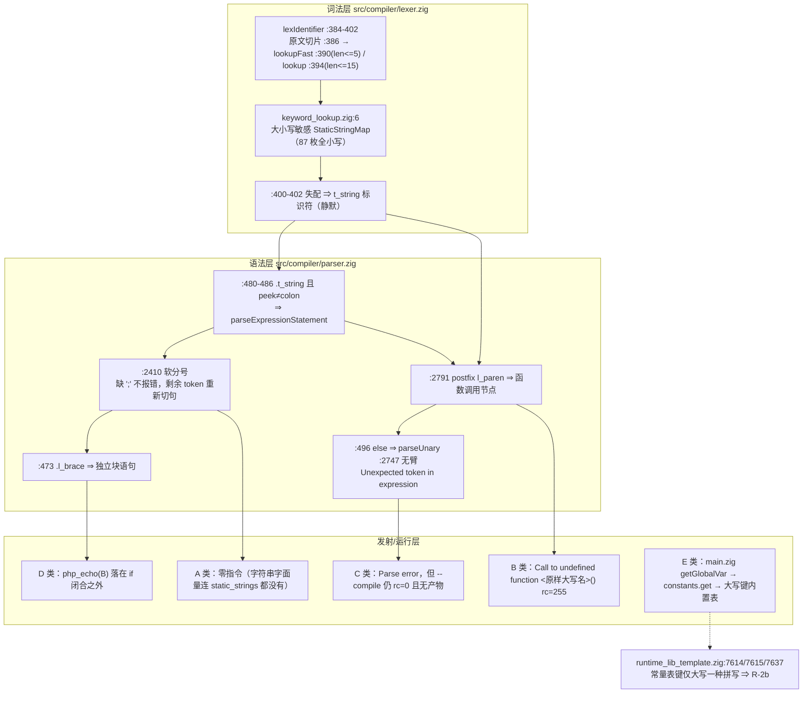

# AOT-CODEGEN-010 R-1 归因轮 + 常量表第二面孔（任务 #119，2026-10-07）

- 代次：`HEAD=497edc6` 工作树（零 `src/` 改动）
- 工单：`docs/known-issues/AOT-CODEGEN-010-keyword-case-insensitive-lexer.md`（md5 `f34e2d540e23a4c37e2ef7389fad6b9a`／204 行）
- 编译器：`1f15e4ce9b5c9cdaaef7cabf5efb9c76` · lexer：`21f02e926ee28c7354aa92507136074d` · keyword_lookup：`b8832bef829d3e0c11c4e249700bfddd` · parser：`5995c1e75c55a2c5581e875406113f14` · runtime_lib_template：`008b7b639f1069cb73e443064e115ed1`

---

## 1. 高层摘要（TL;DR）

老铁，本轮把「一枚词法缺陷为何长出四种（实测实为五种）不同结局」这个问题**取证到行**，并且在归因过程中**实测出一张独立的第二面孔**（运行期常量表只登记大写拼写），把原本笼统的「改 lexer 查表」路线拆成了**两条必须分别裁决的路线**。

三句话结论：

1. **五类结局的断点全部到行**，共同上游只有一处（`lexer.zig:384-402` 失配落 `t_string`），分流点在 `parser.zig` 的四个不同文法位 + 生成器的一处常量回落；其中 A/B 两支**同源码只差一对括号**，一条判别锁死了「静默」来自 parse 层的**零指令**而非运行期吞掉。
2. **E 类「TRUE 看起来正常」是两处缺陷互抵消**，不是免疫：用第三种拼写 `True` 一戳就红（`getGlobalVar("True")` → `Undefined variable` + `t=NULL`），顺带把缺陷面从「关键字」扩到「内置常量表单拼写键」。
3. **R-2（lexer 大小写归一）收不了常量表这张脸**：门 G 的三枚红形源码里**一个大写关键字都没有**；同时门 G 的四枚守卫臂实测给这条新路线划了**硬覆盖边界**（`php_int_max` 在 PHP 侧也是 Fatal、用户常量大小写行为必须逐字保持），即「全局给常量表加忽略大小写」会把两枚当前等值的臂砸红。

成本全部实测：门 F `30s`／8 形（3.75 s/形），门 G `26s`／7 形（3.7 s/形），归因派生的额外编译 6 次。**零源码修改，五张路线（R-2／R-2b／R-3／R-4）全部待裁决。**

---

## 2. 影响范围

| 对象 | 影响 | 实测依据 |
|---|---|---|
| `src/` 源码 | **零改动**（发射中性自证：不重建、不换 md5） | 本节 compiler/lexer/parser md5 与 #118 立项代次一致 |
| 冻结基线（68 语料） | **未触碰**，本轮未跑主回归 | 语料关键字位混合大小写 0 处（§4 计数），基线绿属覆盖意外 |
| 工单 AOT-CODEGEN-010 | 状态由「四类结局」更正为「**五类结局，断点到行**」，新增 §3.1/§3.2/§3.3，§5 新增 R-2b，§7-1/§7-6 闭环 | 工单 204 行 |
| 永久侧门 | 新增门 F（R-1 归因门，8 形）+ 门 G（常量表面，7 形）；两者**尚未入十二腿门链** | 两门脚本 md5 见 §6 |
| 待裁决路线 | R-2 覆盖面**收窄**（只消 A/B/C/D），R-3 金丝雀覆盖面**收窄**（只抓 A 类），新增 R-2b 独立面 | §3.1 五类表 + 门 G 实测 |
| 跨模式（宪法 §五） | 同族在解释器/字节码模式 3/4 臂复现（#118 已测），**是否一并修仍需老铁明示** | 工单 §2.2 |

---

## 3. 核心变更

| # | 变更 | 类型 | 关键读数 |
|---|---|---|---|
| 1 | 归因门 F 落地并修正两处门自身缺陷（清理时序、realpath） | 只读取证资产 | `shapes=8 same=4 diff=4 zero_instr=1 compile_fail=0`／`30s` |
| 2 | **五类结局逐类到行**（A 静默零指令／B 运行致命／C 解析失败／D 臂无条件执行／E 偶然等值） | 机制定案 | 每条锚点实文核对，见 §4.2 |
| 3 | A／B 判别对（`Echo "x";` vs `Echo ("x");`）实测锁定 | 判别证据 | `instr=0` vs `instr=3 + Call to undefined function Echo` |
| 4 | D 类改判为**位序缺陷**：`instr`/`echo` 计数与控制臂**完全相同** | 结论更正 | 双臂同为 `instr=9 echo=2` |
| 5 | E 类「免疫」否证，改用 `True` 拼写取到红形 | 结论更正 | `gvar=getGlobalVar("True")` + `t=NULL` |
| 6 | 新立独立面孔 **R-2b**（运行期常量表拼写键）+ 门 G | 新面 | `shapes=7 same=4 diff=3 red_confirmed=3 guard_same=4 guard_red=0`／`26s` |
| 7 | R-2b 的**硬覆盖边界**实测（禁「全局忽略大小写」式实现） | 边界约束 | `php_int_max`／`ggc2` 守卫臂 PHP 与 AOT 逐字节等值 |
| 8 | 工单 §5 路由表重写、§6 复测路径加入门 F/G 逐形预期、§7 结两项开三项 | 登记 | — |

---

## 4. 可视化概览

### 4.1 分层归属



### 4.2 五类断点（流程）

```mermaid
flowchart LR
    S["同一份源码<br/>大写/混合大小写关键字"] --> LX["lexer 失配 → t_string"]
    LX -->|裸标识符 + 软分号| A["A 静默空输出 rc=0<br/>parser:480-486 + :2410 + :3059"]
    LX -->|紧跟 l_paren| B["B 运行致命 rc=255<br/>parser:2785/:2791"]
    LX -->|残留 else/as 或赋值右值| C["C 解析失败 rc=0 无产物<br/>parser:496 → :2747"]
    LX -->|链闭合后多余 {块}| D["D 臂无条件执行<br/>parser:473（位序缺陷）"]
    LX -->|常量字面量拼写| E["E 偶然等值<br/>getGlobalVar → 大写键常量表"]
    E -->|换 True 拼写| ER["红：Undefined variable + NULL"]
```

### 4.3 R-2 与 R-2b 的覆盖面（谁收哪张脸）

```mermaid
graph LR
    R2["R-2 lexer 查表忽略大小写<br/>token 文本仍交原文"] --> A2["消 A/B/C/D"]
    R2 --> E2["消字面量拼写 TRUE/FALSE/NULL（走 k_true 等关键字支）"]
    R2B["R-2b 常量表拼写"] --> X["消 constant(\"true\") / constant(\"false\") / constant(\"Null\")"]
    R2 -.->|源码无大写关键字 ⇒ R-2 无从介入| X
    BND["边界（实测）"] -.->|禁全局忽略大小写| R2B
```

---

## 5. 详细变更分析

### 5.1 涉及文件

| 层 | 文件 | 本轮动作 |
|---|---|---|
| 只读取证资产 | `fuzzy_scripts_720/tmp/c010_mechanism_gate_tmp.sh` | 修正后定稿（149 行） |
| 只读取证资产 | `fuzzy_scripts_720/tmp/c010_constant_case_gate_tmp.sh` | 新建并修正（103 行） |
| 读数 | `fuzzy_scripts_720/tmp/c010_mechanism_tmp.tsv`、`c010_constant_case_tmp.tsv` | 生成（门脚本产物，随门保留） |
| 工单 | `docs/known-issues/AOT-CODEGEN-010-keyword-case-insensitive-lexer.md` | §2.1 改判、新增 §3.1/3.2/3.3、§4 补语料行、§5 重写路由、§6 补复测、§7 结 1/6 开 7/8/9 |
| 记忆 | `project-aot-codegen010-keyword-case.md` + 项目 `MEMORY.md` 索引行 | 更新为 #119 口径 |
| 源码 | `src/**` | **无改动** |
| 实文核对（只读） | `src/compiler/parser.zig:2408/:2410`、`:2747`、`:2785/:2791/:2792`、`:3044-3061/:3059`、`:2972-2982`、`:473`、`:496`、`:480-486`；`src/compiler/keyword_lookup.zig:6/:25/:26/:42/:99/:104`；`src/aot/runtime_lib_template.zig:7614/:7615/:7637`；生成码 `.zigphp_aot_build_68668/main.zig:60-99`、`:1043/:1066-1070` | 锚点逐条读到原文 |

### 5.2 门 F 逐形实测（R-1 归因，8 形）

| shape | verdict | instr | echo | gvar | 断点类别 |
|---|---|---|---|---|---|
| `m_echo_bare_ctl`（小写控制臂） | SAME | 2 | 1 | none | — |
| `m_echo_bare_title`（`Echo "x";`） | DIFF（空输出 rc=0） | **0** | 0 | none | **A** |
| `m_echo_paren_title`（`Echo ("x");`） | DIFF（rc=255） | 3 | 0 | none | **B** |
| `m_true_lower_ctl` | SAME | 10 | 3 | none | — |
| `m_true_upper`（`TRUE`） | SAME | 10 | 3 | `getGlobalVar("TRUE")` | **E** |
| `m_true_title`（`True`） | DIFF | 10 | 3 | `getGlobalVar("True")` | E 的否证形 |
| `m_else_ctl` | SAME | 9 | 2 | none | — |
| `m_else_upper`（`ELSE`） | DIFF（多出 `Q`） | 9 | 2 | none | **D** |

C 类三枚（`If`/`FOREACH`/`NEW`）在 #118 门 E 已登记为 `compile_fail=3`，本门未重复计入 ⇒ 门 F `compile_fail=0` 属**口径差异**，不可与门 E 的总数混引。

### 5.3 门 G 逐形实测（R-2b 面，7 形）

| shape | role | verdict | PHP 真值 | AOT |
|---|---|---|---|---|
| `k_const_true_lower` `constant("true")` | red_expected | DIFF | `a=true` | `Fatal: Undefined constant "true"` |
| `k_const_false_lower` `constant("false")` | red_expected | DIFF | `b=false` | `Fatal: … "false"` |
| `k_const_null_title` `constant("Null")` | red_expected | DIFF | `c=NULL` | `Fatal: … "Null"` |
| `k_const_true_upper` `constant("TRUE")` | guard_same | SAME | `d=true` | `d=true` |
| `k_const_nonkw_lower` `constant("php_int_max")` | guard_same | SAME | **PHP 也 Fatal** | 逐字节等值 |
| `k_const_user_lower` `define("GgC1",7)` 后 `constant("GgC1")` | guard_same | SAME | `f=7` | `f=7` |
| `k_const_user_wrong` 大小写不符的用户常量 | guard_same | SAME | PHP Fatal | 逐字节等值 |

四枚守卫臂的全部意义：**给 R-2b 划覆盖边界** —— 只允许敞开三枚关键字常量，任何「全局忽略大小写的常量表」实现会把 `php_int_max`／用户常量两臂从 SAME 砸成 DIFF（`guard_red` 现为 0，是修复后的硬验收位）。

### 5.4 门自身两处缺陷（已修，登记为教训）

1. **清理时序**：`cleanup_gen()` 原先在提取生成码读数之前执行 ⇒ 首跑 `zero_instr=8` 全部为「目录已被删、grep 空文件」的假读数。该次总数**禁止引用**，已在门头与工单 §3.2 双重标注。
2. **realpath**：`mktemp -d /tmp/...` 在生成码里写作 `/private/tmp/...` ⇒ `setSourceLocation("<$T>/…")` 恒 0 命中。改用 `RSRC="$(cd "$T" && pwd -P)/…"`。
3. 门 G 另修一处：`^PHP ` 锚定剥离永不触发（每形先 echo 自己的标记，`PHP Fatal` 出现在行中）⇒ 改位置无关 `s|PHP Fatal|Fatal|g`，修前两枚守卫臂假 DIFF。

---

## 6. 影响与风险评估

| 项 | 评估 |
|---|---|
| 是否破坏式变更 | **否**。零 `src/` 改动、零基线触碰，只新增只读门脚本 + 工单/记忆登记 |
| 核心结论更正 | 「四类结局」→「五类」；「`TRUE` 免疫」→「两处独立缺陷互抵消」；「`instr`/`echo` 计数可判 A 类」→**D 类对指令计数完全不可见**（双臂同为 `instr=9 echo=2`），必须比**花括号闭合位序** |
| 路由影响（最重要） | R-2 单落地**不能**收常量表面 ⇒ 若只报 R-2 完工，门 G 三枚仍红；R-3 金丝雀只抓 A 类（语句位 `t_string`），抓不到 D 类位序缺陷 |
| 未归因残留 | D 类里 `reg_5` 从未出现的原因**仅为推断**（`parser` 链闭合后丢弃），未取得行级证据，已登记工单 §7-8 |
| 复测风险 | 门 F/G 用 `KEEP_TEMP` 通道读生成码，编译**必须在仓库根**执行（在 `/tmp` 下编译 ⇒ `executable generation failed: FileNotFound` 且无产物）；门脚本自管临时目录并在提取后才清理 |
| 基线漂移风险 | 仍未影子实测（R-2 落地时才需要）；语料关键字位混合大小写 0 处 ⇒ 理论上发射中性，**该中性未实测** |
| 入库状态 | 门 F/G、TSV、工单、本文档均**未提交**（需老铁给「提交」二字）；`src/aot/native_linker.zig` 仍挂着 #74 纯注释批 |

---

## 7. 复测路径（体验流程）

```bash
cd /Users/wangjianjun/products/parser   # 必须仓库根，否则 --compile 无产物

# 门 F：R-1 归因门（8 形，实测 30s = 3.75 s/形）
bash fuzzy_scripts_720/tmp/c010_mechanism_gate_tmp.sh
# 当前代次预期：C010MECH_DONE shapes=8 same=4 diff=4 zero_instr=1 compile_fail=0
# 逐形预期（禁笼统引用）：
#   m_echo_bare_ctl SAME instr=2 | m_echo_bare_title DIFF instr=0（A 类铁证）
#   m_echo_paren_title DIFF rc=255 instr=3（B 类）
#   m_true_lower_ctl SAME gvar=none | m_true_upper SAME gvar=getGlobalVar("TRUE")（E 类）
#   m_true_title DIFF gvar=getGlobalVar("True") | m_else_ctl/m_else_upper 同 instr=9 echo=2（D 类位序缺陷）
# 修复后（R-2 落地）预期：same=8 diff=0 zero_instr=0；三枚控制臂必须**始终** SAME
md5 实测：门 F 149 行 / d71380842e667ad3fdafb0db02ec6e69

# 门 G：R-2b 常量表面（7 形，实测 26s = 3.7 s/形）
bash fuzzy_scripts_720/tmp/c010_constant_case_gate_tmp.sh
# 当前代次预期：C010G_DONE shapes=7 same=4 diff=3 red_confirmed=3 guard_same=4 guard_red=0 compile_fail=0
# 修复后（R-2b 落地）预期：same=7 diff=0 且 guard_red 必须**恒为 0**（该位一红 = 实现过宽，砸了 PHP 真值等值面）
md5 实测：门 G 103 行 / 921244072b7e2482d4da83c907b6566c

# 门 E（#118 立项门，19 形 60s）保持不变，禁止回头扩形（规则 11）
```

---

## 8. 遗留 / 待裁决

1. **R-2 / R-2b / R-3 / R-4 全部待裁决**（详见工单 §5）。门控声明原文：「**门控声明**：R-1 归因轮属「只读取证」，已在 `继续推进` 授权范围内完成；**R-2 / R-2b / R-3 / R-4 任一落地前仍需老铁点头**（宪法 §六：编译前端语义改动 + 可能损失/改变发射形态；§五：跨模式（解释器/字节码）同面**是否一并修**亦需明示）。」
2. **跨模式是否一并修**：#118 实测解释器模式同族 3/4 臂复现 ⇒ 宪法 §五 待明示。
3. **87 枚关键字穷举门未跑**（工单 §7-2）：当前门只覆盖 10 族，一形一文件 ~87 次编译，**耗时未知**。
4. **D 类 `reg_5` 被跳过的原因仅为推断**（§7-8）。
5. **C 类无生成码可读**（编译失败 ⇒ 无产物）⇒ 该行级证据只能走 AST/解析器侧，当前未取（§7-7）。
6. **门 F/G 未入十二腿门链**（§7-9）。
7. **未提交**：工单、门 F/G 及 TSV、本文档、#74 纯注释批。
8. **另需老铁裁决的老账**：字节码 VM `.`-拼接静态属性 panic（`src/bytecode/vm.zig:2322 handleConcat`，`Stack underflow in popFast`，vm.zig md5 `4343151291f461d067b61187ff9bb9be`／8863 行）是否立单。

---

## 9. 后续建议（P0/P1/P2）

| 优先级 | 建议 | 影响面 | 落地成本 |
|---|---|---|---|
| **P0** | **R-2**：`keyword_lookup.zig` 增加忽略大小写查表路径，`lexIdentifier` 仍交**原始 token 文本**（勿把归一化文本喂给 identifier 语义） | 编译前端全量 token 流 ⇒ 可能触发冻结基线漂移；须先影子实测 68 语料 `main.zig` md5；跨模式同面需 §五 明示 | **未实测**（落地后必跑：门 E + 门 F + 主回归 `run_regression.sh` + 影子 md5 对照） |
| **P0** | **R-2b**：常量表**仅**敞开 `true/false/null` 三枚关键字常量的忽略大小写入口（禁做全局忽略大小写） | `runtime_lib_template.zig:7614/7615/7637` 三枚键；门 G 四枚守卫臂为硬验收位（`guard_red` 恒 0） | **未实测**（面测通道已有：门 G 26s） |
| **P0** | **87 枚关键字穷举门**（一形一文件，按 `keyword_lookup.zig` 表项自动生成） | 决定 R-2 的真实验收面；当前 10 族覆盖不足以宣称收口 | **未实测**，**耗时未知**（参考同档实测 3.2–3.75 s/形） |
| **P1** | **R-3** 发射期金丝雀：语句位出现 `t_string` 且其原文忽略大小写等于关键字表条目 ⇒ 立即报错 | 只加断言支路，合法脚本零影响；覆盖面**仅 A 类**（抓不到 D 类位序缺陷） | **未实测**（CODEGEN-005/006 发射期金丝雀有先例） |
| **P1** | 门 F/G 纳入十二腿门链登记，并把「D 类必须比花括号位序」写进门判读口径 | 门资产状态；防后续轮次用指令计数误判位序缺陷 | 低（登记动作，零编译） |
| **P2** | **R-4**：`lexIdentifier:390/:394` 的 `len <= 15` 硬编码改为按表内最长键计算 | 现 87 枚键最长 9 字符 ⇒ 当前无面，属未来静默失效预防；与 R-2 同批则零额外成本 | 与 R-2 同批：**零额外**；单独：未实测 |
| **P2** | 补齐 C 类的解析器侧行级证据（不经生成码通道） | 只读 | 未实测 |
