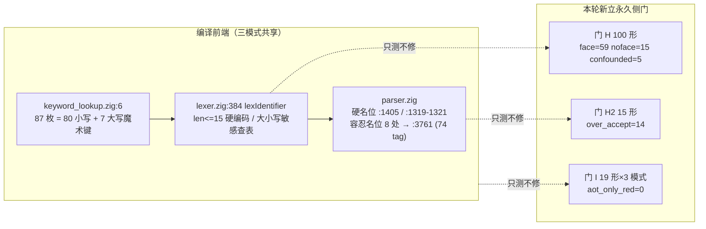
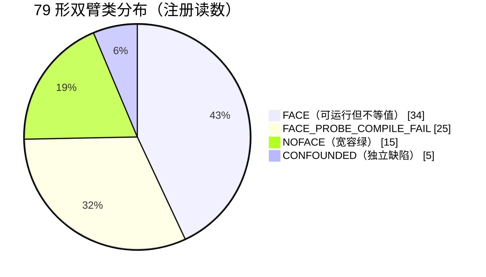
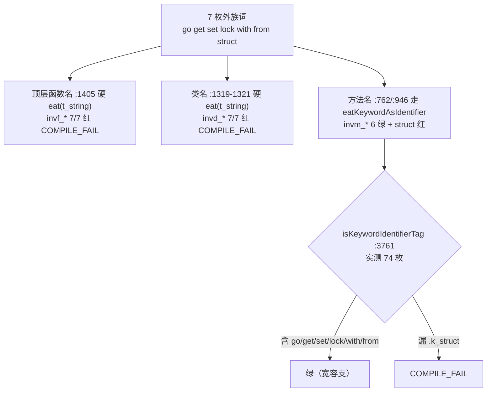
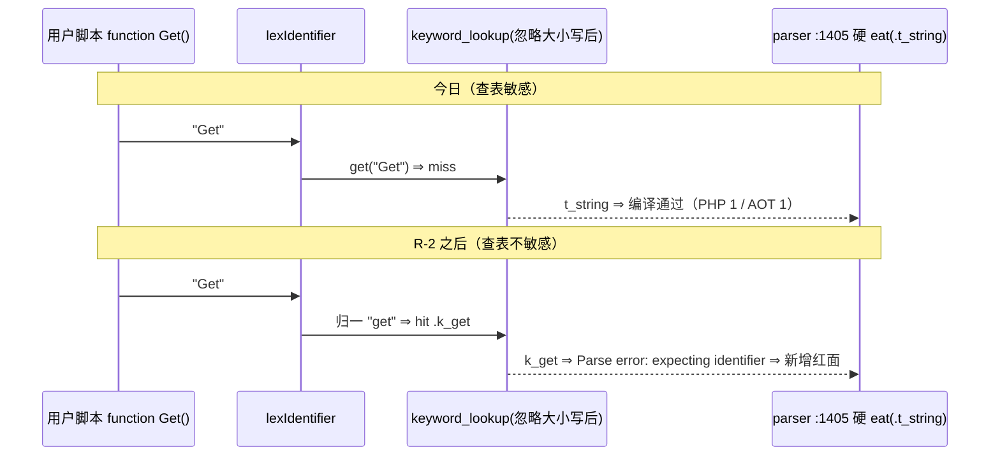

# AOT-CODEGEN-010 · 任务 #120：87 枚表项穷举门（侧门 H）+ NOFACE 成因门（H2）+ 跨模式门（I）落地闭环

> 本轮 **零 `src/` 改动**（只测不修）。工单：[AOT-CODEGEN-010](../../known-issues/AOT-CODEGEN-010-keyword-case-insensitive-lexer.md)

---

## 1. 高层摘要（TL;DR）

工单 §7-2 的「按 `keyword_lookup.zig` 全表穷举的覆盖面，当前未跑、耗时未知」已闭环为**三张永久侧门**，并给出实测单价：

| 新门 | 形数 | 实测耗时 | 单位成本 | 作用 |
|---|---|---|---|---|
| **H** `c010_kw_full_table_gate_tmp.sh` | 79 主群（双臂）+ 21 反例组 = **100 形 / 200 臂** | `ELAPSED=595s` | **6.0 s/形** | 表项穷举 ⇒ 红面从门 E 的 11 枚扩至 **59 枚**；反例组量「过度识别」 |
| **H2** `c010_noface_tolerance_gate_tmp.sh` | 15 | `54s` | 3.6 s/形 | 15 枚 NOFACE 的成因判别（同位换瞎词）⇒ **14/15 = 文法位过度宽容** |
| **I** `c010_crossmode_gate_tmp.sh` | 19（逐字复制门 E 形集） | `57s` | 3.0 s/形 | AOT/tree/bytecode 三模式对照 ⇒ **`aot_only_red=0`**（不存在「只修 AOT 即可关掉的形」） |

三条**新落地事实**（此前均为推断或未知）：
1. **R-2 的真实验收面 = 59 形**（34 FACE 含 2 枚纯文本噪声 ⇒ 语义红 32 + 25 探针编译失败 ⇒ **语义红面 57**）。
2. **R-2 会「新增」红面**（首次给出回归预测并定位到行）：`function Get()` 一类混合大小写**外族词**今日靠「查表落空」在**硬名位**通过；忽略大小写之后将命中 `.k_get` ⇒ `parser.zig:1405`（顶层函数名）与 `:1319-1321`（类名）两处**必须同批补名位容忍支**，否则消 59 枚红以新增编译失败为代价。
3. **旧措辞两处经实测否证**：① `isKeywordIdentifierTag`（`:3761`–`:3840`）**只列 74 枚** `.k_*` tag，非「全部 87 枚」，漏项 6 枚 = `.k_endfor/.k_endforeach/.k_endif/.k_endswitch/.k_endwhile/.k_struct` ⇒ 恰好解释反例组唯一的方法名位红形 `invm_struct`；② 表内 87 枚键**并非全小写**（80 小写 + 7 枚大写魔术常量），最长键为 `__NAMESPACE__`（13 字符）⇒ `len <= 15` 仅剩 2 字符余量。

---

## 2. 影响范围

| 对象 | 影响 | 说明 |
|---|---|---|
| `src/`（全部） | **无** | 本轮只读；`git status --porcelain src/` 仅 `M src/aot/native_linker.zig`（#74 纯注释批，先前既有） |
| 冻结基线 / 68 语料 | **无** | 未跑主回归；语料 `pass/*.php` 68 文件未改，全仓 399 枚 `.php` 完整 |
| `docs/known-issues/AOT-CODEGEN-010-…md` | 结构扩写 | 新增 §3.4（含 §3.4.1–§3.4.5）、§3.5；§6 增三门复测块；§5 R-2/R-4 行按实测更正；§7 项 2/3/9/11 闭环 + 新增 12–16 |
| 测试资产（新增） | 3 张永久侧门 + 3 份 TSV 读数 | 门 H 经**两轮修门**后才注册（§7-11），首跑读数禁止引用 |
| 待裁决面 | 由「是否跨模式同修」扩为 **4 项** | 见 §7 |

---

## 3. 核心变更

| # | 变更 | 类型 | 关键点 |
|---|---|---|---|
| C-1 | 建门 H：表项自动生成形集 + 一形一文件双臂 | 新增测试资产 | `@KW@` 模板；`ctrl`=表内拼写、`probe`=Title 拼写 ⇒ 跨臂差异不可归因于模板；类名/函数名逐形专属 |
| C-2 | 修门第一轮：坏探针 + 预检 | 门修正 | `k_callable` 曾写 Go 风格 `fn(): int {}`（PHP 自己拒）⇒ 补 `php -l` 预检 + `BAD_PROBE_*` 两类；`face 58→59`、`confounded 6→5` |
| C-3 | 修门第二轮：反例组形集 7 → **7 词 × 3 名位 = 21** | 门修正 | 旧版 7 形各用**不同名位** ⇒ 对「逐词过度识别」零判别力；3 形冒烟实证同词的函数名/类名位红、方法名位绿 |
| C-4 | FACE 语义四分（`c010h_face_split_tmp.awk`，用毕删除） | 只读复算 | 剥离 `Warning:` 行后逐字节比对 ⇒ FATAL 13 / SILENT_EMPTY 12 / WRONG_VALUE 7 / 仅噪声 2 |
| C-5 | 建门 H2：同位换瞎词 `Zkwhq` | 新增测试资产 | 判据「不比谁对，只比 AOT 是否接受 PHP 不接受的」⇒ `over_accept=14 strict_same=1` |
| C-6 | 建门 I：三模式对照 | 新增测试资产 | 同一源形跑 AOT / `--interpret`(tree) / bytecode VM ⇒ `both_red=11`、`vm_only_red=1`、**`aot_only_red=0`** |
| C-7 | 机制到行：硬名位 vs 容忍名位 | 只读实文 | 硬：`:1405`（`try self.eat(.t_string)`）、`:1319-1321`（go-mode 条件式的 else 臂）；容忍：`:762/:946/:1263/:2181/:2465/:2524/:2563/:2869` 共 8 处 → `:3843 eatKeywordAsIdentifier` → `:3761`（74 枚） |
| C-8 | §5 R-2 行的落地约束改写 | 文档更正 | 「名位对 R-2 中性」作废；门成本 527s→**595s**、验收门合计 754s→**822s**（≈14 分钟，不含主回归） |

---

## 4. 可视化概览

### 4.1 分层与门链



### 4.2 门 H 的类分布（79 主群）



### 4.3 反例组 21 形的名位矩阵（过度识别面）



### 4.4 「R-2 新增红面」因果时序



---

## 5. 详细变更分析

### 5.1 涉及文件清单

| 文件 | 状态 | 备注 |
|---|---|---|
| `docs/known-issues/AOT-CODEGEN-010-keyword-case-insensitive-lexer.md` | 修改（11 + 8 处） | 本轮回填 §3.4.2、§3.4.5-4、§4 容忍行、§5 R-2 行、§6 门 H 块、§7-9/11/16 |
| `fuzzy_scripts_720/tmp/c010_kw_full_table_gate_tmp.sh` | 新增 | md5 `c5d6343151193a7e489f814f309ae39c`，279 行（注册读数绑定该 md5，**不得再改**） |
| `fuzzy_scripts_720/tmp/c010_kw_full_table_tmp.tsv` | 新增 | 107 行（4 表头 + 79 + 21 + 2 门尾），`ELAPSED=595s` |
| `fuzzy_scripts_720/tmp/c010_noface_tolerance_gate_tmp.sh` / `…_tmp.tsv` | 新增 | md5 `8e11de20dd598f0875d166022f4c905c`，99 行 |
| `fuzzy_scripts_720/tmp/c010_crossmode_gate_tmp.sh` / `…_tmp.tsv` | 新增 | md5 `d28ae3dcaa57afe4b70829cf827967d1`，138 行 |
| `src/compiler/{lexer,keyword_lookup,parser}.zig` | **只读** | md5 见工单代次锚点表（`21f02e…` / `b8832b…` / `5995c1…`） |
| `fuzzy_scripts_720/tmp/c010h_face_split_tmp.awk` | 新增后**删除** | 一次性 FACE 复算器，读数已入 §3.4.1 |

### 5.2 注册读数（逐字）

```tsv
C010H_DONE shapes=79 arms=200 face=59 noface=15 confounded=5 bad_probe=0 ctrl_compile_fail=1
         probe_compile_fail=25 probe_timeout=0 inverse_shapes=21 inverse_face=15
         inverse_noface=6 inverse_confounded=0 repo_build_residue=0 SMOKE_ONLY=0   ELAPSED=595s
C010H2_DONE shapes=15 over_accept=14 strict_same=1 aot_compile_fail=0 php_ok_aot_diff=0  ELAPSED=54s
C010I_DONE shapes=19 tree_same=7 tree_diff=12 bc_same=7 bc_diff=12 aot_same=8 aot_diff=8
           aot_compile_fail=3 both_red=11 vm_only_red=1 aot_only_red=0               ELAPSED=57s
```

**跨 run 自证**：门 H 两轮跑的 79 主群行逐字节比对 `run1_rows=79 run2_rows=79 diff_bytes=0` ⇒ 第二轮修门（仅改反例组形集）未扰动主群，两组计数可分别引用。

---

## 6. 影响与风险评估

| 项 | 判定 |
|---|---|
| 是否破坏式变更 | **否**。零源码改动；新增资产全在 `fuzzy_scripts_720/tmp/` 与 `docs/` |
| 影响范围 | 仅工单文档 + 三张侧门；官方十二腿门链未动 |
| 需要特别注意的点 | ① 门 H 的 `norm()` **窄于**门 G（不折叠双空格）⇒ 引用 FACE 必须同时给 **34（含噪声）/ 32（语义）**；② 主群计数与首跑相同，但**首跑读数仍禁止引用**（分类逻辑已变）；③ 门 H 的 `--compile` 解析失败返回 rc=0 且无产物 ⇒ `compile_fail` 只能靠**产物存在性**判定（既有规则 21）；④ 复测必须在**仓库根**（越界 cwd 报 `FileNotFound`） |
| 复测路径 | `timeout 900 bash fuzzy_scripts_720/tmp/c010_kw_full_table_gate_tmp.sh`（H，6.0 s/形）<br>`timeout 300 bash fuzzy_scripts_720/tmp/c010_noface_tolerance_gate_tmp.sh`（H2）<br>`timeout 480 bash fuzzy_scripts_720/tmp/c010_crossmode_gate_tmp.sh`（I）<br>门 E/F/G 复测口径不变，见工单 §6 |

**门 H 的修复后预期（R-2 单落地，逐条判据，勿只看总数）**：`face→0` ∧ `probe_compile_fail→0`；`noface=15` 仍绿**且需比对生成码**（当前绿来自宽容支）；`confounded=5` 只要求两臂一致、**不要求**转绿；`inverse_face` 必须**仍为 15**（变大 = 把词表改成保留字表；变小 = 动了外族词集合，均越界）；`m_*` 六形必须转绿而非更红（更红 = 归一方向写反）；门 H 覆盖不到的**新增面**须手跑 `function Get()` 探针（修复后必须仍为 `1`）。

---

## 7. 遗留 / 待裁决

| # | 事项 | 优先级 | 需老铁裁决什么 |
|---|---|---|---|
| L-1 | R-2 落地形态是否**含 parser 两处硬名位补洞**（工单 §7-16） | P0 | 甲（同批补洞，扩到第二文件）／乙（只改 lexer，接受新增红面） |
| L-2 | 是否接受 R-2 **天然三模式同修**（门 I `aot_only_red=0`） | P0 | 宪法 §五 明示（无法只动 AOT 一侧，除非分叉前端） |
| L-3 | 五枚与大小写无关的默认档独立缺陷是否立单（`k_and`/`k_var`/`k_goto`/`k_iterable`/`m_namespace`） | P1 | 立单／只登记 |
| L-4 | 死桩 `parser.zig:3756-3759 isKeywordUsableAsIdentifier`（恒 `false`、零调用点）删除或改名 | P2 | 涉及删除代码（§六-3） |
| L-5 | AOT 重复警告行（同一未定义变量连打两行）归因 | P2 | 是否开工单；它会多算所有「逐字节等值」门的红面 |
| L-6 | 替代语法 `if:`…`endif;` 是否真被支持**不可判**（NOFACE 来自宽容支） | P2 | 需另建正/负例门 |
| L-7 | 门 H 为新建资产，未纳入官方十二腿门链，且与本轮全部文档**未提交** | 流程 | 待「提交」指令 |

---

## 8. 后续开发 / 建设性建议

| 建议 | 优先级 | 影响面 | 落地成本 |
|---|---|---|---|
| R-2 落地时**同批**补 `:1405`/`:1319-1321` 名位容忍支，并把 `isKeywordIdentifierTag` 的 6 枚漏项按 PHP 语义逐枚判定（`end*` 五枚为替代语法结束符、`struct` 为本仓 Go 模式遗留） | P0 | 决定 R-2 是「净收益」还是「消 59 枚红 + 新增名位红」 | 两处各 +3 行，零额外编译轮 |
| 验收顺序建议：**先跑门 H 的反例组 + `function Get()` 探针**（≈2 分钟）再跑全量主群（10 分钟），以便尽早发现「新增面」 | P0 | 复测吞吐 | 门已内建 `ONLY=` 通道 |
| 影子实测 68 语料 `main.zig` md5（R-2 发射中性前提尚未证） | P0 | 冻结基线 | 沿用既有 `KEEP_TEMP` 通道 |
| 把「AOT 重复警告行」修掉后**重跑**门 H 一次，以拿到「无噪声」口径的 FACE 数 | P2 | 判据精度 | 595s |
| 替代语法正/负例门（`endif`/`endwhile`/`endfor`/`endforeach`/`endswitch` 五枚） | P2 | 现覆盖面为「不可判」 | 5 形 ≈ 30s |
