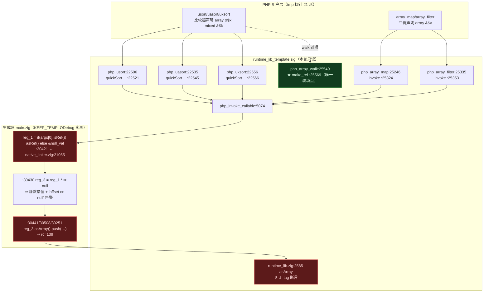
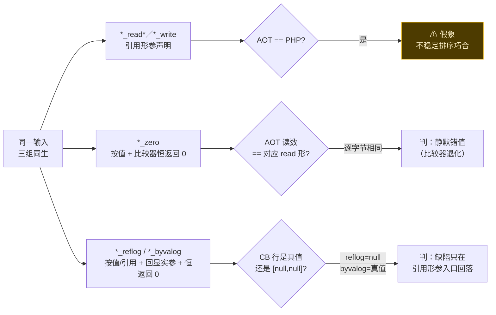
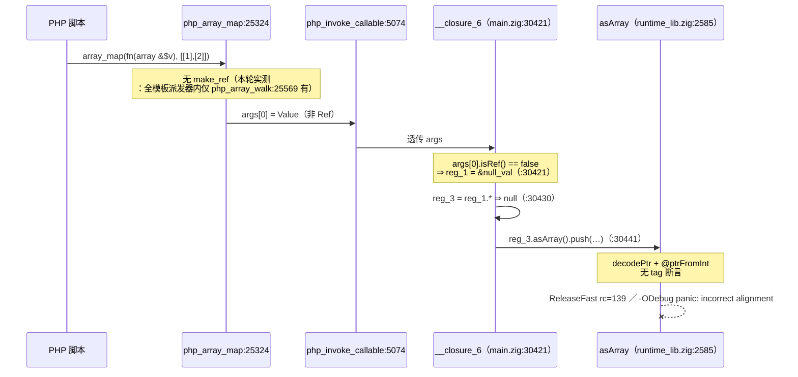
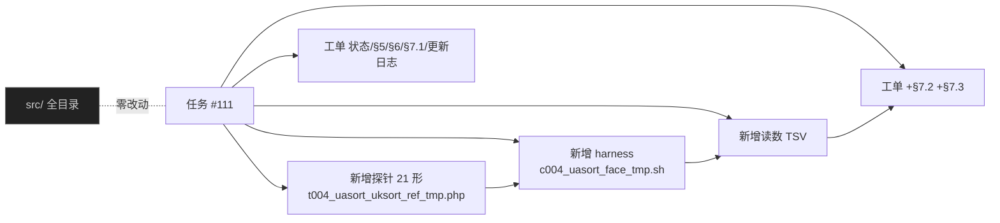

# 内建回调族引用面实测补测与三枚新崩形归因 · AOT-REF-004 任务 #111

**日期**: 2026-10-07　**任务**: #111（REF-004 §7 面补测：`uasort`/`uksort` 与 `map`/`filter` 写回形的实测，非门控）
**工单**: [AOT-REF-004-dynamic-call-byref-arg-not-made.md](../../known-issues/AOT-REF-004-dynamic-call-byref-arg-not-made.md) §7.2 / §7.3
**性质**: **纯取证轮 —— 零源码改动**（`src/` 暂存区仍只有 #74 纯注释批，numstat `5 4`）

---

## 1. 高层摘要（TL;DR）

REF-004 §7 的内建回调族普查当时对 9 枚派发器只实测了 6 枚，`php_uasort`／`php_uksort` **仅停在 grep 结论**；崩溃组合只在 `usort` 一枚上量过；`array_map`／`array_filter` 只测了标量只读形 ⇒ **路线 H（P0）的覆盖面在待裁决阶段是推断**。

本轮以 21 形 × {PHP 真值, AOT} 的实测把这条推断换成数据，并得到四项结果：

1. **崩溃面从 1 枚派发器扩到 4 枚**（`usort` / `uasort` / `array_map` / `array_filter`），且 `array_map`／`array_filter` 两枚**完全不涉及排序** ⇒ 回落链与派发器无关，H 的**单点**（`native_linker.zig:21055`）足以覆盖本轮全部 `rc=139`。
2. **参数级实证**：比较器恒返回 0 且回显实参 ⇒ 三枚 `*_reflog` 全部 `CB=[null,null]`、三枚 `*_byvalog` 全部真值 ⇒ 「内建确实传参、缺陷只在引用形参入口回落」升为实测。
3. **新立两条判据**：① 三枚排序派发器全走 `quickSort*`（**不稳定**）⇒ "AOT 输出 == PHP 真值" **不等于**等值，比较器形必须成对带 `*_zero` 控制臂（据此把 `uasort_read`／`uksort_read` 两枚"看似绿"**改判**静默错值）；② 比较器退化 + 实参回显的参数级解耦。
4. **诊断侧为双重偏差**（非"无告警"）：AOT 不发 PHP 的 by-ref 告警，却在下标访问实参的只读形改发一条 PHP 没有的 `Trying to access array offset on null` ⇒ 落地 H 后**两条告警都会消失**，文本对齐需 H 之外另批发射点。

三枚新崩形的崩点已用 `-ODebug` 重建通道归因到 `runtime_lib.zig:2585 in asArray`（无 tag 断言），故障句与生成码行号均实测登记。

**实测成本（非估算）**：21 形面测 `ELAPSED=20s`（1 次编译 + 42 次运行 ⇒ ≈0.45 秒／臂）；`-ODebug` 运行时归因重建 **4.5 秒**／臂。

---

## 2. 影响范围

| 维度 | 影响 | 说明 |
|---|---|---|
| 运行时代码 | **无** | 本轮零源码改动；`native_linker.zig` 维持 `fbe6382a2e0904b6740d771b88c409c7`／32797 行，`runtime_lib_template.zig` 维持 `008b7b639f1069cb73e443064e115ed1`，冻结二进制维持 `1f15e4ce9b5c9cdaaef7cabf5efb9c76` |
| 68 语料基线 | **无漂移** | 未重编译基线、未跑 sweep；本轮只在 `tmp/` 探针上取证 |
| 缺陷面认知 | **扩大并定量化** | 崩溃派发器 1 → 4 枚；静默错值形新增 6 枚；`uasort`／`uksort` 由 grep 升为实测 |
| 待裁决路线 | **覆盖面被证实** | REF-004 §7.1 路线 H 的覆盖面从推断变实测；§4 路线 E 的必要性不变（H 不可顶替 E） |
| 验收口径 | **新增两条硬判据** | 任何比较器类测试**必须成对带 zero 控制臂**；H 落地后须逐枚重跑 zero 臂（读数变化即 H 溢出到按值路径） |
| 跨工单 | **禁止重复计价** | 与 CODEGEN-007 崩溃**入口**同为无断言的 `asArray`，成因两条独立路径 ⇒ 守卫型路线（本单 G/H × C007 §5-E）落同一点位，裁决须并读两单 |
| 永久资产 | **+3** | 探针 `.php`（21 形）、harness `.sh`、读数 `.tsv`，均在 `fuzzy_scripts_720/tmp/`，**勿删** |

---

## 3. 核心变更

| # | 变更 | 落点 | 类型 |
|---|---|---|---|
| 1 | 21 形引用面探针（`$argv[1]` 选路 ⇒ 1 次编译覆盖全形，崩溃形不阻断其他形） | `fuzzy_scripts_720/tmp/t004_uasort_uksort_ref_tmp.php`（新增，md5 `d02d0a73d687b3ef63c375c5b51aebc2`） | 测试资产 |
| 2 | 永久 face harness：表头四枚戳 + 逐形 {php,aot} 双跑 + `warn_lines` 计数 + 自计时 + 按**显式路径**清产物 | `fuzzy_scripts_720/tmp/c004_uasort_face_tmp.sh`（新增，md5 `c7cb8be5dc82e81f9c940fcee290d518`） | 测试资产 |
| 3 | 权威读数落盘（51 行，`ELAPSED=20s`） | `fuzzy_scripts_720/tmp/c004_uasort_face_tmp.tsv`（新增） | 证据 |
| 4 | 新增 §7.2（实测面 + 两条判据 + 四条结论）、§7.3（三枚崩形归因 + 生成码实证 + 禁互推边界） | 工单 §7.2／§7.3 | 文档 |
| 5 | 状态行登记 #111 与「崩面 4 枚」；§5 补两条复测通道（含实测成本）；§6 第 1 条补 grep→实测、第 2 条改**结案**、第 3 条改双重偏差口径；§7.1 H 行加覆盖面指针 | 工单 | 文档 |
| 6 | 初稿自我更正两处：`*_byvalog` 组不判等值（比较条数 3/4/4 vs PHP 各 2）；探针戳误记 `a2a8cfc7…` → 实测 `d02d0a73…` | 工单 §7.2 | 文档 |

---

## 4. 可视化概览

### 4.1 分层架构 + 缺陷定位



### 4.2 业务流程（判据设计）



### 4.3 执行流程 + 代码映射（崩溃形）



### 4.4 本轮变更点映射



---

## 5. 详细变更分析

### 5.1 读数总表（21 形，取自 `.tsv`，`~` = 换行）

| 形 | PHP 真值 | AOT（默认档） | warn(P/A) | 判定 |
|---|---|---|---|---|
| `ctrl_usort` | `[[1],[2]]` | `[[1],[2]]` | 0/0 | 等值（对照锚） |
| `usort_read` | `[[1],[2]]` | `[[2],[1]]`＝输入序 | 2/2 | 静默错值 |
| `usort_read3` | `[[1],[2],[3]]` | `[[3],[1],[2]]`＝`usort_zero3` AOT | 6/6 | 静默错值 |
| `uasort_read` | `{"q":[1],"p":[2]}` | 同值 | 2/**4** | ⚠ 假象＝`uasort_zero` AOT ⇒ 判静默错值 |
| `uasort_read3` | `{"q":[1],"r":[2],"p":[3]}` | `{"r":[2],"q":[1],"p":[3]}`＝`uasort_zero3` AOT | 6/**8** | 静默错值 |
| `uksort_read` | `{"a":2,"b":1}` | 同值 | 2/**0** | ⚠ 假象＝`uksort_zero` AOT ⇒ 判静默错值 |
| `uksort_read3` | `{"p":1,"q":2,"r":0}` | `{"q":2,"p":1,"r":0}`＝`uksort_zero3` AOT | 6/**0** | 静默错值 |
| `uasort_write` | `{"q":[1],"p":[2]}` | **`rc=139` 零输出** | 2/0 | **段错误** |
| `map_write` | `r=[[1,9],[2,9]] a=[[1],[2]]` | **`rc=139`** | 2/0 | **段错误（不涉排序）** |
| `filter_write` | `r={"1":[2]}` | **`rc=139`** | 2/0 | **段错误（不涉排序）** |
| `usort_zero3` | `[[3],[1],[2]]` | `[[3],[1],[2]]` | 0/0 | 判据臂 |
| `uasort_zero3` | `{"p":[3],"q":[1],"r":[2]}` | `{"r":[2],"q":[1],"p":[3]}` | 0/0 | 判据臂 |
| `uksort_zero3` | `{"r":0,"p":1,"q":2}` | `{"q":2,"p":1,"r":0}` | 0/0 | 判据臂 |
| `uasort_zero` | `{"p":[2],"q":[1]}` | `{"q":[1],"p":[2]}` | 0/0 | 判据臂（2 元假象来源） |
| `uksort_zero` | `{"b":1,"a":2}` | `{"a":2,"b":1}` | 0/0 | 判据臂（2 元假象来源） |
| `usort_reflog` | `CB=[[3],[1]]`,`CB=[[1],[2]]` | `CB=[null,null]` ×3 | 4/**0** | 回落参数级实证 |
| `usort_byvalog` | `CB=[[3],[1]]`,`CB=[[1],[2]]`（2 次） | `CB=[[3],[1]]`,`CB=[[1],[2]]`,`CB=[[3],[1]]`（3 次） | 0/0 | 传参为真值；**不判等值** |
| `uasort_reflog` | `CB=[[3],[1]]`,`CB=[[1],[2]]` | `CB=[null,null]` ×4 | 4/**0** | 同上 |
| `uasort_byvalog` | 2 次真值 | 4 次（含 `[[1],[1]]` 自我比较） | 0/0 | 传参为真值；**不判等值** |
| `uksort_reflog` | `CB=["r","p"]`,`CB=["p","q"]` | `CB=[null,null]` ×4 | 4/**0** | 同上 |
| `uksort_byvalog` | 2 次真值 | 4 次（含 `["p","p"]`） | 0/0 | 传参为真值；**不判等值** |

⇒ 本轮 21 形的分类合计：等值 1（`ctrl_usort`）／静默错值 6／段错误 **3**／判据臂（zero 控制）5／参数级取证 6 = 21。加上 §7 另一探针的 `usort` 形 ⑫，**崩溃派发器合计 4 枚**（`usort`/`uasort`/`array_map`/`array_filter`）。

### 5.2 崩点归因表（§7.3，`-ODebug` 零插桩通道）

| 形 | ReleaseFast | Debug 崩溃帧 | 生成码故障句 |
|---|---|---|---|
| `map_write` | `rc=139` | `runtime_lib.zig:2585 in asArray` ← `main.zig:30441 __closure_6` ← `php_invoke_callable:5074` ← `php_array_map:25324` | `try reg_3.asArray().push(runtime.runtime_allocator, reg_2);` |
| `filter_write` | `rc=139` | 同上 ← `main.zig:30508 __closure_7` ← `:5074` ← `php_array_filter:25353` | 同形 |
| `uasort_write` | `rc=139` | 同上 ← `main.zig:30251 __closure_4` ← `:5074` ← `invokeUserCompare:22392` ← `quickSortEntriesByValueWithCallback:22426` ← `php_uasort:22545` | 同形 |

生成码确定性自证：md5 `bbd057cbff458fbf943b039d99da1cb2`／33270 行，跨两次编译逐字节等值。
回落句实测现文（`main.zig:30421`）：

```zig
// generated main.zig:30421（__closure_6 入口）
reg_1 = if (args.len > 0 and !args[0].isMissing() and args[0].isRef()) args[0].asRef() else &null_val;
```

### 5.3 涉及文件清单

| 层 | 文件 | 动作 |
|---|---|---|
| 测试资产 | `fuzzy_scripts_720/tmp/t004_uasort_uksort_ref_tmp.php` | 新增（永久，勿删） |
| 测试资产 | `fuzzy_scripts_720/tmp/c004_uasort_face_tmp.sh` | 新增（永久 harness） |
| 证据 | `fuzzy_scripts_720/tmp/c004_uasort_face_tmp.tsv` | 新增（权威读数） |
| 文档 | `docs/known-issues/AOT-REF-004-…md` | +§7.2/§7.3；状态行/§5/§6/§7.1/更新日志同步 |
| 源码 | `src/aot/*.zig` | **只读**，零改动 |

---

## 6. 影响与风险评估

| 项 | 评估 |
|---|---|
| 是否破坏式变更 | **否**。零源码改动、零基线动作，只新增测试资产与文档 |
| 影响范围 | 认知面（缺陷覆盖面定量化）+ 验收口径（两条新判据对所有后续比较器类测试生效） |
| 需要特别注意的点 | ① **不稳定排序假象**：`quickSort*` 使"AOT 输出 == PHP 真值"失去判据力，任何比较器形不带 zero 臂即**不可判**；② **exit 码不可作同一性判据**：Debug `134`／ReleaseFast `139`，同一句两种表现；③ **byvalog 组不可判等值**（本轮初稿误判，已更正）；④ **禁与 CODEGEN-007 互推**：入口同为 `asArray`，成因独立；⑤ 单形崩溃会杀进程 ⇒ 多形必须 `$argv[1]` 选路、一次编译多次运行 |
| 风险 | 低。读数依赖冻结二进制（戳已入 TSV 表头，代次漂移可检） |
| 复测路径（体验流程） | `cd` 仓库根 → `bash fuzzy_scripts_720/tmp/c004_uasort_face_tmp.sh`（≈20 秒，期望末行 `C004_FACE_DONE shapes=21`）→ 比对 `.tsv`；崩溃归因走 §5 的 `KEEP_TEMP` + `-ODebug`（≈4.5 秒／臂）。详见工单 §5 |

---

## 7. 遗留 / 潜在问题

1. **修复仍在待裁决**：§4 路线 E/F/G、§7.1 路线 H/I 全部属 IR/发射/模板改动 ⇒ 需老铁点头。本轮只把 H 的覆盖面换成实测，未落地任何修复。
2. **`quickSort*` 算法面**：AOT 比较次数（3/4/4）与 PHP（各 2）不同、并出现 `[[1],[1]]` 自我比较 ⇒ 与 REF-004 无关，但属可独立立项的排序效率/稳定性面（PHP 8 起排序为稳定）。本轮**未**立项。
3. **告警文本对齐缺口**：H 落地后 AOT 将两条告警都不发 ⇒ 与 PHP 的 by-ref 告警仍不一致（§6 第 3 条待裁决）。
4. **`array_walk_recursive` 缺装填（形 ⑧⑨）**：路线 I 属模板改动，工单已写明**本批内禁止编辑**，待排期。
5. **语料面仍为 0**：两条口径（引用形参闭包／内建高阶函数 + 引用形参声明）实测零命中 ⇒ 本族不受基线保护，修复落地时基线绿**不能**当作正确性证据，验收只能走探针门。

---

## 8. 后续开发 / 优化建议

| 优先级 | 建议 | 影响面 | 落地成本 / 前置 |
|---|---|---|---|
| **P0** | 裁决并落地 **REF-004 §7.1 H**（`:21055` 回落改「值装私有 cell」）—— 覆盖面已实测：4 枚崩溃派发器 + 6 枚静默错值形 + §1 形 ①–⑤ | 一次性消掉本单全部 `rc=139` 与按值族错值 | 中；**前置**：动态调用/回调热点基准（§六-7 性能损失须先问）＋ 68 语料漂移门 + zero 臂逐枚重跑 |
| **P1** | **REF-004 §4 E**（`call_indirect` 按 callee 掩码装填）—— PHP 本应写回的用户级动态调用只有 E 能覆盖，H 不可顶替 | 形 ①③④⑤ 写回语义复原 | 中-高：跨 IR + 模板 + 运行时分发三处 |
| **P1** | **REF-004 §7.1 I**（`php_array_walk_recursive_inner:25598` 补 `make_ref`） | 形 ⑧⑨ 丢写回 | 低-中：模板改动，需独立批次 |
| **P2** | `asArray` 前置 tag 断言（本单 G 与 CODEGEN-007 §5-E **同点位**）—— 统一裁决、**禁止重复计价** | 把"静默段错误"换成可诊断错误 | 低（发射期断言零成本）／运行时守卫有成本 ⇒ 待裁决 |
| **P2** | 排序派发器的**稳定性与比较次数**另立工单（本轮 3 条 byvalog 实测为其提供了基线读数） | `usort`/`uasort`/`uksort` 算法面 | 中；非本单缺陷面，不阻塞 P0 |

---

**验收快照（本轮收尾实测）**：`.php` 计数 仓内 574／`fuzzy_scripts_720` 376／`pass` 68（源脚本零删除）；仓内 `aot_compile_*` 残留 **0**；`/tmp/c004*`、`/tmp/aot_compile_*`、`.zigphp_aot_build_*`（仓内与 `/tmp`）**零残留**（产物按显式路径清除）；`git status --short -- src/` = `M  src/aot/native_linker.zig` 单行；`git diff --cached --numstat -- src/aot/native_linker.zig` = `5 4`（#74 纯注释批，仍未提交）；四枚戳（二进制 `1f15e4ce…`／`native_linker` `fbe6382a…`／`runtime_lib_template` `008b7b63…`／探针 `d02d0a73…`）与登记值等值。
