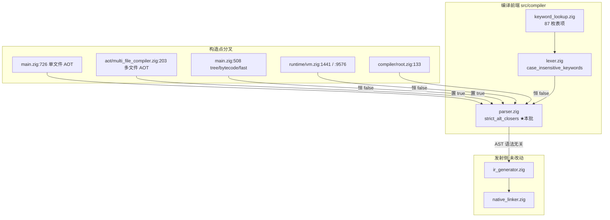
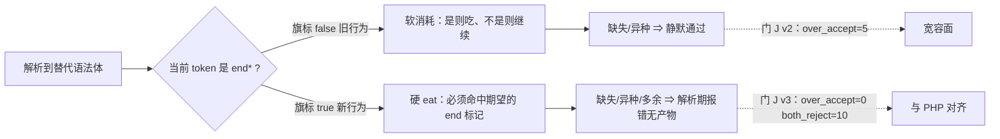
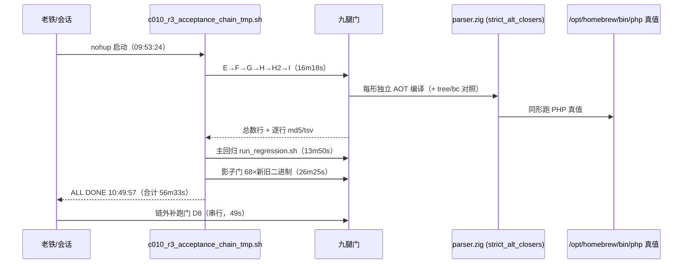
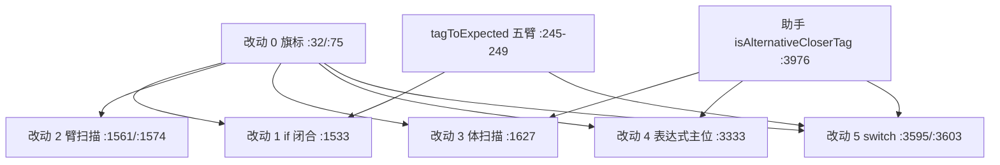

# AOT-CODEGEN-010 · R-3 批落地：替代语法（`endif;`/`endswitch;` 族）严格闭合，旗标门控只改 AOT

> 工单：[AOT-CODEGEN-010-keyword-case-insensitive-lexer.md](../../known-issues/AOT-CODEGEN-010-keyword-case-insensitive-lexer.md) §3.6「R-3 批落地实测」
> 任务号：本会话 #124（与工单内并发会话的「任务 #123/#124」编号无关）；**追加批 = 本会话 #125（门 H2 判向分桶，纯门改动，见 §5.5）**
> 代次：`src/compiler/parser.zig` md5 `5ad452fe4bc250b4732cbb3a2827b28a`（4288 行）／二进制 `81f8a55a989f9a793fec2f75c32fd37d`／仓库基线 commit `f9432e23`
> 裁决：**D-门控口径 = A 旗标门控，只改 AOT**；**D-范围 = 只做 CODEGEN-010 门 J P1**

---

## 1. 高层摘要（TL;DR）

门 J 取证出的 5 枚「PHP 拒而 AOT 静默接受」宽容面已**全部清零**：新增一枚解析期旗标 `Parser.strict_alt_closers`（只在两枚 AOT 编译入口置位），把五枚 `end*` 关闭标记从**软消耗**改为**硬 `eat`**，并同步收掉体扫描只认同种 `end` 标记、表达式主位把 `end*` 降级成变量、`switch` 分支意外 token 整枚跳过三处连带缺陷。

实测终态：**门 J v3（29 形）`same=19 diff=0 over_accept=0 both_reject=10 aot_only_red=0 run_red=0`**；官方主回归 **Pass 67 / Skip 1** 保持；影子门 **68/68 语料生成码 `main.zig` md5 逐字节一致**（相对修复前冻结二进制 `1f15e4ce…`）；门 E/F/G/H/I/D8 逐行等值；**门 H2 顺带收敛 2 枚**（`over_accept 14→12`）。整条验收链实测耗时 **56 分 33 秒**，零其他源码改动。

> **同文追加批（任务 #125，2026-10-09）**：本 R-3 批暴露的「门 H2 汇总列无法区分收敛与真回归」已用一次**纯门改动**收口（见 §5.5）—— 代次不变（二进制 `81f8a55a…`／`parser.zig` `5ad452fe…`），零 `src/` 改动，故不重跑验收链。

---

## 2. 影响范围

| 层面 | 影响 | 描述 |
|---|---|---|
| 编译前端（Parser） | **仅 AOT 路径** | 旗标由 `Parser.initWithModeInsensitive` 置位，其调用点实测只有 `src/main.zig:726`（单文件 AOT）与 `src/aot/multi_file_compiler.zig:203`（多文件 AOT）；其余 5 枚构造点（tree/bytecode/fast 解释、VM、`root.zig`）旗标恒 `false` |
| 解释器 / 字节码模式 | **零影响（实测）** | 门 I 19 行 × `tree`/`bc` 输出列逐行 `diff_rows=0`，读数与冻结注册值逐项相同 |
| 发射侧（IR / native_linker） | **零改动** | 本批只动解析期判定，未触碰 `ir_generator.zig`、`native_linker.zig`；影子 68/68 逐字节自证 |
| 冻结基线 68 语料 | **零扰动** | 语料替代语法面实测为 0（`pass/`68、`fail_runtime/`77、`fail_compile/`12 的开口头与关闭标记全 0）⇒ 基线对本面零保护力，本批也无从扰动 |
| 用户可见行为 | **拒绝面扩大（与 PHP 对齐）** | 缺失/异种/多余 `end*` 的脚本从「AOT 编译通过并静默跑出部分输出」变为「AOT 解析期报错、无产物」；报错消息词族改善（`expecting token` → `expecting "endif"`） |
| 门资产 | 门 J 扩至 v3（29 形）；门 H2 读数变动 2 列 | 门 H2 的 `aot_compile_fail` 桶首次非 0 ⇒ 门口径需补 `BOTH_REJECT` 判读规则（已登记） |

---

## 3. 核心变更

| # | 变更 | 落地前（旧锚点） | 落地后（新锚点） | 实测效果 |
|---|---|---|---|---|
| 0 | 新增旗标字段与置位点 | 无 | `:32` 声明、`:75` 于 `initWithModeInsensitive` 内 `initFromLexer` 之后置位 | 分叉生效；门 I `tree`/`bc` 逐字节不变 |
| 1 | `if` 闭合改硬 `eat` | `:1515-1517` 软消耗 | `:1533-1537` `eat(.k_endif)` + `eat(.semicolon)` | 缺 `endif;` ⇒ 同拒 |
| 2 | `elseif`/`else` 臂改走体扫描 | `:1540`/`:1549` `parseStatement()`（单语句） | `:1561`/`:1574` `parseAlternativeBody(.k_endif)`（旗标开启时） | 3 枚多语句臂正例 SAME ⇒ 硬 `eat` 不误拒合法写法 |
| 3 | 体扫描遇异种 `end*` 终止 | `:1594` 只认同种 `end_tag` | `:1627` `if (strict_alt_closers and isAlternativeCloserTag(curr)) break` | `if: … endwhile;` ⇒ 停在闭合位由调用侧报错 |
| 4 | 关闭标记排除出表达式主位容忍支 | `:3299-3305` 可降级成 `.variable` | `:3333` 加 `!(strict_alt_closers and isAlternativeCloserTag(curr))` | 裸 `endif;`／双 `endif;` 不再产出零指令语句 |
| 5 | `switch` 意外 token 不再整枚跳过 | `:3556-3558` `nextToken()`；`:3563-3565` 软消耗 | `:3595`（仅 `is_alternative`）`break`；`:3603-3607` 硬 `eat(.k_endswitch)` | 四形 `case` 前裸语句预检：PHP 全拒 ⇒ 新增拒绝与 PHP 同向 |
| 6 | 新建恰 5 枚的集合助手 | 复用 `isAotExtendedKeywordIdentifierTag`（6 枚含 `.k_struct`） | `:3976` `isAlternativeCloserTag`（5 枚） | 覆盖面不收窄、不扩到 `.k_struct` |
| 7 | `tagToExpected` 补 5 枚 `end*` 臂 | 兜底 `else => "token"` | `:245-249` | AOT 报 `expecting "endif"` / `"endswitch"`（真实复测见 §3.6） |

---

## 4. 可视化概览

### 4.1 分层与业务映射（Code & Logic Map）



### 4.2 业务流程（关闭标记的四条文法位判定）



### 4.3 执行流程（本批验收链时序，从上层到底层）



### 4.4 逐点业务代码映射



---

## 5. 详细变更分析

### 5.1 涉及文件列表

| 层 | 文件 | 变更 | 实测 |
|---|---|---|---|
| 数据/源码层 | `src/compiler/parser.zig` | +64 / −6（**唯一源码改动**） | `git diff --stat` |
| 门资产 | `fuzzy_scripts_720/tmp/c010_alt_syntax_gate_tmp.sh`（v3，md5 `592ef97458d6ae7e044e97ad6289fd69`，29 形） | v2 → v3：新增 3 枚 elseif/else 多语句臂正例 + 3 枚负例 | 门 J v3 全量 70s |
| 门读数 | `fuzzy_scripts_720/tmp/c010_alt_syntax_gate_tmp.tsv`（md5 `2a25520cf7e4e78362a6be601e7cc5f6`，含 `ELAPSED=70s`） | 29 形读数 + 四枚代次头行（`compiler_md5=81f8a55a… / parser_md5=5ad452fe…`） | 逐形 join（vs `git show 73f4d6b:` 的 v2 表）：23 枚共有形 **16 SAME→SAME、5 OVER_ACCEPT→BOTH_REJECT、2 BOTH_REJECT 保持** ⇒ 只动宽容面、正例面零扰动 |
| 验收链 | `fuzzy_scripts_720/tmp/c010_r3_acceptance_chain_tmp.sh`（新建） | 六门 → 主回归 → 影子，逐段 timeout + 阶段标记 | 56m33s |
| 读数快照 | `fuzzy_scripts_720/tmp/c010_r3_presnap/`（新建，本批实测 12 份 → **任务 #125 追加 1 份 = 现 13 份**） | 复跑前快照 8 份上一代次门 TSV + 2 份回归报表 + 本轮收存的门 J **v1 快照表**（`gate_j_v1_snapshot.tsv`，md5 实测 `a8afda22…` ＝ §7-15b 登记值全等）与替代语法语料扫描探针（`alt_corpus_scan_tmp.php`）⇒ 支撑「逐行 `diff_rows=0`」与 v1→v2 判据对照取证 | 用于本轮等值对照 |
| 产物清理 | 会话 scratch（宪法 §三-7） | 删 `c010_r3_zigtest_tmp.log`/`c010_r3_zigtest2_tmp.log`；删被中断 run 残留的 `/tmp/c010d.DhtQQZ`、`/tmp/c010d3.kNwfKA`、`/tmp/c010shadow.WS2v3i`、`/tmp/c010d_dir.txt` | **`/tmp/c010_prefix_backup/` 保留**（影子门的冻结对照二进制 `1f15e4ce…` 在此，删了影子跑不了）；仓库根 `aot_compile_*`/`.zigphp_aot_build_*` 实测零残留；全部 `.php` 源未动 |
| 报表 | `fuzzy_scripts_720/regression_report.md`、`regression_failures.tsv` | 由官方主回归重写（68 行全表） | Pass 67 / Skip 1 |
| 门资产（任务 #125 追加） | `fuzzy_scripts_720/tmp/c010_noface_tolerance_gate_tmp.sh`（门 H2，md5 `582ca74d50ff85567ac933b0f85dc7b3`，99 → 116 行） | **纯门改动，零 `src/` 改动**：拒绝支按 `php_rc` 判向拆成 `BOTH_REJECT`/`AOT_ONLY_RED_COMPILE`、运行侧新增 `AOT_ONLY_RED_RUN`、`aot_log=` 列走与门 J `:54` 同口径的 `normlog()`、表头补 `parser_md5` | 冒烟 2 形 → 全量 44s；与 R-3 快照 diff **12 行**、判据数据行 **13/15 逐字节全等** |
| 门读数（任务 #125 追加） | `fuzzy_scripts_720/tmp/c010_noface_tolerance_tmp.tsv`（md5 `0663be8da1ef8f17449d5409937b6f87`，mtime 晚于脚本） | 新代次注册：`over_accept=12 strict_same=1 aot_compile_fail=2 both_reject=2 aot_only_red=0` | 修门前旧表另存 `c010_r3_presnap/c010_noface_tolerance_r3gen_tmp.tsv`（md5 `7577d51c…`）作逐字节对照基线 |
| 工单 | `docs/known-issues/AOT-CODEGEN-010-keyword-case-insensitive-lexer.md` | §3.6 R-3 落地实测全块、§6 新代次预期读数、§7-15/15b/15c、状态行、代次指针；**任务 #125 追加**：§3.5.1（H2 修门全记录）、§6 门 H2 块改五桶口径、§7-15d（H2 读数代次）、初代锚点表两行加「四桶口径已作废」标记 | — |

### 5.2 关键读数（全部实测，非估算）

```bash
# 门 J v3（29 形 = 19 正例 + 10 负例，ELAPSED=70s = 2.4 s/形）
C010J_DONE shapes=29 same=19 diff=0 over_accept=0 both_reject=10 aot_only_red=0 run_red=0 both_err_diff=0 repo_build_residue=0
# 门 E/F/G（逐行 diff_rows=0）
C010KW_DONE   shapes=19 same=19 diff=0 silent_empty=0 aot_fatal=0 compile_fail=0        （69s）
C010MECH_DONE shapes=8  same=8  diff=0 zero_instr=0 compile_fail=0
C010G_DONE    shapes=7  same=7  diff=0 red_confirmed=0 guard_same=4 guard_red=0 compile_fail=0
# 门 H（103 数据行 diff_rows=0，ELAPSED=738s）
C010H_DONE shapes=79 arms=200 face=0 noface=78 confounded=1 bad_probe=0 ctrl_compile_fail=0 probe_compile_fail=0 probe_timeout=0 inverse_shapes=21 inverse_face=0 inverse_noface=21 inverse_confounded=0 repo_build_residue=0
# 门 H2（唯一变动列：over_accept 14→12、aot_compile_fail 0→2，ELAPSED=46s）
C010H2_DONE shapes=15 over_accept=12 strict_same=1 aot_compile_fail=2 php_ok_aot_diff=0 repo_build_residue=0
# 门 I（分叉判据腿，19 行 diff_rows=0，ELAPSED=69s）
C010I_DONE shapes=19 tree_same=7 tree_diff=12 bc_same=7 bc_diff=12 aot_same=19 aot_diff=0 aot_compile_fail=0 both_red=0 vm_only_red=12 aot_only_red=0 repo_build_residue=0
# 门 D8（链外补跑，串行，ELAPSED=49s）
C010D8_DONE shapes=14 defect_red=1 guard_same=13 compile_fail=0 bad_probe=0 repo_build_residue=0
# 影子门（相对修复前冻结二进制 1f15e4ce…，ELAPSED=1585s）
C010_SHADOW_DONE total=68 same=68 diff=0 miss=0
# 官方主回归（13m50s）
Total=68 Pass=67 Fail(Compile)=0 Fail(Runtime)=0 Fail(Diff)=0 Skip=1（f004_oop_deep_inheritance_magic.php，PHP_error_exit=255）
# 真实语料正例面（非最小探针，逐枚 cmp）
test_006_loops_for.php / test_007_loops_while.php / test_008_loops_foreach.php ⇒ 3/3 逐字节 SAME（行数 40/37/43）
```

### 5.3 预测偏差与更正（口径教训）

| 项 | 落地前登记预测 | 实测 | 根因 |
|---|---|---|---|
| `same` | 「16 不变」 | **19**（旧 16 全绿 + 新 3 枚多语句臂 SAME） | 预测假定正例面本就是单语句臂；`parseElseifAlternative` 实际用 `parseStatement()` ⇒ 只补硬 `eat` 会误拒 PHP 合法的多语句臂（**读码推导，未做单臂反证**）⇒ 正例面必须含多语句臂才能守住改动 2 |
| `both_reject` | 2 → **7** | 2 → **10** | 预测按 v2 的 23 形口径给出；v3 扩到 29 形，新增 3 枚负例 ⇒ 逐形对照无缺一枚 |
| `over_accept` | 5 → 0 | **5 → 0** | 达成；并额外使门 H2 的 2 枚同位形收敛（14 → 12） |
| 门 D8 residue | — | 首轮 `=1`、复跑 `=0` | 首轮与影子门**并发**执行，D8 以 `ls -d .zigphp_aot_build_*` 取样 ⇒ 并发污染 ⇒ 首轮读数禁引用 |

### 5.4 本轮自纠的两处取证口径（登记以自证）

1. **门 J v3 脚本 md5 首登值作废**：工单与本文首版写作 `1ff97d51…`，实测当前脚本 `592ef97458d6ae7e044e97ad6289fd69`、表 `2a25520cf7e4e78362a6be601e7cc5f6`。取证：脚本 mtime `09:46:35` **早于** 表 mtime `09:47:54` 且此后脚本未再编辑 ⇒ 产出注册读数的那版就是 `592ef974…`；`1ff97d51…` 是「6 形已加、头行两枚自证戳（`gate_rev`／`positive_shapes`）尚未改」的中途读数。**口径**：md5 必须在脚本定稿（含其自证头行）之后取，并**在同一条命令里同时抓「脚本 + 表 + 二进制 + 被改源码」四戳**。
2. **等值对照命令自身要先验**：首次用 `sort`+`comm`+`join` 做 v2↔v3 逐形对照时，`awk` 的 `!=` 在命令传递中被反斜杠转义 ⇒ awk 语法错误、退出码 2，`comm` 随之**错报** 2 枚共有形在 v3 缺失（实际存在）。改为直接落两列 `(shape, verdict)` dump 人工对齐后得到相反结论（23 枚共有形无缺一枚）。**口径**：join/comm 类取证必须先确认命令自身 rc=0 且行数等于预期形数，再读它的结论；否则会把「工具坏」记成「编译器动了对照面」。

---

### 5.5 追加批（任务 #125，2026-10-09）：门 H2 判向分桶修门（**纯门改动，零 `src/` 改动**）

**动因**：本批 §6「特别注意点 ①」与 §8 P1 都留了一条门口径债 —— 门 H2 汇总列只有四桶，`aot_compile_fail` 把「PHP 同拒（收敛）」与「PHP 通过而 AOT 拒（真回归）」压成同一枚计数。R-3 落地时该列 `0→2`，全靠人工回读逐形 `php_rc=255` 才没把它误判成新红。守卫门的方向判别不能靠人肉，故本批把它制度化。

| 项 | 修门前（入库 blob `73f4d6b:…sh`） | 修门后（脚本 md5 `582ca74d…`／116 行） |
|---|---|---|
| 拒绝支判向 | `:76-80` 直接写 `AOT_COMPILE_FAIL`，**不判向**，AOT 侧文本固定 `<none>` | `php_err` 计算上移到该分支之前 ⇒ `php_err=1` 记 **`BOTH_REJECT`**、`=0` 记 **`AOT_ONLY_RED_COMPILE`**；两支均落 `aot_log=`（`normlog()` 归一，与门 J `:54` 逐字同口径） |
| 运行侧守卫 | `php_rc=0` 而 AOT 崩/报错 ⇒ 与「输出不同」混计入 `DIFF_PHP_OK_AOT_DIFF` | 新增 **`AOT_ONLY_RED_RUN`**，与 `aot_only_red` 同计数 |
| 代次锚点 | 表头三枚（`compiler`/`lexer`/`keyword_lookup`） | 补 `# parser_md5=`（本门判据落在 parser 文法位） |
| 汇总列 | `over_accept/strict_same/aot_compile_fail/php_ok_aot_diff` | 追加 `both_reject`/`aot_only_red`；**`aot_compile_fail` 语义更正为拒绝总数 = `both_reject + aot_only_red`**（历史列不删，引用须读分列） |

**实测（全量 `ELAPSED=44s`，先 `ONLY=n_endif,n_endswitch` 冒烟）**

```bash
C010H2_DONE shapes=15 over_accept=12 strict_same=1 aot_compile_fail=2 both_reject=2 aot_only_red=0 php_ok_aot_diff=0 repo_build_residue=0
```

**修门证明**：与修门前快照 `c010_r3_presnap/c010_noface_tolerance_r3gen_tmp.tsv`（md5 `7577d51c…`）逐字节 `diff` ⇒ 差异 **12 行**，全部落在「表头 4 + 2 形重分类（旧 2 行 + 新 2 行）+ `ELAPSED` + 总数行」；**判据数据行 13/15 逐字节全等**（`comm -12` 实测，命令自身 rc=0）⇒ 修门未扰动任何一形的 PHP/AOT 结局，`over_accept=12`/`strict_same=1` 与 R-3 代次逐项等值。

**两条固化口径**（本批教训升格为门规则）：
1. **AOT 拒 ≠ 红** —— 拒绝类读数必须先判 PHP 侧方向，收敛（同拒）与真回归（单方拒）禁止同计数；新增的 `aot_only_red` 是硬守卫列，转正即真回归。
2. **旧表结构不可判向时，禁止用「人工回读某一列」代替修门** —— R-3 轮的回读只是应急，本批才把它变成门能力（同 §5.4-2 的「对照命令自身要先验」，取证能力必须落在门脚本里，不能落在会话记忆里）。

**归属**：本批不改编译器行为，故**不重跑**验收链（六门/主回归/影子均无需，二进制与 `parser.zig` md5 与本批注册值全等即自证）；门 H2 新代次读数即为工单 §6 的当代次预期。

---

## 6. 影响与风险评估

| 维度 | 判定 | 依据（实测） |
|---|---|---|
| 是否破坏式变更 | **对非法 PHP 脚本是破坏式（且为期望方向）** | 5 + 2 = 7 枚形从「AOT rc=0 静默」变为「解析期报错、无产物」；PHP 侧本就 rc=255 ⇒ 与语言真值对齐 |
| 是否回归 | **否** | 门 J 两枚硬守卫列 `aot_only_red=0`/`run_red=0`；门 I `aot_only_red=0`；主回归 Pass 67/Skip 1；影子 68/68 逐字节；门 E/F/G/H/I/D8 逐行 `diff_rows=0` |
| 其他模式风险 | **零**（分叉实测达成） | 置位点只有两枚 AOT 入口（源码级 grep）+ 门 I `tree`/`bc` 逐字节等值（行为级） |
| 性能风险 | **无** | 改动只在解析期做 5 元素 tag 判定；语料替代语法面为 0 ⇒ 无热路径 |
| 影响范围（未覆盖） | **花括号 `switch` 残面**（§7-15c）：`switch (1) { echo "W"; }` PHP rc=255、AOT rc=0 空输出 ⇒ 本批只改 `is_alternative` 支路，花括号支行为逐字未变（四形预检已实测） | 待裁决 |
| 特别注意点 | ①门 H2 的判向债**已由任务 #125 收口**（2026-10-09，见 §5.5）：汇总列现为五桶，`aot_compile_fail` = 拒绝总数 = `both_reject`（收敛）+ `aot_only_red`（真回归，硬守卫须 0），**禁止再单独拿 `aot_compile_fail` 当红面**；②任何带 `repo_build_residue` 列的门**不得与影子/回归并发**；③`regression_failures.tsv` 上一轮快照仅 20 行 ⇒ 等值对照只能取报表计数器 | ①已登记于工单 §3.5.1/§7-15d，②③登记于工单 §3.6 |
| 复测路径（体验流程） | 见下 §6.1 | — |

### 6.1 复测路径

```bash
# 仓库根执行；全部带 timeout；产物名 aot_compile_*（防误删源文件）
timeout 120 zig build                                     # 预期 rc=0
timeout 300 bash fuzzy_scripts_720/tmp/c010_alt_syntax_gate_tmp.sh   # 门 J v3：over_accept=0 both_reject=10 aot_only_red=0 run_red=0
timeout 300 bash fuzzy_scripts_720/tmp/c010_noface_tolerance_gate_tmp.sh  # 门 H2（#125 修门后）：over_accept=12 both_reject=2 aot_only_red=0（免人工回读 php_rc）
timeout 480 bash fuzzy_scripts_720/tmp/c010_crossmode_gate_tmp.sh    # 门 I：tree/bc 与注册值逐项相同 + aot_same=19（分叉判据腿）
timeout 300 bash fuzzy_scripts_720/tmp/c010_indep_defects_gate_tmp.sh # 门 D8：**必须串行**，residue=0
timeout 1800 bash fuzzy_scripts_720/run_regression.sh     # Pass 67 / Skip 1
timeout 3600 bash fuzzy_scripts_720/tmp/c010_shadow_main_md5_tmp.sh  # 68/68（需 /tmp/c010_prefix_backup 内 1f15e4ce 冻结二进制）
# 一条链跑完（六门 → 主回归 → 影子，实测 56m33s；D8 需链后单独补跑）
nohup bash fuzzy_scripts_720/tmp/c010_r3_acceptance_chain_tmp.sh >/dev/null 2>&1 &
```

---

## 7. 遗留 / 潜在问题

| 级别 | 项 | 状态 |
|---|---|---|
| P1（待裁决） | **§7-15c**：花括号 `switch` 在首个 `case` 前的裸语句仍被 AOT 静默接受（PHP rc=255） | 本批范围外（裁决＝只做门 J P1），已实测立形、未修 |
| P2（消息面） | 门 J 的 10 枚同拒里 **4 枚**（`n_endif_alone`/`n_colon_brace_mix`/`n_double_endif`/`n_else_no_endif`）AOT 报通用句 `Unexpected token in expression`，不经 `tagToExpected` ⇒ 另有一条报错支 | 措差不改判定，不入等值判据 |
| P1（待裁决） | 门 H2 余下 **12 枚** `over_accept`（类型位/修饰符位/声明关键字位的瞎词容忍） | 与替代语法无关，本批未触碰 |
| ~~P2（门口径）~~ **已收口** | ~~门 H2 汇总列缺 `BOTH_REJECT` 桶~~ ⇒ **任务 #125（2026-10-09）落地**：五桶 + `aot_log=` + `parser_md5` 锚点，纯门改动零 `src/`（详见 §5.5） | 已闭合；新代次注册 `over_accept=12 strict_same=1 aot_compile_fail=2 both_reject=2 aot_only_red=0` @44s |
| P2 | §8 唯余 `d3a`=goto 发射侧子轮；§7-10 死桩 `isKeywordUsableAsIdentifier`（D-4 = 维持现状）。**§7-3 的 `len <= 15` 已消除**：本轮 `grep` 实测 `lexer.zig:405` 走 `text.len <= keyword_lookup.max_key_len`（`keyword_lookup.zig:104` 计算 + `:184` 测试钉住 =13）⇒ **工单 §7-3 的「登记待并批」措辞已过时，需按 R-4 落地事实更正** | goto 子轮未变；§7-3 属文档措辞 |
| 流程 | **本批 + #125 资产全部未提交**：`src/compiler/parser.zig`、门 J v3 脚本/TSV、验收链脚本、presnap（现 13 份）、工单文档、本变更文档、**门 H2 脚本 `582ca74d…` 与读数表 `0663be8d…`** | 待老铁「提交」指令 |
| 噪声（非本单） | `zig build test` RC=0 但尾行 `failed command: ./.zig-cache/o/55e29…/test` | 已归因为既有 CI 门面试验（直跑该二进制 = `All 3 tests passed`，mtime `Oct 5`） |

---

## 8. 后续开发 / 优化建议

| 优先级 | 建议 | 影响面 | 落地成本（实测口径） |
|---|---|---|---|
| P1 | **裁决 §7-15c**：花括号 `switch` 首 `case` 前裸语句是否一并收硬（可复用同一旗标，改动点就在 `:3595` 邻支的花括号对应位） | 1 形实测面 + 语料面 0 | 单点改动；复测只需门 J（70s/29 形）+ 主回归（13m50s） |
| P1 | **门 H2 余 12 枚文法位过度宽容**（`n_do`/`n_else`/`n_void`/`n_const`/`n_final`/`n_mixed`/`n_public`/`n_global`/`n_object`/`n_private`/`n_finally`/`n_namespace`）：**门侧前置已由任务 #125 交付**（判向分桶 + `aot_log=` + `parser_md5`，见 §5.5）⇒ 余下工作＝按位分族归因与裁决（类型位/修饰符位/声明位各族机制不同，不可一枚改动统收），且每一族落地后须看 `aot_only_red` 恒 0 | 12 枚宽容面 | 归因按 R-1 归因轮方法（每族一轮，参照门 H2 实测档 **2.9 s/形 = 44s/15 形**；单族门 ≈ 30–60s） |
| P2 | **P2 消息面收口**：定位那 4 枚不经 `tagToExpected` 的报错支（`Unexpected token in expression`），把期望词并入消息 ⇒ 提升与 PHP 的可读性对齐，不改接受/拒绝边界 | 4 枚同拒形的消息措辞 | 需先归因到行（禁凭推测），预计单轮探针 + 少量模板/消息改动 |
| P2 | **把门 J / D8 纳入官方门链**：本批十腿验收中九腿为「永久侧门」但尚未入官方十二腿链（§7-9 同口径） ⇒ 建议随下一次提交一并登记入口清单 | 验收覆盖 | 文档 + 官方脚本清单登记，无源码成本 |
| P2 | **验收链脚本补 D8 串行尾腿**：现链缺 D8，且已实证并发会脏 `residue` 列 ⇒ 在链尾 `ALL DONE` 前追加 `timeout 300 …indep_defects_gate_tmp.sh`（串行位） | 单条链自证完整 | 改 1 行脚本 + 49s 成本 |
| P3 | **route R-3（发射期静默金丝雀，与本批次号无关的 §5 路线）** 仍未启动：本批把「解析期静默接受」面收口后，剩余静默风险已转向发射侧（如 §7-15c 与 CODEGEN-008 零发射面孔） ⇒ 金丝雀价值上升 | 静默类缺陷的自动化捕获 | 需单独设计轮 |

> ⚠ 编号消歧：本文的「R-3 批」＝工单 AOT-CODEGEN-010 的第 3 个**修复批次**；工单 §5 的「路线 `R-3`」＝发射期静默金丝雀**路线**，两者无关（消歧见工单 §5 开头）。
