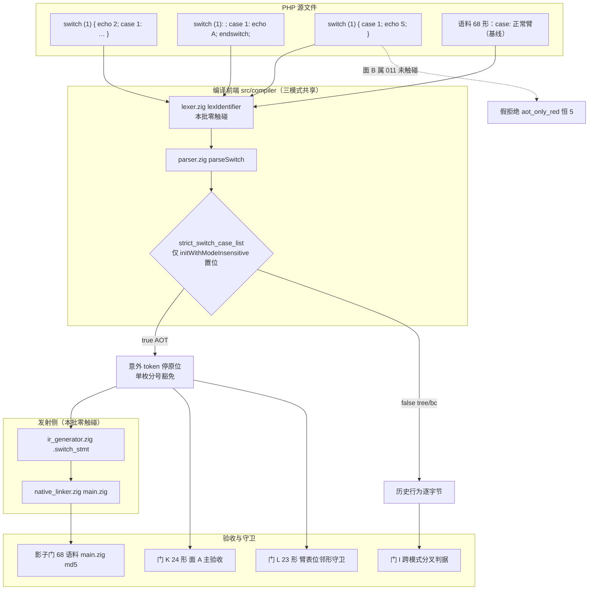
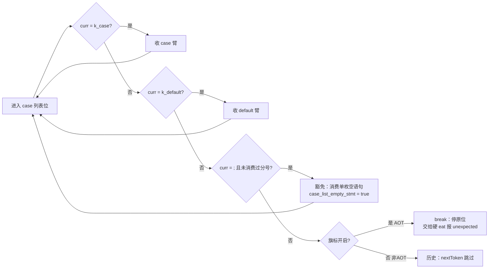
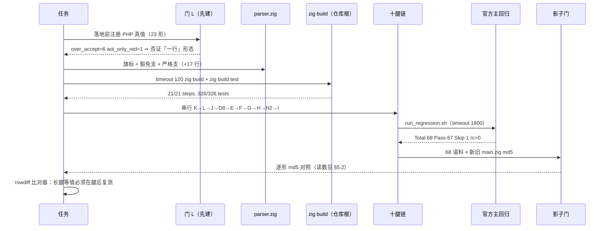

# AOT-CODEGEN-010 · R-5 批落地：花括号 `switch` 臂表位严格化（面孔 A 收口）+ 永久守卫门 L 建成，旗标门控只改 AOT

**任务**: #127（承接 #126 取证轮）
**日期**: 2026-10-09
**工单**: [docs/known-issues/AOT-CODEGEN-010-keyword-case-insensitive-lexer.md](../../known-issues/AOT-CODEGEN-010-keyword-case-insensitive-lexer.md) §3.8 / §5 路线 R-5 / §7-15c
**姊妹单**: [AOT-CODEGEN-011](../../known-issues/AOT-CODEGEN-011-switch-case-semicolon-terminator-and-default-arm-position.md)（面孔 B／C，本批**零触碰**）
**代次**: 二进制 `6939cd2e891f20aef590de2585b15681`｜`src/compiler/parser.zig` `1eab26c068b13b9f904d2f432464d852`（4305 行）｜`lexer.zig` `e3dd4191…`（543）／`keyword_lookup.zig` `ef70993a…`（186）**与 `0652130` 逐枚全等**
**HEAD**: `f9432e2`（本批 `src/` 改动与全部门资产**未提交**）

---

## 1. 高层摘要（TL;DR）

1. **面 A 收口**：花括号 `switch` 在首个 `case` 之前跳过任意意外 token 的过度接受（#126 量化为 **4 枚 `OVER_ACCEPT`**）已修复 ⇒ 门 K `over_accept 4→0`、`both_reject 6→10`。
2. **「一行」成本口径被实测否证**：#126 与本单 §5 旧句都写「`:3595` 去掉 `is_alternative and` 即可」。**先建的守卫门 L 直接打回该形态** —— `case` 列表首**恰好接受一枚空语句分号**是 PHP 8.5.8 的合法形（门 L 的 `l_semi_arm_list`/`l_semi_only`/`l_alt_semi_arm` 三枚 `php_rc=0`），直改会把它们砸成硬守卫红 ⇒ 真实形态是**「旗标 + 单枚前导分号豁免支」三处改动**（净 **+17 行**）。
3. **顺带闭合 R-3 批的漏网硬守卫红** `l_alt_semi_arm`（替代语法 `switch` 臂表位那枚合法 `;` 从未被消费，导致 R-3 的硬 `eat(.k_endswitch)` 停在 `;` 上）⇒ 门 L `aot_only_red 1→0`。**根因是覆盖面意外而非回归**：门 J 只盯闭合位，不覆盖臂表位邻形 ⇒ 新口径「闭合位门 ≠ 臂表位门」。
4. **AOT-only 分叉达成（实测）**：新旗标 `Parser.strict_switch_case_list` 仅由 `initWithModeInsensitive`（= `src/main.zig:726` 与 `src/aot/multi_file_compiler.zig:203` 两枚 AOT 入口）置位 ⇒ 门 I 的 `tree_same=7 tree_diff=12 bc_same=7 bc_diff=12` 与本单冻结注册值**逐项等值**（19 行 `diff_rows=0`）⇒ 解释器／字节码模式行为逐字节等于历史（宪法 §五 未越界）。
5. **零扩散实证**：门 K 的 `aot_only_red` **前后恒 5**（面孔 B 五枚假拒绝）、`diff_php_ok` **前后恒 1**（面孔 C 的 `k_default_first`）⇒ 面 B／C 未被顺带动，仍待 011 的 D-1…D-4。
6. **副产品 = 消息精确化**：门 L 5 枚同桶行的泛化文案 `Unexpected token in expression` 改为带 token 与期望集的 `syntax error, unexpected token "X", expecting "}"` ⇒ §7 的「泛化消息（P2）」面收窄。
7. **验收面（全链实测完成）**：十腿门段逐腿绿 + 逐行 `diff_rows` 全等（八腿 0、影子 **0**（`136/136`，腿后复测））+ 主回归 **Total 68 / Pass 67 / Skip 1**（`regression_rc=0`）+ 影子 **`total=68 same=68 diff=0 miss=0 ELAPSED=1507s`** ⇒ **全链墙钟 56m24s**（十门 18m23s + 主回归 12m54s + 影子 25m07s；与 R-3 批同构链 56m33s 同量级 ⇒ 今后该口径预算取 ≈1 小时）。

---

## 2. 影响范围

| 维度 | 影响 | 实测证据 |
|---|---|---|
| `src/compiler/parser.zig`（`parseSwitch` + 两枚构造点） | **本批唯一源码面**，净 +17 行（与未提交的 R-3 批合起来 `git diff --numstat HEAD` = **+81/−6** ⇒ **未来提交消息必须同时点名两批**） | 三个 hunk：`@@ -26,6 +26,16`（旗标声明）、`@@ -66,7 +76,11`（AOT 入口置位）、`@@ -3526,6 +3568,8` + `@@ -3554,14 +3598,29`（`parseSwitch` 豁免支与严格支） |
| 解释器／字节码模式 | **零**（旗标缺省 `false`） | 门 I 19 行 `diff_rows=0`、`tree`/`bc` 三列读数逐项 = 冻结注册值 |
| 冻结基线（68 语料 `main.zig`） | 预期零漂移（语料 `stmt_before_first_case=0` ⇒ 合法代码永不进入被改的 `else` 支） | 主回归 Pass 67/Skip 1；影子门逐形 md5（读数见 §5.2） |
| 语料暴露面 | **0**（#126 两枚独立分词器扫描器互证；本批复扫列值不变） | `switch=7 brace=7 alt=0`、`stmt_before_first_case=0`（对照臂 `colon_arm=37` 证明扫描器有判别力） |
| 面 B（`case expr;`／`default;` 假拒绝）／面 C（`default` 位次丢失） | **未触碰** | 门 K `aot_only_red=5`、`diff_php_ok=1` 前后恒等；门 L 形集不含该族（`aot_only_red=0`） |
| 关键字大小写面（本单主根） | **零扰动** | 门 E `same=19`、门 F `zero_instr=0`、门 G `guard_red=0`、门 H `face=0` 逐行 `diff_rows=0`（100 行） |
| §8 七枚独立缺陷面 | **零扰动**，`k_goto` 残红维持 | 门 D8 `defect_red=1 guard_same=13`，14 行 `diff_rows=0` |
| 生成码／运行时 | **零改动**（`ir_generator.zig`/`native_linker.zig`/`runtime_lib_template.zig`/`vm.zig` 均未动） | `git status --porcelain` 的 `src/` 仅 `parser.zig` 一行 |

---

## 3. 核心变更

| # | 位置（当代次实测行号） | 变更 | 判读 |
|---|---|---|---|
| ① | `parser.zig:33–38` | 新字段 `strict_switch_case_list: bool = false` + `///` 文档注释（内嵌「PHP 实测该位**恰好接受一枚空语句分号**」的实测依据与门 L 形名） | 旗标缺省关 ⇒ 非 AOT 模式行为不变 |
| ② | `parser.zig:80–82`（`initWithModeInsensitive`） | `p.strict_switch_case_list = true;`（与既有 `strict_alt_closers` 同处补设） | 唯二调用点 `src/main.zig:726`、`src/aot/multi_file_compiler.zig:203` ⇒ AOT-only 分叉 |
| ③ | `parser.zig:3571–3572` | 局部标记 `var case_list_empty_stmt = false;` | **纯 `//` 注释**：Zig 对局部 `var` 写 `///` 是**编译错误**（本轮首建即触发 `:3571:9: error: expected statement, found 'a document comment'`） |
| ④ | `parser.zig:3601–3606` | 新增豁免支 `} else if (self.curr.tag == .semicolon and !case_list_empty_stmt) { … consume once }` | PHP 合法的单枚前导空语句照常接受 ⇒ 门 L 三枚 `l_semi_*` 与四枚 `l_ctl_*` 未被新拒 |
| ⑤ | `parser.zig:3607–3613` | 严格支由 `if (is_alternative and self.strict_alt_closers) break;` 改为 `if (self.strict_switch_case_list or (is_alternative and self.strict_alt_closers)) break;` | 意外 token 停在原位 ⇒ 由既有硬 `eat(.k_endswitch)`（`:3617–3626`）/ `eat(.r_brace)`（`:3628`）报精确 unexpected，不再整枚跳过 |
| ⑥ | `fuzzy_scripts_720/tmp/c010l_switch_armslot_gate_tmp.sh`（**新建永久门 L**） | 23 形 = 4 枚控制臂（`l_ctl_*`）+ 19 枚臂表位邻形；表头内嵌实测规则与四枚代次戳 | **落地前**先建 ⇒ 正是它否证了「一行」口径 |
| ⑦ | `fuzzy_scripts_720/tmp/c010_r5_acceptance_chain_tmp.sh` + `c010_r5_rowdiff_tmp.sh` | 十腿串行链（`K→L→J→D8→E→F→G→H→H2→I`，全 `timeout`）→ 主回归 → 影子；比对器只比逐形数据行（剔表头与 `ELAPSED`/`_DONE`） | 腿序＝「先读本批判据、再吃长腿」；比对器把「等值」从人工比对变成 `diff_rows` 计数 |
| ⑧ | 工单 010 §3.7／§3.8／§3.8.6／§3.8.10／§5 R-5 行／§6／§7-15c ＋ 工单 011 页顶代次更正与 §5/§6/§7 锚点改名 | 就地更正旧措辞、登记代次与门读数 | 门 K 的注册读数被链复跑就地覆盖 ⇒ 已按 md5 保全在 `c010_r5_presnap/`（§5.3） |

---

## 4. 可视化概览

### 4.1 分层与业务映射（Code & Logic Map）



### 4.2 业务流程（臂表位判定的四条分支）



### 4.3 执行流程（本批验收链时序）



### 4.4 逐点业务代码映射

| 业务判定 | 代码位（当代次） | 门形 |
|---|---|---|
| 「首 `case` 前裸语句应拒」 | `parser.zig:3607–3613` 严格支 | `k_stmt_before_case`、`k_stmt_before_case_two`、`k_nested_stmt_head`、`k_stray_endswitch`（门 K）／`l_two_semi_arm_list`、`l_assign_before_case`、`l_var_before_case`、`l_alt_if_before_case`、`l_endif_stray`、`l_bare_colon_arm_list`（门 L） |
| 「单枚前导 `;` 应接受」 | `parser.zig:3601–3606` 豁免支 + `:3571–3572` 标记 | `l_semi_arm_list`、`l_semi_only`、`l_alt_semi_arm` |
| 「PHP 合法臂不得新拒」（控制臂） | 旗标关闭路径逐字节 = 历史 | `l_ctl_case_first`、`l_ctl_default_first`、`l_ctl_empty`、`l_ctl_between_arms` |
| 「只落 AOT 侧」 | `parser.zig:80–82` + `src/main.zig:726` + `src/aot/multi_file_compiler.zig:203` | 门 I 19 形 × tree/bc/aot 三模式 |

---

## 5. 详细变更分析

### 5.1 涉及文件列表（📦 全部未提交）

> **未提交的两种形态（`git status --porcelain` 实测计数 = `14 M` + `16 ??`，HEAD `f9432e2`）**：老铁的 `73f4d6b` 已把 **R-2 代次**的 318 份门脚本/读数表入库 ⇒ 本批链复跑改写的那些表是「**已入库但工作树已改**」（M：`parser.zig`、工单 010、门 J/门 H2 脚本、8 份门读数表、影子表、回归报告）；而**本批新长的资产是「全新未跟踪」**（`??`：工单 011、门 K 脚本+表、**门 L 脚本+表+落地前快照**、`c010_r5_presnap/`、`c010_r3_presnap/`、`c010k_presnap/`、链脚本+日志、rowdiff 比对器、C010KM 跨模式探针、两枚语料扫描器、`docs/changes/2026-10-09/`）⇒ **两类都属未提交**，未来会话不得因「门资产曾在库里」而判本批已入库。

| 文件 | md5 | 行数 | 性质 |
|---|---|---|---|
| `src/compiler/parser.zig` | `1eab26c068b13b9f904d2f432464d852` | 4305 | 源码（R-3 + R-5 合并未提交，`+81/−6`） |
| `fuzzy_scripts_720/tmp/c010l_switch_armslot_gate_tmp.sh` | `babe087708ec2e518f06c1cea2100ee4` | 139 | **新建永久门 L** |
| `fuzzy_scripts_720/tmp/c010l_switch_armslot_tmp.tsv` | `19cac57546634f4d748f2d96893b1857` | 37 | 门 L R-5 代次读数 |
| `fuzzy_scripts_720/tmp/c010l_presnap/prefix.tsv` | `8a0116db0108bb97147661ede573c854` | — | 门 L **落地前**快照（`over_accept=6 aot_only_red=1`） |
| `fuzzy_scripts_720/tmp/c010_r5_acceptance_chain_tmp.sh` | `df6eed2b557e5e5e935626629a07ca2e` | 47 | 十腿验收链 |
| `fuzzy_scripts_720/tmp/c010_r5_rowdiff_tmp.sh` | `e735feb71354bd37fee60a3293e74f8c` | 34 | 逐行等值比对器（★ 腿后复测段写入表头 ⇒ md5 由初代 `b6684beb…`／27 行更新；**纯注释增补，`GATES` 列表与比对逻辑逐字未动**，实测复跑 23 行输出与增补前全等） |
| `fuzzy_scripts_720/tmp/c010_r5_presnap/`（11 枚 TSV） | — | — | R-3 代次落地前快照（等值判据的对照侧） |
| `fuzzy_scripts_720/tmp/c010_brace_switch_tmp.tsv`（门 K 活动表） | `60cbac5a…` | — | R-5 代次读数；注册原表已按 md5 保全于 presnap |
| `fuzzy_scripts_720/tmp/c010_shadow_main_md5_tmp.sh` | `cb8183142569c0afbed4385478558c98` | 53 | 影子门（**脚本 md5 已由记忆里的 `7cd0b611…` 更新**） |
| `docs/known-issues/AOT-CODEGEN-010-keyword-case-insensitive-lexer.md` | — | ~1100 | 工单（§3.7 就地更正、§3.8 落地轮、§3.8.6 锚点 +17、§3.8.10 全链读数、§5/§6/§7-15c） |
| `docs/known-issues/AOT-CODEGEN-011-…default-arm-position.md` | — | — | 页顶「#127 代次更正」三块（锚点 +9/+17、门 K 表覆盖、门 L/M/N 撞号改名） |

### 5.2 关键读数（全部实测，非估算）

```bash
# 门 L（本批主判据，23 形）落地前 → 落地后
#   前：same=9 over_accept=6 diff_php_ok=0 both_reject=7 aot_only_red=1 run_red=0 @50s（2.2 s/形）
#   后：C010L_DONE shapes=23 same=10 over_accept=0 diff_php_ok=0 both_reject=13 aot_only_red=0 run_red=0 @33s（1.4 s/形）
# 门 K（面 A 主验收，24 形）
#   C010K_DONE shapes=24 same=8 over_accept=0 diff_php_ok=1 both_reject=10 aot_only_red=5 run_red=0 @31s（1.3 s/形）
#   ★ aot_only_red=5 与 diff_php_ok=1 为「面 B/C 未触碰」的现役硬证据，禁止读成新增回归
# 门 J（R-3 面，29 形）：same=19 over_accept=0 both_reject=10 aot_only_red=0 @66s
# 门 D8（§8 面，14 形）：defect_red=1 guard_same=13 compile_fail=0 bad_probe=0 @47s
# 门 E（19 形）：same=19 diff=0 @65s        门 F（8 形）：same=8 zero_instr=0 @26s
# 门 G（7 形）：same=7 guard_red=0 @24s     门 H（79+21 形）：face=0 noface=78 confounded=1 inverse_face=0 @700s
# 门 H2（15 形）：over_accept=12 strict_same=1 both_reject=2 aot_compile_fail=2 aot_only_red=0 @45s
# 门 I（19 形 × 3 模式）：tree_same=7 tree_diff=12 bc_same=7 bc_diff=12 aot_same=19 aot_only_red=0 @66s
#   ★ 分叉判据：tree/bc 两列与冻结注册值逐项相同 ⇒ 严格化只落在 AOT 侧
# 十腿门段：Σ ELAPSED = 1103 s ↔ 墙钟 12:21:51→12:40:14 = 18m23s = 1103 s（两口径互证，串行无并发污染）
# 官方主回归（12:40:14→12:53:08 = 12m54s，regression_rc=0）：Total=68 / Pass=67 / Fail 三项=0 / Skip=1（f004，基线保持）
# zig build（仓库根，timeout 120）：绿；zig build test：Build Summary 21/21 steps succeeded; 326/326 tests passed
# 逐行等值比对器（对照 c010_r5_presnap/，只比逐形数据行；★ 腿毕后复测）：
#   门 K diff_rows=8（= 面 A 四形 × 旧/新）      门 L diff_rows=24（= 7 行改判 + 5 行仅文案变）
#   门 J / D8 / E / F / G / H / H2 / I diff_rows=0（八腿逐字节等值）
# 影子门（12:53:08→13:18:15 = 25m07s）：C010_SHADOW_DONE total=68 same=68 diff=0 miss=0 ELAPSED=1507s
#   影子表 diff_rows=0（old_rows=136 new_rows=136）⇒ 对照 R-3 代次表逐行逐字节全等 ⇒ **实测发射中性**
# 全链墙钟 = 12:21:51 → 13:18:15（`== ALL DONE`）= **56m24s**（十门 18m23s + 主回归 12m54s + 影子 25m07s）
#   ⇒ 与 R-3 批 56m33s 同构同量级 ⇒ 今后「十门 + 主回归 + 影子」的预算一律取 **≈1 小时**
```

### 5.3 预测偏差与更正（口径教训）

| 旧口径（本单/#126 曾写） | 实测 | 更正处置 |
|---|---|---|
| 「R-5 = 一行（`:3595` 去掉 `is_alternative and`）」 | 该形态会把 `l_semi_arm_list`/`l_semi_only`/`l_alt_semi_arm` 三枚 **PHP 合法形**砸成硬守卫红 | 落地形态改为「旗标 + 单枚分号豁免 + 严格支」，净 +17 行；规则「`case` 列表首恰好一枚 `;`」写进源码注释（`parser.zig:3601–3606`）、门 L 表头、工单 §3.8.1 三处 |
| 「门 J 的 29 形已覆盖 `end*` 面 ⇒ R-3 无漏网」 | 门 J 只盯**闭合位** ⇒ `switch(1): ; case 1: … endswitch;` 的**臂表位**合法 `;` 从未被探到 | 新口径：**闭合位门不覆盖臂表位邻形**；由门 L 补面，`l_alt_semi_arm` 同批闭合 |
| 「门 L 的 4 枚控制臂 = `l_semi_arm_list`/`l_semi_only`/`l_alt_semi_arm`（+1）」 | `grep ^l_ctl` 实测控制臂为 `l_ctl_case_first`/`l_ctl_default_first`/`l_ctl_empty`/`l_ctl_between_arms`；`l_semi_*` 是**豁免面对照形** | 工单 §3.8.10 已按实测改写并加「权威指针」指向 §3.8.4，两处登记不再可能分叉 |
| 「引用 011 的 `:3571`/`:3583`/`:3616` 仍有效」 | R-5 在 `parseSwitch` 中部插入 17 行 ⇒ 实测 `:3580`/`:3592`/`:3633`；`:3634` 之后**一律 +17**（确认点 `isAlternativeCloserTag` `:3976→:3993`） | 011 页顶「#127 代次更正 ①」+ 工单 010 §3.8.6 漂移表；`ast.zig:186`、`ir_generator.zig`、`vm.zig`、`generator.zig` 四枚锚点**未受影响**（R-5 零触碰发射/VM 侧） |
| 「门 K 注册读数表 md5 `b3eb6e91…` 永久可引」 | 链复跑就地覆盖同一路径 ⇒ 活动表已是 R-5 代次（`60cbac5a…`） | 注册原表按 md5 保全于 `c010_r5_presnap/c010_brace_switch_tmp.tsv`（与注册值逐字节全等，实测）；工单 §3.7 就地加「代次更正」块 |

### 5.4 本轮流程自纠（登记为口径，非面孔）

1. ★★ **影子表的「假等值」→ 已由腿后复测闭合**：首次 rowdiff 跑在影子腿**开跑之前** ⇒ 读到的是 R-3 代次的旧表与新表对照，当时的 `diff_rows=0` 只证明「旧表 vs 旧表」。影子腿毕（13:18:15）复跑比对器 ⇒ 实测 `old_rows=136 new_rows=136 diff_rows=0`（工单 §3.8.10 影子行已改写为「腿后复测，真等值」，中途读数就地标注**作废**）。⇒ 口径固化：**长腿（主回归/影子）的等值必须在腿完成后复测比对器**，中途读数一律标注「禁引用」。
2. **双层后台事故**：在 `run_in_background` 的命令里再套 `nohup … &` ⇒ harness 立即误报完成，真实链仍存活 ⇒ 据假信号又起一条链 ⇒ **两条链并发写同一批 TSV**（门 K 被截断到 1 行数据、门 J 出现 51 行/两枚 `_DONE`）。处置：`ps ax -o pid,ppid,command` 追父 ⇒ `kill -TERM` 三个 pid ⇒ 删孤儿锁 `.zigphp_aot_build_11167` ⇒ 单层重跑。`setsid` 在 macOS **不存在**（一次启动静默失败）。⇒ 口径：**后台链只允许单层；`ps` 见存活 ≠ 已完成；每轮复跑前先快照 TSV**。
3. **Zig 语言位约束**：局部 `var` 上写 `///` 文档注释 = 编译错误（`error: expected statement, found 'a document comment'`）⇒ 局部变量注释一律 `//`。
4. **代次捷径失效**：本批改了 `parser.zig` ⇒ 工单 §9.2 的「四枚源码 md5 对照」等价取证**不适用**，必须走整链（十门 + 主回归 + 影子）。

---

## 6. 影响与风险评估

| 项 | 判定 |
|---|---|
| 是否破坏式变更 | **对 AOT 是语义收紧**（原先静默接受的非法 `switch` 现在编译期拒绝），对解释器/字节码**零改动**。语料 `stmt_before_first_case=0` ⇒ 68 语料无一受影响（主回归 + 影子实测） |
| 变更影响范围 | 单函数 `parseSwitch` 的臂表位循环 + 两枚构造点旗标；发射侧/IR/VM/运行时**零触碰**（`git status` 的 `src/` 只有 `parser.zig`） |
| 需要特别注意的点 | ① 未来提交必须**同时点名 R-3 与 R-5**（`+81/−6` 合并在一个未提交工作树里）；② 引用 011 的 parser 行号前先查 §3.8.6 的 +17 规则；③ 门 K 的 `aot_only_red=5`/`diff_php_ok=1` 两列是**验收守卫**，变 0 才说明越界动了面 B/C；④ 门 L 表头内嵌的「单枚 `;`」规则是 R-5 形态的唯一来源，复跑或改形必须先回显 |
| 性能影响 | 无（parse 期一次布尔判定 + 一枚局部标记；零发射侧改动 ⇒ 生成码体积不变，影子逐形 md5 为证） |
| 内存／并发 | 不涉及（纯 parser 判定，无分配、无跨帧状态） |

### 6.1 复测路径（仓库根执行，全部带 `timeout`，产物名 `aot_compile_*`）

```bash
# 单腿（本批判据）
timeout 300 bash fuzzy_scripts_720/tmp/c010l_switch_armslot_gate_tmp.sh   # 门 L，预期 over_accept=0 aot_only_red=0
timeout 300 bash fuzzy_scripts_720/tmp/c010_brace_switch_gate_tmp.sh      # 门 K，预期 over_accept=0 但 aot_only_red=5（非回归）
# 一条链（十门 → 主回归 → 影子；实测 = 十门 18m23s + 主回归 12m54s + 影子 25m07s = 56m24s）
timeout 7200 bash fuzzy_scripts_720/tmp/c010_r5_acceptance_chain_tmp.sh
# 逐行等值（长腿腿毕后复跑）
timeout 120 bash fuzzy_scripts_720/tmp/c010_r5_rowdiff_tmp.sh
# 语料面复扫（判据 3/4）
timeout 90 /opt/homebrew/bin/php fuzzy_scripts_720/tmp/c010k_brace_switch_corpus_scan_tmp.php fuzzy_scripts_720/pass
```

---

## 7. 遗留 / 潜在问题

| 编号 | 问题 | 优先级 | 状态 |
|---|---|---|---|
| L-1 | 面孔 B（`case expr;`／`default;` 假拒绝 5 枚）＝ AOT-CODEGEN-011 R-B1 | **P1** | 待 D-1…D-4 裁决；落地前须先自建**门 N**（臂终止符位 PHP 真值门） |
| L-2 | 面孔 C（`default` 位次在 AST 层丢失 ⇒ 丢 fall-through **且** 假执行）＝ 011 R-C1+R-C2(+R-C3) | P1/P2 | 待裁决；需动 `ast.zig` + 宪法 §一 超大文件 `ir_generator.zig`，成本**未实测** |
| L-3 | 门 H2 的 `over_accept=12`（名位过度宽容）＋ D8 的 `k_goto` 残红 | P2 | 与本批无关，预先存在，待裁决 |
| L-4 | 泛化消息面（P2）：本批精确化 5 枚，其余位仍走兜底 `"token"` | P2 | §3.6 的 5 枚 `end*` 期望词枚举已补；剩余位待按同法扩 |
| L-5 | `--compile` 解析失败仍 `rc=0` 且无产物（判据只能靠产物存在性） | P2 流程 | 未修（§7-5） |
| L-6 | 十门 + 全部文档资产**未入库**（未获「提交」二字）；`parser.zig` 的 +81/−6 跨两批 | P0 流程 | 待老铁指令；D-7（是否纳入官方门链）未答 |
| L-7 | `.zigphp_aot_build_*` 构建锁目录：跑链期间**禁止清理**（本轮曾遇孤儿锁需手删） | P2 流程 | 本轮链毕后随产物清理批处置 |

---

## 8. 后续开发 / 优化建议

| 建议 | 优先级 | 影响面 | 落地成本 |
|---|---|---|---|
| **门 L 做法推广到臂终止符位**：R-B1 落地前先建门 N（`case expr;`／`default;` 的正/负例 + 控制臂），把「同函数不同文法位不同规」固化成两张门而非一张 | **P0 前置** | 面 B 的 5 枚假拒绝 + 防「修 B 砸 A」 | 零 `src/`；≈ 门 L 的 33s／23 形 |
| **提交批拆分**：把 R-3 与 R-5 的 `parser.zig` 改动**分两次提交**（先 `git stash` 式隔离不现实 ⇒ 用 `git add -p` 逐 hunk），或接受合一提交但消息必须点名两批与十门资产 | P0 流程 | 未来代次可判 | 一次性，`git add -p` 手工核对 hunk 归属（三个 hunk 属 R-5） |
| **rowdiff 比对器纳入链尾**：在链脚本影子腿**之后**自动跑一次 rowdiff（而不是手工中途跑）⇒ 消除「假等值」这一类误判 | P1 | 所有长腿验收轮 | 链脚本 +3 行，零回归风险 |
| **门 K 注册表与活动表分路径**：验收链改为把复跑写到 `*_r5.tsv` 而非覆盖注册表 ⇒ 免再靠 presnap 保全 md5 | P1 | 门 K/门 L 读数可追溯性 | 脚本各 2 行；⚠ 会改门脚本 md5 ⇒ 必须先修门后引用 |
| **R-3 金丝雀路线（§5 R-3）单列评估**：本批已实测「`case` 列表位」可被严格化 ⇒ 同类「静默跳过意外 token」的文法位可枚举（`grep -n 'Skip unexpected' src/compiler/parser.zig`）后逐位裁决 | P2 | 前端稳健性 | 只读轮 ≈ 10 分钟；落地每位需影子 |
| **D-7（是否把十门纳入官方十二腿门链）催答**：当前十门全靠 `tmp/` 脚本 + 记忆口径维系 | P2 流程 | 回归保护强度 | 需老铁裁决，零成本 |
