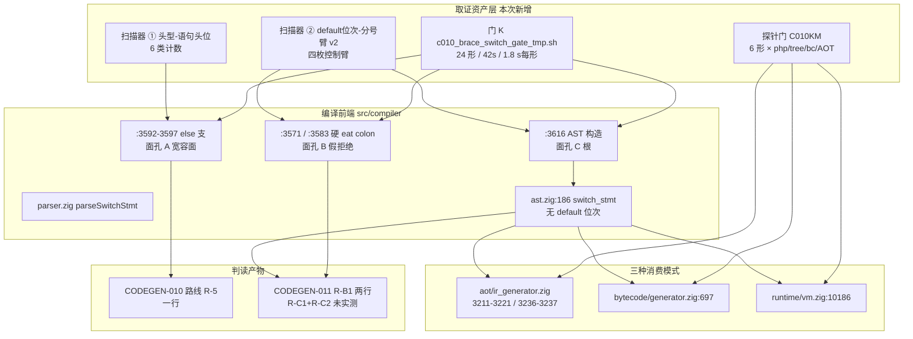
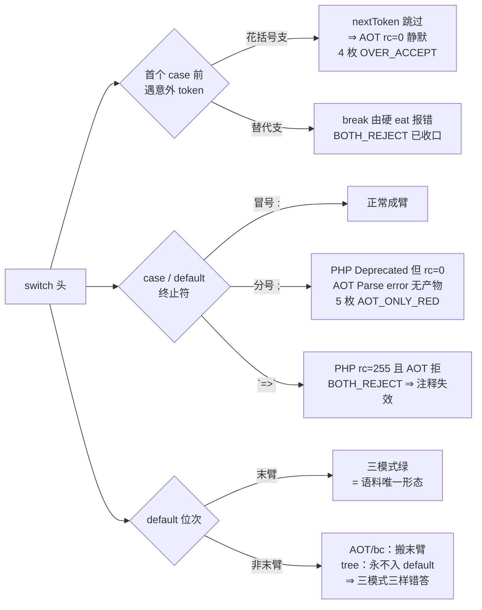
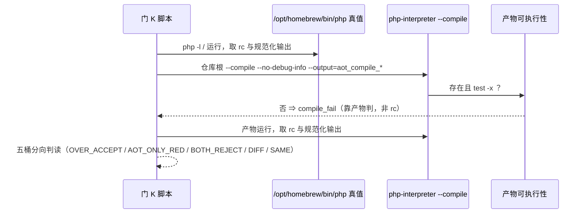

# AOT-CODEGEN-010 · 任务 #126 取证轮：永久侧门 K（花括号 `switch` 与 `case` 臂族）+ 跨模式探针 C010KM ⇒ §7-15c 量化为 4 枚宽容面，另立 AOT-CODEGEN-011（面孔 B／C）

> 工单：[AOT-CODEGEN-010 §3.7](../../known-issues/AOT-CODEGEN-010-keyword-case-insensitive-lexer.md)（面孔表 + 六形补充 + 跨模式补记 + 语料面穷举）／新立工单 [AOT-CODEGEN-011](../../known-issues/AOT-CODEGEN-011-switch-case-semicolon-terminator-and-default-arm-position.md)
> 任务号：本会话 #126 ｜ 性质：**只读取证**（`继续推进` 授权范围内）⇒ **零 `src/` 改动、零提交**
> 代次：`src/compiler/parser.zig` md5 `5ad452fe4bc250b4732cbb3a2827b28a`（4288 行）／二进制 `81f8a55a989f9a793fec2f75c32fd37d`／仓库基线 commit `f9432e23`（与 §3.6 R-3 批**同代次** ⇒ 本轮读数可直接对接 R-3 终态，无需重跑验收链）

---

## 1. 高层摘要（TL;DR）

§7-15c 登记的花括号 `switch` 宽容面原来只有 **1 枚形 + 一句未实测推断**（「`is_alternative` 门控可保证对 68 语料零扰动」）。本轮把它取证到「**面孔穷举 + 语料面穷举**」：

1. **新建永久侧门 K**（24 形 = 正例 14 + 负例 10，`ELAPSED=42s` ⇒ **1.8 s/形**，本单最便宜的门）。注册读数：`C010K_DONE shapes=24 same=8 over_accept=4 diff_php_ok=1 both_reject=6 aot_only_red=5 run_red=0 repo_build_residue=0 SMOKE_ONLY=0`；与首轮快照去掉 `ELAPSED` 行后 **`diff_rows=0`**（24 数据行 + 7 表头逐字节全等）。⇒ 面孔 A 由 1 枚扩到 **4 枚 `OVER_ACCEPT`**，其中 `k_stray_endswitch` 不是空输出而是**照跑并打 `z`**（跳过关闭标记后语义继续）。
2. **同一段代码的反方向也有面**：门 K 硬守卫列 `aot_only_red=5` **非 0** ⇒ PHP 合法的 `case 1;`／`default;`（8.5 仅 Deprecated、rc=0 且臂体照常执行）被 AOT **假拒绝编译**。根因到行 `parser.zig:3571`/`:3583` 的 `_ = try self.eat(.colon); // or .fat_arrow` **硬只认冒号**；且该注释声称的「or .fat_arrow」实测**方向相反**（`case 1 => echo` 在 PHP 自己就 rc=255 ⇒ 门 K `k_case_arrow` 判 `BOTH_REJECT`）。
3. **第三张面孔与 A／B 不同根**：`default` 臂的**源码位次在 AST 层就不存在**（`parser.zig:3616` 的 `{expression, cases, default}` × `ir_generator.zig:3211-3221`/`:3236-3237` 把 default 强制链成末臂）。六形实测给出两重后果 —— 丢 default 后的 fall-through，以及**末位 case 的体尾错落进 default（PHP `C` / AOT `CD`，即执行了 PHP 不执行的语句）**。
4. **语料面三张面孔全为 0**：两枚独立 `token_get_all` 分词器扫描器互证（249 文件、`switch=7`、花括号头 `7`、替代头 `0`、`stmt_before_first_case=0`、`nonlast_default=0`、`semi_arm=0`，对照 `colon_arm=37` 自证判别力）⇒ 冻结基线对这三面**零保护力**，而**机制完全可达**（判据 3/4）。扫描器 ② 走了一次 v1→v2 修复（v1 把 enum/match 的 `case`/`default` 误记为 switch 臂 ⇒ `semi_arm=87` 全为假阳性，**v1 读数全废**）。
5. **跨模式探针门 C010KM**（6 形 × `php`/`--mode=tree`/`--mode=bytecode`/AOT，`ELAPSED=13s`，路径归一后跨 run `diff_rows=0`）实测三条：面 B 的修复点在三模式**共享**的前端；面 C 呈「**三模式三样错答**」（`c_middle_default`：PHP `adb`／tree `ab`／bc `abd`／AOT `abd`）；★★ **连控制臂（default 已在末臂）在 tree 模式都是红的**（`vm.zig:10186` 的 default 支条件为 `if (!matched …)` ⇒ 解释器模式**永不 fall-through 进 default**）。副产品：`--mode=tree`／`--mode=bytecode` **对解析失败静默吞掉**（rc=0、零输出、无错误行）⇒ 任何只看 rc 的 VM 腿会把编译失败读成绿。
6. **归属切分**：面孔 A 留本单（§5 路线 **R-5**，一行：`:3595` 去掉 `is_alternative and`）；面孔 B／C **已另立 AOT-CODEGEN-011**（路线 R-B1／R-C1+R-C2，待裁决 D-1…D-4）。**三张面孔的落地全部待老铁点头**（宪法 §六）。

---

## 2. 影响范围

| 层面 | 影响 | 描述 |
|---|---|---|
| `src/` 源码 | **零改动** | 本轮为只读取证；三处修复点位（`:3595`／`:3571`+`:3583`／`ast.zig:186` × IR）仅**定位到行**，未编辑 |
| 编译前端（Parser） | **面定位** | `parseSwitchStmt` 内 `:3592-3597` 的 `else` 支（面孔 A）、`:3571`/`:3583` 的硬 `eat(.colon)`（面孔 B）、`:3616` 的 AST 构造（面孔 C 根） |
| AST / IR / VM / bytecode | **面定位** | `ast.zig:186` 缺臂序字段 ⇒ 三模式消费点各自重演：`ir_generator.zig:3211-3221`+`:3236-3237`（AOT）、`bytecode/generator.zig:697`（bc）、`vm.zig:10186`（tree） |
| 冻结基线 68 语料 | **零扰动（未触碰）** | 语料三面暴露面实测全 0（`pass/` 内 4 枚花括号 switch 站点逐处回文核对：`f048:118` default 末臂、`f134:94`、`f134:160`、`f163:133` 无 default）⇒ 影子/主回归无需重跑 |
| 解释器 / 字节码模式 | **发现两张新面，按 §五 只登记不修** | 面 C 在 tree 侧连控制臂都红；tree/bc 对解析失败静默吞掉。是否一并修 = 011 的 D-1/D-3 |
| 门与资产 | **+4 组永久资产** | 门 K（脚本/表/首快照）、两枚语料扫描器（脚本/读数）、跨模式探针门 C010KM（脚本/读数）、新工单 011 |

---

## 3. 核心变更（本轮全部为取证资产，非代码变更）

| # | 变更 | 落地前状态 | 本轮实测后状态 | 实测效果 |
|---|---|---|---|---|
| 1 | 建永久侧门 K（**新门文件，禁扩已注册门 J**） | §7-15c 仅 1 枚形、无门 | 24 形门，`6408a6b6…`／表 `b3eb6e91…`／首快照 `6f4e9f8b…` | `over_accept=4`、`aot_only_red=5`、`diff=1`、`both_reject=6`、`same=8`；跨 run `diff_rows=0` |
| 2 | 语料扫描器 ①（头型／语句头位） | 无 | `d7a2ccdc…`／读数 `a999224a…` | `GRAND switch=7 brace=7 alt=0 stmt_before_first_case=0` |
| 3 | 语料扫描器 ②（default 位次／分号臂）**v1→v2 修门** | v1 全树 `T_CASE`/`T_DEFAULT` 误当 switch 臂 | v2 按 switch/enum token 区间分类 + 终止集扩 `:` `;` `=` `=>` `,` + 四枚控制臂 | `nonlast_default=0 semi_arm=0 colon_arm=37`；同输入合成控制 `semi_arm 6→6`、`nonlast_default 4→3` ⇒ 修 scanner 只收窄假阳性 |
| 4 | 面孔 C 六形扩测（门内 1 枚 → 定面） | 只有 `k_default_first` | 六形表（含控制臂 default 末臂 SAME） | 分界实测为「default 是否位于末臂」，与花括号／替代语法无关 |
| 5 | 跨模式探针门 C010KM | 无跨模式取证通道 | `973996ef…`／读数 `52f32f9d…`，6 形 × 4 侧 `ELAPSED=13s` | 三模式三样错答 + tree 控制臂红 + VM 静默吞解析失败 |
| 6 | 工单归属切分 | 三面拟并 §7-15c 讨论 | A→本单 R-5；B/C→**已立** AOT-CODEGEN-011 | 本单 §3.7 面孔表归属列、§5 R-5 行 + 委托行、§7-15c/15e/15f、§6 复测命令全部同步 |

---

## 4. 可视化概览

### 4.1 分层与业务映射（Code & Logic Map）



### 4.2 面孔分派流程（同一 `parseSwitchStmt` 内三向）



### 4.3 执行流程（门 K 单形判定，规则 21 口径）



---

## 5. 详细变更分析

### 5.1 涉及文件列表（本轮新增／修改）

| 文件 | 类型 | md5（脚本定稿后取值） | 说明 |
|---|---|---|---|
| `fuzzy_scripts_720/tmp/c010_brace_switch_gate_tmp.sh` | 新增门（永久侧门 K） | `6408a6b6f32d73367fa8e458a8ee249b`（142 行） | 24 形 × 五桶，`repo_build_residue` 守卫 |
| `fuzzy_scripts_720/tmp/c010_brace_switch_tmp.tsv` | 注册读数 | `b3eb6e913edbc774a8b95a3fe61f0613`（33 行） | 表头四戳 + `gate_rev=v1` + 列契约 |
| `fuzzy_scripts_720/tmp/c010k_presnap/c010_brace_switch_gen1_tmp.tsv` | 首轮快照 | `6f4e9f8b2d119b8cb5c08f694cfbca7a` | 与注册表仅 `ELAPSED` 一行不同（43s／42s） |
| `fuzzy_scripts_720/tmp/c010k_brace_switch_corpus_scan_tmp.php` / `.txt` | 扫描器 ① | `d7a2ccdc0a3002cacfe0d7c0cd858a04` / `a999224aba026cd5bf6096cf31d3e639` | 头型／首 case 前语句位 |
| `fuzzy_scripts_720/tmp/c010k_case_order_terminator_scan_tmp.php` / `.txt` | 扫描器 ②（**v2**） | `83247654ada70c9b587181869753af66` / `653fc553cf255214fc0f50254ad2d628` | default 位次／分号臂；v1 读数全废 |
| `fuzzy_scripts_720/tmp/c010km_crossmode_probe_tmp.sh` / `.txt` | 跨模式探针门 | `973996ef88c6db340871dc9402682c42`（53 行） / `52f32f9d0d71bf350e522f1b89ac8b5b`（27 行） | 6 形 × 4 侧，`RESID=0` |
| `docs/known-issues/AOT-CODEGEN-011-switch-case-semicolon-terminator-and-default-arm-position.md` | 新工单 | — | 面孔 B／C 的完整代次锚点、路线与待裁决 |
| `docs/known-issues/AOT-CODEGEN-010-keyword-case-insensitive-lexer.md` | 工单同步 | — | §3.7 全节、§4 语料面新行、§5 R-5 行 + 委托行、§6 门 K 复测块 + 两枚扫描器命令、§7-15c/15e/15f、状态行 |
| `src/**` | **零改动** | — | `parser.zig` 仍为 R-3 代次 `5ad452fe…` |

### 5.2 三张面孔的机制与描述（变更点描述）

| 面孔 | 形 | PHP 真值 | AOT 实测 | 机制 | 修复点与行数 |
|---|---|---|---|---|---|
| **A** 宽容 | `k_stmt_before_case`／`_two`／`k_nested_stmt_head`／`k_stray_endswitch`（4） | rc=255 `unexpected token "…", expecting "case" or "default" or "}"` | rc=0；前三枚空输出，末枚**照跑并打 `z`** | `parser.zig:3592-3597` 的 `else` 支只在 `is_alternative and strict_alt_closers` 时 `break`，花括号支保留 `self.nextToken()`；随后 `:3611 _ = try self.eat(.r_brace);` 仍成立 | **R-5**：`:3595` 去掉 `is_alternative and`（**一行**，本单） |
| **B** 假拒绝 | `k_case_semi`／`_fall`／`k_default_semi`／`k_case_semi_alt`／`k_case_semi_two_arms`（5） | Deprecated 警告 ×2/臂，**rc=0 且臂体执行**（`S`/`T`/`D`/`Q`/`b`） | **无产物**，`Parse error: syntax error, unexpected ";", expecting ":"` | `parser.zig:3571`（case 臂）与 `:3583`（default 臂）硬 `eat(.colon)`；注释「or .fat_arrow」实测失效（`=>` 侧 PHP 自己就拒） | **R-B1**：两处改「`:` 或 `;` 取一」（**两行**，011 单，D-1 必答） |
| **C** 语义（臂序丢失） | `k_default_first` + 六形补充（含控制臂） | 按源码臂序执行 fall-through | ① default 体尾不落进后续 case；② 末位 case 体尾错落进 default（PHP `C` / AOT `CD`）；③ default 被搬到末臂位（PHP `adb` / AOT `abd`） | `parser.zig:3616` ⇒ `ast.zig:186` 无位次 × `ir_generator.zig:3211-3221`（`case_blocks.items[i+1]`）/`:3215-3217`（末臂才接 default）/`:3236-3237`（default 尾恒 `br merge_block`） | **R-C1**（AST 加位次）+ **R-C2**（IR 重链），**成本未实测**；跨模式面 **R-C3** 待 D-3 |

### 5.3 语料面穷举（判据 3/4）

| 语料 | 文件 | switch | 花括号头 | 替代头 | 首 case 前有语句 | default 非末臂 | 分号臂 | 冒号臂 |
|---|---|---|---|---|---|---|---|---|
| `fuzzy_scripts_720/pass/`（冻结基线） | 68 | 4 | 4 | 0 | **0** | **0** | **0** | 20 |
| `fuzzy_scripts_720/fail_runtime/` | 77 | 1 | 1 | 0 | 0 | 0 | 0 | 4 |
| `fuzzy_scripts_720/fail_compile/` | 12 | 0 | 0 | 0 | 0 | 0 | 0 | 0 |
| `fuzzy_scripts/`（旧语料） | 42 | 0 | 0 | 0 | 0 | 0 | 0 | 0 |
| `fuzzy_scripts_715/` | 50 | 2 | 2 | 0 | 0 | 0 | 0 | 13 |
| **GRAND** | 249 | **7** | **7** | **0** | **0** | **0** | **0** | **37** |

两枚扫描器对 `switch`／花括号头／替代头三项独立计数**逐项全等**（7／7／0）⇒ 互证。三面「语料内」暴露均为 0、「机制可达」均为完全可达；控制侧 `colon_arm=37` 证明扫描器有判别力（非恒零）。

### 5.4 跨模式读数（C010KM，四侧对照）

| 形 | PHP | tree | bytecode | AOT |
|---|---|---|---|---|
| `b_case_semi`（`case 1;`） | Deprecated + `S`（rc=0） | **rc=0 零输出** | **rc=0 零输出** | compile_fail（有 `Parse error` 日志） |
| `b_default_semi`（`default;`） | Deprecated + `D` | rc=0 零输出 | rc=0 零输出 | compile_fail |
| `c_default_first` | `DC` | `D` | `D` | `D` |
| `c_lastcase_fall_into_default` | `C` | `C` ✅ | `CD` ❌ | `CD` ❌ |
| `c_middle_default` | `adb` | `ab` ❌ | `abd` ❌ | `abd` ❌ |
| `c_ctl_default_last`（控制臂） | `abd` | `ab` ❌ | `abd` ✅ | `abd` ✅ |

⇒ ★★ 控制臂在 tree 侧亦红（根 `vm.zig:10186` 的 `if (!matched and …)`）；⇒ tree/bc 的 rc=0 零输出是**解析失败被静默吞掉**（另测缺 `}` 的 `if` 同现象），与 §7-5 同族但更危险。

### 5.5 门与扫描器的自我证明（先修门、后引用）

- 门 K 跨 run：注册表 vs 首快照去 `ELAPSED` ⇒ `diff_rows=0`。
- C010KM 跨 run：把 `/private/tmp/c010km.XXXXXX` 路径归一后 `diff_rows=0`（`b_*` 两行的 Deprecated 原文含临时路径，非归一则必报假差）。
- 扫描器 ②：v1→v2 **同输入合成控制** `semi_arm 6→6`、`nonlast_default 4→3`（差的正是被修掉的过计），并配四枚控制臂（match `default =>` 不计 SEMI、enum 带值 `case` 不计 SEMI、合成 `switch(1){case 1;}` 必须计 SEMI、嵌套 switch 外层末臂 default 不得计非末臂）。
- C010KM 脚本头注释修订后 md5 变更 ⇒ **重跑并重新取值**（13s），确保注册读数属于定稿版本。

---

## 6. 影响与风险评估

| 项 | 判定 |
|---|---|
| 是否破坏式变更 | **否**。零 `src/` 改动、零基线扰动、零提交；新增资产全部在 `fuzzy_scripts_720/tmp/` 与 `docs/` |
| 影响范围 | 三处修复点位已被**钉死到行**（`:3595`／`:3571`+`:3583`／`ast.zig:186` × `ir_generator.zig` 三站点 × `vm.zig:10186`），后续落地批无需再归因 |
| 特别注意点 1 | **门 K 不是守卫门**：`aot_only_red=5` 自建成即非 0（面 B 为已知红面）。引用时禁止把该列读成「本轮新增回归」；面 B 收口后该列应 `5→0`，届时判据需同时盯 `over_accept` 与 `aot_only_red` 两列 |
| 特别注意点 2 | 面 A 的硬化点 `:3595` 与已落地的 R-3 支路**同处一段代码**，改动虽是一行，但会把花括号 `switch` 纳入 `strict_alt_closers` 语义 ⇒ 语料 7 枚花括号 switch 全在该构造族内，**影子 68/68 仍须实测**（语料面 0 不等于影子面 0） |
| 特别注意点 3 | 面 B 落在**三模式共享的 `parser.zig`** ⇒ 直改会改变 tree/bytecode 结局（从 rc=0 零输出变为真的执行）；宪法 §五 要求先裁决（011 的 D-1） |
| 特别注意点 4 | 面 C 需动宪法 §一 超大文件 `ir_generator.zig`（改前必须 grep 既有模式）+ AST 形态（`switch_stmt` 三处消费点）⇒ **不可与 A/B 同批**，成本未实测 |
| 特别注意点 5 | tree 侧控制臂红意味着「基线绿只覆盖 AOT/bc 侧」；若只按 §五 修 AOT，三模式对同一脚本仍将给出三种答案，复测时**必须以 `/opt/homebrew/bin/php` 为唯一真值** |

**复测路径（体验流程，全部仓库根执行，均带 timeout）**：

```bash
# ① 门 K（24 形，≈42s）—— 面 A 落地的验收位：over_accept 4→0
timeout 300 bash fuzzy_scripts_720/tmp/c010_brace_switch_gate_tmp.sh

# ② 跨模式探针（6 形 × 4 侧，≈13s）—— 面 B/C 的 D-1/D-3 取证件
timeout 120 bash fuzzy_scripts_720/tmp/c010km_crossmode_probe_tmp.sh

# ③ 语料面复跑（两枚扫描器，≈2s / ≈4s）
timeout 90 php fuzzy_scripts_720/tmp/c010k_brace_switch_corpus_scan_tmp.php
timeout 90 php fuzzy_scripts_720/tmp/c010k_case_order_terminator_scan_tmp.php

# ④ 任一落地批：沿用 §3.6 实测链 六门 16m18s + 主回归 13m50s + 影子 26m25s = 56m33s
```

---

## 7. 遗留 / 潜在问题

1. **三张面孔全部「取证完成、落地待点头」**（§六-2）：面 A 一行、面 B 两行、面 C 三处同动；未获点头前 §7-15c 不得判为已收口。
2. **面 C 的六枚实测形中有两枚未进门**（未匹配走 default 的 `db`/`d`、多臂 `dbc`/`d`）仍为一次性 `/tmp` 形 ⇒ 011 落地前应先固化（否则复测不可比）。
3. **门 K 的 `same=8` 含空输出臂**（`k_empty`/`k_default_empty` 两侧皆空）⇒ 该两枚判别力弱，落地后需补生成码侧核对。
4. **扫描器 ② v2 的已知低估边界**：臂序列以花括号深度为界 ⇒ 替代语法体内嵌套的花括号 switch、`case 1: { … }` 花括号臂体内的臂不计入外层（二者语料面均为 0）。
5. **`--mode=tree`／`--mode=bytecode` 静默吞解析失败**：按 §五 只登记不修（属非 AOT 模式），但它使任何「只看 rc」的 VM 腿失真 —— 已在 011 §7 登记，并再次支撑记忆口径「compile_fail 只能靠产物存在性判定」。
6. **`parser.zig:3571`/`:3583` 注释失效**（声称支持 `=>`，实测 PHP 自己就拒 `=>` 而 AOT 拒 `;`）⇒ 修复批需同步改注释，禁止留下误导锚点。
7. **Deprecated 消息面**（面 B 收口后 PHP 打 2 行/臂、AOT 侧消息措辞未必对齐）列为 P2，非等值判据，但会污染「输出逐字节等值」的门 —— 与 §7-13 的重复警告行同族。
8. **PHP 版本依赖**：面 B 的「Deprecated 但 rc=0」是 PHP 8.5 行为（9.0 移除）⇒ 真值二进制固定 `/opt/homebrew/bin/php`（8.5.8），换版本需重跑门 K 的 5 枚 `b_*` 判定。
9. **本轮所有资产未提交**（未获「提交」二字）：门 K 三件、两枚扫描器、C010KM 两件、工单 010 修订、工单 011、本变更文档。

---

## 8. 后续开发 / 优化建议

| 优先级 | 建议 | 影响面 | 落地成本 |
|---|---|---|---|
| **P1** | **落地面 A（R-5，一行 `:3595`）**：与 R-3 同段代码、同旗标语义，边际风险最低 | 4 枚 `OVER_ACCEPT` → 收敛为 `BOTH_REJECT`；语料面 0 | **实测**：改动 1 行；验收 = 门 K `over_accept 4→0` + 既有链 **56m33s**；门 K 本身 42s |
| **P1** | **先裁决再落地面 B（R-B1，两行）**：D-1 决定「直改共享前端」vs「旗标门控只改 AOT」 | 5 枚 `AOT_ONLY_RED_COMPILE`（假拒绝，比宽容更致命）；若直改，tree/bc 从 rc=0 零输出变为真执行 | **实测**：改动 2 行；验收链同上可复用；须同步修 `// or .fat_arrow` 失效注释 |
| **P2** | **面 C 走设计轮再定 AST 形态**（R-C1 `ast.zig:186` 位次字段 vs 把 default 塞进 `cases` 序列）+ R-C2 IR 重链 + R-C3 跨模式裁决 | 语义正确性（含「执行 PHP 不执行的语句」）；基线零保护 ⇒ 无回归数据可依 | **未实测**（需动超大文件 `ir_generator.zig`，先 grep `switch_data.default` 全部消费点） |
| **P2** | 把面 C 剩下两枚一次性形固化进门（或建 011 的常驻验收门） | 复测可比性 | 门改动，≈1 小时；单形 AOT 编译 1.8 s/形 |
| **P2** | 面 B 收口后补一枚**生成码侧**核对（避免 `k_empty` 式弱判别） | 判据强度 | 零 src 改动 |
| **P3** | 把 `--mode=tree`／`bc` 静默吞解析失败作为独立小票评估（若老铁同意扩到非 AOT 模式） | 所有 VM 腿判据可信度 | 未实测 |
