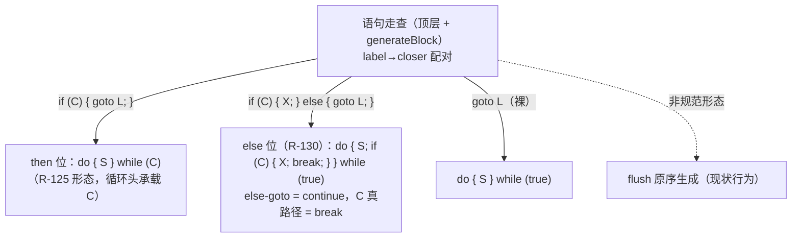

# AOT-CODEGEN-010 else 位 goto closer 降级 + 枚举 redeclare 名词_R130_2026-10-11_fbe6382a

## 1. 高层摘要（TL;DR）

1. **goto 降级的最后一种规范形态（else 位 closer）落地**：`L: S…; if (C) { X…; } else { goto L; }` ≡ `do { S…; if (C) { X…; break; } } while (true);`（严格等价：else-goto = 循环 continue，C 真路径 = break）——形态族先经 w2/w3 探针证实为 do-while 渲染路径原生支持再实施。
2. **枚举重复声明名词修正**：redeclare 消息名词 class → 按 is_enum 输出 `enum`（e2/e3 探针 AOT 与 PHP **逐字节一致**）。
3. **验收**：门 D8 `defect_red=0 guard_same=14` 保持（then 位形态零扰动）；e5 `le3`、e6 多语句 then `aaa!`、e7 then 位回归 `t3` 全绿；影子 68 语料 md5 **68/68 一致**；主回归 **Pass 67 / Skip 1**。
4. 至此 goto 降级覆盖**全部三种规范闭合形态**（then 位裸 closer / then 位条件 closer / else 位 closer）+ 前向 goto 尾随语句修复；非规范形态（双 goto 连发等）维持登记（发射器 goto 形状改造，#122d 定论）。
5. 本轮源码 `ir_generator.zig`（检查器双形态化 + 降级函数双形态）与 `runtime_lib_template.zig`（枚举名词）。

## 2. 核心变更

| # | 变更 | 位置 | 内容 |
|---|---|---|---|
| 1 | `GotoLoopCloser` 双形态 | ir_generator.zig | `{cond_idx, then_stmts, in_else}`：then 位（现行，cond 在循环头）/ else 位（新增，cond 恒真 + closer-if 在体尾） |
| 2 | `gotoLoopCloserInspect` | ir_generator.zig | then 位判据不变；else 位判据 = else 块首语句为 goto L（尾随死语句丢弃）⇒ then 位语句为循环体内真实路径 |
| 3 | 降级函数双形态 | ir_generator.zig `generateGotoLoopLowering` | else 位：体尾发射 `if (C) { X…; br exit } else { br cond }`（标准 if_then_/if_else_ 命名，w2/w3 形态族） |
| 4 | 枚举 redeclare 名词 | runtime_lib_template.zig ×2 | noun 链补 `is_enum → "enum"` |

## 3. 可视化概览（Code & Logic Map）

## 4. 验收读数（链 X）

| 门 | 读数 |
|---|---|
| D8 | `defect_red=0 guard_same=14`（then 位零扰动） |
| E/F/G/H/H2/I | 与 R-129 代注册值一致 |
| 影子 | `total=68 same=68 diff=0`（上轮注册签名漂移已重冻结） |
| 主回归 | Total 68 / Pass 67 / Skip 1 |
| 探针 | e5 `le3` ✅ e6 `aaa!` ✅ e7 `t3` ✅ e2 枚举消息逐字节一致 ✅ |

## 5. 遗留与建议

| 优先级 | 事项 |
|---|---|
| **P0** | 「提交」：分票点名（R-3/R-5 parser 批 / R-125~R-130 goto+CI 批 / 012 工单 / 门十二座 / 文档） |
| P2 | 非规范 goto（双 goto 连发等）——发射器 goto 形状改造（#122d 定论，独立评审） |
| P2 | 类名注册侧枚举/接口名词的 redeclare 已对齐；`class_alias` 族未探（登记） |
