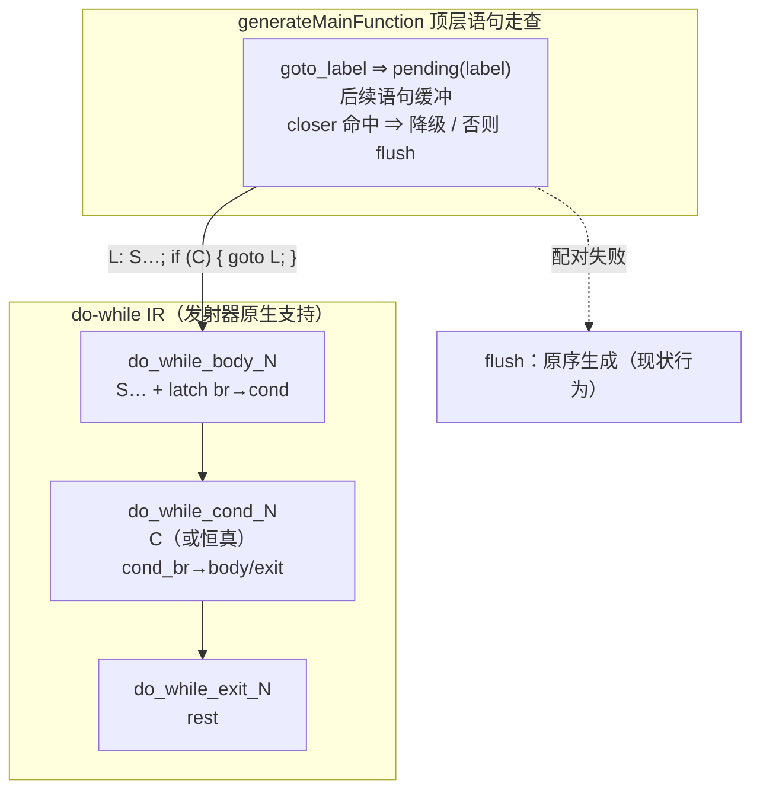

# AOT-CODEGEN-010 goto 降级批（§8 #3 关闭，defect_red=0）_R125_2026-10-11_fbe6382a

## 1. 高层摘要（TL;DR）

1. **§8 最后一枚独立缺陷 #3（goto）修复落地**：门 D8 `defect_red=0 guard_same=14` —— 工单 §8 七枚**全数关闭**；门 H 主群终态 **face=0 noface=79 confounded=0**、反例组 **inverse_face=0**（开局 59 红/15 红）。
2. **形态**：不触碰结构化发射器（#122d 子轮已证其无法表达非相邻 br）——在 `generateMainFunction` 顶层语句走查加 **label→closer 配对**，把规范后向 goto 降级为 **do-while IR**（`L: S…; if (C) { goto L; }` ≡ `do { S…; } while (C);` 严格等价；块名 `do_while_*` ⇒ 发射器既有机制原生出码）。
3. **验收（链 V，合并态 = 本批 + 并行会话 R-3/R-5）**：影子 68 语料 `main.zig` md5 **68/68 一致**（语料 goto 0 处 ⇒ 零漂移）；门 I **tree/bc 四项读数逐项不变**（改动全在 AOT IR 层）；门 H2/J/K/L 读数与 R-5 代注册值一致；主回归 **Pass 67 / Skip 1** 保持。
4. **附带收益**：前向 `goto L; L: …` 的历史尾随语句丢失（`12` vs PHP `123`）经 flush 路径一并修复。
5. 本轮源码仅 `ir_generator.zig` +137 行（配对走查 + 三助手）；工作树现有**两批未提交**：并行会话 R-3/R-5（parser +81/−6）+ 本批（ir_generator +137/−0），提交消息须分别点名。

## 2. 影响范围

| 维度 | 范围 |
|---|---|
| 执行模式 | 仅 AOT（ir_generator 为 AOT 专属；门 I tree/bc 逐项不变实证） |
| 语法面 | 顶层作用域的规范后向 goto（`L:` + 平铺语句 + 单 goto/单 if-goto 闭合）；语料 goto 0 处 |
| 不覆盖（登记边界） | 函数体/花括号块内 goto 循环、双 goto 连发、带 else 的 closer、多标签 —— 均维持现状行为 |
| 门资产 | 门 D8 刷新 `defect_red=0`；门 H confounded 1→0 |

## 3. 核心变更（ir_generator.zig +137/−0）

| # | 变更 | 位置 | 内容 |
|---|---|---|---|
| 1 | label→closer 配对走查 | `generateMainFunction` 顶层循环 | `goto_label` 起 pending；后续语句缓冲；命中闭合形态即降级；`goto_label`/非配对 goto ⇒ flush 后按原序 |
| 2 | `gotoLoopCloserCondition` | 新增助手 | 判据 = if 无 else 且 then 块仅含一条 goto L ⇒ 返回条件节点 |
| 3 | `generateGotoLoopLowering` | 新增助手 | 镜像 `generateDoWhileStmt`：`do_while_body_`（缓冲语句 + latch br）/`do_while_cond_`（closer 的 C 或恒真，cond_br then=body=goto 回边 / else=exit）/`do_while_exit_`；`goto_labels.put(L → body)`、`loop_stack.push` |
| 4 | `flushGotoLoopBuffer` | 新增助手 | 配对失败按原序生成（标签标记 + 逐条），保持现状行为 |

## 4. 可视化概览（Code & Logic Map）



```mermaid
sequenceDiagram
    participant S as PHP 源
    participant G as ir_generator 走查
    participant E as 发射器（零改动）
    S->>G: $i=0; L: $i++; if ($i<2) { goto L; } echo "t".$i;
    G->>G: label L ⇒ pending；$i++ 缓冲；if(goto L) = closer
    G->>G: 降级 do { $i++; } while ($i<2)（goto_labels L→body）
    G->>E: do_while_* 块图（既有渲染机制）
    E->>E: 影子 68/68 零漂移；门 D8 d3a 转绿
```

## 5. 详细变更分析

| 层 | 变更点 | 设计约束 |
|---|---|---|
| IR 生成层 | 配对走查（仅顶层） | 判据收紧：closer 必须无 else 且 then 仅一条 goto L；非规范形态 flush 保持现状 ⇒ 行为面增量仅限规范形态 |
| IR 生成层 | do-while 镜像 | 块图/命名/loop_stack/goto_labels 与 `generateDoWhileStmt` 逐项对齐 ⇒ 发射器零改动 |
| 语义 | `goto L` = 重跑 S | `goto_labels.put(L → body)`：体内嵌套 goto 解析为重跑边；closer then 位由 while 结构承担 |
| 门资产 | D8 defect_red=0；H confounded=0 | GUARD_SAME 控制臂全程未动；§8 七枚终局关闭 |

## 6. 影响与风险评估

- **是否破坏式变更**：否。语料 goto 0 处 ⇒ 影子 68/68、主回归 Pass 67/Skip 1、门 I tree/bc 逐项不变。
- **需要特别注意**：①降级仅在顶层走查生效——函数体内 goto 循环仍走旧路径（登记边界）；②`has_do_while` 探测使含 goto 循环的 `__main__` 切到状态机发射路径（switch/match 同款既有路径，已由语料覆盖验证）；③并行会话 R-3/R-5（parser 未提交批）与本批构成合并态，链 V 验证的即合并态——提交时**两批必须分别点名**（工单 §9 口径）。
- **复测路径**：门 D8（`defect_red=0` ✅）→ 链 V 六门+影子+回归（✅）；命令与超时同工单 §6。

## 7. 遗留问题 / 潜在问题

1. 非规范 goto 形态维持现状（双 goto 连发 g4 / 带 else closer / 函数体内循环 / 多标签）——如需全量支持需发射器 goto 形状改造（#122d 定论），P2。
2. 命名参数 CI、运行期查名族折形（`php_is_callable` 等）维持登记。
3. 未提交面：并行会话 R-3/R-5（parser）+ 本批（ir_generator）+ 工单/文档。

## 8. 后续开发 / 优化建议

| 优先级 | 建议 | 影响面 | 落地成本 |
|---|---|---|---|
| **P0** | 明示「提交」：R-3/R-5 与 R-125 分票点名入库 | 资产防丢 | 零成本 |
| **P2** | 函数体/块内 goto 循环：把配对走查下沉到 `generateBlock`（同机制复用） | 作用域扩展 | 单点下沉 + 门复跑 |
| **P2** | 非规范 goto 形态（发射器 goto 形状改造，#122d 定论） | 核心渲染器 | 大改造，需独立评审 |
