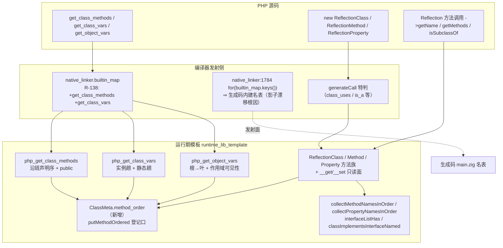
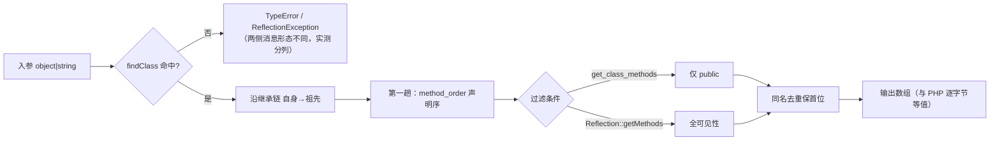
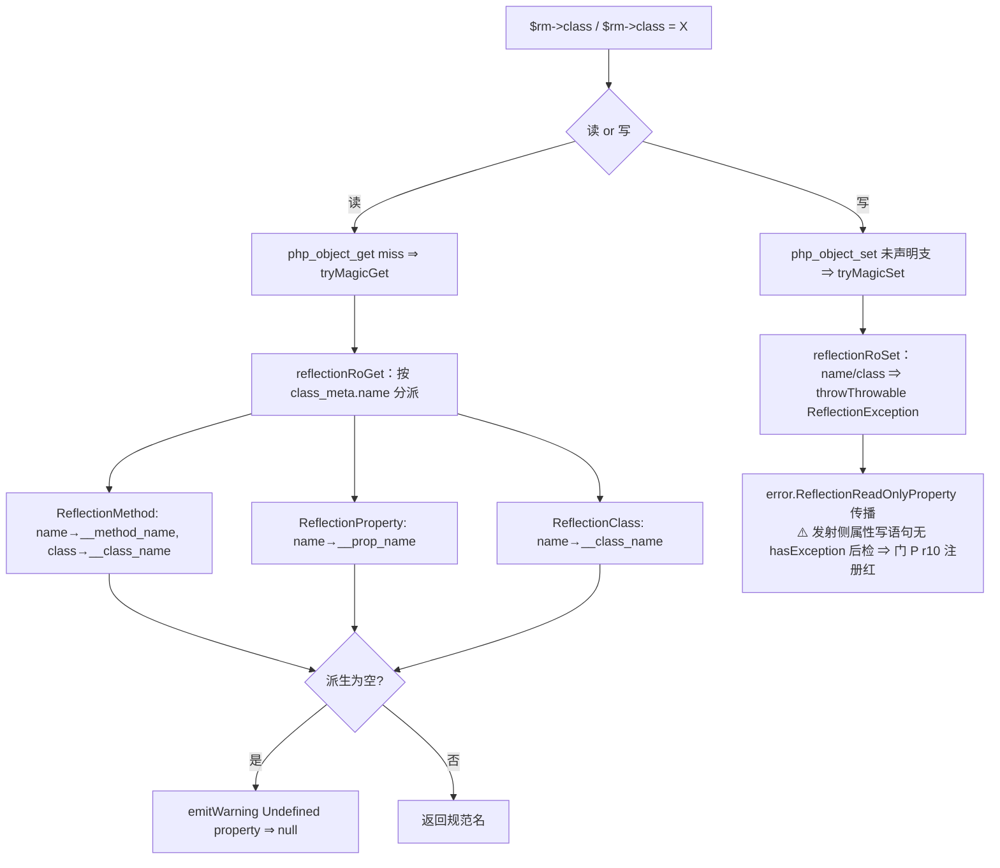
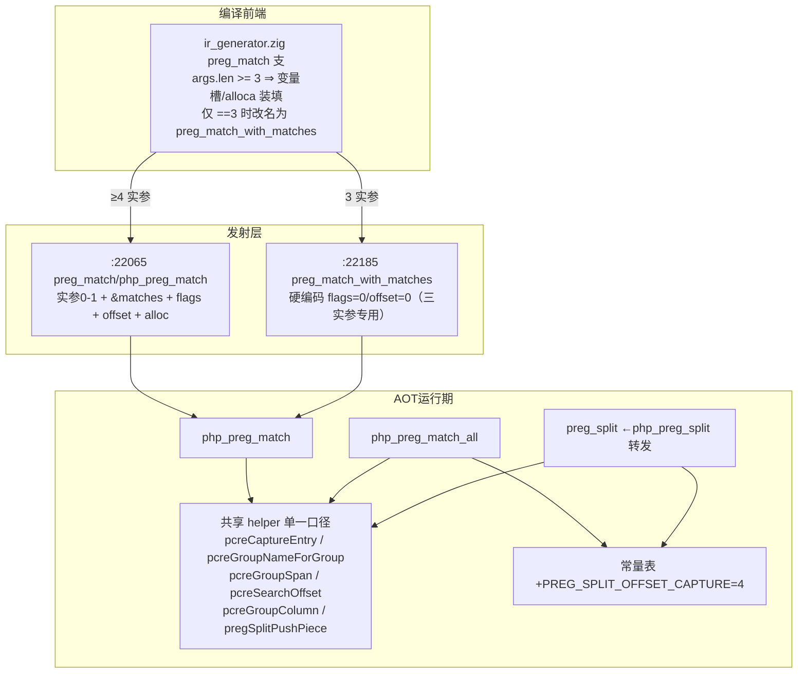
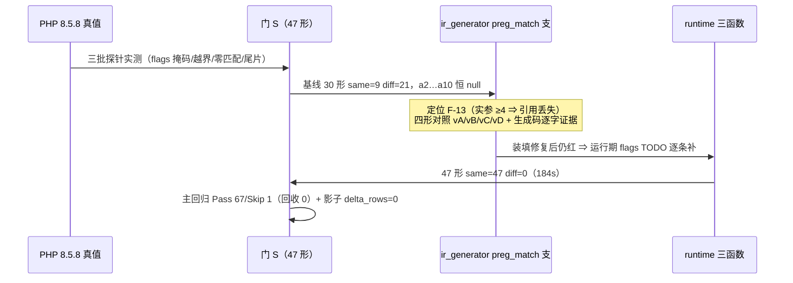
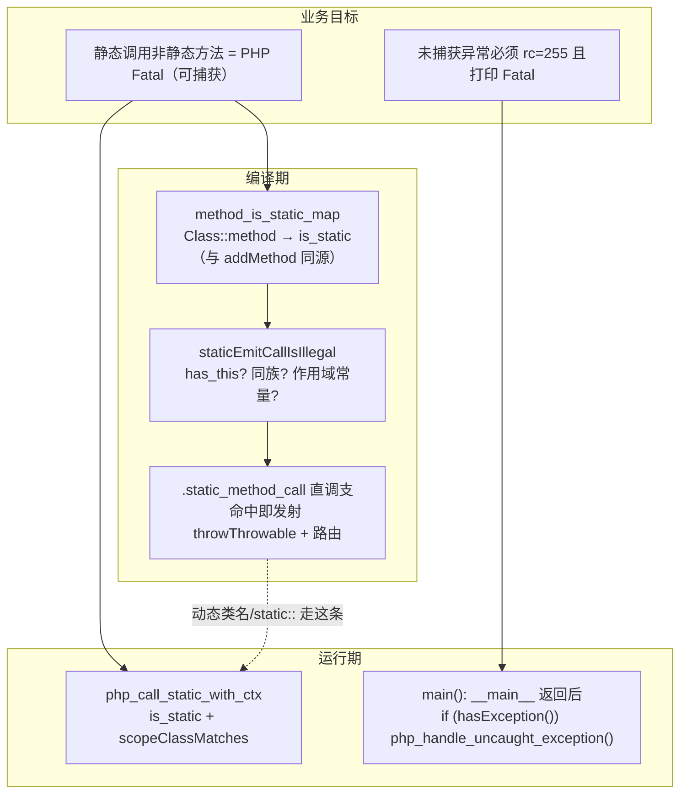
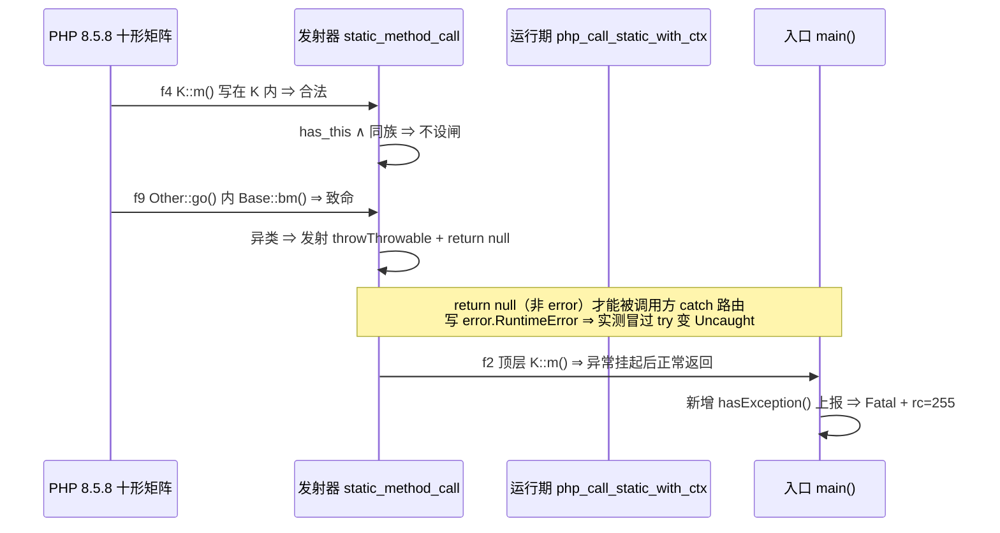
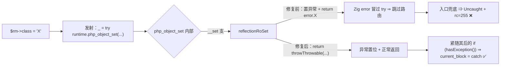
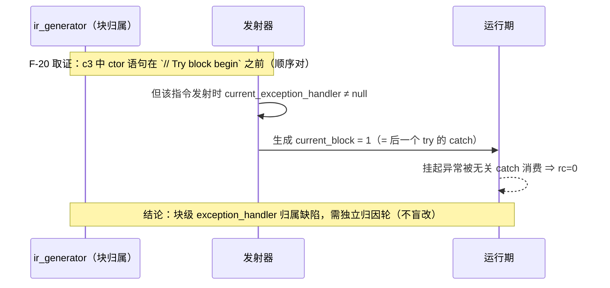
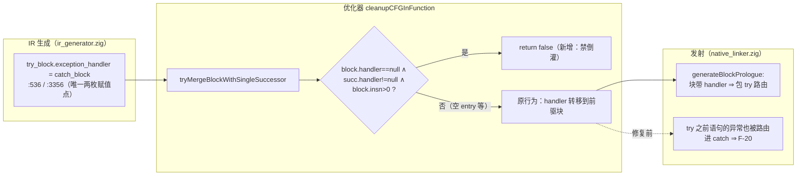

# AOT-CODEGEN-012 · 内省枚举族落地与永久侧门 P（R-138）_2026-10-12_9f3b0b9

## 1. 高层摘要（TL;DR）

1. **本会话从交接文档接手后的唯一入口发现**：R-136/R-137 落地的 Reflection/内省族**没有任何永久门保护**（工单 §11 明示待办），且 §10 记录的 R-137b/R-137c 抛出支**从未入库**（假阳性）。
2. **新建永久侧门 P**（35 形三段）把该族转为常驻守卫，并以它穷举出内省枚举族的真实红面：开局 `same=7 diff=15`（22 形版）→ 落地后 `same=31 diff=4`，4 枚差异恰为三族**新立面孔**（注册红）。
3. **九项落地**（全部 AOT-only）：`ClassMeta.method_order` 结构字段 + 内部类 28 处登记口统一、`get_class_methods`/`get_class_vars` 接入 `builtin_map`、三枚枚举函数按 PHP 真值重写（有序 + 可见性 + 继承链）、Reflection 族 CI/语义补齐、只读属性面、R-137b/R-137c 重落。
4. **验收全绿**：门 P 31/35（4 枚注册红）、门 M 19/19、D8 14/14、N 7/7、O 6/6、`zig build test` 21/21 & 326/326、主回归 **Pass 67 / Skip 1 / Fail 0**；影子 `diff=68` 已归因为**发射面预期漂移**且行为等值由主回归独立佐证。
5. **本批未修、已登记待裁决 6 项**（F-1~F-6），其中 **F-4 = `builtin_map` 33 枚重复键可被无关增项静默翻转实现胜者**，属机制级风险。

---

## 2. 影响范围

| 层 | 文件 | 影响描述 |
|---|---|---|
| 运行期元数据 | `src/aot/runtime_lib_template.zig`（+609/−115，含 native_linker 合计 499 净增） | ClassMeta 增 `method_order` 字段；内部类 28 处方法登记改走受序入口；三枚内建枚举函数重写；Reflection 族 12 处语义修正 |
| 编译器发射 | `src/aot/native_linker.zig`（+5） | `builtin_map` 补 `get_class_methods`/`get_class_vars` 两枚条目 ⇒ **所有脚本的生成码内建名表哈希序重排**（影子 68/68 漂移根因） |
| 门资产 | `fuzzy_scripts_720/tmp/c012_reflection_gate_tmp.sh` + `c012_reflection_tmp.tsv` | 永久侧门 P 新建（本批 35 形 / 成本 150s；R-141/142/143 逐轮扩至现行 **39 形**，注册红 4 → 5 枚） |
| 工单 | `docs/known-issues/AOT-CODEGEN-012-...md` | 新增 §12（+100 行）；§10 假阳性内联更正；§11 待办收口；状态行重写 |
| 语料行为 | `pass/` 68 语料 | 对该族 **0 命中** ⇒ 无既有行为扰动；`f130`（fail_runtime）阻塞点后移但未回收 |

---

## 3. 核心变更

| # | 变更 | 位置 | 判据（实测） |
|---|---|---|---|
| C-1 | `ClassMeta.method_order`（默认 `.empty`）+ `putMethodOrdered` 受序登记 + `addMethod` 复用之 + `deinit` 归还 | ClassMeta 定义/init/deinit/addMethod | 门 P n1 `a1\|a2\|tzA\|tzB\|p1\|p2` 与 PHP 逐字节等值 |
| C-2 | 内部类 28 处 `meta.methods.put("X", .{…})` → `meta.putMethodOrdered(.{…})` | Generator/SplFixedArray/SplStack/SplQueue 族 | 改造前后对照：不转换则这些类 `get_class_methods` 变**空数组**（我引入的回归，已闭环防护） |
| C-3 | `builtin_map` 补两枚条目 + 模板侧两枚 2 参 wrapper（口径同 `php_get_object_vars_builtin_wrapper`） | native_linker `builtin_map`；模板 `*_builtin` 之后 | n1–n5/n12 由 Fatal `undefined function` 转绿 |
| C-4 | `php_get_class_methods` 重写：沿链声明序 + public 过滤 + TypeError 消息 | 原 `:4903` | n1/n2/n3/n4/n12 SAME |
| C-5 | `php_get_class_vars` 重写：**两趟**（实例沿链 → 静态沿链）+ public + TypeError（值形态） | 原 `:4940` | n5 `a,b,s=1,2,3`、r3 `3,1,4,2\|2,1\|1,2` SAME |
| C-6 | `php_get_object_vars` 重写：根→叶声明序 + **调用作用域可见性过滤**（复用 `findPropertyDeclaringClass` + `checkPropertyAccess`）+ 动态支防泄漏 | 原 `:4967` | n6/r1/r7 SAME；改造前 AOT 泄漏 protected/private（实测 `b,a,c` vs PHP `a`） |
| C-7 | `ReflectionClass`：ctor 未注册类抛 + 对象实参；`getMethod`/`getMethods`/`getProperties`/`hasProperty` CI+沿链+有序；`isSubclassOf`/`implementsInterface`/`isInstantiable` 语义补齐 | rc_meta 区 | g4–g8、n7、n8、r2、r5、r6 SAME |
| C-8 | `ReflectionMethod`：ctor 规范化 + 存在性抛；`invoke` 静态真调用 + 非静态无对象抛 + 去掉吞异常的 `catch initNull`；`ReflectionProperty` ctor 同上 | rm_meta / rprop_meta 区 | g5/g6、r4、r9 SAME |
| C-9 | 只读属性面 `__get`/`__set` 共享支（一处覆盖 8 个构造点，含 PHP 的 Undefined property 告警复刻） | 模板文件级 + 三枚 meta attach | r8 SAME |
| **R-144 增量** | PCRE flags/offset 全族（§15 详解）；⚠️ **本行原写「F-4/F-5 合并升级为 F-7、真实缺口是 flags/offset 全为 TODO、常量本身已定义」为不完整归因**——除运行期 TODO 外还有一枚**独立的编译器侧缺陷 F-13**（`preg_match` 实参 ≥4 时引用装填丢失），且 `PREG_SPLIT_OFFSET_CAPTURE` **确实缺失**（R-144 已补，值 4 实测） | `ir_generator.zig` preg_match 支 + 模板 `php_preg_match`/`php_preg_match_all`/`preg_split`/常量表 | 门 S 由 `same=9 diff=21` → **47 形 `same=47 diff=0`** |

---

## 4. 可视化概览【Code & Logic Map】

### 4.1 分层架构



### 4.2 业务流程（枚举口径）



### 4.3 执行流程（只读属性面）



### 4.4 时序图（改动前后对照，上层→底层）

```mermaid
sequenceDiagram
    participant U as PHP 脚本
    participant EM as 发射器 native_linker
    participant RT as 运行期 runtime_lib
    participant CM as ClassMeta
    U->>EM: get_class_methods("A")
    Note over EM: 改动前：builtin_map 无此名 ⇒ 生成 undefined function Fatal
    EM->>RT: php_get_class_methods_builtin_wrapper(args, alloc)
    RT->>CM: 沿 parent 链读 method_order
    CM-->>RT: a1,a2,tzA,tzB → p1,p2（声明序）
    RT-->>U: public 过滤后的有序数组（== PHP）
    U->>EM: $o = new SplFixedArray(2); get_object_vars($o)
    EM->>RT: php_get_object_vars
    RT->>RT: findPropertyDeclaringClass + checkPropertyAccess（作用域）
    RT-->>U: 声明属性根→叶；内部槽泄漏登记为 F-3
```

---

## 5. 详细变更分析

### 5.1 端 / 模块层

| 端 | 模块 | 变更点 |
|---|---|---|
| 编译器 | `src/aot/native_linker.zig` | `builtin_map` +2 条目（含归因注释） |
| 运行期 | `src/aot/runtime_lib_template.zig` | 结构字段 1、登记口 1、内部类站点 28、文件级助手 4、内建函数重写 3、Reflection 方法改写 12、只读属性支 2 + attach 3 |
| 资产 | 门 P 脚本 + TSV | 新建（35 形，G/N/R/I 四段 + 注册红清单内置于门头注释） |
| 文档 | 工单 012 | §12 新增、§10 更正、§11 收口、状态行 |

### 5.2 涉及文件清单

- `src/aot/runtime_lib_template.zig`
- `src/aot/native_linker.zig`
- `fuzzy_scripts_720/tmp/c012_reflection_gate_tmp.sh`（新）
- `fuzzy_scripts_720/tmp/c012_reflection_tmp.tsv`（新）
- `docs/known-issues/AOT-CODEGEN-012-class-name-case-insensitive-lookup.md`
- `docs/changes/2026-10-12/交接文档_..._R137.md`（并行会话已 `git add`，本会话仅读）

### 5.3 门 P 形目与读数（终态）

| 段 | 形 | 内容 | 读数 |
|---|---|---|---|
| G（R-136/R-137 守卫） | g1–g8 | 构造规范名 / hasMethod CI / class_uses / ReflectionException / invoke / isSubclassOf / implementsInterface / isInstantiable | 8 SAME |
| N（枚举族探测） | n1–n14 | get_class_methods 五形、get_class_vars、get_object_vars、getMethods/getMethod/getProperties、class_uses 组合、trait 适配、ctor 形态 | 13 SAME + n15 注册红 |
| R（本轮修复自身守卫） | r1–r10 | 可见性双作用域、继承属性、静态分组、ReflectionMethod 规范化、isSubclassOf 同类/未知、implementsInterface 两类抛、只读面 | 8 SAME + r10 注册红 |
| I（内建类保真标记） | i1–i2 | 内建类方法集与内部槽可见性 | 2 注册红 |

---

## 6. 影响与风险评估

| 维度 | 判定 |
|---|---|
| 是否破坏式变更 | **否**（68 语料对该族 0 命中；主回归 Fail(Compile/Runtime/Diff)=0，Pass 67/Skip 1 保持） |
| 生成码影响面 | `builtin_map` +2 ⇒ **全语料 main.zig 名表哈希序重排**（非行为）；影子基线代次需在「提交」后重冻结 |
| 结构体影响 | `ClassMeta` 增字段：四处内部字面量站点已实测**不经 `addMethod`**，取 `.empty` 默认零扰动；`deinit` 已归还 ⇒ 无泄漏 |
| 性能 | `method_order` 仅在类注册期写入（编译期一次性），枚举侧为线性扫描；**属性访问热路径零新增成本**（未给 PHPObject 增插入序字段，见遗留 R-2） |
| 特别注意点 1 | Zig 0.16 `std.ArrayList(T){}` 非法（默认初始化已 deprecated）⇒ 必须 `.empty`；`deinit` 收 `*Self` ⇒ 绑定须 `var`；局部名 `empty` 会与文件内既有声明**遮蔽**报错 |
| 特别注意点 2 | 分发表约定是「位置实参 + allocator」，直连 3 参 `*_builtin` 会生成 arity 不符调用；`needs_allocator=true` 的语义须以 `php_get_object_vars_builtin_wrapper` 为样本 |
| 特别注意点 3 | **F-4**：`builtin_map` 有 33 枚重复键，`preg_split` 两枚条目的实现不同；本批仅新增无关条目即令胜者翻转（实测调用名改变）。本次两实现行为等价（9 形三方对照逐字节相同），但该机制可造成**静默语义翻转** |
| 复测路径 | `bash fuzzy_scripts_720/tmp/c012_reflection_gate_tmp.sh`（**现行 39 形**，判据 `diff` 恰为五枚注册红 `n15 r10 v2 i1 i2`）→ 门 M/D8/N/O → `zig build test` → `bash fuzzy_scripts_720/run_regression.sh` |

---

## 7. 遗留问题 / 潜在问题

| # | 项 | 状态 |
|---|---|---|
| L-1 | F-1 静态调用非静态方法不报错（门 P n15） | 待裁决，成本未实测 |
| L-2 | F-2 属性写语句缺 `hasException` 路由（门 P r10）——抛出与消息本身逐字正确 | 待裁决（热路径加检） |
| L-3 | F-3 内建类方法集与 PHP 不一致（门 P i1/i2；`CachingIterator` 未注册；引擎内部槽对外可见） | 待裁决，独立族 |
| L-4 | F-4 `builtin_map` 33 枚重复键的实现胜者不稳定 | 待裁决，建议先建「重复键普查门」 |
| L-5 | F-5 `preg_split` 空串/`//`+NO_EMPTY 边界与 `PREG_SPLIT_OFFSET_CAPTURE` 常量缺失（新旧实现共有） | 登记 |
| L-6 | F-6 `debug_backtrace()` 整体未实现（f130 回收的新阻塞点） | 登记 |
| R-2 | 多枚**动态属性插入序**无法保真（`obj.properties` 为 StringHashMap）——需对象级 order 字段，触及属性写热路径 | 已在门 P n6/r1/r7 单枚场景等值；多枚场景登记 |
| R-3 | ~~f170 的 AOT **rc=0 零字节**（全量输出静默丢失）~~ **已自纠推翻**：真身为 `--compile` rc=1 **编译失败**（elseif 合取 + else 臂 return ⇒ 生成码语句序倒置 ⇒ Zig `unreachable code`），0 字节 +x 产物造成误读。已另立 **AOT-CODEGEN-013**，最小复现（q1/q2）与永久侧门 Q 均已到手 | 下一轮取证 |
| R-4 | f073 分类陈旧（唯一差异为 `random_bytes`），非 AOT 缺陷 | 建议移出 `fail_runtime` 或标 SKIP |
| R-5 | 影子基线仍在 `be305cfa` 前缀，与新代次差 68 行 | 待「提交」后重冻结 |
| R-6 | **索引被并行会话 `git add` 抓到半成品**：`native_linker` 全量（我的 +5）与 `runtime_lib_template` 的 12:09 前快照（不含 `putMethodOrdered`）同处暂存区 | 提交前须以工作树全量为准核对 |

---

## 8. 后续开发 / 优化建议

| 优先级 | 建议 | 影响面 | 落地成本 |
|---|---|---|---|
| P1 | **重复键普查门（F-4 前置）**：以 `builtin_map` 键的 `uniq -d` 建常驻门，并对 33 枚逐对判定 `runtime_name` 是否等价；不等价者去重 | 所有内建分发的确定性 | 普查 1 轮（只读，≈5 分钟）+ 去重批需逐枚实测 |
| P1 | ~~f170 AOT 零字节归因轮~~ **本会话后续轮已完成**：改立 **AOT-CODEGEN-013**（P0 发射缺陷，最小复现 + 永久侧门 Q 基线 `expect_fail=2 same=3`），修复路线 R-A/R-B/R-C 待裁决 | 发射主干 if-chain 渲染 | R-A 中；R-B 普查 ≈10 分钟；R-C 小 |
| P2 | F-2 属性写异常路由：在 `php_object_set` 调用点补 `hasException()` 后检（可旗标门控仅 AOT） | 可捕获异常语义 + 每条动态属性写热路径 | 中，须影子重冻结 |
| P2 | F-1 静态调用非静态方法判定（发射或运行期入口） | 合法 PHP 的 Fatal 语义 | 未实测 |
| P2 | 内建类元数据保真族（F-3）：逐类对齐方法集合 + 内部槽声明为 private 以退出可见面 | 内省/序列化面 | 逐类工作量，独立评审 |
| P2 | 对象级属性插入序字段（R-2）：以 `prop_order` 镜像 `property_order`，评估属性写热路径成本 | 动态属性枚举保真 | 需性能实测（宪法 §一.4/§六.7 门控） |

---

## 9. 追加批次（R-139 · 同日后续轮）：CODEGEN-013 R-A / R-C 落地

| 项 | 内容 | 位置 | 验收 |
|---|---|---|---|
| R-A | else 臂尾 PHI 物化加 `!return_generated and !break_generated` 守卫（口径取自本文件 `:17515` 既有先例，非新造判据） | `native_linker.zig` 「PHI 消解（非 coalesce 情况）」站点 | 门 Q `same=5`（q1/q2 由编译失败转逐字节等值，c1/c2/c3 控制臂不动 ⇒ 未越界） |
| R-C | 新增 `deleteStaleProduct()`，两处 `CompilationFailed` 前删产物 | `native_linker.zig` `invokeZigCompiler` 尾 | A/B 实证：修复前 rc=1 残留 `size=0 mode=-rwxr-xr-x`；修复后无该文件 |
| 门资产 | 影子门增 `invalid` 桶，禁把「两侧同为哨兵值」计成 same | `c010_shadow_main_md5_tmp.sh` | 磁盘满那一轮曾产出 4 枚假 SAME（`NOT_EXECUTABLE==NOT_EXECUTABLE`），清理后复跑 `same=0 diff=68 miss=0 invalid=0` |

**全链复跑**（磁盘清理后冷编译，二进制 `d1443020…`）：门 M 19/19、D8 14/14、N 7/7、O 6/6、门 P `same=31 diff=4`（恰四枚注册红）、门 Q `same=5`、普查门 B `diff_impl=3` 不变、`zig build test` 21/21 & 326/326、主回归 **Pass 67 / Skip 1 / Fail(Compile·Runtime·Diff)=0**。

**两条流程教训**（已并入记忆）：① **冷编译改变二进制 md5**（源码未变，`.zig-cache` 被清后重建 ⇒ `f8f2a66d` → `d1443020`）⇒ md5 只能作「同代次同一性」判据，跨冷编译须改用行为读数；② 本会话我曾把自己的规则 22（`-x` 需配 `-s`）踩了一遍，产出整页错误归因后推翻——判据先于假设。

**修复后新暴露（登记未修）**：F-8 `ReflectionParameter::isDefaultValueAvailable()` 缺失；**F-9 未捕获 fatal 不终止执行**（隔离探针：PHP `A`+Fatal+rc=255；AOT `A`+Fatal+**`B` 仍执行**+**rc=0**，f170 内 14 条 fatal 一路跑到底）——F-9 会让任何 CI 把致命错误当通过，严重度高于本单原论断，建议独立成单优先处理。
| P3 | `debug_backtrace()`（F-6）与 `preg_split` 边界/常量（F-5） | f130 回收 + 正则族 | 未实测 |

---

## 10. 第三批（R-140 · F-9 致命错误终止语义，2026-10-12 同日）

| 项 | 内容 |
|---|---|
| 根因 | `php_object_call` 四处「打印 Fatal 文本 / 返回静默 null」的落点既不设异常也不终止 ⇒ 后续语句照跑、rc=0（f170 曾 7 次 fatal 一路跑到底） |
| 落地 | `runtime_lib_template.zig:20327 / 20366 / 20376 / 20386` 四处改 `throwThrowable("Error", …)`（口径取既有先例 `:20081` 抽象类实例化）；类型词复用本文件 `phpArgTypeWord`；**未动字符串伪方法命中路径** |
| 新门 | 永久侧门 R `c013_fatal_term_gate_tmp.sh`（9 形 39s）——**判据把 rc 计入载荷**（只比 stdout 分不出「正确中止」与「打印后继续」）；基线 `same=8 diff=1 terminate_lost=0`，唯一 diff 是 h6 |
| 效果 | 未捕获面 AOT rc **0 → 255** 且 `B`/`TAIL` 不再执行、中止前输出完整保留；h1–h5 五形可捕获消息与 PHP 逐字节等值 |
| f170 | 改前 rc=0 / 51 行 / 7 次 fatal 跑到底 → 改后 **rc=255 / 14 行 / 1 次即止**（PHP rc=0 / 30 行）；剩余阻塞 = F-8 |
| 验收 | 门 M 19/19、D8 14/14、N 7/7、O 6/6、**门 P `same=31 diff=4`（四枚注册红未变）**、门 Q `same=5`、门 R `same=8 diff=1`、普查门 B `diff_impl=3`、`zig build test` 21/21 & 326/326、主回归 23:24:43 **Total 68 / Pass 67 / Fail(Compile) 0 / Fail(Runtime) 0 / Fail(Diff) 0 / Skip 1** ⇒ 行为对语料中性；模板侧改动且二进制未重建 ⇒ 影子按定义不变（上轮 `diff=68 invalid=0`），本轮跳过并说明理由 |
| 建门自纠 | 门 R 首版九形全报 `BAD_PROBE_PHP_EMPTY` 且整轮仅 1 秒：`norm()` 函数体是 `sed`（读 stdin）却按 `norm "$file"` 调用 ⇒ 参数被吞、恒空。与规则 22 同源——**全体同种坏 + 耗时远低于 s/形 ⇒ 先怀疑门自身，再怀疑编译器** |
| 代次 | `runtime_lib_template.zig` = `6ca10d6d356c87cd5ec09764293d9728`；`native_linker.zig` = `d91e22c4995f9fb7b9fbef23e900a02f`（本批未改）；二进制 = `d1443020e764e3b5097e82b8f76e8528`（未重建）；门 R 脚本 = `67c672f43ce9554190541bfd82abe37a` |

**新增待裁决**：**F-10 = AOT 独有的字符串伪方法面**（`$s->toUpper()/trim()/length()/replace()/split()/concat` 等，PHP 一律 `Error: Call to a member function … on string`）⇒ 与 PHP 语义相反的既有扩展面，收与不收属产品决策，本批刻意只改「未命中」落点、不动命中路径。

---

## 12. 第四批（R-141 · ReflectionParameter 默认值面，F-8 拆分）

| 项 | 内容 |
|---|---|
| 实测更正 ① | F-8 是两半：`isDefaultValueAvailable()` **可由既有元数据推导**（本批落地）；`getDefaultValue()` 缺的是**数据通道**——`ClassMeta` 只有 `param_names/param_types/param_nullable`，IR 亦无默认值表 ⇒ `registerFunctionMeta(name, param_count, required_params)` 连 `param_names` 都不带 |
| 实测更正 ② | AOT 既有的 `ReflectionParameter::hasDefaultValue()` 在 **PHP 中不存在**（实测 Fatal `Call to undefined method ReflectionParameter::hasDefaultValue()`），且其读的 `__has_default` **从未被写入** ⇒ 恒 false 死支（F-10 同族，登记不擅删） |
| 落地 | `getParameters` 三径（rm_meta ClassMeta 路／rm_meta registry 回退路／rf_meta 路）构造参数对象时写 `__has_default` + `__is_optional`，口径 = `位置 ≥ required_params`；新增 `isDefaultValueAvailable()`。纯模板侧、零发射改动 |
| 门 P 扩形 | 35 → **38 形**，新增 V 组：v1（F-8a 守卫）**SAME**；v2（F-8b `getDefaultValue`）、v3（F-12 ReflectionFunction 参数名）为注册红 ⇒ 判据更新为「`diff` 恰等于六枚 `n15 r10 v2 v3 i1 i2`」 |
| 验收 | 门 M 19/19、D8 14/14、N 7/7、O 6/6、门 P `same=32 diff=6`、门 Q `same=5`、门 R `same=8 diff=1 terminate_lost=0`、普查门 B `diff_impl=3`、`zig build test` 21/21 & 326/326、主回归 00:00:15 报表 **Total 68 / Pass 67 / Fail(Compile) 0 / Fail(Runtime) 0 / Fail(Diff) 0 / Skip 1**；模板侧改动且二进制未重建 ⇒ 影子读数不变（上轮 `diff=68 invalid=0`） |
| f170 | 阻塞点由 `isDefaultValueAvailable` 推进到 **`getDefaultValue`**（rc=255 / 14 行）⇒ 回收 f170 的前置就是 F-8b |
| 代次 | R-141 后 `runtime_lib_template.zig` = `5dd03c56b8523fbd33e25df6fcc7c9ba`；`native_linker.zig` 与二进制均未变（`d91e22c4…` / `d1443020…`）⇒ 影子与 main.zig 发射面**按定义不受本批影响** |

**F-8b / F-12 成本**：都需在**发射侧**加通道（`ClassMeta.param_defaults`、`registerFunctionMeta` 带 `param_names`）⇒ 改 `main.zig` ⇒ **影子全量漂移 + 重冻结**，且默认值需处理注册时序（`= C::X` 常量引用、`= []`）与 Value 所有权 ⇒ 独立批次待裁决；本批刻意**不做半实现打桩**。

---

## 13. 第五批（R-142 · 2026-10-13 凌晨：F-12 ReflectionFunction 参数名）

| 项 | 内容 |
|---|---|
| 落地 | `registerFunctionMeta` 增 `param_names` 形参（**不设默认值**）+ 四处发射点带名（助手 `writeFunctionMetaParamNames`）+ `ReflectionFunction::getParameters` 按 `__func_name` 查 registry 取名（单一数据源），查不到才回退 `param{i}` |
| 四条实测约束 | ① Zig 0.16 解析不了 `[]const []const u8` 的**形参默认值**（`&.{}` 与 `&[_][]const u8{}` 都报 `expected ',' after parameter`）；② 零参数函数发 `&[_][]const u8{}` ⇒ 数组长度无法推断 ⇒ 空情形改发 `&.{}`；③ IR `Parameter.name` 含 `$`，按既有 `:3212` 约定剥 `$` 且**不跳 `$this`**（保持与 `param_count` 1:1）；④ `generateFunctionRegistration` 原 `_ = self;` 在用上 self 后变成 `pointless discard` 编译错 ⇒ 删 |
| 门 P | `same=32 diff=6` → **`same=33 diff=5`**，v3（ReflectionFunction 参数名）转 SAME（`PHP[x,y] == AOT[x,y]`）；注册红清单收口为 **`n15 r10 v2 i1 i2`** 五枚 |
| 新登记 | **F-12b**：闭包参数名（`PHPClosure` 只有 `param_count/required_params`，无 `param_names`）⇒ 又一处发射面，未修 |
| 语料暴露 | `pass/` 内 2 枚用 `ReflectionFunction`（f047:7、f152:7），但只调 `getNumberOfParameters()` **不读名字** ⇒ 行为无影响；发射面签名改动 ⇒ 影子 68/68 漂移属预期 |
| 验收 | 门 M 19/19、D8 14/14、N 7/7、O 6/6、门 P `same=33 diff=5`、门 Q `same=5`、门 R `same=8 diff=1`、普查门 B `diff_impl=3`、`zig build test` 21/21 & 326/326、影子 **`same=0 diff=68 miss=0 invalid=0`**（1033s）、主回归 00:56:07 **Total 68 / Pass 67 / Fail(Compile) 0 / Fail(Runtime) 0 / Fail(Diff) 0 / Skip 1** |
| 链完整性 | 源码最后修改 00:17:16 / 00:17:56，二进制建于 00:19:06，链 00:19:33 起 ⇒ **链期间零源码编辑**（铁律 1 成立） |
| 代次（取代 §10/§12 行的旧值） | `native_linker.zig` = `b3c27685f2caa859bbeb5e7f0427e9b9`；`runtime_lib_template.zig` = `7ce66844dd1bf9b6785819aaecdcf084`；二进制 = `d3079f71fad7007a9b023b8eafb46b06`；门 P 脚本 = `4271929efc63fde6690e035e1e5a6271`（判据行同步改为五枚注册红） |

---

## 14. 第六批（R-143 · 2026-10-13：F-12b 闭包参数名，纯增量）

| 项 | 内容 |
|---|---|
| 落地 | `PHPClosure` 增 `param_names`；创建点从 `function_meta_registry` 带入；**两处**复制点（`bindTo/bind` 与另一 `new_closure.* = .{…}`）透传；`ReflectionFunction::getParameters` 名字解析改三级（读 `__closure` → 查 registry → 才回退 `param{i}`） |
| 效果 | 三路对 PHP 逐字节等值：`CLOSURE=qq:0\|ww:1 nump=2`、`BOUND=qq,ww`、`NAMED=alpha,beta` |
| 静默失效教训 | 新字段有默认值 `&.{}` ⇒ **复制点漏写不报编译错，只静默退回 `param{i}`**。首轮我只补了一处复制点，`bindTo` 路仍红 ⇒ 必须「加字段先枚举全部构造/复制点 + 立刻配能区分真值与默认值的常驻门形」（门 P v4 即此）。同类：R-138 的 `ClassMeta.method_order` 漏改 28 处内部类登记口就会让 `get_class_methods` 变空数组 |
| 门 P | 38 → **39 形**，`same=34 diff=5`，注册红仍 `n15 r10 v2 i1 i2` |
| 验收 | 门 M 19/19、D8 14/14、N 7/7、O 6/6、Q `same=5`、R `same=8 diff=1`、普查门 B `diff_impl=3`、`zig build test` 21/21 & 326/326、主回归 01:30:34 **Pass 67 / Fail(Compile·Runtime·Diff) 0 / Skip 1**；影子跳过（二进制未重建 + 纯模板侧 ⇒ 发射面不变） |
| 代次 | `runtime_lib_template.zig` = `4a9a3b22251e1a66ec86c3a562ce9a7c`；门 P 脚本 = `e275bada301d9118b9bd915f89147f49`；`native_linker.zig` / 二进制未变 |

**未做（按宪法 §六.3 删除代码须先问）**：F-4 去重（删 33 条冗余 `builtin_map` 行，可让分发表对编辑顺序彻底免疫）；F-10 收字符串伪方法面（删功能）。**F-8b 设计分叉仍待定**（丙 thunk / 乙 常量折叠 / 甲 暂不动），它是 f170 的最后一个阻塞点。

---

## 15. 第七批（R-144 · 2026-10-13：F-5/F-7 PCRE flags/offset 落地，并长出一枚新面孔 F-13）

### 15.1 TL;DR

1. **F-7 不是「只差运行期语义」**：修复前门 S 30 形 `same=9 diff=21`，其中 `a2…a10` 清一色 `AOT[1|null]`（连默认面的 `$m` 都没填）⇒ 真因是**编译器侧按引用装填**（新立 **F-13**）：`ir_generator` 的 preg_match 支只在 `args.len == 3` 时把第 3 实参换成变量槽，4/5 实参时 `:7231` 的 `const_null` 占位符不被替换 ⇒ 发射成 `blk: { var tmp = reg_0; … &tmp }`，**写进临时副本、引用整体丢失**。只补 flags 语义一枚也收不掉。
2. **落地七处**（`ir_generator.zig` × 1 + `runtime_lib_template.zig` × 6）：装填条件放宽为 `>= 3` 且 `preg_match_with_matches` 重命名**仅在恰三实参**时发生（该发射分支硬编码 flags=0/offset=0）；`php_preg_match` / `php_preg_match_all` / `preg_split` 按 PHP 8.5.8 实测补齐 OFFSET_CAPTURE / UNMATCHED_AS_NULL / offset 形参 / 未匹配组表示 / 命名键插序 / DELIM_CAPTURE / 尾部空片；`flags` 合法性 ValueError；常量表补 `PREG_SPLIT_OFFSET_CAPTURE = 4`。
3. **门 S 建成即全绿**：47 形 `same=47 diff=0 compile_fail=0 bad_probe=0`（184s），判据 **`diff=0`、无注册红** ⇒ 任何转红都是 PCRE 面回归。
4. **本批语料回收枚 = 0**：主回归 04:40 仍 **Total 68 / Pass 67 / Fail(Compile·Runtime·Diff) 0 / Skip 1**，且影子 **new-side 列与上一代次快照逐字节 `delta_rows=0`**（发射面零扰动，因语料内 ≥4 实参的 `preg_match*` 调用为 0）。

### 15.2 影响范围

| 层 | 文件 | 影响描述 |
|---|---|---|
| 编译器 IR | `src/aot/ir_generator.zig`（+2 条件，净 +6/−2） | preg_match 的 byref 装填覆盖面由「恰 3 实参」扩到「≥3 实参」；重命名条件化 ⇒ 3 实参发射逐字节不变 |
| AOT 运行期 | `src/aot/runtime_lib_template.zig` | 新增 2 枚 PCRE2 常量 + 3 枚 PREG 位名 + 6 枚共享 helper；`php_preg_match`、`php_preg_match_all`、`preg_split` 三函数按实测重写填充段；常量表 +1 枚 |
| 发射器 | `src/aot/native_linker.zig` | **未改**（md5 不变）⇒ `builtin_map` 未增项 ⇒ 无新增哈希序漂移 |
| 门资产 | `fuzzy_scripts_720/tmp/c014_pcre_flags_gate_tmp.sh` + `c014_pcre_flags_tmp.tsv` | 永久侧门 S 新建：30 → **47 形**（默认面守卫 6 / `preg_match` 11 / `preg_match_all` 7 / `preg_split` 5 / 常量 2 / `e1…e17` 规则常驻臂） |
| 工单 | `docs/known-issues/AOT-CODEGEN-012-…md` | 新增 §17（真值表 / F-13 取证 / 落地清单 / 遗留 F-13b·F-14·F-15）；状态行改到 R-144 代次 |

### 15.3 可视化概览（Code & Logic Map）





### 15.4 执行流程（修复前 → 修复后，同一形）

```php
<?php
// 门 S 形 a2：preg_match 带 PREG_OFFSET_CAPTURE
$m = null;
$c = preg_match("/a(b)c/", "xxabcyy", $m, PREG_OFFSET_CAPTURE);
echo $c, "|", json_encode($m), "\n";
```

| 阶段 | 生成的调用 | 运行输出 |
|---|---|---|
| 修复前 | `php_preg_match(reg_1, reg_2, blk: { var tmp = reg_0; break :blk &tmp; }, reg_4, initInt(0), alloc)` | `1\|null`（引用丢失） |
| 修复后 | `php_preg_match(reg_1, reg_2, reg_5, reg_4, initInt(0), alloc)` | `1\|[["abc",2],["b",3]]` ≡ PHP |

### 15.5 详细变更分析（端/层）

| # | 位置 | 变更 | 依据（全部实测，非推算） |
|---|---|---|---|
| 1 | `ir_generator.zig` preg_match 支 | `args.len == 3` → `>= 3`；重命名改条件化 | vA/vB/vC/vD 四形对照 + 3 参与 4 参生成码逐字 diff |
| 2 | 常量块 | `PCRE2_INFO_CAPTURECOUNT=4`、`PCRE2_UNSET_VALUE=~0` | `/opt/homebrew/include/pcre2.h:449/538` |
| 3 | 常量块 | `pregMatchFlagsInvalid` / `pregMatchAllFlagsInvalid` | `preg_match` 边界 128 拒 / 256 受、258/514 拒、768 受；`preg_match_all` 3/259 拒、1/2/256/1024 受；`preg_split` 1..1048576 全受 ⇒ 不校验 |
| 4 | helper | `pcreCaptureEntry`（未匹配 → `null`/`""`；OFFSET_CAPTURE → `[文本,-1 或偏移]`） | `/(a)?b(c)/` on `bc`：无 flags `["bc","","c"]`、+256 `[["bc",0],["",-1],["c",1]]`、+512 `["ab",null]`、+256\|512 `[["ab",0],[null,-1]]` |
| 5 | `php_preg_match` | 逐组入表（旧 `if (start < length)` 会**跳组致索引错位**）；命名键按 `0,name1,1,…` 插序；`offset` 越界 ⇒ `false` + 空数组 | 越界实测 `bool(false)` + `array(0)`；串尾实测 `0` + `[]` |
| 6 | `php_preg_match_all` | `flags_val == 2` **等值 → 位与**；PATTERN_ORDER 恒按模式全组数出行（零匹配 `[[]]`、`[[],[],[]]`）；SET_ORDER 尾部省略、+512 补齐；命名两键并存；`offset` 生效 | 六形实测逐条对齐（见工单 §17.3） |
| 7 | `preg_split` | DELIM_CAPTURE（捕获组各自成片、带自身偏移）；OFFSET_CAPTURE；**尾部空片保留**（旧 `while (offset < length)` 少一轮）；limit 计数保持原口径 | `/,/` on `a,b,` = `["a","b",""]`；`//` on `abc` = `["","a","b","c",""]`；`//` on `''` = `["",""]`；`/(,)/` on `a,,b` 1\|2 = `["a",",",",","b"]` |
| 8 | 常量表 | `PREG_SPLIT_OFFSET_CAPTURE = 4` | `defined()` 实测 = 4 |

**Zig 0.16 编译期踩实**：`PHPArray.init` 返回 **`*PHPArray`** ⇒ 按值写的 helper 签名（`!PHPArray`）与 `&result_arr` 双双报 `expected *PHPArray, found **PHPArray`；该错只在**用到该函数的形**才现形 ⇒ 首轮门读数 `compile_fail=17` 即其证据（也是「实现后必须立刻全量复跑门，而非抽样」的理由）。

### 15.6 影响与风险评估

| 项 | 结论 |
|---|---|
| 是否破坏式变更 | 否。语料内 ≥4 实参的 `preg_match*` 调用为 **0**（自写括号平衡扫描器穷举：`preg_match=5 / preg_match_all=0 / preg_split=2 / preg_replace=2 / preg_quote=1`，≥4 实参仅 `f097` 的 `preg_split` 一处且不走本支）⇒ 影子 `delta_rows=0` 互证 |
| 破坏式风险点 | 3 实参 `preg_match` 的发射逐字节不变（重命名条件化保住了旧路径）；若当初无条件去掉重命名，会把 10 处语料调用改写到另一发射分支 ⇒ 68 形影子全漂 |
| 性能 | 新增 helper 均为调用期构造；`preg_match_all` 命名组在 PATTERN_ORDER 下**列数组建两次**（name 与 numeric 各一份）＝ PHP 语义本身要求两份独立副本，非冗余；旧实现只存偏移不存字符串切片，内存与旧持平 |
| 内存 | `all_matches` 改为存 `PcreCaptureSpan`（偏移三元组）后 `deinit` 路径照旧归还；无常量默认值型结构字段（§14 静默失效陷阱不适用于本批：未新增带默认值的结构字段） |
| 需特别注意 | ① **裸 `preg_match`（`:10661`）/ 裸 `preg_match_all`（`:10786`）本批刻意未动** —— 现役胜者实测为 `php_preg_match`（三实参即回填），改裸侧需删其实现体 ⇒ 宪法 §六.3 须先点头；一旦委托，`diff_impl=3` 可归零。② 非法正则的告警/返回值面（新登记 F-14）与未定义常量文案族（F-15）仍在。③ `preg_match_all` 第 3 实参为 `$m[0]` 等非 `.variable` 形态仍丢引用（F-13b，与 REF-004 E 路线重叠，禁两处造轮） |
| 复测路径 | `bash fuzzy_scripts_720/tmp/c014_pcre_flags_gate_tmp.sh`（47 形，判据 `diff=0`）→ 门 P（39 形，判据 `diff` 恰为 `n15 r10 v2 i1 i2`）→ 门 M/D8/N/O/Q/R → 普查门 B → `zig build test` → 影子 → `bash fuzzy_scripts_720/run_regression.sh` |

### 15.7 验收读数与代次

| 腿 | 读数 |
|---|---|
| 门 S | **47 形 `same=47 diff=0 compile_fail=0 bad_probe=0 residue=0`** @184s（修复前 30 形 `same=9 diff=21` @115s） |
| 门 P | 39 形 `same=34 diff=5`，注册红仍 `n15 r10 v2 i1 i2` ⇒ PCRE 批对该族零扰动 |
| 门 M / N / O / D8 | 19/19、7/7、6/6、`guard_same=14 defect_red=0` |
| 门 Q / R | `same=5`、`same=8 diff=1 terminate_lost=0`（唯一红仍 h6 = F-10） |
| 普查门 B | `entries=497 distinct=464 dup_rows=33 diff_impl=3 field_diff=0 identical=30` 不变 |
| `zig build test` | **21/21 steps；326/326 tests**（rc=0） |
| 影子 | `total=68 same=0 diff=68 miss=0 invalid=0` @1031s；**new-side 列 vs 上一代次快照 `delta_rows=0`** |
| 主回归 | 04:40 报表 **Total 68 / Pass 67 / Fail(Compile) 0 / Fail(Runtime) 0 / Fail(Diff) 0 / Skip 1**（SKIP = `f004`，逐行等值于 R-143 代） |
| .php 保护 | 语料原始脚本零删除（`find fuzzy_scripts_720 -name '*.php' | wc -l` 复测不变）；`aot_compile_*` / `.zigphp_aot_build_*` 残留 0 |

代次（`git status --porcelain -- src/` 2026-10-13 04:5x 复测仍 3 枚 `M`）：`runtime_lib_template.zig` `5c0ecf421e3f33c8c447310dede9bae3`／`ir_generator.zig` `0242d8b5a960a8b8e06b063494f6ec23`／`native_linker.zig` `b3c27685f2caa859bbeb5e7f0427e9b9`（未变）／二进制 `86174723bf2ab2f08f34d7c4d0725e44`（**已重建**）／门 S 脚本 `f3c2c9e6b1a319cd76a297217212fb54`。

### 15.8 两处自纠（本批内）

1. **红面归因过早**：我先把 21 枚红全记成「运行期 flags TODO」，基线里 `a2…a10` 的 `AOT[1|null]` 才暴露出更靠前的装填环节（F-13）。⇒ 同族「整族同一种坏」必须先怀疑装填/入口，再怀疑语义实现。
2. **重复臂堆叠**：落地后我一度拟再补 a12/a13/b10/b11/b12/b13 六形，逐条比对实测值后发现**全部已被 `e1/e3/e7/e10/e11` 覆盖** ⇒ 撤回，改为写进工单 §17.3 真值表。重复臂不扩防回归面，只稀释读数。

### 15.9 后续开发建议

| 优先级 | 建议 | 影响面 | 落地成本 |
|---|---|---|---|
| P1 | F-4 去重 + 裸 `preg_match`/`preg_match_all` 委托到 canonical | 消除 `diff_impl=3` 与「无关增项静默翻转实现胜者」整类风险 | 需删码 ⇒ 待点头；删后普查门 B 判据改 `diff_impl=0` |
| P1 | F-13b：`preg_match_all` 第 3 实参非 `.variable` 形态（`$m[0]`）装填 | 与 REF-004 E 路线重叠，须同源实现 | 未实测（需先建臂） |
| P2 | F-14 非法正则的 `Warning + false` 语义 | 错误返回族（与 F-9 同族不同位） | 未实测 |
| P2 | 语料 PCRE 面扩形：把 `f097` 的 `preg_split` 4 参形收进常驻臂 | 目前该面仅门 S 覆盖，语料自身不红 | 低（并入门 S） |

---

## 16. 第八批（R-145 · 2026-10-13：F-1 静态调用非静态方法收口 + 入口级新面孔 F-16）

### 16.1 TL;DR

1. **F-1（门 P 注册红 n15）收口**：`K::m()` 静态调用非静态方法，PHP 给 `Error: Non-static method K::m() cannot be called statically` 且**可捕获**，AOT 原先静默返回 `5`。
2. **判据被实测纠正一次**：我最初按「限定符是不是 `self::/parent::/static::`」豁免 ⇒ **误杀实例方法里的 `static::m()`**。真判据＝**调用处是否真有 `$this` 且限定类名与所属类同族**（十形矩阵 f1…f10 全部进门 P 常驻）。
3. **两路派发都要设闸**：类名+方法名可静态解析时发射成 `@"K::m"(...)` 直调，**完全不经运行期查名** ⇒ 只改运行期会漏报；新增编译期 `staticEmitCallIsIllegal`（查 `method_is_static_map` + `current_function_has_this` + IR 父链）。
4. **顺带暴露并修复 F-16（P1）**：入口只在 `__main__` 返回 Zig error 时才上报未捕获异常，而 `throw` 在无 handler 的帧里按既有口径**返回 null** ⇒ 顶层 `throw new LogicException` 实测「无输出 + rc=0」，PHP 是 `Fatal error` + rc=255。补一条 `if (hasException()) php_handle_uncaught_exception();` 后两形全等。
5. **本批是一次彻底的影子重冻事件**：入口守卫写进每个 `main.zig` ⇒ new-side 列相对 R-144 代 `changed_rows=68 / unchanged=0`（R-144 是 `delta_rows=0`）。主回归 07:26:23 仍 **Pass 67 / Fail(Compile·Runtime·Diff) 0 / Skip 1** ⇒ 新增上报未误伤任何正常收尾脚本。

### 16.2 影响范围

| 层 | 文件 | 影响描述 |
|---|---|---|
| 编译器发射 | `src/aot/native_linker.zig` | ① 新增 `method_is_static_map`（登记点与 `addMethod(.{.is_static=…})` 同源，随每次 emitFile 重建并在 deinit 归还）；② 新增 `staticEmitCallIsIllegal` + `isScopeQualifiedClassNameForEmit`；③ `.static_method_call` 直调支入口加闸门；④ **入口 `main()` 补未捕获异常上报** ⇒ 全 68 形生成码变化 |
| AOT 运行期 | `src/aot/runtime_lib_template.zig` | `php_call_static_with_ctx` 命中方法后按 `is_static` + 同族判定并 `throwThrowable("Error", …)`；新增 `classMetaSameFamily` / `scopeClassMatches` |
| 门资产 | `fuzzy_scripts_720/tmp/c012_reflection_gate_tmp.sh` | 门 P **39 → 49 形**（新增 F 组 f1…f10），并加 `ONLY=` 子集开关与 `AOT_BIN` 覆盖；注册红 5 → **4** |
| 工单 | `docs/known-issues/AOT-CODEGEN-012-…md` | 新增 §18（判据矩阵 / 两路闸门 / F-16 / 自纠两条） |

### 16.3 可视化概览【Code & Logic Map】





### 16.4 执行流程（同一形，修复前 → 修复后）

```php
<?php
class K { public function m(): int { return 5; } public static function s(): int { return 9; } }
echo K::s(), "|";
echo K::m(), "\n";        // n15 / f2
```

| 阶段 | AOT 输出 | rc |
|---|---|---|
| 修复前 | `9|5`（静默继续） | 0 |
| 只改运行期闸门 | `9|5`（直调支不经运行期 ⇒ 漏报） | 0 |
| + 编译期闸门 | `9|` + Fatal | 0（仍未上报 ⇒ F-16） |
| + 入口上报 | `9|PHP Fatal error: Uncaught Error: Non-static method K::m() cannot be called statically…` ≡ PHP | **255** |

### 16.5 影响与风险

| 项 | 结论 |
|---|---|
| 是否破坏式 | **发射面是**：入口守卫进入每个 `main.zig` ⇒ 影子 new-side 全 68 行漂移，须重冻基线；**行为面否**：主回归逐行等值 |
| 主要风险 | 入口新增的 `hasException()` 上报会把「跑完但挂着异常」的脚本判 255 ⇒ 已用 68 语料实测排除（Pass 67/Skip 1 不变） |
| 性能 | 编译期闸门只在 `.static_method_call` 直调支增加一次哈希查表（编译期）；运行期闸门多一次 `is_static` 判定 + 同族链走（命中方法时才跑）；入口多一次 `hasException()` 读 ⇒ 均非热路径新增开销 |
| 内存 | `method_is_static_map` 的键由 `self.allocator` 分配、随 `deinit()` 归还；条目值仅 bool，无额外生命周期问题 |
| 特别注意 | `php_call_static` / `php_call_static_dynamic` 均以 `initNull()` 顶替 ctx ⇒ **运行期看不到调用处 $this**，「静态方法内 `self::`」只能靠编译期覆盖；若将来出现「动态类名 + 静态上下文」组合，本面会漏报（已登记 §18.2） |
| 复测路径 | `ONLY="f1 f2 … f10" bash fuzzy_scripts_720/tmp/c012_reflection_gate_tmp.sh`（子集快验）→ 门 P 全量 49 形（判据 `diff` 恰为 `r10 v2 i1 i2`）→ 门 S/M/N/O/D8/Q/R/B → `zig build test` → 影子 → `run_regression.sh` |

### 16.6 验收读数与代次（最终态，全链重跑）

| 腿 | 读数 |
|---|---|
| 门 P | **52 形 `same=47 diff=5`**，注册红 `r10 v2 i1 i2 f12`（**n15 转绿**；f12 = 新登记的 F-18 漏报）@206s |
| 门 S | 47 形 `same=47 diff=0` @186s |
| 门 M / N / O / D8 | 19/19 @67s、7/7 @24s、6/6 @20s、`guard_same=14 defect_red=0` @49s |
| 门 Q / R | `same=5` @22s、`same=8 diff=1` @38s（唯一红 h6 = F-10） |
| 普查门 B | `dup_rows=33 diff_impl=3` @1s 不变（本批未碰 `builtin_map`） |
| `zig build test` | 21/21 steps；326/326 tests |
| 影子 | `total=68 same=0 diff=68 miss=0 invalid=0` @1037s；new-side 列相对 R-144 代 **`changed_rows=68 / unchanged=0`** ⇒ **彻底的影子重冻事件**（与 R-144 的 `delta_rows=0` 性质不同） |
| 主回归 | 08:32:40 **Total 68 / Pass 67 / Fail(Compile·Runtime·Diff) 0 / Skip 1**（失败明细 1 行 = `f004`）；回收枚 0 |
| .php / 残留 | `fuzzy_scripts_720` 下 `.php` = 403（与开跑前一致）；`aot_compile_*` / `.zigphp_aot_build_*` = 0 |

代次（最终）：`runtime_lib_template.zig` `67a606758c6e88df516a9c5a7c909888`／`native_linker.zig` `49a3da31660fef4963b8eb50d7587987`／`ir_generator.zig` `0242d8b5a960a8b8e06b063494f6ec23`（未变）／二进制 `fec549b26ab4d58f77bfa5316f61445e`／门 P 脚本 `5904939bd07eb24bba4011cf4e6dc69c`。

### 16.7 本批两处自纠

1. **豁免判据猜错**：以「限定符写法」代替「有没有 $this」⇒ 误杀 `static::m()`；十形矩阵实测后改为 $this + 同族（f6 为反例形）。
2. **「回收 1 枚」是拿汇总数推出来的错判**：先看 harness 行 `PASS=68`、再看 `Total/Pass/Skip` 汇总，两次都没查**失败明细行的存在性**。更正方式：`git show HEAD:fuzzy_scripts_720/regression_report.md` 与本轮报表的明细行同为 1 行（仅 `f004`）⇒ f097 修复前后都 PASS ⇒ 回收枚 0，且该面在语料不可见、只能靠门臂 `s21` 守。

### 16.8 后续建议

| 优先级 | 建议 | 影响面 | 落地成本 |
|---|---|---|---|
| P0 | 提交时**按 R-145 代次重冻影子基线**（68 行 new-side 全换） | 否则后续任何一轮都无法再用影子作发射面判据 | 低（一次影子跑 + 前缀替换） |
| P1 | F-2（r10）归因重开：对照臂已证「普通函数内 throw 跨帧可捕获」，断点收窄到 ReflectionMethod 只读属性写单点 | 门 P 注册红再减一枚 | 中（先定位实际落点分支） |
| P2 | 让 `php_call_static` / `*_dynamic` 把调用处 ctx 透传进 `php_call_static_with_ctx`，使运行期也能判「静态上下文」 | 消掉 §18.2 的漏报残余 | 中（改发射形态 ⇒ 又是一次影子漂移，宜与 F-4 去重同批做） |

---

## 17. 第九批（R-146 · 2026-10-13：F-2 只读属性写收口 + 新立 F-20）

### 17.1 TL;DR

1. **F-2（门 P 注册红 r10）收口**：抛出点是 R-138 本工单自己写的 `reflectionRoSet`（`git log -S` 指到 `1d48649`），形态为「置异常 + `return error.X`」；而发射侧路由在 `try` **之后**才查 `hasException()` ⇒ Zig error 先冒走 ⇒ 异常不可捕获。改成 F-9 已定型的 `return throwThrowable(...)` 一枚表达式即收口，**r10 与姊妹形 w1/w2/w3 全部转绿**。
2. **控制臂 w4 先行**：同批改的是「只读判定」，最容易犯的错是把判定扩大化 ⇒ `public int $ro` 普通属性写必须仍可改 ⇒ w4 与三枚只读形同批入门 P。
3. **F-20（新立，P1，注册红 f14）比 F-2 更危险**：`try` **之前**语句抛出的未捕获异常，会被**后面无关 try 的 catch** 消费（实测 c3：PHP Fatal + rc=255，AOT `CONSUMED` + rc=0）。发射顺序正确，缺陷在**块级 `exception_handler` 归属** ⇒ 未盲改，登记并建常驻红。
4. **发射面不变**：本批纯模板侧（二进制与 `main.zig` 均未变），抽样实证 `f016` / `f097` 生成码 md5 与 R-145 登记的 new-side 列逐字节相同 ⇒ **不产生新的影子漂移**（R-145 的重冻需求仍在，未叠加）。

### 17.2 核心变更

| # | 位置 | 修复前 | 修复后 | 依据 |
|---|---|---|---|---|
| 1 | `runtime_lib_template.zig` `reflectionRoSet` | `_ = throwThrowable(...) catch {};` + `return error.ReflectionReadOnlyProperty;` | `return throwThrowable("ReflectionException", msg, alloc);` | 生成码 `_ = try runtime.php_object_set(...)` 后才有 `if (hasException()) { … current_block = 1; }` ⇒ 抛 Zig error 必然绕过路由 |
| 2 | 同上，脏写核查 | — | 不改返回链 | `php_object_set` → `tryMagicSet`（`:19508`）对 `__set` 返回值是 `_ = try …` 丢弃 ⇒ 异常对象不入任何槽（避开 RUNTIME-002 G3 复发） |
| 3 | 门 P `c012_reflection_gate_tmp.sh` | 52 形 / 五枚红含 r10 | **57 形**，新增 W 组 w1/w2/w3/w4 + 注册红 f14；红集 `v2 i1 i2 f12 f14` | 判读行写明「n15、r10 两枚转绿的守卫去向」 |

### 17.3 可视化概览





### 17.4 验收读数与代次

| 腿 | 读数 |
|---|---|
| 门 P | **57 形 `same=52 diff=5`**，红 = `v2 i1 i2 f12 f14`（r10/n15 双转绿）@227s |
| 门 S | 47 形 `same=47 diff=0` @186s |
| 门 M / N / O / D8 | 19/19、7/7、6/6 @21s、`guard_same=14 defect_red=0` @50s |
| 门 Q / R | `same=5` @21s、`same=8 diff=1` @38s |
| 普查门 B | `dup_rows=33 diff_impl=3` 不变 |
| `zig build test` | 21/21 steps；326/326 tests |
| 发射面 | 抽样 `f016`=`f21c7080…`、`f097`=`a4926b5f…` 与 R-145 new-side 列**逐字节相同** ⇒ 零新增漂移 |
| 主回归 | 09:27:56 报表 **Total 68 / Pass 67 / Fail(Compile·Runtime·Diff) 0 / Skip 1**（失败明细仅 1 行 = `f004 SKIP`）⇒ 与 R-145 代逐行同构：**改抛出形态未扰动语料，也未冒出新增红** |

代次：`runtime_lib_template.zig` = `4ff0befc7c5b50d4fcfb8b1fd1f057e7`；`native_linker.zig` = `49a3da31660fef4963b8eb50d7587987`（未变）、`ir_generator.zig` = `0242d8b5…`（未变）、二进制 = `fec549b26ab4d58f77bfa5316f61445e`（**未重建 ⇒ 影子不重跑，抽样代证**）、门 P 脚本 = `3d5c0c8aa86954d389f533c1b1c184e9`（终值待注释定稿后刷新）。

### 17.5 遗留

| 优先级 | 项 | 影响面 | 成本 |
|---|---|---|---|
| **P1** | **F-20** 块级 `exception_handler` 归属（注册红 f14） | 未捕获异常被无关 catch 吞 ⇒ 致命变通过，比 F-2 严重 | 需独立归因轮（IR 块切分 / 发射取值两处），未实测 |
| P1 | F-18（f12）动态类名路 $this 不可得 | 与 REF-004 路线 E 同区 | 待 ctx 管道，禁两处造轮 |
| P0 | F-8b 设计分叉（丙／乙／甲） | f170 唯一剩余阻塞 | 需老铁定调 |

## 18. 第十批（R-147 · 2026-10-13：F-20 handler 倒灌收口 + 新立 F-21）

### 18.1 TL;DR

1. **F-20 定案并修复**：`try` 之前语句抛出的未捕获异常被**后一个 try 的 catch 吞掉**（PHP = Fatal + rc=255，AOT 修复前 = `CONSUMED` + rc=0）。归因**不在 IR 生成侧**：`--aot-max-iterations=0` A/B 显示关优化后 entry 块不带 handler 且行为与 PHP 全等 ⇒ 根在 `optimizer.zig` 的 `tryMergeBlockWithSingleSuccessor`——它把后继块（try_body）的 `exception_handler` **倒灌**进有指令的前驱块，而发射侧路由**完全按块级 handler** 决定。
2. **修复 = 一条守卫**（与既有「嵌套 try 禁并」守卫反向对称），只跳过合并、不改控制流；门臂 f14 由 DIFF 转 SAME，门 P 红集从 `v2 i1 i2 f12 f14` 变为 **`v2 i1 i2 f12 f15`**。
3. **新立 F-21（注册红 f15，同底座）**：实测把「catch 类型选择」面收窄——四向里三支其实是对的（同 try 多臂顺序选择、子类匹配、`Throwable` 兜底逐字相同），**唯一**错的是「嵌套 try 且内层全部臂不匹配时应外溢给外层」；根因同为块级 handler 无**异常区域栈**，本批不强修，只建常驻臂（f15 红 + f16 正确面守卫，防止修 F-21 时把三支改坏）。
4. **发射面扰动用实测代替推断**：静态可达界（61 枚无 `try` ⇒ 守卫不可达）+ 守卫开/关 A/B ⇒ **6/68 枚 `main.zig` 改变、运行时输出逐行等值**。

### 18.2 影响范围

| 维度 | 影响 |
|---|---|
| 修复面 | `optimizer.zig` `tryMergeBlockWithSingleSuccessor`（+12 行：7 行取证注释 + 5 行守卫） |
| 受影响语料 | 含 `try {` 的 7 枚中 **6 枚**生成码变化（`f006` 不变）；其余 62 枚逐字节不变（静态不可达 + `f016`/`f097` 抽样实证） |
| 运行时面 | 主回归 **Pass 67 / Fail(Compile·Runtime·Diff) 0 / Skip 1** 与上一代逐行等值 ⇒ 零行为回归、零回收 |
| 影子基线 | 本轮 `same=0 diff=68 invalid=0` 是 **R-145 入口守卫**的既有漂移（前缀仍 `be305cfa`）；本轮新增 6 枚扰动 ⇒ 「提交」时重冻的列必须按 R-147 代取（整列已落盘 `fuzzy_scripts_720/tmp/c010_shadow_newside_r147_tmp.txt`） |
| 门 P | 59 形 `same=54 diff=5`（判据 = diff 恰为注册红 `v2/i1/i2/f12/f15`） |

### 18.3 核心变更

| # | 位置 | 变更 |
|---|---|---|
| 1 | `src/aot/optimizer.zig:4360-4371` | 新增反向守卫：`block.exception_handler == null and succ.exception_handler != null and block.instructions.items.len > 0` ⇒ `return false`（保留「空 entry 继承 try_body handler」这一既有正确支，故必须带 `instructions.len > 0`） |
| 2 | 同上 `:4351-4358` | 未改动，但本轮把它读成「正向禁并」，与新增的「反向禁倒灌」合起来才封住两个方向 |
| 3 | `fuzzy_scripts_720/tmp/c012_reflection_gate_tmp.sh` | F 组扩到 f1…f16：f14 = F-20 形（转绿后常驻）、f15 = F-21 嵌套外溢（注册红）、f16 = 同 try 多臂正确面守卫 |
| 4 | `fuzzy_scripts_720/tmp/c018_f20_guard_ab_tmp.sh` | 新建守卫开/关 A/B 资产：`perl -0777` 精确删 12 行 → `zig build -p /tmp/noguard`（不覆盖验收二进制）→ 7 枚双臂编译取 md5 → `trap` 兜底复原并断言 `optimizer.zig` md5 |

### 18.4 可视化概览【Code & Logic Map】



```mermaid
sequenceDiagram
  participant U as PHP 脚本
  participant NL as native_linker
  participant RT as runtime
  Note over U,RT: 修复前（默认档 1 轮优化）
  U->>NL: $rp=new ReflectionProperty("C","nope"); try{...}catch(Exception $e){...}
  NL->>NL: entry(有指令) 合并进 try_body ⇒ entry 继承 handler
  NL->>RT: 发射：new 语句也在 try{…}catch 内
  RT-->>U: CONSUMED + rc=0（错）
  Note over U,RT: 修复后
  U->>NL: 同一形
  NL->>NL: 守卫命中 ⇒ 跳过合并，多留一个块
  NL->>RT: new 语句在无 handler 的前驱块
  RT-->>U: Fatal ReflectionException + rc=255 ≡ PHP 8.5.8
```

### 18.5 执行流程（同一形，修复前 → 修复后）

| 步骤 | 修复前 | 修复后 |
|---|---|---|
| IR | `try_block.handler = catch` | 同 |
| cleanupCFG | entry 并入 try_body，handler 倒灌 entry | 守卫 `return false` ⇒ 两块分离 |
| 发射 | entry 块头 `(handler: 1)` ⇒ 块内全部语句包进 `try` | entry 块头无 handler ⇒ 仅 try_body 路由 |
| 运行 | `CONSUMED`、rc=0 | `Uncaught ReflectionException`、rc=255 |
| 门 | f14 DIFF | f14 SAME、f15 转为唯一新增红 |

### 18.6 详细变更分析

| 层 | 文件 | 说明 |
|---|---|---|
| 优化层 | `src/aot/optimizer.zig` | 唯一 src 改动；`block.exception_handler` 的**消费方**只有发射侧块级路由（`native_linker.zig:5325-5333` 的 `generateBlockPrologue`）与 `:4468` 的 try 区状态保存，故禁并即止血 |
| 取证 | `--aot-max-iterations=0` A/B | 关优化 ⇒ entry 无 handler ⇒ 行为与 PHP 全等，锁定归因到本 pass（旧措辞「不是优化器、是块归属」的推断已被否证） |
| 门层 | 门 P / 门 S / 门 M / N / O / D8 / Q / R / 普查门 B | 全部按注册判据复核，见 §18.7 |
| 资产层 | `c012_reflection_gate_tmp.sh`（59 形）、`c018_f20_guard_ab_tmp.sh`、`c010_shadow_newside_r147_tmp.txt` | 未提交 |

### 18.7 验收读数与代次

| 腿 | 读数 |
|---|---|
| 门 P | 59 形 `same=54 diff=5` @237s，红 = `v2 i1 i2 f12 f15`（判据满足） |
| 门 S | 47 形 `same=47 diff=0` @192s |
| 门 M / N / O / D8 | 19/19 @69s、7/7 @24s、6/6 @21s、`defect_red=0 guard_same=14` @50s |
| 门 Q / R | `same=5` @22s、`same=8 diff=1 terminate_lost=0` @38s |
| 普查门 B | `dup_rows=33 diff_impl=3` @2s（未碰 map） |
| `zig build test` | 21/21 steps；326/326 tests passed |
| 影子 | `total=68 same=0 diff=68 miss=0 invalid=0` @1092s；整列 new-side 已落盘（68 行断言通过，表身 md5 `628aa13b…`） |
| 守卫 A/B | `shapes=7 changed=6 unchanged=1` ⇒ 真实扰动面 6/68；`RESTORE_OK`、验收二进制未被覆盖 |
| 主回归 | 10:23:30 **Total 68 / Pass 67 / Fail(Compile·Runtime·Diff) 0 / Skip 1**（明细仅 `f004` SKIP ⇒ 回收 0） |
| 残留 / 语料 | `aot_compile_*`、`.zigphp_aot_build_*` = 0；`.php` 总数 403、`pass/` 68 未变 |

代次：`optimizer.zig` `6cffa137f766bdd2a13769c7ba3314b5`（新）／`runtime_lib_template.zig` `4ff0befc…`、`native_linker.zig` `49a3da31…`、`ir_generator.zig` `0242d8b5…`（均未变）／**二进制 `8b5c65a1f34af70977e73e6c4dea2bd7`（重建，`fec549b2…` 作废）**／门 P 脚本 `eab47607…`、门 S 脚本 `f3c2c9e6…`（未变）。

### 18.8 影响与风险

| 项 | 判定 |
|---|---|
| 是否破坏式 | **发射面是**（6 枚语料 `main.zig` 变，属预期：合并被跳过 ⇒ 多一个块）；**行为面否**（主回归逐行等值） |
| 性能 | 块数增加 ⇒ 发射的 `switch` 臂多一项；未做基准（AOT 编译耗时实测：单枚 ~9-16 s，与上一代同量级）。若老铁要求量化，需另开基准轮 |
| 误杀风险 | 守卫带 `instructions.len > 0` ⇒ 保留「空 entry 继承 handler」的正确支，未回退 R-138 的 try/catch 正常面（门 R、门 Q、c2 形全绿作证） |
| 复测路径 | `bash fuzzy_scripts_720/tmp/c012_reflection_gate_tmp.sh`（判据 `diff` 恰为 `v2 i1 i2 f12 f15`）→ `bash fuzzy_scripts_720/tmp/c018_f20_guard_ab_tmp.sh`（判据 `RESTORE_OK` + `shapes=7 changed=6`）→ `bash fuzzy_scripts_720/run_regression.sh` |

### 18.9 本批两处自纠

| # | 错误 | 纠正 |
|---|---|---|
| 1 | 把「后台轮询命令返回」当「验收链完成」，两次抢答影子/主回归读数（其中一次还把 09:27 遗留报表当本轮） | 判据改为：日志末腿出现 `*_DONE` 行 **且** 报表 mtime 晚于该腿开跑时刻；本轮实测影子 10:09 收尾、主回归 10:23 收尾后才回填 |
| 2 | 原打算直接拿 `/tmp/c015_shadow_*_newside.txt` 当跨代基线算 `delta_rows` | 清点后发现：`prev` 属 06:5x 中途轮代次、`now` 只有 5 行（腿开跑 1 分钟时截的），且 `f004`（无 `try`）三列互异 ⇒ 归因不成立 ⇒ 改用「静态可达界 + 守卫开关 A/B」，并把 R-147 整列立刻落盘供下轮使用（工单 §20.8） |

### 18.10 遗留与后续建议

| 优先级 | 项 | 影响面 | 落地成本 |
|---|---|---|---|
| **P1** | **F-21** 异常区域栈（注册红 f15） | 嵌套 try 内层臂不匹配时应外溢给外层，AOT 直接进内层臂 ⇒ 错 catch + 可能吞致命 | 需把块级 handler 升级为**区域栈**（发射侧 `current_exception_handler` 与运行时 catch 链两处），未实测；f16 已作正确面守卫 |
| P1 | F-18（f12）动态类名路 `$this` 不可得 | 与 REF-004 路线 E 同区 | 待 ctx 管道，禁两处造轮 |
| P0 | F-8b 设计分叉（丙／乙／甲） | f170 唯一剩余阻塞 | **需老铁定调** |
| P0 | F-4 `builtin_map` 去重 + 裸 `preg_*` 委托（`diff_impl=3`） | 删除代码 | **需老铁点头** |
| P0 | F-10 AOT 独有字符串伪方法面 | 收＝删功能 | **需老铁点头** |
| P1 | 提交时按 R-147 代重冻影子基线（前缀 `be305cfa` 换成 `c010_shadow_newside_r147_tmp.txt` 的当代列） | 否则下轮影子判据继续失真 | 一次替换 + 一次影子复跑 |
