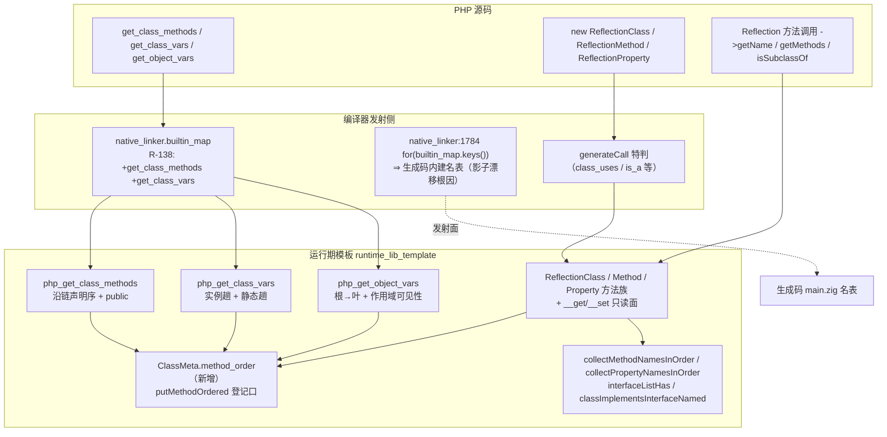
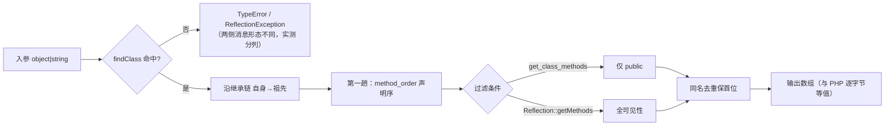
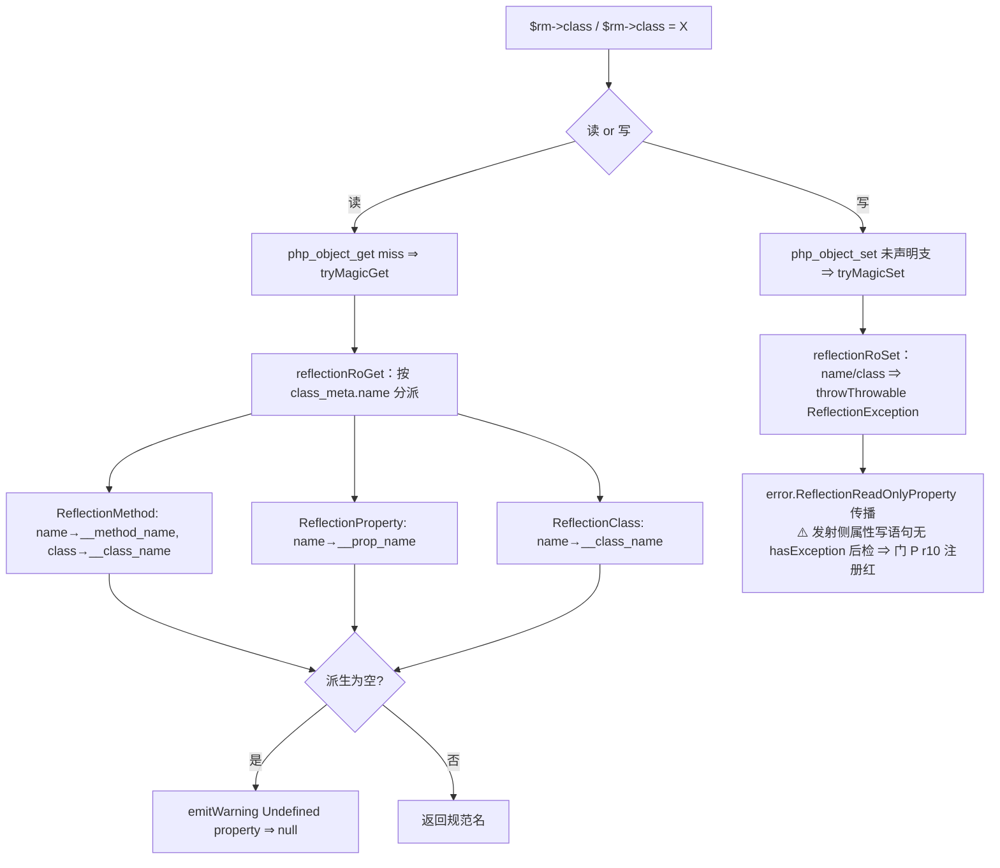

# AOT-CODEGEN-012 · 内省枚举族落地与永久侧门 P（R-138）_2026-10-12_9f3b0b9

## 1. 高层摘要（TL;DR）

1. **本会话从交接文档接手后的唯一入口发现**：R-136/R-137 落地的 Reflection/内省族**没有任何永久门保护**（工单 §11 明示待办），且 §10 记录的 R-137b/R-137c 抛出支**从未入库**（假阳性）。
2. **新建永久侧门 P**（35 形三段）把该族转为常驻守卫，并以它穷举出内省枚举族的真实红面：开局 `same=7 diff=15`（22 形版）→ 落地后 `same=31 diff=4`，4 枚差异恰为三族**新立面孔**（注册红）。
3. **九项落地**（全部 AOT-only）：`ClassMeta.method_order` 结构字段 + 内部类 28 处登记口统一、`get_class_methods`/`get_class_vars` 接入 `builtin_map`、三枚枚举函数按 PHP 真值重写（有序 + 可见性 + 继承链）、Reflection 族 CI/语义补齐、只读属性面、R-137b/R-137c 重落。
4. **验收全绿**：门 P 31/35（4 枚注册红）、门 M 19/19、D8 14/14、N 7/7、O 6/6、`zig build test` 21/21 & 326/326、主回归 **Pass 67 / Skip 1 / Fail 0**；影子 `diff=68` 已归因为**发射面预期漂移**且行为等值由主回归独立佐证。
5. **本批未修、已登记待裁决 6 项**（F-1~F-6），其中 **F-4 = `builtin_map` 33 枚重复键可被无关增项静默翻转实现胜者**，属机制级风险。

---

## 2. 影响范围

| 层 | 文件 | 影响描述 |
|---|---|---|
| 运行期元数据 | `src/aot/runtime_lib_template.zig`（+609/−115，含 native_linker 合计 499 净增） | ClassMeta 增 `method_order` 字段；内部类 28 处方法登记改走受序入口；三枚内建枚举函数重写；Reflection 族 12 处语义修正 |
| 编译器发射 | `src/aot/native_linker.zig`（+5） | `builtin_map` 补 `get_class_methods`/`get_class_vars` 两枚条目 ⇒ **所有脚本的生成码内建名表哈希序重排**（影子 68/68 漂移根因） |
| 门资产 | `fuzzy_scripts_720/tmp/c012_reflection_gate_tmp.sh` + `c012_reflection_tmp.tsv` | 永久侧门 P 新建（35 形，成本 150s） |
| 工单 | `docs/known-issues/AOT-CODEGEN-012-...md` | 新增 §12（+100 行）；§10 假阳性内联更正；§11 待办收口；状态行重写 |
| 语料行为 | `pass/` 68 语料 | 对该族 **0 命中** ⇒ 无既有行为扰动；`f130`（fail_runtime）阻塞点后移但未回收 |

---

## 3. 核心变更

| # | 变更 | 位置 | 判据（实测） |
|---|---|---|---|
| C-1 | `ClassMeta.method_order`（默认 `.empty`）+ `putMethodOrdered` 受序登记 + `addMethod` 复用之 + `deinit` 归还 | ClassMeta 定义/init/deinit/addMethod | 门 P n1 `a1\|a2\|tzA\|tzB\|p1\|p2` 与 PHP 逐字节等值 |
| C-2 | 内部类 28 处 `meta.methods.put("X", .{…})` → `meta.putMethodOrdered(.{…})` | Generator/SplFixedArray/SplStack/SplQueue 族 | 改造前后对照：不转换则这些类 `get_class_methods` 变**空数组**（我引入的回归，已闭环防护） |
| C-3 | `builtin_map` 补两枚条目 + 模板侧两枚 2 参 wrapper（口径同 `php_get_object_vars_builtin_wrapper`） | native_linker `builtin_map`；模板 `*_builtin` 之后 | n1–n5/n12 由 Fatal `undefined function` 转绿 |
| C-4 | `php_get_class_methods` 重写：沿链声明序 + public 过滤 + TypeError 消息 | 原 `:4903` | n1/n2/n3/n4/n12 SAME |
| C-5 | `php_get_class_vars` 重写：**两趟**（实例沿链 → 静态沿链）+ public + TypeError（值形态） | 原 `:4940` | n5 `a,b,s=1,2,3`、r3 `3,1,4,2\|2,1\|1,2` SAME |
| C-6 | `php_get_object_vars` 重写：根→叶声明序 + **调用作用域可见性过滤**（复用 `findPropertyDeclaringClass` + `checkPropertyAccess`）+ 动态支防泄漏 | 原 `:4967` | n6/r1/r7 SAME；改造前 AOT 泄漏 protected/private（实测 `b,a,c` vs PHP `a`） |
| C-7 | `ReflectionClass`：ctor 未注册类抛 + 对象实参；`getMethod`/`getMethods`/`getProperties`/`hasProperty` CI+沿链+有序；`isSubclassOf`/`implementsInterface`/`isInstantiable` 语义补齐 | rc_meta 区 | g4–g8、n7、n8、r2、r5、r6 SAME |
| C-8 | `ReflectionMethod`：ctor 规范化 + 存在性抛；`invoke` 静态真调用 + 非静态无对象抛 + 去掉吞异常的 `catch initNull`；`ReflectionProperty` ctor 同上 | rm_meta / rprop_meta 区 | g5/g6、r4、r9 SAME |
| C-9 | 只读属性面 `__get`/`__set` 共享支（一处覆盖 8 个构造点，含 PHP 的 Undefined property 告警复刻） | 模板文件级 + 三枚 meta attach | r8 SAME |

---

## 4. 可视化概览【Code & Logic Map】

### 4.1 分层架构



### 4.2 业务流程（枚举口径）



### 4.3 执行流程（只读属性面）



### 4.4 时序图（改动前后对照，上层→底层）

```mermaid
sequenceDiagram
    participant U as PHP 脚本
    participant EM as 发射器 native_linker
    participant RT as 运行期 runtime_lib
    participant CM as ClassMeta
    U->>EM: get_class_methods("A")
    Note over EM: 改动前：builtin_map 无此名 ⇒ 生成 undefined function Fatal
    EM->>RT: php_get_class_methods_builtin_wrapper(args, alloc)
    RT->>CM: 沿 parent 链读 method_order
    CM-->>RT: a1,a2,tzA,tzB → p1,p2（声明序）
    RT-->>U: public 过滤后的有序数组（== PHP）
    U->>EM: $o = new SplFixedArray(2); get_object_vars($o)
    EM->>RT: php_get_object_vars
    RT->>RT: findPropertyDeclaringClass + checkPropertyAccess（作用域）
    RT-->>U: 声明属性根→叶；内部槽泄漏登记为 F-3
```

---

## 5. 详细变更分析

### 5.1 端 / 模块层

| 端 | 模块 | 变更点 |
|---|---|---|
| 编译器 | `src/aot/native_linker.zig` | `builtin_map` +2 条目（含归因注释） |
| 运行期 | `src/aot/runtime_lib_template.zig` | 结构字段 1、登记口 1、内部类站点 28、文件级助手 4、内建函数重写 3、Reflection 方法改写 12、只读属性支 2 + attach 3 |
| 资产 | 门 P 脚本 + TSV | 新建（35 形，G/N/R/I 四段 + 注册红清单内置于门头注释） |
| 文档 | 工单 012 | §12 新增、§10 更正、§11 收口、状态行 |

### 5.2 涉及文件清单

- `src/aot/runtime_lib_template.zig`
- `src/aot/native_linker.zig`
- `fuzzy_scripts_720/tmp/c012_reflection_gate_tmp.sh`（新）
- `fuzzy_scripts_720/tmp/c012_reflection_tmp.tsv`（新）
- `docs/known-issues/AOT-CODEGEN-012-class-name-case-insensitive-lookup.md`
- `docs/changes/2026-10-12/交接文档_..._R137.md`（并行会话已 `git add`，本会话仅读）

### 5.3 门 P 形目与读数（终态）

| 段 | 形 | 内容 | 读数 |
|---|---|---|---|
| G（R-136/R-137 守卫） | g1–g8 | 构造规范名 / hasMethod CI / class_uses / ReflectionException / invoke / isSubclassOf / implementsInterface / isInstantiable | 8 SAME |
| N（枚举族探测） | n1–n14 | get_class_methods 五形、get_class_vars、get_object_vars、getMethods/getMethod/getProperties、class_uses 组合、trait 适配、ctor 形态 | 13 SAME + n15 注册红 |
| R（本轮修复自身守卫） | r1–r10 | 可见性双作用域、继承属性、静态分组、ReflectionMethod 规范化、isSubclassOf 同类/未知、implementsInterface 两类抛、只读面 | 8 SAME + r10 注册红 |
| I（内建类保真标记） | i1–i2 | 内建类方法集与内部槽可见性 | 2 注册红 |

---

## 6. 影响与风险评估

| 维度 | 判定 |
|---|---|
| 是否破坏式变更 | **否**（68 语料对该族 0 命中；主回归 Fail(Compile/Runtime/Diff)=0，Pass 67/Skip 1 保持） |
| 生成码影响面 | `builtin_map` +2 ⇒ **全语料 main.zig 名表哈希序重排**（非行为）；影子基线代次需在「提交」后重冻结 |
| 结构体影响 | `ClassMeta` 增字段：四处内部字面量站点已实测**不经 `addMethod`**，取 `.empty` 默认零扰动；`deinit` 已归还 ⇒ 无泄漏 |
| 性能 | `method_order` 仅在类注册期写入（编译期一次性），枚举侧为线性扫描；**属性访问热路径零新增成本**（未给 PHPObject 增插入序字段，见遗留 R-2） |
| 特别注意点 1 | Zig 0.16 `std.ArrayList(T){}` 非法（默认初始化已 deprecated）⇒ 必须 `.empty`；`deinit` 收 `*Self` ⇒ 绑定须 `var`；局部名 `empty` 会与文件内既有声明**遮蔽**报错 |
| 特别注意点 2 | 分发表约定是「位置实参 + allocator」，直连 3 参 `*_builtin` 会生成 arity 不符调用；`needs_allocator=true` 的语义须以 `php_get_object_vars_builtin_wrapper` 为样本 |
| 特别注意点 3 | **F-4**：`builtin_map` 有 33 枚重复键，`preg_split` 两枚条目的实现不同；本批仅新增无关条目即令胜者翻转（实测调用名改变）。本次两实现行为等价（9 形三方对照逐字节相同），但该机制可造成**静默语义翻转** |
| 复测路径 | `bash fuzzy_scripts_720/tmp/c012_reflection_gate_tmp.sh`（35 形，判据 `diff` 恰为 `n15 r10 i1 i2`）→ 门 M/D8/N/O → `zig build test` → `bash fuzzy_scripts_720/run_regression.sh` |

---

## 7. 遗留问题 / 潜在问题

| # | 项 | 状态 |
|---|---|---|
| L-1 | F-1 静态调用非静态方法不报错（门 P n15） | 待裁决，成本未实测 |
| L-2 | F-2 属性写语句缺 `hasException` 路由（门 P r10）——抛出与消息本身逐字正确 | 待裁决（热路径加检） |
| L-3 | F-3 内建类方法集与 PHP 不一致（门 P i1/i2；`CachingIterator` 未注册；引擎内部槽对外可见） | 待裁决，独立族 |
| L-4 | F-4 `builtin_map` 33 枚重复键的实现胜者不稳定 | 待裁决，建议先建「重复键普查门」 |
| L-5 | F-5 `preg_split` 空串/`//`+NO_EMPTY 边界与 `PREG_SPLIT_OFFSET_CAPTURE` 常量缺失（新旧实现共有） | 登记 |
| L-6 | F-6 `debug_backtrace()` 整体未实现（f130 回收的新阻塞点） | 登记 |
| R-2 | 多枚**动态属性插入序**无法保真（`obj.properties` 为 StringHashMap）——需对象级 order 字段，触及属性写热路径 | 已在门 P n6/r1/r7 单枚场景等值；多枚场景登记 |
| R-3 | ~~f170 的 AOT **rc=0 零字节**（全量输出静默丢失）~~ **已自纠推翻**：真身为 `--compile` rc=1 **编译失败**（elseif 合取 + else 臂 return ⇒ 生成码语句序倒置 ⇒ Zig `unreachable code`），0 字节 +x 产物造成误读。已另立 **AOT-CODEGEN-013**，最小复现（q1/q2）与永久侧门 Q 均已到手 | 下一轮取证 |
| R-4 | f073 分类陈旧（唯一差异为 `random_bytes`），非 AOT 缺陷 | 建议移出 `fail_runtime` 或标 SKIP |
| R-5 | 影子基线仍在 `be305cfa` 前缀，与新代次差 68 行 | 待「提交」后重冻结 |
| R-6 | **索引被并行会话 `git add` 抓到半成品**：`native_linker` 全量（我的 +5）与 `runtime_lib_template` 的 12:09 前快照（不含 `putMethodOrdered`）同处暂存区 | 提交前须以工作树全量为准核对 |

---

## 8. 后续开发 / 优化建议

| 优先级 | 建议 | 影响面 | 落地成本 |
|---|---|---|---|
| P1 | **重复键普查门（F-4 前置）**：以 `builtin_map` 键的 `uniq -d` 建常驻门，并对 33 枚逐对判定 `runtime_name` 是否等价；不等价者去重 | 所有内建分发的确定性 | 普查 1 轮（只读，≈5 分钟）+ 去重批需逐枚实测 |
| P1 | ~~f170 AOT 零字节归因轮~~ **本会话后续轮已完成**：改立 **AOT-CODEGEN-013**（P0 发射缺陷，最小复现 + 永久侧门 Q 基线 `expect_fail=2 same=3`），修复路线 R-A/R-B/R-C 待裁决 | 发射主干 if-chain 渲染 | R-A 中；R-B 普查 ≈10 分钟；R-C 小 |
| P2 | F-2 属性写异常路由：在 `php_object_set` 调用点补 `hasException()` 后检（可旗标门控仅 AOT） | 可捕获异常语义 + 每条动态属性写热路径 | 中，须影子重冻结 |
| P2 | F-1 静态调用非静态方法判定（发射或运行期入口） | 合法 PHP 的 Fatal 语义 | 未实测 |
| P2 | 内建类元数据保真族（F-3）：逐类对齐方法集合 + 内部槽声明为 private 以退出可见面 | 内省/序列化面 | 逐类工作量，独立评审 |
| P2 | 对象级属性插入序字段（R-2）：以 `prop_order` 镜像 `property_order`，评估属性写热路径成本 | 动态属性枚举保真 | 需性能实测（宪法 §一.4/§六.7 门控） |
| P3 | `debug_backtrace()`（F-6）与 `preg_split` 边界/常量（F-5） | f130 回收 + 正则族 | 未实测 |
