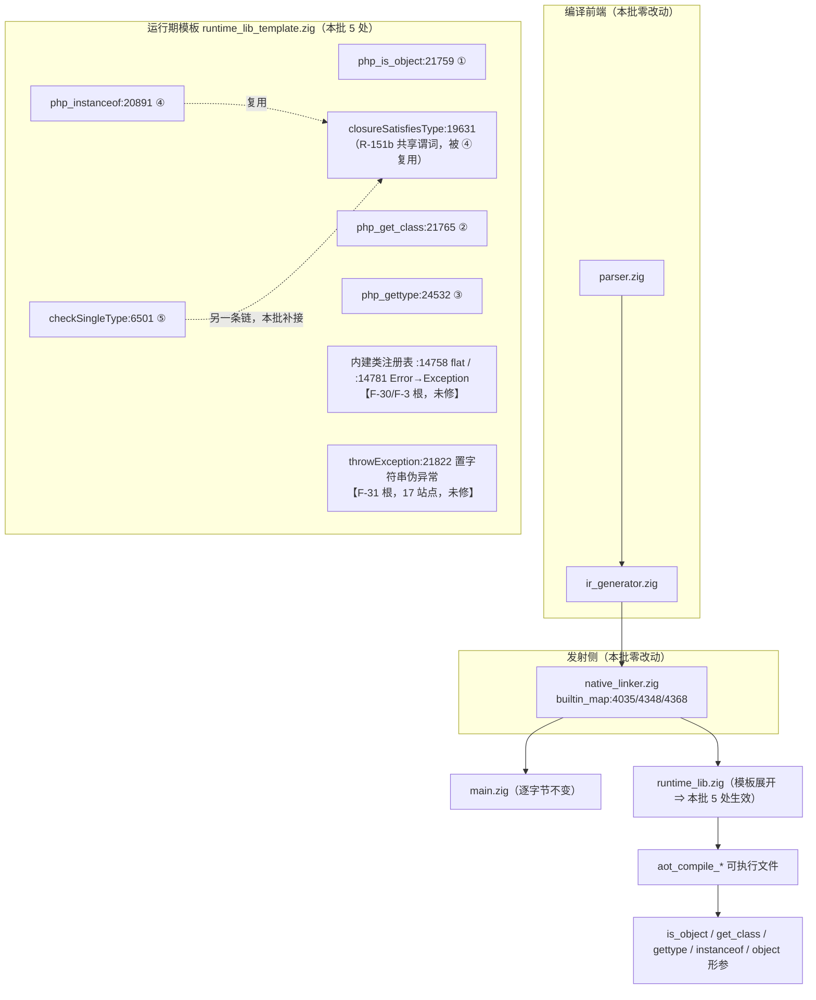
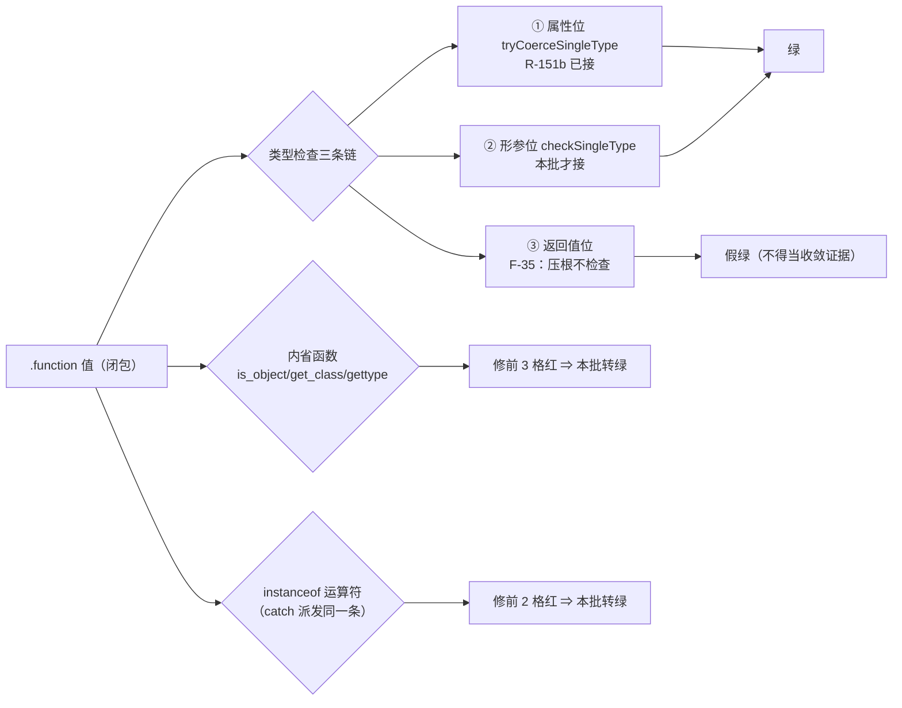
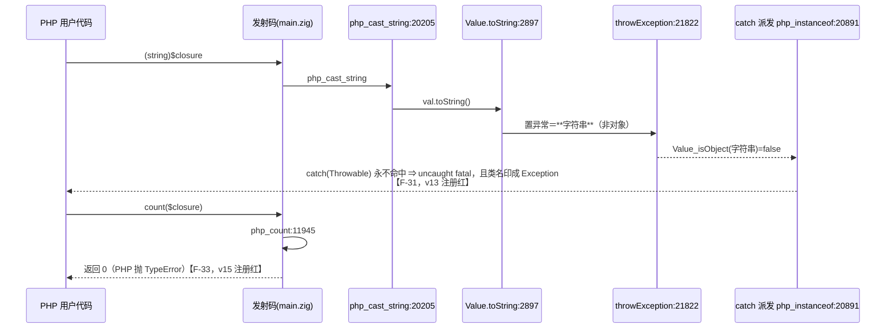
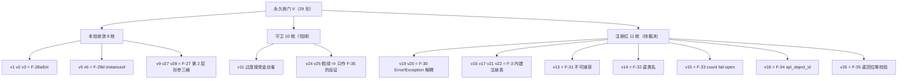

# AOT-CODEGEN-012 · R-154：F-28「闭包不被当作对象」内省面落地 + 永久侧门 V 建成

**类型**: AOT 运行时模板缺陷修复（纯模板改动 ⇒ 二进制与 `main.zig` 均不变）
**代次**: 工单 §28 / 门 V（`c021_closure_obj_face_tmp.sh`，29 形）
**日期**: 2026-10-13
**基线 commit**: `72cdaca`（本批 src 改动已由老铁于 17:40 入库；门资产与文档尚未提交）

---

## 1. 高层摘要（TL;DR）

1. 门 T 里孤零零的一枚 `t23`（`get_class(闭包)` 返空串）被扩成 **29 形永久侧门 V**，把「AOT 的闭包到底算不算对象」这一族一次测穿：**内省函数四格 + 类型检查三条链 + 返回值位**，读侧全绿才算收口。
2. 落地 **5 枚纯模板改动**（`php_is_object` / `php_get_class` / `php_gettype` / `php_instanceof` / `checkSingleType` 的 `object` 伪类型支），门 V 从 `same=10 diff=19` 收敛到 **`same=18 diff=11`**，八枚转绿且**十一枚守卫生成码面零扰动**（主回归/门 P/门 S 等值，见 §8）。
3. ★两条**对上游结论的实测否证**（都写进工单并改了排期）：
   - 我此前写的「F-27 已覆盖方法参数与返回值」被推翻 —— 类型检查实为**三条互不复用的链**，R-151b 只收了属性位；形参位（函数 / 方法 / 可空）与 `instanceof` 位当时仍红，本批补上。
   - 「闭包从 `: object` 返回没问题」是**假绿**：返回值类型位**根本不校验**（新立 F-35，用 `: object` 返回 `int` 证死）。
4. ★本批最大意外是语言版本级真值：**PHP 8.5.8 的 `Error` 不再继承 `Exception`**（`get_parent_class('Error')=false`、`is_subclass_of('TypeError','Exception')=false`），而 AOT 在 `:14781` 用一句 `for simplicity` 把它们连在一起 ⇒ `catch (Exception)` 在 AOT 里过度捕获引擎错误。新立 **F-30**，并连带把 **F-3（内建类注册表保真）** 的真值表 32 枚一次取全。
5. 另外新立 4 项：F-31（`throwException` 把异常置成**字符串** ⇒ `catch` 永不命中，调用点实测 17 枚）、F-32（无 `__toString` 的对象字符串化返类名）、F-33（`count()` 对非 Countable 返 0）、F-34（`spl_object_id()` 对闭包返 0）、F-35（返回位零校验）。
6. 落地前把三项的**成本与批次**改了：F-33 拆两半（先判「非 Countable ⇒ fatal」，接口判定留给 F-3 同批，否则会打红 `ArrayObject`/`SplFixedArray`）、F-32 比想象贵（`Value.toString` 有 52 个调用点，含消息构造路径）、F-30 比想象便宜（发射侧零硬编码，全收在模板内，但必须三件同批）。

---

## 2. 影响范围

| 维度 | 影响 | 量化 |
|---|---|---|
| 修复面 | PHP 闭包在 AOT 侧被当作 `Closure` 实例：`is_object`/`get_class`/`gettype`/`instanceof` 与 `object` 形参位 | 5 处模板位点，1 处共享谓词复用（`closureSatisfiesType`） |
| 可执行语义变化 | 仅「闭包值」的判定结果由 false→true / 空串→`Closure`；非对象（int/string/array/null）判定不变 | 金丝雀臂 `v11` 证过度接受 = 0 |
| 语料（68 形）暴露面 | `is_object`/`get_class`/`gettype` 共 12 处调用点，逐点回溯实参 ⇒ 闭包流入 **0 处**；`object` 标注位点 2 处（f010 返回位 / f104 形参位），`addComponent` 的 15 个实参全是 `new X(...)` ⇒ **0 处**；`instanceof Closure` **0 处** | 主回归与影子对该族零暴露 ⇒ 门 V 是唯一常驻证据 |
| 编译产物 | 纯模板改动，`native_linker`/`ir_generator` 未动 ⇒ 生成的 `main.zig` 逐字节不变，**影子基线不需重冻** | 二进制 md5 链首尾同为 `f1ff7a0d…` |
| 新增回归资产 | 永久侧门 V（29 形，122s）；另备好 R-155 的永久侧门 W 脚本（20 形，待登记轮） | 门链成本 +122s |
| 未修而新立 | F-30 / F-31 / F-32 / F-33 / F-34 / F-35 + F-26 族新子面（内省函数不吃类名字符串） | 全部列入待裁决，本批一律不碰 |

---

## 3. 核心变更

| # | 层 | 文件:行 | 变更 | 收口臂 | 修前 → 修后 |
|---|---|---|---|---|---|
| 1 | 运行期·内省 | `runtime_lib_template.zig:21759 php_is_object` | `Value_isObject(val)` → `… or val.isFunction()` | v1 | `is_object($c)=false` → `true` |
| 2 | 运行期·内省 | `:21765 php_get_class` | 新增 `.function` 前置支返回 `"Closure"` | v2 | `get_class($c)`→空串（`initBool(false)` 被 echo 成空）→ `Closure` |
| 3 | 运行期·内省 | `:24532 php_gettype` | 与对象格合并判定 ⇒ `"object"` | v3 | `unknown type` → `object` |
| 4 | 运行期·类型判定 | `:20891 php_instanceof` | 早退前接共享谓词 `closureSatisfiesType`（复用 R-151b，不另造口径） | v5 v6 | `Closure`/`\Closure` 两格 `false` → `true` |
| 5 | 运行期·形参检查 | `:6501 checkSingleType` | `object` 伪类型 `… or arg.isFunction()` | v9 v27 v28 | 函数形参 / 方法形参 / 可空方法形参三格的假 `TypeError` 消失 |
| 6 | 文档正确性 | `:19611` `closureSatisfiesType` 头注释 | 把「属性、方法参数、返回值」的错误覆盖面写成**三条链 + 返回位不校验**的枚举 | — | 防后来者重蹈我的错判 |

未修而登记的机制面（十一枚注册红）：`v13`=F-31、`v14`=F-32、`v15`=F-33、`v16 v17 v21 v22`=F-3、`v18`=F-34、`v19 v20`=F-30、`v26`=F-35。

---

## 4. 可视化概览

### 4.1 分层架构图（变更点定位）

### 4.2 业务流程：一个闭包值在 AOT 里「算不算对象」

### 4.3 执行流程（`(string)$closure` 与 `count($closure)` 两条未修链）

### 4.4 代码—逻辑映射（臂 ↔ 机制 ↔ 状态）

---

## 5. 详细变更分析

### 5.1 端 / 层

| 层 | 是否触及 | 说明 |
|---|---|---|
| 编译前端（lexer/parser/ast） | 否 | 本批与关键字大小写族（010）无关 |
| IR 生成（ir_generator） | 否 | 未动，md5 仍 `25e3033a…` |
| 发射（native_linker） | 否 | 未动，md5 仍 `c261d2b2…`；`builtin_map` 三个条目 1:1 指向被改函数（`4035` get_class / `4348` is_object / `4368` gettype），无重复键 ⇒ 单点改即全覆盖 |
| 运行期模板 | **是（5 处）** | `runtime_lib_template.zig` = **`980a3a8d7660b9f667d965c3378f4785`**（R-151b 的 `13203065…` 作废） |
| 优化器 | 否 | `6cffa137…`（R-147 守卫） |
| 解释器 / 字节码模式 | 否 | `src/runtime/*`、`src/bytecode/vm.zig` 各自有独立 `is_object`/`gettype` 实现 ⇒ 按宪法 §五只报不改（见 §7） |

### 5.2 涉及文件清单

| 文件 | 性质 |
|---|---|
| `src/aot/runtime_lib_template.zig` | 唯一被改的源码（5 处判定 + 1 处注释更正） |
| `docs/known-issues/AOT-CODEGEN-012-class-name-case-insensitive-lookup.md` | §28（1–14 小节，含两张新真值表、影响面穷举、排期更正）；头部状态/待裁决行刷新 |
| `fuzzy_scripts_720/tmp/c021_closure_obj_face_tmp.sh` | **新增**永久侧门 V（29 形） |
| `fuzzy_scripts_720/tmp/c021_closure_obj_face_tmp.tsv` | 门 V 读数表 |
| `fuzzy_scripts_720/tmp/c022_internal_throwable_tmp.sh` | **新增**永久侧门 W 脚本（20 形，R-155 待登记） |
| `fuzzy_scripts_720/tmp/c021_r154_acceptance_chain_tmp.sh` | R-154 验收链（15 腿） |
| `docs/changes/2026-10-13/…本文…` | 本变更摘要 |

### 5.3 变更点描述（逐条）

1. **判定加宽只走读侧**：`Value_isObject` 本体一字未动。理由＝F-26/F-27 两次自造回归都源于「在谓词根动刀」；本批改的是「内建函数对 `.function` 值的可见性」，不碰 `asObject()` 的类型双关前提。实测：闭包属性读写（`@$f->prop` / `$f->dynProp = 7`）修前就不崩（得 NULL），说明即使 `is_object` 转真引入新分支，下游也不是致命路径。
2. **`php_instanceof` 复用共享谓词而非新写**：该函数同时服务用户 `instanceof` 与 **catch 派发**（`ir_generator:3442` 用同一个 IR op），口径分裂会立刻造出「门绿语料红」。新增支只在左值是 `.function` 时生效 ⇒ 异常值（对象或 F-31 的字符串）路径字节不变。
3. **`get_class` 的空串症状**：原实现 `return Value.initBool(false)`，在 `echo` 下渲染成空串 ⇒ 症状像「返回了空类名」，实为「返回了 false」。这是本批一条读数教训：**空串红要先怀疑类型**，否则会把布尔误诊为字符串路径缺陷。
4. **三条检查链的取证方式**：不是读代码猜，而是为每条链各建臂（属性 v23 / 函数形参 v9 / 方法形参 v27 / 可空形参 v28 / union v29 / 返回 v24 v25），一次跑完即知覆盖面差多少。R-151b 当年只有属性位的臂，才让「已覆盖方法参数」这句错话活了两个批次。
5. **PHP 8.5 层级真值**：`is_subclass_of('TypeError','Exception')=false`、`get_parent_class('Error')=false`、`class_implements('Error')=Stringable,Throwable`、`Throwable` 自身实现 `Stringable`、SPL 异常是**两级**树（`BadMethodCallException→BadFunctionCallException→LogicException→Exception` 三级）。全部由单进程一次取表（32 名）。
6. **内省函数的实参形态**：AOT 的 `php_get_parent_class` 首行拒绝非对象 ⇒ 门 W 全部改用对象实参取父链；「类名字符串」这一形态另属 F-26 族子面，不与层级问题混谈。

---

## 6. 影响与风险评估

| 项 | 结论 |
|---|---|
| 是否破坏式变更 | **否**。判定单调加宽（只允许更多值通过），无删除、无签名变化、无发射形状变化 |
| 影子/基线 | 不需重冻：二进制 md5 链首尾一致（`f1ff7a0d868410b8b2d111f325e0d368`），`main.zig` 逐字节中性 ⇒ 链上影子列为等值复证（§8） |
| 主要风险 | 「过度接受」——把非对象放成对象。已用 `v11` 金丝雀反臂锁死（`is_object(5/[]/"x")` 必须恒 false、`get_class(stdClass)` 必须仍是 `stdClass`），链上 `v11` SAME |
| 次生风险 | `php_instanceof` 是 catch 派发的共用件。已验证：异常值不会是 `.function`，新增支在该路径上不可达；门 P（Reflection 族，大量走 instanceof/get_class）与门 R（fatal 终止语义）读数逐腿等值 |
| 性能 | 三枚内省函数各加一次 tag 比较（`isFunction()` 为常量时间）；`php_instanceof` 的非对象路径加一次谓词调用（谓词首行即 `!isFunction()` 早退）⇒ 对象路径零额外开销。未引入任何 O(n) 循环 |
| 需特别注意的点 | ① **v24/v25 是假绿**，任何后续引用不得把它当作 F-27 收敛证据；② F-30 落地**必须三件同批**（摘 parent + 方法集搬根 + 接口表），`findMethod` 沿 parent 上溯，只摘 parent 会把 `getMessage` 整族从 Error 支抹掉；③ F-33 的接口判定必须等内建接口表补齐，否则 `count(new ArrayObject)` 由能数变 fatal |
| 复测路径（体验流程） | `bash fuzzy_scripts_720/tmp/c021_closure_obj_face_tmp.sh`（122s，判读：`same=18 diff=11 compile_fail=0 bad_probe=0`，残红恰为 `v13 v14 v15 v16 v17 v18 v19 v20 v21 v22 v26`）；单臂复测 `ONLY="v1 v9 v27 v28" bash …`；全链 `bash fuzzy_scripts_720/tmp/c021_r154_acceptance_chain_tmp.sh` |

### 6.1 R-154 验收链读数（15 腿，`c021_r154_acceptance_chain_tmp.log`）

| 腿 | 读数 | 与注册值比对 |
|---|---|---|
| 链首二进制 md5 | `f1ff7a0d868410b8b2d111f325e0d368` | 与 R-151b 代一致 ⇒ 纯模板改动自证（链尾再取一次，须同值） |
| `zig build test` | rc=0 @3s，但输出末行有 `failed command: …/test` | **不采信**：rc 与输出互相矛盾 ⇒ 链后无并发复跑 `zig build test` 与 `zig build test-aot` 另取真读数（规则 34） |
| 门 V | `shapes=29 same=18 diff=11 compile_fail=0 bad_probe=0` @121s | 等值（本批新建门的定档读数） |
| 门 T | `shapes=22 same=16 diff=5 compile_fail=1 bad_probe=0` @89s | **注册红集下调一枚**：`t23` 随 F-28 转绿 ⇒ 现行红 = `t2 t9 t11 t12 t13`，`t17` 仍为注册 compile_fail |
| 门 P | `shapes=76 same=71 diff=5 compile_fail=0` @302s | **恰等注册红集、零新红** ⇒ F-28 没把 Reflection 族改回去 |
| 门 S | `shapes=47 same=47 diff=0` @195s | 等值（该门判据即 `diff=0`） |
| 门 M / N / O | `19 red=0 green=19` @72s ／ `7 red=0 green=7` @25s ／ `6 red=0 green=6` @21s | 等值 |
| 门 D8 | `defect_red=0 guard_same=14` @52s | 等值 |
| 门 Q / R | `same=5 unexpected_fail=0` @22s ／ `same=8 diff=1 terminate_lost=0` @40s | 等值 |
| 门 U（F-25 撞面普查） | 按 TSV 原行聚合：**75 行 = `SAME=51 / COMPILE_FAIL=22 / BAD_PROBE_PHP=2`** @213s | **等值**（注册值即 22 枚撞名清单 + 2 枚不可声明名，见工单 §26.2） |
| 普查门 B | `entries=497 distinct=464 dup_rows=33 diff_impl=3 field_diff=0 identical=30` @2s | 等值（`diff_impl=3` 是 F-4 待裁决的现役证据，不得为 0） |
| 主回归 | 进行中（17:51 开跑） | 目标：`Total 68 / Pass 67 / Fail 0 / Skip 1`，且失败明细仍只有 `f004 SKIP` |
| 影子 | 待跑（预算 3600s，实测约 1120s） | 目标：new-side 列 vs R-151b 列 `changed_rows=0`，并落盘 `c010_shadow_newside_r154_tmp.txt` |

> 注：链脚本用 `tail -1 <leg stdout>` 取 DONE 行，而**门 U 不打印 `*_DONE` 汇总行**（它只逐行追加普查表）⇒ 那一腿的链内捕获拿到的是普查表尾行 `25 global SAME`。本表读数改由 `awk -F'\t' 'NF>=3{c[$3]++}'` 对 TSV 原行聚合计得。链脚本改进项：DONE 行统一用 `grep -E "[A-Z0-9]+_DONE$"` 取，取不到则回退为按列聚合（已列入 §8 的 P2 项）。

---

## 7. 遗留问题 / 潜在问题

| 编号 | 面 | 状态 |
|---|---|---|
| F-30 | PHP 8.5.8 `Error` 不继承 `Exception` ⇒ AOT `catch (Exception)` 过度捕获引擎错误 | 待裁决；根在 `:14781`（代码自注 `for simplicity`），落地形态与影响面已在工单 §28.10.2 穷举完毕，门 W 已备好 |
| F-3 | 内建可抛出层级扁平化（`:14758` 12 枚全挂 Exception）、内建接口表空、`getTrace`/`getTraceAsString` 方法缺失 | 待裁决；真值表 32 枚已取全（工单 §28.10.1） |
| F-31 | `throwException:21822` 置**字符串**伪异常 ⇒ 不可捕获 + fatal 类名错，调用点 17 枚 | 待裁决；六个信息族的 PHP 真值已测（工单 §28.5.1），含两枚「编译期 fatal、运行期改不动」的分支 |
| F-32 | 无 `__toString` 的对象字符串化返类名（`PHPObject.toString:19437`） | 待裁决；成本被本批上修：`Value.toString` 有 52 个调用点，含消息构造路径 |
| F-33 | `count()` 非 Countable 返 0（`php_count:11956`）＋判定用 `findMethod("count")` 而非接口 | 待裁决；已拆两批（第一批零过度收紧），第二半必须与 F-3 接口表同批 |
| F-34 | `spl_object_id()` 对闭包返 0（`php_spl_object_id:11494`） | 待裁决；**已定价为低成本**：`php_spl_object_id` + `php_spl_object_hash` 两处各加一枚 `.function` 支，指针源取 `Value.asFunction(): *PHPClosure`（`:2618`）。判据只能是 `>0` 与自等，禁比 id 绝对值（AOT 用地址掩码，PHP 用递增序号） |
| F-35 | **返回值类型位完全不校验** | 待裁决；唯一需要重冻影子的一档（语料内 1064 处带返回类型声明 / 68 文件全覆盖），排最后 |
| F-24d / F-29 | 父/接口缺失 fail-open，前置是「类声明按位登记」 | 上一轮已否证直接修法（会 over-fatal），待裁决 |
| F-22 / F-8b / F-4 / F-10 | 多语句 finally、`getDefaultValue` 分叉、`builtin_map` 去重（删代码）、字符串伪方法面（删功能） | 均待裁决或待归因 |
| 其他模式 | 解释器/字节码模式各自有独立的 `is_object`/`gettype` 实现，本批未核 | 按宪法 §五：**只报不改**，需要老铁明示才动 |

---

## 8. 后续开发建议

| 优先级 | 建议 | 影响面 | 落地成本 |
|---|---|---|---|
| **P0** | **F-33 第一批**：`php_count:11956` 非数组且无 `count()` 可调 ⇒ `throwThrowable("TypeError", …)`，消息类型名按 C6/C7 实测口径（bool 印 `true`）；门 V 追加 v30–v33 并重定档 | `count(` 语料 184 处 / 47 文件，但由「基线对 PHP 真值绿」可推暴露面 0（工单 §28.12.1 规则 41 口径，不含 1 枚 SKIP） | 低：纯模板一处 + 四枚臂 + 一链 |
| **P0** | **F-30 + F-3 合并轮**：先跑门 W 登记轮取 AOT 侧读数，再「摘 parent + 方法集按 `method_order` 搬根 + Exception/Error 各设 `interfaces`」三件同批；SPL 两级树按 §28.10.1 数据表化（宪法 §四.3 反硬编码：表从真值生成） | 内建可抛出族全部 catch 命中面；语料真实 catch 子句仅 8 枚，暴露面 0；**门 W 的 w13/w14 为硬验收项** | 中：纯模板一函数区域 + 一次门 W + 一链 |
| P1 | F-31 分族批：先做「只换类别、文本不动」的 2 枚（`Method name must be a string`），验证 `throwException`→`throwThrowable` 迁移对门 R（fatal 终止语义）的扰动，再逐族推进带参消息 | 17 站点分 6 族，其中 2 族是 PHP 编译期 fatal ⇒ 归解析期，不在模板 | 中：一族一链，约 4–5 轮 |
| P1 | F-26 族子面：内省函数接受类名字符串（`get_parent_class("Error")` 等），打通后才能用与 PHP 同形态取注册表 | 内省函数群 | 中 |
| P2 | F-35 返回位校验：**唯一需要重冻影子**的一档，单独一轮，发射面按返回类型声明位点分批 | 68 文件全漂移 | 高 |
| P2 | 门 V / 门 W 的 ONLY 子集并入 R-155 起的常备链腿（现链 15 腿，门 V +122s、门 W 约 +90s） | 链时长 +3.5 分钟 | 低 |
