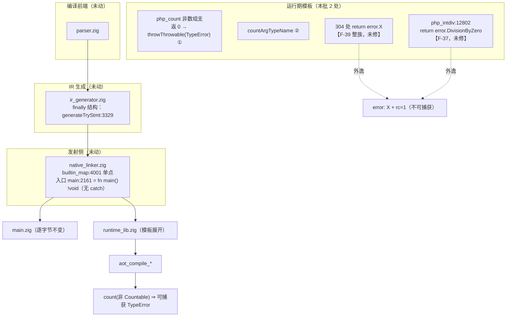
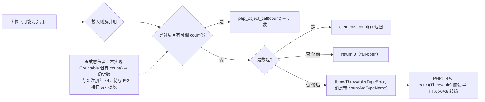
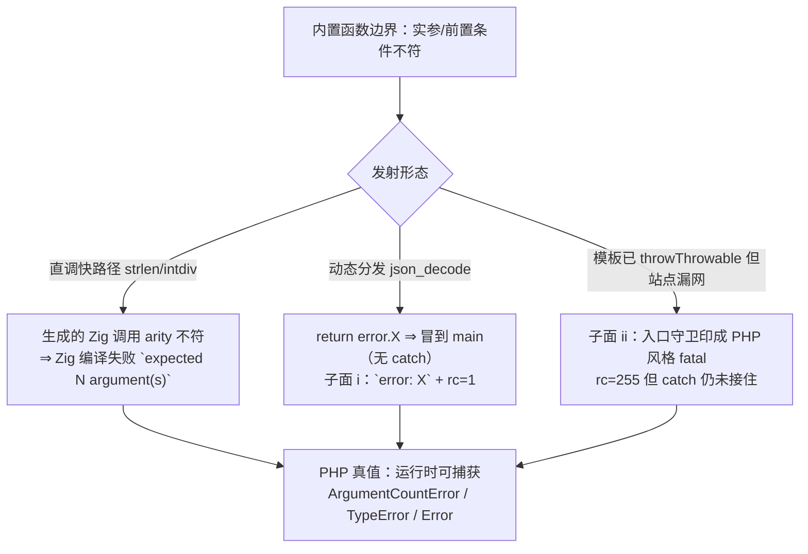
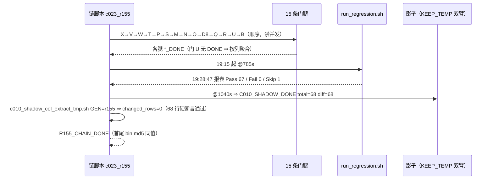

# AOT-CODEGEN-012 · R-155：F-33 第一批（`count()` fail-open）落地 + 永久侧门 X/Y 建成 + 取证件缺陷 F-40 修复

**类型**: AOT 运行期模板缺陷修复（纯模板 ⇒ 二进制与 `main.zig` 均不变）+ 门链取证能力修复
**日期**: 2026-10-13
**基线 commit**: `72cdaca`（本批与 R-154 的 src/模板改动均由老铁自行入库；门资产与文档仍未提交）
**工单**: `docs/known-issues/AOT-CODEGEN-012-class-name-case-insensitive-lookup.md` §28–§29

---

## 1. 高层摘要（TL;DR）

1. **F-33 第一批落地**：`php_count` 的非数组支由「静默返 0」改为抛可捕获的 `TypeError`，并新增专用类型名 helper `countArgTypeName`（PHP 在这条消息里对 bool 打 `true`/`false`、对资源打 `resource`，**不能**复用现名表）。
2. **两批合计新增三枚永久侧门**：门 V（29 形，闭包=对象）、门 X（9 形，count/Countable）、门 Y（12 形，Zig error 外逸）；门 W（20 形，内建可抛出层级）脚本已建并已跑登记轮。五门全部进入验收链常备腿。
3. ★**自我否证一条**：我上一轮写的「`php_count` 从不解引用 ⇒ 第一批必须同补解引用」被门 X 登记轮否证——`count(&$array)`／`count(&$countableObj)`／by-ref 形参内 `count` 三形**本就与真值等值**（引用在载入侧已解）⇒ 第一批收窄为两处。
4. ★**取证件缺陷 F-40（本轮最重要发现之一）**：门 T/V/W/X/Y 的 rc 判据此前**从未生效**（`ao=$(cmd | norm); arc=$?` 取的是管道末端 `norm` 的返回值，恒 0）⇒ AOT 退出码从未参与等值判定。已统一改成门 R 的正确写法并全量复跑：**五门逐枚读数与修复前完全同值** ⇒ 既往判读未被扭曲，但今后 rc 才是真判据（门 Y 的三个子面正是靠真 rc 才分得开）。
5. 新立 **F-39（内置函数边界：模板内 304 处 `return error.X` 绕过 PHP 异常语义，分三个子面）**、**F-41（实参不足的内置调用在编译期就被 Zig 拒掉，而 PHP 是运行时 `ArgumentCountError`）**、**F-36（`new Error()->getFile()` 为空 ⇒ Error 根与 Exception 根不等价，须并入 F-30 落地清单）**、**F-37（`intdiv` 除零外逸 + `PHP_INT_MIN/-1` 静默返回错值）**、**F-38（`zig build test-aot` 长期 6 处编译错误 ⇒ AOT 单测步骤实际没在保护任何回归）**。
6. **F-4 决策就绪**：`builtin_map` 三枚实现不同的重复键（`preg_match`/`preg_match_all`/`preg_split`）——真正的风险是 `StaticStringMap.initComptime` **按 key 排序后取第一个相等键**，胜者由编译期排序决定而非书写顺序 ⇒ 可能无声翻面退回 legacy PCRE 行为。给了甲/乙/丙三态，因 §六.3「删代码先问」本批未动。

---

## 2. 影响范围

| 维度 | 影响 | 量化 |
|---|---|---|
| 运行期语义 | `count()` 对「非数组且无可调 `count()`」的值由静默 `0` 改为 `TypeError`（可捕获）；实参为引用时行为不变 | 模板 `php_count` 一处 + helper 一枚 |
| 故意不收的口 | `count($hasCountButNotCountable)` 仍返回数字（PHP 抛 TypeError）⇒ 门 X 注册红 `x4` 留到第 2 批 | 留红理由：切接口判定会打红 `SplFixedArray`(`:8942`/`:8932`)、`ArrayObject`(`:9406`) |
| 影子/基线 | 不需重冻：二进制 `f1ff7a0d…` 链首尾同值，`main.zig` 逐字节中性 | `changed_rows=0`、整列 md5 `f19fb070…`（与 r148b~r154 六列同值） |
| 语料暴露 | `count(` 在 pass/ 内 184 处 / 47 文件；12 个文件同时含引用写法 ⇒ 但基线对着 PHP 真值是绿的 ⇒ 这些站点今天都没跑到非 Countable（规则 41） | 主回归 Pass 67 / Fail 0 / Skip 1（明细仅 `f004`），回收 0 枚 |
| 取证能力 | 五门 rc 判据修复 + 门 X 观测器半行伪迹修复 + 新增影子列抽取脚本（内置 68 行硬断言） | 门链时长 R-154 `3106s` → R-155 `3069s`（17 腿，含新三门） |
| 提交状态 | `72cdaca` 已含 R-148b~R-154；本批模板改动 + 全部门资产/文档**未提交** | `git status` 34 条（15 门资产 `??` + 文档/回归产物 `M`） |

---

## 3. 核心变更

| # | 层 | 文件:位点 | 变更 | 收口臂 |
|---|---|---|---|---|
| 1 | 运行期 | `src/aot/runtime_lib_template.zig` `php_count` 非数组支 | `return Value.initInt(0)` → `return throwThrowable("TypeError", "count(): Argument #1 ($value) must be of type Countable|array, {s} given", runtime_allocator)` | X `x6` `x9`、V `v15` |
| 2 | 运行期 | 同文件新增 `countArgTypeName` | bool ⇒ `true`/`false`、resource ⇒ `resource`，其余复用 `phpGetValueTypeName`（DRY） | X `x9` 消息面 |
| 3 | 取证件 | 门 T/V/W/X/Y 判定段 | `ao=$(… | norm); arc=$?` → 先重定向取 `arc=$?` 再 `norm` 文件；PHP 侧合并成单次运行 | 五门全部 |
| 4 | 取证件 | 门 X 观测器 | 先 `$n = count(…)` 再 echo（禁 `echo 前缀, 会抛的表达式`） | X 全部 |
| 5 | 取证件 | 新增 `c010_shadow_col_extract_tmp.sh` | new 侧整列抽取 + `changed_rows` + **两侧各 68 行硬断言** | 影子腿 |
| 6 | 资产 | 新增 `c023_count_countable_tmp.sh`（门 X，9 形）、`c024_zig_error_escape_tmp.sh`（门 Y，12 形） | 见 §29.1 / §29.10 | — |

模板 md5：`980a3a8d…`（R-154）→ **`c0e722b18d25821323b0ed1b183c7f5d`**；`ir_generator`/`native_linker`/`optimizer` 均未变。

---

## 4. 可视化概览

### 4.1 分层架构图（本批变更定位）

### 4.2 `count()` 判定流程（修前 vs 修后）

### 4.3 Zig error 外逸的三个子面（门 Y 靠真 rc 才分得开）

### 4.4 门链时序（R-155 的 17 腿，3069s）

---

## 5. 详细变更分析

### 5.1 端 / 层

| 层 | 触及 | 说明 |
|---|---|---|
| lexer/parser/ast | 否 | — |
| `ir_generator.zig` | 否（但已为 R-156 备好料，见 §21.5.1） | — |
| `native_linker.zig` | 否 | `builtin_map` 三个 PCRE 重复键的取证在 §29.9，未动 |
| `optimizer.zig` | 否 | `6cffa137…`（R-147 守卫） |
| `runtime_lib_template.zig` | **是（2 处）** | `php_count` + `countArgTypeName` |
| 门资产（`fuzzy_scripts_720/tmp/`） | **是** | 新门 X/Y；T/V/W/X/Y 的 rc 判据与 X 的观测器修复；新增影子列抽取脚本 |
| 解释器 / 字节码模式 | 否（按宪法 §五只报不改） | `src/bytecode/vm.zig:547` 与 `src/runtime/fn_dispatch.zig:466` 有各自的 `gettype`/`is_object` 实现，F-28/F-33 在那些模式下是否同病**未核** |

### 5.2 涉及文件清单

| 文件 | 性质 |
|---|---|
| `src/aot/runtime_lib_template.zig` | 唯一源码改动（md5 `c0e722b1…`） |
| `fuzzy_scripts_720/tmp/c023_count_countable_tmp.sh` / `.tsv` | 门 X（`c6769b77…`，9 形 @41s） |
| `fuzzy_scripts_720/tmp/c024_zig_error_escape_tmp.sh` / `.tsv` | 门 Y（`fe5b7586…`，12 形 @43s） |
| `fuzzy_scripts_720/tmp/c019_fq_typepos_gate_tmp.sh` | 门 T：rc 判据修复 + 头部定档（`c4e94c68…`） |
| `fuzzy_scripts_720/tmp/c021_closure_obj_face_tmp.sh` | 门 V：同上（`9d3ff5ef…`） |
| `fuzzy_scripts_720/tmp/c022_internal_throwable_tmp.sh` | 门 W：同上（`d7c2fa82…`） |
| `fuzzy_scripts_720/tmp/c010_shadow_col_extract_tmp.sh` | 新增：影子列抽取 + 硬断言 |
| `fuzzy_scripts_720/tmp/c023_r155_acceptance_chain_tmp.sh` / `.log` | R-155 验收链（17 腿） |
| `fuzzy_scripts_720/tmp/c010_shadow_newside_r154_tmp.txt` / `_r155_tmp.txt` | 两代 new-side 整列（各 68 行，md5 同值） |
| `docs/known-issues/AOT-CODEGEN-012-…md` | §28.13.1/§28.13.2、§29 全节、头部状态行 |

### 5.3 关键取证与更正（逐条带证据）

1. **引用解引用被否证**：门 X `x1/x2/x3` 登记轮 SAME ⇒ `php_count` 虽体内 `isRef` 出现 0 次，但引用在载入侧已解 ⇒ 撤销「三处同动」中的解引用一项（工单 §29.1）。
2. **消息类型名不可复用现名表**：`count(false)` 的 PHP 消息打 `false given`，而 `phpGetValueTypeName` 返回 `bool` ⇒ 新增 `countArgTypeName`（§28.7.4 实测表）。
3. **接口判定必须延后**：`findMethod("count")` → `implementsInterface("Countable")` 的切换会让三个内建类（`SplFixedArray`/`ArrayObject`/`WeakMap`，`interfaces` 字段实测为空）由能数变 fatal ⇒ 与 F-3 内建接口表同批（§28.7.2）。
4. **F-4 的真正风险换了位置**：不是书写顺序而是 `StaticStringMap.initComptime`(`:71`) 的**排序 + 首个相等键**语义（`getIndex:198`）⇒ 胜者不确定（§29.9）。
5. **门 Y 的建臂纪律**：Zig error 外逸会终止进程 ⇒ **一臂一站点**，禁合臂；`fn bi()` 实测是恒等函数 ⇒ 我先前「`bi()` 会包一层可变参」的推测作废。
6. **影子统计口径固化**：`403` = `find fuzzy_scripts_720 -name '*.php'`；全仓 `.php` 是另一个数（601）⇒ 跨轮比较必须同口径。

---

## 6. 影响与风险评估

| 项 | 结论 |
|---|---|
| 是否破坏式 | **否**：判定由 fail-open 改为抛 PHP 真值异常，且保留「有 `count()` 即计数」的过度接受 ⇒ 零过度收紧（over-fatal）方向 |
| 实测回归 | 主回归 Pass 67/Fail 0/Skip 1；门 P `71/5`、门 S `47/0`、门 R `same=8 diff=1 terminate_lost=0`、门 M/N/O/D8/Q/U/B 全部与注册值逐腿等值 ⇒ **零新红**（规则 30 第三次预防成功） |
| 影子 | `changed_rows=0` / 整列 md5 与 r148b~r154 六列同值；链首尾二进制同值 |
| 残留与源码保护 | `.zigphp_aot_build_*` = 0、`aot_compile_*` = 0、`pass/*.php` = 68、`fuzzy_scripts_720` 内 `.php` = 403（未删） |
| 需特别注意 | ① 门 Y 的 `compile_fail=2` 是 **F-41 的真红**（非缓存争用）：已在无并发下复跑两次同值；② `count()` 现在开始抛 ⇒ 任何依赖「数一下不报错」的新代码要按 PHP 真值写；③ F-40 修复使 rc 首次进入判据，后续若某门红集变化，先怀疑 rc 而不是输出 |
| 复测路径 | `bash fuzzy_scripts_720/tmp/c023_count_countable_tmp.sh`（9 形，判读 `same=8 diff=1`，残红恰 `x4`）；`bash fuzzy_scripts_720/tmp/c024_zig_error_escape_tmp.sh`（12 形，`same=3 diff=7 zig_escape=2 compile_fail=2`）；整链 `bash fuzzy_scripts_720/tmp/c023_r155_acceptance_chain_tmp.sh`（约 51 分钟，禁并发手工编译） |

---

## 7. 遗留 / 潜在问题

| 编号 | 面 | 状态 |
|---|---|---|
| F-33 第 2 批 | 接口判定 `implementsInterface("Countable")` + 内建类 `interfaces` 表 | 与 F-3 同批；门 X `x4` 为验收项 |
| F-39 | 模板内 304 处 `return error.X` 的三个子面 | 待裁决：甲（入口 catch，覆盖 rc/文本但仍不可捕获、影子需重冻）／乙（逐站 `throwThrowable`，真可捕获、132 枚消息须逐函数实测） |
| F-41 | 实参不足的内置调用编译期被拒（`strlen()`/`intdiv(5)`） | 新立；根在直调快路径的 arity 发射，门 Y `y1`/`y3` 为常驻证据 |
| F-37 | `php_intdiv:12802` 除零外逸；`PHP_INT_MIN/-1` 在 `@divTrunc` 下静默返回错值 | 新立，属 F-9/R-145 族的漏网站点 |
| F-36 | ~~`new Error()->getFile()` 为空（`new Exception` 非空）⇒ Error 根与 Exception 根不等价~~ ★**R-156 实测更正**：两支「构造后从未 throw」的对象 file/line **都空**；当时对照用的 `new Exception` 形是被 `throw` 过的 ⇒ 与 Error 支无关，真机制是 `file`/`line` 由 `setException` 惰性注入 | 已从 F-30「搬根」清单**删除**「属性初始化」一项；F-30 仍需「方法集按 `method_order` 复制 + `interfaces` 表」两半（工单 §30.3） |
| F-38 | `zig build test-aot` 6 处编译错误（全在 `test {}` 块内）⇒ AOT 单测步骤长期失编译 | 新立；宪法 §三.2 对 AOT 侧目前实际由门链代偿 |
| F-4 | `builtin_map` 三枚实现差异重复键（PCRE 族） | 决策就绪，甲/乙/丙见 §29.9 |
| F-30 / F-3 / F-31 / F-32 / F-34 / F-35 / F-24d / F-29 / F-25 / F-22 / F-8b / F-10 | 见工单 §28.12.1 定价表与 §21.5.1（F-22 已到位点与最小落地形态） | 待裁决 / 待归因 |

---

## 8. 后续开发建议

| 优先级 | 建议 | 影响面 | 落地成本 |
|---|---|---|---|
| **P0** | **R-156 F-22 落地**（finally 入口摘走 pending + 块尾 `php_restoreException` 放回，`finally_dup_*` 同处理） | 含 `finally` 的脚本，**语料 0 枚**；门 P `f24/f25` 为硬守卫、`f26` 为回收判据 | 中：模板 1 函数 + `ir_generator` 3 处 ⇒ **需重建二进制 + 全链复跑（~50 分钟）** |
| **P0** | **F-39 甲案**（`main` 外层 catch ⇒ 已知 Zig 错误名映射为 PHP fatal + rc=255） | 304 站的「未捕获」结局一次收口；仍不可捕获 | 中，但属发射侧 ⇒ **影子全量漂移、需重冻** ⇒ 建议单独一轮 |
| P1 | F-30 + F-3 合并轮（门 W 已登记 13 枚红，含 w13/w14 方法继承金丝雀；SPL 两级父链真值表已取全） | 内建可抛出族的 catch 命中面；语料真实 catch 子句仅 8 枚 | 中：纯模板 ⇒ 影子中性 |
| P1 | F-4 甲/乙（PCRE 重复键去重） | 消除编译期排序翻面风险；门 B 判据由 `diff_impl=3` 改 `=0`（**判据变更需登记新旧两版**） | 低-中 |
| P2 | F-38 修 6 处陈旧测试调用，让 `zig build test-aot` 恢复可用 | 恢复 AOT 模块的单测保护 | 低（零生产码风险） |
| P2 | 门 X 增列 `count(Countable 但 count() 私有)` 之类**已证非法**形态前，先按规则 38 剔除（PHP 编译期即 fatal） | 防止把非法探针登记成红 | 低 |
