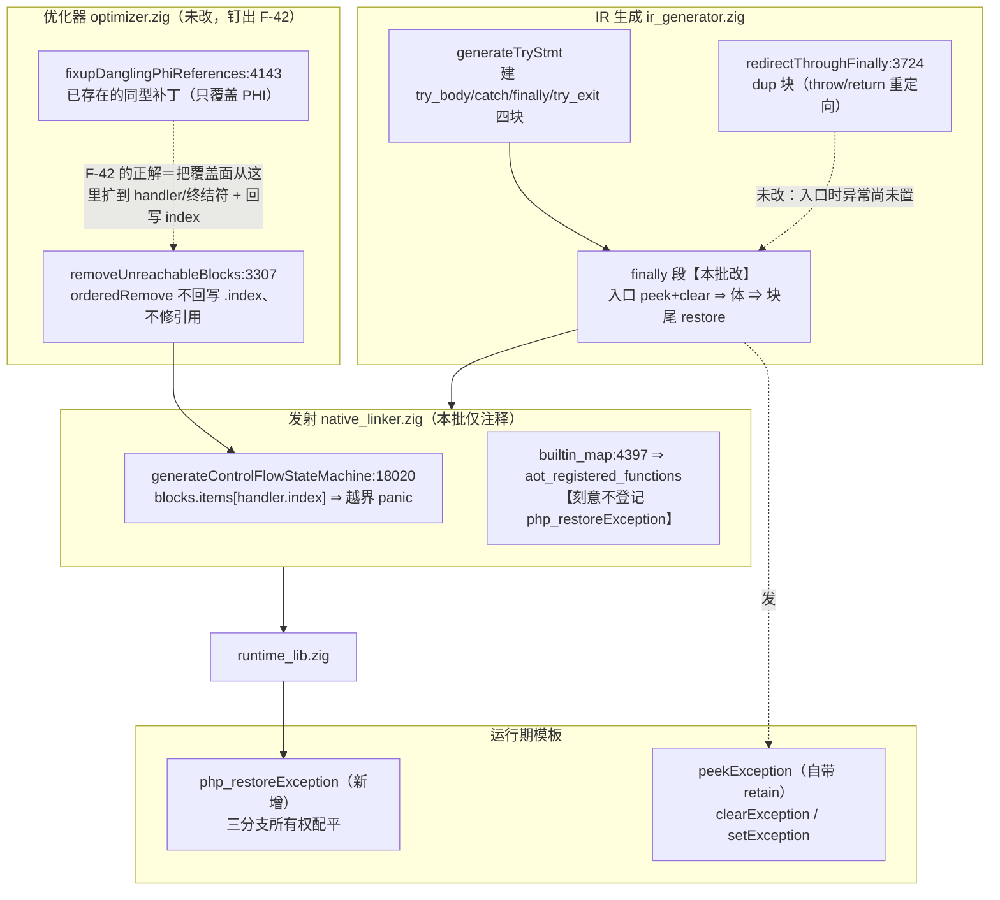
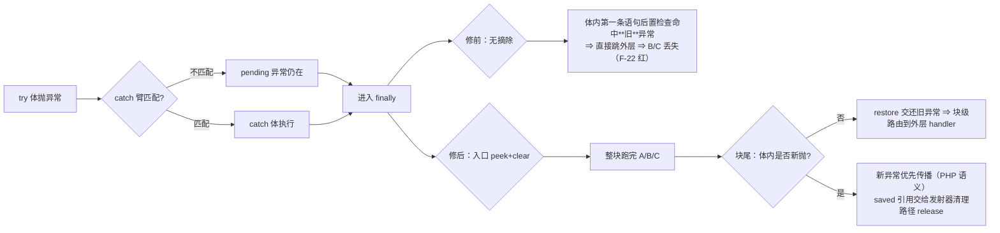
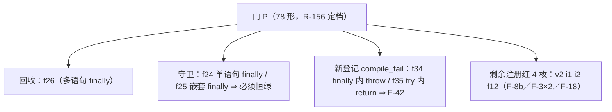

# AOT-CODEGEN-012 · R-156：F-22 落地（finally 整块执行完再传播）⇒ 回收门 P 注册红 `f26`；顺带钉出既存 F-42 / F-43

**类型**: AOT 编译器缺陷修复（IR 生成 + 运行期模板；★动了 `ir_generator` ⇒ 需重建二进制 ⇒ 全链与影子按新代次重测）
**日期**: 2026-10-14
**基线 commit**: `72cdaca`（R-148b~R-154 的 src 由老铁入库；R-155/R-156 两批仍未提交）
**工单**: `docs/known-issues/AOT-CODEGEN-012-class-name-case-insensitive-lookup.md` §30

---

## 1. 高层摘要（TL;DR）

1. **F-22 落地**：PHP 语义是「finally 必须整块跑完，再传播 pending 异常」。AOT 过去在 finally 入口**带着 pending 异常**继续执行 ⇒ 体内第一条语句的后置 `hasException()` 路由把「try 里已抛的异常」误当成本体新抛 ⇒ `echo A; echo B; echo C` 只跑 `A`。修法＝入口 `peek_exception`+`clear_exception`、块尾 `php_restoreException` 交还。
2. **回收实测**：门 P 从 `76 形 same=71 diff=5 cf=0` → **`78 形 same=72 diff=4 compile_fail=2`**，`diff` 恰等剩余四枚注册红 `v2 i1 i2 f12`（`f26` 消失＝真回收），守卫 `f24`（单语句 finally）/`f25`（嵌套 finally）逐枚 SAME。
3. 落地过程中**否证了自己上一轮的一条说法**：F-36 与 Error 支无关（未抛出的 `Exception` 同样 `getFile()` 空），真机制是 `file`/`line` 由 `setException` 惰性注入 ⇒ F-30「搬根」清单删掉一项。
4. 钉出 **F-42（既存，非本批引入）**：`optimizer.zig:3361` 删不可达块用 `orderedRemove` 但**不回写 `.index`、不修引用、还 destroy 对象** ⇒ `native_linker:18020` 拿 `handler.index` 当数组下标即 panic；同一索引域还被 cond_br/phi/环检测比较使用 ⇒ **陈旧下标若在范围内就是静默跳错块**。本仓早已为 PHI 写过同型补丁 `fixupDanglingPhiReferences:4143` ⇒ F-42 的正解是**扩面那个补丁**，不是新造机制。
5. 另立 **F-43**：`function_exists("php_bool_or")` AOT=true／PHP=false ⇒ 内部 helper 登记进 `builtin_map` 会泄漏成 PHP 可见函数名（与 F-4 同族）。因此本次 `php_restoreException` **刻意不登记**，改走 `php_` 前缀默认路径（`may_raise` 默认 true / `needs_allocator` 默认 false），既零影子漂移又不新增可见名。
6. 补齐 F-32 的静态证据：`php_echo` **没有对象支也没有 else** ⇒ `echo $obj` 今天是静默零输出（比 `(string)$obj` 返类名更隐蔽）。

---

## 2. 影响范围

| 维度 | 影响 | 量化 |
|---|---|---|
| 修复面 | 含 `finally` 的 try 语句：块入口摘走 pending、块尾交还 ⇒ finally 体完整执行 | `ir_generator` 一处（finally 段）+ 模板一枚新函数 |
| 语料暴露 | `pass/` 内 `} finally {` 子句 **0 枚** ⇒ 主回归与影子不可能因此变红 | 链上实测影子 `changed_rows=0`、Pass 67 不变 |
| 新二进制代次 | `ir_generator`+`native_linker`(仅注释)+模板 ⇒ 二进制 `f1ff7a0d…` → **`4e048f47861cc841856a0c1dabacba62`** ⇒ 全部门腿与影子按新代次重跑（不是抽查） | `zig build` rc=0 @68s |
| 新增常驻证据 | 门 P `+f34/f35`（F-42 panic 复现件，登记为 compile_fail）；门 W/X/Y 进入链常备腿 | 链 17 腿 |
| 未修而登记 | F-42（optimizer 陈旧索引，P0 候选，量法已备）、F-43（helper 名字泄漏）、F-36（改判后的形态）、F-32 的 echo 入口 | 见工单 §30.6/§28.6.1 |

---

## 3. 核心变更

| # | 层 | 位点 | 变更 | 效果 |
|---|---|---|---|---|
| 1 | 运行期模板 | `runtime_lib_template.zig` `clearException` 之后 | 新增 `pub fn php_restoreException(saved: Value) !void`，三分支配平：null⇒不动；已有 pending⇒**不碰引用**（交给发射器的清理路径 release）；否则 `retain()` 后 `setException` | 交还不泄漏、不双释放 |
| 2 | IR 生成 | `ir_generator.zig` `generateTryStmt` finally 段（原 `:3551-3561`） | 入口 `emitWithResult(.peek_exception)` 存 `saved_ex_reg` + `emit(.clear_exception)`；块尾（仅 `!isBlockTerminated()` 时）发 `.call php_restoreException(saved_ex_reg)`，`.return_type = .void` | finally 体跑完再传播；体外层 catch 由既有块级路由接住 |
| 3 | 发射侧 | `native_linker.zig` `builtin_map`（`:4397` 附近） | **只写注释说明为何不登记条目**（登记＝进 `aot_registered_functions` ⇒ 每个 `main.zig` 漂移 + 多一个 PHP 可见名） | 零影子漂移来源；同时钉出 F-43 |
| 4 | 门资产 | `c012_reflection_gate_tmp.sh` | `+f34/f35` 两臂；头部改 R-156 定档；★门内不再自指 md5（改由工单 §29.11 统一登记） | 常驻复现件 |

---

## 4. 可视化概览

### 4.1 分层架构图（本批变更定位）



### 4.2 业务流程：try/catch/finally 的异常传播（修前 vs 修后）



### 4.3 执行流程与所有权时序（一次 finally 交还）

```mermaid
sequenceDiagram
  participant G as 生成码 main.zig
  participant RT as runtime
  G->>RT: saved = peekException()  %% 命中则 retain ⇒ reg 持 1 份
  G->>RT: clearException()        %% 释放全局那份；reg 那份仍在
  G->>G: 执行 finally 体 A;B;C（无 pending ⇒ 不被路由打断）
  G->>RT: php_restoreException(saved)
  alt has_exception（体内新抛）
    RT-->>G: 直接 return（不碰引用）
    G->>RT: 发射器清理块 reg.release() ⇒ 引用归零前已被全局另持新异常
  else 无 pending
    RT-->>RT: saved.retain() 后 setException(saved)（全局自有 1 份）
    G->>RT: 调用后 hasException() 为真 ⇒ 清理块 reg.release() ⇒ 寄存器那份回收
  end
```

### 4.4 代码—逻辑映射（臂 ↔ 判据）



---

## 5. 详细变更分析

### 5.1 端 / 层

| 层 | 触及 | 说明 |
|---|---|---|
| lexer/parser/ast | 否 | — |
| `ir_generator.zig` | **是** | `generateTryStmt` 的 finally 段；md5 `f3f11def…` |
| `native_linker.zig` | 注释（无逻辑改动） | `builtin_map` 处写明「不登记」的理由；md5 `31f9433d…` |
| `optimizer.zig` | 否 | `6cffa137…`（R-147 守卫）——F-42 归因指到这里，但本批未动 |
| `runtime_lib_template.zig` | **是** | 新增 `php_restoreException`；md5 `998aa7f6…` |
| 解释器 / 字节码模式 | 否（§五只报不改） | finally 在 `vm.zig`/`generator.zig` 是独立实现，本批未核 |

### 5.2 涉及文件清单

| 文件 | 性质 |
|---|---|
| `src/aot/runtime_lib_template.zig` | 新增 helper（唯一新运行期函数） |
| `src/aot/ir_generator.zig` | finally 入口/块尾发射 |
| `src/aot/native_linker.zig` | 注释（决策留痕） |
| `fuzzy_scripts_720/tmp/c012_reflection_gate_tmp.sh` | 门 P `+f34/f35`、头部 R-156 定档 |
| `fuzzy_scripts_720/tmp/c025_r156_acceptance_chain_tmp.sh` + 日志 | R-156 链（17 腿） |
| `docs/known-issues/AOT-CODEGEN-012-…md` | §30 全节 + 头部状态行 + §28.6.1/§29.3 就地更正 |

### 5.3 变更点描述

1. **为什么不「把 finally 块的 handler 置 null 让它不路由」**：发射器在无 handler 时兜底是 `return error.RuntimeError`（与静态属性支同款），会把「跑完 finally」变成「函数提前退出」⇒ 只能走「入口摘走 + 块尾放回」。
2. **为什么块尾不需要 IR 分支**：入口既已 clear，体内任何新抛都会在抛出点路由出去、**走不到块尾**；能到块尾就说明全局无 pending ⇒ helper 内部三分支足以覆盖，无需 `cond_br`。
3. **为什么 `finally_dup_*` 不加同一段**：`redirectThroughFinally` 服务于 throw/return 重定向，其 `.throw` 终结符在复制体**之后**才发 ⇒ 进入 dup 块时尚无 pending，摘了也是空转。
4. **为什么不登记 `builtin_map`**：登记即把名字发射进 `aot_registered_functions`（`function_exists` 的数据源）⇒ 每个 `main.zig` 都漂移，还白送一个 PHP 可见函数名（F-43 就是这个机制造成的既存偏差）。未登记的 `php_*` 名默认路径恰好是所需语义。
5. **F-42 的定级故意留白**：可达性有现成出口可量（`--verbose` 打 `Dead blocks removed`），先量分母再定 P0/P1，不凭「听起来很严重」定级。

---

## 6. 影响与风险评估

| 项 | 结论 |
|---|---|
| 是否破坏式 | 否。仅在**存在 finally 的函数**里新增两条指令；无 finally 的函数发射形状不变（⇒ 语料 0 枚 finally ⇒ 影子预期 `changed_rows=0`，仍以实测为准） |
| 内存安全 | 三分支所有权逐一对照发射器清理块核对（见 §4.3）；`retain`+`setException` 的组合避免双释放，`has_exception` 分支不碰引用避免二次释放 |
| 主要残留风险 | ① F-42 未修 ⇒ 本批只是让 finally 语义正确，`f34/f35` 两类合法 PHP 仍**编译不过**；② F-36 改判后仍未修（未抛出的异常对象取不到 file/line）；③ `count()` 的 `x4` 与 F-3 内建接口表同批，仍留红 |
| 需特别注意 | 新二进制代次 ⇒ **一切旧门读数（含 P/S/T/V/W/X/Y/M/N/O/D8/Q/R/U/B）都必须按新代次复跑**，不可沿用；影子 new-side 列要重新落盘 `c010_shadow_newside_r156_tmp.txt` |
| 复测路径 | 门 P `ONLY="f24 f25 f26"`（11s，判读 `same=3`）⇒ 全门 `bash c012_reflection_gate_tmp.sh`（78 形 @313s，判读 `same=72 diff=4 compile_fail=2`）⇒ 整链 `bash fuzzy_scripts_720/tmp/c025_r156_acceptance_chain_tmp.sh`（17 腿 ≈45 分钟） |

### 6.1 R-156 验收链读数（17 腿，08:05:16→08:57:28，**3132s**，链首尾二进制同为 `4e048f47861cc841856a0c1dabacba62`）

| 腿 | 读数 | 判定 |
|---|---|---|
| 门 X / V / W / T | `9 → same=8 diff=1` ＠42s ／ `29 → same=19 diff=10` ＠126s ／ `20 → same=7 diff=13` ＠78s ／ `22 → same=16 diff=5 cf=1` ＠92s | 新代次下全部等值 ⇒ F-22 零扰动 |
| **门 P** | `78 same=72 diff=4 compile_fail=2 bad_probe=0` @316s | `diff` 恰等 `v2 i1 i2 f12` ⇒ **`f26` 回收**；`cf` 恰等 `f34/f35` ⇒ F-42 登记。与链前无并发单跑逐枚一致（非并发假象） |
| 门 S / M / N / O / D8 / Q / R | `47 diff=0` ／ `19 red=0` ／ `7/7` ／ `6/6` ／ `defect_red=0 guard_same=14` ／ `same=5` ／ `same=8 diff=1 terminate_lost=0` | 全等值 |
| 门 U / 门 B | U 按列聚合 `SAME 51 / COMPILE_FAIL 22 / BAD_PROBE 2`；B `entries=497 dup_rows=33 diff_impl=3 identical=30` | 等值；**B 的 `entries` 未变** ⇒ 「不登记 helper 条目」确实零地图漂移 |
| 主回归 | 08:40:08 @794s：`Total 68 / Pass 67 / Fail(Compile·Runtime·Diff) 0 / Skip 1`，明细仅 `f004 SKIP` | 零回归、回收 0 枚（语料无 `finally`，符合预期） |
| 影子 | `total=68 diff=68` @1040s；new-side 列 `rows=68 col_md5=f19fb070…` 与 r155 列同值 | **`changed_rows=0`** ⇒ 虽换新二进制，`main.zig` 仍逐字节不变（新增两条指令只存在于含 `finally` 的函数里） |
| 残留 | 链内各腿 `repo_build_residue=0`；`.php` 原件零删除 | 影子腿期间的 `residue=1` 是其 KEEP_TEMP 在制品，禁删（§28.13 注） |

---

## 7. 遗留 / 潜在问题

| 编号 | 面 | 状态 |
|---|---|---|
| F-42 | `optimizer.zig:3361` 删不可达块不回写 `.index`、不修引用、destroy 对象 ⇒ `native_linker:18020` panic；cond_br/phi/环检测比较共用同一陈旧域 ⇒ 范围内即静默跳错块 | ★**本行的「不回写 `.index`」口径已被 R-158c 实测否证**（`analysis.zig:273-275 rebuildCFG` 一直统一重编号，且三枚删块站点都随后调它）；肇事站点也不是 `:3361` 而是 trampoline `:4336`。正解、三面判定与门 Z 读数见工单 **§31**（本段原文按当轮认知保留，不作静默改写） |
| F-36（改判后） | `file`/`line` 由 `setException` 惰性注入 ⇒ 构造后未抛出的异常对象取不到位置 | 待修（纯模板）；已从 F-30 清单移除 |
| F-43 | 内部 helper 登记进 `builtin_map` ⇒ 泄漏成 PHP 可见函数名（`function_exists("php_bool_or")` AOT=true） | 与 F-4 同族，待裁决 |
| F-33 第 2 批 | 接口判定 `implementsInterface("Countable")` + 内建 `interfaces` 表 | 与 F-3 同批；门 X `x4` 常驻 |
| F-30 / F-3 / F-31 / F-32 / F-34 / F-35 / F-39 / F-41 / F-24d / F-29 / F-25 / F-8b / F-4 / F-10 | 见工单 §28.12.1 定价表、§29.7~§29.9、§30.6 | 待裁决或待归因（均按 §六不动代码） |
| R-147 的 `optimizer:4360-4371` 守卫 | F-42 修好后是否仍必要 | 属删代码 ⇒ 需老铁点头，本批不动 |

---

## 8. 后续开发建议

| 优先级 | 建议 | 影响面 | 落地成本 |
|---|---|---|---|
| **P0（待量分母后定级）** | **R-158b F-42**：① 先跑 68 语料 `--compile --verbose` 统计 `Dead blocks removed>0` 的脚本数（只读）② 建一枚**静默跳错块**臂（非 panic 侧）③ 扩 `fixupDanglingPhiReferences` 到 `exception_handler`+终结符 + 回写 `.index` | 一切含优化删块的函数；控制流正确性的根子 | 中-高：动 optimizer ⇒ 重建 + 全链，影子可能漂移需重冻 |
| P1 | F-30 + F-3 合并轮（门 W 已登记 13 枚红；w13/w14 方法继承金丝雀；SPL 两级父链真值表已取全） | 内建可抛出族 catch 命中面；语料真实 catch 子句 8 枚、暴露面 0 | 中：纯模板 ⇒ 影子中性 |
| P1 | F-32（先按 §28.6.1 定收口形态；`php_echo`/`php_print` 必须进清单） | 非 Stringable 对象的全部用户可见转换入口 | 中：纯模板，入口多 |
| P1 | F-4 甲/乙（PCRE 重复键去重；`preg_*` 三枚 legacy 条目） | 消除编译期排序翻面风险；门 B 判据 `diff_impl 3→0` 属判据变更需登记 | 低-中 |
| P2 | F-43（helper 名字空间卫生：给 `builtin_map` 加「内部 helper 不导出」分区） | `function_exists`/`get_defined_functions` 保真 | 低 |
| P2 | F-38（修 `zig build test-aot` 的 6 处陈旧测试调用，恢复 AOT 单测保护） | 验证体系 | 低 |
