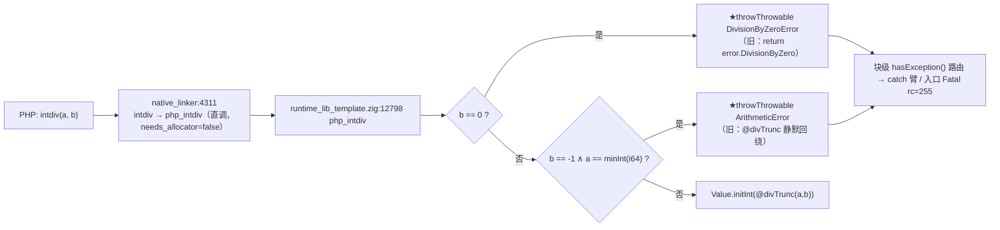
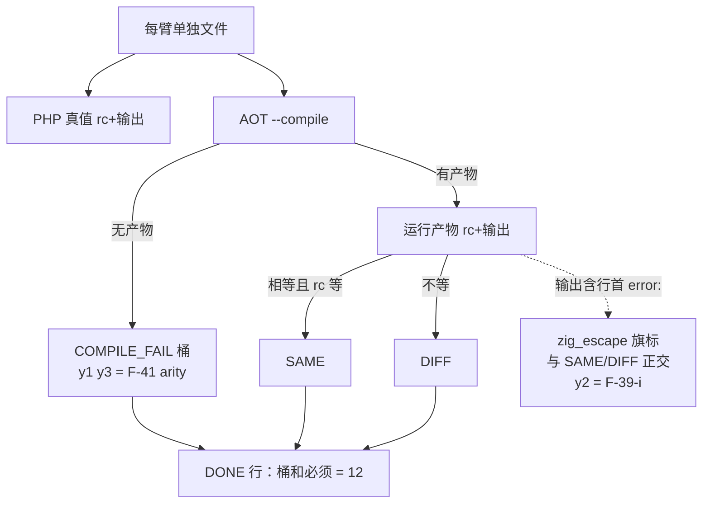

# AOT-CODEGEN-012 · R-159 F-37 落地（`intdiv` 两枚 Zig 外逸）+ 门 Y 改档与首次入链 + F-45 新立（2026-10-14）

## 1. 高层摘要（TL;DR）

- **落地**：`src/aot/runtime_lib_template.zig` 的 `php_intdiv` 两枚站点由「Zig error 外逸 / 静默回绕」改为 PHP 语义的**可捕获异常**。**纯模板改动 ⇒ 不重建二进制**，`main.zig` 发射面中性。
- **回收**：门 Y 的 `y5`（`intdiv(1,0)`）与 `y6`（`intdiv(PHP_INT_MIN,-1)`）由 DIFF 转 SAME；门 Y 改档为 `same=4 diff=6 zig_escape=1 compile_fail=2`。
- **补链缺口**：门 Y 自 R-155 建成后**从未进过任何验收链**（R-155/R-156/R-158b 三条链腿表均无 Y）⇒ 本批起为永久腿（R-159 链 20 腿）。
- **修门揪出新缺陷 F-45（待裁决）**：`printf '1 % 0'` 的裸 `%` 被 bash 当格式符，探针被截成 `1` ⇒ 门 Y 旧档里「y7 是同族已正确先例」**从未被实测**。改单一转义口径后 y7 转真红，暴露 F-45：**结果被丢弃的可抛出算术语句被 DCE 整条消除**（`1 % 0;`／`1 / 0;` 在 AOT 静默返回，PHP 抛 `DivisionByZeroError`）。
- **一次自身事故留档**：一条误写的 `rm -f …` 组合命令删除了未入库的门 Y 脚本；靠删除前快照的 TSV 做**逐臂字段比对**复验重建（除 `ELAPSED` 外完全同值），过程中另纠正两处判据口径（`zig_escape` 必须行首锚定；`norm` 的 `/^Stack trace:/,$d` 会删到文件末尾）。

## 2. 影响范围

| 对象 | 影响 | 描述 |
|---|---|---|
| `src/aot/runtime_lib_template.zig` | 直接 | `php_intdiv` 两枚守卫，md5 `998aa7f6…` → **`6d520849c9a7eab50082c62e924662dd`** |
| 二进制 `zig-out/bin/php-interpreter` | **不变** | 纯模板 ⇒ 无需 `zig build`；链首尾 `bin_md5` 须同为 `b71f9f41…` |
| `main.zig` 生成码 | **零** | 模板进 `runtime_lib.zig`，影子不哈希它 ⇒ 影子等值只证发射器未动（规则 29），运行面证据＝门 Y + 语料 `intdiv(` 计数 **0** |
| `builtin_map` / 函数签名 | **不变** | `intdiv` 本就是 `.needs_allocator=false`，用全局 `runtime_allocator` ⇒ 门 B `entries` 须仍 497 |
| 门 Y（12 形） | 改档 | `y5 y6` 回收；`zig_escape` 旗标口径收紧；★首次入链 |
| 门 P/T/V/W/X/Z/S/M/N/O/D8/Q/R/U/B + 主回归 | 应等值 | 本批不触碰其判据面（链内逐腿复测） |
| 解释器 / 字节码 / JIT 模式 | 未触碰 | 模板只进 AOT 产物 |

## 3. 核心变更

| # | 变更 | 位置 | 修前 → 修后 |
|---|---|---|---|
| 1 | 除零守卫改可捕获异常 | `runtime_lib_template.zig:12802-12808` | `return error.DivisionByZero`（打 `error: DivisionByZero`、rc=1、后续语句不执行）→ `_ = try throwThrowable("DivisionByZeroError", "Division by zero", runtime_allocator); return Value.initNull();` |
| 2 | 新增「商不可表示」守卫 | `:12809-12814` | `@divTrunc(minInt,-1)` **静默回绕**回 `minInt`（rc=0）→ `throwThrowable("ArithmeticError", "Division of PHP_INT_MIN by -1 is not an integer", …)`；判据用 `std.math.minInt(i64)`（与 `:494` 登记 `PHP_INT_MIN` 同一表达式，零硬编码） |
| 3 | 门 Y 表达式发射统一转义口径 | `c024_zig_error_escape_tmp.sh` `body_for` | 10 枚表达式臂全改 `printf '%s' '<expr>'`（旧 `printf '1 % 0'` 会静默截断探针） |
| 4 | 门 Y 旗标/归一口径更正 | 同上 | `escape` 由子串 `"error: "` 改**行首锚定** `^error: [A-Za-z]`（否则 PHP 自己的 `PHP Fatal error:` 被误计）；`norm` 不再用 `/^Stack trace:/,$d`（`sed` 的 `$` 是文件末行 ⇒ 会把第二份回显与帧行一起删掉） |
| 5 | R-159 验收链 | `c028_r159_acceptance_chain_tmp.sh` | 20 腿：新增 **Y 腿**（主门）并保留 R-158b 的 ZFACES/ZCENSUS 两腿 |

## 4. 可视化概览（Code & Logic Map）

### 4.1 分层与调用链



### 4.2 门 Y 的判据维度（正交旗标）



### 4.3 修门轮长出的 F-45（DCE 消除可抛出语句）

```mermaid
sequenceDiagram
  participant PH as PHP
  participant IR as ir_generator
  participant DCE as optimizer DCE
  participant RT as 运行期
  PH->>PH: "1 % 0;" ⇒ DivisionByZeroError（可捕获）
  IR->>DCE: 发射 .mod 指令（结果寄存器死）
  DCE->>DCE: purity 判定「无副作用」⇒ 整条删除
  DCE->>RT: 生成码内已无该运算
  RT-->>RT: 静默返回，异常消失
  Note over DCE: A/B 复证：--aot-disable-pass=dce 或 --aot-max-iterations=0 ⇒ 恢复 CAUGHT
```

## 5. 详细变更分析

| 层 | 文件 | 变更点 | 备注 |
|---|---|---|---|
| 运行期模板 | `src/aot/runtime_lib_template.zig` | `php_intdiv` 两处守卫 | 形态照搬同文件既有 `/`（`:5962`/`:5976`）与 `%`（`:6003`）三支 ⇒ 不新造机制 |
| 异常类表 | 同上 `:14853` | 无改动 | `DivisionByZeroError extends ArithmeticError` 的 ClassMeta 早已登记 ⇒ 捕获面天然正确。★该行旧记 `:14843`，因本批在 `:12802` 起插入 10 行而**下移 +10**（本文件内 `:12816` 之后的锚点一律 +10） |
| 发射器 | `src/aot/native_linker.zig` | 无改动 | 直调点位 `:4311` 不变（arity 面另属 F-41） |
| 门与链 | `c024_zig_error_escape_tmp.sh`（md5 `89cd0ef9…`）/`c028_r159_acceptance_chain_tmp.sh` | 改档 + 首次入链 | 脚本曾被误删，按旧 TSV 逐臂复验重建 |
| 工单 | `docs/known-issues/AOT-CODEGEN-012-…md` §32 | 全新章 | 含 §32.2 printf 假绿否证、§32.3 F-45 四格矩阵、§32.5 事故与复原 |

## 6. 影响与风险评估

### 6.1 R-159 验收链读数（20 腿，11:15:25→12:22:32，**4027 s**；链首尾 `bin_md5=b71f9f41…` 与 `tpl_md5=6d520849…` **双双同值** ⇒ 纯模板批未换代次）

| 腿 | 读数 | wall | 判定 |
|---|---|---|---|
| `zig build test` | rc=0 | 4 s | 缓存档 |
| **门 Y（首次入链）** | `shapes=12 same=4 diff=6 zig_escape=1 compile_fail=2 bad_probe=0` | 43 s | ★主门等值；红集 `y2 y4 y7 y8 y9 y10`，`cf` = `y1 y3` |
| 门 Z 面孔 | `shapes=10 same=9 diff=1 dangling=0` | 38 s | 等值 R-158b 档 |
| 门 Z 普查 | `total=68 dangling=0 ok=68 other=0` | 814 s | 等值 ⇒ 模板批不影响 IR 合法性 |
| 门 X / V / W / T | `8/1` @42s ／ `19/10` @126s ／ `7/13` @76s ／ `16/5 cf=1` @91s | — | 全等值 |
| 门 P | `78 same=73 diff=5 cf=0` | 320 s | 等值（红 `v2 i1 i2 f12 f34`） |
| 门 S/M/N/O/D8/Q/R | `47 diff=0`／`19 red=0`／`7/7`／`6/6`／`guard_same=14`／`same=5`／`same=8 diff=1` | — | 全等值 |
| 门 U / 门 B | U 列聚合等值 @210s；B `entries=497 distinct=464 dup_rows=33 diff_impl=3 identical=30` | 2 s | ★`entries`/`distinct` 未变 ⇒ 改函数体不动签名确实零地图漂移；`distinct=464` 与 ARITY 普查口径互证 |
| 主回归 | 报表 mtime 12:05:09 @794 s：`Total 68 / Pass 67 / Fail(Compile·Runtime·Diff) 全 0 / Skip 1`，明细仅 `f004 … SKIP` | — | 零回归、回收 0 枚（语料 `intdiv(` = 0） |
| 影子 | `total=68 diff=68 miss=0 invalid=0` @1043 s | — | 无 miss/invalid |
| 影子 new-side 列 | `gen=r159 rows=68 col_md5=f19fb070ba1b86c34f02b3883de8e4dd`＝r158b 同值 ⇒ `changed_rows=0 col_identical=yes` | — | ★自 r148b 起**第 8 代同值**；★但影子不哈希 `runtime_lib.zig`（规则 29）⇒ 本批运行面证据＝**门 Y + 语料计数 0**，不是影子 |
| 残留 | 各腿 `repo_build_residue=0`；`.php` 原件零删除 | — | 合规 |


### 6.2 是否破坏式变更

**否。** 模板内两处守卫，函数签名与 `builtin_map` 都不动；语料 `intdiv(` 计数 **0** ⇒ 基线零暴露。行为变化仅在「合法 PHP 本就抛异常」的输入上：由 `rc=1 + error: X` 或静默错值，变为可捕获异常 / 正确 Fatal 文本 + `rc=255`。

### 6.3 需要特别注意的点

1. **`zig_escape` 是正交旗标**：判读时桶和须等于形数（12），把它当互斥桶会读出自相矛盾的数字（重建首跑就给到 `escape=5`）。
2. **纯模板 ≠ 可以省链**：影子只哈希 `main.zig`，模板改动在它上面**天然隐形**（规则 29）⇒ 本批运行面证据链 = 门 Y + 语料计数 0 + 主回归等值。
3. **探针生成必须单一转义口径**：`printf` 里裸 `%` 会造成「语法仍合法、语义已变形」的静默截断，`php -l` 与「输出非空」两道预检都拦不住。
4. **门脚本长期未入库 = 资产风险**：本仓已有 `AOT-PROC-001`（gitignore `test_*`）与本轮误删事故两类同因风险 ⇒ 建议首次定档后即入库（需老铁点头，本批未擅自 `git add`）。

### 6.4 复测路径

```bash
# 仓库根执行；纯模板改动 ⇒ 无需 zig build
timeout 600 bash fuzzy_scripts_720/tmp/c024_zig_error_escape_tmp.sh      # 门 Y：期望 same=4 diff=6 zig_escape=1 cf=2
ONLY="y5 y6 y7" timeout 300 bash fuzzy_scripts_720/tmp/c024_zig_error_escape_tmp.sh  # 子集：y5 y6 必 SAME、y7 必 DIFF(F-45)
timeout 5400 bash fuzzy_scripts_720/tmp/c028_r159_acceptance_chain_tmp.sh             # 全链 20 腿
```

单形手工复现（两侧对照）：

```bash
# shell
printf '%s\n' '<?php try { $r = intdiv(PHP_INT_MIN, -1); echo "RET|", var_export($r, true), "\n"; } catch (Throwable $e) { echo "CAUGHT|", get_class($e), "\n"; }' > /tmp/f37_probe.php
/opt/homebrew/bin/php /tmp/f37_probe.php                                                     # PHP: CAUGHT|ArithmeticError
timeout 120 zig-out/bin/php-interpreter --compile --no-debug-info --output=/tmp/aot_compile_f37_probe /tmp/f37_probe.php
/tmp/aot_compile_f37_probe; echo "rc=$?"                                                     # AOT 修后: CAUGHT|ArithmeticError
```

## 7. 遗留问题 / 潜在问题

| 编号 | 面 | 状态 |
|---|---|---|
| **F-45** | 结果被丢弃的 `%`/`/` 语句被 DCE 消除 ⇒ 应抛的 `DivisionByZeroError` 静默消失（A/B 关 dce 复现 CAUGHT） | 新立，待裁决（甲＝purity 加可抛出性，含优化损失；乙＝仅语句位保留）；永久臂＝门 Y `y7` |
| F-45 语料分母 | 粗正则命中 1075 行属**过匹配**，已作废 | 需 IR 侧计数（死寄存器 ∧ `.div`/`.mod`）或逐形实测 ⇒ F-45 归因轮 |
| **F-44** | finally 体内 `throw` ⇒ 整个 finally 体重发一份 | 待裁决（上一轮新立，见 §31.9） |
| y2（`json_decode()`） | `error: InvalidArgumentCount` 裸外逸 rc=1 | F-39-i 剩余一枚（132 处 InvalidArgumentCount 族的代表） |
| y1/y3 | `strlen()`/`intdiv(5)` 编译期硬拒 | F-41 arity，待裁决 |
| y4/y8/y9/y10 | 未捕获上报文本与 PHP 不逐字节等值（`Uncaught Exception:` 应为 `Error:`、by-ref 消息类别等） | F-16/F-39-ii 族，待归因落地 |
| F-30 / F-3 / F-31 / F-32 / F-34 / F-35 / F-39 / F-24d / F-29 / F-25 / F-8b / F-4 / F-10 | 既有待裁决项 | 未动（均按 §六 不改代码） |
| 门脚本入库 | 永久门脚本全部 `?? 未跟踪` | 建议入库；删除/提交都需老铁明示 |

## 8. 后续开发 / 优化建议（★老铁已于 2026-10-14 裁决，见工单 §32.8）

| 优先级 | 建议 | 裁决 | 影响面 | 落地成本 |
|---|---|---|---|---|
| **P0** | **R-160＝F-41 丙型**：编译期 arity 金丝雀（把「实参数 < 已确认必填数」从静默 Zig 编译错变成可读诊断），不改任何真值表 | ✅ **采「丙 → 甲 两步走」** | 语料面 0；先把 y1/y3 这类「合法 PHP 编译不过」变可定位 | 低-中（ir_generator 一处比较 + 门 Y 改档） |
| **P0** | 后续一轮＝F-41 甲型：就地补齐/更正 `src/runtime/fn_table.zig`（165 缺失 + 10 冲突），AOT 侧 `@import("runtime")` 复用 | ✅ 已许甲，但★甲跨解释器/字节码/JIT ⇒ **开工前先量「改表对三模式的行为影响」** | 单一真值源 | 中-高（165 枚逐条核 + 跨模式读数） |
| **P0** | **F-45 落地**：DCE 对「结果被丢弃」的语句位保留可抛 binop | ✅ **采乙型（仅语句位保留）** | 静默丢失可捕获异常 ⇒ 收口；性能损失面最小 | 中（`optimizer.zig` ⇒ 重建 + 全链）；前置＝IR 侧「死寄存器 ∧ 可抛 binop」分母实测 |
| **P1** | F-44（finally 体内 throw ⇒ 体被重发一份）：先给 z3/z7/z9/z10 补守卫臂，再动 `ir_generator:3744` | 待点头 | finally 语义族 | 中（动 `ir_generator` ⇒ 全链 + 影子可能漂移） |
| **P1** | 未捕获上报文本逐字节对齐（门 Y 的 y4/y8/y9/y10 四枚） | 未裁决 | 错误可读性、脚本可比对性 | 低-中（模板单点 + 门 Y 改档） |
| **P2** | 门脚本入库 + CI 跑「门 Z 普查 / 门 Y / ARITY」做提交前门禁 | ❌ **暂不提交**（老铁明示后才 `git add`） | 防资产流失、防判据漂移 | 低 |
| **P2** | `dead_blocks_removed` 旗标补齐另两枚删块站点（或改名加注） | 未裁决 | 诊断可信度 | 低 |

### 8.1 本轮已备好的下一步素材

- **ARITY 普查门**（`c029_arity_census_tmp.sh`，md5 `a85c9e1f…`）：464 枚内置名的 `PHP 反射 min/total/variadic × 是否在 fn_table × 抽样真调用消息` 全表 ⇒ 丙型的名单与甲型的缺口清单都从它出。
- ★该门**不调 AOT**（纯静态 + 纯 PHP 反射）⇒ 可在验收链跑动期间执行（规则 35/46 的例外），适合当常态化前置检查。

