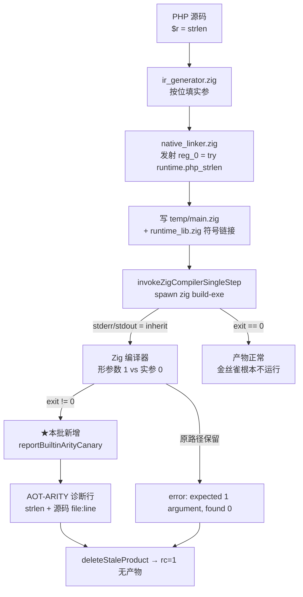
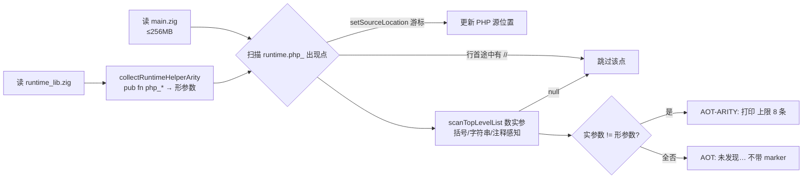
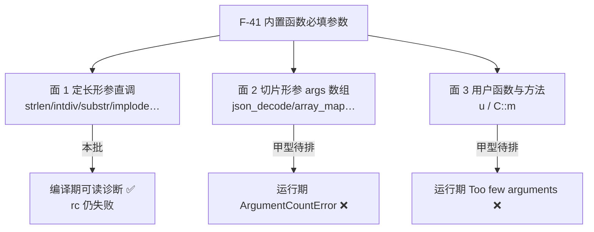

# AOT-CODEGEN-012 · R-160：F-41 丙型「arity 金丝雀」落地 —— 编译失败后自解析生成码，把裸 Zig arity 错翻成可读诊断

**代次**：`native_linker.zig` `9eb19280e01eea3740dea1ffa00bddbb`／`optimizer.zig` `ba0e0f579518908e030fc09ca994147f`（未变）／`runtime_lib_template.zig` `6d520849c9a7eab50082c62e924662dd`（未变）／二进制 `fe5d70d42745ab8e3fddc8a66139d6b6`
**工单**：`docs/known-issues/AOT-CODEGEN-012-class-name-case-insensitive-lookup.md` §36（链前取证）＋ §36.8（链读数）
**裁决依据**：老铁 2026-10-14 裁「F-41 arity 真值来源＝**丙 → 甲 两步走**」（工单 §32.8）

---

## 1. 高层摘要（TL;DR）

PHP 里 `strlen()`／`intdiv(1)`／`substr("abc")` 这类**内置函数实参写少了**的形，在 PHP 8.5.8 是**可捕获的 `ArgumentCountError`**；在 AOT 里则是**编译期硬失败**——而且失败信息只有 `main.zig:57:24: error: expected 1 argument(s), found 0` 这一行指向**生成码**的 Zig 裸错，既不说哪个 PHP 函数、也不说用户的源码在第几行。

本批按**丙型**收口「**可读性**」这一半：在编译器的**终局失败分支**里自解析刚生成的 `main.zig` 与运行时库签名，把「调用实参数 ≠ helper 形参数」的站点翻译成带 **PHP 函数名 + PHP 源码 file:line** 的诊断行（前缀 `AOT-ARITY:`）。

★三条硬约束全部落地并自证：**不建 arity 真值表**（必填数直接取运行时库里 `pub fn php_*` 的形参数，与 Zig 的判据同源）；**不碰子进程管道**（Zig 自己的诊断照旧 inherit 透传，门 AC 用 `zig_raw_arity_err` 恒 7 当这条的不变量）；**不改进 rc、不改进发射文本**（⇒ 影子必须 `changed_rows=0`）。

★本批**不解决**运行时语义：`compile_fail` 仍是 `compile_fail`，切片形参面（`json_decode()` 编译通过、运行期才炸）与用户函数/方法面仍红 ⇒ 那是**甲型**（补 `fn_table` 真值）的工作。

---

## 2. 影响范围

| 维度 | 影响 | 实测证据 |
|---|---|---|
| 成功编译路径 | **零影响**（新代码只挂在 `code != 0` 分支） | 门 AC 的 5 枚 `ran` 臂、门 F45FACE/Y 全档等值；影子 `changed_rows` 判据＝0 |
| 失败编译路径 | 多打 1..8 行 `AOT-ARITY:` 诊断（或一行 `AOT: 未发现…`） | 门 AC `canary 0→7` |
| 生成码文本 | **不改**（发射器输出零变化） | 影子 new-side 整列 vs r161 列（链内填数） |
| rc / 产物存在性 | **不改**（`compile_fail` 枚数恒 7／12 臂口径） | 门 AC `compile_fail` 修前 7 ⇒ 修后 12 臂口径仍 7 |
| 其他执行模式（tree/bytecode/fast） | 不触及（改动在 `src/aot/native_linker.zig`，仅 AOT 链路使用） | 本批零 `src/` 非 AOT 改动 |
| 语料（68 形） | 暴露 0（pass/ 内内置调用实参都正确，R-156 已测） | 主回归 `Pass 67 / Skip 1`（链内填数） |

---

## 3. 核心变更

| # | 变更 | 位置 | 性质 |
|---|---|---|---|
| 1 | 终局失败分支追加金丝雀调用 | `native_linker.zig:32993`（`.exited code != 0` 内、`deleteStaleProduct` 之前） | 一行调用，失败路径专属 |
| 2 | `reportBuiltinArityCanary` | `native_linker.zig:33182` 起 | 读 `main.zig`+`runtime_lib.zig`，扫不匹配站点并打印诊断 |
| 3 | `collectRuntimeHelperArity` | 同段 | 从运行时库扫 `pub fn php_*(` ⇒ 形参数登记（实测 **539/539**，排除 0 枚） |
| 4 | `scanTopLevelList` | 同段 | 括号平衡＋字符串/注释感知的顶层条目计数；**判不可靠即 null ⇒ 放弃诊断** |
| 5 | `parseEmittedSourceLocation` | 同段 | 借生成码里的 `setSourceLocation("<php>", N)` 游标还原告警到**用户 PHP 源码位置** |
| 6 | 反面自证行 `AOT: 未发现…` | 同段末 | ★**故意不带** `AOT-ARITY:` 前缀 ⇒ 让 a13 这类非 arity 失败不被假亮 |

净变更：`native_linker.zig` **+246 / −0**（`git diff --stat HEAD` 实测）。

---

## 4. 可视化概览（Code & Logic Map）

### 4.1 分层与缺陷链



### 4.2 金丝雀内部流程（全部「不可靠即沉默」）



### 4.3 三面分工（丙型只吃第一面）



---

## 5. 详细变更分析

### 5.1 端 / 层

| 层 | 文件 | 说明 |
|---|---|---|
| 编译前端 | — | 未触及（arity 不在前端判定） |
| IR / lowering | `ir_generator.zig`（未变） | 发射器按位填实参的形状本批**只观察不改** |
| 发射 | `native_linker.zig` | 新增失败分支诊断；`compileToExecutable` 的 OOM 重试与 `deleteStaleProduct` 语义不动 |
| 运行时 | `runtime_lib_template.zig`（未变） | 只作为**签名真值来源**被读取 |
| 门禁 | `c034_arity_canary_gate_tmp.sh`（门 AC，永久侧门） | 13 臂：7  arity 站点 + 1 非 arity 失败反面臂 + 5 守卫/控制臂 |

### 5.2 生成码形状实测（七枚 arity 站点 + 一枚切片形参对照）

| 臂 | PHP 源 | 生成码调用 | Zig 报错 | helper 形参 | 修后 |
|---|---|---|---|---|---|
| a1 | `strlen()` | `runtime.php_strlen()` | expected 1, found 0 | 1 | `AOT-ARITY` ✓ |
| a2 | `intdiv(1)` | `php_intdiv(reg_0)` | expected 2, found 1 | 2 | ✓ |
| a3 | `array_pop()` | `php_array_pop(alloc)` | expected 2, found 1 | 2 | ✓ |
| a4 | `substr("abc")` | `php_substr(reg_0, alloc)` | expected 4, found 2 | 4 | ✓ |
| a5 | `strpos("ab")` | `php_strpos(reg_0)` | expected 3, found 1 | 3 | ✓ |
| a6 | `str_replace("a","b")` | `php_str_replace(reg_0, reg_1, alloc)` | expected 5, found 3 | 5 | ✓ |
| a12 | `implode(",")` | `php_implode(reg_0, alloc)` | expected 3, found 2 | 3 | ✓（★建门轮新增的第 7 枚） |
| a7 | `json_decode()` | `php_json_decode(&[_]Value{}, alloc)` | **无** | 切片 ⇒ 编译通过 | ❌ 丙型不覆盖（甲型） |

### 5.3 涉及文件清单

| 文件 | 状态 |
|---|---|
| `src/aot/native_linker.zig` | 修改 +246/−0 |
| `fuzzy_scripts_720/tmp/c034_arity_canary_gate_tmp.sh` | 新增（门 AC，永久侧门，未入库） |
| `fuzzy_scripts_720/tmp/c034_arity_canary_tmp.tsv` | 门 AC 表身（13 行＋DONE） |
| `fuzzy_scripts_720/tmp/c035_r160_acceptance_chain_tmp.sh` | 新增（21 腿验收链，未入库） |
| `docs/known-issues/AOT-CODEGEN-012-…md` | 新增 §36 与 §6 状态行 |

---

## 6. 影响与风险评估

### 6.1 R-160 验收链读数（21 腿，实测）

链窗口 `16:16:30 → 17:26:23`，**ELAPSED 4193 s**；首尾 `bin_md5=fe5d70d42745ab8e3fddc8a66139d6b6`／`tpl_md5=6d520849c9a7eab50082c62e924662dd` 各同值 ⇒ 链内零代次漂移。规则 28 双判成立（末腿 `R160_CHAIN_DONE` ∧ 报表 mtime `17:09:01` 晚于该腿开跑）。

| 腿 | 读数 | wall | 判定 |
|---|---|---|---|
| buildtest | rc=0 | 1 s | 缓存档 |
| **AC** | `arms=13 compile_fail=8 ran=5 same=2 diff=3 canary=7 bare_symbol=8 zig_raw_arity_err=7 residue=0` | 25 s | ★主判据达成：`canary 0→7`，而 `compile_fail`/`zig_raw` 未动（＝不改 rc、不碰子进程管道的实证） |
| F45FACE | `shapes=14 raise_lost=2 preserved=12 both_match_php=5 both_red_not_match_php=7` | 106 s | R-161 复证等值（★本腿 DONE 首次直接显示外层） |
| Y | `shapes=12 same=5 diff=5 zig_escape=1 compile_fail=2` | 44 s | 等值注册档；y1/y3 仍 `cf`，符合「丙型不改 rc」 |
| ZFACES / ZCENSUS | 表身聚合 `10 行 = SAME 9 / DIFF 1` ／ `68 行 = OK 68`（`dangling` 命中 0） | 38 / 824 s | 等值 |
| X / V / W / T | `8/1` ／ `19/10` ／ `7/13` ／ `16/5 cf=1` | 42/128/79/93 s | 全等值注册档 |
| P / S | `78 → 73/5 cf=0` @327s ／ `47 diff=0` @198s | — | 等值 |
| M / N / O / D8 / Q / R | `19 red=0` ／ `7 red=0` ／ `6 red=0` ／ `defect_red=0 guard_same=14` ／ `same=5` ／ `same=8 diff=1` | 73/25/22/52/23/41 s | 全等值 |
| U | 列聚合 `75 行 = SAME 51 / COMPILE_FAIL 22 / BAD_PROBE_PHP 2`（★桶和＝行数已核对） | 214 s | 等值 |
| B | `entries=497 distinct=464 dup_rows=33 diff_impl=3` | 2 s | 等值 ⇒ 零地图漂移 |
| regression | `Total 68 / Pass 67 / Fail 全 0 / Skip 1`；`## 失败明细` 仅 `f004 SKIP` | 794 s（mtime `17:09:01`） | 回收 0、新增红 0 |
| shadow | `total=68 same=0 diff=68 miss=0 invalid=0` | 1042 s | 对照冻结前缀常态 |
| shadowcol | `gen=r160 rows=68 col_md5=f19fb070…` ＝ r161 列同值 ⇒ **`changed_rows=0 col_identical=yes`** | — | ★落地前写死的硬判据达成：自 R-148b 起**第 10 代发射同值** ⇒ 本批确实没碰发射路径 |
| 残留 | 各腿 `residue=0`、`bad_probe=0`；`.php` 原件零删除 | — | 合规 |

★**取证第 2 版更正**（覆盖本文初稿写的 `tail -1` 方案）：`head -1` 与 `tail -1` **都**不通用——门 ZFACES 先打 `ZFACE_DONE shapes=…` 再打 `ZFACE_DONE tsv=…`，所以 `tail -1` 反把该腿数字吃掉。正确口径＝**按内容取** `grep -E '_DONE (shapes|arms|total)='`，取不到再回退表身列聚合（工单 §36.8 末）。本轮 ZFACES/ZCENSUS 即由表身聚合复核为等值，属显示层缺陷、不影响判定。

### 6.2 是否破坏式变更

**否。** 只在编译已经失败的分支追加输出；不改 rc、不改产物判定、不改发射文本。理论代价＝失败时多两次读盘（`main.zig` 5.9 MB 实测、`runtime_lib.zig` 1.4 MB）＋两次线性扫描，属**失败路径专属**，成功编译零成本。

### 6.3 需要特别注意的点

1. **措辞不能误导**：诊断写的是「生成码里传了 N 个实参（含自动补的 allocator/输出槽）」，**不是**「PHP 少写 N 个」——`substr("abc")` 里 PHP 写 1 个而 N=2。第一版措辞会误导，已改（§36.5）。
2. **`AOT: 未发现…` 行绝不能带 `AOT-ARITY:`**：否则门 AC 的 `canary` 会在任何无关编译失败上假亮（本轮真实踩到并自纠，§36.7-1）。
3. **注释误读守卫**：生成码每条指令前有 `// <php 文件>:<行>`，扫描器回退到行首见 `//` 即放弃该点（§36.7-2）。
4. **不可靠即沉默**：`scanTopLevelList` 遇未闭合括号／三引号多行串返回 null；形参含 `comptime/anytype/type/...` 的 helper 不登记（实测此类为 0 枚，但守卫必须在）。
5. **上限 8 条**：巨型脚本可能有多枚 arity 站点，诊断封顶 8 条防刷屏。
6. **丙型不是甲型**：禁把「诊断可读」当「语义收敛」上报——面 2/面 3 仍红，`compile_fail` 仍存。

### 6.4 复测路径（体验流程）

```bash
cd /Users/wangjianjun/products/parser
# 1) 单形直观复现（看诊断行）
printf '<?php\n$r = strlen();\necho "R=[$r]\\n";\n' > /tmp/ac.php
timeout 180 zig-out/bin/php-interpreter --compile --no-debug-info --output=/tmp/aot_compile_ac /tmp/ac.php
# 2) 门 AC（13 臂，~25s）
timeout 900 bash fuzzy_scripts_720/tmp/c034_arity_canary_gate_tmp.sh
# 3) 反面守卫（非 arity 失败必须 canary=no）
grep -E '^a13' fuzzy_scripts_720/tmp/c034_arity_canary_tmp.tsv | cut -c1-120
# 4) 全链（21 腿，~65 分钟；链跑动期间禁改 src/模板）
nohup timeout 5400 bash fuzzy_scripts_720/tmp/c035_r160_acceptance_chain_tmp.sh &
```

---

## 7. 遗留问题 / 潜在问题

| # | 项 | 说明 | 归类 |
|---|---|---|---|
| 1 | **F-41 甲型**（arity 真值源） | `fn_table.zig` 缺 165 枚、10 枚与 PHP 反射冲突；AOT 侧 `builtin_map` 不带 arity 字段 | 待排（跨解释器/字节码/JIT ⇒ 开工前须先量其他模式影响） |
| 2 | 面 2：切片形参站点静默通过编译 | `json_decode()` 编译通过、运行期 `error: InvalidArgumentCount`（门 AC a7 `RUN_DIFF`） | 甲型＋运行期守卫 |
| 3 | 面 3：用户函数/方法少传参 | a10/a11 `RUN_DIFF`，PHP 消息是 `Too few arguments to function` | 独立面，未编号收口 |
| 4 | 门 Y 的 `y1 y3` 仍 `compile_fail` | 丙型不改 rc ⇒ 这两枚要等甲型才转绿 | 已登记 |
| 5 | 诊断只针对 `runtime.php_*` 直调 | 若将来发射器改走别的调用形态（如通过函数指针表），金丝雀覆盖面需重新测 | 观察项 |
| 6 | `build.zig:10` 默认档 ReleaseSafe 下，zig 失败信息可能不止 arity | 本批只在失败分支加行，不遮蔽任何原始输出（`zig_raw_arity_err` 恒 7 自证） | 无 |
| 7 | ★**R-160b（工单 §37）改写了甲型的形态**：`src/runtime/stdlib.zig:24-47` 已经在用 `fn_table` 的 `min_args/max_args` 做中央校验（tree/fast 走它，AOT 与 bytecode 都不走） | ⇒ `fn_table` 那 10 枚错值**今天就是 tree/fast 的活缺陷**：实测 **5 枚过度拒绝**（`array_merge()`／`array_push($a)`／`array_diff($a)`／`implode($a)`／`array_unshift($a)`，PHP 全合法）＋**3 枚该拒不拒**（`parse_str("a=1")`／`mktime()`／`get_class_methods()`，PHP fatal 而 tree/fast 放行）；bytecode 对 10 枚里 8 枚直接返回 `NULL` | 新立 **F-47**（消息文本不合 PHP）／**F-48**（bytecode 零校验）／**F-49**（fast 模式 `printValue` 整数溢出 panic）；三态待老铁裁（甲‑1／甲‑2 推荐／甲‑3） |

---

## 8. 后续开发 / 优化建议

| 优先级 | 项 | 影响面 | 落地成本 |
|---|---|---|---|
| **P0** | **R-160 链收口后把门 AC 并入常备链**（与门 Y/F45FACE 并列） | arity 面从此有守卫 | 低（已在链内） |
| **P1** | **甲型第一步：量「改 `fn_table` 对解释器/字节码/JIT 三模式的行为影响」** | 决定甲型能否动表 | 中（跨模式差分门一枚） |
| **P1** | **面 2 收口：为切片形参 helper 发运行期 arity 守卫**（`php_json_decode` 之类 → `throwThrowable("ArgumentCountError", …)`） | 让 `json_decode()` 变成可捕获异常 | 中（发射侧需知 PHP 必填数 ⇒ 仍依赖甲型真值） |
| **P2** | 诊断文本再进一步：把「PHP 侧必填数」直接写进消息（现在只能说「与实现形参不符」） | 用户可读性 | 依赖甲型 |
| **P2** | 门 AC 扩臂：`compact()`／`range()`／`array_slice()` 等更多定长站点 + 一枚多行调用形 | 覆盖面自证 | 低（臂表扩写） |
