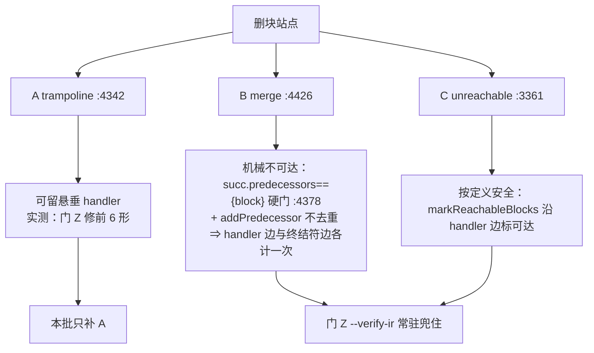

# AOT-CODEGEN-012 · F-42 悬垂 handler 改道落地 + 永久门 Z 建成 + F-44 新立（R-158b / R-158c，2026-10-14）

## 1. 高层摘要（TL;DR）

- **落地**：`optimizer.zig` 的快转块删除站点（`tryRemoveTrampolineBlock`）在释放块之前，新增一次 `exception_handler` 改道（`redirectExceptionHandlerRef`，扫全函数块表）。**+29/−0，单文件**。⇒ 合法 PHP 的 `try{…}finally{…}`（无 `catch` 子句）不再让编译器 panic，也不再产出「从错块收集清理集」的生成码。
- **否证两条既有口径**（都带实测证据，不静默删除）：
  1. 「删块后 `.index` 漂移、修法要回写 `.index`」——**错**：`analysis.zig:273-275 rebuildCFG` 开头就统一重编号，且三枚删块站点全部随后调用它。
  2. 「用 `--verbose` 的 `Dead blocks removed` 量本族分母」——**错**：该旗标只由三枚站点之一（`:3364`，不可达块删除）递增，恰好漏掉肇事的 trampoline 面。
- **新永久资产**：**门 Z** 两张——面孔门（10 形，判据取 `dangling` 桶）+ 全语料普查（68 形 × `--verify-ir --no-opt-fallback`）。
- **新立 F-44（待裁决，属暴露非引入）**：`ir_generator.zig:3744 redirectThroughFinally` 的豁免条件在「throw 位于 finally 体自身」时失效 ⇒ 整个 finally 体被重发一份。A/B 臂（关掉 cfg_cleanup）实测仍双打 ⇒ 与本批 optimizer 改动正交。
- **门 P 改档**：`compile_fail 2→0`；`f35` 转绿、`f34` 转为语义红（=F-44）⇒ 注册红 `v2 i1 i2 f12` → `v2 i1 i2 f12 f34`。

## 2. 影响范围

| 对象 | 影响 | 描述 |
|---|---|---|
| `src/aot/optimizer.zig` | 直接 | 新增 `redirectExceptionHandlerRef` + trampoline 站点一行调用 |
| AOT 编译产物（`main.zig` 生成码） | **零**（实测） | 68 语料在 `--verify-ir` 下 `dangling=0 ok=68` ⇒ 语料内不存在本改道触发的形态；影子 new-side 列 `changed_rows=0`（整列 md5 仍 `f19fb070…`，自 r148b 起第 7 代同值） |
| 合法 PHP 的 `try/finally` 族 | 修复 | 门 Z 修前 6 形 `dangling`（5 枚编译期 panic + **1 枚静默**）⇒ 修后 0 |
| 门 P（78 形） | 改档 | `cf 2→0`、注册红 4→5 枚 |
| 运行期模板 / `ir_generator` / `native_linker` | **未动** | F-44 留待下一批（不同层、不同文件，规则 31） |
| 解释器 / 字节码 / JIT 模式 | 未触碰 | 改动全在 AOT 的 IR 优化与发射链路内 |
| 二进制代次 | 必须重建 | 改 `optimizer` ⇒ `zig build`；`b71f9f41…` |

## 3. 核心变更

| # | 变更 | 位置 | 说明 |
|---|---|---|---|
| 1 | 新增 `redirectExceptionHandlerRef(func, removed, replacement)` | `optimizer.zig:4354` | 把 `exception_handler == removed` 的块改道到 `replacement`；**必须扫全函数块表**而非 `removed.predecessors`（终结符已先改道 ⇒ 那些块不再算前驱） |
| 2 | trampoline 释放前调用改道 | `optimizer.zig:4340`（紧邻 `:4342 orderedRemove`） | 与既有 `replaceBlockInTerminator`（只管终结符）、`expandPhiIncomingForRemovedBlock`（只管 PHI）并列补齐第三类引用 |
| 3 | 「目标 == 自身 ⇒ 置 `null`」不变量守卫 | `optimizer.zig:4365` 内 | 依据 `analysis.zig:316` 建边硬写 `handler != block` ⇒ 自环 handler 是本 IR 自己声明不接受的形态。**如实登记：当前无门臂能区分带/不带该守卫（效果实测为零）** |
| 4 | 门 Z 面孔门（10 形） | `fuzzy_scripts_720/tmp/c026_dangling_ref_face_tmp.sh` | 双维判据：`--verify-ir` 桶（`DANGLING_REF`/`SILENT`/`PANIC`）＋产物输出对 PHP 真值 |
| 5 | 门 Z 全语料普查（68 形） | `fuzzy_scripts_720/tmp/c026_dangling_ref_census_tmp.sh` | 不变量探针取代统计旗标做分母；`--no-opt-fallback` 防兜底把 `InvalidIR` 降级成 warning |
| 6 | 工单 §31 全章 + 门 P 改档 | `docs/known-issues/AOT-CODEGEN-012-…md` | 含 §31.10 锚点漂移表（`:4354` 之后一律 +29）与 §31.11 资产表 |

## 4. 可视化概览（Code & Logic Map）

### 4.1 分层

```mermaid
flowchart LR
  A[PHP 源<br/>try{…}finally{…} 无 catch] --> B[ir_generator<br/>generateTryStmt]
  B --> C["catch_block = 空块 + 一跳<br/>（:3544-3548）"]
  B --> D["try_body.exception_handler = catch_block<br/>（:3349）"]
  C --> E[optimizer IROptimizer]
  D --> E
  E --> F["cleanupCFGInFunction :4236"]
  F --> G["tryRemoveTrampolineBlock :4318<br/>三前置：零指令 / 自身无 handler / .br"]
  G --> H["★本批：redirectExceptionHandlerRef :4340"]
  H --> I["orderedRemove + destroy :4342-4344"]
  I --> J[rebuildCFG analysis.zig:270<br/>重编号 .index + 重建边]
  J --> K[native_linker 发射<br/>:18020 handler.index / :18024 collectBlockUsedRegs]
```

### 4.2 缺陷与修复时序（修前 vs 修后）

```mermaid
sequenceDiagram
  participant OPT as optimizer(trampoline)
  participant IR as func.blocks
  participant LK as native_linker
  Note over OPT,LK: 修前
  OPT->>IR: replaceBlockInTerminator(仅终结符)
  OPT->>IR: orderedRemove + destroy(catch 空块)
  IR-->>OPT: try_body.exception_handler 仍指向已释放块
  LK->>IR: handler.index（读已释放内存＝旧下标 2）
  LK->>LK: blocks.items[2] 越界 → ReleaseSafe panic / ReleaseFast 从错块收集清理集
  Note over OPT,LK: 修后
  OPT->>IR: 改道 exception_handler → target（目标==自身则置 null）
  OPT->>IR: orderedRemove + destroy
  LK->>IR: handler.index 合法 → 清理集来自正确块
```

### 4.3 三面判定（为何只补 A）



## 5. 详细变更分析

### 5.1 涉及文件

| 文件 | 类型 | 行数 | md5（终稿） |
|---|---|---|---|
| `src/aot/optimizer.zig` | 修复 | +29/−0 | `e720145e5da407335bc301fbdfb0c909` |
| `fuzzy_scripts_720/tmp/c026_dangling_ref_face_tmp.sh` | 新永久门 Z（面孔） | 新增 | `3bc9f759f52a2161f7a0021afcc525b0` |
| `fuzzy_scripts_720/tmp/c026_dangling_ref_census_tmp.sh` | 新永久门 Z（普查） | 新增 | `b5e5b1b889f100220d5fdbaa2d4cafe9` |
| `fuzzy_scripts_720/tmp/c027_r158b_acceptance_chain_tmp.sh` | 验收链 19 腿 | 新增 | `40deafd3263fe04ea12f5611334fc787` |
| `fuzzy_scripts_720/tmp/c012_reflection_gate_tmp.sh` | 门 P 改档 | 注释 | `0d31ebf943c78b8426666a10acf28538` |
| `docs/known-issues/AOT-CODEGEN-012-class-name-case-insensitive-lookup.md` | 工单 §31 | +约 150 行 | — |

### 5.2 变更点描述（发射/IR 侧）

- **改道语义等价的论证**：被释放块满足「指令数 = 0」（`:4319`）+「自身无 handler」（`:4320`）+「终结符是无条件 `.br`」（`:4323`）⇒ 进入它与直接进入 `target` 在块级路由模型下逐位相同（发射侧 `.try_begin/.try_end` 只输出注释、不改状态）。
- **为何不选「拒绝合并」**：拒绝＝留块＝编译器优化损失（宪法 §六.7 要先问）；改道零性能损失且语义等价。
- **门 Z 面孔门的双维**：只比输出会漏（z4 输出全对却 IR 非法），只比校验会漏（校验绿了仍可能语义错）⇒ 两桶都必须记。

## 6. 影响与风险评估

### 6.1 验收读数（R-158b 19 腿链，09:51:06→10:57:09，**3963 s**，链首尾二进制同为 `b71f9f41f182161df7ebab04a0b64879`）

| 腿 | 读数 | 判定 |
|---|---|---|
| `zig build test` | rc=0 @8 s | 缓存命中档（R-156 代 @5 s） |
| **门 Z 面孔（ZFACES）** | `shapes=10 same=9 diff=1 dangling=0 compile_fail=0 bad_probe=0` @36 s | ★**本批主判据**：`dangling 6→0`；唯一残红 `z2` = F-44（语义面，非本批） |
| **门 Z 普查（ZCENSUS）** | `total=68 dangling=0 ok=68 other=0` @767 s | ★语料在「IR 校验 + 关保守退路」下 68/68 通过 ⇒ 零暴露，且**不需要兜底档**就能过全量校验 |
| 门 X / V / W / T | `9→same=8 diff=1` @39s ／ `29→same=19 diff=10` @122s ／ `20→same=7 diff=13` @75s ／ `22→same=16 diff=5 cf=1` @88s | 全部等值注册档 |
| **门 P** | `78 same=73 diff=5 compile_fail=0 bad_probe=0` @310 s | ★改档确认：`cf 2→0`、红集恰等 `v2 i1 i2 f12 f34`、`f35 SAME` ⇒ 与链前单跑（@306 s）逐枚同值，非并发假象 |
| 门 S / M / N / O / D8 / Q / R | `47 diff=0` ／ `19 red=0` ／ `7/7` ／ `6/6` ／ `defect_red=0 guard_same=14` ／ `same=5` ／ `same=8 diff=1 terminate_lost=0` | 全等值 |
| 门 U / 门 B | U 列聚合与 R-156 代**逐字节相同**（`diff /tmp/r156_U.out /tmp/r158b_U.out` 为空）；B `entries=497 dup_rows=33 diff_impl=3 identical=30` | 等值；B 的 `entries` 未变 ⇒ 地图零漂移 |
| 主回归 | 报表 mtime 10:38:30 @785 s：`Total 68 / Pass 67 / Fail(Compile·Runtime·Diff) 全 0 / Skip 1`，`## 失败明细` 仅 `f004_oop_deep_inheritance_magic.php \| SKIP \| PHP_error_exit=255` 一行 | 零回归；回收 0 枚（语料无 `finally`，符合 §2 预期） |
| 影子 | `total=68 same=0 diff=68 miss=0 invalid=0` @1119 s（对照冻结前缀 `be305cfa`） | 无 miss/invalid 即合格 |
| 影子 new-side 列 | `gen=r158b rows=68 col_md5=f19fb070ba1b86c34f02b3883de8e4dd`＝r156 列同值 ⇒ **`changed_rows=0` / `col_identical=yes`** | ★换了二进制代次仍**逐字节发射中性**（自 r148b 起第 7 代同值）⇒ 「语料无 Face A 形态」由推断转为实测 |
| 残留 | 各腿 `repo_build_residue=0`；`.php` 原件零删除；本轮 KEEP_TEMP 目录（`.zigphp_aot_build_10626`/`_15361`）取证后即删 | 合规 |

### 6.2 是否破坏式变更

**否。** 单文件 +29/−0，无删除、无签名变更、无公共 API 变更；语料暴露实测为 0 ⇒ 生成码不变（影子列须 `changed_rows=0`）。

### 6.3 需要特别注意的点

1. **`compile_fail` 桶自本代起恒 0**：门 P 再出现 `cf` 必是新的编译器级缺陷，禁默认放行。
2. **统计旗标不可当分母**：任何「用计数器量可达性」的口径，先 grep 该计数器的**全部递增点**与被量机制的**全部站点**对照。
3. **静默面比 panic 面重**：`build.zig:10` 把默认 `zig build` 的 exe 映射成 ReleaseSafe ⇒ 今天表现为编译失败；ReleaseFast 下同一悬垂指针只是从错块收集 `current_catch_used_regs`（生成码运行期 UAF）。**定级看最坏面。**
4. **F-44 未修**：门 Z 的 `z2` 与门 P 的 `f34` 现在都是它的常驻标记臂；修它要动 `ir_generator` 的 finally 复制支，且必须先给 z3/z7/z9/z10（现全 SAME）补守卫臂。
5. **R-147 守卫回看项**：`optimizer.zig:4396-4400`（handler 倒灌拒绝合并）是否仍必要，属**删代码**范畴 ⇒ 按宪法 §六.3 未动，需老铁明示。

### 6.4 复测路径（体验流程）

```bash
# 仓库根执行
timeout 300 zig build                                   # 重建（改 optimizer 必做）
timeout 900 bash fuzzy_scripts_720/tmp/c026_dangling_ref_face_tmp.sh     # 门 Z 面孔门：期望 dangling=0
timeout 2400 bash fuzzy_scripts_720/tmp/c026_dangling_ref_census_tmp.sh # 门 Z 普查：期望 total=68 dangling=0
timeout 700 bash fuzzy_scripts_720/tmp/c012_reflection_gate_tmp.sh       # 门 P：cf 必须 0，diff 恰等 v2 i1 i2 f12 f34
timeout 5400 bash fuzzy_scripts_720/tmp/c027_r158b_acceptance_chain_tmp.sh  # 全链（含主回归 + 影子）
```

单形手工复现（最小）：

```bash
# shell
printf '%s\n' '<?php try { throw new RuntimeException("first"); } finally { echo "F34 FIN\n"; throw new LogicException("second"); }' > /tmp/f42_probe.php
timeout 120 zig-out/bin/php-interpreter --compile --no-debug-info --verify-ir --no-opt-fallback --output=/tmp/aot_compile_f42_probe /tmp/f42_probe.php   # 修前：InvalidIR
```

## 7. 遗留问题 / 潜在问题

| 编号 | 问题 | 状态 |
|---|---|---|
| **F-44** | finally 体内 `throw` ⇒ 整个 finally 体被重发一份（多打 echo）+ 异常链丢失（PHP 给 `Uncaught RuntimeException` + `Next LogicException`） | 新立，待裁决（甲／乙） |
| F-42 守卫臂缺口 | 「目标==自身 ⇒ null」守卫无门臂可区分（实测效果为零） | 如实登记，非缺陷 |
| F-30/F-31/F-32/F-33/F-34/F-35/F-39/F-4/F-25/F-8b/F-10 | 既有待裁决项 | 未动 |
| B/C 两面不改道 | 靠推导判定机械不可达 | 由门 Z 常驻实测兜住；若推导有错校验器必红 |
| 影子/prefix 重冻 | 提交时需按当代次重冻 | 待「提交」二字 |

## 8. 后续开发 / 优化建议

| 优先级 | 建议 | 影响面 | 落地成本 |
|---|---|---|---|
| **P0** | **F-37 落地**（`php_intdiv` 两枚 Zig 外逸 ⇒ `DivisionByZeroError`/`ArithmeticError`）：纯模板改动，零 `zig build`、`main.zig` 中性，主门已是现成的门 Y（y5/y6 两枚臂） | 合法 PHP 的整数除法异常面 | 极低（模板两处 + 门 Y 重定档） |
| **P1** | F-44 落地：先给 `return in finally`（z7 现 SAME）与 z3/z9/z10 补守卫臂，再改 `ir_generator:3744` | finally 语义族 | 中（动 `ir_generator` ⇒ 全链 + 影子可能漂移） |
| **P1** | 把门 Z 的 `--verify-ir` 普查并入既有验收链常态腿（本批已并入 ZCENSUS 腿）之后，考虑给主回归 harness 也加一枚「IR 合法性」列 | 编译器自证能力 | 低 |
| **P2** | `dead_blocks_removed` 旗标补上另两枚站点的递增（或改名并注释「仅统计不可达删除」），避免下一轮再次误用 | 诊断可信度 | 低（纯统计，不改语义） |
| **P2** | R-147 守卫（`optimizer.zig:4396-4400`）回看：F-42 收口后是否仍必要；若要删属删代码，须先问 | 优化收益 | 低（但需裁决） |
