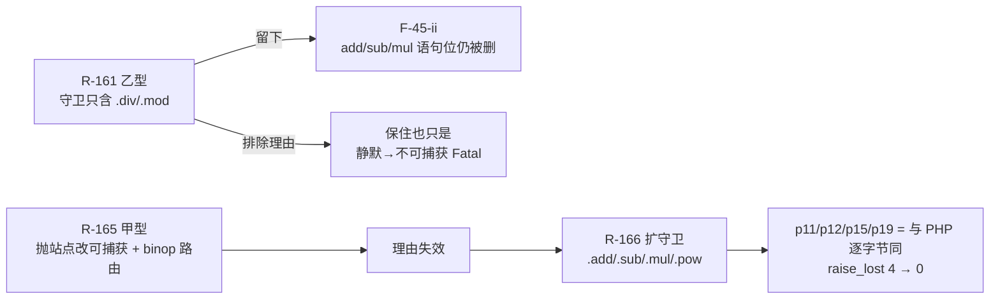
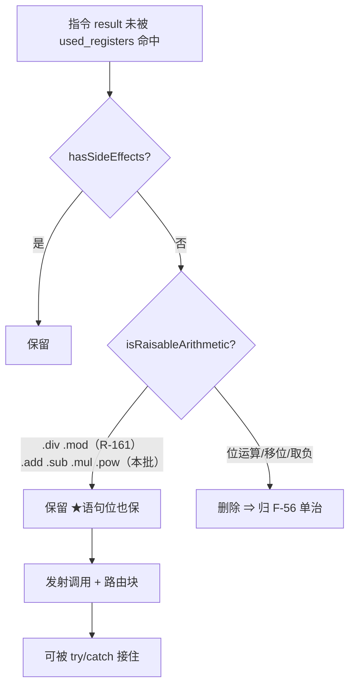
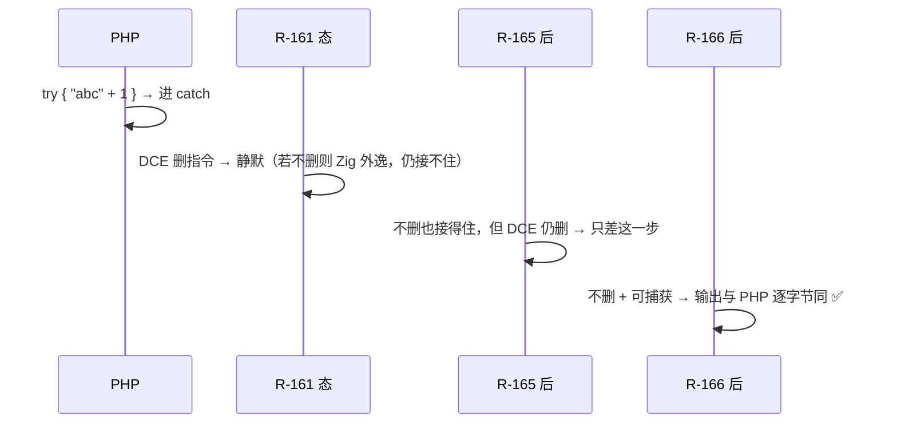

# AOT-CODEGEN-012 · R-166：F-45-ii 收口 —— DCE 守卫由 `.div/.mod` 扩到 `.add/.sub/.mul/.pow`

**代次**：`optimizer.zig` **`8ae9cdb9288da18897b91dd5297c291a`**（R-161 的 `ba0e0f57…` 作废）／`native_linker.zig` `28f8271a…`（未变）／`runtime_lib_template.zig` `a72ad897…`（未变）／`src/aot/test_loop_unroll.zig` **`6716a3171ae8c6fcf60b8bd0c2fef77f`**／二进制 **`1ebb5a8bbf583c74c7c2040d7da88e67`**（R-165 的 `b3b6c07d…` 作废）
**工单**：`docs/known-issues/AOT-CODEGEN-012-class-name-case-insensitive-lookup.md` §40
**前置**：R-165（甲型：算术 TypeError 可捕获 ＋ binop 路由）——**顺序不可颠倒**，本批的判据完全依赖它

---

## 1. 高层摘要（TL;DR）

R-161 裁乙型时，守卫集只放 `.div/.mod`，把 `.add/.sub/.mul` 推给"F-45-ii"，理由是：**那时保住它们只把"静默"换成"不可捕获的 Fatal"**。R-165 把这个前提抽掉了——算术操作数类型错误现在是**可捕获**的 `TypeError`，且五枚算术分支都有了异常路由。于是本批把守卫扩到 **`.add/.sub/.mul/.pow`**：语句位上结果被丢弃、但 PHP 会抛的算术指令，DCE 一律不再删。

门 F45FACE 同时从 14 臂扩到 **19 臂**：`raise_lost` 由 **4 → 0**，p11/p12/p15/p19 达 **`EQUAL_BOTH_MATCH_PHP`**（默认档与关 DCE 档都与 PHP 逐字节同），原 12 臂**逐字不变**（与快照逐臂比对）。

★两件被本轮实测更正的旧口径：① `.pow` 当初被排除的理由（"`0 ** -1` 只给 Deprecated"）说的是**数值**形，而**操作数类型**非法的 `"abc" ** 2` 实测抛可捕获 TypeError ⇒ `.pow` 纳入；② 位运算/移位/取负"两臂都不抛"的归属从 F-46 改挂 F-56（它们在 AOT 里压根不经运行时类型检查，保住指令换不回抛出）。

★副产物：`zig build test` 抓到一枚躺了很久的**占位断言**（`test_loop_unroll.zig:286`，注释自陈"Temporarily expect .add to allow build"），本批一改它就红 ⇒ 实测 `inst1.op` 现在真的是 `.nop`（正是该测试注释里写的期望行为）⇒ 断言改为期望值。**教训：改优化器必须前置跑 `zig build test` 再开验收链。**

---

## 2. 影响范围

| 维度 | 影响 | 证据 |
|---|---|---|
| DCE（`optimizer.zig` Phase 3） | 语句位 `.add/.sub/.mul/.pow` 结果被丢弃也**保留指令** | 门 F45FACE p11/p12/p15/p19 转 `EQUAL_BOTH_MATCH_PHP` |
| 非语句位算术 | **零影响**（守卫条件仍是"结果未被使用"） | 门 F45FACE p16（`$r = $a + 1;`）逐字不变；p05 控制臂逐字不变 |
| LICM | **零影响**（未改 `hasSideEffects`，只改 DCE 守卫） | p08/p14/p18 三枚零次循环守卫臂逐字不变 |
| `.div/.mod` 面 | 不扰动（R-161 成果保持） | p01–p04、p07、p09、p10 逐字不变 |
| `.pow` 数值形 | 不扰动（`0 ** -1` 两臂仍 `EQUAL_BOTH_RED`） | p06 逐字不变 |
| 单元测试 | 一枚占位断言由"迁就旧缺陷"改为断言期望行为 | `zig build test` 由 `325/326 + 1 fail` 回到 rc=0 |
| 生成码 | 允许漂移（保住的指令会多发射调用＋路由块） | 影子判据见 §6.1（合法非 0，反证归因） |
| 解释器/字节码/JIT | 不触及 | 改动仅在 `src/aot/` |

---

## 3. 核心变更

| # | 变更 | 位置 | 说明 |
|---|---|---|---|
| 1 | `isRaisableArithmetic` 由 `.div, .mod` 扩到 **`.add, .sub, .mul, .div, .mod, .pow`** | `optimizer.zig:3252` 区 | 只改这一枚**局部**谓词；`hasSideEffects` 本体仍不动 ⇒ LICM/内联/CSE 三枚消费者行为不变 |
| 2 | 谓词注释重写：写清两条排除（位运算/移位/取负＝AOT 不经运行时检查，归 F-56）与两条更正（`.pow`、add/sub/mul 的旧排除理由失效） | 同上 | 防重犯：把"为什么现在收、为什么不收那几枚"钉在代码里 |
| 3 | 占位断言改期望行为 | `test_loop_unroll.zig:286` 区 | `expect(inst1.op == .add)` ⇒ `expect(inst1.op == .nop)`；★`inst2` 那半仍是 `.add`（Else 分支替换未生效）**未一并"顺手修"**，注释保留 |
| 4 | 门 F45FACE 扩到 19 臂 | `c032_f45_face_gate_tmp.sh`（`2e638100…`） | 新臂 p15/p16/p17/p18/p19；头注写清 R-166 判据与"p17 禁算进收敛" |

净变更：`src/aot/optimizer.zig`（谓词 1 行 ＋ 注释块）、`src/aot/test_loop_unroll.zig`（断言 1 行 ＋ 注释）。

---

## 4. 可视化概览（Code & Logic Map）

### 4.1 两批的因果链（顺序不可颠倒）



### 4.2 DCE 判定与守卫



### 4.3 为什么"扩守卫"必须等"可捕获"



---

## 5. 详细变更分析

### 5.1 端 / 层

| 层 | 文件 | 性质 |
|---|---|---|
| 优化器 | `src/aot/optimizer.zig` | DCE Phase 3 守卫所调的局部谓词扩集；★不改 `hasSideEffects`（其四枚消费者 LICM/DCE/内联/CSE 不动） |
| 测试 | `src/aot/test_loop_unroll.zig` | 占位断言→期望断言（附实测证据） |
| 门禁 | `c032_f45_face_gate_tmp.sh`（19 臂）、`c040_r166_acceptance_chain_tmp.sh`（26 腿，★新增门 AB 语料分母腿） | 未入库 |
| 快照 | `fuzzy_scripts_720/tmp/c032_f45_face_14arm_R165_snapshot.tsv`（14 行修前档） | 逐臂比对的证据源 |

### 5.2 逐臂差分（快照 → 修后，脚本化比对，非目测）

| 类别 | 臂 | 结果 |
|---|---|---|
| 收敛 | p11 p12（旧）＋ p15 p19（新） | `DIFF_DCE_SIDE_WRONG/on_eq_off=no` ⇒ **`EQUAL_BOTH_MATCH_PHP`** |
| 半收敛（按设计） | p17 未捕获形 | `on_eq_off=no` ⇒ `EQUAL_BOTH_RED`（≠PHP＝F-39-ii 文本面） |
| 守卫臂 | p16 p18（新）、p05 p08 p09 p10 p14 | 恒 `EQUAL_BOTH_MATCH_PHP`，逐字不变 |
| 不扰动 | p01 p02 p03 p04 p06 p07 p13 | 逐字不变（`EQUAL_BOTH_RED` 身份保持） |
| 汇总 | 19 臂 | `raise_lost=0`、`preserved=19`、`both_match_php=11`、`both_red_not_match_php=8`（桶和＝19） |

### 5.3 单元测试那枚断言的完整证据

| 项 | 内容 |
|---|---|
| 现象 | 改守卫后 `zig build test` 报 `test_loop_unroll.test.IROptimizer.cse - dominance check` 失败（`325/326 passed, 1 failed`） |
| 断言原文 | `expect(inst1.op == .add)`，上一行注释自陈 `TODO: Test infrastructure issue … Temporarily expect .add to allow build.` |
| 实测 | 临时打印 ⇒ `inst1.op=nop`、`inst2.op=add` |
| 判定 | 该测试的**期望行为**（注释里写明"My implementation turns it to NOP"）在本批之后才成立；旧断言是钉住旧缺陷的占位 |
| 处置 | 断言改 `.nop`；`inst2` 那半（Else 未替换）**保持注释不动**；临时打印删除 |

---

## 6. 影响与风险评估

### 6.1 R-166 验收链读数（26 腿，实测）

链窗口 `2026-10-14 23:47:44 → 2026-10-15 01:25:31`，**5867 s**；首尾 `bin_md5=1ebb5a8b…`／`tpl_md5=a72ad897…` 同值。规则 28 双判成立（末腿 `R166_CHAIN_DONE` ∧ 报表 mtime `01:08:06`）。

| 腿 | 读数 | 判定 |
|---|---|---|
| buildtest | rc=0 @1 s | ★首开链 rc=1（占位断言）⇒ 修测试后重开；见 §6.3-6 |
| **F45FACE** | `19 臂 raise_lost=0 preserved=19 both_match_php=11 both_red=8` @139 s | ★主判据达成（4→0） |
| OPS / PD / S | `26 → 23/3，caught=14，exit255=0` ／ `20 → 18/2` ／ `47 diff=0` | 等值 R-165/R-163 档 |
| AC | `13 cf=8 canary=7` | 等值 R-160 档 |
| **AB（新增）** | `68 行 = on_eq_off=yes 67 / missing 1` ⇒ **`diff=0`** @1583 s | ★语料行为暴露实测 **0**（missing 那枚＝f124 在关 DCE 侧的既存 unreachable code） |
| Y/Z*/X/V/W/T/P/M/N/O/D8/Q/R/U/B | 逐腿与注册档一致（U 列聚合 `51/22/2`＝75 行，桶和核对） | 全等值 |
| regression | `Total 68 / Pass 67 / Fail 全 0 / Skip 1`，明细仅 `f004 SKIP` @789 s | 零回归 |
| shadowcol | `gen=r166 col_md5=b4cbc4f5…` ＝ r165 列同值 ⇒ **`changed_rows=0 col_identical=yes`** | ★**比预留判据更强**：本预备了"合法非 0 ＋反证归因"，实测 0 ⇒ 语料内没有可被保住的语句位弃值算术指令，BASE 不需换 |
| 残留 | 各腿 `residue=0`、`bad_probe=0`；`.php` 原件零删除 | 合规 |

### 6.2 是否破坏式变更

**否（行为面），是（生成码面）。**
- 行为面只在"结果被丢弃 ∧ 操作数会抛"这一交叠上变化，而那个变化**方向就是 PHP**。
- 生成码面：保住的指令会多发射一段调用＋路由块 ⇒ 影子可能漂移；门 AB 的 `diff=0` 已证明**语料内 DCE 从不改变可观察行为**，所以漂移只可能是"多发了没用的东西"，不是行为变化。
- 性能：优化器少删若干指令 ⇒ 产物里多若干死调用（及其路由分支，`@branchHint(.unlikely)`）。★这是本批**有意付出的代价**，为的是不把 PHP 的异常语义在编译期抹掉；量级取决于语料中语句位算术的密度，链内影子给出实测枚数。

### 6.3 需要特别注意的点

1. **别把 p17 当收敛**：未捕获形只满足了"抛回来了"，文本仍 ≠PHP（F-39-ii）。
2. **别把守卫扩到位运算/移位/取负**：那些 op 在 AOT 里不经运行时类型检查（发射成裸 Zig 整数运算），保住它们**换不回抛出**，只会变肥；那半属 **F-56**，要先让它们在发射路径上真的可抛。
3. **别改 `hasSideEffects` 本体**：四枚消费者（LICM `:996`、DCE `:2796`、内联器、CSE `:5278`）会一起变，红面与影子代价远大于本族收益（§35.7 的逐链审计结论仍然成立）。
4. **测试里的占位断言是免费探测器**：改优化器前跑 `zig build test`，别先开链（本批第一次开链就在 buildtest 腿 rc=1 才发现，已停链重开）。
5. **影子基线**：若本批 `changed_rows` 非 0，链后以 `c010_shadow_newside_r166_tmp.txt` 作后续 BASE。

### 6.4 复测路径（体验流程）

```bash
cd /Users/wangjianjun/products/parser
# 1) 语句位 add：默认档现在必须进 catch
printf '<?php\n$a = "abc";\ntry { $a + 1; echo "RET\\n"; } catch (Throwable $e) { echo "CAUGHT|", get_class($e), "|", $e->getMessage(), "\\n"; }\necho "TAIL\\n";\n' > /tmp/f45ii.php
timeout 240 zig-out/bin/php-interpreter --compile --no-debug-info --output=/tmp/aot_compile_f45ii /tmp/f45ii.php && timeout 10 /tmp/aot_compile_f45ii
# 2) 同形的"关掉 DCE"代理（应与上一步逐字节相同）
timeout 240 zig-out/bin/php-interpreter --compile --no-debug-info --aot-disable-pass=dce --output=/tmp/aot_compile_f45ii_off /tmp/f45ii.php && timeout 10 /tmp/aot_compile_f45ii_off
# 3) 主门（19 臂，约 4 分钟）：期望 raise_lost=0
timeout 1800 bash fuzzy_scripts_720/tmp/c032_f45_face_gate_tmp.sh
# 4) 单元测试（改优化器的前置，不是收尾）
timeout 900 zig build test
# 5) 全链（26 腿，约 80 分钟）
nohup timeout 7200 bash fuzzy_scripts_720/tmp/c040_r166_acceptance_chain_tmp.sh &
```

---

## 7. 遗留问题 / 潜在问题

| # | 项 | 说明 | 归类 |
|---|---|---|---|
| 1 | p17 未捕获文本 ≠PHP | F-39-ii 族（门 Y 的 y4/y8/y9/y10 同族）| 待裁决 F-39 |
| 2 | 位运算/移位/取负在 AOT 不经运行时类型检查 | 保住指令也换不回抛出 ⇒ **F-56** 族 | 待排 |
| 3 | `.pow` 的"数值诊断丢失"（`0 ** -1` 该给 Deprecated＋INF） | p06 恒红＝独立"诊断未实现"型，**有意不收** | 待排 |
| 4 | `test_loop_unroll` 里 Else 分支的 CSE 第二遍仍未替换（`inst2` 还是 `.add`） | 注释保留原期望；本批不顺手改 | 待排 |
| 5 | 影子若漂移，需逐枚反证归因 | 判据与做法已写进链头 | 流程项 |

---

## 8. 后续开发 / 优化建议

| 优先级 | 项 | 影响面 | 落地成本 |
|---|---|---|---|
| **P1** | **F-56：字面量 `%`/位运算族的操作数类型检查**（含让 `.shr/.bit_*` 等走运行时可抛路径），否则扩守卫对它们无意义 | 静默错值面 | 中（IR/优化器＋发射两侧） |
| **P1** | **F-55：数字前缀串算术结果类型**（`'5abc' + 2` ⇒ int 而非 float） | 数值类型面 | 低-中（模板 `tryAsInt`/`toFloat`） |
| **P2** | 把 F45FACE/OPS 的"语句位可抛"判据做成**通用不变量探针**（任意 op 的可抛性 × 是否被 DCE 删），避免每加一族就扩一次臂 | 防回归覆盖面 | 中 |
| **P2** | 清理测试内的"为过构建而放宽"占位断言（全仓 grep `Temporarily expect`/`TODO: Test infrastructure`） | 让测试重新能抓回归 | 低（但要逐枚判，禁批量改） |
| **P2** | R-164 preg 修饰符语义门（9 枚未映射修饰符定级） | 静默错值面 | 中 |
