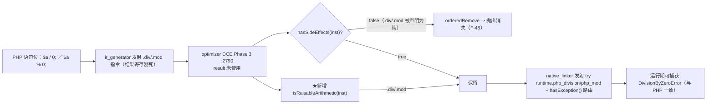
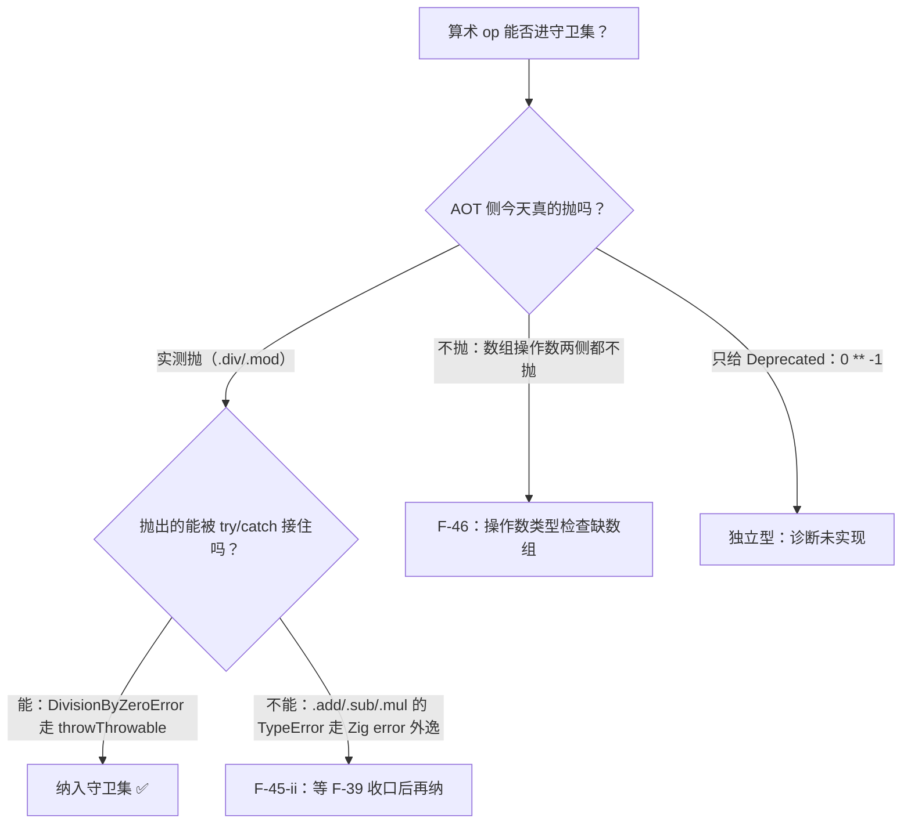
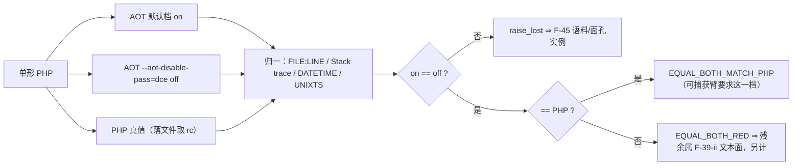

# AOT-CODEGEN-012 · R-161 F-45 落地（DCE 不再删「会抛的算术指令」）+ 门 AB/F45FACE 两件永久资产（2026-10-14）

## 1. 高层摘要（TL;DR）

- **落地**：`optimizer.zig` 的 DCE Phase 3 删除守卫追加一条「该指令是可抛出算术 ⇒ 即使结果被丢弃也不删」，新谓词 `isRaisableArithmetic` **按实测只含 `.div`/`.mod`**。⇒ 合法 PHP 的语句位除零不再被静默消除。
- **收口度量**：门 F45FACE（14 臂，判据 `on_eq_off`）的 `raise_lost` **9 → 2**，剩下的 2 枚（`.add`/`.mul`）是**刻意不收**的 F-45-ii；其中 **p09/p10 达到与 PHP 逐字节等值**（可捕获形）。门 Y 的 `y7` 回收 ⇒ 改档 `12 形 same=5 diff=5 zig_escape=1 compile_fail=2`。
- **语料暴露 = 0（实测）**：门 AB 在把 `DATETIME`/`UNIXTS` 折进归一之后 `equal=67 diff=0`；首轮报的 2 枚"暴露"（f119/f175）**只是两臂执行时刻不同的 `date()` 输出**。
- **新立两枚面**：**F-45-ii**（`.add/.sub/.mul` 的语句位；其 TypeError 今天**不可捕获** ⇒ 等 F-39）、**F-46**（数组等操作数的算术 TypeError 在 AOT **两侧都不抛** ⇒ 操作数类型检查缺数组，与 DCE 正交）。
- **完成 F-45 的逐链审计**（§35.7）：全仓 6 处指令删除站点只有 DCE 会二次犯本面 ⇒ 本批一处即闭合，并留下两枚如实登记的观察项。

## 2. 影响范围

| 对象 | 影响 | 描述 |
|---|---|---|
| `src/aot/optimizer.zig` | 直接 | DCE 守卫 +1 条件、新增 `isRaisableArithmetic`（终稿 md5 `ba0e0f579518908e030fc09ca994147f`） |
| 二进制 | 必须重建 | `d824ad999d10ec232255999d8edddfad`（R-158b/R-159 的 `b71f9f41…` 作废） |
| **语料行为** | **零**（实测） | 门 AB `equal=67 diff=0`（68 枚，另 2 枚旁支与 F-45 无关：f004 主回归唯一 SKIP、f124 只在关 DCE 侧 `unreachable code`） |
| **语料发射面** | ★**可能合法漂移** | 保住 dead `.div/.mod` ⇒ 命中脚本会多发射一次调用 + `hasException()` 路由 ⇒ 影子 `changed_rows` 非 0 是**预期内**，但必须逐枚归因（变化枚都要含语句位除/模）且 Pass 不得下降 |
| 门 Y / 门 P / 门 Z / 其余门 | 判据不变 | 门 Y 只回收 `y7`；门 P 注册红仍 `v2 i1 i2 f12 f34`；门 Z 仍 `dangling=0` |
| 解释器 / 字节码 / JIT | 未触碰 | 改动在 AOT 的 IR 优化器内 |

## 3. 核心变更

| # | 变更 | 位置 | 说明 |
|---|---|---|---|
| 1 | DCE 守卫追加一条 | `optimizer.zig:2793` | `if (!self.hasSideEffects(inst) and !self.isRaisableArithmetic(inst))` |
| 2 | 新增局部谓词 | `optimizer.zig:3252` | 只含 `.div`/`.mod`；★**不改** `hasSideEffects` 本体（甲型），因其有 4 枚消费者（`:996` LICM／`:4594` 内联器／`:5278` CSE） |
| 3 | 门 AB（语料分母） | `c031_dce_ab_gate_tmp.sh`，md5 `17d3cbe3…` | 默认档 vs `--aot-disable-pass=dce` 端到端差分；接 `TSV_OUT`；归一折 `DATETIME`/`UNIXTS` |
| 4 | 门 F45FACE（14 臂） | `c032_f45_face_gate_tmp.sh`，md5 `5eb4c077…` | 判据 `on_eq_off`；含控制臂、LICM 对偶臂、F-45-ii/F-46 文档臂 |
| 5 | 链 | `c033_r161_acceptance_chain_tmp.sh`（21 腿） | F45FACE 首次入链（在 Y 之前，作为主门） |

## 4. 可视化概览（Code & Logic Map）

### 4.1 缺陷链路与修复点



### 4.2 为什么守卫集只有 `.div/.mod`（收窄是实测决定的）



### 4.3 门 AB / F45FACE 判定流



## 5. 详细变更分析

| 层 | 文件 | 变更 | 备注 |
|---|---|---|---|
| IR 优化 | `src/aot/optimizer.zig` | `:2793` 守卫 + `:3252` 谓词 | 唯一一处行为变更点；其余 5 处指令删除站点经审计不犯本面（§35.7） |
| 门与链 | `c031_dce_ab_gate_tmp.sh`／`c032_f45_face_gate_tmp.sh`／`c033_r161_acceptance_chain_tmp.sh` | 新建 | ★AB 的归一必须先覆盖宪法 §七.5/6/7 的"不算差异"清单，否则第一跑就假红 |
| 工单 | `docs/known-issues/AOT-CODEGEN-012-…md` §33.6–33.7、§35 全章 | 新增 | 含修前 13 臂登记、修后 14 臂、逐链审计、三枚自造工具错 |

## 6. 影响与风险评估

### 6.1 R-161 验收链读数（21 腿，实测）

链窗口 `14:02:04 → 15:09:59`，**ELAPSED 4075 s**；首尾 `bin_md5=d824ad999d10ec232255999d8edddfad`、`tpl_md5=6d520849c9a7eab50082c62e924662dd` **各同值** ⇒ 链内零代次漂移。规则 28 双判成立（末腿 `R161_CHAIN_DONE` ∧ 主回归报表 mtime `14:52:37` 晚于该腿开跑 `14:39:29`）。

| 腿 | 读数 | wall | 判定 |
|---|---|---|---|
| buildtest | rc=0 | 6 s | 缓存档 |
| **F45FACE** | `shapes=14 raise_lost(on_eq_off=no)=2 preserved=12 both_match_php=5 both_red_not_match_php=7` | 108 s | ★主门等值链前单跑：残红恰为故意不收的 p11/p12 |
| **Y** | `shapes=12 same=5 diff=5 zig_escape=1 compile_fail=2 bad_probe=0` | 44 s | 等值 R-161 改档（红 `y2 y4 y8 y9 y10`，`cf=y1 y3`） |
| ZFACES / ZCENSUS | `10 same=9 diff=1 dangling=0` @38s ／ `total=68 dangling=0 ok=68` @787s | — | 等值 ⇒ 死指令保留未破坏语料 IR 合法性 |
| X / V / W / T | `8/1` ／ `19/10` ／ `7/13` ／ `16/5 cf=1` | 40/122/75/89 s | 全等值注册档 |
| P | `78 same=73 diff=5 cf=0` | 314 s | 等值 ⇒ 未把任何内省臂打红 |
| S | `47 same=47 diff=0` | 189 s | 等值 |
| M / N / O / D8 / Q / R | `19 red=0` ／ `7 red=0` ／ `6 red=0` ／ `defect_red=0 guard_same=14` ／ `same=5` ／ `same=8 diff=1` | 70/24/21/50/22/38 s | 全等值 |
| U | 列聚合 `75 行 = SAME 51 / COMPILE_FAIL 22 / BAD_PROBE_PHP 2` | 206 s | 等值（★该表**无表头**，聚合须去掉 `NR>1`，否则首行被当表头吞掉而少计 1 枚） |
| B | `entries=497 distinct=464 dup_rows=33 diff_impl=3` | 2 s | 等值 ⇒ 零地图漂移 |
| regression | `Total 68 / Pass 67 / Fail(Compile·Runtime·Diff)=0 / Skip 1`；失败明细仅 `f004 SKIP` | 787 s | 回收 0、新增红 0 |
| shadow | `total=68 same=0 diff=68 miss=0 invalid=0` | 1042 s | 对照冻结前缀的常态 |
| shadowcol | `gen=r161 rows=68 col_md5=f19fb070…`＝r159 同值 ⇒ **`changed_rows=0 col_identical=yes`** | — | ★自 r148b 起**第 9 代同值**：预留的「合法漂移」出口未触发，与门 AB `equal=67 diff=0`（语料暴露 0）互证，无需逐枚归因 |
| 残留 | 各腿 `repo_build_residue=0`、`bad_probe=0`；`.php` 原件零删除 | — | 合规 |

★取证更正（登记不静默改）：链脚本 `run_gate` 从 `c028` 起用 `head -1` 取 DONE 行 ⇒ 对「门内嵌门」的 F45FACE 腿只会显示内层 `AB_DONE`。本批真实读数取自 `/tmp/r161_F45FACE.out` 第 2 行；`c033`/`c028` 已改为 `tail -1`，新 md5 `f6fedf6db9d739b999048df0ba62df42`／`6fa76c2af4cfd0c19a059d4238d4e8af`（§35.9）。

### 6.2 是否破坏式变更

**否。** 一处守卫、一处新谓词；语料行为实测零变化。代价是**极小量的优化损失**（保留结果被丢弃的可抛运算），且刻意限定在语句位（这正是老铁裁的乙型），未改共享谓词 ⇒ LICM/内联/CSE 行为不变。

### 6.3 需要特别注意的点

1. **`on_eq_off` 才是本面的判据**：p01–p04/p07 修后仍 `≠PHP`，那是**未捕获上报文本**的另一枚缺陷（F-39-ii）⇒ 读门时禁把两者混为一谈，也禁把它们当成本批的新红。
2. **p11/p12 是"合理残红"**：注册为 2 枚，将来 F-39 收口后它们必须同时满足 `on_eq_off=yes` **且** `=PHP`，否则 F-45-ii 未真正闭合。
3. **p13/p06 是反面臂**：分别钉住 F-46 与"诊断丢失"型，用来证明本批没有过度声明。
4. **差分门的归一**：任何"两臂对比"的门，第一跑前必须先折叠时间戳/浮点末位/栈追踪行号，否则会产出一批假缺陷（本轮真实发生并已向老铁更正）。
5. **不要在门跑动期间改门**（本轮踩实：bash 惰性读文件导致汇总块被截坏，`F45FACE_DONE` 一度没打印）。

### 6.4 复测路径

```bash
# 仓库根；★改的是 optimizer ⇒ 必须 zig build
timeout 300 zig build
timeout 1800 bash fuzzy_scripts_720/tmp/c032_f45_face_gate_tmp.sh   # 期望 raise_lost=2（p11/p12），preserved=12
timeout 600  bash fuzzy_scripts_720/tmp/c024_zig_error_escape_tmp.sh # 期望 same=5 diff=5 zig_escape=1 cf=2（y7 已 SAME）
timeout 3000 bash fuzzy_scripts_720/tmp/c031_dce_ab_gate_tmp.sh     # 语料分母，期望 diff=0 both_red=1 compile_fail=1
timeout 5400 bash fuzzy_scripts_720/tmp/c033_r161_acceptance_chain_tmp.sh  # 全链 21 腿
```

手工单形（修后应抛且可捕获）：

```bash
# shell
printf '%s\n' '<?php try { 1 % 0; echo "RET\n"; } catch (Throwable $e) { echo "CAUGHT|", get_class($e), "|", $e->getMessage(), "\n"; } echo "TAIL\n";' > /tmp/f45_p09.php
/opt/homebrew/bin/php /tmp/f45_p09.php
timeout 120 zig-out/bin/php-interpreter --compile --no-debug-info --output=/tmp/aot_compile_f45_p09 /tmp/f45_p09.php
/tmp/aot_compile_f45_p09; rm -f /tmp/aot_compile_f45_p09   # 期望与上行逐字节相同
```

## 7. 遗留问题 / 潜在问题

| 编号 | 面 | 状态 |
|---|---|---|
| **F-45-ii** | `.add/.sub/.mul` 语句位：AOT 抛出的 TypeError **不可捕获**（Zig error 外逸） | 待排，前置＝F-39；永久臂 p11/p12 |
| **F-46** | 数组等操作数的算术 TypeError 在 AOT **两臂都不抛** | 新立，待归因（`checkArithmeticOperand` 为何漏数组）；永久臂 p13 |
| 观察项① | LICM 可提升判定与 `hasSideEffects` 同源 ⇒ 理论上能把可抛运算提升到零次循环外 | 当前实测未现形（p08/p14 恒绿） |
| 观察项② | `mayRaiseException:3316` 与 `hasSideEffects:3261` 对 `.cast/.type_check/.unbox` 口径相反 | 甲型（改共享谓词）时一次对齐 |
| p01–p04/p07 残余 | 未捕获上报文本与 PHP 不逐字节等值 | F-39-ii 族（门 Y 的 y4/y8/y9/y10 同族） |
| F-44 / F-30 / F-31 / F-32 / F-34 / F-35 / F-39 / F-41 / F-4 / F-24d / F-29 / F-25 / F-8b / F-10 | 既有待裁决项 | 未动（F-31 真值全表已备好，见 §34） |
| 提交 | 源码与门资产**均未提交**（老铁明示"暂不提交"） | 门 Y 脚本曾被我误删并重建，入库建议仍挂起 |

## 8. 后续开发 / 优化建议（★路线已按老铁裁决固定）

| 优先级 | 建议 | 影响面 | 落地成本 |
|---|---|---|---|
| **P0** | **R-160 丙型**：失败后自解析生成码，把 `expected N argument(s)` 变成带函数名与 PHP 行号的可读诊断（不建 arity 表、不碰子进程管道） | 「合法 PHP 编译不过」的可定位性 | 中：单文件（native_linker）失败分支；语料零命中 ⇒ 零风险 |
| **P0** | **F-46 归因轮**：查 `checkArithmeticOperand` 为何放过数组/对象/resource，并给出 PHP 消息格式表（已实测 12 形） | 静默错值面比 F-45 更宽（任意位置） | 中：模板单点，但要逐 op 收口 |
| **P1** | **F-45-ii**：待 F-39 把 `.add/.sub/.mul` 的 TypeError 变成可捕获后，扩 `isRaisableArithmetic` 并让 p11/p12 要求逐字节等值 | 完整收口算术异常面 | 低（一行）但依赖 F-39（304 处） |
| **P1** | 甲型：补 `fn_table` 的 165 枚缺失 + 更正 10 枚冲突并让 AOT 复用；★同时一次对齐两枚可抛谓词 | 真值源统一 | 高（跨模式，须先量三模式影响） |
| **P2** | 把门 AB／F45FACE／门 Z 普查列为常态提交前门禁（三者都不依赖 `zig build` 之外的新工具） | 防语义面回退 | 低 |
| **P2** | 链的 `run_gate` 取 DONE 行改为"按门名前缀取"或 `tail -1`，避免嵌套门取到内层汇总 | 读数可读性 | 低 |
