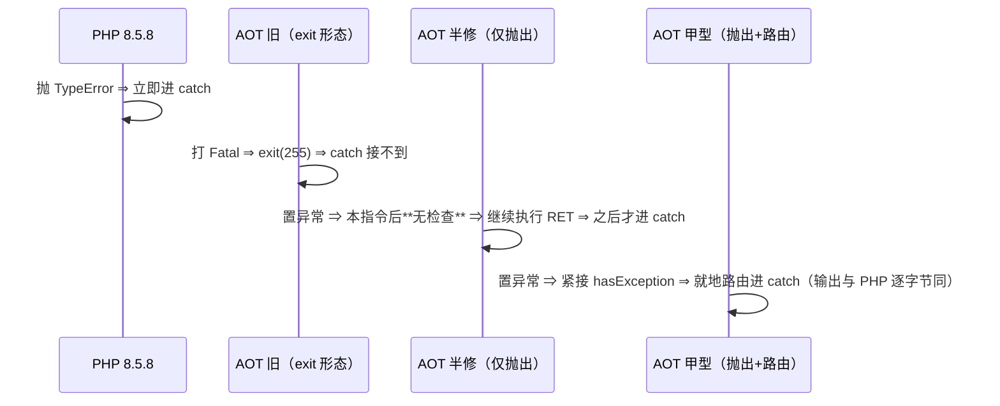
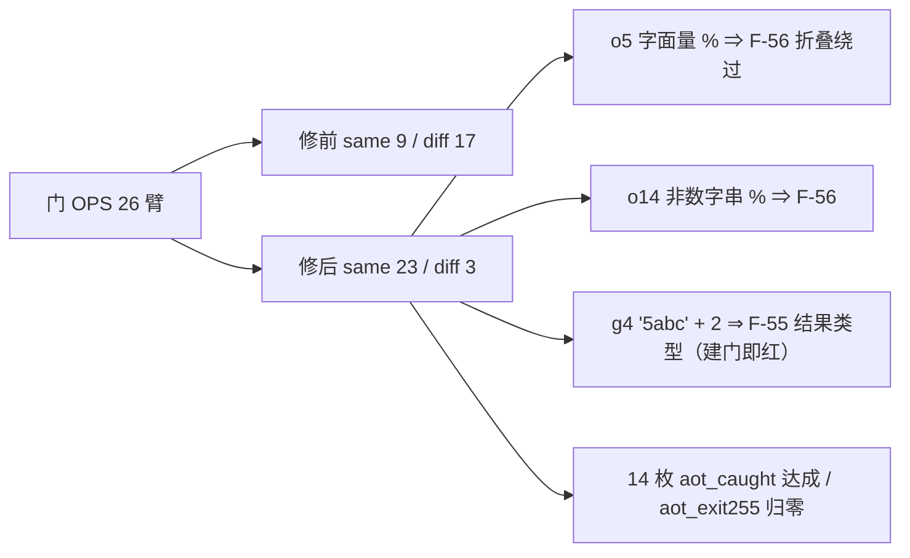

# AOT-CODEGEN-012 · R-165：F-46 改定与甲型落地 —— 算术操作数 TypeError 改可捕获，并给五枚算术 binop 补异常路由

**代次**：`runtime_lib_template.zig` **`a72ad897776fd520e322dce01005710c`**／`native_linker.zig` **`28f8271a6044ab8568fa5a1895d122b4`**／`optimizer.zig` `ba0e0f57…`（未变）／二进制 **`b3b6c07d9c4a655871c0271a1ecf4cae`**（R-160 的 `fe5d70d4…` 作废）
**工单**：`docs/known-issues/AOT-CODEGEN-012-class-name-case-insensitive-lookup.md` §39
**裁决**：老铁 2026-10-14 22:00 选 **甲型**（抛站点 + 路由同批），并接受每枚算术 binop 多一枚分支的代价
**基线提交**：`df31715`（老铁自提交，含 R-159/R-160/R-161/R-163）

---

## 1. 高层摘要（TL;DR）

`try { $x = [1] + 2; } catch (TypeError $e)` 在 PHP 8.5.8 会进 catch；在 AOT 里**永远进不去**——不是因为缺类型检查
（`checkArithmeticOperand` 早就拒绝数组与非数字串了），而是因为抛出站点 `emitUnsupportedOperandError` 是
**`noreturn` + `std.process.exit(255)`**：它自己打印 `Fatal error: Uncaught TypeError: Unsupported operand types: …`
然后直接终止进程，**绕过了整条异常路由**。消息文本本来就对，形态完全错。

本批按甲型把两半一起落：① 抛出站点改为 `throwThrowable("TypeError", …)` + 返回 null，并给此前**完全没检查**的
`php_pow`／`php_neg` 补上同口径检查（一元取负的措辞照抄 PHP：`array * int`）；② 发射器给 `.add/.sub/.mul/.pow/.neg`
五枚分支各补一段与 `.div/.mod` **同形**的 `hasException()` 路由块。

★中间态被实测否决：只做 ① 不做 ② 时，症状是 `RET|` 与 `CAUGHT|` **都打**（错误之后的语句先执行），未捕获形更从
「立即终止」变成「继续跑到下一个检查点」⇒ 属自造回归（规则 30），所以我把工作区还原、复跑证明修前读数可复现，再按甲型重落。
⇒ **抛出形态与路由形态是同一枚缺陷的两半，禁止分两批落。**

门 OPS：修前 `same=9 diff=17 aot_caught=0 aot_exit255=12` ⇒ 修后 **`same=23 diff=3 aot_caught=14 aot_exit255=0`**，
3 枚残红身份逐枚可归因（2 枚 F-56 字面量 `%` 折叠绕过 ＋ 1 枚 F-55 结果类型，均非本面）。

---

## 2. 影响范围

| 维度 | 影响 | 证据 |
|---|---|---|
| `+ - * / %` 与 `**`、一元 `-` 的非法操作数 | 由「打 Fatal 后 `exit(255)`」改为**可捕获 TypeError**（类名＋消息文本与 PHP 逐字节同） | 门 OPS `aot_caught 0→14`、`aot_exit255 12→0` |
| `pow`／`neg` | 此前**无任何操作数检查**（静默算出错值）⇒ 现补检查 | 门 OPS o6/o16 转 `SAME` |
| 生成码 | **变化**：五枚算术分支各多一段路由块 ⇒ ★本批是"发射非中性"批，影子 `changed_rows` **允许合法非 0** | 与 R-158b…R-163 的"第 N 代同值"口径不同，链内逐枚归因 |
| 产物性能 | 每枚算术 binop 多一枚 `hasException()` 分支（`@branchHint(.unlikely)` ⇒ 预测命中，成本≈流水线无扰动） | ★老铁已明示接受该代价 |
| 语料 | 抽查 5 形（f045/f135/f010/f124/f006）AOT 与 PHP 归一后逐字节同、rc=0/0；全量见 §6.1 | 链内主回归 Pass 67/Skip 1 |
| 解释器/字节码/JIT | 不触及 | 本批只改 `src/aot/` 两文件 |

---

## 3. 核心变更

| # | 变更 | 位置 | 说明 |
|---|---|---|---|
| 1 | `emitUnsupportedOperandError`（`noreturn`）⇒ `throwUnsupportedOperandError(...) Value` | 模板 `:6181` 区 | `throwThrowable("TypeError", "Unsupported operand types: {l} {op} {r}")` + `return Value.initNull()`；分配失败也不回退成 `exit` |
| 2 | 五枚站点接返回值 | `php_add:5694`／`php_sub`／`php_mul`／`php_div`／`php_mod` | `return throwUnsupportedOperandError(lhs, rhs, "…")` |
| 3 | 新增 `throwNegateOperandError` | 模板 | 一元取负措辞＝实测的 `{type} * int` |
| 4 | `php_pow`／`php_neg` 补操作数检查 | 模板 | 复用既有 `checkArithmeticOperand`（★不新建谓词） |
| 5 | 五枚算术发射分支补路由块 | `native_linker.zig:20541/20646/20741/21023/21978` 各分支尾 | 与 `.div`(`:20918` 区)／`.mod` **逐字同形**：`hasException()` → `@branchHint(.unlikely)` → `generateCleanupCode` → `current_block = handler` ∧ `continue`，无 handler 时 `return error.RuntimeError` |

净变更：`src/aot/runtime_lib_template.zig`（＋38/−46）＋ `src/aot/native_linker.zig`（＋60，五段 ×12 行）。

---

## 4. 可视化概览（Code & Logic Map）

### 4.1 缺陷两半与修复点

```mermaid
flowchart TD
  SRC[PHP: try { $x = [1] + 2; } catch TypeError] --> EMIT[native_linker 发射<br/>.add 分支]
  EMIT --> CALL["reg = try runtime.php_add(...)"]
  CALL --> TPL[模板 php_add]
  TPL --> CHK{checkArithmeticOperand?}
  CHK -->|旧| EXIT["emitUnsupportedOperandError<br/>noreturn + exit(255) ⇒ 绕过路由"]
  CHK -->|新 ★件1| THR["throwThrowable TypeError<br/>return null"]
  THR -.-> RC[hasException 已置位]
  CALL --> ROUTE{★件5 路由块}
  ROUTE -->|有 handler| CATCH[current_block = catch 块]
  ROUTE -->|无 handler| UP[return error.RuntimeError ⇒ 未捕获上报]
  EXIT -.症状.-> WRONG[catch 永不命中]
  CATCH -.-> RIGHT[与 PHP 同：只打 CAUGHT]
```

### 4.2 为什么两半不可分两批



### 4.3 覆盖面与残红归属



---

## 5. 详细变更分析

### 5.1 端 / 层

| 层 | 文件 | 说明 |
|---|---|---|
| 发射 | `native_linker.zig` | 五枚算术分支补路由（★与 `.div/.mod` 同形，不引入新谓词） |
| 运行时模板 | `runtime_lib_template.zig` | 抛出站点 + pow/neg 检查 |
| 优化器 | `optimizer.zig` | 本批未动（★DCE 守卫扩到 `.add/.sub/.mul`＝下一轮 R-166，本批已把它的前置条件准备好） |
| 门禁 | `c038_operand_type_gate_tmp.sh`（门 OPS，永久侧门，26 臂）＋ `c039_r165_acceptance_chain_tmp.sh`（25 腿） | 新资产，未入库 |

### 5.2 实测口径表（PHP 真值，资产 `fuzzy_scripts_720/tmp/c038_operand_truth_tmp.php`、`fuzzy_scripts_720/tmp/c038_string_truth_tmp.php`、`fuzzy_scripts_720/tmp/c038_pow_neg_truth_tmp.php`）

| 形 | PHP | AOT 修前 | AOT 修后 |
|---|---|---|---|
| `[1] + 2` / `[1] - 2` / `[1] * 2` / `[1] / 2` / `[1] % 2`（变量形） | `CAUGHT TypeError: Unsupported operand types: array OP int` | 打 Fatal 后 `exit(255)`，catch 接不到 | ✅ 进 catch，文本逐字节同 |
| `2 + [1]` 等反向形 | `int OP array` | 同上 | ✅ |
| `[1] - [2]`、`[1] * [2]` | `array OP array` | 同上 | ✅ |
| `[1] + [2]` | ★**并集**，不抛 | 不抛 | 仍不抛（守卫臂 g1 恒绿） |
| `[1] ** 2`、`-([1])` | `array ** int`／`array * int` | ★**压根不检查**，静默算出错值 | ✅ 收敛 |
| `"abc" + 2`、`"" + 2` | `string OP int` catchable | 文本对但不可捕获 | ✅ |
| `'5abc' + 2` | 不抛，值 **7**（int）＋ Warning `A non-numeric value encountered` | 7.0（float）＋同一条 Warning | ❌ 残红＝**F-55** |
| `[1] % 2`／`"abc" % 2`（**字面量**） | catchable TypeError | 静默算出 `1`／`0` | ❌ 残红＝**F-56**（★实测 `[1] ** 2`／`-([1])` 的字面量形**已收敛** ⇒ F-56 面比预估窄，只在 `%`） |
| `'abc' . 2` | 拼接合法 | 合法 | 仍合法（★禁扩到拼接位） |

---

## 6. 影响与风险评估

### 6.1 R-165 验收链读数（25 腿，实测）

链窗口 `22:04:51 → 23:18:54`，**4443 s**；首尾 `bin_md5=b3b6c07d…`／`tpl_md5=a72ad897…` 同值 ⇒ 链内零代次漂移。规则 28 双判成立（末腿 `R165_CHAIN_DONE` ∧ 报表 mtime `23:01:27`）。

| 腿 | 读数 | 判定 |
|---|---|---|
| buildtest | rc=0 @7 s | 缓存档（不证模板编译） |
| **OPS** | `arms=26 same=23 diff=3 aot_caught=14 aot_exit255=0` @116 s | ★主判据达成；3 枚残红身份逐枚核过（o5/o14＝F-56、g4＝F-55） |
| PD / S | `20 → 18/2` @84 s ／ `47 → 47/0` @197 s | R-163 成果未被本批扰动（S 的 `diff=0` 是 preg 侧硬判据） |
| AC / F45FACE / Y | `cf=8 canary=7` ／ `raise_lost=2` ／ `same=5 diff=5 cf=2` | 全等值注册档（★F45FACE 仍 2 枚＝本批未扩 DCE 守卫） |
| ZFACES / ZCENSUS | `10 same=9 diff=1 dangling=0` ／ `68 dangling=0 ok=68` @823 s | 等值 |
| X/V/W/T/P/M/N/O/D8/Q/R/B | 逐腿与注册档一致；B `entries=497 distinct=464` | 等值 ⇒ 零地图漂移 |
| U | 列聚合 `75 = SAME 51 / CF 22 / BAD_PROBE_PHP 2`（桶和＝行数） | 等值 |
| regression | `Total 68 / Pass 67 / Fail 全 0 / Skip 1`；明细仅 `f004 SKIP` @837 s | ★路由块进场后**零回归** |
| shadow | `total=68 miss=0 invalid=0` @1047 s | 对照冻结前缀常态 |
| shadowcol | `gen=r165 col_md5=b4cbc4f5…` vs r163 `f19fb070…` ⇒ **`changed_rows=49`（合法漂移）** | ★逐枚归因完成：19 枚未变化行**全部**实测 `arith_calls=0`，变化侧抽样 f045＝26、f124＝9 ⇒ 漂移量＝算术 binop 站点数；连 11 代 `changed_rows=0` 在此正当终结 |
| 残留 | 各腿 `residue=0`、`bad_probe=0`；`.php` 原件零删除 | 合规 |

★后续代次的影子 BASE 改用 `c010_shadow_newside_r165_tmp.txt`（列 md5 `b4cbc4f5…`）。

### 6.2 是否破坏式变更

**是（行为面）＋是（生成码面）**，但方向是"向 PHP 收敛"：
- 行为面：此前不可捕获的算术 TypeError 变为可捕获；`pow`/`neg` 从静默错值变为抛错。任何"依赖 AOT 宽松性"的脚本会得到 PHP 的结果（这类脚本本就不该存在——它的 PHP 行为是抛异常）。
- 生成码面：五枚算术分支各多一段路由块 ⇒ 影子必然漂移 ⇒ 需要按当代次重冻影子基线（链内给出 `changed_rows` 实测与逐枚归因）。
- 性能面：每枚算术 binop 多一枚分支，`@branchHint(.unlikely)` 使预测不扰动流水线；★该代价已由老铁明示接受。

### 6.3 需要特别注意的点

1. **两半不可分**：只做抛出改造会产出比原形态更偏离 PHP 的行为（错误之后的语句被执行）⇒ 落地顺序必须"模板 + 发射器"同批。
2. **一元取负的消息措辞**是 PHP 自己的 `{type} * int`（实测），不要"整理"成更合理的写法。
3. **`+` 对数组是并集**：`checkArithmeticOperand` 的数组拒绝必须让位于 `php_add` 里那条"两侧皆数组 ⇒ 走 `php_array_union`"的前置分支（实文顺序已如此，勿改序）。
4. **不要扩到拼接位**：`. concat` 与算术无关，扩了会打红 `'abc' . 2` 这类合法形。
5. **`php_pow` 的 `0 ** -1` 仍只该是 Deprecated**（PHP 8.5.8 实测），本批的检查只针对操作数**类型**，不引入新的数值告警。
6. **门 OPS 的 3 枚残红是"登记"不是"待本批收"**：把它们算进本批收敛就是过度声明。

### 6.4 复测路径（体验流程）

```bash
cd /Users/wangjianjun/products/parser
# 1) 直观复现（四形输出应与 PHP 逐字节同）
cat > /tmp/f46.php <<'P'
<?php
$a = [1]; $b = 2; $s = 'abc';
try { $x = $a % $b; echo "MOD=RET\n"; } catch (Throwable $e) { echo "MOD=CAUGHT|", get_class($e), "|", $e->getMessage(), "\n"; }
try { $y = $a ** $b; echo "POW=RET\n"; } catch (Throwable $e) { echo "POW=CAUGHT|", get_class($e), "|", $e->getMessage(), "\n"; }
try { $z = -$a; echo "NEG=RET\n"; } catch (Throwable $e) { echo "NEG=CAUGHT|", get_class($e), "|", $e->getMessage(), "\n"; }
try { $w = $s + 1; echo "STR=RET\n"; } catch (Throwable $e) { echo "STR=CAUGHT|", get_class($e), "|", $e->getMessage(), "\n"; }
P
timeout 240 zig-out/bin/php-interpreter --compile --no-debug-info --output=/tmp/aot_compile_f46 /tmp/f46.php && timeout 10 /tmp/aot_compile_f46
timeout 10 /opt/homebrew/bin/php /tmp/f46.php
# 2) 门 OPS（26 臂 ~116 s）：期望 same=23 diff=3，且红臂恰为 o5/o14/g4
timeout 1200 bash fuzzy_scripts_720/tmp/c038_operand_type_gate_tmp.sh
# 3) 路由是否真的"就地"：看生成码里算术调用后紧跟 hasException
ZIGPHP_AOT_KEEP_TEMP=1 timeout 240 zig-out/bin/php-interpreter --compile --no-debug-info --output=/tmp/aot_compile_f46b /tmp/f46.php >/dev/null 2>&1
D=$(ls -d .zigphp_aot_build_* | tail -1); grep -A 1 "php_add\|php_pow\|php_neg" "$D/main.zig" | grep -c hasException
# 4) 全链（25 腿，约 70 分钟）
nohup timeout 7200 bash fuzzy_scripts_720/tmp/c039_r165_acceptance_chain_tmp.sh &
```

---

## 7. 遗留问题 / 潜在问题

| # | 项 | 说明 | 归类 |
|---|---|---|---|
| 1 | **F-56** | 字面量数组／非数字串参与 `%` 时走常量折叠，绕过 `php_mod` ⇒ 静默错值（门 OPS o5/o14） | 待排（IR/优化器侧） |
| 2 | **F-55** | `'5abc' + 2` 结果类型 float vs PHP int（g4，建门即红＝预先存在） | 待排（`tryAsInt`/`toFloat` 口径） |
| 3 | 未捕获形的上报文本 | 本批把它交给标准未捕获路由，文本面属 F-39-ii（门 Y 的 y4/y8/y9/y10 同族） | 待裁决 |
| 4 | F-45-ii（DCE 守卫未扩到 `.add/.sub/.mul`） | ★本批已把前置（可捕获性）补齐 ⇒ 扩守卫现在能真收敛，但需再一次全链 | R-166 |
| 5 | 影子基线需按当代次重冻 | 本批 `changed_rows` 合法非 0 ⇒ 链后以 `c010_shadow_newside_r165_tmp.txt` 作后续 BASE | 流程项 |
| 6 | 门 OPS 用字面量与变量两种形做同一面 | 是**故意的**（区分 F-46 与 F-56），读门时禁只按"抛没抛"合并两类 | 口径 |

---

## 8. 后续开发 / 优化建议

| 优先级 | 项 | 影响面 | 落地成本 |
|---|---|---|---|
| **P0** | **R-166 扩 DCE 守卫到 `.add/.sub/.mul`**（F-45-ii）：前置已具备 ⇒ 门 F45FACE 的 p11/p12 应达"与 PHP 逐字节等值" | 语句位算术 TypeError 不再被静默消除 | 低（`isRaisableArithmetic` 加三枚 op）＋ 一次全链 |
| **P1** | **F-56 折叠侧补同口径检查**（字面量 `%` 也必须抛） | 静默错值面（与 F-46 同类，只是发生在折叠期） | 中（IR/优化器，需新面探针） |
| **P1** | **F-55 数字前缀串结果类型** | 数值类型面（PHP 语义细节） | 中（模板 `tryAsInt`/`toFloat`） |
| **P2** | 把门 OPS 并入常备链（已在链内）并加 `.intdiv`／比较运算符的操作数面臂 | 覆盖面 | 低（扩臂） |
| **P2** | 未捕获算术 TypeError 的上报文本收敛（F-39-ii 族） | 需先裁 F-39 形态 | 高（304 处外逸站点族） |
