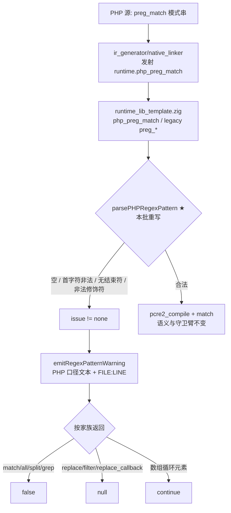
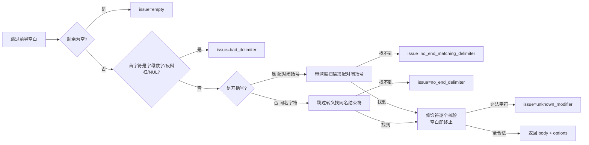
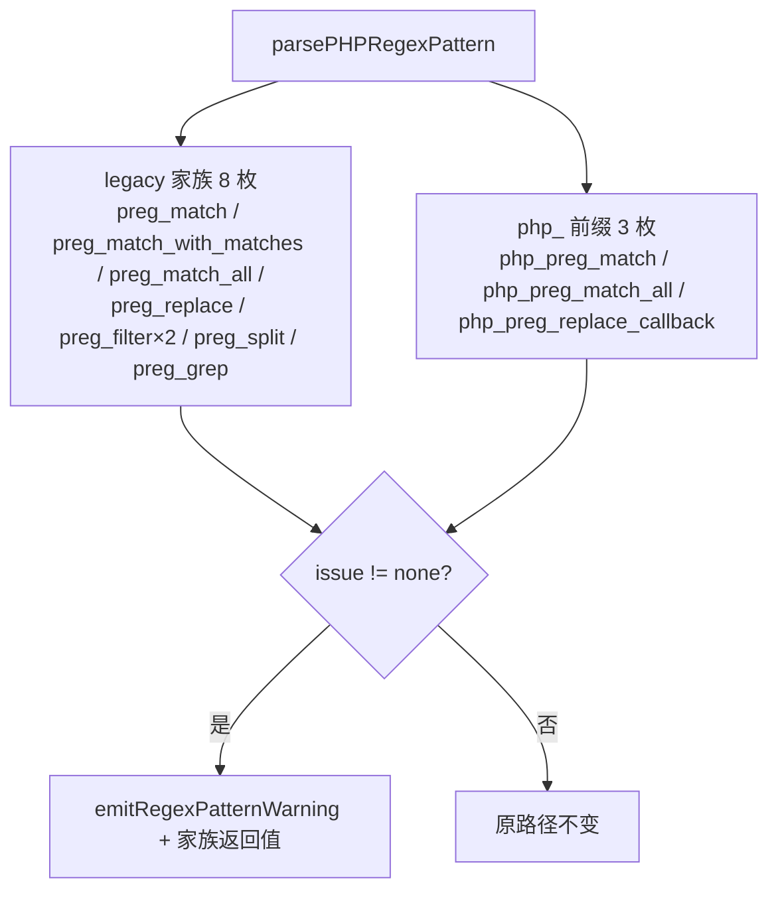

# AOT-CODEGEN-012 · R-163：F-50 落地 —— `preg_*` 补齐 PHP 的分隔符/修饰符校验（纯模板改动）

**代次**：`runtime_lib_template.zig` **`7bfee93178e59bd83c405e4775a80673`**（本批唯一改动文件）／`native_linker.zig` `9eb19280…`（未变）／`optimizer.zig` `ba0e0f57…`（未变）／二进制 `fe5d70d42745ab8e3fddc8a66139d6b6`（**未重建**，纯模板）
**工单**：`docs/known-issues/AOT-CODEGEN-012-class-name-case-insensitive-lookup.md` §38
**新立**：F-53（出参预置值）／死码登记（`php_preg_replace`）／观察项登记（9 枚未映射修饰符）

---

## 1. 高层摘要（TL;DR）

PHP 在把正则交给 PCRE **之前**会先校验模式：空模式、非法首分隔符、找不到结束分隔符、非法修饰符这四类都只发一条 **Warning** 并让函数返回 `false`（`preg_replace`/`preg_filter`/`preg_replace_callback` 返回 `null`），且**不写 `$matches` 出参**。AOT 此前完全不查：把非法模式直接送进 PCRE，结果是**静默错值**——`preg_match("b","abc")` 返回 `1` 而 PHP 返回 `false`，`preg_split("b","abc")` 切出 5 段。

本批在共享解析器 `parsePHPRegexPattern` 里一次补齐四类校验 ＋ **成对分隔符**（`(a)`/`{a}`/`[a]`/`<a>`，此前从未支持）＋ 实测得到的 13 枚合法修饰符集合，并把 **11 枚调用站点**按各自家族的返回值口径接上（false 与 null 的区分是实测的，不是推的）。

★两条我自己的预估在建门轮被实测否证：① 我以为 `(a)`/`{a}` 是恒绿守卫臂，其实它们今天就是红的；② 我以为缺校验只在 `preg_match`，其实整个 preg 家族都缺 ⇒ 修复面必须是共享解析器而非单点。

---

## 2. 影响范围

| 维度 | 影响 | 证据 |
|---|---|---|
| `preg_match`／`preg_match_all`／`preg_split`／`preg_grep` | 非法模式由「静默错值」改为 **Warning + false** | 门 PD pd1–pd6/pd8 转 `SAME` |
| `preg_replace`／`preg_filter`／`preg_replace_callback` | 非法模式改为 **Warning + null** | 门 PD pd7 转 `SAME` |
| 成对分隔符 `(a)` `{a}` `[a]` `<a>` | 由「解析失败静默降级」改为正常匹配 | 门 PD pd11/pd12 转 `SAME` |
| 合法模式与合法修饰符 | **零变化**（守卫臂恒绿） | 门 PD pd9/pd10/pd13–pd17/pd19；门 S 47 臂判据 `diff=0` |
| `$matches` 出参 | 早退支装空数组（PHP 保留预置值）⇒ 非空预置形态残差单列 **F-53** | 门 PD pd18/pd20 恒红 |
| 生成码文本 / 二进制 | **未变**（纯模板） | `bin_md5` 链首尾同 `fe5d70d4…`；影子 `changed_rows` 判据 0 |
| 解释器/字节码/JIT 模式 | 不触及（改的是 AOT 运行时模板） | 本批零 `src/runtime/` 改动 |

---

## 3. 核心变更

| # | 变更 | 位置 | 性质 |
|---|---|---|---|
| 1 | `PatternIssue` 枚举 + `ParsedPattern` 扩 `issue`/`issue_char` | 模板 `:10694`／`:10701` | 校验结果有了出口 |
| 2 | `php_regex_valid_modifiers`＝**实测 13 枚** `i m s x n u r A D J S U X` | `:10712` | ★禁凭文档猜（第一版实测法本身有缺陷，已重测） |
| 3 | `pairedCloseDelimiter`（只对开括号配对） | `:10723` | 闭括号 `)a)` 实测合法 ⇒ 不能一刀切配对 |
| 4 | `emitRegexPatternWarning`（固定 `[_]u8` 缓冲拼 PHP 口径文本） | `:10732` | 零分配；复用既有 `emitWarning` 的双行输出格式 |
| 5 | `parsePHPRegexPattern` 重写（空白/空判定 → 首字符 → 配对扫描 → 转义 → 修饰符） | `:10750` 起 | 单一实现点，11 站点共享 |
| 6 | 11 枚站点接返回值口径（false ×8、null ×2、数组循环 `continue` ×1） | `preg_match`…`php_preg_replace_callback` | ★区分 false/null 是实测结论 |
| 7 | 删 `_ = matches_ref;`（改后该参数被真实写入） | `preg_match` 头部 | Zig 会因 pointless discard 直接拒绝编译 |

净变更：仅 `src/aot/runtime_lib_template.zig`。

---

## 4. 可视化概览（Code & Logic Map）

### 4.1 分层与修复点



### 4.2 解析器的判定顺序（与 PHP 实测一致）



### 4.3 站点接线（11 枚）



---

## 5. 详细变更分析

### 5.1 PHP 真值口径（全部实测，工单 §38.1 有完整表）

| 形态 | PHP | AOT 修前 | AOT 修后 |
|---|---|---|---|
| `preg_match("b","abc")` | Warning + `false` | **`1`**（空模式匹配一切） | Warning + `false` ✅ |
| `preg_match("","abc")` | Warning `Empty regular expression` + `false` | `1` | ✅ |
| `preg_match("/a","abc")` | Warning `No ending delimiter '/' found` + `false` | `1`（body 变成 `a`） | ✅ |
| `preg_match("/a/+","abc")` | Warning `Unknown modifier '+'` + `false` | `1` | ✅ |
| `preg_match("(a)","abc")` | `1`（成对分隔符） | **`0`** | ✅ |
| `preg_match("{a}","abc")` | `1` | **`0`** | ✅ |
| `preg_match_all("b","abc",$m)` | Warning + `false` | **`4`**（4 次空匹配） | ✅ |
| `preg_replace("b","X","abc")` | Warning + `NULL` | `'abc'` | ✅ |
| `preg_split("b","abc")` | Warning + `false` | 5 段空切分 | ✅ |
| `preg_grep("b",["abc"])` | Warning + `false`（逐元素告警） | 静默 | ✅ |
| `preg_match("/a/ ",…)` / `")a)"` / `"|a|"` / `"#a#"` / `"/a/i"` / `"/\//"` | 全部合法 | 合法 | 仍合法（守卫臂恒绿） |

### 5.2 涉及文件与资产

| 文件 | 状态 |
|---|---|
| `src/aot/runtime_lib_template.zig` | 修改（唯一 `src/` 改动） |
| `fuzzy_scripts_720/tmp/c036_preg_delimiter_gate_tmp.sh` | 新增永久侧门 **门 PD**（20 臂；修前登记为 17 臂，后扩 3 臂承 F-53） |
| `fuzzy_scripts_720/tmp/c036_preg_delimiter_tmp.tsv` | 门 PD 表身（无表头） |
| `fuzzy_scripts_720/tmp/c037_r163_acceptance_chain_tmp.sh` | 21 腿验收链（★首条用上「按内容取 DONE」的新口径） |
| `docs/known-issues/AOT-CODEGEN-012-…md` | 新增 §38 与状态行 |

---

## 6. 影响与风险评估

### 6.1 R-163 验收链读数（21 腿）

★待 `R163_CHAIN_DONE` 后按 `c037_r163_acceptance_chain_tmp.log` 逐腿填，禁预估。链前已实测（真读数）：门 PD 链内首跑 `arms=20 same=18 diff=2 compile_fail=0 bad_probe=0 residue=0` @80 s，与链外单跑同值。

### 6.2 是否破坏式变更

**是——但方向是"由静默错值变为与 PHP 同形的告警"**，且只在**非法模式**上触发。合法模式的解析路径逐字节不变（守卫臂 8 枚恒绿 ＋ 门 S 全绿判据）。
需要老铁知道的取舍：若某脚本原依赖 AOT 的宽松行为（PHP 本来就报 Warning 的形），现在会得到与 PHP 一致的 `false`/`null` ⇒ 这类脚本的行为变化**是修复本身**，不是回归。

### 6.3 需要特别注意的点

1. **模板改动编不进 `zig build test`**：本轮 `_ = matches_ref;` 变成 pointless discard 后，`zig build test` 仍然 rc=0，而 **20 臂门全 `compile_fail`**（9 s "跑完"就是假信号）⇒ ★落地后必须先单跑一枚门验编译，再谈验收链（F-38 的现形）。
2. **`error_get_last()` 会跨轮残留**：第一版修饰符扫表用它，得出「a–zA–Z 全部 UNKNOWN」的**假结论**（连 `i`/`m`/`s`/`x` 都被算成非法）⇒ 必须 `set_error_handler` 逐轮清零。合法集合以重测的 13 枚为准。
3. **闭括号可单独作分隔符**（`)a)` 合法）⇒ 配对规则**只**对开括号生效，写反了就会把合法模式判死。
4. **false 与 null 的家族差异**是实测的，不能统一返回 `false`（`preg_replace` 系列是 null）。
5. **数组实参逐元素告警** ⇒ 循环内那枚站点用 `continue`（跳过该元素）而不是整函数返回 null。
6. **F-53 不是本批引入**：出参预置值保留需要按引用装填补齐；本批先取"装空数组"以免 rc=255 崩（比 PHP 更糟），并把残差恒红登记在 pd18/pd20。
7. **9 枚修饰符（n u r A D J S U X）语义未映射** ⇒ 本批只保证"不被误判为非法"，**不声明已支持**（R-164 待测定级）。

### 6.4 复测路径（体验流程）

```bash
cd /Users/wangjianjun/products/parser
# 1) 直观复现（Warning 双行 + false）
printf '<?php\n$m = null;\nvar_dump(preg_match("b", "abc", $m));\nvar_dump(preg_match("(a)", "abc"));\n' > /tmp/f50.php
timeout 240 zig-out/bin/php-interpreter --compile --no-debug-info --output=/tmp/aot_compile_f50 /tmp/f50.php && timeout 10 /tmp/aot_compile_f50
# 2) 门 PD（20 臂，~80 s）
timeout 900 bash fuzzy_scripts_720/tmp/c036_preg_delimiter_gate_tmp.sh
# 3) 首要回归守卫：门 S 必须仍 diff=0（47 臂，~200 s）
timeout 500 bash fuzzy_scripts_720/tmp/c014_pcre_flags_gate_tmp.sh
# 4) 全链（21 腿，~65 分钟）
nohup timeout 5400 bash fuzzy_scripts_720/tmp/c037_r163_acceptance_chain_tmp.sh &
```

---

## 7. 遗留问题 / 潜在问题

| # | 项 | 说明 | 归类 |
|---|---|---|---|
| 1 | **F-53** | 告警早退支无法保留 `$matches` 的**非空**预置值（PHP 保留、AOT 空数组）；根因是按引用实参槽不从调用者变量初始化 | 门 PD pd18/pd20 恒红登记 |
| 2 | 9 枚修饰符语义未映射 | `n u r A D J S U X` 接受但不实现 | R-164 备料（先建语义门取红集） |
| 3 | `php_preg_replace` 死码 | 手写非 PCRE 实现、全仓零引用；按宪法不删 | 已登记，勿误当活路径修 |
| 4 | `preg_match_with_matches` 等内部名仍是 PHP 可见名 | F-43 家族（helper 泄漏成可调用名），本批未动 | 待 F-43 裁决 |
| 5 | 门 PD 判据含告警文本 ⇒ 若 AOT 的 Warning 位置文本与 PHP 不同 | 已由归一折叠 `FILE:LINE`（宪法 §七.5）⇒ 不构成差异 | 无 |
| 6 | `preg_quote`/`preg_last_error` 未纳入本批 | 与分隔符校验正交 | 无 |

---

## 8. 后续开发 / 优化建议

| 优先级 | 项 | 影响面 | 落地成本 |
|---|---|---|---|
| **P1** | **R-164 preg 修饰符语义门**：9 枚未映射修饰符逐枚建最小可分辨形，先登记红集再决定是否补 `PCRE2_ANCHORED`/`UNGREEDY`/`EXTRA`/`DUPNAMES` 等 | 静默错值面（与 F-50 同类，只是缺的是选项位） | 中（门 ~12 臂；模板内补 options 映射，改动小但要全链） |
| **P1** | **F-53 按引用出参初始化**：与 REF-004/F-13 同族，修好后 pd18/pd20 应转绿 | 出参语义面（`preg_match`/`array_*`/`usort` 等共用） | 中（发射侧装填，需重冻 md5） |
| **P2** | 把门 PD 并入常备链并与门 S 组成「PCRE 双门」 | 防回归 | 低（已在链内） |
| **P2** | `php_preg_replace` 死码处置（删或改活路径）——**须老铁明示**（宪法 §六.3 涉删代码） | 认知负担 | 低 |
