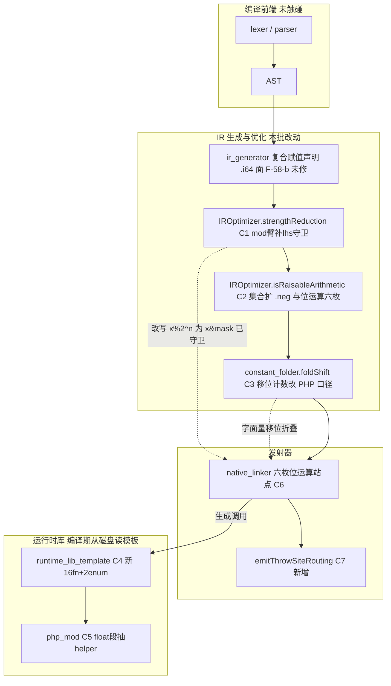
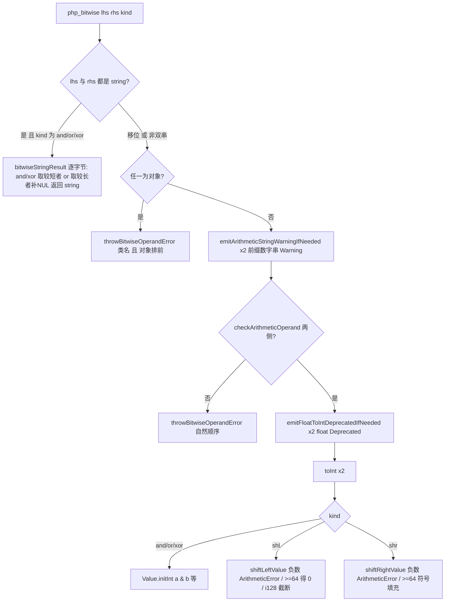
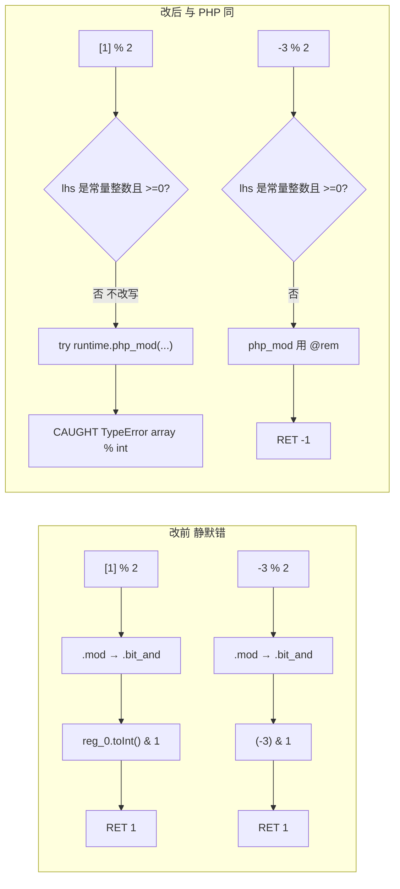

# AOT-CODEGEN-012 R-167：F-56 改定为「强度削减 `.mod` 臂」＋ F-58 位运算/移位/取反族落地

- **日期**：2026-10-15
- **轮次**：R-167（工单 `docs/known-issues/AOT-CODEGEN-012-class-name-case-insensitive-lookup.md` §41）
- **基线 commit**：`df31715`（本批四文件改动 **staged 未提交**，口径＝老铁「我只记录不提交」）
- **裁决**：F-56 取 **甲型**（补 lhs 守卫）；F-58 **本轮一并修**

---

## 1. 高层摘要（TL;DR）

1. **旧归因被实测否证**：R-165/166 把 `[1] % 2`／`"abc" % 2` 两枚残红记作「常量折叠绕过操作数类型检查」。
   实测 `constant_folder.foldMod` 只在 `.int ∧ .int` 折叠、且 `ConstantValue` **没有 array 分支** ⇒ 折不动这两个形。
   真凶是 **强度削减** `optimizer.zig:5903` 的 `.mod` 臂：只查 rhs 是 2 的幂、**完全不查 lhs**，
   把 `x % 2^n` 改写成 `x & (2^n-1)`，发射成 `reg_x.toInt() & mask` ⇒ 整条 `php_mod`（含 R-165 刚补的检查与路由）被绕开。
2. **同一臂藏着两面**：面 A 是类型旁路（array/非数字串静默给垃圾）；
   ★面 B 是**纯静默错值**——PHP 的 `%` 是截断取余（符号随被除数），`x & mask` 是向下取模（恒非负）
   ⇒ `-3 % 2` PHP `-1`／AOT `1`，`-9 % 8` PHP `-1`／AOT `7`。**连异常都没有**，故定 P0。
3. **F-58 是另一族**（与强度削减无关，老铁批准并入本轮）：`& | ^ << >> ~` 六枚发射站点是裸 Zig 整数运算
   ⇒ 无操作数检查、**PHP 合法的 string × string 逐字节运算被算成 int 0**、无 float Deprecated、
   无负移位计数诊断、无异常路由；`constant_folder.foldShift` 还用 C 风格 `@mod(rhs,64)` 掩码（`1 << 64` 应 0）。
4. **门 MSR 一次定档、一次闭环**：修前 72 臂注册红 **48**（F-56 的 14 ＋ F-58 的 34），
   落地后 74 臂（补语句位取负 b47/b48）**`same=74 diff=0`、`aot_caught 0→28`**、守卫臂一枚未被打红。
5. **顺带多收一枚**：门 F45FACE 的 `both_match_php 11→12`， recovered 的是 `p13 = [] % 1`
   （`isPowerOfTwo(1)` 为真 ⇒ 旧形走 `& 0`），证明同一守卫在别的门里也有一枚等待已久的红。
6. **零回归但非零代价**：主回归 `Pass 67 / Skip 1` 不掉一枚；影子列 `changed_rows=13` 全部落在校准集内（越界 0 枚）。
   ★性能：模运算侧 +2～4%（预估 1～3% 成立），**位运算侧实测 +32%**（我裁决前给的"个位数"被实测否证，已按实测登记为 F-60）。

---

## 2. 影响范围

| 影响面 | 范围 | 程度 |
|---|---|---|
| 正确性（取模） | 所有 `% 2^n` 且 lhs 为**负数**的 PHP 程序 | 静默错值 ⇒ 修正；语料 24 处站点全为非负 ⇒ 语料零值变 |
| 正确性（类型） | `[1] % 2`、`"abc" % 2`、`[1] % 1024` 等 | 静默垃圾 ⇒ 修正为可捕获 TypeError |
| 正确性（位运算） | `& \| ^ << >> ~` 六族 × (array／非数字串／对象／null／bool) | 静默错值／缺失 fatal ⇒ 修正 |
| 正确性（位运算） | **string × string 逐字节**（PHP 合法，返回 string） | 原返回 int 0 ⇒ 修正为 string |
| 诊断面 | float 参与 `%`／位运算的 `Deprecated: Implicit conversion…`；`'5abc' & 3` 的 Warning | 丢失 ⇒ 补回 |
| 异常控制流 | 位运算抛出后的**路由**（F-57 同族）＋语句位**不被 DCE 删**（F-45 同族） | 缺 ⇒ 补齐 |
| 移位计数 | `1 << -1`／`8 >> -1` ⇒ ArithmeticError；`1 << 64`⇒0；`-1 >> 64`⇒-1 | 三处口径修正（两条路径各一套旧错法） |
| 性能 | 位运算热点 **+32%**（实测）；模运算 **+2～4%**（实测） | ★未做快路，登记 F-60 待裁决 |
| 影子基线 | `changed_rows=13`（r166 列 `b4cbc4f5…` ⇒ r167 列 `f5f2bf5e…`） | **受控重冻**，逐枚归因完成 |
| 其他模式 | 未触碰（`tree`/`bytecode`/`fast` 不跑 `IROptimizer`／不用本模板） | 宪法 §五：仅 AOT |

---

## 3. 核心变更

| # | 层 | 位置 | 变更 |
|---|---|---|---|
| C1 | 优化器 | `optimizer.zig:5903+`（`.mod` 强度削减臂） | 补 lhs 守卫：`lhs` 亦须为常量整数**且 `>= 0`**（比 `.mul/.div` 多这一条，因 `x & mask` 对负数不等价） |
| C2 | 优化器 | `optimizer.zig:3256 isRaisableArithmetic` | 集合扩：`+ .neg`（★R-166 漏项，b47 实测语句位 `-([1]);` 被删）＋ `.bit_and/.bit_or/.bit_xor/.shl/.shr/.bit_not`；旧排除理由留字防重犯 |
| C3 | 常量折叠 | `constant_folder.zig:167 foldShift` | 去 C 风格 `@mod(rhs,64)`：负计数**不折叠**（交运行时抛，兼消一处 `@intCast` 越界转换）、`>=64` 走 PHP 口径、shl 经 i128 截断复刻位回绕 |
| C4 | 运行时模板 | `runtime_lib_template.zig`（`php_mod` 之后） | 新增 **16 fn ＋ 2 enum**：`operandTypeName`／`emitFloatToIntDeprecatedIfNeeded`／`throwBitwiseOperandError`／`throwBitNotError`／`throwBitShiftNegativeError`／`bitwiseStringResult`／`php_bitwise` 核心／`shiftLeftValue`／`shiftRightValue`／`castShift`／`php_bit_and`／`php_bit_or`／`php_bit_xor`／`php_shl`／`php_shr`／`php_bit_not` |
| C5 | 运行时模板 | `php_mod` 两段内联 float 检查 | 抽出为 `emitFloatToIntDeprecatedIfNeeded` 并就地改调（DRY，形为不变；由 OPS 的 o4/o9/g8 守回边） |
| C6 | 发射器 | `native_linker.zig:21133/21138/21143/21152/21161`＋`:22067` | 六枚站点由裸 Zig 运算改 `try runtime.php_bit_*（…）`，统一 `writeRegAssignmentPrefix`＋`writePhpValueExpr`；★顺带补 `.shl/.shr` 原先**缺失的 alloca `.*` 解引用**，并删去 `.bit_not` 三段按 `operand.type_` 分档的同构死分支 |
| C7 | 发射器 | `native_linker.zig`（`generatePostCallExceptionCheck` 之后） | 新增 `emitThrowSiteRouting`（块级抛出站点路由，与既有七处内联形逐字节同构；既有七处**保持原样**） |
| C8 | 门禁 | 新永久侧门 **MSR**（`c041_mod_strength_gate_tmp.sh`，74 臂） | 三种探针：`mk_probe`／`mk_stmt_probe`（语句位）／`mk_probe_t`（`gettype`+`bin2hex`，因合法结果可为二进制串） |
| C9 | 门禁 | 新普查 `c042_bit_corpus_census_tmp.sh` | 语料 `bit ∪ modpow` 允许集（影子漂移归因的判据底座） |

---

## 4. 可视化概览（Code & Logic Map）

### 4.1 分层与变更点



### 4.2 判定流程（位运算族一次求值）



### 4.3 执行流程（含路由与 DCE）

```mermaid
sequenceDiagram
  participant PH as PHP 8.5.8 真值
  participant IR as IROptimizer
  participant NL as native_linker
  participant MAIN as 生成 main.zig
  participant RT as runtime_lib
  PH-->>IR : 语义基准（截断取余 / 逐字节串运算 / 类名消息）
  IR->>IR : strengthReduction `.mod` 臂（C1 守卫后仅常量非负才改写）
  IR->>IR : DCE Phase3（C2 位运算与 .neg 不再被删）
  IR->>NL : 通过校验的 IR
  NL->>MAIN : reg = try runtime.php_bit_and(a, b); + 路由块（C6/C7）
  MAIN->>RT : php_bitwise → throwThrowable("TypeError"/"ArithmeticError")
  RT-->>MAIN : setException + initNull
  MAIN->>MAIN : if (runtime.hasException()) → current_block = catch（异常可被接住）
```

### 4.4 取模面：改前 vs 改后



---

## 5. 详细变更分析

### 5.1 涉及文件

| 文件 | 本批角色 | staged 行数（自 `df31715` 起**累计**，含 R-165/166 未提交部分） |
|---|---|---|
| `src/aot/optimizer.zig` | C1 C2 | +46 / −24 |
| `src/aot/constant_folder.zig` | C3（★staged 即本批全量） | +15 / −2 |
| `src/aot/native_linker.zig` | C6 C7（累计含 R-165 五枚路由） | +130 / −27 |
| `src/aot/runtime_lib_template.zig` | C4 C5（累计含 R-165 抛出站点） | +233 / −56 |
| `src/aot/test_loop_unroll.zig` | R-166 占位断言修正（本批未再动） | +5 / −3 |
| `fuzzy_scripts_720/tmp/c041_mod_strength_gate_tmp.sh` | 新永久侧门 MSR（74 臂） | 新 |
| `fuzzy_scripts_720/tmp/c042_bit_corpus_census_tmp.sh` | 新语料普查 | 新 |
| `fuzzy_scripts_720/tmp/c042_r167_acceptance_chain_tmp.sh` | 26 腿验收链 | 新 |
| `docs/known-issues/AOT-CODEGEN-012-…md` | §41（10 小节）＋§6 状态行 | 新段 |

### 5.2 变更点与实测对应

| 变更 | 关闭的注册红 | 实测臂 |
|---|---|---|
| C1 `.mod` 臂守卫 | F-56 面 A/B/C 共 14 枚 | m1–m6／m7–m12,m14／m12,g8；另收 F45FACE 的 p13 |
| C3 `foldShift` | 字面量移位计数面 | b18 `1 << -1`、b20 `1 << 64`、b21 `$a << 64`、b22 `$a >> 64` |
| C6 六站点＋C7 路由 | F-58 面 A′/B′/C′/E′/F′ 共 31 枚 | b1–b9、b10–b14、b15–b17、b26–b28、b29–b35 |
| C2 DCE 集合 | F-58 面 D′（语句位）＋取负漏项 | b23、b24、b25、b47（控制臂 b48） |
| C4 `operandTypeName` | 对象操作数消息 | b26/b27（对象排前＋类名）、b35（`~` 用类名） |

### 5.3 逐枚口径来源（全部实测，非文档推断）

- string × string：`"abcdef" & "abc"`→len 3；`"ab" | "a"`→len 2；`"ab" ^ "abc"`→两枚 NUL；`'5' & '3'`→字符串 `"1"`。
- 一元 `~`：`~[1]`／`~null`／`~true`／`~new Bar()` ⇒ `Cannot perform bitwise not on array|null|true|Bar`；`~"abc"`→`\x9e\x9d\x9c`。
- 移位：`1 << 64`→0、`8 >> 65`→0、`-1 >> 64`→-1、`PHP_INT_MAX << 1`→-2、`1 << -1`→ArithmeticError。
- 消息顺序：`[1] & 2`→`array & int`、`2 & [1]`→`int & array`、`1 & new stdClass()`→`stdClass & int`。

---

## 6. 影响与风险评估

| 项 | 结论 |
|---|---|
| 是否破坏式 | **对 PHP 语义非破坏**（把错值/漏诊断改成与真值一致）；**对既有 AOT 输出是行为变更**：位运算结果类型可由 int 变 string（string×string 形），语句位位运算不再被删 |
| 范围 | 只有真正使用 `& \| ^ << >> ~` 或 `% 2^n` 的程序受影响；语料内命中 35 枚（其中真实运算符 13 枚产生发射漂移） |
| 性能 | ★位运算热点实测 **+32%**（45 ns/次量级），模运算 **+2～4%**。快路（类型守卫内联）**未做**＝F-60，需先证伪"推断成 int 却实装 string/float"才可调，否则拿正确性换性能 |
| 需特别注意 | ① `isPowerOfTwo(1)` 为真 ⇒ `% 1` 也进旧改写支（p13 现形）；② 对象在**算术**族仍被 `checkArithmeticOperand` 放行＝F-59 未修；③ 复合赋值的结果寄存器声明 `.i64` 与 string 结果可能不一致＝F-58-b 待测；④ 影子**只哈希 `main.zig`** ⇒ `changed_rows` 不证运行面，运行面看门与主回归 |
| 复测路径 | `bash fuzzy_scripts_720/tmp/c041_mod_strength_gate_tmp.sh`（74 臂 ≈340 s，期望 `same=74 diff=0`）→ `bash fuzzy_scripts_720/tmp/c038_operand_type_gate_tmp.sh`（26 臂，期望 **改档后** `same=25 diff=1`，残红 g4）→ `bash fuzzy_scripts_720/tmp/c042_r167_acceptance_chain_tmp.sh`（26 腿 ≈1 h 45 m） |

### 6.1 验收链实测（`c042_r167_acceptance_chain_tmp.log`，09:50:56 → 11:35:43，6287 s）

| 腿 | 读数 |
|---|---|
| buildtest | rc=0 |
| **MSR** | `arms=74 same=74 diff=0 aot_caught=28 compile_fail=0 bad_probe=0 residue=0` @337s |
| F45FACE | `raise_lost=0 preserved=19 both_match_php=12 both_red=7`（修前 11/8） |
| OPS | `arms=26 same=25 diff=1 aot_caught=16`（修前 23/3，红 o5/o14/g4） |
| PD / S / AC | `20 18/2` ／ `47 same=47 diff=0` ／ `13 cf=8 canary=7`（逐字段等值） |
| AB | 全行 `68 = MATCH_PHP 66 + BOTH_RED 1 + COMPILE_FAIL 1`；`on_eq_off=yes 67 / missing 1`（与 R-166 分布逐字同） |
| CENSUS | `total=68 bit_only=24 modpow_only=2 both=9 neither=33 bucket_sum=68` |
| PERF | bit `2807/2803/2783` ms（修前 `2127/2092/2119`）；mod `A 503/486/473`、`C 473/491/493`、`B 521/621/620` |
| 其余 16 腿 | Y/ZFACES/ZCENSUS/X/V/W/T/P/M/N/O/D8/Q/R/U/B **全部等值注册档**（U 列聚合 `51 SAME/22 CF/2 BAD_PROBE`＝与 R-166 全等） |
| regression | `Total 68 / Pass 67 / Fail 0 / Skip 1`（mtime 11:18:12）＝零回归 |
| shadow / shadowcol | `68 行` ／ **`changed_rows=13`**，`col_md5=f5f2bf5ef969dd091962a468bf3afcbb`（新 BASE） |

### 6.2 影子 13 枚漂移的归因（判据：变化集 ⊆ 允许集）

- 变化集：`f007 f016 f025 f027 f043 f045 f047 f065 f066 f135 f151 f152 f178`
- `OUT_OF_RANGE`：**空**（无一枚越界）✓
- `% 2^n` 允许集 11 枚**全部**在变化集内（甲型逐枚命中）＋ 2 枚位运算热点（f016/f025）✓
- 「在允许集却未变」的 22 枚：严格扫描证明是普查口径**过宽**的假阳性（按引用 `array &$arr`、联合类型 `int|string`、`&&`、字符串字面量里的 `&`/`^`/`~`），零真运算符 ✓

---

## 7. 遗留 / 潜在问题

| 编号 | 问题 | 状态 |
|---|---|---|
| F-60 | 位运算/移位带检查调用的性能回边（实测 +32%） | 待裁决（甲＝类型守卫内联快路／乙＝接受现状） |
| F-59 | 算术族对**对象**完全放行（`$o + 1` 不抛不报；PHP 侧 `int + Foo` 带类名） | 待裁决（改 `checkArithmeticOperand` 波及 68 枚共用入口） |
| F-58-b | `&= \|= ^= <<= >>=` 结果寄存器声明 `.i64`，而 string×string 现返回 string | 未取证（链跑动期间禁并发编译） |
| F-55 | 数字前缀字符串算术结果类型（门 OPS 唯一残红 g4） | 待裁决 |
| F-38 | `zig build test-aot` 仍 6 处编译错误（`dependency_resolver.zig:692/706/723/738/789`、`linker.zig:162`） | 本批复现＝非本批引入 |
| — | 门 MSR 修前档为 72 臂、落地后为 74 臂（b47/b48 系补入）；其修前读数用修前二进制 `1ebb5a8b…` 单独实测 | 已登记 |

### 7.1 本批自我更正（五条，全部留字于工单 §41.7）

1. 门 DIFF 行 `printf` 少传 `$arc` ⇒ AOT 列丢 rc（判据本身未受影响）。
2. 臂表表达式参数误用**双引号** `"$n << 1"` ⇒ `set -u` 下整条门在第 45 臂崩掉、无 DONE 行。
3. 为改表头写的 python 用**非唯一短语**定位行区间 ⇒ 删掉门脚本 153 行；靠「重建后同一子集 26 行逐字节 diff 为空」复证复建成功。
4. 语句位取负此前无任何臂覆盖 ⇒ `.neg` 是 R-166 的集合漏项（b47 实测）。
5. 一次 `rm` 与 `md5` 并写同条命令（违规则 47；目标均为本会话 `/tmp` 草稿，无仓库资产受损）。
6. ★另更正一处**我自己的预估**：裁决前给位运算代价"约个位数百分比"，实测 **+32%** ⇒ 以实测登记。

---

## 8. 后续建议

| 优先级 | 事项 | 影响面 | 落地成本 |
|---|---|---|---|
| P1 | **F-58-b 取证**：构造"字符串位运算结果被按 int 消费"的臂（`$a = "abc"; $a &= "abd"; if ($a > 0)`），确认 `.i64` 声明是否引出类型误读／panic | 复合赋值全族 | 低（3–5 臂，约 2 分钟门内时间） |
| P1 | **F-60 决断**：先做"被推断为 int 却实装 string/float"的证伪普查，再决定是否上类型守卫内联快路；同时补语料级稀释比（需重建同代修前二进制做对照） | 位运算热点语料（f025/f065/f066/f016 等） | 中（普查 1 轮＋快路 1 轮） |
| P1 | **F-59**：算术族对象面（`checkArithmeticOperand` 补对象拒绝 ＋ 消息用类名） | 全体算术入口 | 中（须整链重冻） |
| P2 | 门 MSR 加「`% 2^n` 与位运算的**未捕获文本**」臂族（现 7 枚 F45FACE 恒红属 F-39-ii 文本面） | 未捕获面 | 中 |
| P2 | 把 `php_div`/`php_pow`/`php_add` 的 float Deprecated 段统一改用 `emitFloatToIntDeprecatedIfNeeded`（现仅 `%` 与位运算族走该 helper） | 诊断一致性 | 低 |
| P2 | 修 `zig build test-aot` 的 6 处编译错误（F-38），让 AOT 模块单测重新入库 | 测试可 gating 性 | 低（但属其他模块，需老铁点头） |
