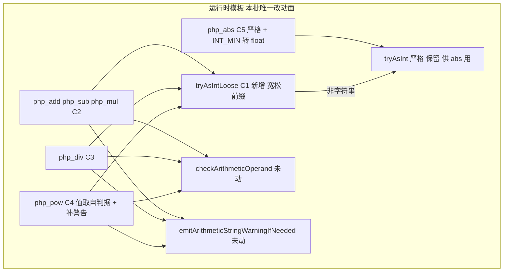
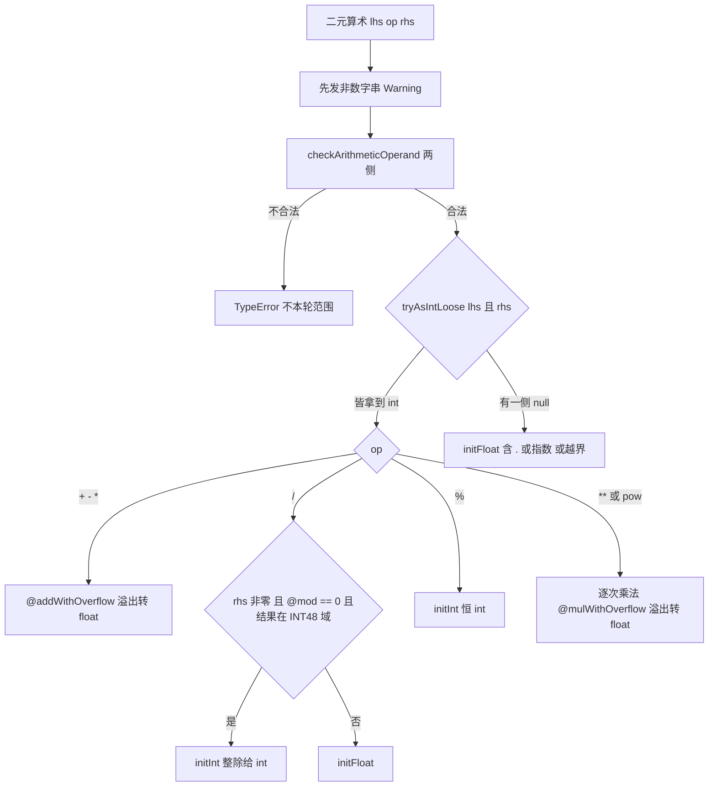
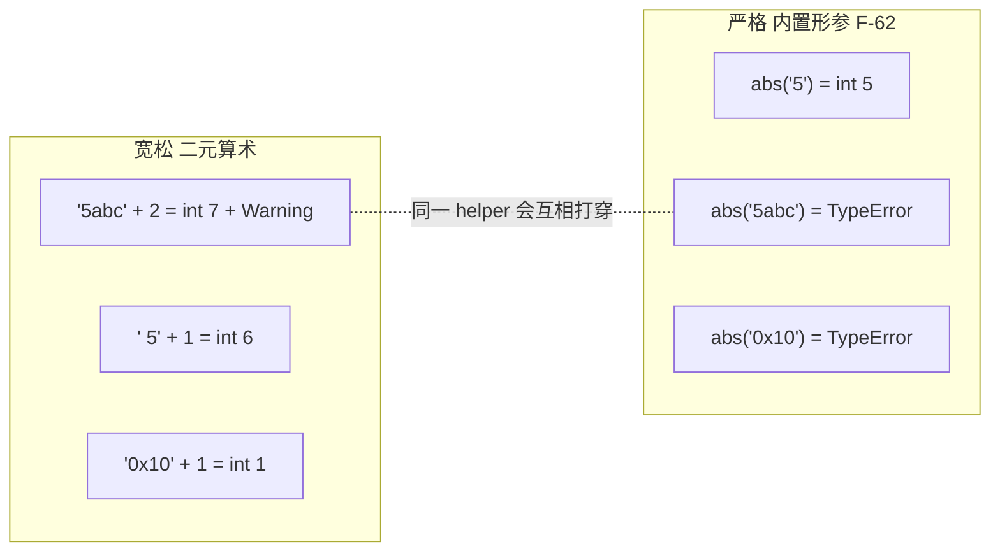
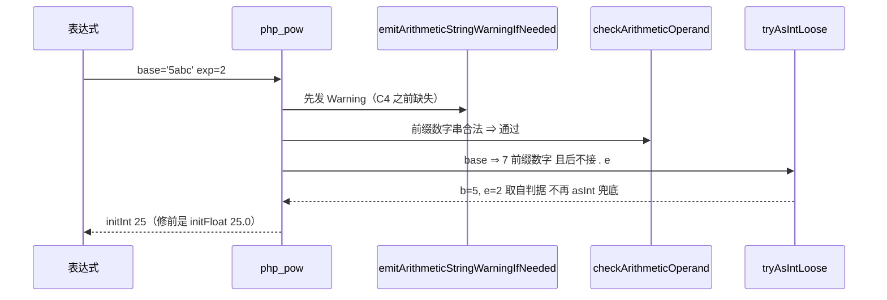

# AOT-CODEGEN-012 R-171：F-55 落地 —— 算术结果的 int／float 分叉按 PHP「字面语法」收口（门 OPS 首次零注册红）

- **日期**：2026-10-16
- **轮次**：R-171（工单 `docs/known-issues/AOT-CODEGEN-012-class-name-case-insensitive-lookup.md` §45）
- **基线 commit**：`2254f88`（R-167/R-169 已入库；R-170 与 R-171 的模板改动**未提交**，口径＝老铁「我只记录不提交」）
- **改动性质**：★**纯模板轮** ⇒ 二进制 md5 保持 `c514f194…`（链内断言），生成码逐字节中性

---

## 1. 高层摘要（TL;DR）

1. **PHP 的结果类型由「字面语法」决定，不由「数值是否为整」决定**——本轮逐枚实测钉死：
   `'5' + 1` = **int 6**，而 `'5.0' + 1` = **double 6.0**；`6 / 2` = **int 3**，`5 / 2` = double 2.5，`5 / 2.5` = double 2.0；
   `'5abc' + 2` = **int 7**（配非数字串 Warning）；`'0x10' + 1` = int 1（前缀只吃到 `0`）；`'99999999999999999999' + 1` = double。
2. **AOT 有四处独立缺口**（门 NST 修前 18 枚红全部定位到函数）：
   R1 `php_pow`／`php_abs` 的整数路径要求 `.isInt()`、`php_div` 只看 `isInt/isNull/isBool` ⇒ **整数字面量串一律落 float**；
   R2 `tryAsInt` 只收「整串是数字」⇒ 前缀数字串落 float，**这正是门 OPS 唯一残红 g4 的真身**；
   R3 `abs(PHP_INT_MIN)` 在 i64 上 `-i` **回绕** ⇒ AOT 返回 `integer -9223372036854775808`（值与符号皆错，PHP 是 float）；
   R4 `php_pow` 整条**漏发** `A non-numeric value encountered`（值对、警告缺）。
3. **两套口径刻意不能合并**：二元算术看**数字前缀**（容忍首尾空白与尾随垃圾，并打 Warning），
   内置函数形参是**严格 `is_numeric`**（`abs('5abc')`、`abs('0x10')` 在 PHP 直接 `TypeError`）
   ⇒ 新增 `tryAsIntLoose`、**保留** `tryAsInt` 给 `abs`。
4. **里程碑**：门 **OPS 由 `25/1` 改档为 `26/26 → diff=0`＝零注册红**，是本工单第一道完全全绿的操作数门；
   主门 NST 由 18 红降到 **2 红**，且这 2 枚都是**已登记的其他面**（F-62 与 F-63）。
5. **验收**：28 腿链 6805 s 全 `rc=0`；OBJ/ABS/MSR/F45FACE/PD/S/AC/AB/CENSUS/U/B/ZCENSUS 与 R-170 逐字等值；
   主回归 `Pass 67 / Skip 1` 零回归；★影子 **`changed_rows=0 col_identical=yes`**（连续第三个发射中性的纯模板轮）。

---

## 2. 影响范围

| 影响面 | 变化 |
|---|---|
| `+ - * / % **` 与 `pow()` | 操作数是**整数字面量串**或**前缀数字串**时：结果由 `double` 变 **`integer`**（与 PHP 同） |
| `/` 的整除判定 | `'6' / 2` 由 `3.0` 变 **int 3**；`5 / 2.5` 仍是 `double 2.0`（有 float 语法就不给 int） |
| `abs()` | 整数字面量串 ⇒ int；`abs(PHP_INT_MIN)` ⇒ **float**（不再回绕成负整数） |
| 诊断 | `'5abc' ** 2` 现在会打 `Warning: A non-numeric value encountered`（此前只 add/sub/mul/div/mod 打） |
| 内置函数形参严格性 | **未动**（`abs('5abc')` 仍不抛＝F-62 待裁决面，本轮刻意不合并两套口径） |
| 语料 | 零（主回归不掉一枚；AB 分母腿分布逐字同） |
| 其他模式 | 未触碰（模板只服务 AOT 产物）⇒ 宪法 §五「仅 AOT」成立 |
| 性能 | `tryAsIntLoose` 对非字符串直接转调 `tryAsInt`；对字符串多几次字符扫描 ⇒ 无可测退化（本批不主张性能数字） |

---

## 3. 核心变更

| # | 位置 | 变更 |
|---|---|---|
| C1 | 新 `tryAsIntLoose(val) ?i64` | 跳首空白 → 可选符号 → 吃数字；无数字前缀 或 前缀后紧跟 `.`／`e`／`E` ⇒ `null`（交浮点路）；`parseInt` 越界 ⇒ `null`；非字符串转调严格 `tryAsInt` |
| C2 | `php_add`／`php_sub`／`php_mul` | 三处判据 `tryAsInt` → `tryAsIntLoose`（修 R2） |
| C3 | `php_div` | `lhs_is_int`／`rhs_is_int` 改由 `tryAsIntLoose(...) != null` 决定；**整除判断与 INT48 范围检查一字未动**（修 R1） |
| C4 | `php_pow` | int 路径改 `if (tryAsIntLoose(base)) \|b\| { if (tryAsIntLoose(exp)) \|e\| {…`——★**改用判据解析出的值**，因为旧写法对字符串寄存器调 `asInt()` 是 NaN-boxing 兜底会读成 0；并补两行 `emitArithmeticStringWarningIfNeeded`（修 R1＋R4） |
| C5 | `php_abs` | 改走**严格** `tryAsInt`（内置形参口径），并补 `i == minInt(i64) ⇒ initFloat`（修 R3，形与 `php_neg` 一致） |

---

## 4. 可视化概览（Code & Logic Map）

### 4.1 分层与变更点

### 4.2 结果类型判定流程（PHP 规则的实现）

### 4.3 两套口径的分界（为什么不能合并成一个 helper）

### 4.4 时序：一次 `'5abc' ** 2`

---

## 5. 详细变更分析

| 层 | 文件 | 变更点 |
|---|---|---|
| 运行时 | `src/aot/runtime_lib_template.zig` | C1～C5；新增 1 个 helper、改 6 个函数入口判据 |
| 门禁 | 新永久侧门 **NST**（`c049_numeric_string_type_gate_tmp.sh`，32 臂，md5 `a728ed983f390bbd35445fbf5a420c42`） | 判据是 `gettype($x)\|var_export` ⇒ int／float 必然分家；含**越界验收专用臂 n32**（只报 `gettype` 列表，避开 F-63 记法噪声） |
| 链 | `c050_r171_acceptance_chain_tmp.sh`（28 腿，含 CENSUS） | 三重自保延续（代次 md5／磁盘断言／失败即停） |
| 真值资产 | `/tmp/r171/matrix.php`、`m2.php`、`abs.php`、`absmin.php` | 20＋15＋11＋5 例逐枚实测 |
| 快照 | `c049_nst_prefix32_R171_snapshot_tmp.tsv`（`7b0d5394…`）、`c049_nst_postfix32_R171_snapshot_tmp.tsv`（`4766181…`） | 修前／修后两档都在盘上（R-169 教训的执行） |

---

## 6. 影响与风险评估

| 项 | 结论 |
|---|---|
| 是否破坏式 | 对 PHP 语义非破坏（把 float 改回 int、把回绕负数改回 float）；对 AOT 是**值与类型级修正**，会改变部分输出（`7.0` → `7`） |
| 过宽风险 | 刻意**未**把宽松判据用于内置函数形参 ⇒ `abs('5abc')` 维持现状（该面属 F-62，需要的是抛 TypeError 而不是"变 int"）；`n9/n31` 两枚恒红即此边界的哨兵 |
| 过窄风险 | `tryAsIntLoose` 只认十进制前缀；十六进制字面量串（`'0x10'`）按 PHP 取前缀 `0` ⇒ 实测一致（n19 绿） |
| 特别注意 | ① 对字符串寄存器**永远不要用 `asInt()` 取值**（NaN-boxing 兜底读 0），要取就用 `tryAsInt*` 的返回值——C4 就是这个坑；② 门 OPS 现在零注册红，日后任何 g/o 臂转红都是**真回归**而非既有噪声 |
| 复测路径 | `bash fuzzy_scripts_720/tmp/c049_numeric_string_type_gate_tmp.sh`（32 臂 ≈145 s，期望 `same=30 diff=2` 且残红只能 n9/n31）→ `c038`（期望 **26/26**）→ `c047`（期望 13/15）→ `c044`/`c043`/`c041` → 全链 `c050` |

---

## 7. 遗留 / 潜在问题

| 编号 | 问题 | 状态 |
|---|---|---|
| **F-62** | 内置数值形参的严格性：`abs('5abc')`／`abs('0x10')` 应抛 `Argument #1 ($num) must be of type int\|float, string given`；`intdiv/fdiv/sqrt/bcadd` 同族；`array_sum/array_product` 只 Warning＋返回值、`max/min/比较` 只 Notice ⇒ **不可一并加抛** | 门 BLT b1..b13 与 NST n9 已登记；门已建，等定调（中央 `fn_table` 校验 vs 逐函数） |
| **F-63** | 大浮点记法：`9223372036854776000.0`（AOT）vs `9.223372036854776E+18`（PHP）；**值已对**，NST n31 就是这枚 | 需先普查语料大浮点暴露与受影响通道 |
| F-61 | 增量族余面（`$arr++` 措辞、bool 增量 Warning） | 门 OBJ i8/i11 恒红登记 |
| F-53 | 按引用出参无法保留调用者预置值 | 门 PD 两枚恒红 |
| F-58/F-59 已闭 | 位运算族与对象算术面 | R-167/R-169/R-170 完成，本轮 OBJ/ABS/MSR 全等值复证 |

---

## 8. 后续建议

| 优先级 | 事项 | 影响面 | 落地成本 |
|---|---|---|---|
| P1 | **F-62 定调**：中央化（按 `fn_table` 的形参类型在内置入口统一发第四套措辞）vs 逐函数补。建议中央化，但必须先把「只 Warning/Notice 不抛」的那批（`array_sum/array_product/max/min/比较`）从中央路径里**排除**出来，否则当场造 over-fatal | 全体数值内置函数 | 中（一个 helper＋若干登记臂） |
| P1 | **F-63 普查**：语料内数量级 ≥1e16 或 <1e-4 的浮点输出点，及 `echo`/`var_export`/`print_r`/`json_encode` 四条通道的记法差异 | 输出格式化（会牵动逐字节对照） | 低（普查）／中（实现） |
| P2 | 把「同一运算的**运算符形**与**函数形**必须行为一致」做成机检门（本轮 pow 与本轮 abs 两次都是栽在"两条实现"上） | 编译面一致性 | 中（一次投入，长期防同类漏网） |
| P2 | 门 OPS 已零注册红 ⇒ 可升格为「全绿门」并入快速回归档（现在它每次转红都是真回归，判据价值提高） | 验收效率 | 低 |
