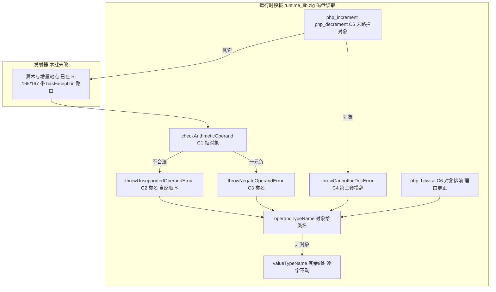
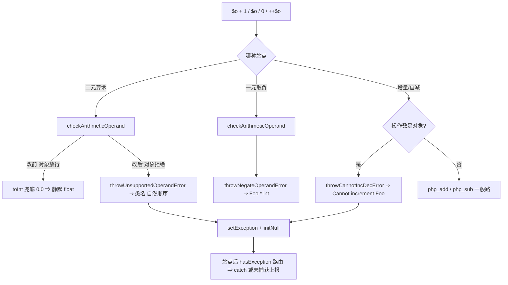
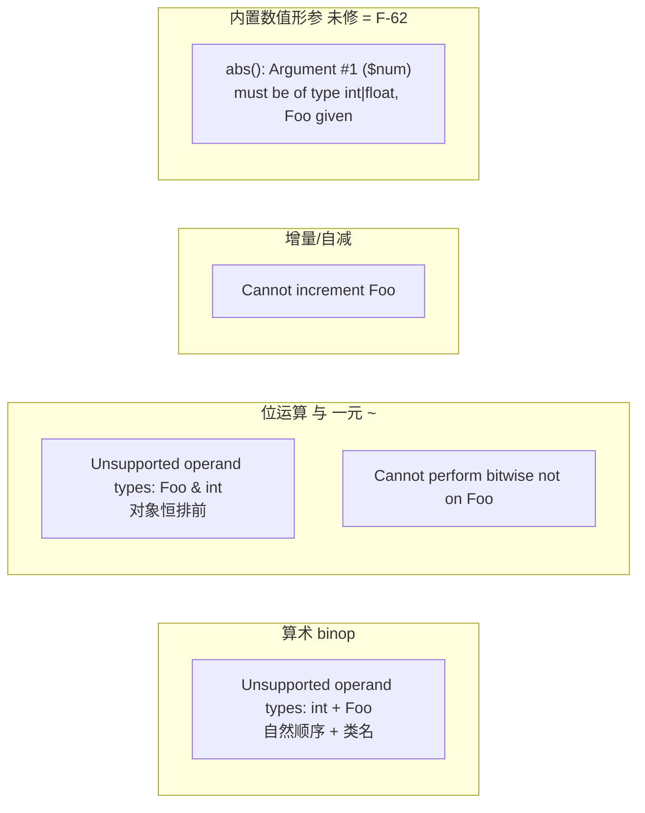
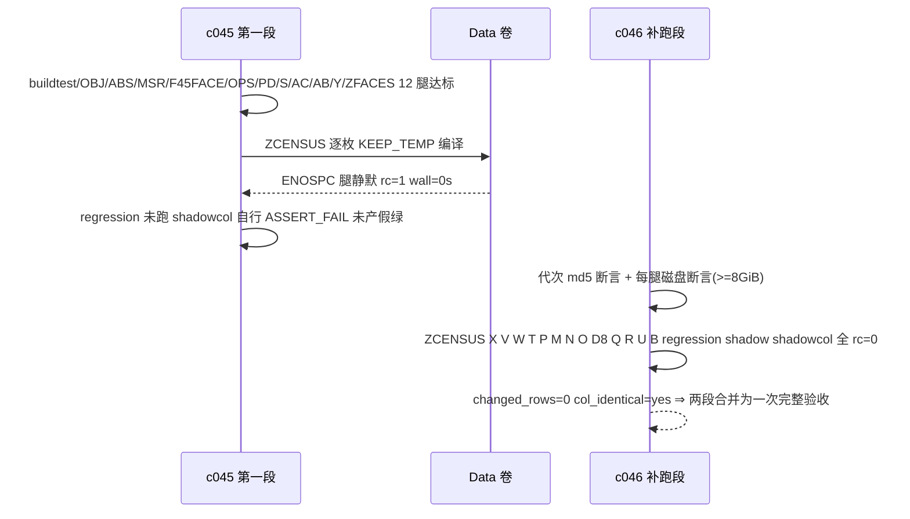

# AOT-CODEGEN-012 R-169：F-59 落地 —— 算术族拒绝对象操作数 ＋ 消息类名 ＋ 增量族第三套措辞

- **日期**：2026-10-16（落地动作发生于 2026-10-15 傍晚，验收补跑完成于 2026-10-16 11:13:42）
- **轮次**：R-169（工单 `docs/known-issues/AOT-CODEGEN-012-class-name-case-insensitive-lookup.md` §43）
- **基线 commit**：写作时为 `df31715`（当时五文件 staged 未提交，口径＝老铁「我只记录不提交」）。**后续核实更正**：老铁已于 2026-10-16 10:03:35 将 R-167＋R-169 一并提交为 **`2254f88`**（`git show 2254f88` 内含 `throwCannotIncDecError` 等本批符号）⇒ 本文档描述的改动**现已入库**，未提交的只剩其后 R-170 的模板改动（+14/−14）。文件名保留原基线号不改，以免断链。
- **裁决**：F-60 取 **乙（接受现状，不做快路）**；F-59 **本轮直接修**
- **改动性质**：★**纯模板轮**（未动 `optimizer.zig`／`native_linker.zig`／`ir_generator.zig`／`constant_folder.zig`）⇒ 生成码逐字节中性

---

## 1. 高层摘要（TL;DR）

1. **对象在算术里被完全放行**：`checkArithmeticOperand` 旧写只拒「无数字前缀的字符串」与 `array`，
   对象直接通过 ⇒ 被 NaN-boxing 兜底成 `0.0` ⇒ `$o + 1` **静默得 float `1.0`**、`$o / 0` 还抢在类型检查前报
   `DivisionByZeroError`。PHP 8.5.8 全部是可捕获 `TypeError`。
2. **消息用 "object" 而不是类名**：PHP 的操作数消息对对象一律给**类名**（`1 + $o` ⇒ `int + Foo`），
   本仓 `valueTypeName` 给 `"object"`。本批新增 `operandTypeName` 只服务操作数消息，其余 9 处调用点**逐字不动**
   （那里的 "object" 本来就是正确口径 ⇒ 规则 30）。
3. ★**两条先验判断被实测否证**：
   - 我怕 `DateTime - DateTime` 是 DateInterval 合法差、 blanket 拒绝会造 over-fatal ⇒ 实测 **PHP 自己就抛**
     `Unsupported operand types: DateTime - DateTime`（取差要靠 `diff()`）⇒「对象一律拒」就是正确行为。
   - 只改算术检查会让 `$o++` 抛成 `Unsupported operand types: Foo + int`（PHP 是 `Cannot increment Foo`）
     ＝**把一种错换成另一种错**；我把这个**中间态单独量出来**（11 臂档 `same=4 diff=7`）才补增量守卫。
4. **门 OBJ 三段读数**：修前 24 臂红 **17** ⇒ 中间态 11 臂红 **7** ⇒ 落地后 35 臂 **`same=33 diff=2`**，
   残红**恰好只有**已登记的 F-61 两枚（i8/i11），**没有第三枚**。
5. **验收闭合**（分两段，中间隔着一次磁盘写满事故）：ABS 26/26、MSR 74/74、F45FACE 12/7、OPS 25/1、
   PD/S/AC/AB/U/B/ZCENSUS 与 R-167 逐字同；**主回归 `Pass 67 / Skip 1` 零回归**；
   ★**影子 `changed_rows=0 col_identical=yes`**（纯模板轮的强判据达成 ⇒ 不重冻、不归因）。

---

## 2. 影响范围

| 影响面 | 变化 |
|---|---|
| 七处算术站点 | `+ - * / % **` 与一元 `-` 的对象操作数：静默 float ⇒ **可捕获 TypeError（带类名）** |
| 次序面 | `$o / 0`、`$o % 0`：原先报 DivisionByZero ⇒ 现在**类型检查先于运算**（与 PHP 一致） |
| 增量面 | `++$o`／`$o++`／`--$o`／`$o--`：静默 float ⇒ `Cannot increment|decrement <类名>` |
| 内置面 | `pow($o, 2)` ⇒ `Unsupported operand types: Foo ** int`（经 `php_pow`，与 PHP 同）；`abs/intdiv/fdiv/sqrt/bcadd` 的**参数类型措辞**未动＝F-62 |
| 消息文本 | 仅**对象形参**的措辞变（`object` → 类名）；数组/字符串/数字串的文本一字未动（OPS 25/1 复证） |
| 语料暴露 | **0**（主回归 Pass 67/Skip 1 不掉一枚；AB 68 行分布逐字同；影子 `changed_rows=0`） |
| 性能 | 无新增调用（对象检查只是 `Value_isObject` 一次 tag 判定）⇒ 未测出退化 |
| 其他模式 | 未触碰（本模板只服务 AOT 产物）⇒ 宪法 §五「仅 AOT」成立 |

---

## 3. 核心变更

| # | 位置 | 变更 |
|---|---|---|
| C1 | `runtime_lib_template.zig: checkArithmeticOperand` | 新增 `if (Value_isObject(v)) return false;`（注释内嵌「DateInterval 特例经实测不存在」取证）⇒ 七处站点一次收口，**不新造窄判据** |
| C2 | `throwUnsupportedOperandError` | `valueTypeName` → `operandTypeName`，**保自然顺序**（`int + Foo`） |
| C3 | `throwNegateOperandError` | 同上 ⇒ `-$o` ⇒ `Foo * int` |
| C4 | 新 `throwCannotIncDecError(val, action)` | `Cannot {increment|decrement} <类名>` |
| C5 | `php_increment` / `php_decrement` 末路 | 在落到 `php_add/php_sub` **之前**拦对象 ⇒ 避开「换成另一种错」 |
| C6 | `php_bitwise` 的对象提前拦截 | 逻辑不变、**理由改写**：不是因 `checkArithmeticOperand` 放行，而是位运算族要「对象恒排前」 |

---

## 4. 可视化概览（Code & Logic Map）

### 4.1 分层与变更点

### 4.2 对象进入算术的判定流程

### 4.3 四套措辞互不复用（落地纪律）

### 4.4 验收链时序（含 ENOSPC 事故）

---

## 5. 详细变更分析

| 层 | 文件 | 变更点 |
|---|---|---|
| 运行时 | `src/aot/runtime_lib_template.zig` | C1–C6 共 6 处；新增 1 个 helper（`throwCannotIncDecError`），复用 R-167 的 `operandTypeName` |
| 门禁 | 新永久侧门 **OBJ**（`c044_arith_object_gate_tmp.sh`，35 臂，md5 `367bd756…`） | 对象算术 15＋次序 1＋语句位 2＋增量 5＋守卫 7＋登记不修 2＋DateTime/Strable 特例 3 |
| 门禁 | 新链 `c045`（25 腿）＋补跑链 `c046`（17 腿，带磁盘断言） | 补跑链带 `GENERATION_ASSERT_FAIL`／`DISK_ABORT`／`LEG_FAIL` 三重自保 |
| 资产 | `/tmp/r169/truth.php`、`inc.php`、`builtin.php`、`builtin2.php`；`c044_obj_increment_intermediate_R169_tmp.tsv`（`cfc54f6d…`） | 真值与中间态留证 |
| 数据 | 影子列 `c010_shadow_newside_r169_tmp.txt`（表身 `f5f2bf5e…`＝r167 同值） | 下一代 BASE 可直接沿用同一前缀 |

---

## 6. 影响与风险评估

| 项 | 结论 |
|---|---|
| 是否破坏式 | **对 PHP 语义非破坏**（静默错值 → 可捕获正确异常）；**对既有 AOT 是行为变更**：对象进算术/增量从「返回 float」变为「抛可捕获 TypeError」 |
| 过宽风险检查 | 守卫臂全绿 ⇒ 拼接 `$s . "x"` 仍合法、`null + 1`/`true + 1` 仍不抛、`abs("5")` 类不涉；`array_sum/array_product` **不经** `php_add/php_mul`（内联累加）⇒ 未被推成抛异常 |
| 半修风险 | 已用**中间态实测**排除（增量守卫与算术守卫同批落） |
| 需特别注意 | ① 措辞四套互不复用，复用即错；② `checkArithmeticOperand` 是 68 枚语料共用入口，扩它必须先有 OBJ 这类消费面门；③ `max/min/>` 走的是 **Notice＋比较语义**，不要顺手当算术面修 |
| 复测路径 | `bash fuzzy_scripts_720/tmp/c044_arith_object_gate_tmp.sh`（35 臂 ≈171 s，期望 `same=33 diff=2`，残红只能 i8/i11）→ `bash fuzzy_scripts_720/tmp/c043_bit_assign_gate_tmp.sh`（26/26）→ `bash fuzzy_scripts_720/tmp/c041_mod_strength_gate_tmp.sh`（74/74）→ 全链 `c045`＋（磁盘不足时）`c046` |

---

## 7. 遗留 / 潜在问题

| 编号 | 问题 | 状态 |
|---|---|---|
| **F-61** | 增量族剩余两面：`$arr++` 应为 `Cannot increment array`（现为算术措辞）；`$b++`（bool）缺 `Warning: Increment on type bool has no effect…` | 门 OBJ 的 i8/i11 **恒红登记**；另 `php_increment` 对 bool 返回 `2/1` 与「取旧值」lowering 的关系**只有代码阅读、无运行证据** ⇒ 需专用臂 |
| **F-62** | 内置数值形参的**第四套措辞**（`abs/intdiv/fdiv/sqrt/bcadd` ⇒ `Argument #N ($name) must be of type <T>, Foo given`；次序形参校验先于运算）；`array_sum/array_product` 对对象**只 Warning 不抛**并返回 0/1；`max/min/比较` 走 Notice | PHP 真值已取全；门 `c047_builtin_numeric_object_gate_tmp.sh`（20 臂）已建**未跑**（链跑动期间禁并发编译） |
| F-55 | 数字前缀字符串算术结果类型（门 OPS 唯一残红 g4） | 待裁决 |
| F-60 | 位运算带检查调用的性能回边 | **已裁定为乙：接受现状**，关闭 |
| 环境 | ENOSPC 打断验收链；`.zig-cache` 整目录在同一点消失（非我删除，原因不做无据归因） | 已产出磁盘前置断言；代次一致性改由 md5 断言承担 |

---

## 8. 后续建议

| 优先级 | 事项 | 影响面 | 落地成本 |
|---|---|---|---|
| P1 | **跑门 `c047` 取 F-62 修前红集**（20 臂，约 100 s），再按四套措辞的口径决定是否需要中央「参数类型校验」helper——**注意 `array_sum`/`max` 两面不能抛**，否则当场造 over-fatal（R-155 的 count() 同型陷阱） | 全体数值内置函数 | 低（先跑门）／中（落地） |
| P1 | F-61 收口：增量族数组措辞＋bool Warning，配「增量结果被直接使用」的臂 | 增量/自减族 | 低 |
| P2 | 把「链磁盘前置断言」上升为所有验收链的公共前置（本轮已在 `c046` 实践：不足即 `DISK_ABORT`，失败即停链） | 验收可信度 | 低 |
| P2 | F-55（OPS 唯一残红）与 F-53（PD 两枚恒红）可并为一轮「数值串类型/按引用出参」专项 | 类型面 | 中 |
