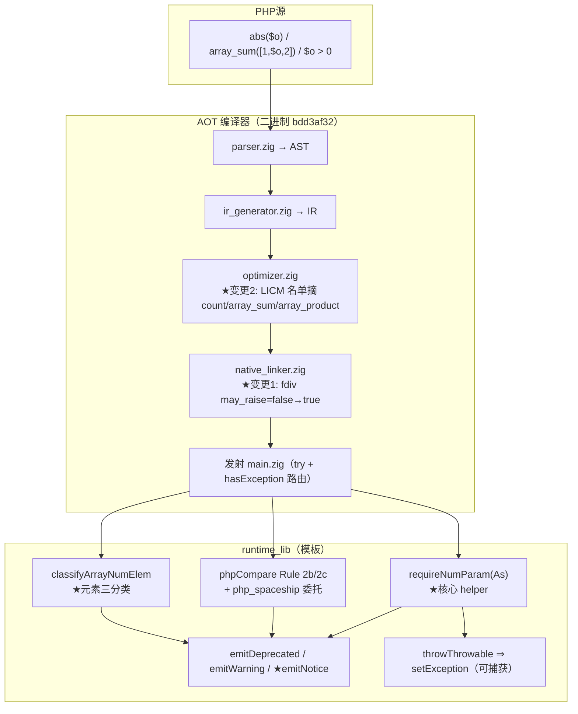
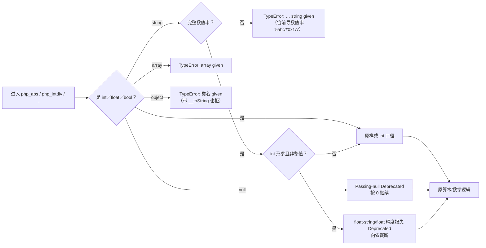
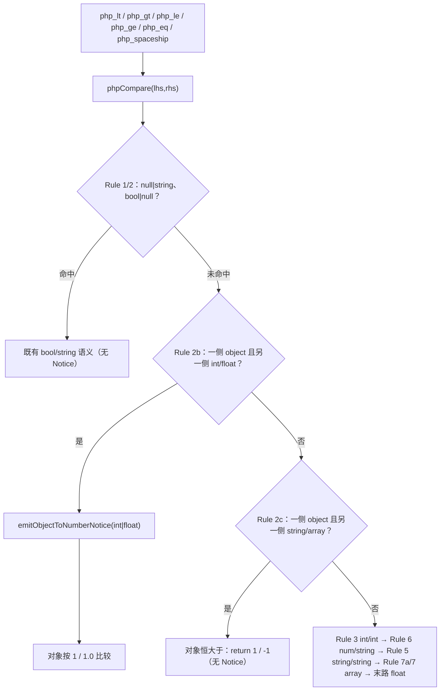

# AOT-CODEGEN-012 · F-62 内置数值形参「第四套措辞」落地（R-172，乙型＝模板内集中 helper＋全数值族＋c/d 一并修）

**基线 commit**：`228534d`（本批 src 改动已由老铁随工单一并提交；我在整轮中未执行任何 `git add`/`git commit`）
**代次**：编译器二进制 `c514f194f274857bae241184e0fa2c9c` ⇒ **`bdd3af326d3c59d2bbd0bdf25b07afec`**（连续三代模板轮后的第一次重编译）
**验收链**：`fuzzy_scripts_720/tmp/c051_r172_acceptance_chain_tmp.sh`（29 腿，`R172_CHAIN_DONE`，`ELAPSED=7259s`）

---

## 1. 高层摘要（TL;DR）

PHP 对**内置函数的形参**用的既不是算术操作数措辞、也不是位运算措辞，而是**第四套**＝参数类型校验：
`abs($o)` ⇒ `abs(): Argument #1 ($num) must be of type int|float, Foo given`。
本批之前，AOT 侧的数学/三角/对数/幂/格式化内置**根本没有这层校验**：对象、array、非数值串、前导数值串、越界 float 一律被
`toFloat()`／`toInt()` 静默读成 `0`／`0.0`，既不抛也无类名；`array_sum`／`array_product` 对坏元素既无 Warning 也无跳过；
比较族对 object 无 Notice 且把对象当 `0`（PHP 当 `1`）。

老铁三裁：**乙型**（只在模板里做集中 helper＋逐函数入口，不给发射器加形参类型元数据表）、覆盖**全数值族**、F-62 内另外两套机制
（`array_sum/array_product` 的元素级 Warning、`max/min` 的比较族 Notice）**c＋d 全修**。

主门 BLT（`c047`）由 28 臂扩到 **129 臂**，修前注册红 **85** ⇒ 修后 **3**（关闭 **82** 枚；残红 b5＝F-62b、b27/b28＝F-63 皆先前已登记面）。
另经两裁进入**新二进制代次**：`fdiv` 的 `.may_raise` 翻 true、LICM 纯函数名单摘除 `count/array_sum/array_product`。
★**重编译仍测得发射中性**：影子 `changed_rows=0 col_identical=yes`（68 枚语料的 `main.zig` 逐字节不变），主回归 `Pass 67 / Skip 1` 不降。

## 2. 影响范围

| 影响面 | 程度 | 说明 |
|---|---|---|
| 内置数值形参的类型拒 | **行为变更（26 个内置／33 处形参校验）** | 对象/array/非数值串/前导数值串/越界 float 由「静默 0」变为**可捕获 TypeError**，措辞带类名 |
| `int` 形参的强转诊断 | 新增 | `intdiv(5.5,2)`、`intdiv("5.5",2)` ⇒ `Deprecated: Implicit conversion from float[‑string] … to int loses precision` 后向零截断 |
| null 传数值形参 | 新增 | `Deprecated: <fn>(): Passing null to parameter #N ($p) of type <T> is deprecated` 后按 0 继续 |
| `array_sum`／`array_product` | 行为变更 | 元素级三分类（跳过／计入 0／计入前缀）＋容器非数组 ⇒ TypeError；★**不抛异常**（PHP 只 Warning） |
| 比较族（`< <= > >= <=> ==`） | 行为变更 | object vs int ⇒ Notice＋按 **1**；vs float ⇒ 措辞换 `to float`＋按 **1.0**；vs string/array ⇒ **对象恒大于且无 Notice** |
| `max`／`min` | 行为变更 | 单参非数组 ⇒ TypeError；`min` 同值并列改「取后者」（`max` 保持取前者） |
| `fdiv` 调用点生成码 | 结构变更 | `may_raise` ⇒ 加 `try` ＋ `hasException` 路由块；**语料 0 处命中** ⇒ 实测零发射变化 |
| LICM | 优化面收窄 | 三枚内置不再被提升；语料里它们本就不是循环不变量调用 ⇒ 实测无性能回退证据（也无提升证据，见 §7） |
| 语料/主回归 | 无回归 | `Total 68 / Pass 67 / Skip 1` 与上代逐字同 |

## 3. 核心变更

| # | 变更 | 位置 |
|---|---|---|
| 1 | `rejectParamType` 单点承载第四套措辞，对象给**类名**（复用 `operandTypeName`） | `src/aot/runtime_lib_template.zig`（helper 段，`valueTypeName` 之前） |
| 2 | `requireNumParamAs`／`requireNumParam`／`requireOptionalNumParam`：校验**＋按 PHP 口径强转**（int／float／Deprecated／拒） | 同上 |
| 3 | `strictIntFromTrimmed`／`trimNumericWhitespace`／`numericPrefixValue`／`intParamFromFloat` | 同上 |
| 4 | `emitDeprecatedPassingNull`／`emitDeprecatedFloatStrToInt`（★float-string 版措辞带引号，与 float 版不同句式） | 同上 |
| 5 | `emitNotice`／`emitObjectToNumberNotice`（模板里**第一处** `Notice:` 站点） | 同上 |
| 6 | `ArrayNumElem`／`classifyArrayNumElem`／`arrayElementNotSupported`（sum 与 product 共用一份元素口径） | 同上 |
| 7 | 入口 ×26 函数／33 处形参：`abs sqrt floor ceil round(×2) intdiv(×2) fdiv(×2) fmod(×2) exp log log10 log2 sin cos tan asin acos atan atan2(×2) sinh cosh tanh hypot(×2) deg2rad rad2deg number_format(×2)` | 各函数体首行 |
| 8 | `php_array_sum`／`php_array_product` 容器校验＋循环体改走元素分类器（`fastPackedIntSum` 纯 int 快速路保留） | 模板 |
| 9 | `phpCompare` 新增 Rule 2b／2c（object vs 数值、object vs string/array），位置钉死在旧 Rule 7 之前 | 模板 |
| 10 | `php_spaceship` object 操作数**交回 `phpCompare`**（消除第三套实现） | 模板 |
| 11 | `php_max`／`php_min` 单参非数组 ⇒ TypeError；`php_min` 两支 `< 0` ⇒ `<= 0` | 模板 |
| 12 | `php_fdiv` 签名 `Value` ⇒ `!Value` | 模板 |
| 13 | `fdiv` 的 `.may_raise = false` ⇒ `true` | `src/aot/native_linker.zig:4312` |
| 14 | LICM 纯函数名单摘除 `count`／`array_sum`／`array_product`（含 WHY 注释） | `src/aot/optimizer.zig:935` |

## 4. 可视化概览（Code & Logic Map）

### 4.1 分层与变更点



### 4.2 业务流程（内置数值形参一次调用）



### 4.3 执行流程（比较族 object vs 数值）



### 4.4 上层→底层时序（`abs($o)` 可捕获）

```mermaid
sequenceDiagram
    participant U as PHP 语句
    participant M as main.zig（生成码）
    participant R as runtime_lib.php_abs
    participant H as helper requireNumParam
    participant E as runtime 异常态
    U->>M: reg_x = try runtime.php_abs(reg_o)
    M->>R: php_abs(val)
    R->>H: requireNumParam("abs",1,"num",.num_param,val)
    H->>E: throwThrowable("TypeError","abs(): Argument #1 ($num) must be of type int\|float, Foo given")
    H-->>R: null（异常已置）
    R-->>M: Value.initNull()
    M->>M: if (runtime.hasException()) { cleanup; current_block = handler; continue; }
    M->>U: catch (TypeError) 命中 ⇒ 输出与 PHP 逐字节同
```

## 5. 详细变更分析

### 5.1 涉及文件

| 文件 | 变更行数级别 | 内容 |
|---|---|---|
| `src/aot/runtime_lib_template.zig` | md5 `15b9d494…` ⇒ `af81be0f…` | 18 枚新 helper、26 个内置／33 处形参入口、4 处容器校验、sum/product 两函数、phpCompare 两支、spaceship 委托、max/min、`php_fdiv` 签名 |
| `src/aot/native_linker.zig` | `1b70d7ad…` ⇒ `dde7217b…`（1 行） | `fdiv` 的 `may_raise` |
| `src/aot/optimizer.zig` | `0eca2875…` ⇒ `36f354f4…`（3＋注释） | LICM 纯函数名单摘三枚 |
| `fuzzy_scripts_720/tmp/c047_builtin_numeric_object_gate_tmp.sh` | 28 ⇒ 129 臂（md5 `12ae4983…`） | 永久侧门 BLT 扩臂（b1–b28 逐字未改，快照对段 diff 自证） |
| `fuzzy_scripts_720/tmp/c051_r172_acceptance_chain_tmp.sh` | 新建 | 29 腿验收链（含三重自保） |
| `docs/known-issues/AOT-CODEGEN-012-…md` | §46.1–46.7 | 工单入档 |

### 5.2 变更点描述（口径逐条对应实测证据）

| 变更点 | 实测证据（`/tmp/r172/*`） | 门臂 |
|---|---|---|
| 对象恒拒＋类名（`__toString` 也拒） | `abs($b)` ⇒ `Bar given`；`bcadd($b,"1")`='6'（string 形参另论） | b1/b4/b45/b53…b67 |
| array ⇒ `array given` | `abs([1])`、`intdiv([1],2)` | b29/b33/b39/b42/b43 |
| 前导数值串在内置形参上是**拒**的 | `abs("5abc")`、`abs("0x1A")`、`intdiv("5a",2)`、`intdiv("",2)` | b30–b32/b34/b35/b41/b44 |
| `int` 形参的域与非整值 | `intdiv(5.5,2)`=2＋Deprecated、`intdiv(-5.9,2)`=-2、`intdiv(1e19,2)`/`intdiv(NAN,2)`/`intdiv("1e19",2)` ⇒ TypeError | b36/b37/b80/b81 |
| Passing-null Deprecated | `abs/sqrt/floor/intdiv/number_format/round(null)` 的类型文本逐函数取（`number_format` 的 `$num` 独为 `float`） | b13/b68–b72 |
| 校验先于运算 | `intdiv($o,0)` ⇒ 参数类型错；`intdiv(5,null)` ⇒ 先 Deprecated 再 DivisionByZeroError | b6/b44/b45 |
| 元素三分类 | `array_sum([1,$o,2])`=3、`array_sum(["abc"])`=0、`array_sum(["5a"])`=5、`array_sum(["1e3"])`=double 1000.0、`array_product([2,[1]])`=2、`array_product([2,"abc"])`=0 | b7–b9/b96–b114 |
| 容器非数组 TypeError | `array_sum(5)`/`array_sum($o)` ⇒ `($array) must be of type array, int/Foo given`；`max($o)` ⇒ `($value) … Foo given` | b106/b107/b125 |
| 比较族 Notice 与「对象算 1／1.0」 | `$o > 0`/`$o == 1`/`$o == 2`/`$o <=> 1`/`1 < $o`/`$o > 0.5`（措辞 `to float`） | b12/b115–b120/b128/b129 |
| object vs string/array 恒大于、无 Notice | `$o > "abc"`=true、`$o > [1]`=true、`[1] > $o`=false、`$o <=> "a"`=1 | b121/b122 |
| 同值并列不对称 | 八臂矩阵：min 取后者、max 取前者 | b10/b11/b126 |
| `pow()` **不加**参数校验 | 实测措辞是 `Unsupported operand types: Foo ** int`（操作数面） | b17/b21–b23（守卫臂恒绿） |

## 6. 影响与风险评估

**是否破坏式变更**：语义上属「静默错值 ⇒ 抛可捕获 TypeError／打诊断」的对齐，**不是** API 破坏；但它是**行为变更**——
任何依赖「`abs($o)` 静默返回 0」的既有代码会改为抛异常。这是修复目标本身，且 PHP 侧行为如此。

| 风险 | 缓解与实测 |
|---|---|
| 校验口径偏严 ⇒ 把合法 weak 强转打成 Fatal | 门 BLT **C 段 23 枚合法强转守卫臂**（`" 5 "`／`"+5"`／`"1e3"`／`"5.0"`／bool／整值 float／首尾空白）：修前只有 3 枚红，落地后 23 枚全绿；主回归 `Pass 67/Skip 1` 不降 |
| over-fatal（把 Warning 族改成抛） | `array_sum/array_product` 明确走 Warning＋跳过／计入 0，**不发 TypeError**；`max/min` 走 Notice＋继续；门内 b7–b11/b96–b114 逐字节对表 |
| 省略的可选形参被当显式 null | ★首轮落地即被门 b72 抓回（AOT 多印一行 `#2 ($precision)` Deprecated）⇒ 新增 `requireOptionalNumParam` 透传 null/missing；代价＝显式 `round(1.5,null)` 的 `#2` Deprecated 不发（登记 F-62b 家族） |
| 新二进制代次带来影子漂移 | `fdiv` 语料 0 处、LICM 三枚在语料里均非循环不变量调用 ⇒ **实测 `changed_rows=0`**，本批无需逐枚反证归因 |
| `?Value` helper 当语句用 | 生成码报 `value of type 'Value' ignored`（4 站点），由**AOT 编译期**冒烟抓到并补 `_ =`，未污染任何门读数 |
| 比较族动到共享 `phpCompare` | 26/28 腿 DONE 逐字同（OBJ/ABS/MSR/F45FACE/OPS/S/AC/AB/Y/ZFACES/…）⇒ 除预期的 BLT/NST 外零扰动；数组逐元素比较（Rule 7a）递归路径未变（b127 `min([[1],[2]])` 恒绿） |

**复测路径（体验流程）**

```bash
# 仓库根，全命令带 timeout；链跑动期间禁改 src/模板/门脚本
timeout 1800 bash fuzzy_scripts_720/tmp/c047_builtin_numeric_object_gate_tmp.sh    # 主门 BLT：arms=129 same=126 diff=3
timeout 900  bash fuzzy_scripts_720/tmp/c049_numeric_string_type_gate_tmp.sh      # NST：31/1（改档，n31＝F-63）
timeout 2400 bash fuzzy_scripts_720/run_regression.sh                             # Total 68 / Pass 67 / Skip 1
timeout 3600 bash fuzzy_scripts_720/tmp/c010_shadow_main_md5_tmp.sh               # 影子 68 行
GEN=r173 BASE=fuzzy_scripts_720/tmp/c010_shadow_newside_r172_tmp.txt \
  timeout 120 bash fuzzy_scripts_720/tmp/c010_shadow_col_extract_tmp.sh           # changed_rows=0
```

## 7. 遗留问题 / 潜在问题

| ID | 面 | 状态 |
|---|---|---|
| **F-62b** | bc 族与 `?string` 形参需 **stringable 感知**（`bcadd($b,"1")`='6' vs `bcadd($o,"2")` 抛）；`number_format` 的 `#3/#4` | 门 b5 恒红，登记不修 |
| **F-62d** | `round` 的 `$mode` ⇒ **ValueError** `must be a valid rounding mode (RoundingMode::*)`；`settype` 同族 | 登记 |
| **F-62e** | `log($num,$base)` 的 `$base` 未实现；`log2()` PHP 不存在而 AOT 有；`max()`/`min()` 零参 PHP 抛 `ArgumentCountError` | 登记 |
| **F-62f** | 数值族**漏网**＋两大 int/string 形参族：`dechex`/`decoct`（实测是 **int** 形参）、`long2ip`/`rand`/`sleep`/`array_fill`、`range`（`string\|int\|float`）、`base_convert`/`bindec`/`hexdec`/`octdec`/`substr`/`str_repeat`（string 形参）；普查口径＝**76 个内置体内是 `toInt()/toFloat()` 而无任何校验** | 措辞与参数名已逐枚实测，下批纯机械补入口 |
| ★负证据 | `intval($o)`=int 1、`floatval($o)`=1.0、`sprintf("%d",$o)`='1' 在 PHP **不抛** ⇒ 做 F-62f 时禁止把它们当数值内置加校验 | 留字防 over-fatal |
| **F-65** | `round`/`number_format` 精度形参：PHP 实测 `round(1.5,PHP_INT_MAX)`=1.5、`round(1.5,-3e9)`=0.0、`number_format(1,3e9)` 内存耗尽 Fatal；AOT 侧 `@as(i32,@intCast(…))` 越界与 `for (0..dec) pow10*=10` 长循环属**存量**（读码观察，无运行证据） | 登记 |
| **F-61c** 扩 | object vs object：PHP `$o <=> $b` **两方向都印 1**（自身不稳定）、不同实例 `==` false；AOT 走末路恒相等 | 不复刻，登记 |
| 性能 | 26 个内置（33 处形参校验）各加一次校验＋强转的成本**本批未测**（链内无 PERF 腿） | 待测，禁报估算值 |
| F-63 | 大浮点记法（b27/b28、NST n31） | 先前已登记 |

## 8. 后续开发 / 优化建议

| 优先级 | 建议 | 影响面 | 落地成本 |
|---|---|---|---|
| **P0** | 做 **F-62f**：按本批 helper 直接补 `dechex/decoct/long2ip/rand/sleep/array_fill/range` 等入口；措辞与参数名已实测钉死 ⇒ 纯机械；同时把「**同一语义多套实现**」做一次普查（R-170 `pow` vs `**`、R-172 `spaceship` vs `<`，已三次） | 广（76 个内置）／低逃逸风险 | 中：扩臂＋逐族落地 |
| **P0** | 建 **PERF 腿**并给 F-62 入口定价：`abs`/`intdiv`/`array_sum` 热点，ReleaseSmall 与 ReleaseFast 同档对照（历史锚点：位运算族 +32%、mod +2~4%） | 决定是否要给热点加内联快路 | 低：两个基准脚本＋一次链外测 |
| **P1** | **F-62b**：给 `?string`／bc／`base_convert` 族做 **stringable 感知**拒绝（AOT 已有 `meta.magic_toString`，探测可行） | 门 b5 与字符串大族 | 中 |
| **P1** | **F-65**：`round`/`number_format` 精度形参的短路（先定 PHP 的 308 位阈值口径，再动，避免凭推测） | 防 Debug panic／UB | 低-中 |
| **P2** | 把 `emitNotice` 接入既有 `@` 抑制与 error_reporting 路径复核（本批已复用 `isErrorSuppressed`，但 `E_NOTICE` 级开关未与 `set_error_handler` 联动测过） | 一致性 | 低 |
| **P2** | NST/BLT 注册红集在工单 §6 状态行做一次集中清册（现散落各节） | 可维护性 | 低 |
