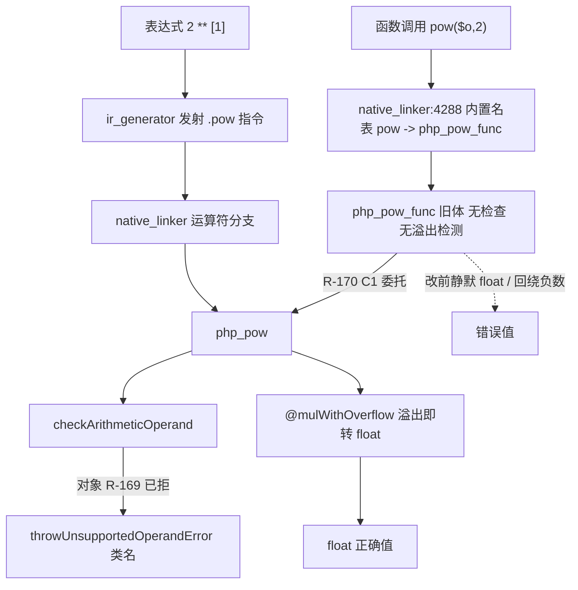
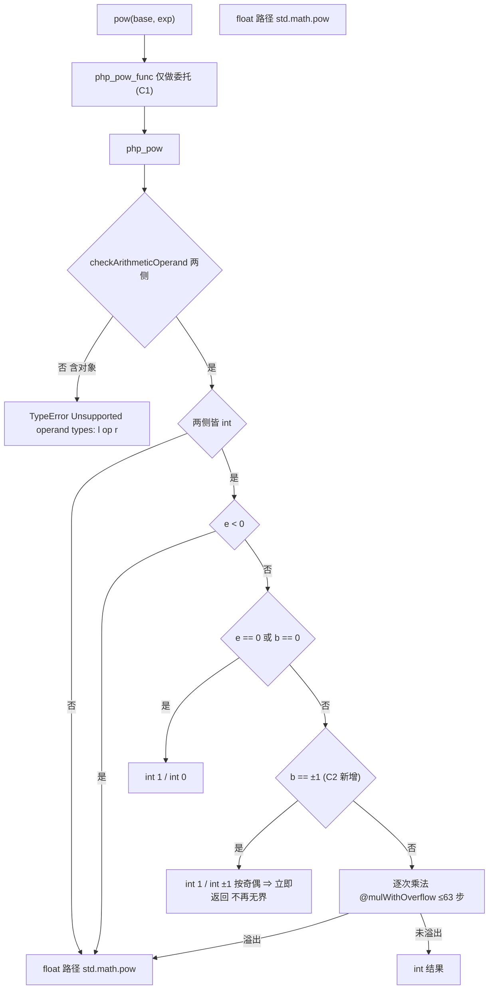
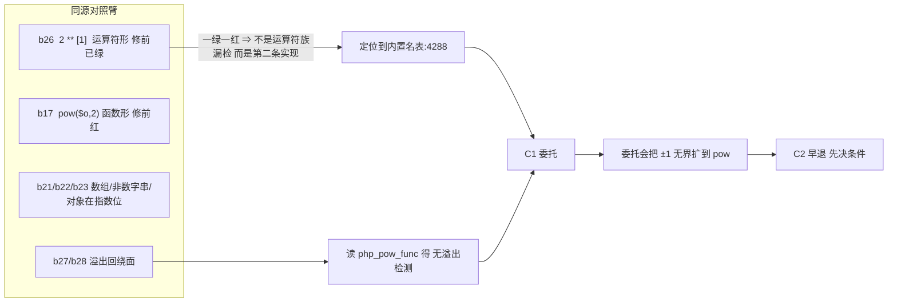
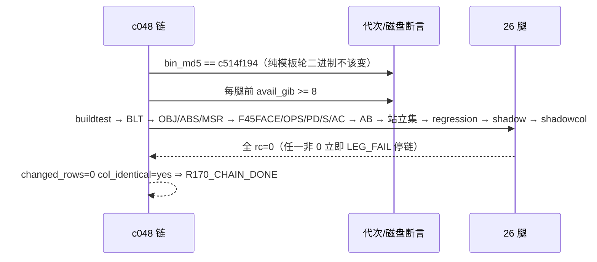

# AOT-CODEGEN-012 R-170：`pow()` 的第二条实现（F-59 漏网面）＋ `php_pow` 无界循环边界 ＋ 新立 F-63

- **日期**：2026-10-16
- **轮次**：R-170（工单 `docs/known-issues/AOT-CODEGEN-012-class-name-case-insensitive-lookup.md` §44）
- **基线 commit**：`2254f88`（含 R-167/R-169；**本批模板改动 +14/−14 尚未提交**，口径＝老铁「我只记录不提交」）
- **改动性质**：★**纯模板轮**（未动任何 `.zig` 编译器文件 ⇒ 二进制 md5 保持 `c514f194…`，链内做断言）

---

## 1. 高层摘要（TL;DR）

1. **一句话**：R-169 我断言「`pow($o, 2)` 与 PHP 逐字节同」——那句话**只测了 PHP 侧、只读了 `wrapBuiltin_pow → php_pow` 一行**；
   实测否证：内置名表 `native_linker.zig:4288` 把 `pow` 映射到 **另一个函数 `php_pow_func`**，
   那个函数体**一次操作数检查都没有** ⇒ 函数写法完全漏网，运算符写法（`**`）已绿。
2. **同一函数体里还藏着一条 P0 级静默错值**：它的整数幂是**无溢出检测**的逐次乘法 ⇒
   `pow(2, 63)` 得 **`integer -9223372036854775808`**、`pow(10, 19)` 得 **`integer -8446744073709551616`**，
   而 PHP 两者都返回 float。连符号都是反的，且**不抛不警**。
3. **修法**：`php_pow_func` 整体**委托 `php_pow`**（`@mulWithOverflow` 溢出即转 float）——同一语义只留一份实现；
   委托前先补 `b == ±1` 早退，因为 `php_pow` 的循环**只靠溢出退出**，而 `|b| == 1` 永不溢出
   ⇒ 不补就是**把挂死从 `**` 扩到 `pow()`**（`1 ** 1000000000000` 需一万亿次迭代）。
4. **门 BLT 28 臂**：修前 `same=7 diff=21` ⇒ 落地后 `same=11 diff=17`，**关掉的正好是 pow 族 6 枚**，
   残红 17 枚全部是**先前已登记**的 F-62／F-55／新立 F-63 ⇒ 本批未新增一枚红、也未顺手关别的族。
5. **验收**：26 腿链 7102 s 全 `rc=0`；三族门（OBJ/ABS/MSR）与 F45FACE/OPS/PD/S/AC/AB/U/B/ZCENSUS 逐字等值；
   主回归 `Pass 67 / Skip 1`（语料三处 `pow(` 调用无一掉值）；★**影子 `changed_rows=0 col_identical=yes`**
   ——连续第二个纯模板轮达到发射中性。

---

## 2. 影响范围

| 影响面 | 变化 |
|---|---|
| `pow()` 函数形式 | 对象／数组／非数字字符串操作数：静默 float ⇒ **可捕获 `TypeError`，措辞与 `**` 完全相同**（`Foo ** int`、`int ** Foo`） |
| `pow()` 整数溢出 | 有符号回绕的负整数 ⇒ **float**（与 PHP 同） |
| `**` 与 `pow()` 共有路径 | 新增 `b == ±1` 早退 ⇒ 消除 `1 ** 10^12`／`(-1) ** 10^12` 的**无界循环**（原为 `**` 独有隐患，委托后会传染给 `pow()`） |
| 结果类型 | `pow("5", 2)` 仍 `double 25.0`（PHP 为 `integer 25`）⇒ **本批有意不关**，属 F-55（整值数字串应得 int，`abs("5")` 同根） |
| 输出记法 | `pow(2,63)` 修后为 `9223372036854776000.0`，PHP 为 `9.223372036854776E+18` ⇒ 值对、**记法**不同＝新立 **F-63** |
| 语料 | 零（Pass 67/Skip 1 不变；三处 `pow(` 调用点 f043/f048/f179 值不变） |
| 其他模式 | 未触碰（模板只服务 AOT 产物）⇒ 宪法 §五 成立 |
| 性能 | 无新增调用；`b == ±1` 是**减少**工作量；整数幂最多 63 步即转 float ⇒ 无可退化路径 |

---

## 3. 核心变更

| # | 位置 | 变更 | 为什么这样做 |
|---|---|---|---|
| C1 | `runtime_lib_template.zig: php_pow_func` | 旧体（无检查的 int 快路 ＋ `std.math.pow` 兜底）**整体替换为 `return php_pow(base, exponent);`** | 「加两行检查」不够：旧体的**溢出**与 `e >= 64` 两处口径也各自独立错；委托让同一语义只有一份实现（DRY），且天然随 `php_pow` 后续修改进化 |
| C2 | `runtime_lib_template.zig: php_pow` | 在 `e == 0`／`b == 0` 之后补 `if (b == 1)`／`if (b == -1)` 早退（含奇偶判定） | C1 的委托会把「`|b|==1` 时循环无界」这一隐患从 `**` 扩到 `pow()`；`|b| >= 2` 至多 63 步即溢出，所以下面的循环本身有界，只需收掉 ±1 |

---

## 4. 可视化概览（Code & Logic Map）

### 4.1 一个运算符两条实现（本批的肇因结构）

### 4.2 委托与边界的落地流程

### 4.3 门的对照臂设计（把「两条实现」变成可检出的形状）

### 4.4 链时序（三重自保首次全链生效）

---

## 5. 详细变更分析

| 层 | 文件 | 变更点 |
|---|---|---|
| 运行时 | `src/aot/runtime_lib_template.zig` | C1 `php_pow_func` 委托；C2 `php_pow` ±1 早退（staged **+14 / −14**） |
| 门禁 | 新永久侧门 **BLT**（`c047_builtin_numeric_object_gate_tmp.sh`，28 臂，md5 `ccac79537b9a5a17e836b825694e1cf0`） | 内置形参面 b1..b14／守卫 b15..b20／**pow 双实现面 b17+b21..b28** |
| 快照 | `c047_blt_prefix28_R170_snapshot_tmp.tsv`（`903f50a7…`）、`c047_blt_postfix28_R170_snapshot_tmp.tsv`（`626bd9d7…`） | ★R-169 的教训（扩臂后立刻快照）本轮**已执行**：修前/修后两档都在盘上 |
| 真值资产 | `/tmp/r169/builtin.php`、`builtin2.php`、`pow.php`；`/tmp/r170/powstr.php` | 四套措辞＋记法＋数字串类型的逐枚实测 |
| 链 | `c048_r170_acceptance_chain_tmp.sh` ＋ `.log` | 26 腿、7102 s、三重自保 |
| 影子 | `c010_shadow_newside_r170_tmp.txt`（表身 `f5f2bf5e…` ＝ r169/r167 同值） | 三代同值 ⇒ 下一代 BASE 仍可用同一前缀 |

---

## 6. 影响与风险评估

| 项 | 结论 |
|---|---|
| 是否破坏式 | 对 PHP 语义非破坏（错值 → 正确值／可捕获异常）；对 AOT 既有输出是**值级修正**（`pow` 大指数从负整数变 float） |
| 委托的风险 | 委托让 `pow()` 继承 `php_pow` 的**全部**行为 ⇒ 正因如此必须先补 ±1 边界（已补并实测四形瞬时返回） |
| 过宽风险 | 未新增检查 ⇒ 不会把 PHP 不抛的形变成抛；`array_sum/array_product/max/min` **刻意未动**（PHP 侧是 Warning/Notice＋返回值） |
| 特别注意 | ① **收口「运算符∪内置函数」面之前必须查内置名表**（普查：8 个数值内置的目标函数体检查命中全为 0）；② F-63 是**记法**差不是精度差，别拿宪法 §七.7 豁免掉；③ F-55 面（整值数字串该得 int）在 `pow`/`abs` 各留一枚，宜并成一轮 |
| 复测路径 | `bash fuzzy_scripts_720/tmp/c047_builtin_numeric_object_gate_tmp.sh`（28 臂 ≈120 s，期望 `same=11 diff=17` 且残红只能是 b1..b14/b24/b27/b28）→ `c044`（33/2）→ `c043`（26/26）→ `c041`（74/74）→ 全链 `c048` |

---

## 7. 遗留 / 潜在问题

| 编号 | 问题 | 状态 |
|---|---|---|
| **F-62** | 内置数值形参的第四套措辞（`abs/intdiv/fdiv/sqrt/bcadd` ⇒ `Argument #N ($name) must be of type <T>, <类名> given`；参数校验先于运算）；`array_sum/array_product` 应只 `Warning … is not supported on type X` 并返回 `0`/`1`；`max/min`、`$o > 0` 应给 `Notice: Object of class X could not be converted to int` 并保持各自的返回值 | 门 BLT 修前红已登记（b1..b13），**未动代码**；★落地时严禁把 Warning/Notice 面改成抛 |
| **F-63**（新立） | 大浮点数记法：PHP `9.223372036854776E+18`／`1.0E+19`，AOT 展开式 | 值已对，仅表示法；需先普查语料暴露面再动格式化（会牵动逐字节对照） |
| F-55 | 整值数字串的结果类型：`"5" ** 2`／`pow("5",2)`／`abs("5")` 应得 int，AOT 给 float（`"5" + 2`、`"5" % 2` 已对） | 待裁决；本轮新增两枚证据（b14/b24） |
| F-61 | 增量族余面：`$arr++` 措辞、bool 增量 Warning | 门 OBJ 恒红登记（i8/i11） |
| 环境 | R-169 的 ENOSPC 事故（链腿静默 `rc=1 wall=0s`）与 `.zig-cache` 消失（非我删除，原因不做无据归因） | 已产出三重自保，本链首次全程生效 |

---

## 8. 后续建议

| 优先级 | 事项 | 影响面 | 落地成本 |
|---|---|---|---|
| P1 | **F-62 定调后落地**：先决定「参数类型校验」要不要中央化（一处按 `fn_table` 的形参类型 ⇒ 第四套措辞），还是按函数逐个补；同时把 `array_sum/array_product/max/min` 的 **Warning/Notice 面**作为**独立子面**（不可抛） | 全体数值内置函数 | 中（需门 BLT 全绿判据＋整链） |
| P1 | **F-55 一轮收口**：整值数字串 ⇒ int 的规则同时命中 `abs`/`pow`/OPS 的 g4；建议统一到一个「数值串求值并给出 int/float 类型」的 helper，而不是各函数各补 | 数值串全家 | 中 |
| P2 | **F-63 先普查再动手**：语料内大浮点（数量级 ≥ 1e16 或 < 1e-4）出现频次；确认哪些输出通道（`echo`/`var_export`/`print_r`/`json_encode`）需要科学计数法 | 输出格式化 | 低（普查）／中（实现） |
| P2 | 把「内置名表 vs 运算符实现」的一致性做成**可机检的门**（例：对 `+ - * / % ** & \| ^ << >> ~ ++ --` 逐个断言函数形式与运算符形式行为一致），一次性排除同类漏网 | 编译面一致性 | 中（新门，但一劳永逸） |
