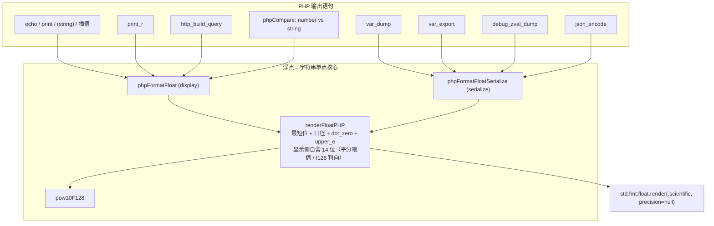
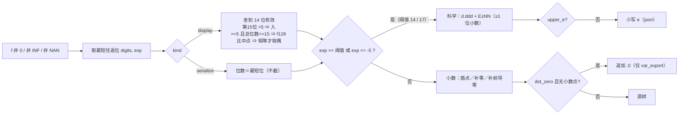
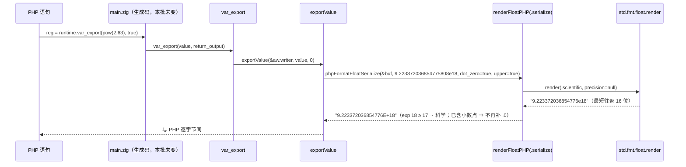

# AOT-CODEGEN-012 · F-63 改定与落地＝浮点→字符串的两套口径收敛到单点核心（R-173 ＋ R-173b）

**基线 commit**：`228534d`（R-172 批次；本轮 `src/` 改动截至发稿**未提交**，我未执行任何 `git add`/`git commit`）
**代次**：编译器二进制**未变**，仍 `bdd3af326d3c59d2bbd0bdf25b07afec`（纯模板轮）
**验收**：链 `c053_r173_acceptance_chain_tmp.sh`（30 腿，`7570s`，全 `rc=0`）＋ R-173b 定向复测（`00:05→00:35`）

---

## 1. 高层摘要（TL;DR）

R-172 收口 F-62 后，两道永久门里剩下的唯一注册红是 **F-63**。取证后**原登记名「大浮点数科学计数法记法不合 PHP」被实测否证**：
PHP 的浮点→字符串根本不是「一种记法」，而是**两套口径**——
`echo`／`print`／`(string)`／插值／`print_r`／`http_build_query` 走**显示口径**（`precision=14`，`%.14G`）；
`var_dump`／`var_export`／`json_encode`／`debug_zval_dump` 走**序列化口径**（`serialize_precision=-1`＝最短往返）。
两套的**科学切换点不同**（`exp≥14` vs `exp≥17`）、**后缀不同**（只有 `var_export` 补 `.0`）、**大小写不同**（`json` 用小写 `e`）、
且 `json` 遇 INF/NAN 要**整个 encode 返回 false**。

AOT 侧原本有**七套并行实现**：`phpFormatFloat`（自带 14 位手工舍入，先除幂再 `.13` ⇒ 二次舍入）、
`php_var_dump` 的 `float({})`、`exportValue` 的手写 `e→E`、两处 `json*` 的 `{d}`，以及两处**从来没做任何格式化**的 `asFloat()` 直出。
★Zig 0.16 的 `{d}`/`{e}`/`{}` 实测是「最短位数直出」（不是 PHP 的 14 位口径，也不是 glibc 的平分取偶）⇒ 必须自己写。

落地＝**一个核心 `renderFloatPHP` ＋ 两支包装（显示／序列化）＋ 11 处站点全部接线**。
新永久门 **FLT**（68 臂，一臂把同一个值过七条输出路径）：修前 `same=32 diff=24` ⇒ 终档 `same=59 diff=4 compile_fail=5`，
**F-63 自身注册红清零**；连带把 **BLT 由 `126/3` 改档为 `128/1`**、**NST 由 `31/1` 改档为 `32/0`（继 OPS 之后第二道零注册红的数值门）**。

## 2. 影响范围

| 面 | 影响 | 实测依据 |
|---|---|---|
| `echo`/`(string)`/插值/`print_r`/`sprintf('%s')` | 14 位舍入改为 **glibc 平分取偶**，并修掉「先除幂再截位」的二次舍入 | 门 b5（`123456789012345.0` ⇒ `1.2345678901234E+14`）、t1..t6 |
| `var_dump`/`var_export`/`json_encode`/`debug_zval_dump` | 从「最短位直出」改为**序列化口径**：`exp≥17` 出科学、`var_export` 补 `.0`、`json` 小写 `e`、非有限值 ⇒ **json 返回 false** | 门 b7..b12、c2..c6、d3..d6、e2/e3、h1/h2、m1 |
| `php_json_encode` 错误路径 | 新增内部 `error.JsonInfOrNan`，由 `php_json_encode` 收成 `bool false` | m1 前置探针（顶层与嵌套都 false；`JSON_PARTIAL_OUTPUT_ON_ERROR` 不救） |
| `http_build_query` | ① 浮点值改走显示口径；② 值一律过 URL 编码（`+`⇒`%2B`，与字符串同支） | 门 m1（修前 `a=10000000000000000000`／修后 `a=1.0E%2B19`） |
| 极端值的健壮性 | ★**结构上**根除 `error: NoSpaceLeft`（极值必走科学计数支 ⇒ `[64]u8` 不再被 300 位小数撑爆） | 门 d6（`var_dump(1e-300)` 修前是**整段输出丢失**） |
| `number_format`／`sprintf('%d',float)` | **未改**（它们的差属 F-69/F-70，本批只登记） | 门 g3/g4 保持原身份 |
| 语料／主回归 | 零退化 | `Total 68 / Pass 67 / Skip 1`（链 23:26 与复测 00:18 两次） |

## 3. 核心变更

| # | 变更 | 位置 |
|---|---|---|
| 1 | 新增 `renderFloatPHP(buf, f, kind, dot_zero, upper_e)`：`std.fmt.float.render(.scientific, .precision=null)` 取**最短往返位**＋十进制指数 ⇒ 按口径决定科学/小数、位数、`.0`、`E`/`e` | `src/aot/runtime_lib_template.zig`（原 `phpFormatFloat` 位置） |
| 2 | 显示口径自写 14 位舍入：一般按第 15 位方向（`>= '5'` 入），**恰 15 位且末位 5** 时用 f128 与精确中点 `(D14+0.5)×10^(exp-13)` 比大小，真相等才**取偶** | 同上 |
| 3 | 新增 `pow10F128`（二元快速幂，≤9 次乘法；仅上面那一支用到） | 同上 |
| 4 | `phpFormatFloat` 变薄为 `.display` 包装（**签名与全部调用点不变**）；新增 `phpFormatFloatSerialize(buf, f, dot_zero, upper_e)` | 同上 |
| 5 | 接线：`php_var_dump`（不补 `.0`、大写 E、缓冲 64→96）、`exportValue`（补 `.0`）、`jsonEncodeValue`＋`jsonEncodeValuePretty`（小写 e ＋ 非有限值 `return error.JsonInfOrNan`）、`php_json_encode`（`catch` 该 error ⇒ `false`） | 同上 |
| 6 | 抽出 `urlEncodeQueryComponent`，`http_build_query` 的字符串支与浮点支共用（★本文件 `anytype` writer 的既有惯例＝**传指针 `&aw.writer`**） | 同上 |
| 7 | `debug_zval_dump` 浮点行接序列化口径（其数组体/refcount 面**刻意不动**，登记 F-71b） | 同上 |
| 8 | 新永久门 **FLT** `fuzzy_scripts_720/tmp/c052_float_format_gate_tmp.sh`（68 臂，四类探针：`mk_probe`／`mk_probe_arr`／`mk_probe_guard`／`mk_probe_hq`）＋真值件 `c052_truth_float_matrix_tmp.php` | 门资产 |
| 9 | 新链 `c053_r173_acceptance_chain_tmp.sh`（30 腿，含 FLT 首腿；三重自保） | 链资产 |

## 4. 可视化概览（Code & Logic Map）

### 4.1 分层与站点收敛



### 4.2 两套口径的判据（实测）



### 4.3 一次 `var_export(pow(2,63))` 的执行流



## 5. 详细变更分析

| 层 | 文件 | 变更点 |
|---|---|---|
| 运行期模板 | `src/aot/runtime_lib_template.zig` | md5 `af81be0f…` ⇒ `36a621c8…`（R-173）⇒ **`22762f83605c56a324345c7969bea9cf`**（R-173b）。新增 `FloatFmtKind`/`renderFloatPHP`/`pow10F128`/`phpFormatFloatSerialize`/`urlEncodeQueryComponent`；改写 5 个既有函数的浮点支 |
| 编译器 | 无 | 二进制 `bdd3af32…` 未变（链首尾 md5 断言） |
| 门资产 | `c052_float_format_gate_tmp.sh`（md5 `4446635d46d0664da9c9ed864afe4c50`）＋ `c052_truth_float_matrix_tmp.php` ＋ 三段表身 | 修前 `16bf6177…`、首落含自造回归 `31e1a250…`、终档 `1ce850d1…` |
| 链资产 | `c053_r173_acceptance_chain_tmp.sh`（md5 `4ac4693f7096af0ed80d96fd4ebf85eb`）＋ `.log` | 30 腿 |
| 工单 | `docs/known-issues/AOT-CODEGEN-012-…md` §47.1–§47.11 ＋ §6 状态行 | 两套口径真值、七套实现清单、三段读数、四条自纠、新登记 F-66/F-67/F-69/F-70/F-71 |

## 6. 影响与风险评估

**是否破坏式**：否——输出更贴近 PHP；但它是**全局共享格式化器**的行为变更，风险面为「原本靠运气对齐的值被改错」。

| 风险 | 缓解与实测 |
|---|---|
| 语料 `var_export` 107 处／`json_encode` 105 处 ⇒ 面很大 | 主回归两次实测（链 23:26:31 与复测 00:18:17）均 `Total 68 / Pass 67 / Skip 1`；影子 `changed_rows=0`（发射中性） |
| 平分判据推错 | ★我自己连错两次并公开留字：① 以「最短末位 5」当平分的充分条件 ⇒ 门 t6 打回；② 改 ① 时把基线写成 `d15 > '5'` ⇒ **b6/c5/c6 由绿转红**（全量复跑 `diff=7` 才现形）⇒ 修回 `>= '5'` 后复跑 `diff=4`，且**未动任何原本已红的臂**（残红身份逐枚不变） |
| 冒烟被打断误判为自己代码的错 | 两次 `zig build-exe` 失败原文是 `integer literal '-0' is ambiguous`／`type 'f64' cannot represent integer value '1e308'` ⇒ **F-67**（合法 PHP 编译失败），已独立立案；由此得出口径：**新臂先用 `AOT_BIN=/bin/false` 证臂体合法，再谈读数**，且 `compile_fail` 桶要有恒定期望值（本门＝5） |
| `anytype` writer 传值 | `error: expected type '*Io.Writer'` ⇒ 按本文件惯例改传 `&aw.writer` |
| 序列化站点若漏改一处 ⇒ 同族再现漂移 | 收尾用「`asFloat()` 落进任何 print/bufPrint/writeAll/appendSlice」全扫 ⇒ 现**仅剩核心的 11 处包装调用**，直出站点归零 |
| `debug_zval_dump`/`http_build_query` 其它面被顺手扩大 | 刻意不做：`debug_zval_dump` 不设臂（数组体与 refcount 面未取真值，规则 31）；`http_build_query` 的键编码与嵌套形制登记 F-71c 不改 |

**复测路径**

```bash
# 仓库根，全命令带 timeout；链跑动期间禁改 src/模板/门脚本
timeout 900 bash fuzzy_scripts_720/tmp/c052_float_format_gate_tmp.sh   # FLT：arms=68 same=59 diff=4 compile_fail=5
timeout 900 bash fuzzy_scripts_720/tmp/c047_builtin_numeric_object_gate_tmp.sh  # BLT：129 same=128 diff=1（仅 b5）
timeout 900 bash fuzzy_scripts_720/tmp/c049_numeric_string_type_gate_tmp.sh     # NST：32 same=32 diff=0（零注册红）
timeout 2400 bash fuzzy_scripts_720/run_regression.sh                           # Total 68 / Pass 67 / Skip 1
timeout 3600 bash fuzzy_scripts_720/tmp/c010_shadow_main_md5_tmp.sh
GEN=r174 BASE=fuzzy_scripts_720/tmp/c010_shadow_newside_r173b_tmp.txt \
  timeout 120 bash fuzzy_scripts_720/tmp/c010_shadow_col_extract_tmp.sh          # changed_rows=0
```

## 7. 遗留问题 / 潜在问题

| ID | 面 | 状态 |
|---|---|---|
| **F-66** | NAN→字符串在 `echo`/`(string)`/插值/`print_r` 四路各打 `Warning: unexpected NAN value was coerced to string`（序列化三路不打） | 门 e4 常驻红，登记不修 |
| **F-67** | **浮点字面量与常量幂的生成码缺陷**：`1e100`/`1e308`/`-0.0`/`-9.223372036854776e18`/`1e308*10` ⇒ `f64 cannot represent integer value …`／`integer literal '-0' is ambiguous`／`use of undeclared identifier 'inf'` ⇒ **合法 PHP 编译失败**；语料暴露 0 | 5 枚 `compile_fail` 恒注册；修它在 `ir_generator`/发射侧 ⇒ 换代次，独立轮 |
| **F-69** | `sprintf("%d", 1.0e19)`：PHP 打 `Warning: The float … is not representable as an int, cast occurred`，AOT **静默回绕** | 门 g3 常驻红 |
| **F-70** | `number_format(123456789012345.6, 2)`：PHP 按二进制精确值舍（`…345.59`），AOT 按十进制舍（`…345.60`）；语料 9 枚文件 25 处 | 门 g4 常驻红 |
| **F-71b / F-71c** | `debug_zval_dump` 数组体与 refcount 整体不忠实；`http_build_query` 键不编码、嵌套形制（`a[b]`）未实现 | 登记，未设臂 |
| F-62b / F-62d / F-62e / F-62f / F-65 / F-61c | R-172 登记项不变（BLT 残红只剩 b5） | 见 §46 |
| 性能 | 新核心每次格式化多一次 `render` ＋字符串处理；`json_encode`/`var_export` 热路径成本**未测** | 与 F-62 入口定价同批测，禁报估算值 |
| 死码 | `phpStripTrailingZeros` 自本代起零调用者 | 按 §六.3 **保留待点头**，未删 |

## 8. 后续开发 / 优化建议

| 优先级 | 建议 | 影响面 | 落地成本 |
|---|---|---|---|
| **P0** | **F-67 编译失败面**：这是本工单当前唯一的「合法 PHP 编不过」级缺陷（浮点字面量被当整数发射）。先用 `ZIGPHP_AOT_KEEP_TEMP` 定位发射点，再判是常量折叠还是字面量分支；修它必换代次 ⇒ 需先冻结影子基线 | P0（编译可用性）；语料暴露 0 ⇒ 只能靠门臂 | 中 |
| **P0** | 门 FLT 的 4 枚常驻红各开一票：**F-69**（float→int 越界告警，与 F-65 同区）、**F-70**（`number_format` 精确值舍入，语料 25 处 ⇒ 收益最直接）、**F-66**（NAN 四路告警）、e6 的幂运算 `Deprecated`（与 F45FACE p06 同条，合并修一次收两门） | 中—高（`number_format` 面） | 低—中 |
| **P1** | **F-62f ＋ F-71b/c** 同批：`dechex/decoct/long2ip/rand/sleep/array_fill/range` 等 76 处无形参校验的内置，配合本批已就位的 `phpFormatFloat` 单点，一次把「数值输出＋数值入参」两侧收干净（★三条负证据：`intval/floatval/sprintf` 吃对象在 PHP 不抛） | 广 | 中 |
| **P1** | 把**格式化口径**做成常驻普查：任何 `asFloat()` 出现在 print/bufPrint/writeAll/appendSlice 即视为待接线（本批就是靠这条扫出 2 处遗漏） | 防漂移 | 低 |
| **P2** | 补 `http_build_query` 的键编码与嵌套（PHP 用 `arg[0][k]=v` 形制），并为其建臂（与 F-71 同臂族，别混进 FLT） | 小 | 低 |
| **P2** | 死码 `phpStripTrailingZeros` 与既有无引用件一起走「点头即删」，避免长期挂账 | 清洁度 | 低 |
