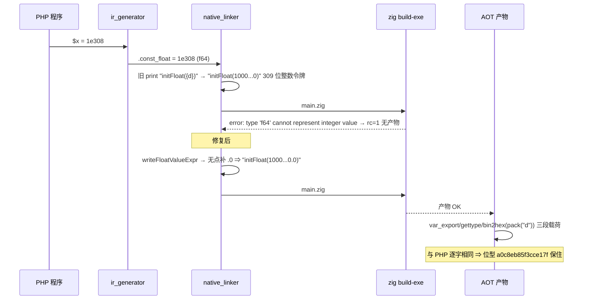
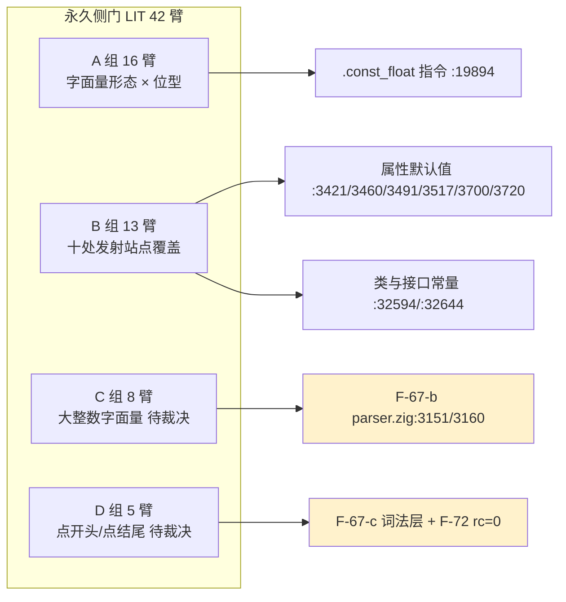

# AOT-CODEGEN-012 · R-174 · F-67 浮点常量的**发射形态**单点收口（含 F-73／F-74／F-67-b／F-67-c／F-72 五枚新登记，及 F-69／F-70／F-62f 三项只读备料）

## 1. 高层摘要（TL;DR）

- **修的是什么**：`--compile` 对**合法 PHP** 报 Zig 编译错误（`rc=1`、无产物）。根因不在数值、不在显示，而在**把 f64 常量发射成 Zig 源码时丢了浮点身份**——十处站点统一写 `runtime.Value.initFloat({d})`，而 Zig 的 `{d}` 对 f64 输出「最短位、永不带 `E`」，于是整值浮点变成一个**整数令牌**。
- **三条坏形**（全部实测报错原文）：`1e23`/`1e308`/`DBL_MAX` ⇒ `type 'f64' cannot represent integer value '…'`；`-0.0` ⇒ `integer literal '-0' is ambiguous`；`1e400`（PHP 解析成 INF）⇒ `use of undeclared identifier 'inf'`。阈值实测落在 **1e22 可精确表／1e23 不可**。
- **怎么修**：新增单点 helper `writeFloatValueExpr(writer, v)`——`{d}` 文本无小数点则补 `.0`；`isNan`/`isInf` 走 `std.math.nan(f64)`/`±std.math.inf(f64)`。十处站点一次收口（DRY，不在各站复制格式逻辑）。
- **正确性证明方式**：不靠显示文本，靠**逐位**。选型阶段用一次性探针把 `{d}` 文本喂回 `std.fmt.parseFloat` 比 bits，**19 枚样本 fails=0**（含 `-0.0` 的 `8000000000000000`、`5e-324`、`1e308`、`DBL_MAX`）；落地后由门 LIT 的每臂载荷 `bin2hex(pack("d",…))` 在 AOT 产物上复证。
- **验收**：新永久侧门 **LIT** 42 臂 `compile_fail 19→0`；连带 **FLT 改档** `compile_fail 5→0 / same 59→64`，且 FLT 的 4 枚注册红身份一枚未动；主回归 `Total 68 / Pass 67 / Fail_* 0 / Skip 1`；其余 26 腿与 R-173b 档**逐字相同**；影子 `changed_rows=6`，身份与链前用词法器做的静态预测**完全一致**，其余 62 枚 `main.zig` 逐字节不变。
- **本批动了发射器** ⇒ 二进制换代次 `bdd3af32…` → `a9eaef5e…`；影子基线列换 `r174`（表身 `351bc834…`）。
- **长出五枚新登记**（详见 §7）：F-73 属性默认值 fail-open 静默 NULL、F-74 trait 带静态属性运行期致命、F-67-b 大整数字面量饱和、F-67-c `.5`/`5.` 词法、F-72 parse 失败 rc=0。后三枚修复点在**共享 parser/lexer** ⇒ 按宪法 §五.2/§六.6 **未动，待老铁裁决**。

## 2. 影响范围

| 维度 | 实测读数 | 影响描述 |
|---|---|---|
| 改动文件 | `src/aot/native_linker.zig` 1 个（`49a3da31…`→`5ab4d501…`） | 纯发射侧；模板/`ir_generator`/`optimizer` 未动 |
| 二进制 | `bdd3af32…` → **`a9eaef5e…`** | 换代次 ⇒ 影子必然漂移，需重冻基线 |
| 发射站点 | **10 处** `initFloat({d})` 收口，`initInt({d})` 7 处**不涉及** | 类/trait 属性默认值 ×6、enum 值 ×1、`.const_float` 指令 ×1、类与接口常量 ×2 |
| 编译失败面 | 门 LIT `compile_fail 19 → 0` | 「合法 PHP 编不过」级缺陷清零 |
| 显示面（连带） | 门 FLT `compile_fail 5 → 0`、`same 59 → 64`、`diff=4` 身份不变 | 那 5 枚不仅开始编译，且显示口径逐字对上 PHP |
| 语料 | `Total 68 / Pass 67 / Fail_* 0 / Skip 1`（`report_mtime 2026-10-17 02:59:51`） | 回收 0 枚、新红 0 枚 |
| 影子漂移 | `changed_rows=6`（6 枚身份＝预测集，其余 62 枚逐字节不变） | 全部由 `initFloat(N)`→`initFloat(N.0)` 解释，**值不变** |
| 语料浮点字面量暴露 | 编不过面 **0 命中**（`e` 记法 3 处全在字符串内）；整值浮点 token **11 处/6 枚文件** | 防回归只能靠门臂，语料给不了保护 |

## 3. 核心变更

| # | 变更 | 位置 | 说明 |
|---|---|---|---|
| 1 | 新增 `writeFloatValueExpr(writer, v)` | `native_linker.zig`（紧邻 `escapeString`） | `isNan`⇒`std.math.nan(f64)`；`isInf`⇒`±std.math.inf(f64)`；否则 `{d}` 文本，无 `.` 补 `.0`；局部 `[512]u8`（`{d}` 理论上界 342，实测最长 326） |
| 2 | 类/trait 属性默认值 ×6 改走 helper | `:3421/:3460/:3491/:3517/:3700/:3720` | `.const_float => \|v\| try writeFloatValueExpr(writer, v),` |
| 3 | enum 值站点改走 helper | `:3637` | PHP 禁 float backing ⇒ 合法 PHP 不可达，**仍收口但不留死臂** |
| 4 | `.const_float` 指令改走 helper | `:19894` | 保持 `writeRegAssignmentPrefix` + `";\n"` 的原赋值形态（含 alloca 解引用） |
| 5 | 类/接口常量两处改走 helper | `:32594/:32644` | `writeConstantValueCode` / `writeConstantValueInlineDepth` |
| 6 | helper 去掉未使用的 `self` 形参 | 同上 | ★Zig 0.16：**未使用形参是编译错误**（与 R-142「用了 self 却留 `_ = self;` 报 pointless discard」对称） |

## 4. 可视化概览（mermaid）

### 4.1 分层与缺陷定位

```mermaid
flowchart TB
    A[PHP 源码<br/>$x = 1e308 / -0.0 / 1e400] --> B[parser.zig<br/>literal_float = f64 正确]
    B --> C[ir_generator.zig<br/>.const_float f64 正确]
    C --> D[optimizer.zig 常量折叠<br/>f64 正确]
    D --> E[native_linker.zig 发射器<br/>旧: initFloat 加 {d} 文本]
    E --> F{文本里有小数点吗?}
    F -->|有 0.5 / 大小数位展开| G[Zig 浮点令牌 OK]
    F -->|无 整值 1e23/1e308| H[整数令牌<br/>cannot represent integer value]
    F -->|负零 -0| I[integer literal -0 is ambiguous]
    F -->|非有限 inf/nan| J[use of undeclared identifier]
    H --> K[合法 PHP 编不过 rc=1 无产物]
    I --> K
    J --> K
    E -.本批修复.-> L[writeFloatValueExpr<br/>无点补 .0 / 非有限走 std.math]
    L --> M[Zig 逐位回读等价<br/>19 枚 fails=0]
    style E fill:#ffe6e6
    style K fill:#ffcccc
    style L fill:#e6ffe6
```

### 4.2 业务流程（发射→回读）



### 4.3 门与站点的映射（防回归面）



## 5. 详细变更分析

### 5.1 涉及文件

| 层 | 文件 | 变更 |
|---|---|---|
| 发射器 | `src/aot/native_linker.zig` | +helper、10 站点改写（md5 `49a3da31…`→`5ab4d501eb9f9c090d6dc7184c2bb955`） |
| 工单 | `docs/known-issues/AOT-CODEGEN-012-class-name-case-insensitive-lookup.md` | 新增 §48（含 §48.8 链回填与 §48.8.1 自纠）、§49（F-70 规则推导）、§50（F-69 三区制）、§51（F-74 只读收窄）、§52（F-62f 普查）；状态行加 R-174 段 |
| 门资产 | `fuzzy_scripts_720/tmp/c054_float_literal_gate_tmp.sh`（LIT，42 臂，md5 `e018bb60…`） | **新建永久侧门** |
| 门资产 | `fuzzy_scripts_720/tmp/c055_r174_acceptance_chain_tmp.sh`（31 腿，md5 `691521cf…`） | 新建验收链 |
| 备料资产 | `c056_truth_number_format_tmp.php`（31 例绿）、`c057_derive_number_format_rule_tmp.php`（八候选对比）、`c058_measure_tie_epsilon_tmp.php`、`c059_truth_float_to_int_tmp.php`（24 例绿）、`c060_f62f_unguarded_census_tmp.sh`、`c061_integral_float_roles_tmp.php` | 全部**只跑系统 PHP / 纯静态**，链内可复跑 |
| 快照 | `c054_flt_prefix42_R174_snapshot_tmp.tsv`（修前）、`c054_flt_postfix42_R174_snapshot_tmp.tsv`（修后）、`c010_shadow_newside_r174_tmp.txt`（新基线列） | 跨代真差值可续算 |

### 5.2 判据与实测对照

| 项 | 修前 | 修后 | 判据 |
|---|---|---|---|
| 门 LIT | `arms=42 same=13 diff=7 compile_fail=19 parse_fail=3 @78s` | `same=31 diff=8 compile_fail=0 parse_fail=3 @138s` | compile_fail 必须 0；diff 身份恰为 `b4 b11 b12 c1 c2 c3 c4 d4` |
| 门 FLT（R-173b 档） | `same=59 diff=4 compile_fail=5 @234s` | `same=64 diff=4 compile_fail=0 @249s` | `+5 same`、`compile_fail→0`、**diff 身份不许变**（e4/e6/g3/g4） |
| 门 BLT | `129→128/1` | `129→128/1` | 残红仍只有 b5（F-62b） |
| 门 NST/OPS/ABS/MSR/S | `32/0`、`26/0`、`26/0`、`74/0`、`47/47` | 全同 | 零注册红门，一转红即真回归 |
| 主回归 | `Pass 67 / Fail_* 0 / Skip 1` | 同 | 不得下降 |
| 影子 | `diff=68 invalid=0`，列 md5 `f5f2bf5e…` | `diff=68 invalid=0`，列 md5 `351bc834…`，**`changed_rows=6`** | 6 枚必须逐枚可解释 |

## 6. 影响与风险评估

- **是否破坏式变更**：否。语义等价（逐位证明），仅生成码文本变化；无任何删除、无接口变更、无跨模式改动。
- **变更影响范围**：所有含**整值浮点常量**的 AOT 程序其 `main.zig` 文本会变（`initFloat(10)`→`initFloat(10.0)`）。位型与显示完全不变。
- **需要特别注意的点**：
  1. **影子列基线已换代**：下轮起前代取 `c010_shadow_newside_r174_tmp.txt`（表身 `351bc834…`）；`f5f2bf5e…` 作废。提交时需按当代次重冻入口守卫。
  2. **helper 是浮点常量的唯一出口**：将来新增发射站点必须调它，禁止再写 `initFloat({d})`（本仓已有「同一语义多套实现」四次前科：R-170 `pow`/`**`、R-172 `spaceship`、R-173 七套浮点格式化）。
  3. **门 LIT 的 C/D 两组是「待裁决注册红」**：不许为了让门变绿去动 `src/compiler/`（共享 parser/lexer）。
  4. **性能**：本批未测，禁报估算值。helper 只在编译期跑，运行期零新增开销（生成的仍是字面量初始化）。
- **复测路径（体验流程）**：
  ```bash
  # 仓库根，全命令带 timeout
  printf '%s\n' '<?php' '$x = 1e308; echo var_export($x, true), "|", bin2hex(pack("d", $x)), "\n";' > /tmp/f67.php
  timeout 180 zig-out/bin/php-interpreter --compile --no-debug-info --output=/tmp/aot_compile_f67 /tmp/f67.php && /tmp/aot_compile_f67
  # 期望：1.0E+308|a0c8eb85f3cce17f（与 /opt/homebrew/bin/php 同值）
  timeout 900 bash fuzzy_scripts_720/tmp/c054_float_literal_gate_tmp.sh          # 门 LIT（≈140s）
  timeout 120 bash fuzzy_scripts_720/tmp/c061_integral_float_roles_tmp.php       # 漂移归因预测（系统 PHP，无需编译）
  rm -f /tmp/aot_compile_f67 /tmp/f67.php
  ```

## 7. 遗留问题 / 潜在问题

| 编号 | 状态 | 内容 |
|---|---|---|
| **F-73** | 待裁决（甲／乙） | 属性默认值走 `tryMakeConstInstruction` 纯语法白名单 ⇒ 表达式形态返回 null ⇒ `native_linker` 三叉 `else ⇒ initNull()` 误命中，**静默 NULL 而 `has_default` 仍 true**。甲＝接同文件既有 `getConstantValue`（已覆盖 unary/binary/类常量，折叠单一来源 `constant_folder.zig`，约 15 行）；乙＝改 fail-closed（**不推荐单独用**，合法 PHP 会从静默错值变编不过）。残余 **F-73b**＝全局常量取用（`PHP_INT_MIN`）`getConstantValue` 未覆盖。语料暴露 0（489 属性站点中 0 枚） |
| **F-74** | 待归因（需一次编译） | trait 带**静态属性** ⇒ 运行期 `Cannot redeclare trait`＋rc=255。已只读收窄到「`native_linker.zig:3691` 唯一可能来源 ⇒ 同名 trait TypeDef 在 `ir_module.types.items` 出现两次」，并排除「整段被发射两遍」。修复甲／乙两式已写于 §51，**由实测决定** |
| **F-67-b** | 待裁决（跨模式） | `parser.zig:3151/3160` 把超 `PHP_INT_MAX` 整数字面量**饱和**成 maxInt ⇒ 能编能跑、静默错值。★实测 PHP 口径**按进制不一致**（传统八进制全 7 ⇒ 饱和；`0200…0`/hex/bin/十进制 ⇒ float）⇒ 修复须逐进制照抄 |
| **F-67-c** | 待裁决（跨模式） | `.5`/`5.`/`.5e3` 被词法拒；`5.e3` 更坏——被误读成 `5 . e3` 串接 ⇒ Warning ＋ 字符串 `'5'` |
| **F-72** | 新立 | AOT parse 失败 **rc=0**（PHP=255）⇒ 脚本化调用会把解析失败当成功 |
| **F-70** | 规则已推出，待建门 | 候选 F＝「最短表示优先，**小数位数**不足 N 时回退精确展开」+ half-up ⇒ curated 52/52、随机 394/400。残差 6 枚在**重建段**（`round(643248.8032,10)` 位型比输入恰高 1 ulp）。★下一步必须先建门 NFM 实测 AOT 坏在哪一段，禁照抄就写 |
| **F-69** | 表已测全，待建门 | float→int 三区制（回绕／`\|v\|≥2^64`⇒0／非有限⇒0）＋告警（条件为闭下界开上界，repr 走最短口径）。AOT 侧仅 `1e19` 一枚实测（饱和＋不告警＋污染 `number_format`） |
| **F-62f** | 普查已建 | `unguarded=91 / distinct=464`，含已知假阳性族（`ctype_*`、扩展族、**已实测负证据** `intval/floatval/sprintf/sscanf` 必须不抛）与 `runtime_name_missing=7` 待核 |
| 流程 | 已自纠 | ① 链包装脚本用 `tail` 收尾 ⇒ 把 `timeout 7200` 的掐断遮成 `exit 0`；② `timeout` 只掐父脚本、孤儿影子门继续跑完 ⇒ 补跑重腿前先 `pgrep` 判活；③ 门臂载荷禁以 `var_export` 比对整型（PHP 对 minInt 输出 `-9223372036854775807-1`），必须用 `(string)` |
| P2 | 未动 | 门 LIT 待扩臂 `c9 = 02000000000000000000000`（八进制转 float 侧，链跑动期间不改门） |

## 8. 后续开发 / 优化建议

| 优先级 | 项 | 影响面 | 落地成本 |
|---|---|---|---|
| **P0** | **F-69 先于 F-70**：建门 F2I 取 AOT 修前基线，再落 float→int 三区制 helper＋告警 | F-69 改变 `number_format` 的大值输入，F-70 的门臂读数才稳定 | 模板单点（helper＋告警站点），预期发射中性 |
| **P0** | **F-70 建门 NFM** 并用实测判定「AOT 坏在判定段还是重建段」 | 语料 9 枚 25 处调用 ⇒ 本工单语料暴露最大的未修面 | 需精确十进制展开底座（可参考 `src/runtime/bigdecimal.zig`，先核对依赖闭包），与 F-65 同批 |
| **P1** | **F-73 甲型**（接 `getConstantValue`）＋ F-73b（全局常量查表）分两步 | 反射/`isset` 与属性初值正确性 | 甲约 15 行；F-73b 需类注册期常量表 |
| **P1** | **F-74 归因收尾**（一次 KEEP_TEMP 即可定分支） | trait + 静态属性 ⇒ 运行期致命 | 低（先证后修；两式已备） |
| **P1** | 请老铁裁决 **F-67-b / F-67-c / F-72** 是否在共享 parser/lexer 上动 | 三枚都在共享层 ⇒ 会同时改解释器/VM/bytecode | 未定价（须先裁方向再测） |
| **P2** | 「同一语义单一实现」加**静态守卫**：门/链里加一条 grep 断言 `initFloat({d})` 站点数为 0 | 防本族第四次复发 | 极低 |
| **P2** | 链包装脚本改「以链自身 `*_CHAIN_DONE` 为唯一成功判据」并把预算按历史 +50% 给 | 防再次出现「报告 completed 却缺腿」 | 极低 |
