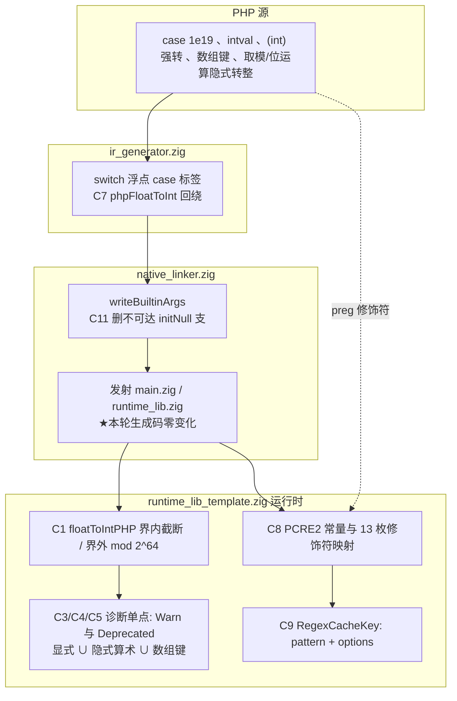
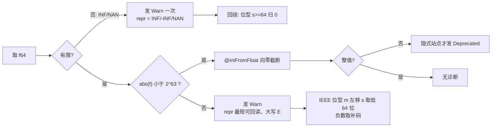
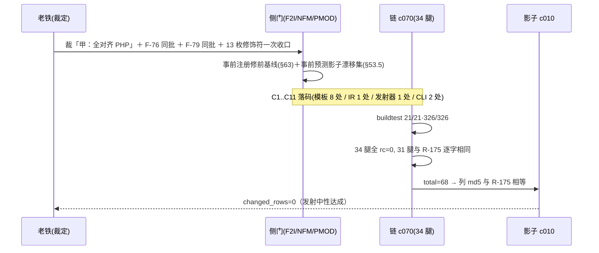

# AOT-CODEGEN-012 · R-176 批次：F-69 甲型 ＋ F-76 ＋ F-72 ＋ #89 ＋ F-79/F-79b/§38.4（2026-10-17）

## 1. 高层摘要（TL;DR）

本轮把 **PHP 的 float→int 语义**一次性对齐到 AOT：越界浮点强转不再饱和、而是按 **该 double 整数值 mod 2^64 的补码回绕**，并把 `The float <repr> is not representable as an int, cast occurred` 这条 Warning 补齐到**显式站点 ∪ 隐式算术族 ∪ 数组键**三类全部转化点；同时修掉一条**编译器自身崩溃**（`switch` 的浮点 `case` 标签在编译期走无守卫 `@intFromFloat` ⇒ `Abort trap: 6`）、一条 **P0 静默错值**（模板手抄的 PCRE2 option 位有三枚抄错，导致 `m/s/x` 修饰符行为错误且 `x` 与 `CASELESS` 撞位＝**过匹配**）、以及**正则缓存键不含 options**（同一次运行里修饰符行为依赖调用顺序）。另外收口 AOT 入口内部"解析失败却返回 rc=0"的约定不一致，并删掉发射器里一条不可达的"缺省位补 null"死分支。

验收：**主门 F2I 28 臂红转绿、0 臂绿转红、四对账计数全部归零**；34 条门腿中 **31 条与 R-175 逐字相同**；**影子跨代整列 md5 相等 ⇒ `changed_rows=0`（发射中性实证）**；主回归 `Pass 67 · Fail 0 · Skip 1`；`zig build test` `21/21 steps · 326/326 tests`。

## 2. 影响范围

| 维度 | 影响 | 量化的证据 |
|---|---|---|
| 用户可见行为 | 越界浮点转整数的**数值**改变（饱和 → 回绕）＋ 新增/纠正 **Warning／Deprecated 条数与顺序** | 门 F2I：修前 `warn_under=28 dep_over=8 dep_under=1` → 修后四者 **=0**，`aot_warned=28` |
| 编译器可用性 | 合法 PHP 不再让编译器崩（`switch` 浮点 case 标签） | F2I 臂 `d14`：`COMPILE_FAIL`（`Abort trap: 6`）→ `SAME` |
| CLI 契约 | AOT 解析失败 `rc: 0 → 1`（仍刻意不对齐 PHP 的 255） | 门 LIT 的 `d1/d2/d3` 三行 `rc=` 变 1，**其余 39 行逐字节不变** |
| 正则语义 | `m s x` 三位改对；`A D J U n u r` 七位新映射；缓存键并入 options | 门 PMOD：`same=1 → 11`（转绿 10 枚身份点名） |
| 生成码 | **零改动**（发射中性） | `SHADOWCOL_DONE … changed_rows=0 col_identical=yes` |
| 邻门 | 零扰动 | `C084CMP_DONE legs=34 same=31 diff=0 no_counterpart=3` |
| 跨模式 | **未触碰**解释器／字节码／JIT 语义（§五.1 合规） | 改动仅 `src/aot/*` ＋ AOT 入口 `runAOTCompilation` |

## 3. 核心变更

| # | 变更 | 位置 | 性质 |
|---|---|---|---|
| C1 | 新 helper `floatToIntPHP(f64) i64`＝界内 `@intFromFloat` 向零截断；界外用 IEEE 位型做 `m << s` 低 64 位回绕（`s>=64 ⇒ 0`，INF/NAN 自然归零），**全程不产生越界 `@intFromFloat`** | `src/aot/runtime_lib_template.zig`（值型 helper 区） | 语义核心 |
| C2 | `Value.toInt()` 浮点支改走 C1；**串支刻意不动**（改为守卫，暴露出 F-80） | 同上 `:2733-2742` | 语义 |
| C3 | 诊断单点化：`warnFloatToIntNotRepresentable` ＋ `castIntArgWithWarn`，`sprintf` 的七枚 int specifier（`%d %u %x %X %o %b %c`）由 7 处重复收敛为一处 | `:27687` 起七处 → helper | DRY ＋ 语义 |
| C4 | 隐式支路告警谓词重写：`emitFloatToIntDeprecatedIfNeeded` → **`emitImplicitFloatToIntDiagnostics`**（Warn 与 Deprecated 各自条件，NAN 为唯一"叠发"形） | `:6027/6028/6167/6168/6235` 五处调用点 | 语义 |
| C5 | 数组键两条路径补浮点支（Warn ＋ 条件 Deprecated ＋ C1） | `normalizeArrayKeyFromValue :1807/1814`、`valueToArrayKey` | 语义 |
| C6 | `emitDeprecatedFloatToInt` 的非有限值 repr 走 `phpFormatFloatSerialize`（PHP 打 `NAN`，AOT 原打 `nan`） | 同上 | 文本对齐 |
| C7 | **F-76**：IR 侧 `switch` 浮点 case 标签的 i64 计算改走同规则 helper `phpFloatToInt` | `src/aot/ir_generator.zig:3195-3205` ＋ 新增文件级 `phpFloatToInt` | 崩溃修复（编译期只借**值型**规则，**不发**运行期告警） |
| C8 | **F-79**：12 枚 PCRE2 option 常量按 `pcre2.h` 逐位改对；`parsePHPRegexPattern` 缺省 `UTF\|DOTALL → 0`（★必须同改，否则改对 `DOTALL` 数值会把全体模式静默变 dotall）；修饰符 `switch` 补 `A D J U n u r`（`S/X` 经实测无可观测形） | `runtime_lib_template.zig:11206-11222 / :11366 / :11560-11579` | 静默错值修复 |
| C9 | **F-79b**：正则缓存键由"仅模式体"改为 `RegexCacheKey{pattern, options}`（含自带 `hash/eql`，因 0.16 的 `autoHash` 拒绝含 slice 的 struct 键） | 同文件 `getOrCompileRegex` | 顺序相关缺陷修复 |
| C10 | **F-72**：AOT 入口两条解析失败支 `return;` → `return error.CompilationFailed;`（同函数 `:852` 早已这么返回）；`:833-845` 那条**有意的** rc=0 保持 | `src/main.zig:742-752 / :771-774` | 契约收口 |
| C11 | **#89**：删 `writeBuiltinArgs` 里不可达的 `else "runtime.Value.initNull()"` 补齐分支（读起来像"缺省补 null"＝正是 R-172 会改行为的形态） | `src/aot/native_linker.zig:19087` 区 | 死分支清理 |

## 4. 可视化概览

### 4.1 分层与变更点

### 4.2 浮点转整的判定流程（实测规则）

### 4.3 验收时序（代次冻结 → 落码 → 链 → 归因）

## 5. 详细变更分析

### 5.1 涉及文件

| 文件 | 代次（md5） | 变更点 |
|---|---|---|
| `src/aot/runtime_lib_template.zig` | `ac995d55…` → **`f96040eb94c82ea6416e2a250e318377`** | C1–C6、C8、C9 |
| `src/aot/ir_generator.zig` | **`6f3e300fad154230d315235b8e66ba48`** | C7 |
| `src/aot/native_linker.zig` | `ed61abf5…` → **`bbbc951c521e2b8de7f9512640c51005`** | C11 |
| `src/main.zig` | **`c0a7ea043ae91e56511779e377bf7fec`** | C10 |
| AOT 二进制 | `bd7a7c1c…` → **`657c2e0bb681ea0f85343b19107e7ae9`** | 由上四者重编 |
| 门/资产 | `c062(F2I)` `c067(NFM)` `c072(PMOD)` `c054(LIT)` `c070(链)` `c075/c078/c081/c082(真值与复证)` `c084(腿比对工具)` | 事前基线、事后核账 |
| 工单 | `docs/known-issues/AOT-CODEGEN-012-…md` §53.5–§69 | 判据、更正、备料 |

### 5.2 变更点描述（按层）

- **数据/语义层**：float→int 只保留一条规则——**界外一律取该 double 整数值的 mod 2^64 补码回绕**；旧记忆的「`|v| ≥ 2^64 ⇒ 恒 0」被实测否证（`(int)1e20 = 7766279631452241920`）。诊断侧确立四组合规则：界外有限 ⇒ 仅 Warn；界内非整值 ⇒ 仅 Deprecated；**NAN ⇒ 两条叠发（Warn 在前）**；显式站点 ⇒ 永远只 Warn。
- **编译期层**：IR 的 case 标签支路只借**值型**回绕规则，**禁止**在编译期发运行期告警（否则同一程序告警条数不可复现）。
- **发射层**：本轮唯一改动是删除不可达分支 ⇒ 生成码必须零变化，并以影子列 md5 相等为硬判据。
- **内置层**：`sprintf` 七枚 int specifier 收敛到一个 helper；数组键两条路径与 `php_intval`/`php_cast_int`/`php_settype` 补齐同一告警。

## 6. 影响与风险评估

- **是否破坏式变更**：对**依赖旧（错误）饱和行为**的 PHP 程序是行为改变（数值层面），但对齐目标是 PHP 8.5.8 实测语义，属"纠错"；`rc=0 → 1` 是对调用方可见的契约改变，影响面已实测：只有 `fuzzy_scripts_720/run_regression.sh:54-58` 读编译 rc，而 68 份语料无一解析失败 ⇒ 主回归零变化。
- **变更范围与外溢**：UTF 缺省由"开"转"关"是本轮最容易被低估的外溢点。暴露面重测（§62.4）：语料 22 枚 `preg_*` 调用中**模式体含非 ASCII 者 0 枚**；残余通道＝"多字节主题 × 字符级构造"（`f051:25`、`f057:39`、`f117:8`、`f161:166` 四枚硬暴露 ＋ 3 枚模式来自变量），由主回归裁决 ⇒ `Pass 67 / Fail 0`。★工单初稿写的"17 枚暴露"**不可追、已作废**。
- **需要特别注意的点**：
  1. `DOTALL` 常量与缺省位是**同一处改动的两半**——只改数值不改缺省会静默把所有模式变 dotall（比原缺陷更糟）。
  2. 缓存键必须与常量**同批**：只改位值不改键，成对臂仍红。
  3. Zig 0.16 三处 API 约束（`AutoHashMap` 只接 2 型参／含 slice 的 struct 键需自带 `hash/eql`／`Wyhash` 无 `create/update/final`），以及 `@copysign`/`@isFinite` **不存在**、`std.math.fabs`/`signbit` **不存在**、`std.meta.enumFromInt` **不存在**（§69 已记）。
  4. 未动模板之外的**任何共享层**（parser/lexer 一字未改）⇒ 解释器/VM/bytecode 面零影响。
- **复测路径（体验流程）**：
  1. `timeout 900 zig build test` ⇒ 期望 `21/21 steps`、`326/326 tests`；
  2. `timeout 900 bash fuzzy_scripts_720/tmp/c062_float_to_int_gate_tmp.sh` ⇒ 期望 `arms=51 same=43 diff=7 … warn_over=0 warn_under=0 dep_over=0 dep_under=0`（7 枚红＝登记面：`b5-b8` F-62、`g10` F-65/70、`g13` F-80、`d15` F-81、`b3` 若出现＝F-75）；
  3. `bash fuzzy_scripts_720/tmp/c072_preg_modifier_gate_tmp.sh` ⇒ `same=11 diff=2`（`a3`/`a5`＝F-79d）；
  4. `bash fuzzy_scripts_720/run_regression.sh` ⇒ `Pass 67 / Fail 0 / Skip 1`；
  5. `GEN=rNNN BASE=…_r176_tmp.txt bash fuzzy_scripts_720/tmp/c010_shadow_col_extract_tmp.sh` ⇒ 模板批要求 `changed_rows=0`；
  6. `bash fuzzy_scripts_720/tmp/c084_chain_leg_compare_tmp.sh <旧链log> <新链log>` ⇒ 期望 `diff=0`。

## 7. 遗留问题 / 潜在问题

| 项 | 状态 | 说明 |
|---|---|---|
| F-79d | 新立，未修 | PCRE2 编译失败被 `catch return initInt(0)` 吞成"匹配不上"；PHP 给 `false` ＋ `Warning: preg_match(): Compilation failed: …`。需新增 `pcre2_get_error_message_8` extern |
| F-80 / F-81 | 新立，站点与修法已定死 | 串支"先 parseFloat 再饱和"不分符号（`:2779`、`:13881`）；`sprintf %c` 对范围外整字节丢弃（`:27856`，PHP 恒发低 8 位，9 枚实测） |
| F-82 | 新立，**修法已证等价** | `php_round` 的 mode 映射与 PHP 全错位（实测 `1..8`＝UP/DOWN/EVEN/ODD/CEILING/FLOOR/TOWARD_ZERO/AWAY_FROM_ZERO，AOT 写作 DOWN/EVEN/ODD/else-UP）；语料带 mode 的调用 0 枚 ⇒ 主回归零保护 |
| F-70 / F-65 | 已拆解，未落地 | 段①（`round`）候选实现已在 **581 项真值上证完等价**（`bad_val=0 bad_mode=0`）；段②需**自带 dyadic→十进制精确展开**（§67.6 证 Zig 现成定点格式化不可用） |
| `|places| >= 23` 支路 | 覆盖缺口 | 复证器主动标 `uncovered` 未实现；需单独造真值 |
| `r` 修饰符 | 位已点亮、行为未证 | 无可观测臂 ⇒ 禁写"已支持"（§62.5） |
| F-73 / F-74 / F-75 批 2 / F-53 / F-62f / F-77 / F-67-b/c | 排队 | 门 PD2（F-73）已建成并自检 `bad_probe=0`，AOT 基线待取；F-53 范围已缩到 4 枚并明确两条硬前置（§66） |
| 工单物理顺序 | 已知排版债 | §58–§69 追加时把标题当锚点两次吞掉，已在文件内注明映射，未重排 |

## 8. 后续开发 / 优化建议

| 优先级 | 建议 | 影响面 | 落地成本 |
|---|---|---|---|
| P0 | **R-177 落 F-70 段①＋F-82 同批**（同一函数，实现已证等价；影子漂移集须 ⊆ §69.1 的 13 个文件，`NFM.diff` 只修段①应落 `[13,23]`） | `round()` 全部调用方 ＋ `number_format` 的 10 枚 both 臂；语料 `round` 10 枚 | 低（模板单函数替换，真值/复证器已就位） |
| P0 | **落 F-79d**：编译失败 ⇒ `false` ＋ PHP 原文 Warning（新 extern） | `preg_*` 全家错误路径；当前把"编不过"伪装成"匹配不上" | 中（1 extern ＋ 1 错误文本通路；门 PMOD `a3/a5` 即验收） |
| P0 | **落 F-80／F-81**（两处纯模板：串支按符号饱和、`%c` 无条件发低字节） | 数值串强转 ＋ `sprintf/printf/vsprintf/vprintf` 四入口 | 低（各 1 行；`g13`/`d15` 现成判据） |
| P1 | 门 F2I 扩 **E 段**：`(int)"INF"/"NAN"/"1e400"`、`round(1e19,2,PHP_ROUND_HALF_EVEN)`（§67.3 两枚新无守卫 `@intFromFloat`）、`abs()` | 现在这些形**没有常驻臂**，修完段①会静默改语义而无人报警 | 低（纯门改动） |
| P1 | **F-53 前先做 dup-key 行为探针**（§66.2-2：`preg_match`/`preg_match_all`/`preg_split` 三对指向不同 handler，`StaticStringMap` 只按长度排序 ⇒ 静态不可判定） | 决定 F-53 要不要动 preg 族；动错一枚＝改死代码 | 低（一枚 4 参 `PREG_OFFSET_CAPTURE` 臂） |
| P1 | 把 **§64.4 的"逐臂快照"规矩**写进链脚本：每条腿自动 `cp` 成 `*_R{NN}_snapshot_tmp.tsv` | 否则链后只剩 DONE 行，"逐枚相同"这种强判据无法回验（本轮靠 LIT/NFM 恰好留了档才做成） | 低（链脚本加 2 行） |
| P2 | `builtin_map` 30 对逐字段全同的重复行做**元数据卫生**清理（`diff_impl=3` 除外，那三对要先定档） | 降低 §55/#74 那类"两处都得改"的漏改风险 | 中（497 条目表，须逐对确认无历史语义） |
| P2 | `number_format` 展开 helper 的**性能与上限定价**（禁无界循环；u128 可到 22 位、更大 `dec` 需 big-int 或十进制倍增长除） | 语料 25 枚调用点 | 中（需基准数据，不许报估算值） |
