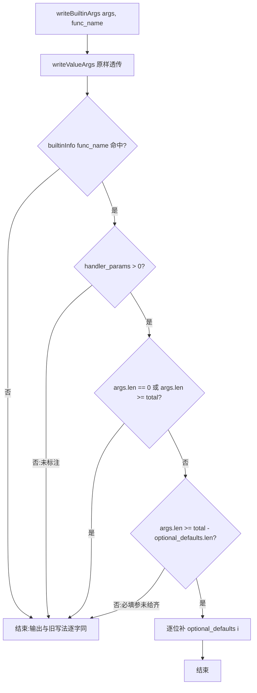
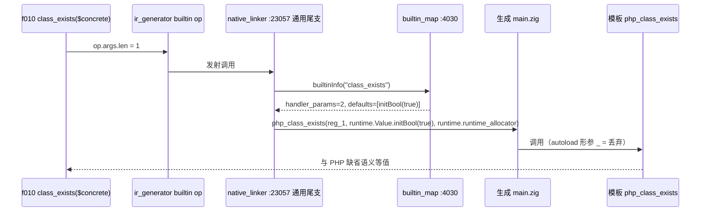

# AOT-CODEGEN-012 / F-75 第一批：内置函数「可选实参」的声明式补齐机制（R-175）

- 工单：`docs/known-issues/AOT-CODEGEN-012-class-name-case-insensitive-lookup.md` §53（含 §53.5 事前预测、§53.6 实测核销）
- 基线 commit：`228534d`（本批只记录、不提交）
- 日期：2026-10-17
- 代次：`native_linker.zig` `49a3da31…` → **`ed61abf5d1389d3753689ded9680739f`**；`runtime_lib_template.zig` `22762f83…` → **`ac995d5578270f3d0d4d5d0c6414438a`**；二进制 `bdd3af32…` → **`bd7a7c1c0b5e609d0de075a96471c7d8`**

---

## 1. 高层摘要（TL;DR）

PHP 里绝大多数内置函数的尾部参数是**可选**的（`class_exists($n, $autoload = true)`），但 AOT 的模板 handler 是 **Zig 定长形参**，可选参只在发射器里**按名字手工**补/裁（4 处 `eql` 特例，其中 `file_put_contents` 的 `@min(args,2)` 还是**静默丢参**）。没被点名的内建只要多传一个可选实参，生成的 `main.zig` 就报 `expected N argument(s), found N+1` ⇒ **合法 PHP 编不过**。实测 **49 枚**。

本批把这件事从「按名特例」改成「**声明式元数据 + 单一发射通道**」：`BuiltinInfo` 增加 `handler_params`（handler 的位置形参总数，不含 allocator）与 `optional_defaults`（逐位的 PHP 缺省值表达式），发射器新增 `writeBuiltinArgs`，只在**四条通用尾支**接一次。第一批只加宽 **6 枚「参数在 AOT 下本就惰性」**的名字（零行为风险，只解编译锁）⇒ 主门 `compile_fail` **49 → 43**、`same` **3 → 9**，其余 32 条共有腿与 R-174 **逐字节相同**。

★刻意**没**加宽的 4 枚（`intval($base)`／`stristr($before_find)`／`class_uses($include_parents)`／`class_implements($fq)`）：实参**会改返回值**，「接收但忽略」＝复刻 `file_put_contents` 那种静默丢参，比编不过更坏。链后逐枚实测进一步把余下 43 枚重定为 **9 枚可诚实加宽／34 枚必须真实现形参／4 枚卡在 by-ref 无机制**（§55）。

---

## 2. 影响范围

| 维度 | 影响 | 量级（实测） |
|---|---|---|
| 编译期可用性 | 6 枚内置的短调用从「编不过」变「编得过且逐位与 PHP 等值」 | ARG `compile_fail 49→43`，`same 3→9` |
| 生成码文本 | 被加宽名字的**短调用**多出缺省实参文本（如 `, runtime.Value.initBool(true)`） | 影子 `changed_rows=1`（＝`f010`），67/68 逐字节不变 |
| 运行期行为 | 加宽的 6 枚参数在 AOT 支持面上**无可观测效果** | 影子 `total=68 same=0 diff=68`；主回归 `Pass 67/Skip 1/Fail_* 0` |
| 其他模式（解释器/VM/bytecode/JIT） | **零触及**（改动全在 `src/aot/`） | 腿 `buildtest 21/21 & 326/326` |
| 后续批次成本 | 每枚内建加宽＝模板加形参 + 表里一行元数据；**不再新增按名 `eql` 特例** | 见 §7/§8 |

---

## 3. 核心变更

| # | 变更 | 位置 | 说明 |
|---|---|---|---|
| ① | `BuiltinInfo` 新增两字段 | `native_linker.zig:3987/3990` | `handler_params: u8 = 0`、`optional_defaults: []const []const u8 = &.{}`；**缺省值 0/空 ⇒ 发射器完全不介入**（未标注名字行为逐字不变） |
| ② | 新增 `writeBuiltinArgs` | `native_linker.zig:19073-19091` | `writeValueArgs` 原样透传 ＋ 在 `[可选段起点, handler_params)` 逐个补 `optional_defaults[i]`；★两条刻意收紧：`args.len==0` 不补、`args.len < 可选段起点` 不补 ⇒ 必填参没给齐时**留给既有 arity 诊断**报可读错，绝不替用户臆造实参 |
| ③ | 四条通用尾支接线 | `native_linker.zig:23057 / 23472 / 23637 / 23680` | 原 `writeValueArgs(writer, op.args)` → `writeBuiltinArgs(writer, op.args, op.func_name)` |
| ④ | 6 行表元数据 | `:4030/4031/4032/4033/4036/4430` | `class_exists/interface_exists/trait_exists/enum_exists/is_subclass_of/getenv`；缺省值**逐位声明**（`getenv` 是 `initBool(false)`，其余 `initBool(true)`） |
| ⑤ | 6 个 handler 加形参 | 模板 `:21546/:21561/:21580/:21599/:21681/:24872` | 例 `php_class_exists(class_name, autoload, allocator)` ＋ `_ = autoload;`，动态包装按 `if (args.len > 1) args[1] else 缺省` 传 |

★惰性成立的依据（读实，不是推测）：模板内 `autoload` 出现 **0 次**（无 autoloader）⇒ `class_exists` 族四枚；AOT 无 SAPI 环境分层 ⇒ `getenv($local_only)`；AOT 侧本就同时收对象与类名字符串 ⇒ `is_subclass_of($allow_string)`。

---

## 4. 可视化概览

### 4.1 分层架构与业务目标


### 4.2 发射流程（补齐判定）



### 4.3 上层到底层时序（一枚短调用 `class_exists($concrete)`）



---

## 5. 详细变更分析

| 层 | 文件 | 变更点 |
|---|---|---|
| 编译期发射层 | `src/aot/native_linker.zig` | `BuiltinInfo` +2 字段；新增 `writeBuiltinArgs`；4 条通用尾支换用；6 行表元数据 |
| 运行期模板层 | `src/aot/runtime_lib_template.zig` | 6 个 handler 加形参 ＋ `_ = 形参;`；6 处动态包装传 `if (args.len > N) args[N] else 缺省` |
| IR 层 | 无改动 | `ir_generator`/`optimizer` 未变（代次未动） |
| 工具/门 | `fuzzy_scripts_720/tmp/c064_arity_gap_census_tmp.php`、`c064_arity_gap_list_tmp.tsv`（66 行普查）、`c065_arity_optional_arg_gate_tmp.sh`（门 ARG，66 臂）、`c065_arg_prefix_R175_snapshot_tmp.tsv`、`c065_arg_postfix_R175_tmp.tsv`、`c066_r175_acceptance_chain_tmp.sh`（34 腿）、`c010_shadow_newside_r175_tmp.txt`（68 行新基线列） | 新建 |
| 文档 | 工单 §53/§53.1-§53.6 | 新增 |

**门 ARG 逐臂读数（66 臂，两遍读数全等）**

| | same | diff | compile_fail | bad_probe |
|---|---|---|---|---|
| 修前 | 3 | 7 | **49** | 7 |
| 修后 | **9** | 7 | **43** | 7 |

转绿身份＝`class_exists enum_exists getenv interface_exists is_subclass_of trait_exists`；`diff=7`（`sort rsort asort arsort ksort krsort ob_start`＝by-ref 传 null 的诊断差异，另案）与 `bad_probe=7`（门自身造参不足：联合类型/可空/by-ref）身份未变。

---

## 6. 影响与风险评估

- **是否破坏式变更：否。** 未标注的名字 `handler_params=0` ⇒ 发射器直接 return，输出与旧 `writeValueArgs` **逐字节相同**（影子 67/68 不变即为证据）。
- **变更范围**：仅 `src/aot/`；解释器/VM/bytecode/JIT 零触及（符合宪法 §五）。
- **需特别注意的点**：
  1. `writeBuiltinArgs` 只在**四条通用尾支**生效 ⇒ `native_linker` 里被按名 `eql` 截走的内建（本批 43 枚中有 5 枚：`array_keys`/`hash`/`hash_file`/`hash_pbkdf2`/`mkdir`）**不走该通道**，后续加宽须在对应支各接一次（工单 §55.3）。
  2. `builtin_map` 有重复键（`file_get_contents:4067/4383`、`unlink:4076/4389`）⇒ 改元数据**两处都要改**。
  3. ★影子判据本批**不再是 `changed_rows=0`**：动了发射器就必然改短调用文本 ⇒ 判据改为「事前点名＋逐枚可解释」，本轮已兑现（§53.5/§53.6）。
  4. Zig 0.16 在本仓构建配置下**未使用的形参是编译错误** ⇒ 加宽必须显式 `_ = 形参;`；helper 若不用 `self` 就不要声明它。
- **复测路径**：
  ```bash
  timeout 900 bash fuzzy_scripts_720/tmp/c065_arity_optional_arg_gate_tmp.sh      # 主门：须 same=9 diff=7 compile_fail=43 bad_probe=7
  timeout 1200 bash fuzzy_scripts_720/tmp/c054_float_literal_gate_tmp.sh          # 邻门：compile_fail=0 保持
  timeout 2400 bash fuzzy_scripts_720/run_regression.sh                            # 主回归：Pass 67 / Skip 1 / Fail_* 0
  GEN=r175 BASE=fuzzy_scripts_720/tmp/c010_shadow_newside_r174_tmp.txt \
    timeout 120 bash fuzzy_scripts_720/tmp/c010_shadow_col_extract_tmp.sh          # 影子：changed_rows=1 且身份=f010
  ```

---

## 7. 遗留 / 潜在问题

| 编号 | 问题 | 状态 |
|---|---|---|
| F-75 余量 | 余 **43 枚** `compile_fail`：★链后逐枚实测**重定范围**＝可诚实加宽仅 **9 枚**（其中 `define` 还须同批发 PHP 的「Argument #3 被忽略」告警才 SAME，`stream_*` 两枚是纯 stub 建议按范围裁）、**34 枚必须真实现形参**、**4 枚卡在 by-ref 出参无机制** | 待排 #87 |
| 我自己写的死分支 | `native_linker.zig:19087` 的 `else "runtime.Value.initNull()"` 在 `:19082-19084` 两道收紧下**不可达**，但读起来像「缺省位会补 null」（那正是会改变行为的形态） | 待删 #89（链后才动，禁链跑期改代次） |
| 按名特例未收敛 | 旧 4 处 `eql` 特例本轮**未删**（删除属 §六.3 需单独点头；且各自走自己的分支，与新机制不冲突、不会双补） | 待裁 |
| F-69/F-76/F-72/F-70/F-65/F-62f/F-77 | 本批只做了**真值与门**的准备（F2I 48→51 臂、NFM 56 臂、PMOD 13 臂、c068/c069/c071 真值资产），未动代码 | #85/#86/#90/#91/#92/#74/#93 |

---

## 8. 后续开发建议

| 优先级 | 项 | 影响面 | 落地成本 |
|---|---|---|---|
| P0 | R-176＝F-69 甲型（值型 helper 纯净 + 显式∪隐式算术族∪数组键发告警）＋ F-76 编译期支 ＋ F-72 ＋ #89 | float→int 静默错值面（`(int)1e19`、`1e19 % 2`、数组键）；影子须发射中性 | 中：模板 12 站点＋ir_generator 1 处；候选实现**已用 430 枚 PHP 真值证等价**（`c069`，`bad_val=0 bad_warn=0 bad_dep=0 bad_mod=0`） |
| P1 | F-62f 47 枚接线（复用已实测 `must be of type int|int|float` 族，零新措辞）；先解 `preg_match_all` 重复键取向 | 对象进数值形参的 over-fatal/漏报边界 | 中：逐枚加 `requireNumParam*`；★禁把 `intval/floatval/sprintf/sscanf/settype` 一起推成抛（负证据族） |
| P1 | F-70/F-65：用门 NFM 先量 AOT 坏在**判定段还是重建段**（`stage_*` 列已内建），再动 `php_number_format` 的无守卫缩放 | `number_format` 大值与高精度位 | 中：规则已推出（候选 F，52/52＋394/400） |
| P2 | F-75 余下 9 枚可加宽名字（`define` 需同批发告警；`stream_*`/pcntl 按 AGENTS §七裁范围） | 合法 PHP 编不过 | 低-中 |
| P2 | 把门 PMOD 的 9 枚可观测臂纳入修饰符映射批次；`r`/`X` 继续找可观测形或明确标「未证」 | preg 家族语义 | 中 |
