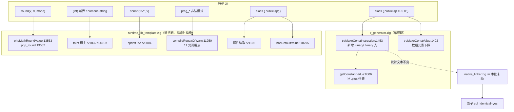
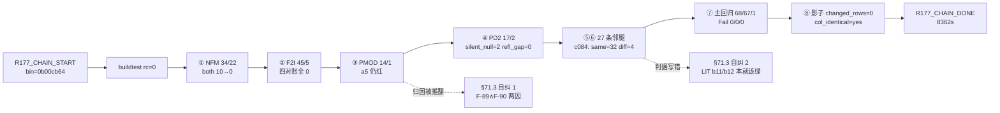
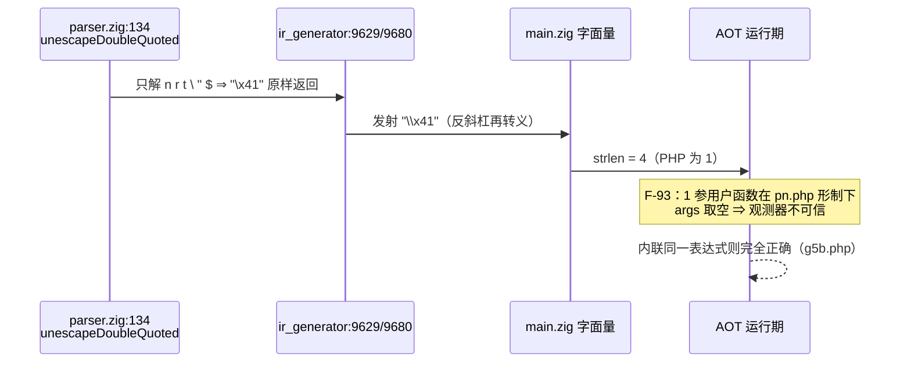

# AOT-CODEGEN-012 · R-177：F-70 段①（`round` 七步移植）＋ F-82／F-62d ＋ F-80／F-81 ＋ F-79d／F-84 ＋ F-83 ＋ F-73 甲型 五件同批

> 代次标记：文件名里的 `0b00cb64` 是 **AOT 二进制 md5 前缀**（`0b00cb647294fca4e744741618b7f3c1`），**不是 commit**——本批代码尚未提交，HEAD 仍是 `18a692a`（R-176）。
> 工单：`docs/known-issues/AOT-CODEGEN-012-class-name-case-insensitive-lookup.md` §67–§72（落地记录＝§71，段②备料＝§72）。

## 1. 高层摘要（TL;DR）

一条验收链装了老铁裁定的五件事，全部为 **AOT-only**：把 php-src `_php_math_round` 七步逐支移植进模板（修 `round()` 值错）、`round()` 的 mode 数值映射由「1/2/3/4→DOWN/EVEN/ODD/UP」纠正为 PHP 的 **1..8** 且非法值改抛 `ValueError`、数字串/浮点越界转 int 改为**按符号饱和**、`sprintf("%c")` 改为**恒发低 8 位一字节**、PCRE2 编译失败不再被吞成「没匹配上」（按函数分派 `false`/`null` ＋ PHP 可见名告警）、未写默认值的属性读取与反射两个口径收口，以及属性默认值的**一元/二元常量表达式折叠通路**（F-73 甲型）。

- 35 条腿（含新增的 PD2 腿）全 `rc=0`，链耗时 `8362s`，九枚**事前注册**判据逐枚命中。
- 主回归 `Total 68 / Pass 67 / Skip 1 / Fail(Compile|Runtime|Diff)=0`。
- 影子拿到最强形态：`changed_rows=0` **且 `col_identical=yes`**（68 行整列 md5 逐位相同）。
- 公开自纠两处：判据③对 `a5` 残留红的归因被后续实测推翻；判据⑥「LIT 必须逐字相同」与批内 F-73 甲型自相矛盾。
- 新登记 **F-84…F-93** 十条，其中 **F-89（双引号转义未解码）** 已由老铁裁「只修 AOT 侧」、**F-93（用户函数取不到实参）** 仍未归因。
- 明知故犯地留下一半：F-73 的**全局常量子支未随批落地**，续做形态已裁定＝发射期改调运行期 `php_constant_get`。

## 2. 影响范围

| 面 | 影响 | 量级（实测） |
|---|---|---|
| `round()` 数值 | 七步算法逐支移植，取代旧的「缩放＋floor」单支 | 门 NFM `diff 23→22`、`stage_both 10→0`；`c081` 探针 **581 行**真值 `bad_val=0 bad_mode=0` |
| `round()` mode 形参 | 合法集 1..8；`0/9/16/负数` 改抛 `ValueError`（旧代码把 1/2/3/4 映射成 DOWN/EVEN/ODD/UP＝**全错位**） | 136 行 mode 真值全同；新增 ValueError 面**不可被 `@` 抑制** |
| float/numeric-string → int | 越界**按符号**饱和（旧：负侧也给 maxInt） | 门 F2I `g13` 转绿（`same 43→45`） |
| `sprintf/printf` 的 `%c` | 恒发 1 字节＝低 8 位（旧：范围外整字节丢弃） | 门 F2I `d15` 转绿；一处修 `printf/vprintf/vsprintf/sprintf` 四入口 |
| preg 编译失败 | 返回 `false`/`null`（按函数）＋ `Warning: preg_<PHP可见名>(): Compilation failed: <PCRE2 原文> at offset N` | 门 PMOD `a3` 转绿（`same 13→14`，15 臂新档）；11 处调用点接线 |
| 属性读取／反射 | 无类型∧无默认值∧槽缺失 ⇒ 静默 NULL；`hasDefaultValue()` ⇒ `has_default ∨ 无类型声明` | 门 PD2 `g6` 转绿、`refl_gap 1→0` |
| 属性默认值折叠 | 一元/二元常量表达式（`-5.0 -5 5*2 +1.0 ~5 -0.0 1+2*3` 及数组元素形、静态属性形）从**静默 NULL** 变正确值 | 门 PD2 `same 7→17`（10 枚转绿）；连带 LIT 的 `b11/b12` 转绿 |
| 是否破坏式 | 否。发射器 `native_linker` **未动**；`ir_generator` 只加折叠通路 ⇒ 影子发射中性 | `col_identical=yes` |

## 3. 核心变更

| # | 文件 | 站点（落地后行号） | 变更 |
|---|---|---|---|
| 1 | [runtime_lib_template.zig](file:///Users/wangjianjun/products/parser/src/aot/runtime_lib_template.zig#L13507) | `phpMathIntPow10:13507`、`phpMathRoundBasicEdge:13518`、`phpMathRoundZeroEdge:13524`、`phpMathRoundHelper:13529`、`phpMathRoundValue:13563` | 新增 5 个 helper，逐支对齐 php-src `_php_math_round`（含 `tmp2` 误差回补、`|tmp|>=1e16` 放弃、`copysign` 边界） |
| 2 | [runtime_lib_template.zig](file:///Users/wangjianjun/products/parser/src/aot/runtime_lib_template.zig#L13582) | `php_round:13582` | mode 合法集 1..8；非法 ⇒ `throwThrowable("ValueError", …, runtime_allocator)`；precision 先钳位再 `@intCast` |
| 3 | [runtime_lib_template.zig](file:///Users/wangjianjun/products/parser/src/aot/runtime_lib_template.zig#L2783) | `:2783` 与 `:14019` | 越界转 int 按符号饱和：`if (float_val < 0) minInt else maxInt` |
| 4 | [runtime_lib_template.zig](file:///Users/wangjianjun/products/parser/src/aot/runtime_lib_template.zig#L28004) | `sprintf` 的 `'c'` 支 `:28004` | `@truncate(@as(u64, @bitCast(val)))` ⇒ 恒 1 字节；根因由「吞 NUL」改写为「范围外整字节丢弃」 |
| 5 | [runtime_lib_template.zig](file:///Users/wangjianjun/products/parser/src/aot/runtime_lib_template.zig#L11225) | `PcreCompileFail:11225`、`warnPcreCompileFailed:11230`、`compileRegexOrWarn:11250` ＋ extern `pcre2_get_error_message_8`，11 处调用点 | 编译失败不再吞；返回值按函数分派（`match/match_all/split/grep⇒false`、`replace/replace_callback/filter⇒null`）；告警用 PHP 可见名（F-84）；★`pcre2_get_error_message` 返回**写入字节数**而非「0＝成功」 |
| 6 | [runtime_lib_template.zig](file:///Users/wangjianjun/products/parser/src/aot/runtime_lib_template.zig#L21106) | 属性读取 `:21106`、反射 `:18795–18800` | 无类型未写默认值 ⇒ 静默 null（typed 支不碰）；`hasDefaultValue = has_default ∨ type_name == null` |
| 7 | [ir_generator.zig](file:///Users/wangjianjun/products/parser/src/aot/ir_generator.zig#L1453) | `tryMakeConstInstruction:1453`（新支注释 `:1518`）、`getConstantValue:9806`、`tryMakeConstValue:1402`（注释 `:1436`） | 折叠通路复用既有 `getConstantValue`：新增 `.unary_expr/.binary_expr` 支、补一元 `+`（只做恒等）、数组元素位下探。★**全局常量子支刻意不做**（见 §7 与工单 §71.4） |
| 8 | [test_runtime_comprehensive.zig](file:///Users/wangjianjun/products/parser/src/aot/test_runtime_comprehensive.zig) | `test "数学 - round"` | 默认 mode 出参改 `initNull()`（原 `initInt(0)` 会直达新 ValueError 支并踩 F-88 段错误）＋ 8 个 mode ＋ `round(1.005,2)` |

## 4. 可视化概览

### 4.1 分层：批内五件在管线里的落点

### 4.2 验收链流程（判据 ↔ 腿）

### 4.3 F-89 与 F-93 的机制时序（本轮新增的两条链外发现）

## 5. 详细变更分析

### 5.1 涉及文件
· 代码：`src/aot/runtime_lib_template.zig`（`f5665ecb…`）、`src/aot/ir_generator.zig`（`7efcee84…`）、`src/aot/test_runtime_comprehensive.zig`。
· **未动**：`src/aot/native_linker.zig`（仍 `bbbc951c…`）、`src/compiler/*`（共享层一律未碰，符合宪法 §五）。
· 门禁：新腿 `c073`（PD2）入链；链脚本 `c087`（由 `c088_chain_gen_tmp.py` 从 `c070` 机械派生，逐条替换都带命中数断言）；新永久门 `c092`（ESCG 28 臂）、`c093`（PERR 21 臂 v2）；新工具 `c084_chain_leg_compare_tmp.sh`（跨代逐腿比对）、`c095_nfm_stage2_gen_tmp.py` ＋ `c094_number_format_equiv_tmp.zig`（段②离线等价探针，模板 helper **机械切片**）。
· 真值资产：`c075_nfm_truth_tmp.tsv`（445 行）、`c079_round_cases_tmp.zig`（445）、`c082_mode_cases_tmp.zig`（136）、`c089b/c090/c091` 三个 PHP 探针、`/tmp` 系列 F-93 repro（已固化 `c094_f93_repro_tmp.php`）。

### 5.2 判据命中表（读数全部取自链日志）
| 判据 | 事前注册 | 实测 | 判定 |
|---|---|---|---|
| ① NFM | `stage_both 10→0`、`diff∈[13,23]`、13 枚 judgment 仍红 | `same 33→34 diff 23→22 both 10→0 judgment 13→22`；join：转绿仅 `rd2`、新红 0、原 13 枚仍红 | ✅ |
| ② F2I | 只许 `g13/d15` 转绿、四对账仍 0 | `same 43→45 diff 7→5 compile_fail=1`；残留＝`b5 b6 b7 b8 g10`＋`b3`；四对账全 0 | ✅（★判据原文"五枚"却列六名＝笔误，已在 §71.2 更正口径） |
| ③ PMOD | `same 13→14`，`a3` 转绿、`a5` 仍红但原因要换 | `arms=15 same=14 diff=1`，唯一红 `a5` | ✅ 数值；归因❌ ⇒ §71.3 自纠 1 |
| ④ PD2 | `same=17 diff=2 silent_null=2 refl_gap=0`，残留 `p12/p13` | 逐字命中 | ✅ |
| ⑤ P／PD | 与 R-176 档同 | 腿比对 `SAME` | ✅ |
| ⑥ 其余腿 | 逐字相同 | `legs=37 same=32 diff=4 no_counterpart=1`；DIFF＝F2I/NFM/PMOD/**LIT** | ⚠️ 判据自相矛盾 ⇒ §71.3 自纠 2（LIT 只动 `b11/b12`，新红 0） |
| ⑦ 主回归 | 68/67/1/0 | `Total 68 Pass 67 Skip 1 Fail(Compile/Runtime/Diff)=0` | ✅ |
| ⑧ 影子 | `changed_rows=0` | `changed_rows=0 col_identical=yes`，new-side 整列已落 `c010_shadow_newside_r177_tmp.txt`（68 行，`4d1a92cf…`） | ✅ 最强形态 |
| ⑨ rc 纪律 | 只认 DONE/Build Summary | `R177_CHAIN_DONE`；`zig build test --summary all` = `21/21 steps succeeded; 326/326 tests passed` | ✅（附：`failed command: ./.zig-cache/o/55e2983…/test` 是 R-176 档就有的既有噪声，同哈希同行） |

### 5.3 链外新增读数
· 门 ESCG 修前基线：`arms=28 same=10 diff=18`——18 枚红＝F-89 解码缺口，10 枚绿＝5 守卫 ∧ 5 **负向守卫**（PHP 也原样保留的 `\x`/`\xg1`/`\u41`/`\E`/`\d`，修后必须仍绿 ⇒ 防"过解"）。
· 段② 候选等价性：`C094NFMDONE rows=445 bad_def=9 bad_comma=3 bad_nodot=3` ⇒ **1317/1335** 吻合；6 枚真不符全在 `|v|≥1e19 ∧ dec<0`，另 2 枚是探针无法表达自定义分隔符（`kind=D`）。
· 门 PERR（v2）修前基线：`arms=21 same=2 diff=19`，两枚绿恰是守卫 `g1/g2` ⇒ 门可信。分段各归各族：`b1…b7`＝F-90（其中 `preg_replace` 连**类型**都错＝返回含高位字节的 string、`preg_split` 返回 array），`k1…k7`＝返回值面**已由 F-79d 收口**、只剩 `preg_last_error()`（F-91）与处理器计数（F-92），`e1/e2/e3`＝F-91（`preg_last_error_msg` 未定义＋七枚 `PREG_*` 常量全 UNDEF），`h1/h2`＝F-92。
· ★两条反证（工单 §72.3）：`nf(3.8238004000000006E+17,-1)="…060"` 而 `sprintf('%.0F', round(同值,-1))="…064"`；纯十进制 half-up 却在 `4.7905886600000006E+20` 上错（PHP 给原样精确展开）⇒ **单一模型不成立**，段②禁未定档前落模板。

## 6. 影响与风险评估

**是否破坏式**：否。发射器未动、`ir_generator` 只加折叠通路且语料表达式形默认值实测 **0 枚**（分母 294）⇒ 影子整列逐位相同；模板改动不进 `main.zig` 文本。

**核心风险与处置**
| 风险 | 说明 | 处置 |
|---|---|---|
| `round()` 新增 `ValueError` 抛出路径 | 旧代码任何 mode 都返回值；新代码非法 mode 抛异常 ⇒ 若某内置在 `initRuntime` 前被直达会段错误 | 已实测踩到一次（F-88）：改测试出参为 `initNull()` 绕开；**根因未修**，已登记「可抛内置不可在 initRuntime 前被单测直达」为守卫项 |
| `|places|>=23` 的文本回环支未覆盖 | 真值矩阵 `\|dec\|≤20` ⇒ 该支**无期望值可核对**，实现按 PHP 注释理由先走除法 | 缺口显式登记在工单 §69，补覆盖后单独一批；禁"顺手猜一遍" |
| `%c` 改动触及四个入口 | `printf/vprintf/vsprintf/sprintf` 共用一支 | 门 F2I `d15` ＋ BLT/OBJ 等 6 腿复证未漂 |
| preg 失败返回值由 `int 0` 变 `false/null` | 依赖「返回 0 当假值」的 PHP 代码语义不变，但 `===` 严格比较与 `var_dump` 输出会变 | 11 处调用点全量接线并逐点标注；PMOD/S/AC 三门复证 |
| F-83 放宽读取支 | typed 未初始化的 `Error` 支若被一起放宽＝静默错值 | 条件写死 `type_name == null ∧ 槽缺失`；门 PD2 的 C 形冒烟＋门 P 腿复证 |
| 折叠通路扩大 | 若 `getConstantValue` 有未覆盖形被折成错值＝从 NULL 变错值（更难发现） | 只做恒等 `.plus`；串操作数类型转换明确不在本支（注释写死）；PD2 位型断言（`-0.0` 用 `bin2hex(pack("d"))`）防把 `-0` 修成 `0` |
| ★F-93（用户函数取不到实参）未归因 | 本轮曾让整门 ESCG 28/28 假红；若语料某形命中＝静默错值 | 已固化 repro＋四条假说排除；语料 532 个单形参函数全过 ⇒ 触发形制更窄；**R-178 优先归因**，归因前新门观测器一律内联 |
| 影子 `same=0 diff=68` | 这是影子腿**自身口径**（main.zig md5 vs PHP md5），非回归失败 | 判据只取 `SHADOWCOL_DONE` 的 `changed_rows/col_identical` |

**复测路径**：见工单 §71.7 的七步（`zig build test` → 四门 → 最小 preg 复现 `/tmp/u1min.php` → `strlen("\x41")`）。

## 7. 遗留问题／潜在问题

1. **F-73 全局常量子支未落地**（老铁已裁「甲＋全局常量子支」，本批只交甲型）：`p12/p13` 仍红、`silent_null=2`。原因＝编译期折叠需在编译器内复制内置常量表（值活在模板 `:8584`）＝宪法 §四.3 禁的硬编码。★续做形态已裁＝**发射期改调运行期 `php_constant_get`（`:8748`）**，零复制；判据预注册 `PD2 same 17→19、silent_null 2→0`，影子仍须 `changed_rows=0`。
2. F-84…F-93 十条登记在册（工单 §71.6／§71.9），其中 F-89 已裁「只修 AOT 侧」（共享层 `parser.zig:134` 不动，tree 模式的 `\ooo`/`\e`/`\v`/`\f` 与 `"\\\\"` 双重解码**禁碰**）；F-90/F-91/F-92 与 F-93 待排。
3. 段②（`number_format`）：候选实现已证 1317/1335，但 `dec<0` 的 `%F` 负精度口径**模型未定档**（两条反证）⇒ 需先补一张「量级 × 负 dec × 平局位」真值矩阵再落模板。
4. F-65（`round`/`number_format` 的精度形参越界与长循环）与段②同批评估——精确展开在 `dec` 极大时的缓冲/耗时**尚未实测**。
5. **门禁两次"门自坏"已修正并留字**（工单 §71.10）：ESCG v1 的观测器写成 1 参用户函数 ⇒ 撞上 F-93、整门 28/28 假红；PERR v1 的比对串从 `#NH#` 起截 ⇒ **返回值面根本没进比对**。两门都已改为**内联观测**并重取基线（`28 臂 same=10 diff=18`、`21 臂 same=2 diff=19`，守卫臂全绿）。★教训：`bad_probe=0` 只查空输出、**不查错值**——必须肉眼看一次"无操作基线臂"的 AOT 输出。
6. `round()` 的 mode 参数经 `requireNumParam` 校验，与 F-62f 的 47 枚待接线清单是同一族；F-62f 本体仍未接。

## 8. 后续开发／优化建议（优先级／影响面／落地成本）

| 优先级 | 事项 | 影响面 | 落地成本 |
|---|---|---|---|
| P0 | **归因 F-93**（`KEEP_TEMP` ＋ `pn.php` vs `pn2.php` 生成码逐行 diff） | 决定它是否只是"窄形制"；若波及语料＝静默错值面，影响面立刻升到全体用户函数 | 中（一个调试轮，不动语义） |
| P0 | F-89 落地（AOT 侧解码）＋ 漂移集 {f175} 复证；判据 `ESCG same 10→28` | 字符串常量正确性；语料暴露仅 5 处八进制 | 中（编译期一支＋插值一支） |
| P0 | F-73 全局常量子支按已裁形态落地 | PD2 残留 2 枚红；语料 0 枚 ⇒ 零外溢 | 低（发射期改调 `php_constant_get`） |
| P1 | 段②：先定 `%F` 负精度口径 → 落 `number_format` 精确展开（弃 i64 塔） | 门 NFM 22 枚 judgment 红 ⇒ 目标 `diff→0`；同时消掉 §56 的无守卫 `@intFromFloat` 一族 | 中（候选已备好，切片生成器可复用） |
| P1 | F-90＋F-91 同批（UTF-8 契约分离＋错误码 API） | preg 家族的正确性；判据＝门 PERR 的 `b*/k*/e*` 三段 | 中（两支都活着的实现 ⇒ 站点须逐枚点） |
| P1 | F-62f 的 47 枚接线（含 `preg_match_all` 重复键 unresolved） | 数值形参校验完整性 | 低-中（复用已实测措辞，零新措辞） |
| P2 | F-92 单独一批（`emitWarning` 路由用户处理器） | 牵动**所有**告警输出与每枚比对 stderr 的门 | 高（须全门重取基线） |
| P2 | 永久门加"编译失败期望"臂类，收 `\u{110000}` 这类编译期子形 | 只影响门禁完整度 | 低 |
| P2 | F-85/F-86/F-87 三枚小面（`var_export` 极值形式、isset 抑制、缺一句 Deprecated） | 渲染与诊断面；可并一批 | 低 |
