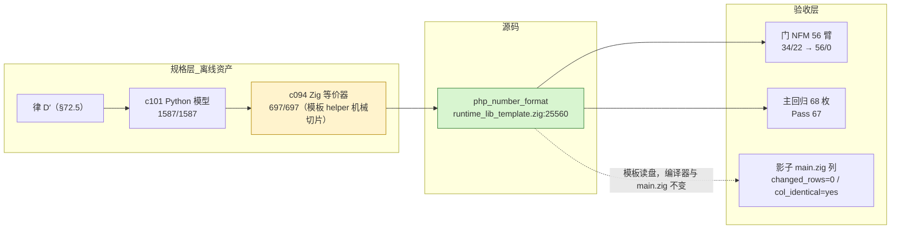
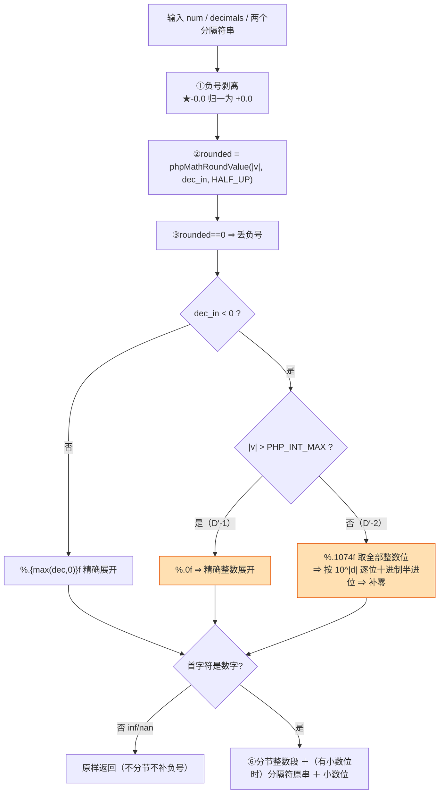
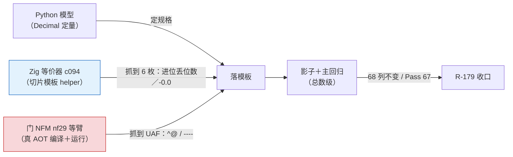
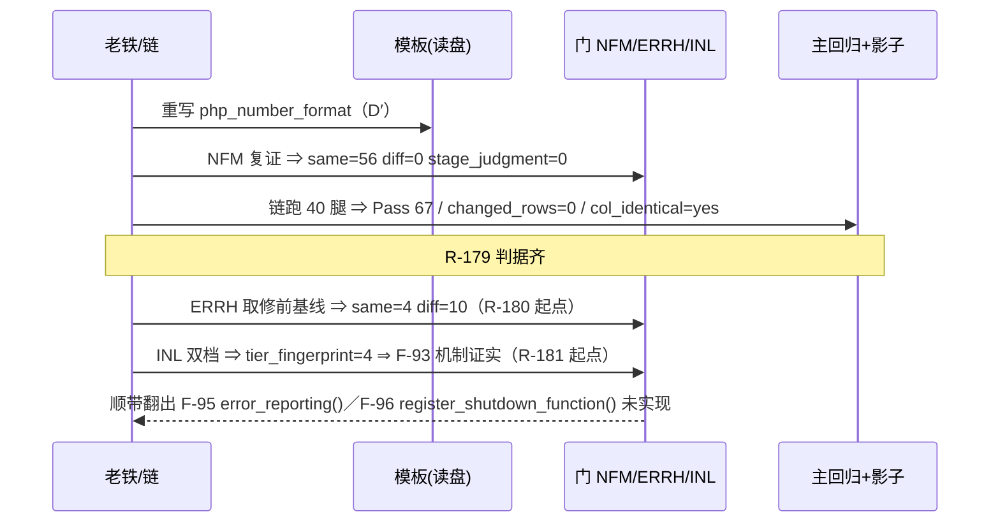

# AOT-CODEGEN-012 · 段② `number_format` 按律 D′ 重写（R-179）变更摘要

> 代次标识＝**模板 md5 前缀 `dbbe5bb3`**（本批唯一改动文件就是运行期库模板）。写作时本批**未入库**（HEAD 仍 `18a692a`），
> 故文件名里的哈希**不是 commit**，只做代次锚点。工单：`docs/known-issues/AOT-CODEGEN-012-class-name-case-insensitive-lookup.md` §72.5／§75／§76／§78。

## 1. 高层摘要（TL;DR）

`php_number_format` 此前把 `decimals` 直接 `@max(0, …)` 归零，并用 `pow10 *= 10` ＋无守卫 `@intFromFloat(num*pow10)` 的 **i64 缩放塔**做舍入 ⇒ 两件事同时成立：负精度（`number_format(995,-1)`）整族语义缺失，且 `|v|×10^dec` 越过 i64 时给出错值甚至 UB。

本批按已机器证明的**律 D′** 重写该函数：`|v| > PHP_INT_MAX` ⇒ 输出 `round` 结果的**精确整数展开**；否则 ⇒ 对 `v` 的**精确值**按 `10^|d|` 做**十进制半进位（远离零）**再补零；结果为零 ⇒ 丢负号。`dec ≥ 0` 支沿用 php-src 的 `%.*F` 精确展开＋已落地的 `phpMathRoundValue` 七步。顺带结掉 §56／F-76 的无守卫转换账，并修掉一枚未登记的旧缺陷（分隔符只取首字节、显式 `""` 被当默认值 ⇒ 新记 **F-94**）。

**本批只动 `runtime_lib_template.zig`**（AOT 编译期从磁盘读入的运行期库文本）⇒ 编译器二进制与 `main.zig` 发射文本都不变 ⇒ 影子判据取到最强形式 **`changed_rows=0` 且 `col_identical=yes`**，并与上一代列**同 md5**。门 NFM 从 `34/22`（`stage_judgment=22`）到 **`56/56 diff=0 stage_judgment=0`**，回归 `68/67/0/0/0/Skip 1`。

链闭后同批取到两条新基线（R-180/R-181 的起点）：**ERRH `same=4 diff=10`**（F-92 只差"路由"，标准打印本来就逐字对）与 **INL `tier_fingerprint=4`**（四枚臂"内联关对、内联开错"⇒ F-93 机制由门自身证实，无需插桩），并由此翻出两枚真实缺失函数 **F-95 `error_reporting()`**／**F-96 `register_shutdown_function()`**。

## 2. 影响范围

| 影响面 | 描述 | 实测规模 |
|---|---|---|
| AOT 运行期语义 | `number_format` 负精度／大数量级／负零／分隔符整串 四件事同时与 PHP 对齐 | 门 NFM `diff 22→0`，`stage_judgment 22→0`，`stage_ok 34→56` |
| 邻族（同一次改动带绿） | F2I 的 `g10`、FLT 的 `g3 g4` 三枚 `number_format` 观测面翻绿 | `45/5→46/4`、`64/4→66/2`；**无一枚新增红** |
| 生成码 | `main.zig` 一字不变（本批不碰编译器） | 影子 68 列 `changed_rows=0`、`col_identical=yes`、列 md5 与 R-178b 同为 `43add0d5…` |
| 越界精度（F-65） | 取消 u64 溢出塔，改为"输出多大就分配多大" | `dec=1e6` 两边 `len=1000002`，PHP 0.000s／AOT 0.001s；`dec=1e7` `len=10000002`，PHP 0.001s／AOT 0.006s |
| 跨模式面 | **零影响**（模板只被 AOT 发射器读取；解释器／字节码／tree 不共用它） | `parser.zig dd07fb09…`、`vm.zig` 未动 |
| 门禁资产 | 新建两扇永久门 ERRH／INL（本批只取基线，不改被测面） | `arms=15 66s`／`arms=10×2 88s`，两扇都经零编译自证 |

## 3. 核心变更

| # | 变更 | 位置 | 说明 |
|---|---|---|---|
| 1 | 按 D′ 重写函数体 | `src/aot/runtime_lib_template.zig:25560 php_number_format` | 七步 php-src 顺序照抄；`dec_in` 饱和到 i32（与 `phpMathRoundValue` 自带 clamp 同口径），`dec`＝`max(dec,0)` 只管打印与分节 |
| 2 | 精确展开走 libc | 同上（`snprintf(&fmt, "%.{d}f", …)`） | ★`formatFloatPrecision` 的"装不下就退回 6 位"分支**不采用**——数值格式化里那是假绿，宁可用导出上界（`exact_frac=1074`、`int_cap=512`，由 `2^-1074`／`DBL_MAX<10^309` 推得）并在越界时报错 |
| 3 | D′-1／D′-2 分形 | 同上（`exact_expansion = dec_in < 0 and mag <= php_int_max`） | ★判别式必须是布尔开关，**不能**写成"精度==1074"（`dec==1074` 会误触发）；`php_int_max` 用 `@floatFromInt(maxInt(i64))` 而非字面量 |
| 4 | 十进制半进位实现 | 同上（逐位与阈值 `'5'＋(bnd-1)×'0'` 比，保留段 ＋1 含溢出） | ★**绝不剥前导零**（溢出时那些 0 是有效位数）；★结果为零 ⇒ 丢负号（D′-3）；★`-0.0` 先归一（`value < 0.0` 对负零是 false） |
| 5 | 分隔符按整串 | 同上（`dp`/`ts` 取 `[]const u8`，`""` 视为"真的为空"） | 修 **F-94**：旧实现只取首字节且把 `""` 当默认值 |
| 6 | ★修自己引入的 UAF | 同上（`d2_buf: ?[]u8` 登记到函数作用域） | 块内 `defer free` ＋块外读 `digits` ＝ use-after-free（实测吐 `^@`／`----`）；由门臂 `nf29` 抓到 |
| 7 | 验收链换代次判据升级 | `fuzzy_scripts_720/tmp/c107_r179_acceptance_chain_tmp.sh` | `EXPECT_TPL` ＋ ★新增 `nlk/irg/shr` 三枚**源码 md5** 断言（`SRC_ASSERT_OK`）；`EXPECT_BIN` 保留但注明"只是同缓存态内的链接指纹" |
| 8 | 两扇新门 | `c108_errh_gate_tmp.sh`／`c109_inl_gate_tmp.sh` | ERRH＝F-92 七条契约 ×15 臂；INL＝10 臂 ×两档并自动统计 `TIER_FINGERPRINT` |

## 4. 可视化概览（Code & Logic Map）

### 4.1 分层与改动落点

### 4.2 业务流：一个数怎么变成 PHP 那串字符

### 4.3 本轮的"三层闸"怎么配合（谁抓到了什么）

### 4.4 上层→底层时序（含 F-92/F-93 两条新基线的取数位置）

## 5. 详细变更分析

| 层 | 文件 | 变更点 |
|---|---|---|
| 运行期库（AOT 唯一产物源） | `src/aot/runtime_lib_template.zig` | `php_number_format` 全函数重写（D′ 三支＋整串分隔符＋缓冲按导出上界分配＋结果缓冲登记到函数作用域）；`phpMathRoundValue`／`ROUND_MODE_HALF_UP` **复用未改** |
| 编译器 | 未动 | `native_linker 95e42e62…`、`ir_generator ca180028…`、共享层 `parser.zig dd07fb09…` |
| 验收链 | `c107_r179_acceptance_chain_tmp.sh` | 由 `c104` 派生；代次断言三层化（`EXPECT_BIN`＋`EXPECT_TPL`＋三枚源码 md5）；影子 BASE＝`c010_shadow_newside_r178b_tmp.txt`、`GEN=r179` |
| 门（新建） | `c108_errh_gate_tmp.sh`、`c109_inl_gate_tmp.sh` | 见 §3 表第 8 行；两者都经"`AOT_BIN=/bin/false`（活臂）＋`/usr/bin/true`（肉眼核真值）"两次零编译自证 |
| 等价器与真值资产 | `c094`／`c095`／`c075`／`c099`／`c101` | `c095` 生成器补 D′-1 分界支、kind=D 行自带分隔符对、kind=N 单形跳过；`c094` 现 697 例全绿 |
| 文档 | 工单 §72.5／§75／§76／§77（含 77.5）／§78，CODEGEN-007 末尾交叉引用 | 编号说明：§73 被 R-179 备料占用、R-178 落地改登 §74、R-179 落地登 §78 |

## 6. 影响与风险评估

| 维度 | 结论 |
|---|---|
| 是否破坏式变更 | 对 AOT 输出是"由错变对"。邻族 3 枚翻绿、0 枚新红；回归与影子双证不变 ⇒ 非破坏式 |
| 影响范围 | 只有调用 `number_format` 的路径；`dec≥0` 支在 c075 的 1335 项上逐字节保持既有正确性 |
| 需要注意 | ①**结果缓冲生命周期**：任何"算完还要被下游读"的缓冲必须函数作用域释放（本批踩过）；②新增 Zig 字面量发射点必须走 `writeZigStringLiteral`（R-178b 的账，与本函数共用发射链）；③`%.{dec}f` 的缓冲区由导出上界决定，改上界要同时改 `exact_frac/int_cap`；④`error_reporting()`/`register_shutdown_function()` 在 AOT 未实现 ⇒ 任何门/探针臂头都不许写它们（F-95/F-96） |
| 变更文档级复测 | ①门 NFM（56 臂）；②`c108` ERRH 认 `same=4 diff=10`；③`c109` INL 认 `tier_fingerprint=4`；④全链 `timeout 14400`，只认 `R179_CHAIN_DONE`＋`SRC_ASSERT_OK`＋Build Summary |

## 7. 遗留／潜在问题

1. **F-92**（R-180）：`emitWarning`/`emitDeprecated`/`php_trigger_error` 三处共用"诊断分发"helper（处理器→掩码→返回值→标准两行→`error_get_last`）；标准两行本来就对 ⇒ 改动面比预想小；`h9`（arity＝COMPILE_FAIL）须先从判据里排除；`l1/l2`（`error_get_last` 轴）待 F-96 之后再做。
2. **F-93＝CODEGEN-007**（R-181）：`tier_fingerprint=4` 已证机制；修形＝种子键换 `.param` 结果寄存器号＋对 `.param` 不克隆＋"形参数≠实参数不内联"；★判据须先跑「被内联文件集」census 才能定影子漂移集。新发现：by-ref 形参（`i5`）在开内联时**编译失败**＝同一肇因的第二种表现。
3. **F-95／F-96**：两枚标准函数未实现（`error_reporting`、`register_shutdown_function`），语料未覆盖 ⇒ 回归不红；★`ini_set` 一类"引擎开关"是否同样缺失，尚未验。
4. **F-94**：本批已随重写修掉，但未单独建门臂；FLT 守卫面的 `G4` 是目前唯一常驻覆盖。
5. **F-65 残余**：`decimals` 越界现在的行为是"按输出规模分配"，`dec` 接近 i32 上界时会 OOM（PHP 亦然）⇒ 是否要加显式上限，待与 F-65 一并裁决。
6. **运维**（任务 #112）：`.zig-cache` 无界增长（本轮实测 76 GB、盘满）；Zig 0.16 无 `cache gc`；链头 `avail_gib` 其实取的是**磁盘**列。
7. **未提交**：R-177／R-178／R-178b／R-179 全部代码与文档仍在工作区（HEAD `18a692a`）。

## 8. 后续开发建议（优先级／影响面／落地成本）

| 优先级 | 事项 | 影响面 | 落地成本 |
|---|---|---|---|
| P0 | R-180 落 F-92（诊断分发 helper；基线已就绪） | 全部引擎告警的输出路径＋用户处理器契约 | 中：模板一处 helper＋3 处接线 |
| P0 | R-181 前先跑「被内联文件集」census，再修 F-93 | 改优化器 ⇒ 生成码必变 ⇒ 决定影子判据形状 | 中：普查脚本＋一轮链 |
| P1 | F-73 全局常量子支（PD2 `17→19`、`silent_null 2→0`；复用 `.global_get`） | 属性默认值/类常量里的全局常量 | 中：6 块 `switch (dv.op)` 加臂 |
| P1 | F-91 两半（19 枚 PCRE 常量入表＋preg 错误码 threadlocal；PERR `2/19` 起） | preg 族＋两枚新函数 | 中：调用点已随 F-79d 收口 |
| P2 | F-95/F-96（两枚缺失函数）＋给 l1/l2 补臂 | 让 ERRH 能覆盖 C3/C4 的后半轴 | 低-中 |
| P2 | 运维 #112：缓存治理＋链头把 `df` 余量做硬前置 | 防止整链因 ENOSPC 作废 | 低 |
