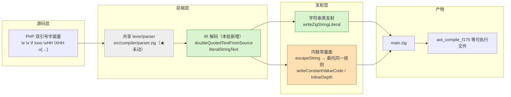
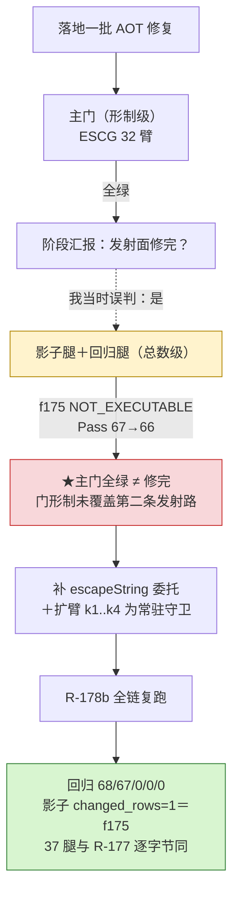
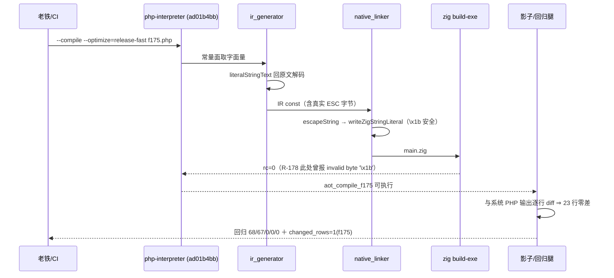

# AOT-CODEGEN-012 · F-89 双引号转义解码（R-178 ＋ R-178b）变更摘要

> 代次标识＝**二进制 md5 前缀 `ad01b4bb`**（R-178b）。本文档写作时本批**尚未入库**，仓库 HEAD 仍为 `18a692a`，
> 故文件名里的哈希**不是 commit**，只做代次锚点。工单：`docs/known-issues/AOT-CODEGEN-012-class-name-case-insensitive-lookup.md` §74。

## 1. 高层摘要（TL;DR）

PHP 双引号串的转义集（`\e \v \f`、八进制 `\ooo`、十六进制 `\xHH`/`\XHH`、`\u{…}`）此前只在**共享 lexer** 里解到一半，
AOT 侧把 `\x41`、`\101`、`\u{4e2d}`、`\e` 原样当成两个字符的文本发出去。本批按老铁裁定「**只修 AOT 侧**」，
在 IR 层新增"回原文重解"的解码器（不在 parser 已产出的值上二次解码），并把**发射面**的 Zig 字面量转义收敛到单点 helper。

R-178 链暴露出我自己的半修：解码后的控制字节会以 raw 字节落进生成的 `main.zig`，而折叠值其实有**第二条发射路**
（内联常量面走 `escapeString`），导致语料 f175 整文件编译失败、回归从 `Pass 67` 掉到 `Pass 66`。
R-178b 把 `escapeString` 也改为委托同一份规则，回归恢复 `68/67/0/0/0/Skip 1`，f175 输出与 PHP **23 行逐字节相同**。

两条验收链：R-178 `c098`（`8506s`）、R-178b `c104`（`8608s`），各 40 腿全 `rc=0`，九条预注册判据逐枚达成。

## 2. 影响范围

| 影响面 | 描述 | 实测规模 |
|---|---|---|
| AOT 编译期 | 双引号字面量在 IR 层解码为真实字节串，再按 Zig 字面量规则安全发射 | 解码规则 1 份（`literalStringText` 系），接入 5 处常量 intake ＋ 折叠 concat 快路 |
| AOT 发射期 | 字符串表 ＋ 内联常量面（属性默认值／类常量／数组字面量）的 Zig 字面量转义统一 | 收敛到 `writeZigStringLiteral`，经 `escapeString` 一次覆盖 40＋ 调用点 |
| 运行期语义 | `"\e"` 等从"两字符文本"变为"一个 ESC 字节"，与 PHP 对齐 | 主门 ESCG `same 10→32`（新增 4 枚常驻守卫臂） |
| 语料回归 | 仅 f175 的 `main.zig` 内容变化，其余 67 枚逐字节不漂 | 影子双抽取各 `changed_rows=1`＝f175；`col_md5` r177 `4d1a92cf…`→r178b `43add0d5…` |
| 跨模式面 | **零影响**（未动共享 lexer／解释器／字节码／tree） | `parser.zig` md5 `dd07fb09…` 未变；模板 md5 `f5665ecb…` 全程未变 |
| 性能 | 解码发生在编译期常量面，运行期发射文本不变 ⇒ 无热路径改动 | 本批未引入运行期分支；未做基准＝因不存在运行期变更（禁报估算值） |

## 3. 核心变更

| # | 变更 | 位置 | 说明 |
|---|---|---|---|
| 1 | 回原文重解（非二次解码） | `src/aot/ir_generator.zig:5737` `doubleQuotedTextFromSource` | 从节点 span 取**源码原文**再解；`"\\x41"` 与 `"\\\\\\x41"` 经 parser 后逐字相同，只有原文能区分（探针实测两边同为 `5C41`） |
| 2 | 解码器本体 | `:5862` `literalStringText`／`:5870` `literalStringTextOrParser` | `n r t v f e \ $ "`＋八进制 1~3 位（`@truncate`）＋`\xHH`/`\XHH`（无有效十六进制位⇒原样）＋`\u{…}`（`std.unicode.utf8Encode`，越界/代理⇒原样）；仅在 `"…"` 包裹或 `.t_encapsed_and_whitespace ∧ quote_type==.double` 时启用 |
| 3 | 五处 intake 接线 | `generateLiteralString`／`tryMakeConstInstruction`／`tryMakeConstValue`／`getConstantValue`（含 `:9786/:9837`）／`evalConstantExprToTypeDef`＋`generateBinaryExpr` 字面量拼接 | 常量串、属性默认值、枚举 case 值、折叠拼接全覆盖 |
| 4 | Zig 字面量安全发射 | `src/aot/native_linker.zig:1411` `writeZigStringLiteral` | 控制字节/DEL⇒`\xNN`；高位字节**仅当整串非合法 UTF-8** 才转义 ⇒ 中文等既有字面量文本逐字节不变（影子不漂的直接原因） |
| 5 | 字符串表收敛 | 表发射循环＋`writeEscapedZigString` 委托 | 转义规则只留一份（DRY） |
| 6 | ★第二条发射路补全 | `:32804` `escapeString` 改为委托 `writeZigStringLiteral` | 覆盖 `writeConstantValueCode:32648`／`writeConstantValueInlineDepth:32692`（属性默认值、类常量、内联常量数组 `arr_0.setByValue(...)`）；`var writer`→`const writer`（`ListWriter` 为 by-value receiver） |
| 7 | 门扩臂 | `fuzzy_scripts_720/tmp/c092_string_escape_gate_tmp.sh` | 新增 `k1 k2 k3 k4`＝字面量数组取下标／类常量数组／属性默认数组，**常驻守卫**，分母 28→32 已写进门头与链头 |
| 8 | 链与台账 | `c104_r178b_acceptance_chain_tmp.sh`、工单 §73/§74 | EXPECT_BIN 换代、判据①⑥⑦就地更正、影子 BASE 与双抽取口径预注册 |

## 4. 可视化概览（Code & Logic Map）

### 4.1 分层架构：一条字符串常量从源码到二进制



绿色＝本批新增/收敛，橙色＝R-178 漏掉、R-178b 补上的第二条发射路，灰色＝跨模式共享层（裁定禁碰）。

### 4.2 业务流程：判据是怎么被"门—回归—影子"三层兜住的



### 4.3 执行流程：解码与发射的决策顺序

```mermaid
flowchart LR
    A["节点 .literal_string"] --> B{"span 是 \"…\" 包裹<br/>或 encapsed∧double?"}
    B -->|否| C["原样取 parser 值"]
    B -->|是| D["读原文并逐字符解<br/>n r t v f e \\ $ \""]
    D --> E{"\\ooo 八进制?"}
    E -->|是| F["1~3 位 @truncate"]
    E -->|否| G{"\\x / \\X + 十六进制位?"}
    G -->|有| H["解成字节"]
    G -->|无| I["原样保留"]
    H --> J["\\u{…} ⇒ utf8Encode<br/>越界/代理⇒原样"]
    I --> J
    F --> J
    J --> K["得真实字节串"]
    C --> L["发射：writeZigStringLiteral"]
    K --> L
    L --> M{"含控制字节/DEL<br/>或整串非法 UTF-8?"}
    M -->|是| N["转 \\xNN"]
    M -->|否| O["原字节写出<br/>（中文不变 ⇒ 影子不漂）"]
```

### 4.4 上层→底层时序（R-178b 复测路径）



## 5. 详细变更分析

### 5.1 涉及文件清单

| 文件 | 类型 | md5（R-178b 后） |
|---|---|---|
| `src/aot/ir_generator.zig` | 编译器（AOT 前端） | `ca1800285c4ce8d39fac9886aadf0a6a` |
| `src/aot/native_linker.zig` | 编译器（AOT 发射） | `95e42e625a8bb0db7b3247b845bc2503` |
| `fuzzy_scripts_720/tmp/c092_string_escape_gate_tmp.sh` | 永久侧门 ESCG（32 臂） | 见文件 |
| `fuzzy_scripts_720/tmp/c104_r178b_acceptance_chain_tmp.sh` | 验收链（40 腿） | 见文件 |
| `fuzzy_scripts_720/tmp/c096_f89_postfix_probe_tmp.php` | 一次性补充探针（10 形） | 见文件 |
| `docs/known-issues/AOT-CODEGEN-012-…md` | 工单 §73/§74 | — |
| **未改**：`src/aot/runtime_lib_template.zig` `f5665ecb…`｜`src/compiler/parser.zig` `dd07fb09…`｜`src/runtime/vm.zig` | 运行期模板／共享前端／解释器 | 跨模式面禁碰（已裁） |

### 5.2 变更点逐条描述

- **前端（模块层）**：新增三个函数构成"回原文重解"链；`literalStringTextOrParser` 用于 `getConstantValue` 一类**不能抛错**的取值口（失败即退回 parser 值，保证不改变无转义串的行为）。
- **发射（数据层）**：`writeZigStringLiteral` 的"高位字节只在整串非法 UTF-8 时才转义"是**刻意的**——它保证合法中文串在 `main.zig` 里仍是原字符，于是 68 枚语料只有含转义的 f175 一列漂移，可被影子门逐字节判定。
- **门（验收层）**：ESCG 的观测一律**内联展开**（`echo "#L#", strlen($s), "#H#", strtoupper(bin2hex($s))`），因为经用户函数观测会撞上 F-93 而使整门假红；`/bin/false` 存活预检 32/32 命中＝无死臂。
- **链（编排层）**：EXPECT_BIN 代次断言在链头即校验，防止"改了源码却拿旧二进制跑验收"。

## 6. 影响与风险评估

| 维度 | 结论 |
|---|---|
| 是否破坏式变更 | 对 **AOT 运行结果**是"由错变对"（`\e` 等此前发成两字符文本）；对既有正确语料无影响——37 枚可比腿与 R-177 逐字节同、67/68 发射文本不变、回归 `Pass 67` 不变 |
| 影响范围 | 双引号字面量／属性默认值／类常量／枚举 case／折叠拼接；单引号与 nowdoc **未动**（守卫 `g3 g4` 证明未过解） |
| 需特别注意 | ①任何**新增 Zig 字面量发射点**必须走 `writeZigStringLiteral`，否则本批的编译回归会重演；②`escapeString` 有 40＋ 调用点，改它＝改全局，复测必带回归腿＋影子腿；③门臂分母变了（28→32），跨代比较须以 DONE 行为准，别拿旧快照比总数 |
| 已知未收口 | `"\u{110000}"`＝PHP 侧 **Parse error**，属编译期面，门里还没有"期望编译失败"的臂类；heredoc/nowdoc/折叠 concat/标量属性默认值四类仅由一次性探针证过，待并为常驻臂 |
| 复测路径 | 见 §74.5：ESCG 单门 185s／f175 单文件编译＋逐行 diff／全链 `timeout 14400`／影子双抽取 |

## 7. 遗留问题／潜在问题

1. **F-93（P0 归因）**：单形参用户函数在特定文件形制下实参丢失，是 ESCG/PERR 两门"观测必须内联"的直接原因；嫌疑＝`static_string_pool` 键生命周期或共享 `inline_buf`，需 Debug＋`AOT_KEEP_TEMP`（`native_linker:1549`）插桩。
2. **F-90 口径已收窄**（工单 §73.2 更正）：主题坏 UTF-8＝`false`＋`preg_last_error()==4`＋零诊断；模式坏 UTF-8 属**编译失败族**（ple=1＋告警），已归 F-79d。
3. **F-91**：PREG_* 共 19 枚常量、`preg_last_error_msg` 五串文本已取齐；`PREG_BAD_PATTERN_ERROR` 在 PHP 8.5 **不存在**，禁发明。
4. **F-92**：`emitWarning` 从不查 `global_error_handler`；`php_trigger_error` 另有四处偏差（实参序／掩码不匹配仍照打／丢返回值／缺 `PHP Warning:` 首行与 stdout 第二行）。落地前须先建门 ERRH。
5. **跨模式面（F-89b）**：`parser.zig:134` 与 `vm.zig:7066` 的解码缺口与 `"\\\\"` 双解码仍在——未经明确同意不动。
6. 本批**未提交**（HEAD `18a692a`），R-177/R-178/R-178b 代码与文档均在工作区。

## 8. 后续开发建议（优先级／影响面／落地成本）

| 优先级 | 事项 | 影响面 | 落地成本 |
|---|---|---|---|
| P0 | R-179 落 `php_number_format`（D′ 三段律，工单 §72.5/§72.6，Python 侧 `1587/1587` 零失配） | 门 NFM `diff 22→0`，顺带结 §56 无守卫 `@intFromFloat` | 中：模板一处重写＋离线 c094 先证 |
| P0 | F-93 Debug 插桩归因 | 两门观测面＋语料里所有单形参用户函数 | 中：需独占二进制（链闭后做） |
| P1 | F-73 全局常量子支：属性默认值发 `getGlobalVarNoWarn` | 门 PD2 `17→19`、`silent_null 2→0` | 中：6 块 `switch (dv.op)`＋`writeConstantValueInline` 加臂 |
| P1 | F-91 甲＋乙（19 枚常量入表＋preg 错误码 threadlocal） | 门 PERR `2/19` 起 | 中：11 个调用点已随 F-79d 收口 |
| P1 | 建门 ERRH 后落 F-92（诊断分发 helper） | **所有**告警文本产出路径 ⇒ 判据含"无处理器时输出逐字节不变" | 中高 |
| P2 | 把 heredoc/nowdoc/折叠 concat/标量属性默认值四类并进 ESCG；新增"期望编译失败"臂类收 `"\u{110000}"` | 只影响门 | 低 |
