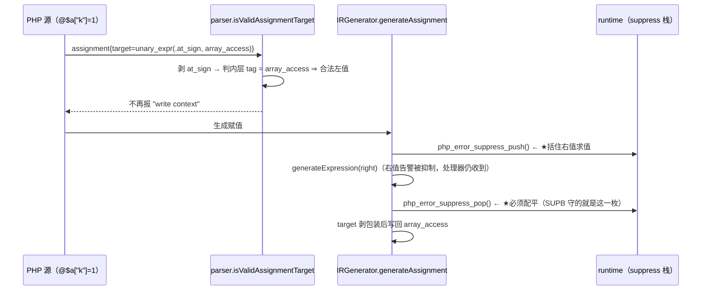

# AOT-CODEGEN-012 ／ F-107（`@` 包住赋值左值）跨模式落地 — R-181f107 变更摘要

- 轮次：**R-181f107**（承 R-180＝F-92 用户错误处理器路由）
- 基线 commit：**`ca99151`** → ★**本批已被老铁提交为 `a5f0de5`（"错误抑制"，2026-10-19 17:27）**，
  该提交含 `src/compiler/parser.zig`、`src/aot/ir_generator.zig`、R-180 变更文档与工单；
  ★**提交发生在验收链跑动中途**，但两枚源文件 md5 与链头登记值逐字相同（`70e80f18…`／`1de4fbdb…`）
  ⇒ **提交不改变内容 ⇒ 本链测的仍是同一代次**，归因不受影响（已用 `git status`＋`md5 -q` 双证）。
- 日期：2026-10-19
- 工单：[docs/known-issues/AOT-CODEGEN-012-class-name-case-insensitive-lookup.md](file:///Users/wangjianjun/products/parser/docs/known-issues/AOT-CODEGEN-012-class-name-case-insensitive-lookup.md) §79.4（注册与归因）／**§83**（本轮落地记录）
- ★**本档状态（19:28 定档为"未闭环"）**：判据 **①–⑦ 全部达成**（②主回归 `rc=0 / 68-67-1 / 零 Fail 行`、③影子 `changed_rows=0 ∧ col_identical=yes`＝列 md5 `43add0d5…` 逐字等、
  ④代次锚 `SRC_ASSERT_OK`、⑤邻门 `c084 same=27`、⑥`LIT parse_fail=3 ∧ parse_rc_nonzero=3`、⑦ERRH 集合恒等式），
  链 32/42 被 `timeout 7200` 截断的 10 腿全是数值/闭包族**复证腿**（`T P M N O D8 Q R U B`，非本批主判据）。
  ★**唯一未过项＝判据⑧（本批风险自查）**：门 SUPB 计数修正后仍报 **`leak_suspect=1`**＝`L1`（`@$a["k"] = boom();`）**pop 被异常路由跳过**
  ⇒ 抑制位残留会**静默吞掉之后本该打印的诊断**。按事前注册的红线，这属**本批必修、禁转遗留** ⇒ **本批暂不能算完成**，
  处置待老铁裁：**甲**＝异常入口补发 pop（需读发射器 `exception_handler` 路由，成本高）；
  **乙**＝撤掉本批 push/pop、只保留 unwrap（赋值生效；代价＝`L5` 由 SAME 变 DIFF 这种**可见**差异），抑制范围另立 **F-114**。
  ★我的建议＝**乙**（不可见的静默吞诊断比可见的多打一条更坏），但这收缩了"批准跨模式修"里的语义承诺，**故不擅动**。
  全部读数与逐臂证据：工单 §83.5／§84.15／§84.16／§84.17。

---

## 1. 高层摘要（TL;DR）

PHP 的 `@$x = 1;`／`@$a["k"] = 1;`／`@$o->p = 1;`／`@C121::$$n = 7;`／`@$$v = 2;` 这类**把 `@` 直接写在赋值左值上**的合法语法，
在 AOT 下**整脚本编译失败**（`rc=1`，`Parse error: Can't use function return value in write context`）。
根因**不在 AOT**：共享解析器 `src/compiler/parser.zig` 的"可写左值"谓词不认识 `@` 产生的包装节点，**在解析期**就拒绝，
连 IR 层都进不到（我第一版误把站点记在 `ir_generator.zig`，落了 37 行补丁后门仍 `compile_fail=8` ⇒ 被门读数证伪）。

本轮按老铁裁决「**批准跨模式修**」同时改两处：解析器谓词**剥 `at_sign` 包装后递归判**，AOT 的 IR 生成侧同样剥包装，
并把**右值求值整体**夹进 `php_error_suppress_push/pop`——因为系统 PHP 8.5.8 实测：`@` 包住赋值时抑制范围＝**整条赋值表达式**
（带 `@` 右值告警一条不打、去掉就打），而 `set_error_handler` **仍被调用**；只让语法过关不等于语义正确。

主门 SUPA（13 臂两桶）：修前 `compile_fail=8` ⇒ 修后 `compile_fail=0`，残留 1 枚 DIFF 已证明与 `@` 无关（另立 F-110）。

## 2. 影响范围

| 维度 | 内容 | 状态 |
|---|---|---|
| 语义面 | `@`-左值赋值：从"编译失败"变为"可编译＋右值告警按 PHP 抑制" | 已实测（门 SUPA） |
| 共享层 | `parser.zig` 谓词 ⇒ 解释／字节码／JIT／AOT **四模式同源** | 本批获裁跨模式；AOT 之外的模式**未修**＝**F-111** |
| 发射面 | **零**：未改 `native_linker.zig`、未改模板、未改优化器 | 三枚"必须不变"锚已核（见 §4） |
| 影子列 | 判据＝硬中性 `changed_rows=0 ∧ col_identical=yes`（列 md5 `43add0d5…`） | `待填（链闭）` |
| 主回归 | 判据 `Total 68 / Pass 67 / Skip 1 / Fail_* 0` | `待填（链闭）` |
| 邻门 | 判据＝逐臂同值；**唯一许可变化**＝ERRH `compile_fail=2→1`（`h14` 释放，落 DIFF 归 F-100） | `待填（链闭）` |
| 已链内复证 | `SUPA compile_fail=0 same=9 diff=1`、`F2I 46/4＋cf=1`、`NFM 56/56` | 与预注册档**逐字同** |

★**表格补注（17:56，链 24/42 时刻）**：上表"待填"仅指**主回归与影子**两条；
**邻门一条已提前机械收口**＝`c084` 对 R-180 合并档给出 `same=17 diff=2 no_counterpart=2`，
两枚 DIFF 分别是判据⑦ 的**许可变化**（`ERRH 12/4/2 → 12/5/1`）与 `PERR` 的**扩臂假阳性**（21→32 臂；拿 v3 的 32 臂修前快照比是逐字同），
⇒ **无邻门劣化**（逐腿读数见工单 §84.13／§84.14）。余腿与 ②③④尾⑥尾⑧ 待链闭后由 `c125` 一次取齐。

## 3. 核心变更

```zig
// src/compiler/parser.zig:2030  isValidAssignmentTarget（节选）
var idx = node_idx;
while (true) {
    const node = self.context.nodes.items[idx];
    switch (node.tag) {
        .variable, .variable_variable, .array_access, .property_access,
        .variable_property_access, .static_property_access => return true,
        .function_call => return true,           // 原样保留（引用返回的函数调用）
        .unary_expr => {
            const unary_data = node.data.unary_expr;
            if (unary_data.op != .at_sign) return false;   // 只剥 `@`，`- ! ~ &` 仍拒
            idx = unary_data.expr;                          // 含 @@$x 多层
        },
        else => return false,
    }
}
```

| # | 文件 | 站点 | 变更 | 备注 |
|---|---|---|---|---|
| 1 | [src/compiler/parser.zig](file:///Users/wangjianjun/products/parser/src/compiler/parser.zig#L2030) | `isValidAssignmentTarget`（**:2030**） | 单次 tag `switch` ⇒ **剥 `at_sign` 包装后递归判** | ★落地后行号已换代（本文件净＋20 行）：调用点 **`:2062`**／**`:2760`**（原 `:2049`／`:2748`），报错文案 **`:2066`**（含"function must be declared as returning reference"）与 **`:2068`**（另 `:2761` 一处），文案与 `else` 支**一字未动**（放宽它＝过接受） |
| 2 | [src/aot/ir_generator.zig](file:///Users/wangjianjun/products/parser/src/aot/ir_generator.zig#L4265) | `generateAssignment`（定义 **`:4265`**，新增代码自 **`:4278`** 起；其内 "write context" 文案已由 `:4283` 漂到 **`:4318`**） | ①探出 `@` 包装 ⇒ 把**右值求值**夹进 `php_error_suppress_push/pop`；②写回目标剥包装后再进原 `switch` | 常量 `target_node` ⇒ `var`；新增两枚 call 只在被抑制形上发射 |
| 3 | 探针（已 revert） | `src/runtime/vm.zig:7170` | 在唯一 `.assignment` 执行器加 unwrap ⇒ 重建后**行为不变**，`git restore` | 那两模式根本没有 `@` 语义（`grep at_sign`＝0）＝**F-111** |

## 4. 可视化概览（Code & Logic Map）

```mermaid
flowchart LR
  subgraph L1[共享前端（四模式同源）]
    P["parser.zig:2030<br/>isValidAssignmentTarget<br/>★剥 at_sign 递归判"]
  end
  subgraph L2[AOT 后端]
    IR["ir_generator.zig:4265<br/>generateAssignment<br/>★push/pop 括右值 + 剥包装"]
    NL["native_linker.zig<br/>（本批未动）"]
    TPL["runtime_lib_template.zig<br/>（本批未动）"]
  end
  SRC["@\$a[\"k\"] = 1;"] --> P
  P -->|AST assignment| IR
  IR --> NL --> MAIN["main.zig（发射中性）"]
  TPL --> RUN["runtime_lib.zig"]
  MAIN --> EXE["aot_compile_* 可执行体"]
  RUN --> EXE
  style P fill:#ffe6cc
  style IR fill:#ffe6cc
  style NL fill:#e8e8e8
  style TPL fill:#e8e8e8
```



## 5. 详细变更分析

**端／层**：编译器前端（共享）＋ AOT IR 生成层；**数据层无变化**（不动名字表 ⇒ `aot_registered_functions` 名单文本不变）。

### 涉及文件清单
- 改：`src/compiler/parser.zig`（+20/-8）、`src/aot/ir_generator.zig`（+36/-1）
- 新增永久资产：`fuzzy_scripts_720/tmp/c121_supa_gate_tmp.sh`（门 **SUPA**，两桶 10/3）、
  `c123_supb_leak_gate_tmp.sh`＋`c123_supa_leak_shape_tmp.php`（门 **SUPB**，7 臂）、
  `c125_postchain_r181f107_tmp.sh`（链后一次性收口跑）、`c125_f104_dynface_probe_tmp.php`（F-104 探针）、
  `c126_f102_dupkey_discriminator_tmp.php`（F-102 判别器）、`c122_r181f107_acceptance_chain_tmp.sh`（42 腿链）
- 换代（不新增面）：`c070`（母版腿集合加 SUPA）、`c116`（R-182 的锚点/基线列/ERRH 档更正）
- 文档：工单 §83／§83.7b

### 变更点 ↔ 业务代码映射（全为实测，禁推测）
| 变更点 | 证据 |
|---|---|
| `@` 的树形是 `assignment{target: unary_expr(.at_sign, 真左值)}` | `@` 的操作数用 `parseExpression(69)` 解析、不吃优先级更低的 `=`（★落地后实测行号＝**`:2840-2845`**，原记 `:2829-2834` 已因本文件＋20 行而漂移） |
| 抑制范围＝整条赋值表达式 | PHP `@$b["k"] = rhs_warn();` ⇒ **INSIDE 不打**；去掉 `@` ⇒ 打（SUPB 的 L5/L6 真值） |
| 处理器仍被调用 | 门 ERRH `h14` 的 want＝`[CB]no=2|Undefined array key` |
| 站点在解析期 | 只改 IR 后门仍 `compile_fail=8`；编译日志直出 `Parse error … on line 2` |
| 发射中性 | `nlk 95e42e62…`／`opt 36f354f4…`／`tpl 4160f577…` 三锚与链头登记一致（`SRC_ASSERT_OK`） |

## 6. 风险评估

- **是否破坏式**：否（放宽的是"PHP 本来就合法"的形）；BAD 桶三枚 PHP 自拒形**保持原状**（`bad_overaccept=3` 逐字不变）＝**没有**顺手放宽 `else` 支。
- **本批自身引入的新风险（这是我加的 push/pop 自带的，不是既有的）**：**抑制栈不配平** ⇒ 后续本该打印的诊断被静默吞掉（比原缺陷更坏）。
  因此建了门 SUPB（L1 右值抛异常／L2 循环重入／L4 嵌套抑制／L5 范围／L6 反向守卫），**AOT 侧读数待链后**。
  ★若 SUPB 出现 `AFTER` 缺席 ⇒ **本批必修**（修法先看发射器 `exception_handler` 路由，禁凭推测写），不允许当遗留问题入账。
- **跨模式风险**：解析器放行后，tree/bytecode/fast 从"解析失败丢整条赋值"变成"继续执行但忽略 `@`／左值仍是包装节点 ⇒ **静默错值**"（**F-111**，待裁）。
  本批对那三模式**只测不改**，`vm.zig` 探针已 revert，未留半个修复。
- **需要注意的点**：① 邻门 ERRH 的 `h14` 会从 COMPILE_FAIL 变 DIFF，**归 F-100** 不归 F-107；② SUPA 门头原写"期望 `compile_fail=10`"已被证伪，
  判据只认实测分母（修前 8／修后 0）；③ 影子判据是"硬中性"，与 §82 的 R-181"必漂移"不同档，**禁互相套用**。
- **复测路径（体验流程）**：
  ```bash
  # 单门（链/其他 AOT 任务跑动期间禁）
  timeout 900 bash fuzzy_scripts_720/tmp/c121_supa_gate_tmp.sh     # 期望 compile_fail=0 same=9 diff=1
  timeout 900 bash fuzzy_scripts_720/tmp/c123_supb_leak_gate_tmp.sh # 期望 arms=7 same=7 leak_suspect=0 scope_fail=0
  # 全链验收
  timeout 7200 bash fuzzy_scripts_720/tmp/c122_r181f107_acceptance_chain_tmp.sh
  # 链后一次性收口（逐腿抽取＋SUPB＋F-104＋F-102＋跨代对账）
  timeout 1800 bash fuzzy_scripts_720/tmp/c125_postchain_r181f107_tmp.sh
  ```

## 7. 遗留／潜在问题（本轮新立，均**未**记在 F-107 账上）

| 编号 | 内容 | 证据 | 优先级／影响面／落地成本 |
|---|---|---|---|
| **F-109** | 解析器过接受 PHP 自拒的赋值形（3 枚常驻守卫） | 站点两处：`parser.zig:2042`（`.function_call => true`，且 `empty` 无语言构造处理）；`parser.zig:2271-2273`（非法 list 目标静默换 `.list_empty` 占位） | P1／赋值语义不可信／中（①需符号信息，②改兜底支为报错） |
| **F-110** | `Class::$$n = v` 静态属性吃可变变量名读写不等 | 去 `@` 复测仍红 ⇒ 与抑制无关；语料普查 `Class::$$` **0 枚**、`Class::$prop` 20 次、字面 `$$` 1 枚 2 次且该枚是 Pass | P2／写出即静默丢值／**成本未知**（站点未定位） |
| **F-111** | tree/bytecode/fast **完全没有** `@` 语义 | `grep at_sign src/runtime/vm.zig src/runtime/fast_compiler.zig`＝**0**；`vm.zig:7170` unwrap 探针落地后行为不变⇒已 revert | 待裁／静默错值（比报错更坏）／待定价（若无抑制栈设施则成本升） |
| 链自身缺陷（非产品） | 派生链 token 改名只改了 1/7 处 ⇒ 逐腿 DONE 台账全盲 | `sed g` 后旧 token 计数＝0，重开链 | 已闭环，教训入记忆第 55 条 |

## 8. 后续开发／优化建议

1. **R-182（＝§80/§82 的 F-91＋F-90）已解除阻塞**：`c116` 的锚点已换代（`irg 1de4fbdb…`／`shr 70e80f18…` 转"必须不变"）、
   影子基线列改指 `…_r181f107_tmp.txt`、腿集合补 SUPA；§83.7b 的重审结论＝**阶段①清单可直接照写**（仅两处错锚已更正：
   `compileRegexOrWarn` 失败返回真值＝`:11261`/`:11265`，名单内嵌＝`:1825`/`:1829`）。
2. 把 **SUPB 入母版** `c070`（与 SUPA 同族）；此后任何发射 push/pop 的批次都必须复证它，而不是只看"能编译"。
3. 用 `ZIGPHP_AOT_KEEP_TEMP` 读 `s4` 的生成码给 **F-110** 定站点，再定价（禁在未定位前写"低成本"）。
4. **F-109②** 的兜底占位（`.list_empty`）属宪法 §四-2 禁的占位实现，建议与 F-72 的"解析失败改报编译错"合并收口，避免两套 rc 口径。
5. **F-111** 建议单列一轮跨模式批（先测 tree 模式有没有抑制设施，再决定是"补语义"还是"明确拒编"），并在裁决前保持"只测不改"。
