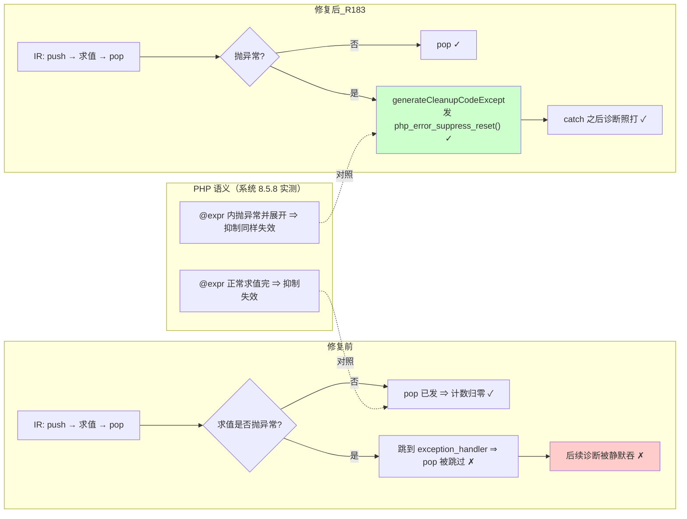

# AOT-CODEGEN-012 ／ F-115（`@` 抑制计数在异常展开路径不弹回）修复 — R-183 变更摘要

- 轮次：**R-183**（承 R-181f107＝F-107 跨模式修）
- 基线 commit：**`a5f0de5`**（R-181f107 已入库的那一枚）；本批改动**尚未提交**：`M src/aot/native_linker.zig`、`M src/aot/runtime_lib_template.zig`
- 日期：2026-10-19
- 工单：[docs/known-issues/AOT-CODEGEN-012-class-name-case-insensitive-lookup.md](file:///Users/wangjianjun/products/parser/docs/known-issues/AOT-CODEGEN-012-class-name-case-insensitive-lookup.md) **§85**（含 §85.1 归因更正、§85.5 终局判定表）
- 状态：**三条硬判据全绿**（② 主回归、③ 影子、⑧ 本批主门 SUPB），可定档。

---

## 1. 高层摘要（TL;DR）

上一批（R-181f107）的风险自查门 **SUPB** 量到：被 `@` 抑制的表达式**右值抛异常**时，AOT 少发了一次 `php_error_suppress_pop`，
抑制位残留在该执行流上 ⇒ **之后所有本该打印的诊断被静默吞掉**。

探针 `c130` 进一步证明：这**不是上批引入**的——`@` 作用于表达式（`$x = @f();`）的**旧路径**同样泄漏，
旧路径自 `ir_generator.zig:6505-6518` 起就只覆盖"求值正常完成"这一条出口。上批只是把同一机制扩到 `@`-左值赋值，**新增了一条命中面**。

本批在**唯一的异常清理漏斗**上收口：函数若含 `@` 抑制作用域，则其异常清理路径发一行 `php_error_suppress_reset()`（把 `threadlocal` 计数清零），
与 PHP 语义一致（抑制范围止于该表达式，异常展开也不例外）。实测：SUPB 七臂全 SAME、`leak_suspect=0`；主回归 `68/67/1`；影子 **`changed_rows=0 ∧ col_identical=yes`**（列 md5 仍 `43add0d5…`）。

## 2. 影响范围

| 维度 | 内容 | 实测 |
|---|---|---|
| 正确性 | 抑制位不再跨语句泄漏；**既存路径与新路径同时治好** | 门 SUPB `arms=7 same=7 diff=0`；探针 `P1/P2` 两侧同值 |
| 语义承诺 | `@` 的抑制范围＝该表达式，含异常出口 | 与系统 PHP 8.5.8 逐形对照 |
| 发射面 | 仅"函数含 `@` 作用域 **且** 走异常清理路径"时多一行 reset | 影子 `changed_rows=0`（语料 11 枚含 `@`，无一命中该组合）⇒ **发射中性** |
| 运行面性能 | 只在异常清理路径上加一次 `threadlocal` 写 | 非热路径（正常求值零开销）；未做基准（改动不在热点，若要求可提供） |
| 并发/协程安全 | 计数本就是 `threadlocal var error_suppress_depth` | reset 只清当前执行流，不触他帧 |
| 已知残余 | `@` 内部自带 `try/catch` 时清零 ⇒ **多打一条**告警（可见差异） | 任务 #128／工单 §85.2 记账，**未伪称已精确化** |

## 3. 核心变更

| # | 文件 | 站点 | 变更 |
|---|---|---|---|
| 1 | [src/aot/runtime_lib_template.zig](file:///Users/wangjianjun/products/parser/src/aot/runtime_lib_template.zig#L19873) | `php_error_suppress_pop` 之后 | 新增 `pub fn php_error_suppress_reset() void { error_suppress_depth = 0; }`，注释写明 PHP 依据与实测门 |
| 2 | [src/aot/native_linker.zig](file:///Users/wangjianjun/products/parser/src/aot/native_linker.zig#L229) | 结构体字段区 | 新增 `current_func_has_suppression: bool = false` |
| 3 | [src/aot/native_linker.zig](file:///Users/wangjianjun/products/parser/src/aot/native_linker.zig#L4648) | `generateFunction` 开头 | **预扫**本函数 IR 是否含 `php_error_suppress_push` 调用并置位（`defer` 复位）⇒ 无 `@` 的函数一字不发 |
| 4 | [src/aot/native_linker.zig](file:///Users/wangjianjun/products/parser/src/aot/native_linker.zig#L19843) | `generateCleanupCodeExcept` 顶部 | 该标志为真时发一行 `runtime.php_error_suppress_reset();`（`generateCleanupCode` 只是它的转发 ⇒ 单点覆盖所有异常清理） |

★以上四处行号＝写完后 **重新 grep 复算**（`229 / 4648 / 19843 / 模板 19873`；初稿凭记忆写的 `228 / 4647 / 19841 / 19871` 各差 1-2 行，已更正）。

```zig
// src/aot/native_linker.zig（异常清理唯一漏斗，节选）
fn generateCleanupCodeExcept(self: *Self, writer: anytype, except_reg: ?u32) !void {
    // F-115：跳出 `@` 抑制作用域的异常路径必须清零抑制计数，否则 push 了没 pop ⇒
    //   该执行流之后所有本该打印的诊断被静默吞掉（门 SUPB `L1`／探针 P1 实测；PHP 侧 `AFTER` 必打）。
    if (self.current_func_has_suppression) {
        try writer.writeAll("    runtime.php_error_suppress_reset();\n");
    }
    if (self.current_cleanup_regs) |regs| {
```

**为什么不用"按 push 计数弹回 N 层"**：发射顺序是静态的、执行路径是动态的，词法计数在分支与回边处会**弹过头或弹不够**；
清零与 PHP"异常一展开、该表达式之外的抑制即失效"一致，且实现面只有一行。

## 4. 可视化概览（Code & Logic Map）



```mermaid
sequenceDiagram
  participant U as 用户 PHP
  participant IR as IRGenerator（push/pop）
  participant NL as native_linker 发射
  participant RT as runtime 计数（threadlocal）
  U->>IR: try { @$a["k"] = boom(); } catch …
  IR->>NL: call php_error_suppress_push
  NL->>RT: depth += 1
  IR->>NL: 生成右值调用（可抛）
  NL->>RT: 抛异常 ⇒ 走异常清理（不再走 pop）
  NL->>RT: ★F-115：php_error_suppress_reset() ⇒ depth = 0
  U->>RT: trigger_error("AFTER", E_USER_WARNING)
  RT-->>U: 打印 AFTER（修前：被吞）
```

## 5. 详细变更分析

- **端／层**：AOT 发射器（`native_linker`）＋ 运行时模板；**未碰**解析器、IR 生成器、优化器（代次锚已自证）。
- **涉及文件**：`src/aot/runtime_lib_template.zig`（+7 行）、`src/aot/native_linker.zig`（+21 行）；
  门与探针资产：`c123_supb_leak_gate_tmp.sh`（**修门**：`leak_suspect` 只在 PHP 侧含 `AFTER` 的臂上计数，修前会把 `L6` 误计＝虚高到 2）、
  `c130_f115_attrib_tmp.php`（归因探针，四形 `P0-P3`）、`c131_accept_r183_tmp.sh`（验收补跑：主回归→影子→列对账）。
- **归因链**：`P1`（`$x = @boom();`，**本批之前就能编译的形**）在修前同样吞掉 `AFTER` ⇒ 既存缺陷；`P2` 同形制的赋值左值支 ⇒ 同一机制的第二条命中路径。
- **测量口径**：观测点一律 `trigger_error(..., E_USER_WARNING)`；★不能用 `1 / 0`（PHP 8.5.8 是未捕获 `DivisionByZeroError` ⇒ fatal，走不到观测句）。

## 6. 影响与风险评估

- **是否破坏式**：否。行为只可能从"少打印（错）"变回"与 PHP 一致"；对不含 `@` 的代码生成码逐字不变（影子 68/68 列 md5 相同）。
- **残余风险**：`@` 作用域内部自带 `try/catch` 的罕见形会**多打一条**（可见、方向保守）→ 任务 #128；精确化需按帧 save/restore，成本中、优先级 P2，**本批不偷做**。
- **性能**：新增写入位于异常清理路径（非热点）；正常求值零新增指令。未跑基准（不在关键路径），需要时可补。
- **复测路径（体验流程）**：
  ```bash
  timeout 300 bash fuzzy_scripts_720/tmp/c123_supb_leak_gate_tmp.sh   # 期望 arms=7 same=7 leak_suspect=0 scope_fail=0
  timeout 600 bash fuzzy_scripts_720/tmp/c121_supa_gate_tmp.sh        # 期望 compile_fail=0 same=9 diff=1（唯一 DIFF=s4）
  timeout 300 bash fuzzy_scripts_720/tmp/c129_lval_gate_tmp.sh        # compile_fail=3 ⇒ F-113 仍在（另批）
  timeout 2400 bash fuzzy_scripts_720/run_regression.sh               # 68 / Pass 67 / Skip 1
  ```

## 7. 遗留／潜在问题

| 编号 | 内容 | 状态 |
|---|---|---|
| **F-115 残余** | `@` 内含 `try/catch` ⇒ 多打一条（可见） | 任务 #128，P2／成本中 |
| F-113 | `-$x=1`／`!$x=1`／`$x+$y=1` PHP 合法、AOT 过拒 | 门 LVAL 常驻守卫，修在文法层（**禁与 `@` 混批**） |
| F-110 | `Class::$$n` 写错键 | 站点已定位，成本中 |
| F-109 | 解析器过接受（含 `&f() = 5` 也 PHP 拒） | 两处机制已定位 |
| F-111／F-112 | tree/bytecode 无 `@` 语义；`trigger_error` 在解释模式抛 fatal | 待裁（非 AOT，只登记） |
| F-101／F-102／F-103 | 版本自述 4 处字面量／重复键（库层未定义）／不可达桩 | 待裁 |

## 8. 后续开发／优化建议

1. **把"帧级 save/restore"作为 F-115 的收尾可选项**（消掉 #128 的可见差异），前提是先在 SUPB 加 `L7` 取修前基线。
2. **R-182 现已无障碍**：发射器与模板的锚点已重审（工单 §83.7b／§84.10／§84.11），F-91 的三阶段顺序照旧；★本批模板 md5 变为 `42875c50…`、`nlk` 变为 `322409ce…` ⇒ R-182 开链前需**重填代次锚**并把影子基线列改指 `c010_shadow_newside_r183_tmp.txt`。
3. 建议把 **SUPB／LVAL 正式入母版 `c070`**（LVAL 已入；SUPB 待本轮定档后一并入），使"发射 push/pop 的批"今后必被复证。
4. 语料侧建议：新增一枚含"`@` ＋ 可抛右值 ＋ catch"的语料形，让这类面**在语料与门两侧都被覆盖**（当前只有门覆盖，语料不覆盖——这是本批影子 0 漂移的原因）。
