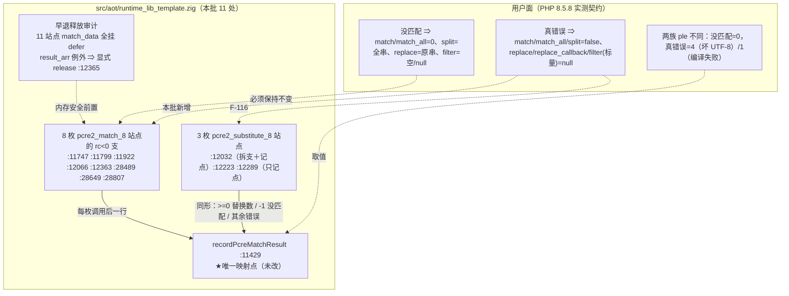
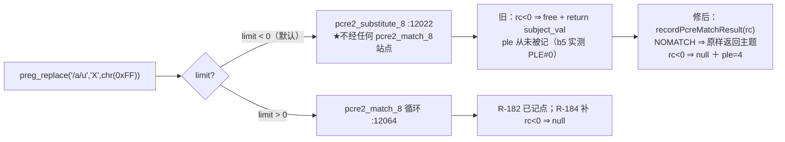
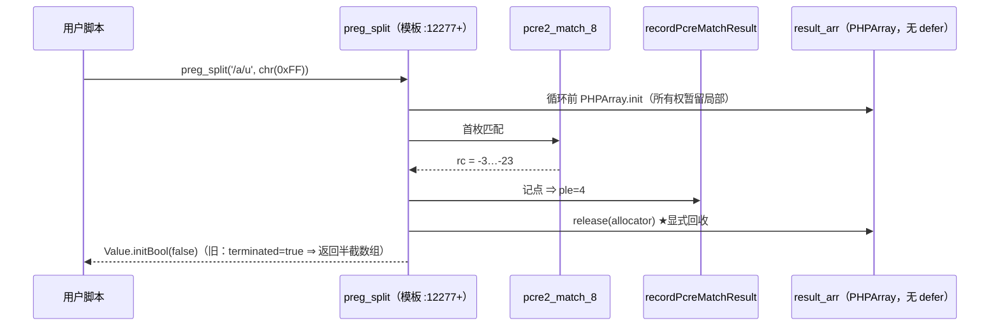

# AOT-CODEGEN-012 ｜ F-90 返回契约 ＋ F-116 substitute 记点（R-184）｜ 2026-10-19 ｜ 基线 `a5f0de5`

## 1. 高层摘要（TL;DR）

R-182 阶段①把 PCRE 错误码"记"对了，但**记完之后返回值仍然错**：坏 UTF-8 主题下 `preg_match`／`preg_match_all`／`preg_split` 该给 `false`、`preg_replace`／`preg_replace_callback`／`preg_filter`(标量) 该给 `null`，AOT 却一律**把错误当成功**——match 族返回 `0`/部分聚合结果、replace 族**原样返回主题**。而跑门时又发现一条覆盖缺口（**F-116**）：`preg_replace` 的默认 `limit=-1` 支根本不走 `pcre2_match_8`，走的是 **`pcre2_substitute_8`**，既不在记点内、又把错误与"没匹配"并成一支。

本批把这**同一支错误分岔的两半**一起收：11 处改动全部落在模板，8 枚 match 站点的 `rc<0` 支按实测型别拆开（`NOMATCH` 保持原契约值／真错误给各函数自己的 false 或 null），3 枚 substitute 站点补进同一映射点并拆支；落地前逐函数核掉**早退释放**（唯一没有 `defer` 的 `result_arr` 显式 `release`）。

冒烟九形（含三形守卫）PHP 与 AOT **逐字相同**；四腿验收读数见 §6。

## 2. 影响范围

| 维度 | 内容 | 状态 |
|---|---|---|
| 语义面 | 坏 UTF-8 主题：`preg_match`／`match_all`／`split` ⇒ `false`；`preg_replace`／`replace_callback`／`filter`(标量) ⇒ `null`；两族均 `preg_last_error()=4`＋**零诊断** | 已实测（§87.3 九形逐字同） |
| 语义面（未动） | `preg_filter`(数组主题)⇒数组、`preg_grep`⇒数组 三支**现状即合契约**，本批**只补记点不改返回值** | 已实测（`b7/b8/b10` 修前已 SAME） |
| 失败面 | 循环内真错误不再"聚合半截当成功返回"⇒ 整调用出参；`preg_split` 的部分结果显式释放 | 已实测（`#D#false`） |
| 模式面 | **AOT-only**（改动全在 `src/aot/runtime_lib_template.zig`，解释／字节码／JIT 不读此模板）⇒ 不触宪法 §五，无需裁决 | 已确认 |
| 发射面 | 纯模板批 ⇒ 判据为**影子必须中性**（`main.zig` 逐字节不变），与"名字表批必然漂移"两档禁互套 | 待 §6 读数 |
| 编译器二进制 | 不变（`bin e21ba239…` 与 R-183/R-182 同值） | 已实测（`SRC_ASSERT_OK`） |

## 3. 核心变更

| # | 站点（R-184 代次行号） | 变更 | 依据 |
|---|---|---|---|
| 1 | `:11747` | `preg_match`（无出参）：真错误 ⇒ `initBool(false)`（旧 `initInt(0)`） | §80.4 c114 实测表 |
| 2 | `:11799-11802` | `preg_match`（带 `matches_ref`）：真错误 ⇒ `false`，出参槽仍空数组 | 同上＋本函数既有早退形制 |
| 3 | `:11922-11924` | `preg_match_all`：循环内真错误 ⇒ **整调用** `false` | 旧：`break` 后把已聚合的部分结果当成功返回 |
| 4 | `:12066` | `preg_replace`（`limit>0` 循环）：真错误 ⇒ **整调用** `null` | 与 R-176 编译失败支同型别 |
| 5 | `:12363-12367` | `preg_split`：真错误 ⇒ `false` ＋ **`result_arr.release(allocator)`** | ★本函数 `result_arr` 无 `defer`（正常路径靠 `initArray` 移交所有权）⇒ 唯一需显式释放的早退 |
| 6 | `:28489`／`:28649` | `php_preg_match`／`php_preg_match_all` 孪生支同语义改动 | §66.2-2（重复键未决不因此改变，但双支必须同语义） |
| 7 | `:28807` | `php_preg_replace_callback`：真错误 ⇒ `null` | 实测契约 |
| 8 | `:12032-12044` | ★**F-116 两半**：`preg_replace` 的 substitute 支补 `recordPcreMatchResult(rc)` ＋ 拆 `NOMATCH`⇒原样返回主题／真错误⇒`null` | 门臂 `b5` 实测 AOT `PLE#0`＋string vs PHP `NULL`＋`ple=4` |
| 9 | `:12223`／`:12289` | `preg_filter` 数组形／标量形 substitute：**只补记点** | 返回契约两支现状已合实测 ⇒ 改它＝无据改语义 |

★落地方式：`c135_land_f90_f116_r184_tmp.py`——11 处 `(old,new)` **各断言恰命中一次**，任一不命中即整体不落盘；自查三数互洽（`pcre2_match_8(` 12＝11 调用＋1 extern、`pcre2_substitute_8(` 4＝3＋1、记点行 14＝11＋3）。
★自查抓到的一处自坏：脚本第 3 条漏 `% F90` ⇒ 源码注释里落进字面 `%s`，由 `grep -n "%s"` 捕后单点修——**"脚本跑成功"不等于"产出内容正确"**。

## 4. 可视化概览

### 4.1 分层：一处分岔、两半收口（Code & Logic Map）

### 4.2 `preg_replace` 的两种失败路（为何 F-116 会漏）

### 4.3 执行流（一次坏 UTF-8 的 `preg_split`）

## 5. 详细分析

### 5.1 涉及文件

| 文件 | 变更 | 代次 md5 |
|---|---|---|
| `src/aot/runtime_lib_template.zig` | 11 处（8 match 分支＋3 substitute 站点），含 1 处显式释放 | **`06d94a1e8d50fde18cef3614c04030a1`**（★R-182 档 `f94d1701…` 转历史） |
| `native_linker.zig`／`ir_generator.zig`／`optimizer.zig`／`parser.zig` | 一字未动（链头 md5 断言） | `322409ce…`／`1de4fbdb…`／`36f354f4…`／`70e80f18…` |
| 门与工具 | `c093_perr_prefix_R184_snapshot_tmp.tsv`（修前基线，md5 `4feacd77…`，32 行）、`c135_land_f90_f116_r184_tmp.py`、`c136_f90_smoke_r184_tmp.php`、`c137_accept_r184_tmp.sh` | — |
| 文档 | 工单 §87（§87.1 早退安全取证／§87.2 清单／§87.3 冒烟／§87.4 锚与判据）＋本文档 | — |

### 5.2 契约表（本批按支落地的实测依据）

| 函数 | 没匹配（`NOMATCH`） | 主题坏 UTF-8 | 编译失败（R-176 已落） | ple |
|---|---|---|---|---|
| `preg_match`／`preg_match_all` | `0` | **`false`** | `false`＋Warning | 4／1 |
| `preg_split` | 全串单元素数组 | **`false`** | `false`＋Warning | 4／1 |
| `preg_replace`／`preg_replace_callback` | 原样返回主题 | **`null`** | `null`＋Warning | 4／1 |
| `preg_filter`（标量主题） | `null` | `null`（同支，不动） | `null` | 4／1 |
| `preg_filter`（数组主题）／`preg_grep` | 数组 | 数组（本批未动返回值） | grep⇒`false` | 4／1 |

## 6. 影响与风险评估

- **是否破坏式变更：语义上是"把错误当成功"改为按 PHP 出参**——凡此前依赖 AOT 静默行为的语料会看到差异；但主回归与门均按实测契约判定（见 §7 读数）。
- **内存安全：本批唯一的真实风险点。** 已核：11 枚站点 `match_data` **全挂 `defer`**；`all_matches`/`result_buf`/`result` 亦挂 `defer`；只有 `preg_split` 的 `result_arr` 靠所有权移交 ⇒ 错误支显式 `release(allocator)`（仓内 137 处同类先例）。
- **性能：无新分配、无新锁。** 每枚调用多一次整数比较链与一次 `threadlocal` 写；错误支改早退后**少做**了后续聚合（错误路径更快）。
- **需要特别注意的点：**
  1. "没匹配"与"真错误"**必须两支不同值**——把两者合并是 F-90/F-116 的共同根因；反向亦然：把"没匹配"错改成 `false` 会立刻在门守卫 `g2`（`/zq/` 无匹配）上爆红。
  2. 孪生支（带 `flags`/`offset` 的 `php_preg_*` 与主支）存在 `builtin_map` 重复键（**F-102**， winner 库层面未定）⇒ **两支必须同语义**，只改一侧会随代次漂移。
  3. `preg_last_error()` 只反映本进程最后一次 PCRE 执行 ⇒ 复测一形一进程。
  4. 码 **3/5/6 的 msg 文案仍未取证**（本机不可触发）；`preg_last_error_msg()` 尚未派发（阶段② #130）。
- **复测路径：** ① `timeout 10 php fuzzy_scripts_720/tmp/c136_f90_smoke_r184_tmp.php` 与同名 AOT 产物对读九行；② `TSV_OUT=… timeout 2700 bash c093_preg_error_gate_tmp.sh` 看 `same/diff` 与 `C093PERR_DONE`；③ `bash c137_accept_r184_tmp.sh` 四腿。

## 7. 遗留问题

| 项 | 内容 | 记账 |
|---|---|---|
| F-91 剩余两半 | `preg_last_error_msg()` 未派发（`e1`／`m1…m5`）；PCRE 自述 4 枚常量未补（`e4`，需新 `extern pcre2_config_8`） | #130／§86.5-1 |
| 判据 | 残余红面应为 **7 枚**（`e1 m1-m5 e4`）＝上述两笔账；`b*`／`k*` 族全绿 ⇒ F-90／F-116 关闭 | §87.4 读数 |
| 未覆盖面 | `pcre2_jit_*`／`pcre2_dfa_match` 等**尚未接入**，若接入须同批进映射点（本批教训：站点清单要按库前缀 `pcre2_` 普查，不是按单个函数名） | §86.7 |
| 链与影子读数 | ★**已收口**（`c137_accept_r184_tmp.log`，22:36，四腿同代次 `tpl=06d94a1e…`）：门 PERR `arms=32 same=25 diff=7 compile_fail=0 bad_probe=0`（上一档 `same=18 diff=14`）；逐臂 join `arms_old=32 arms_new=32 only_old=[] only_new=[]`＋`DIFF→SAME=7`、`DIFF→DIFF=7`、`SAME→SAME=18`、**`SAME→DIFF=0`**；守卫 `g1/g2/g3/e5` 全 SAME；主回归 `rc=0 wall=859s` `68/67/1` 无 Fail；影子 `rc=0 wall=1139s`＋`changed_rows=0 col_identical=yes` | ✅ 判据全达 |
| ★残余红面 | **`e1 m1 m2 m3 m4 m5 e4`＝7 枚**，与预登记逐枚吻合＝#130（未派发）＋§86.5-1（PCRE 自述常量）两笔账；**`b*`／`k*` 两族全绿** ⇒ **F-90 与 F-116 关闭** | 无新增未知红面 |
| 提交状态 | R-182 阶段①＋R-184（本批）两枚改动**均未提交**（模板一枚）；提交需老铁明示 | — |

## 8. 后续开发／优化建议

| 优先级 | 建议 | 影响面 | 落地成本 |
|---|---|---|---|
| P0 | 阶段②#130：`preg_last_error_msg` 进 `builtin_map`＋`builtin_function_map`（两行表项＋shim），走 ⑤a/⑤b/⑤c 漂移三判据 | `e1`＋`m1…m5` 共 6 臂；影子必然整体漂移（与两档中性判据分开） | 中（含一次影子对照腿 ≈1122 s） |
| P1 | PCRE 自述 4 枚常量：新增 `extern pcre2_config_8`（照 `:11343/:11357` 单行形制），版本串动态取，禁硬编码 | `e4` 一枚臂 | 低-中（新外链，单独成批便于回退） |
| P1 | 给门 PERR 补 substitute 族臂（`b11…b13`：`limit>0`／数组模式／`PREG_REPLACE` 计数形），守住 F-116 不再复辟 | 覆盖本轮新改的三支 | 低（门成本实测 32 臂仅 259 s） |
| P2 | 把 `preg_*` 的"没匹配 vs 真错误"双支形态抽成**同一支内联范式**（现 8＋3 处各写一遍），后续新函数照范式落地，减少再次漏支 | 可维护性；★注意别顺手改语义 | 中（需逐函数等价性实测） |
| P2 | 阶段③：42 腿母链全量跑（含 SUPA/LVAL/UNDEF 等邻居档），并回填 `c116` 三锚为新代次 | 邻居不回退证明 | 低（换锚＋开链 ≈1 h） |
