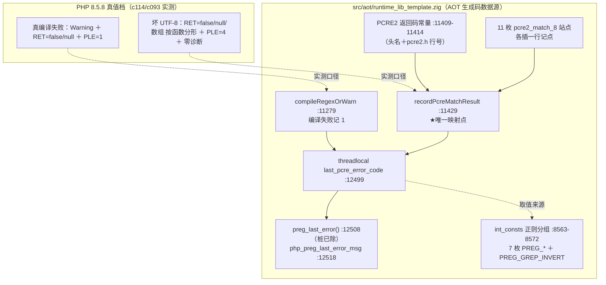
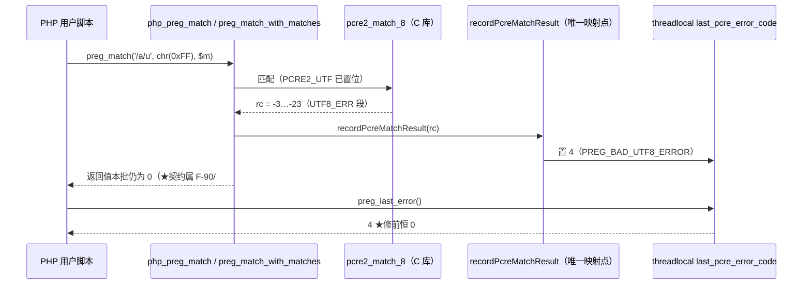
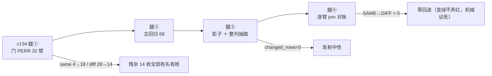

# AOT-CODEGEN-012 ｜ F-91 错误码记点与单点映射落地（R-182 阶段①）｜ 2026-10-19 ｜ 基线 `a5f0de5`

## 1. 高层摘要（TL;DR）

AOT 侧 `preg_last_error()` 此前是**一枚恒返 0 的桩**（工单 **F-91**），PCRE2 的任何运行期错误（主题坏 UTF-8、匹配上限、递归上限、JIT 栈上限）在用户面**完全隐形**；与之配对的 **F-90**（坏 UTF-8 应返回 `false`/`null`）也一直没有码可依据。

本批落 **R-182 阶段①的错误码面**：在纯模板 `runtime_lib_template.zig` 内建立**唯一映射点** `recordPcreMatchResult`（`:11429`），把 **11 枚 `pcre2_match_8` 站点**各接一行记点、把 **编译失败**在 `compileRegexOrWarn` 单点记 `1`，并把桩 `preg_last_error()` 改为读 `threadlocal` 状态位、新增 `php_preg_last_error_msg`；常量表补 **7 枚 `PREG_*` 错误码＋`PREG_GREP_INVERT`**。

验收四腿同代次全绿：主门 **PERR `same 4→18`／`diff 28→14`，`SAME→DIFF=0`（零回退）**、主回归 **68/67/1 无 Fail**、影子 **`changed_rows=0 ∧ col_identical=yes`**（纯模板批＝发射中性）、四枚守卫臂 `g1/g2/g3/e5` 全绿。
★过程中新捕一枚缺陷 **F-116**（`pcre2_substitute_8` 三枚站点不在记点覆盖内，把失败吞成"原样返回主题"）——站点清单当年按 `grep pcre2_match_8` 定，天然漏了同族另一枚函数。

## 2. 影响范围

| 维度 | 内容 | 状态 |
|---|---|---|
| 语义面 | 坏 UTF-8 主题 ⇒ `preg_last_error()` 由恒 `0` 变 **`4`**；真编译失败 ⇒ 由恒 `0` 变 **`1`**；命中/未命中 ⇒ 明确落 `0` | 已实测（PERR `b*`／`k*` 族 14 臂转绿） |
| 观测面 | `PREG_NO_ERROR/PREG_INTERNAL_ERROR/PREG_BACKTRACK_LIMIT_ERROR/PREG_RECURSION_LIMIT_ERROR/PREG_BAD_UTF8_ERROR/PREG_BAD_UTF8_OFFSET_ERROR/PREG_JIT_STACKLIMIT_ERROR/PREG_GREP_INVERT` 由"未定义"变已定义 | 已实测（`e2/e3/e5` 三臂 SAME） |
| 模式面 | **AOT-only**：模板只进 AOT 生成码；解释／字节码／JIT 三模式不读这枚模板 ⇒ 无跨模式扩散（不需老铁裁） | 已确认（改的是 `src/aot/*` 数据源） |
| 发射面 | `main.zig` 文本**逐字节未变**（68 份影子列 md5 与 R-183 同值） | 已实测（`changed_rows=0`） |
| 编译器二进制 | 未变（`bin e21ba239…`）——模板在 AOT 期从磁盘读入，不参与编译器构建 | 已实测（`SRC_ASSERT_OK`） |
| **未覆盖** | `preg_last_error_msg()` 派发（阶段②）、PCRE 自述 4 枚常量、**F-90 返回值契约**、**F-116** substitute 面 | 显式遗留，见 §7 |

## 3. 核心变更

| # | 站点（本代次行号） | 变更 | 依据 |
|---|---|---|---|
| 1 | `runtime_lib_template.zig:8563-8572` `int_consts` | 补 7 枚 `PREG_*` 错误码＋`PREG_GREP_INVERT=1`；★同批更正"8 枚错误码"的口径错（真值里错误码 7 枚，第 8 枚是 flag） | PHP 8.5.8 实测 `defined()` 面 |
| 2 | `:11409-11414` | 新增 6 枚 PCRE2 运行期返回码常量，逐枚带 `/opt/homebrew/include/pcre2.h` 行号（`UTF8_ERR1 :355`／`ERR21 :375`／`JIT_STACKLIMIT :410`／`MATCHLIMIT :411`／`DEPTHLIMIT :417`） | AGENTS §四 禁硬编码；工单 §82.1-2 |
| 3 | `:11429` `recordPcreMatchResult` | **唯一映射点**：`rc>=0 ∪ NOMATCH`⇒`0`；`-3…-23`⇒`4`；`-47`⇒`2`；`-53`⇒`3`；`-46`⇒`6`；其余负值兜底`1`（★`BADOFFSET -33` 按实测落 1，不按常量名直觉落 5） | 工单 §80.2 更正 2 |
| 4 | `:11744 :11792 :11913 :12046 :12191 :12252 :12329 :12425 :28456 :28614 :28769` | 11 枚 `pcre2_match_8` 调用后**各插一行记点**，站点实参原形不动 | 工单 §86.1 形制偏离登记 |
| 5 | `:11279`（`compileRegexOrWarn` 失败支） | 编译失败单点记 `1`，9 个调用点不再各写 | F-79d 实测 ple=1 |
| 6 | `:12490-12521` | `preg_error_*` 常量组＋`threadlocal last_pcre_error_code`（形制照本仓 JSON 先例）＋桩 `preg_last_error()` 改读状态位＋新增 `php_preg_last_error_msg` | 工单 §82.1-5；码 3/5/6 本机不可触发 ⇒ 文案明写"未取证" |

## 4. 可视化概览

### 4.1 分层与映射点（Code & Logic Map）



### 4.2 一次 `preg_match` 的执行流（记点如何落到用户面）



### 4.3 判据链（本批四腿，全同代次 `tpl=f94d1701…`）



## 5. 详细分析

### 5.1 涉及文件（本批唯一动过的生产源＝模板）

| 文件 | 变更 | 代次 md5 |
|---|---|---|
| `src/aot/runtime_lib_template.zig` | 常量表＋PCRE2 返回码常量＋映射点＋11 枚站点记点＋编译失败记点＋状态位与两枚 API | **`f94d1701e3f5ae0c6d1f67198b9f6eb4`**（★下批锚；R-183 档 `42875c50…` 转历史） |
| `src/aot/native_linker.zig` / `ir_generator.zig` / `optimizer.zig` / `src/compiler/parser.zig` | **一字未动**（`c134` 逐枚 md5 断言） | `322409ce…`／`1de4fbdb…`／`36f354f4…`／`70e80f18…` |
| 门与工具 | `c132_insert_recorder_r182_tmp.py`（幂等插点器，按语句边界定位）、`c133_ple_smoke_r182_tmp.php`（冒烟）、`c134_accept_r182_tmp.sh`（四腿串行验收）、`c093_perr_postR182_stage1_tmp.tsv`（★修后快照，**未覆写唯一修前基线**） | — |
| 文档 | 工单 §86（§86.1 形制偏离／§86.2 五处落地／§86.3 冒烟／§86.4 代次锚／§86.5 未做两支／§86.7 新立 F-116／§86.8 验收终局）＋本变更文档 | — |

### 5.2 ★形制偏离：为什么不是 §82.1-3 原写的 `pcreMatch` wrapper

11 枚站点**并不同形**（§84.11 危险清单在落地时兑现）：返回名两样（`rc`×9／`rc_check`×2）、5 枚跨多行、偏移实参五种写法、subject 取指针两样、`match_data` 由各站点自有并 `defer` 释放。
改成 wrapper＝同时要重写 11 处实参与所有权交接。⇒ 保留"映射只发生在一处"这条**目的**，把**手段**换成"站点原形＋调用后一行记点"。插点用幂等脚本机械定位（守卫：站点数≠11 或已有记点即中止），完成后逐枚回读确认记点行落在**调用之后、任何 `rc` 使用之前**。

### 5.3 关键实测读数

```php
// fuzzy_scripts_720/tmp/c133_ple_smoke_r182_tmp.php（冒烟，单形单进程）
$R = preg_match('/a/u', chr(0xFF), $m);
echo "#RET#", var_export($R, true), "#T#", gettype($R), "#PLE#", preg_last_error(), "#NH#", count($e), "#\n";
```

| 侧 | 读数 |
|---|---|
| PHP 8.5.8 | `#RET#false#T#boolean#PLE#4#NH#0#` |
| AOT 修前 | `#RET#0#T#integer#PLE#0#NH#0#` |
| AOT 修后 | `#RET#0#T#integer#PLE#4#NH#0#` ← **`#PLE#` 面合**，`#RET#` 面留 F-90 |

门 PERR 逐臂转移：`DIFF→SAME=14`、`DIFF→DIFF=14`、`SAME→SAME=4`、`SAME→DIFF=0`；`compile_fail=0 parse_fail=0 bad_probe=0`；残余 `b1 b2 b3 b4 b5 b6 e1 b9 m1 m2 m3 m4 m5 e4`。

## 6. 影响与风险评估

- **是否破坏式变更：否。** 影子 68 份 `main.zig` 逐字节未变；主回归 `68/67/1` 无 Fail；`SAME→DIFF=0` 由 join 恒等式机械证死。
- **新增运行期成本：可忽略且可实测。** 每次 PCRE 执行多一趟比较链（最坏 5 次整数比较）＋一次 `threadlocal` 写；无分配、无锁、无 `allocator` 交接。记点写的是 `threadlocal`⇒与执行流不串味（形制照 JSON 侧既有先例）。
- **需要特别注意的点：**
  1. `preg_last_error()` 只反映**本进程内最后一次** PCRE 执行 ⇒ 复测必须一形一进程（门 PERR 就是一只臂一次编译）；连测多形再读码必然读到末形的码。
  2. 码 **3/5/6 的文案未经取证**（本机不可触发），现落 `Internal error` 兜底并在码旁注明——★不得伪称已按 PHP 文案实现。
  3. `e5` 反向守卫守的是"`PREG_BAD_PATTERN_ERROR` 在 PHP 8.5.8 **不存在**"：下批补 PCRE 常量时若顺手把它"补齐"，该臂会红，那是**补错了**而不是门坏了。
  4. 影子判据分档：**纯模板批⇒必须 `changed_rows=0`**；**阶段②（动 `builtin_map` 名字表）⇒必然整体漂移**（`native_linker.zig:1829` 把名单嵌进每份 `main.zig`）。两档判据禁互套。
- **复测路径（体验流程）：**
  1. `TSV_OUT=fuzzy_scripts_720/tmp/c093_perr_postfix_tmp.tsv timeout 2700 bash fuzzy_scripts_720/tmp/c093_preg_error_gate_tmp.sh`（看 `same/diff` 与 `C093PERR_DONE`）；
  2. `timeout 60 php fuzzy_scripts_720/tmp/c133_ple_smoke_r182_tmp.php` 与同名 AOT 产物对读 `#PLE#`；
  3. `bash fuzzy_scripts_720/tmp/c134_accept_r182_tmp.sh`（四腿串行，含代次锚与逐臂对账）。

## 7. 遗留问题

| 项 | 内容 | 记账 |
|---|---|---|
| F-91 未整体闭 | `preg_last_error_msg()` 未进派发（`e1`＝`false`、`m1…m5` 的 `MSG##0 {main}` 是"未定义函数 fatal"外溢）；PCRE 自述 4 枚常量（`PCRE_VERSION/PCRE_JIT_SUPPORT/MAJOR/MINOR`）未补，须先声明 `extern pcre2_config_8` 动态取值 | 工单 §86.5-1、任务 **#130** |
| **F-90** | 8 枚 match 站点的 `rc<0 ∧ ≠NOMATCH` 分支仍吞成"没匹配"（`b1 b2 b3 b4 b9`）；`:12191/:12252/:12425` 三枚现状即合契约、**禁动** | 任务 **#106/#129**（★涉循环体早退释放，属内存安全改动） |
| **F-116（本批新立）** | `pcre2_substitute_8` 三枚站点（`:12022 :12201 :12265`）不在记点覆盖内，且把错误吞成"原样返回主题"（`b5` 实测 `PLE#0`＋返回 string） | 工单 §86.7、任务 **#131** |
| 未做的原因（禁当已完成） | substitute 记点若本批补＝换模板代次，正在跑的回归／影子两腿会与主门不同代次 ⇒ 读数不可比；按"四腿同代次"纪律推后与 #129 同批 | §86.7 末段 |
| 变更文档定档 | 本文档随阶段①出；阶段②③（派发＋42 腿全链）完成后需再出一份并把 §83.6/§86.6 口径升为定档 | 待 R-182 后续批 |

## 8. 后续开发／优化建议

| 优先级 | 建议 | 影响面 | 落地成本 |
|---|---|---|---|
| P0 | **R-184＝#129＋#131 同批**：8 枚 match ＋ 3 枚 substitute 站点的错误分支按实测拆 `NOMATCH`／真错误，并把 substitute 三枚接进唯一映射点；逐函数核对循环体早退路径上的 `match_data`/`ArrayList` 释放 | F-90 整枚＋`b1-b6/b9` 转绿；纯模板批⇒影子必 `changed_rows=0`，判据可复用本批 `c134` | 中（11 站点分支改写＋逐函数释放审计，约一轮链） |
| P0 | **阶段②#130**：`preg_last_error_msg` 进 `builtin_map`＋`builtin_function_map`；★同批必走 ⑤a（5 枚代表形逐枚 diff 恰为一行新增）＋⑤b（`changed_rows==67` 且新列重登记）＋⑤c 反向对照 | 6 臂（`e1`＋`m1…m5`）；影子必然整体漂移，误用本批判据会把正常落地打成越界 | 中（两行表项＋一次影子对照腿） |
| P1 | PCRE 自述 4 枚常量：新增 `extern pcre2_config_8`（照 `:11343/:11357` 单行形制），版本串按 `pcre2_config_8(11, buf)` 返回长度判定，**禁硬编码 `'10.47 2025-10-21'`** | `e4` 臂；风险＝新外链，须单独成批以便失败可回退 | 低-中 |
| P1 | 把"站点普查"从**按函数名 grep** 升级为**按库调用族 grep**（`grep pcre2_` 全量列形）——本批 F-116 正是 `grep pcre2_match_8` 漏掉同族 `pcre2_substitute_8` 造成的 | 预防同类覆盖缺口（后续 `pcre2_jit_*`、`pcre2_dfa_match` 若接入同理） | 极低（一次性普查） |
| P2 | 阶段③按 42 腿全链跑（R-181f107 之后母链已含 SUPA），并把 `c116` 的 `EXPECT_TPL` 换成本批 `f94d1701…`、`nlk` 仍 `322409ce…` | 全量邻居复证 | 低（换锚＋开链，链约 1 h） |
| P2 | 门 PERR 实测 32 臂仅 259 s ⇒ 成本假设已被自己的数否证；可放心扩臂（如 substitute 族的 `b11-b13`） | 覆盖 F-116 修复面 | 低 |
